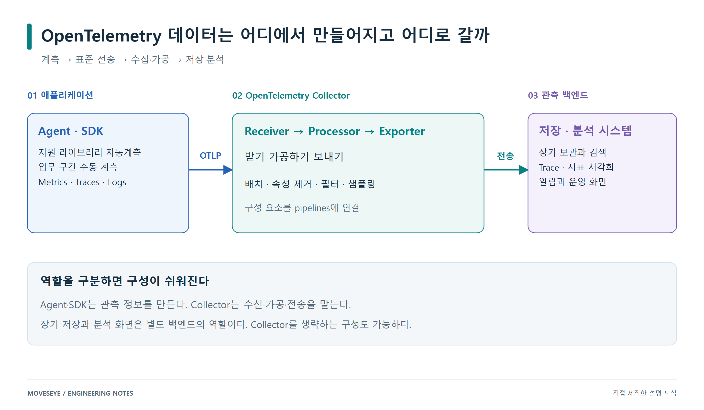
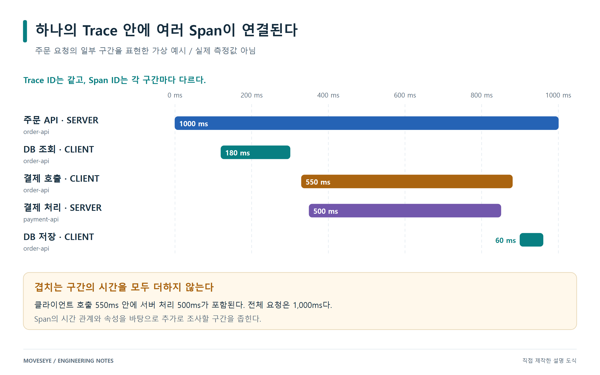

# OpenTelemetry로 이해하는 애플리케이션 관측의 기본

사용자가 “주문 버튼을 눌렀는데 한참 기다려야 한다”고 말한다. 서버는 살아 있고 CPU 사용률도 높지 않다. 애플리케이션 로그에는 요청이 들어왔다는 기록이 있지만, 어디에서 시간이 걸렸는지는 바로 알기 어렵다.

이때 필요한 것은 요청의 흐름을 따라갈 수 있는 정보다. 얼마나 많은 요청이 느려졌는지, 특정 요청이 어떤 서비스를 거쳤는지, 그 과정에서 어떤 사건이 발생했는지를 함께 볼 수 있어야 한다.

OpenTelemetry는 이런 관측 데이터를 만들고 수집하며 전달하기 위한 오픈소스 표준과 도구 모음이다. 흔히 **OTel**, 한국어로는 **오텔**이라고 부른다. 이 글에서는 Metrics, Traces, Logs를 중심으로 OTel의 구성 요소와 데이터가 이동하는 과정을 살펴본다.

## OpenTelemetry가 담당하는 범위

관측 가능성, 즉 Observability는 시스템이 내보내는 정보를 통해 내부 상태를 이해할 수 있는 능력이다. OTel은 애플리케이션에서 필요한 정보를 계측하고, 일관된 형식으로 외부에 전달하는 기반을 제공한다.

OTel 자체에 장기 저장소와 완성된 분석 대시보드가 모두 포함되는 것은 아니다. 데이터를 어디에 보관하고 어떻게 검색·시각화할지는 별도의 관측 백엔드가 맡는다. 따라서 OTel을 도입할 때는 계측·수집 경로와 저장·분석 시스템을 함께 설계한다. [OpenTelemetry 공식 개요](https://opentelemetry.io/docs/what-is-opentelemetry/)



*그림 1. Collector를 사용하는 대표적인 구성. SDK가 호환되는 백엔드에 직접 전송하는 구성도 가능하다.*

표준을 사용하면 수집 목적지를 바꾸거나 여러 시스템에 데이터를 보내기 쉬워진다. 다만 백엔드마다 조회 방식, 지원 신호, 저장 정책은 다를 수 있다. 전송 형식을 맞추는 일과 제품의 기능을 동일하게 만드는 일은 구분해서 생각해야 한다.

## Metrics와 Traces와 Logs가 답하는 질문

세 가지 데이터는 같은 애플리케이션을 서로 다른 관점에서 설명한다.

| 데이터 | 주로 답하는 질문 | 예시 |
|---|---|---|
| Metrics | 전체적으로 어떤 변화가 생겼는가? | 요청 처리량, 오류율, 응답 시간 분포, JVM 메모리 |
| Traces | 특정 요청이 어디를 거쳤고 어디에서 시간을 썼는가? | 주문 API → DB 조회 → 결제 서비스 호출 |
| Logs | 특정 시점에 어떤 사건이 발생했는가? | 결제 응답 timeout, 재시도, 처리 실패 사유 |

예를 들어 주문 API의 지연이 증가했다면 Metrics로 변화의 시점과 규모를 먼저 확인할 수 있다. 이후 느린 요청의 Trace에서 결제 호출 구간을 살펴보고, 같은 요청과 연결된 Log에서 timeout 메시지를 찾을 수 있다. 이 연결을 이용하려면 계측과 로그 연동, 백엔드의 탐색 기능이 함께 갖춰져 있어야 한다. [OTel의 관측 신호](https://opentelemetry.io/docs/concepts/signals/)

Metrics를 읽을 때 평균만으로 판단하지 않는 것도 중요하다. 대부분의 요청은 빠르지만 일부가 매우 느리면 평균이 문제를 충분히 드러내지 못할 수 있다. p95는 관측값의 약 95%가 그 이하에 놓이는 지점을 뜻한다. 값을 구간별 건수로 묶는 Histogram으로 계산하는 경우에는 구간의 경계와 계산 방식에 따른 추정값이다.

## Trace는 요청의 흐름이고 Span은 작업의 구간이다

Trace는 하나의 요청이나 작업이 실행되는 흐름을 나타낸다. 그 안의 개별 작업 구간을 Span이라고 부른다. HTTP 요청 처리, DB 쿼리 호출, 외부 API 호출 등이 각각 Span으로 기록될 수 있다.

Span에는 시작·종료 시각, 작업 이름, 속성, 부모 Span과의 관계 등이 담긴다. 같은 Trace에 속한 Span은 Trace ID를 공유하고, 각 Span은 자신의 Span ID를 가진다. Span은 함수마다 자동으로 생성되는 것이 아니라 계측한 경계와 작업에 대해 생성된다. [Trace와 Span](https://opentelemetry.io/docs/concepts/signals/traces/)



*그림 2. 개념 설명을 위한 가상 Trace. 실제 서비스의 측정 결과가 아니며 일부 작업 구간만 표현했다.*

그림에서 주문 API의 전체 처리 시간은 1,000ms이고, 결제 서비스에 대한 클라이언트 호출 구간은 550ms다. 결제 서버의 처리 구간 500ms는 그 호출과 겹친다. 부모와 자식 Span의 시간을 단순히 모두 더하면 중복 계산이 된다.

또한 클라이언트 호출이 길었다는 사실만으로 결제 서버의 특정 함수가 원인이라고 확정할 수는 없다. 서버 처리뿐 아니라 네트워크, 연결 대기, 재시도 등 관련 정보를 더 확인해야 한다. Trace는 조사할 구간을 좁혀 주는 근거다.

## 여러 서비스를 하나의 요청으로 연결하는 방법

주문 서비스와 결제 서비스가 각각 Span을 만들기만 하면 두 기록이 자동으로 같은 요청이 되는 것은 아니다. 호출하는 쪽의 추적 정보를 받는 쪽에 전달해야 한다. 이 과정을 **Context propagation**, 즉 컨텍스트 전파라고 한다.

HTTP에서는 W3C Trace Context의 `traceparent` 헤더가 대표적인 전달 수단이다. 보내는 쪽이 추적 정보를 헤더에 넣고, 받는 쪽이 이를 읽어 자신의 Span을 연결한다. 아래는 헤더 구조를 설명하기 위한 표기다.

```text
traceparent: <version>-<trace-id>-<parent-id>-<trace-flags>
```

`parent-id`는 전파하는 쪽의 Span ID를 나타낸다. 실제 헤더에는 각 필드의 형식에 맞는 값이 들어간다. SDK와 지원되는 자동계측 라이브러리는 이런 전달을 처리하지만, 자체 비동기 실행기나 사용자 정의 메시지 전달 경로는 별도 연결이 필요할 수 있다. [컨텍스트 전파](https://opentelemetry.io/docs/concepts/context-propagation/)

## Agent와 SDK와 Collector의 역할

용어를 역할별로 나누면 전체 구조를 이해하기 쉽다.

| 구성 요소 | 역할 |
|---|---|
| Instrumentation | 요청·호출·작업의 시작과 종료 등 관측할 지점을 기록한다. |
| API | 애플리케이션 코드에서 Span이나 Metric을 기록할 때 사용하는 인터페이스다. |
| SDK | API의 동작을 구현하고 데이터 처리·집계·내보내기를 설정한다. |
| Java Agent | JVM에 연결되어 지원 라이브러리와 프레임워크를 자동으로 계측한다. |
| OTLP | 관측 데이터를 전달하기 위한 프로토콜이다. |
| Collector | 여러 출처의 데이터를 수신하고 가공한 뒤 목적지로 전달한다. |

Java Agent는 애플리케이션의 바이트코드를 계측하여 HTTP 요청과 DB 호출 같은 경계에서 데이터를 얻는다. 업무 코드를 직접 수정하는 범위를 줄여 주지만, 주문 승인이나 정산 확정처럼 서비스 고유의 의미를 가진 구간은 수동 계측을 추가하면 더 잘 드러낼 수 있다. 지원 라이브러리와 버전에 따라 자동계측 범위도 달라진다. [Java Agent](https://opentelemetry.io/docs/zero-code/java/agent/)

일반적인 OTel Java Agent는 SDK와 자동 설정 기능을 함께 사용해 데이터를 처리하고 내보낸다. 자동계측을 시작하기 위해 애플리케이션 코드에서 별도의 SDK를 반드시 초기화해야 하는 것은 아니다. [Java Agent의 SDK 설정](https://opentelemetry.io/docs/zero-code/java/agent/configuration/#sdk-configuration)

Collector는 애플리케이션의 계측 Agent와 별개의 프로세스다. Collector를 서버마다 배치하는 방식을 Agent 패턴이라고 부르기도 하지만, 이것이 JVM 안에 연결하는 Java Agent와 같은 구성 요소라는 뜻은 아니다.

## Collector는 수신과 가공과 전송을 연결한다

Collector의 기본 파이프라인은 다음과 같이 이해할 수 있다.

```text
Receiver → Processor → Exporter
수신         가공          전송
```

Receiver는 OTLP 같은 방식으로 데이터를 받아들인다. Processor는 배치 처리, 속성 제거, 필터링, 샘플링 등 설정된 작업을 수행한다. Exporter는 결과를 저장·분석 시스템이나 다른 Collector에 보낸다.

설정 파일에 구성 요소를 정의하는 것만으로 동작이 시작되지는 않는다. 사용할 구성 요소를 `service.pipelines`에 연결해야 한다. Processor는 파이프라인에 적힌 순서로 처리되므로 민감값 제거와 전송, 필터링과 샘플링의 배치 순서도 검토해야 한다. 실제로 사용할 수 있는 구성 요소는 Collector 배포판에 따라 다르다. [Collector 설정](https://opentelemetry.io/docs/collector/configuration/)

OTLP는 gRPC와 HTTP 전송을 정의하며, HTTP에서는 Protobuf 바이너리와 JSON 인코딩을 사용할 수 있다. 송신기와 수신기가 같은 방식을 지원하도록 맞춰야 한다. HTTP를 사용한다는 사실만으로 본문이 일반 JSON이라는 뜻은 아니다. [OTLP 규격](https://opentelemetry.io/docs/specs/otlp/)

## 서비스 이름과 속성도 관측 설계의 일부다

여러 서비스의 데이터를 모으면 “이 데이터가 어디에서 나왔는가”를 구분할 정보가 필요하다. OTel의 Resource는 데이터를 생성한 서비스·프로세스·호스트 같은 대상을 설명한다. [Resource](https://opentelemetry.io/docs/concepts/resources/)

예를 들어 다음 값은 하나의 서비스 인스턴스를 설명한다. 실제 환경을 나타내는 값이 아니라 설명용 예시다.

```text
service.name = order-api
service.instance.id = order-api-01
deployment.environment.name = production
```

서비스 이름을 일관되게 관리해야 같은 서비스를 이어서 조회할 수 있고, 환경 정보가 있어야 개발 환경과 운영 환경을 구분할 수 있다.

Semantic Conventions는 HTTP 메서드나 서비스 이름처럼 자주 쓰이는 속성의 이름과 의미를 맞추는 규칙이다. 같은 대상을 팀마다 다른 이름으로 기록하면 검색과 집계가 어려워진다. [Semantic Conventions](https://opentelemetry.io/docs/concepts/semantic-conventions/)

Metric의 속성에는 값의 종류도 고려해야 한다. 예를 들어 경로 템플릿 `/orders/{id}` 대신 주문번호가 포함된 실제 경로를 매번 넣으면 구분되는 시계열의 수가 커질 수 있다. 이처럼 서로 다른 속성 조합의 수를 Cardinality라고 한다. 전체 추세를 보는 Metric에는 집계에 필요한 차원을 두고, 개별 요청 식별자는 Trace나 Log에서 다루는 식으로 목적을 나누는 것이 좋다. [OTel Metrics와 Cardinality](https://opentelemetry.io/docs/concepts/signals/metrics/)

## 모든 Trace를 보관할 수 없다면

트래픽이 많아지면 Trace를 저장하고 조회하는 비용도 증가한다. Sampling은 이때 보관할 Trace를 선택하는 방법이다.

| 방식 | 선택 시점 | 고려할 점 |
|---|---|---|
| Head sampling | 요청 시작 시점 | 초기에 비용을 줄일 수 있지만, 이후 오류나 지연이 생길지 모른다. |
| Tail sampling | 수집된 Span을 일정 시간 관찰한 뒤 | 오류·지연을 기준으로 선택할 수 있지만, 판정용 메모리와 대기 시간이 필요하다. |

Tail sampling을 해도 앞단에서 이미 버린 Span을 복원할 수는 없다. 여러 Collector로 분산할 때는 같은 Trace에 속한 Span이 같은 판정 지점에 모이도록 구성해야 한다. 충분히 늦게 도착하는 Span이나 용량 초과도 고려해야 한다. [Sampling](https://opentelemetry.io/docs/concepts/sampling/)

오류와 느린 Trace를 우선 보관하면 저장된 표본의 구성이 전체 요청과 달라진다. 그 표본만으로 전체 오류율을 단순 계산하면 값이 치우칠 수 있다. 전체 서비스 지표를 계산할 데이터와 개별 요청을 분석할 데이터를 구분하는 이유다.

## 작은 요청 흐름부터 확인하기

처음 적용한다면 요청 하나가 서비스 두 곳을 거쳐 DB에 접근하는 작은 흐름부터 확인하는 편이 좋다. 서비스 이름을 정하고, Agent나 SDK를 연결한 뒤, Collector와 백엔드에서 같은 Trace ID의 Span이 이어지는지 살펴본다.

이후 의도적으로 느린 응답과 오류를 만들어 관측값이 예상과 맞는지 확인한다. 데이터가 보이기 시작하면 민감한 속성, 수집량, 샘플링, 보존 기간을 조정하고 Collector 자체의 전송 실패와 큐 상태도 함께 관측한다.

OpenTelemetry를 이해하는 핵심은 데이터의 출발점과 연결 방식, 이동 경로를 이해하는 데 있다. 이 기반 위에서 어떤 질문에 답할 것인지 정하면 필요한 계측과 화면도 구체적으로 설계할 수 있다.

MovesEye에서 이 구조를 APM으로 연결한 과정은 [OpenTelemetry를 활용한 MovesEye APM 구축 이야기](solutions--02-moveseye-apm.md)에서 이어서 살펴본다.
