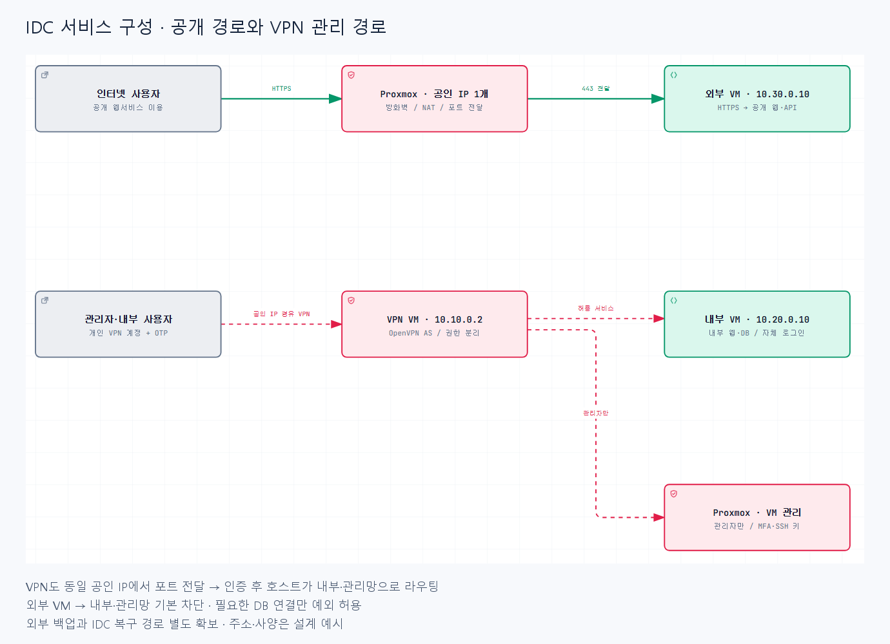
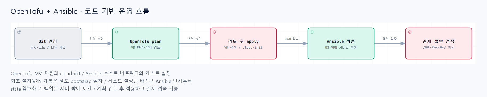

# IDC 인프라 코드 관리 설계 가이드

작성일: 2026-10-27 / 상태: 설계 초안 / 서버 설치·코드 적용: 미수행

## 목적

공인 IP 하나를 가진 IDC 서버를 Proxmox로 나누고, OpenTofu와 Ansible로 변경 이력을 남기며 운영한다. 이번 산출물은 설계 문서와 PNG 구성도이며 실행 가능한 인프라 저장소는 아직 만들지 않았다.

## 읽는 순서

1. 이 문서: 구성과 도구 역할을 빠르게 확인한다.
2. [상세 설계](solutions--01-detailed-design.md): 네트워크, 보안, 코드 구조, state와 비밀정보 관리 기준을 확인한다.
3. [설치·운영 로드맵](solutions--02-roadmap-runbook.md): 최초 구축부터 변경·복구·검증까지 실제 작업 순서를 확인한다.

## 서비스 구성

위 그림은 논리적 통신 경로다. VPN 연결도 동일한 공인 IP와 Proxmox의 DNAT를 통과한다. VPN 이후에는 호스트가 각 망으로 라우팅한다. 관리 대상에는 외부 VM의 SSH도 포함된다. DB 예외 경로는 복잡도를 줄이기 위해 생략했다.

## 코드 기반 변경 흐름

VM 사양 변경은 OpenTofu plan/apply를 거친다. VM 내부 설정만 변경하는 작업은 Ansible 단계부터 진행할 수 있다. 모든 작업에 두 도구를 무조건 실행하는 것은 아니다.

## 도구별 책임

| 대상 | 관리 도구 | 예시 |
|---|---|---|
| Proxmox 최초 설치·공인 IP·복구 경로 | 초기 수동 작업 + 문서 | ISO 설치, IDC 게이트웨이, 콘솔 |
| 호스트 브리지·라우팅·NAT·방화벽 | 별도 Ansible 호스트 playbook | vmbr1~3, 망 간 접근 정책 |
| VM 생성·CPU·RAM·디스크·NIC·cloud-init | OpenTofu | vpn, internal, external VM |
| VM 내부 OS·패키지·SSH·VPN·앱 설정 | Ansible | 계정, Docker, VPN, Reverse Proxy |
| 데이터·VM 백업 | 백업 도구 + Ansible 설정 | 외부 백업, DB 복원 |
| 변경 이력 | Git | 리뷰, 태그, 변경 근거 |
| 인증서·OTP 등록·외부 계정 | 제품별 절차 | 자동화 가능 범위는 구현 시 검증 |

같은 방화벽이나 네트워크 설정을 두 도구가 함께 수정하지 않도록 소유권을 정한다. OpenTofu가 VM NIC의 연결 브리지를 지정하고, Ansible이 호스트 브리지 자체를 관리하는 방식이다.

## 초기 규모

| 구성 | 메모리 | 가상 디스크 | 비고 |
|---|---:|---:|---|
| VPN VM | 2GB | 20GB | OpenVPN Access Server 후보 |
| 내부 VM | 16GB | 250GB | 내부 웹·DB |
| 외부 VM | 8GB | 150GB | 공개 웹·API |
| 미배정 | 나머지 | 나머지 | 호스트·캐시·증가분 |

CPU, SSD 여부, 단일 디스크 여부는 확인 전이다. 이 배분은 성능 보증이나 예약값이 아닌 시작 예시다.

## 먼저 결정할 사항

- Proxmox 버전, CPU 코어 수, 실제 SSD·NIC 구성
- 공인 IP·프리픽스·게이트웨이, IPv6 제공 여부
- IDC 원격 콘솔과 복구 지원
- VPN 사용자 수, 라이선스, OTP·재인증 정책
- VM OS와 템플릿, 저장소 이름, node 이름
- 외부 state 저장소·암호화 키 보관처·백업 저장소
- 관리자의 고정 IP 유무, 회사·가정망과 사설 IP 중복
- 백업 RPO/RTO, 공개 도메인, 서비스별 포트

## Confluence에 옮기는 방법

본문을 페이지에 붙여 넣고 images/network.png와 images/operations.png를 직접 첨부한 뒤 해당 위치에 삽입한다. 로컬 Markdown의 상대 경로는 Confluence로 자동 업로드되지 않는다. Mermaid 플러그인은 필요 없다.

## 파일 안내

- PNG: Confluence·문서 첨부용
- HTML: 확대 가능한 선택적 로컬 뷰어
- architecture.json: 도식 원본
- 검증기록.md: 이미지·HTML 검증 범위

HTML 뷰어의 고정 UI와 HTML 언어 속성은 영어로 fallback한다. 작성한 도식 내용과 문서는 한국어다.
