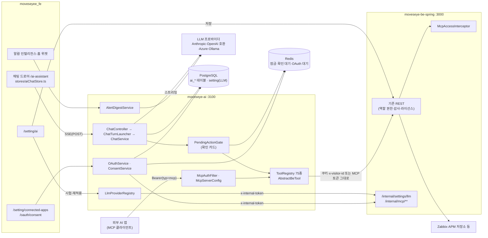

# AI 어시스턴트와 MCP 연동 기능 상세 가이드

> MovesEye 운영자가 화면을 옮겨 다니지 않고 **채팅으로 조회·설정 작업을 시키는 기능**(AI 어시스턴트)과, 사용자가 쓰는 **외부 AI 앱이 MovesEye 계정 권한으로 같은 도구를 부르게 하는 기능**(MCP 연동)을 다룬다. 범위는 채팅(드로어·전용 화면), 화면 인식과 "/" 명령, 툴 75종, 쓰기 확인 카드, 쓰기 후 화면 갱신, 엑셀 산출물, 알람 인텔리전스(알림 요약), LLM 설정과 사용량, MCP 서버·OAuth 동의·연결된 앱·계정별 MCP 권한, 숨김 상태인 AI 계정 모니터링, 다중 노드 고려 사항이다. 이 문서는 소스 정적 대조로 썼다. AI 서버(`moveseye-ai` `main` `6eef23c` + 미커밋 5파일)·BE·FE를 기동하지 않았고, 실제 LLM 호출·브라우저 렌더·외부 MCP 클라이언트 연결은 실행하지 않았다.

## 1. 한눈에 보기

| 기능 | 화면 주소·메뉴 위치 | 상태 | 권한·라이선스 | 한 줄 설명 |
|---|---|---|---|---|
| AI 어시스턴트 채팅 | 화면 우하단 플로팅 버튼(드로어) · 사이드바 AI 어시스턴트 > AI 어시스턴트 `/ai-assistant?c=<대화 id>` | 현재 | 관리자(`userRole` ADMIN·SUPER_ADMIN). 라이선스 게이트 없음 | 자연어로 조회·설정 작업을 지시한다. 답변은 스트리밍된다 |
| 화면 인식·"/" 명령·사용 가이드 검색 | 채팅 입력창, "이 화면 요약" 버튼 | 현재 | 채팅과 같음(화면·명령 조회 API는 로그인만) | 지금 보는 화면을 문맥으로 넘기고, 명령 목록으로 문장을 채운다 |
| 툴 카탈로그(75종) | 채팅 도움말(능력 안내), `GET /ai/tools` | 현재 | 실행 권한은 BE가 사용자 권한으로 판정 | BE REST를 감싼 조회 46·쓰기 25·삭제 4 |
| 쓰기 확인 카드 | 채팅 본문 안 카드 | 현재 | 대화 소유자만 승인·취소 | 쓰기·삭제 툴은 사람이 [실행]을 눌러야 실행된다 |
| 쓰기 후 화면 갱신 | 화면 전체(자동) | 현재 | — | 성공한 쓰기 툴이 알려 준 도메인의 화면 캐시만 버린다 |
| 엑셀 산출물 | 채팅 본문의 다운로드 카드·링크 | 현재 | 만든 사람만 다운로드 | 목록 전체를 엑셀로 만들어 24시간 보관한다 |
| 알람 인텔리전스 | 사이드바 AI 어시스턴트 > 알람 인텔리전스 `/ai-assistant/alert-intelligence` · 홈 위젯 "AI 알림 분석" | 현재 | 관리자 | 최근 24시간·7일 알람 집계와 AI 요약문 |
| LLM 설정·AI 사용량 | 관리 콘솔 > 데이터 소스 묶음 > AI 어시스턴트 `/setting/ai` | 현재 | 관리자 | 프로바이더·모델·키·예산 입력, 연결 시험, 사용량·추정 비용 |
| MCP 서버·OAuth 동의 | `{AI 서버}/mcp` · 동의 화면 `/oauth/consent?rid=` | 현재(설치 기본 꺼짐) | 계정별 MCP 권한(NONE·READ·READ_WRITE) + 역할 권한 | 외부 AI 앱이 내 계정 권한으로 툴을 부른다 |
| 연결된 앱·MCP 권한 부여 | ⚙ > 연결된 앱 `/setting/connected-apps` · 사용자 관리의 MCP 권한 열 | 현재(MCP가 켜진 설치본만 표시) | 연결된 앱은 모든 사용자, 권한 부여는 관리자 | 내 연결 목록·연결 끊기, 사용자별 권한 3단계 |
| AI 계정 모니터링 | `/monitoring/ai-account-usage`(라우트 정의 제외) · 홈 위젯 `ai_monitor_cost` | 보류 | 관리자 | 조직의 Anthropic·OpenAI·Claude Code 사용량 감시. FE 진입점만 숨겼고 BE·툴은 살아 있다 |
| 다중 노드 동작 | 화면 없음 | 부분 | — | 잠금·확인 대기·OAuth 대기는 Redis 공유, 대화 캐시·산출물 파일은 노드 로컬 |
| 채팅 요청 감사·AI 출처 표기 | 화면 없음(DB) | 부분 | — | 질문·처리 상태를 적재하고, BE 변경 이력에 AI 경유를 표시한다. 조회 화면은 없다 |

### 전체 구조

AI 서버(`moveseye-ai`, 기본 포트 3100)는 BE와 분리된 프로세스다. AI 서버는 자기 권한을 갖지 않는다. 브라우저가 보낸 쿠키·`x-visitor-id`(또는 MCP 토큰)를 BE로 그대로 넘겨 BE가 역할 권한·감사·라이선스를 판정한다.

## 2. 기능별 상세

### 2.1 AI 어시스턴트 채팅

**무엇을 하는가** — 관리자가 "지금 심각도 높은 문제 보여 줘", "web-01에 CPU 90% 트리거 만들어 줘" 같은 문장으로 조회와 설정 작업을 지시한다. 모델은 툴로 BE를 조회하고, 쓰기 작업은 확인 카드를 거쳐 실행한다. 사용자·권한·자격 증명·라이선스 변경은 툴에 없다.

**화면과 진입 경로**

- 플로팅 버튼(FAB): 모든 화면 우하단. 관리자이고 AI 서버 상태가 `ready`일 때만 그린다(`moveseyee_fe/src/components/ai/AiAssistantButton.tsx:47-51`). `/ai-assistant`로 시작하는 주소에서는 숨긴다. 누르면 우측 드로어가 열린다.
- 전용 화면: 사이드바 **AI 어시스턴트 > AI 어시스턴트**(`/ai-assistant`). 왼쪽에 대화 목록과 이번 달 사용량, 오른쪽에 채팅. 선택한 대화는 URL query `?c=<대화 id>`에 둔다.
- 전역 검색: `ai-assistant-chat` 항목(관리자만).
- 다른 화면의 링크: 모니터링 커버리지 화면이 `/ai-assistant?prompt=<문장>`으로 보낸다. 이 주소로 들어오면 새 대화를 만들고 그 문장을 **자동 전송**한다(`moveseyee_fe/src/pages/ai/AiAssistantPage.tsx:66-78`).
- 드로어와 전용 화면은 같은 상태 저장소를 본다. 드로어에서 시작한 턴이 전용 화면에서 이어 보인다.

**사용 방법**

1. FAB 또는 사이드바로 채팅을 연다. 빈 대화에는 현재 화면에 맞는 예시 질문 3개와 "이 화면 요약" 버튼이 나온다.
2. 입력창에 문장을 쓰고 Enter로 보낸다(Shift+Enter는 줄바꿈, 4,000자 이내).
3. 답변이 스트리밍된다. 모델이 부른 툴은 칩(이름·등급·소요 시간·결과 앞부분 400자)으로 표시된다.
4. 쓰기 작업이면 확인 카드가 뜨고 입력창이 잠긴다. 카드의 [실행] 또는 [취소]를 누른다(2.4).
5. [중단]은 진행 중인 응답을 끊는다. 드로어를 닫는 것만으로는 끊기지 않는다.
6. 전용 화면의 대화 목록에서 과거 대화를 다시 열거나 지운다. 목록은 최근 20건이다(`ai.api.ts`의 `getConversations(limit = 20)`).

**동작 원리**

- FE 상태는 React 트리 밖의 모듈 싱글턴이다(`moveseyee_fe/src/stores/aiChatStore.ts`). 라우트 그룹을 옮겨 레이아웃이 다시 마운트돼도 스트림이 유지된다. 계정이 바뀌면(`onSessionSwitch`) 대화·카드·스트림을 비운다.
- 전송은 `fetch` POST + `ReadableStream`으로 SSE를 직접 파싱한다(`moveseyee_fe/src/services/ai.api.ts`의 `streamMessage`). 요청 본문은 `{message, route?}`이고 `route`는 현재 화면 경로(pathname + `?tab=`)다. 401이면 토큰을 한 번 재발급하고 다시 보낸다.
- AI 서버 처리 순서(`moveseye-ai/src/main/java/com/dmove/moveseyeai/chat/api/ChatController.java:121-132`, `chat/engine/ChatTurnLauncher.java:40-85`):
  1. `AuthPreflight.requireAdmin` — 받은 쿠키·`x-visitor-id`로 BE `GET /users/my-profile`을 불러 사용자와 `userRole`을 확인한다. AI 서버는 인증 결과를 캐시하지 않는다.
  2. 사용자별 분당 요청 수 제한(Redis 카운터, 기본 12회/분).
  3. 대화 조회(메모리 캐시 → 없으면 DB에서 복원). 소유자가 다르면 404.
  4. 동시 실행 차단: 대화의 메모리 플래그 `busy` + Redis 잠금 `moveseye:ai:conversation-lock:<id>`(TTL 15분) + 사용자별 동시 실행 임대(기본 2개).
  5. 감사 행 기록(`ai_chat_request_audit`) 후 실행 스레드 풀(기본 20개·대기열 40)에 턴을 넣는다.
- 턴 루프(`chat/engine/ChatService.java:90-216`):
  - 사용자 메시지 앞에 `[Now: … | Answer language: … | Data sources: zabbix=UP]`와 `[Current screen: …]`을 붙인다. 시스템 프롬프트(`SystemPrompt.TEXT`)는 영어 고정이다.
  - 이번 턴에 넘기는 툴은 "중립 툴 + 연결된 데이터소스의 전용 툴"이다. 연결 상태는 BE `GET /home/system-status`의 `dataSources`를 60초 캐시한다(`tool/DataSourceStatusService.java`).
  - 모델 응답을 스트리밍하며 `text_delta`로 내보낸다. 툴 호출이 있으면 `ToolCallingManager`가 실행하고(확인 게이트·SSE 이벤트는 `AiToolCallbacks`), 결과를 붙여 다시 호출한다.
  - 한 턴의 툴 호출이 15회에 닿으면 `tool_cap`으로 끝낸다. 응답이 최대 토큰에서 잘리면 `max_tokens`, 모델 거부면 `refusal` 안내를 덧붙인다.
  - 턴이 끝나면 토큰 수와 추정 비용을 `ai_usage`에 기록하고 `done` 이벤트(라운드 수·툴 호출 수·토큰·비용·소요 시간)를 보낸다.
- 턴 종료 시 `ConversationStore.persistTurn`이 모델용 이력(HISTORY)을 통째로 교체하고 화면용 기록(TRANSCRIPT)의 새 꼬리만 추가한다. 모델용 이력은 60개 메시지를 넘으면 앞에서 자른다.
- SSE 이벤트: `text_delta{text}` · `tool_call{id,name,tier,input}` · `tool_result{id,name,error,elapsedMs,preview,invalidates?}` · `confirm_required{actionId,callId,name,tier,summary,targets?,input,timeoutSeconds}` · `confirm_resolved{actionId,decision}` · `artifact{artifactId,filename,url,sizeBytes,expiresAt}` · `done{…}` · `error{errorCode,message}`.

**주요 API** (AI 서버. FE는 BE와 같은 응답 껍데기 `{status, code, data, message}`로 받는다)

| Method | Path | 용도 | 권한 |
|---|---|---|---|
| GET | `/ai/health` | 프로바이더 상태·툴 수·`mcpEnabled`. FE 진입점 판정 | 없음(무인증) |
| GET | `/ai/tools` | 툴 목록(이름·등급·소스·설명·스키마) | 관리자 |
| POST | `/ai/conversations` | 대화 생성 | 관리자 |
| GET | `/ai/conversations?limit=` | 내 대화 목록(1~100, 기본 20) | 관리자 |
| GET | `/ai/conversations/{id}` | 대화 + 화면용 기록 | 관리자·소유자 |
| DELETE | `/ai/conversations/{id}` | 대화 삭제(진행 중이면 거부) | 관리자·소유자 |
| POST | `/ai/conversations/{id}/messages` | 메시지 전송(SSE) | 관리자·소유자 |
| POST | `/ai/actions/{actionId}/confirm` · `/cancel` | 확인 카드 응답 | 관리자·소유자 |
| POST | `/ai/dev/tools/{name}` | 모델 없이 툴 직접 실행(FE 미사용, `ai.dev.tools-endpoint-enabled=true`일 때만 등록) | 관리자 |

**데이터** (AI 서버 Flyway, 이력 테이블 `flyway_schema_history_ai`, BE와 같은 PostgreSQL)

| 테이블 | 버전 | 내용 | 보존 |
|---|---|---|---|
| `ai_conversation` | V1 | 대화 메타(`owner_key`=BE 사용자 id, 제목 40자) | 마지막 갱신 후 30일(`AI_RETENTION_DAYS`), 매일 04:17 삭제 |
| `ai_message` | V1 | `kind=HISTORY`(모델용, 턴마다 통째 교체)·`TRANSCRIPT`(화면용, 추가만), `UNIQUE(conversation_id, kind, seq)` | 대화와 함께 삭제(FK cascade) |
| `ai_chat_request_audit` | V6 | 요청별 사용자·질문 원문·노드 id·상태(RUNNING/COMPLETED/FAILED/REJECTED) | 정리 배치 없음 |
| `ai_usage` | V5 | 턴·요약별 토큰과 추정 비용(마이크로 USD) | 400일, 매일 04:41 삭제 |

**권한·라이선스**

- FE: FAB·사이드바·검색·라우트가 모두 `userRole` 관리자 축 하나를 본다(`PageWrapper adminOnly`).
- AI 서버: 채팅·툴·확인·요약 API는 `requireAdmin`으로 서버가 직접 막는다. FE 숨김에 기대지 않는다.
- 데이터 범위: 툴이 BE를 사용자 쿠키로 부르므로 BE의 역할 권한과 Zabbix 권한 범위가 그대로 적용된다.
- 라이선스: 프리미엄 feature 게이트는 없다(FE `AiAssistantButton.tsx`에 TODO만 있다).

**빈 값·실패·경계 상태**

| 상황 | 화면 | 응답 |
|---|---|---|
| LLM 미설정 | FAB 미표시, 사이드바 항목 비활성, 주소 직접 진입 시 "설정 > AI로 이동" 안내(`AiAssistantGate`) | `/ai/health` `state: unconfigured`, 전송하면 스트림의 `error{errorCode: AI_LLM_UNCONFIGURED}` |
| AI 서버 불통 | 사이드바 항목 비활성, 진입 시 [다시 확인] 버튼 | 네트워크 오류 |
| 같은 대화에 동시 전송 | 오류 말풍선 | `AI_CONVERSATION_BUSY`(409) |
| 분당 요청 초과 | 오류 말풍선 | `AI_CHAT_RATE_LIMITED`(429) |
| 동시 실행 2개 초과·실행 풀 포화 | 오류 말풍선 | `AI_CHAT_CAPACITY_EXCEEDED`(429) |
| LLM 오류 | 오류 말풍선(서버 문구 그대로) | `AI_LLM_AUTH`·`AI_LLM_MODEL_NOT_FOUND`·`AI_LLM_RATE_LIMIT`·`AI_LLM_UNAVAILABLE`·`AI_LLM_UNREACHABLE`·`AI_LLM_TIMEOUT`·`AI_LLM_BAD_REQUEST`·`AI_LLM_ERROR` |
| 툴 실패(BE 오류·입력 오류) | 툴 칩이 실패로 표시, 모델이 원인을 설명 | 모델에는 `[ERROR] …` 문자열 |
| 턴 도중 BE 세션 만료 | 툴이 인증 오류로 실패 | AI 서버는 토큰을 갱신하지 않는다 |
| 관리자 아님 | FE 404, API 직접 호출 시 거부 | `AI_FORBIDDEN`(403), 서버 로그 `AI-ACCESS-DENIED` |

**운영 주의**

- SSE 한 건의 수명 상한은 "확인 대기 시간 + LLM 타임아웃 × 4"(기본 5분 + 2분 × 4 = 13분)다(`ChatTurnLauncher.java:53`). 리버스 프록시는 버퍼링을 끄고 읽기 타임아웃을 이보다 길게 둔다.
- 서버는 SSE 하트비트를 보내지 않는다. 확인 대기 중에는 최대 5분 동안 스트림에 바이트가 흐르지 않는다.
- 브라우저 연결이 끊기면 서버는 다음 이벤트를 쓰다가 감지하고 그 턴의 실행 스레드를 인터럽트한다(4절 AI-08).
- 대화 캐시는 1시간 미사용 시 메모리에서 비운다. DB가 정본이다.

### 2.2 화면 인식, "/" 명령, 사용 가이드 검색

**무엇을 하는가** — 드로어는 다른 화면 위에 떠 있으므로 "여기 뭐가 문제야?"가 무엇을 가리키는지 모델이 알아야 한다. FE가 현재 화면 경로를 메시지마다 실어 보내고, 서버의 화면 카탈로그가 그 경로를 "무엇을 보여 주는 화면이고 어떤 툴이 그 화면을 다루는가"로 바꿔 모델에 전달한다.

**사용 방법**

- "이 화면 요약" 버튼: 현재 화면을 요약하라는 문장을 전송한다.
- 입력창 맨 앞에 `/`를 치면 명령 목록이 뜬다. 고르면 문장이 입력창에 채워질 뿐 전송되지 않는다. `{호스트}` 같은 자리표시자는 선택 상태로 둔다. 실행 경로는 일반 대화와 같다.
- "어디서 하나요?" 질문은 모델이 `search_docs` 툴로 화면 카탈로그를 검색해 메뉴 경로를 답한다.

**동작 원리**

- 화면 카탈로그: `moveseye-ai/src/main/resources/docs/screens.json` — 화면 63개, 탭 46개(코드 개수 기준). 화면마다 경로·메뉴 위치·영문 설명·그 화면을 다루는 툴·한국어 검색어를 갖는다.
- 명령 카탈로그: `resources/docs/commands.json` — 8그룹(monitoring·chart·alerts·config·asset·report·apm·guide) 32개.
- 메시지의 `route`가 카탈로그에 있으면 `[Current screen: 이름 (경로) — 설명 Tools that cover it: …]`이, 없으면 "카탈로그에 없음 — search_docs로 확인하라"는 줄이 사용자 메시지 앞에 붙는다(`ChatService.java:241-254`).
- `search_docs`는 BE를 부르지 않는 유일한 툴이다.

**주요 API**

| Method | Path | 용도 | 권한 |
|---|---|---|---|
| GET | `/ai/screens/resolve?route=` | 화면 이름·예시 질문·커버 툴. 모르는 경로도 200 `{known:false}` | 로그인 |
| GET | `/ai/commands?route=` | 명령 그룹과 현재 화면 추천(`suggested`) | 로그인 |

**운영 주의** — 화면이 생기거나 경로·탭이 바뀌면 `screens.json`을 함께 고쳐야 한다. 빠뜨려도 오류가 나지 않고 "이 화면 요약"이 상위 화면 설명으로 떨어진다.

### 2.3 툴 카탈로그

**무엇을 하는가** — 툴 하나는 BE 엔드포인트 한두 개를 감싼 얇은 프록시다(`tool/AbstractBeTool`). BE 응답에서 id·이름·상태와 핵심 필드만 뽑아 모델에 준다. 목록 툴의 반환 상한은 50건(`ai.limits.list-cap`)이다.

**개수** (2026-10-06 소스에서 `name()` 기준으로 셈. `ToolRegistry`에 등록되는 전체)

| 구분 | 개수 | 설명 |
|---|---|---|
| 전체 | **75** | |
| 등급 READ | 46 | 확인 카드 없이 실행 |
| 등급 WRITE | 25 | 확인 카드 필요 |
| 등급 DESTRUCTIVE | 4 | 확인 카드 + 대상 이름 표시 + 대상 10건 이하 |
| 소스 NEUTRAL | 40 | 데이터소스와 무관하게 노출(APM 11종 포함) |
| 소스 ZABBIX | 35 | Zabbix가 설정돼 있을 때만 채팅에 노출 |

**기능 묶음별 목록**

| 묶음 | READ | WRITE | DESTRUCTIVE |
|---|---|---|---|
| 현황·호스트 조회(10) | `get_system_status` `list_host_groups` `get_group_overview` `get_host_metrics` `list_device_classifications` `zabbix_list_hosts` `zabbix_get_host` `zabbix_list_templates` `zabbix_get_config_overview` `check_monitoring_coverage` | — | — |
| 호스트 변경(7) | — | `zabbix_create_host` `zabbix_update_host` `zabbix_set_host_status` `zabbix_set_device_type` `zabbix_link_templates` `zabbix_unlink_templates` | `zabbix_delete_host` |
| 알람(5) | `list_problems` `get_problem` `brief_problem` `list_config_changes` | `acknowledge_problem` | — |
| 아이템·트리거(11) | `zabbix_list_items` `zabbix_list_item_keys` `zabbix_list_triggers` | `zabbix_create_item` `zabbix_update_item` `zabbix_set_item_status` `zabbix_create_trigger` `zabbix_update_trigger` `zabbix_set_trigger_status` | `zabbix_delete_items` `zabbix_delete_triggers` |
| 점검 기간(3) | `list_maintenances` | `schedule_maintenance` `cancel_maintenance` | — |
| 알림 설정(9) | `check_notification_delivery` `list_media_types` `list_alert_actions` `list_user_notifications` `list_alert_action_options` | `set_media_type_status` `set_alert_action_status` `set_user_notification` `create_alert_action` | — |
| 호스트 커스텀 차트(4) | `list_host_charts` | `create_host_chart` `update_host_chart` `delete_host_chart` | — |
| 자산(7) | `list_assets` `get_asset` `get_asset_dashboard` `list_asset_data_gaps` | `update_asset` `sync_assets` | `exclude_asset` |
| 자산 비용(4) | `get_cost_dashboard` `list_cost_incomplete` `get_asset_cost` | `update_asset_cost` | — |
| 리포트·파일(2) | `create_report` `export_table` | — | — |
| 사용 가이드(1) | `search_docs` | — | — |
| APM(11) | `apm_list_services` `apm_service_status` `apm_slow_endpoints` `apm_error_groups` `apm_trace_lookup` `apm_deployments` `apm_service_map` `apm_collector_status` `apm_slo_status` `apm_synthetics` `apm_jobs` | — | — |
| AI 계정 사용량(1) | `get_ai_usage` | — | — |

**동작 원리 중 화면만 보고는 알 수 없는 것**

- 등급은 **호출 입력으로** 판정한다(`AiTool.effectiveTier`). `zabbix_unlink_templates`는 정적 등급이 WRITE지만 `clear=true`(템플릿이 만든 아이템·트리거·이력까지 삭제)면 그 호출만 DESTRUCTIVE가 된다.
- 쓰기 툴의 호출당 대상 상한: 호스트 상태 10, 아이템·트리거 상태 20, 기기 분류 50, 템플릿 연결·해제 10, 삭제 3종 10.
- `zabbix_update_host`는 BE `PUT /hosts/manage/{id}`가 전체 교체라서 먼저 단건을 읽어 되돌려 보낸다. 프록시 감시 호스트는 거부하고 화면에서 고치라고 안내한다.
- `set_user_notification`도 전체 교체 API라 읽고 병합해 보낸다.
- `schedule_maintenance`는 일회성 구간만 만든다. 반복 점검은 화면에서 만든다.
- `create_alert_action`은 최소 심각도·범위·수신자·채널만 받고 Zabbix 구조는 서버가 조립한다.
- `brief_problem`은 알람 상세·조치 이력·이전 발생·같은 시간대 다른 알람·자원 수치·직전 구성 변경을 한 번에 모은다.
- APM 툴은 데이터소스가 아니라 제품 기능이라 항상 노출된다. 라이선스 미보유·권한 없음은 BE 거부 문구를 안내문으로 바꿔 돌려준다(`tool/apm/AbstractApmTool.explain`). APM은 시각이 밀리초 에폭이고, 계약상 `null`(관측 없음)을 0으로 바꾸지 않는다.
- BE 오류는 예외가 아니라 `[ERROR] 문구 [errorCode]` 문자열로 모델에 돌아간다. 권한 거부 문구는 "역할 편집에서 해당 권한을 켜 달라"는 고정 안내로 바꾼다(`be/BeProxyClient.forbiddenMessage`).

**운영 주의**

- 새 쓰기 툴은 `invalidates()`와 (필요하면) `destructiveFlags()`를 선언해야 한다. 누락은 `InvalidationContractTest`·`DestructiveParamClassificationTest`가 잡는다.
- 툴의 BE 필드 매핑은 가짜 게이트웨이로 테스트한다. BE가 필드 이름을 바꾸면 툴은 오류 없이 빈 값을 낸다(4절 AI-14).

### 2.4 쓰기 확인 게이트(확인 카드)

**무엇을 하는가** — 모델이 쓰기·삭제 툴을 부르면 서버가 실행을 멈추고 사용자에게 카드를 보낸다. 사용자가 [실행]을 눌러야 BE를 호출한다. 모델은 이 결정을 만들 수 없다.

**사용 방법**

1. 카드에서 요약 문장, 등급(WRITE는 주황, DESTRUCTIVE는 빨강), 툴 이름, 대상 표(ID·이름·보조 정보), 입력 파라미터를 읽는다.
2. [실행] 또는 [취소]를 누른다. 5분 안에 누르지 않으면 실행하지 않는다.
3. 결과는 같은 스트림으로 이어진다. 취소·시간 초과면 모델이 그 사실을 알리고 마무리한다.

**동작 원리**

- 게이트 위치: `chat/engine/AiToolCallbacks.java:92-167`. 모든 툴 호출이 이 콜백을 지난다. `effectiveTier(input)`가 READ가 아니면 카드를 만든다.
- 카드 내용: `tool.confirmCard(ctx, input)`. DESTRUCTIVE 툴은 BE를 한 번 읽어 대상 이름을 채운다. BE에서 읽은 이름은 남이 쓴 문자열이므로 요약 문장에는 인용형(60자, 따옴표 치환)으로만 넣고, 원문은 `targets[]`로 분리한다. 방향 제어·제로폭 같은 서식 문자는 제거한다(`tool/ConfirmCard.java`).
- FE는 대상 이름을 일반 텍스트로만 그린다. 마크다운·HTML로 해석하지 않는다(`components/ai/AiConfirmCard.tsx`).
- 대기 상태: `chat/gate/PendingActionGate.java`. Redis 해시 `moveseye:ai:pending-action:<actionId>`에 소유자와 `PENDING`을 쓰고(TTL 5분), 실행 스레드가 200ms 간격으로 상태를 읽는다.
- 응답: `POST /ai/actions/{id}/confirm|cancel` → Lua 스크립트가 "소유자 일치 + 상태 PENDING"일 때만 상태를 바꾼다. 다른 사용자의 카드는 승인할 수 없고, 같은 카드를 두 번 처리할 수 없다.
- Redis를 읽지 못하면 취소로 처리한다(실행하지 않음).
- 한 턴의 확인 카드는 5장까지다(`MAX_CONFIRM_CARDS_PER_TURN`). 6번째 쓰기 호출은 실행하지 않고 모델에 오류 문자열만 돌려준다. FE는 같은 규칙으로 세어 칩을 "실행 안 됨"으로 닫고 안내를 한 번 붙인다.
- 실행된 입력은 카드에 보인 입력과 같은 객체다.
- 기록: 화면용 기록에 `confirm_required`(등급·대상·입력 포함)와 `confirm_resolved`를 남긴다. 대화를 다시 열면 같은 카드가 그려진다.

**권한** — 승인·취소는 관리자이면서 그 대화의 소유자만 할 수 있다. 실제 쓰기 권한은 BE가 다시 판정한다.

**빈 값·실패·경계 상태**

| 상황 | 결과 |
|---|---|
| 5분 경과 | `confirm_resolved{decision: TIMEOUT}`, 실행 안 함 |
| 이미 처리·만료된 카드에 응답 | `AI_ACTION_NOT_PENDING`, FE가 카드를 시간 초과로 닫음 |
| 대상 이름 조회 실패 | 요약만 포기하고 카드는 뜬다 |
| DESTRUCTIVE 대상 10건 초과 | 툴이 입력 오류로 거부 |

**운영 주의** — `ai.cluster.pending-action-ttl`(기본 5분)이 `ai.limits.confirm-timeout`(기본 5분)보다 짧으면 Redis 키가 먼저 사라져 시간 초과로 처리된다. 두 값을 함께 바꾼다.

### 2.5 쓰기 후 화면 갱신(무효화 힌트)

**무엇을 하는가** — AI가 트리거를 만들었는데 뒤 화면 목록이 그대로이면 사용자는 새로고침을 눌러야 한다. 성공한 쓰기 툴이 "무엇을 바꿨는지"를 도메인 토큰으로 알려 주고, FE가 그 토큰이 가리키는 화면 캐시만 버린다.

**동작 원리**

- 서버: 쓰기 툴이 `invalidates()`로 토큰을 선언한다. 툴이 **성공했을 때만** `tool_result.invalidates`에 싣는다(`AiToolCallbacks.java:158-161`).
- 토큰 10개(`tool/InvalidationDomains.java`): `widgets` `assets` `asset-cost` `hosts` `zabbix-items` `zabbix-triggers` `zabbix-templates` `alerts` `maintenance` `notify`.
- FE: `constants/aiInvalidation.ts`의 표가 토큰을 react-query 키 접두어로 바꾸고 `invalidateQueries`를 부른다. 모르는 토큰은 무시한다.
- 유료 API를 다시 부르는 키(Cost Explorer·CloudWatch 지표·클라우드 비용 추정)는 표에서 뺐다. AI 작업 한 번이 과금으로 이어지지 않게 하려는 것이다.
- 과거 대화를 다시 열 때는 무효화하지 않는다(실시간 스트림에서만 한다).

**경계 상태** — 무효화가 실패해도 스트림 처리는 계속된다. MCP로 실행한 쓰기는 브라우저 스트림이 없으므로 화면 갱신이 일어나지 않는다.

### 2.6 엑셀 산출물

**무엇을 하는가** — "전체 목록을 엑셀로" 같은 요청에 파일을 만들어 준다. 행을 모델에 태우지 않고 서버가 BE 목록 API를 끝까지 읽어 쓴다.

**동작 원리**

- `create_report`(kind: problems·hosts·assets + 필터): BE 목록을 페이지 단위로 최대 5,000행(`AI_REPORT_MAX_ROWS`)까지 읽어 데이터 시트 + 요약 시트를 만든다. `export_table`은 모델이 이미 가진 표(500행 × 30열 이하)를 그대로 파일로 만든다.
- 메타는 `ai_artifact`(V3), 본문은 AI 서버 디스크(`AI_ARTIFACTS_DIR`, 기본 임시 디렉터리)에 둔다. 24시간(`AI_ARTIFACTS_TTL`) 뒤 매시 정리한다.
- 툴 결과에 `artifactId`가 있으면 서버가 SSE `artifact` 이벤트를 따로 보낸다. FE는 다운로드 카드를 그리고, 답변 안의 `/ai/artifacts/…` 링크도 같은 다운로드 경로로 가로챈다.
- 두 툴 모두 READ 등급이라 확인 카드가 뜨지 않는다.

**주요 API**

| Method | Path | 용도 | 권한 |
|---|---|---|---|
| GET | `/ai/artifacts/{id}` | 파일 다운로드(`Cache-Control: private, no-store`) | 로그인 + 만든 사람. 남의 것·만료·본문 없음은 404 |

**운영 주의** — 컨테이너 배포에서는 산출물 디렉터리를 호스트 볼륨으로 붙인다. 붙이지 않으면 컨테이너 교체 뒤 메타만 남고 다운로드가 404가 된다.

### 2.7 알람 인텔리전스(알림 요약)와 홈 위젯

**무엇을 하는가** — 최근 24시간(일간) 또는 7일(주간)의 알람을 서버가 집계하고, 모델이 그 숫자를 해석해 짧은 운영 브리핑을 쓴다. 전용 화면 "알람 인텔리전스"와 홈 위젯 "AI 알림 분석"이 같은 API를 쓴다.

**화면과 진입 경로** — 사이드바 **AI 어시스턴트 > 알람 인텔리전스**(`/ai-assistant/alert-intelligence`), 전역 검색 `ai-alert-intelligence`, 홈 위젯 `ai_alert_digest`(관리자 전용 위젯). 화면 도움말 항목은 없다.

**사용 방법**

1. 기간(일간·주간)을 고른다.
2. 요약이 없으면 [지금 분석]을, 있으면 [다시 분석]을 누른다. 버튼을 눌렀을 때만 LLM을 호출한다.
3. 화면에 총 건수, 직전 기간 대비 증감(%), 미확인 건수, 3회 이상 반복된 트리거 수, 직전 기간 건수, 요약문, 심각도 분포, 상위 호스트 5·상위 문제 5가 나온다.

**동작 원리**

- 집계(`insight/AlertStatsCollector.java`): BE `GET /event/problems`를 `from`·`to`·`showSuppress=true`로 200건씩 읽는다. 기간당 표본 상한은 **500건**이다. 현재 기간과 직전 같은 길이 기간을 각각 읽는다. 상한에 걸리면 `truncated: true`를 싣는다.
- 요약(`insight/AlertDigestService.java`): 집계 JSON을 프롬프트에 넣고 "위 숫자만 쓰고 지어내지 말 것, 180단어 이내"를 지시한다. 툴은 주지 않는다.
- 캐시: `ai_insight`에 `(kind, period, period_key, lang, owner_key)` 단위로 저장한다. 기간 키는 일간이 날짜(`2026-10-06`), 주간이 ISO 주차(`2026-W41`)다. 사용자마다 캐시가 따로다 — 알람 조회가 그 사람의 Zabbix 권한 범위로 나가기 때문이다.
- 화면을 여는 것만으로는 생성하지 않는다. 캐시가 없으면 `available:false`와 안내 문구를 준다.
- 사전 생성 배치는 없다. 배치에는 사용자 세션이 없어서 일부러 만들지 않았다.
- 요약 생성도 `ai_usage`에 `kind=insight`로 기록된다.

**주요 API**

| Method | Path | 용도 | 권한 |
|---|---|---|---|
| GET | `/ai/insights/alerts?period=daily\|weekly` | 캐시 조회만 | 관리자 |
| GET | `/ai/insights/alerts?period=…&generate=true[&refresh=true]` | 생성(없으면 생성, `refresh`면 다시 생성). FE 타임아웃 180초 | 관리자 |

**빈 값·실패·경계 상태** — 요약 없음은 오류가 아니라 `available:false`다. LLM 미설정이면 `AI_LLM_UNCONFIGURED`와 설정 링크가 뜬다. 표본 상한에 걸렸다는 표시는 홈 위젯에만 있고 전용 화면에는 없다(4절 AI-13).

### 2.8 LLM 설정과 AI 사용량

**무엇을 하는가** — 설치본이 쓸 LLM을 관리자가 화면에서 정한다. 고객마다 쓰는 LLM이 달라 네 가지 프로바이더를 같은 루프로 지원한다.

| 프로바이더 값 | 대상 | baseUrl | API 키 |
|---|---|---|---|
| `ANTHROPIC` | Anthropic Claude(또는 호환 게이트웨이) | 선택 | 필요 |
| `OPENAI` | OpenAI와 OpenAI 호환 API(vLLM·LM Studio·OpenRouter 등) | 선택 | 필요 |
| `AZURE_OPENAI` | Azure OpenAI(model = 배포 이름) | 필수 | 필요 |
| `OLLAMA` | 사내·로컬 Ollama | 필수 | 불필요 |

**화면과 진입 경로** — 관리 콘솔 데이터 소스 묶음의 **AI 어시스턴트**(`/setting/ai`, 관리자). 채팅의 "미설정" 배너와 진입 가드가 이 화면으로 링크한다.

**사용 방법**

1. 프로바이더·모델·(필요 시) baseUrl·API 키·추론 강도(effort)·최대 토큰(256~128,000)·월 예산(USD, 선택)을 입력한다. Anthropic은 모델 후보 8개가 자동 완성으로 뜨고 직접 입력도 된다.
2. [연결 테스트]로 저장 전에 짧은 요청 1회를 보내 본다. API 키를 비우면 저장된 키로 시험한다(프로바이더가 같을 때).
3. [저장]하면 BE에 저장되고, FE가 AI 서버에 재적용을 요청한다. 재시작은 필요 없다.
4. 상태 카드에서 현재 프로바이더·출처(db 또는 env)·마지막 오류를 본다. 사용량 카드에서 이번 달 호출 수·토큰·추정 비용·예산 대비 비율을 본다.

**동작 원리**

- 저장: BE `POST /settings/llm` → `setting` 테이블 `type=LLM`(BE V24). `apiKey`는 저장 직전에 `enc:v1:` 형식으로 암호화한다. 요청에 키가 없으면 기존 키를 유지한다(`moveseye-be-spring/src/main/java/com/dmove/moveseye/setting/SettingService.java:111-133`). `GET /settings/llm`은 키를 빼고 돌려준다.
- AI 서버가 설정을 읽는 길: `GET {BE}/internal/settings/llm`(헤더 `x-internal-token`). 응답에 평문 키가 실린다. 양쪽의 `INTERNAL_API_TOKEN`이 같아야 한다. 비어 있으면 BE가 항상 403이다.
- 반영 시점 세 가지: ① AI 서버 기동 시 ② BE가 저장 직후 `POST {AI}/internal/settings/changed`로 푸시(`AiServerNotifier`, 실패해도 저장은 성공) ③ FE가 저장 직후 `POST /ai/settings/reload`. 그 밖에 폴백 폴링이 15분마다 돈다(`AI_SETTINGS_REFRESH`, dev 프로필은 5분).
- BE에 설정이 없거나 읽지 못하면 환경변수(`AI_PROVIDER`·`AI_API_KEY`·`AI_MODEL`·`AI_BASE_URL`)로 폴백한다. 둘 다 없으면 기동은 되고 채팅만 `AI_LLM_UNCONFIGURED`다.
- 새 설정으로 프로바이더 생성이 실패하면 이전 프로바이더를 유지한다.
- 프로바이더별 처리(`llm/LlmProviderFactory.java`): Anthropic은 적응형 사고 + 시스템·툴 프롬프트 캐시, effort 5단계. OpenAI·Azure는 effort를 low·medium·high로 매핑(xhigh·max → high). Ollama는 effort를 무시하고 재시도 1회.
- 사용량: 프로바이더가 잔액 조회 API를 주지 않으므로 서버가 턴마다 토큰을 세어 `ai_usage`에 쌓는다. 비용은 `ai.pricing.models` 단가표(최장 접두 일치)로 추정한다. 단가표에 없는 모델은 0원이 아니라 "단가 미설정"으로 표시한다. 월 예산의 90% 이상이면 경고, 초과면 초과 표시만 하고 **차단하지 않는다**.

**주요 API**

| Method | Path | 서버 | 용도 | 권한 |
|---|---|---|---|---|
| GET | `/settings/llm` | BE | 저장된 설정(키 제외) | 관리자 |
| POST | `/settings/llm` | BE | 저장(키 비우면 유지) | 관리자 |
| GET | `/internal/settings/llm` | BE | 평문 키 포함 설정(FE 미사용, 서버 간) | `x-internal-token` |
| GET | `/ai/settings/status` | AI | 프로바이더 상태 | 관리자 |
| POST | `/ai/settings/reload` | AI | 즉시 재적용 | 관리자 |
| POST | `/ai/settings/test` | AI | 연결 시험(HTTP는 항상 200, `data.ok`로 판정) | 관리자 |
| POST | `/internal/settings/changed` | AI | BE의 변경 푸시(FE 미사용) | `x-internal-token` |
| GET | `/ai/usage?period=day\|week\|month&scope=me\|all` | AI | 사용량 요약(`scope=all`은 관리자) | 로그인 |
| GET | `/ai/usage/compact` | AI | 한 줄 요약(관리자는 전체, 그 외 본인) | 로그인 |

**운영 주의**

- 모델을 단가표에 없는 것으로 바꾸면 사용량 화면의 비용이 비어 보인다. `application.yml`의 `ai.pricing.models`에 한 줄을 추가한다.
- API 키·쿠키는 어떤 로그 레벨에도 남기지 않는 것이 규약이다. 예외 한 곳은 4절 AI-17에 적었다.

### 2.9 MCP 서버와 OAuth 동의

**무엇을 하는가** — Claude Desktop·Claude Code·Cursor·VS Code 같은 외부 AI 앱이 `{공개 URL}/mcp`(Streamable HTTP)에 연결해 MovesEye 툴을 부른다. 사용자는 토큰을 직접 다루지 않고 브라우저 동의 화면에서 [허용]만 누른다. 사용자용 절차는 [MCP 연결 가이드](../solutions--MCP-%EC%97%B0%EA%B2%B0-%EA%B0%80%EC%9D%B4%EB%93%9C.md)가 정본이고, 이 절은 내부 동작을 적는다.

**연결 흐름**

1. 클라이언트가 `/mcp`를 인증 없이 부르면 401과 `WWW-Authenticate: Bearer resource_metadata="…/.well-known/oauth-protected-resource"`를 받는다.
2. 클라이언트가 메타데이터를 읽고 `POST /oauth/register`로 자신을 등록한다(동적 등록, `AI_MCP_DYNAMIC_REGISTRATION` 기본 true).
3. `GET /oauth/authorize`(PKCE S256 필수) → 서버가 동의 대기를 Redis에 넣고(10분) FE `/oauth/consent?rid=…`로 302한다.
4. 동의 화면: 미로그인이면 돌아올 주소를 들고 로그인으로 보낸다. 클라이언트 이름·돌아갈 주소의 호스트·요청 권한·내 계정·내 MCP 권한을 보여 준다. 요청이 쓰기인데 내 권한이 조회뿐이면 "읽기만 허용"을 고를 수 있다.
5. [허용] → `POST /ai/oauth/consent/{rid}`. 서버가 BE에서 **사용자 세대**를 먼저 읽고, 내 MCP 권한을 확인한 뒤, 세대를 담은 1회용 인가 코드를 Redis에 넣는다(10분). 응답의 `redirectTo`로 브라우저가 이동한다. [거부]도 오류 파라미터를 붙여 같은 주소로 이동한다.
6. 클라이언트가 `POST /oauth/token`(authorization_code)으로 코드를 교환한다. 서버는 코드를 Lua로 원자적으로 꺼내 지우고(`PendingAuthStore.take`, Redis 2.6 이상이면 동작), BE `POST /internal/mcp/tokens`에 `expectedGeneration`을 보내 access 토큰(BE 서명 JWT `typ=mcp`, 기본 1시간)을 받는다. refresh 토큰(무작위 32바이트, 기본 30일)은 SHA-256 해시만 `ai_oauth_grant`에 저장한다.
7. 이후 `POST /mcp`(Bearer)로 툴 목록·호출을 주고받는다.

**요청마다의 판정**

- AI 서버(`mcp/McpAuthFilter`·`McpTokenValidator`): 토큰으로 BE `/users/my-profile`을 불러 통과하면 유효로 본다. 성공은 토큰 해시 기준 5분 캐시한다. 툴 실행 중 BE가 401을 주면 그 캐시를 즉시 버리고(폐기 세대를 올려 진행 중이던 조회가 다시 채우지 못하게 함) 다음 요청에서 재인증을 요구한다.
- AI 서버(`mcp/McpServerConfig.authorizedCall`): 데이터소스 미연결이면 오류, 쓰기·삭제 등급인데 scope가 read면 거부, DESTRUCTIVE 등급이면 `ai.mcp.allow-destructive`(기본 false)가 꺼져 있을 때 거부, 켜져 있어도 호출 1회의 대상 수가 상한(기본 1) 이하여야 한다.
- BE(`McpAccessInterceptor`): MCP 토큰은 허용 경로 접두어 안에서만 통과한다 — `/hosts` `/host` `/event`(`/event/stream` 제외) `/zabbix-manage` `/assets` `/interface` `/users/my-profile` `/settings/device-classifications` `/session` `/home/system-status` `/costs` `/ai-monitor`. scope가 read면 GET만 된다. 요청마다 DB로 계정 상태·사용자 유형·세대·현재 `mcp_permission`을 다시 본다.

**세션 세대 고정과 연결 회수**

- 비밀번호 변경·재설정·비활성화·삭제는 BE 사용자 세대(`REFRESH_GEN:<userId>`)를 올린다.
- 이미 나간 access 토큰: BE가 토큰의 `gen`과 현재 세대를 요청마다 대조해 다르면 401을 준다. **다음 요청부터** 막힌다.
- 연결(refresh): 갱신 때 연결에 저장된 세대를 `expectedGeneration`으로 보낸다. BE가 `MCP_GRANT_REVOKED`를 주면 연결을 폐기하고 `invalid_grant`로 답한다. 연결된 앱 목록에서 사라지는 시점은 **그 앱이 다음에 갱신을 시도한 때**다.
- 승인과 교환 사이(최대 10분)에 세대가 바뀌면 교환에서 거부되고 연결이 만들어지지 않는다.
- 세대 없는 옛 연결(V8 이전)은 갱신 시 폐기한다. V8 마이그레이션이 기존 연결을 일괄 폐기한다.
- 연결 폐기는 영구 거부 코드(`MCP_GRANT_REVOKED`·`MCP_USER_INACTIVE`·`MCP_PERMISSION_DENIED`·`USER_NOT_FOUND`)에서만 한다. BE 잠금 대기 초과나 BE 호출 실패는 연결·refresh·코드를 보존하고 HTTP 503 `temporarily_unavailable`로 답한다(코드 교환이면 소비한 코드를 남은 수명만큼 되돌린다).
- refresh 교체는 "이전 해시가 그대로이고 미폐기·미만료"일 때만 성공한다. 같은 refresh로 동시에 온 두 요청은 하나만 성공한다.

**MCP에 노출되는 툴** — 정적 등급 DESTRUCTIVE 4종은 기본으로 목록에서 빠진다(기본 설정에서 71종 노출). 쓰기 툴 설명에는 "실행 전 사용자 확인" 지시가 붙는다. MCP에는 서버 측 확인 카드가 없다.

**주요 API**

| Method | Path | 용도 | 권한 |
|---|---|---|---|
| POST·GET | `/mcp` | MCP Streamable HTTP | Bearer MCP 토큰 |
| GET | `/.well-known/oauth-authorization-server` · `/.well-known/oauth-protected-resource` | OAuth 메타데이터 | 없음 |
| POST | `/oauth/register` | 동적 클라이언트 등록 | 없음 |
| GET | `/oauth/authorize` | 인가 요청 → 동의 화면으로 302 | 없음 |
| POST | `/oauth/token` | 코드 교환·갱신 | 없음(PKCE·refresh로 검증) |
| GET·POST | `/ai/oauth/consent/{rid}` | 동의 정보·승인·거부 | 로그인 |
| POST | `/internal/mcp/tokens` (BE) | access 토큰 발급(FE 미사용) | `x-internal-token` |
| GET | `/internal/mcp/users/{id}/generation` (BE) | 현재 세대 조회(FE 미사용) | `x-internal-token` |

MCP 관련 컨트롤러·필터는 `ai.mcp.enabled=true`일 때만 등록된다. 꺼져 있으면 위 경로는 404다.

**데이터**

| 저장소 | 내용 | 수명 |
|---|---|---|
| `ai_oauth_client`(V2) | 등록된 클라이언트(id·이름·redirect URI 목록) | 정리 배치 없음 |
| `ai_oauth_grant`(V2, `generation` V8) | 연결(사용자·클라이언트·scope·refresh 해시·세대·만료·폐기 시각) | 행은 남고 `revoked_at`·`expires_at`으로 제외 |
| Redis `moveseye:ai:oauth:pending:<rid>` | 동의 대기 | 600초 |
| Redis `moveseye:ai:oauth:code:<code>` | 인가 코드(세대 포함) | 600초, 1회 소비 |

**빈 값·실패·경계 상태** — MCP 꺼짐·권한 없음·동의 만료·잘못된 주소는 동의 화면이 각각 다른 안내를 그린다. 툴 거부 문구는 `messages.properties`의 `mcp.*`·`be.forbidden*`이 정본이다.

**운영 주의**

- MCP는 모니터링 데이터가 외부 LLM 서비스로 나가는 기능이라 기본 꺼짐이다. 켤 때는 https가 필요하다.
- 공개 URL은 `X-Forwarded-Proto`·`X-Forwarded-Host`에서 자동 계산한다(`common/PublicUrlResolver`). 프록시가 헤더를 넘기지 않거나 AI 서버가 프록시 없이 직접 노출되는 구성이면 `AI_PUBLIC_URL`·`FE_PUBLIC_URL`을 명시한다.
- 프록시에서 `/oauth/consent`는 FE로, 나머지 `/oauth/`는 AI 서버로 보낸다.
- 배포 순서는 BE 먼저, 곧바로 AI 서버다. 구버전 AI 서버와 새 BE를 함께 두면 MCP 발급이 전부 거부된다(의도된 동작).

### 2.10 연결된 앱과 계정별 MCP 권한

**무엇을 하는가** — 사용자는 자기 계정에 연결된 외부 앱을 보고 끊는다. 관리자는 사용자마다 MCP 권한을 정한다.

**화면과 진입 경로**

- ⚙ 메뉴의 개인 설정 묶음 **연결된 앱**(`/setting/connected-apps`). 관리자 전용이 아니다.
- 사용자 관리(`/setting/user-management`) 목록의 **MCP 권한** 열(`components/user-roles/McpPermissionSelect.tsx`). 관리자만 바꾼다.
- 두 곳 모두 `/ai/health`의 `mcpEnabled`가 명시적으로 true일 때만 내용을 그린다. 꺼진 설치본의 연결된 앱 화면은 "사용하지 않음" 안내만 보인다.

**사용 방법**

1. 연결된 앱 화면에서 내 MCP 권한, 커넥터 주소(`{VITE_AI_URL}/mcp`), 클라이언트별 설정 예시(Claude Code 명령·Cursor·VS Code JSON)를 확인한다.
2. 목록에서 앱 이름·권한(조회만 / 조회+변경)·연결일·마지막 사용·만료를 본다.
3. [연결 끊기] → 확인 → refresh가 폐기된다. 안내 문구가 "이미 발급된 토큰은 최대 N분 유효"를 알려 준다(기본 60분).

**동작 원리**

- 목록은 `ai_oauth_grant`에서 내 사용자 id·미폐기·미만료 행만 읽는다(`ConsentService.myGrants`). BE 세대와는 대조하지 않는다.
- 권한 저장: BE `PATCH /users/{id}/mcp-permission`(관리자) → `user.mcp_permission`(BE V25, 기본 `NONE`).
- 권한을 NONE으로 내리면 BE가 다음 MCP 요청부터 403을 주고, 앱이 갱신할 때 연결이 폐기된다. READ_WRITE → READ면 쓰기만 막고 읽기는 통과한다. 권한을 올려도 이미 만든 연결의 scope는 그대로라 다시 연결해야 한다.

**주요 API**

| Method | Path | 용도 | 권한 |
|---|---|---|---|
| GET | `/ai/mcp/grants` | 내 연결 목록 | 로그인 |
| DELETE | `/ai/mcp/grants/{id}` | 내 연결 끊기 | 로그인·본인 것만 |
| PATCH | `/users/{id}/mcp-permission` (BE) | 사용자 MCP 권한 변경 | 관리자 |

### 2.11 AI 계정 모니터링 (보류·숨김)

**현재 상태** — 조직의 Anthropic·OpenAI 사용량과 Claude Code·Codex CLI 텔레메트리를 감시하는 기능이다. 구현은 끝났고, FE 진입점을 플래그 하나로 숨긴 상태다.

| 층 | 상태 | 근거 |
|---|---|---|
| FE 화면 | 숨김. `AI_MONITOR_ENABLED = false` | `moveseyee_fe/src/constants/featureFlags.ts:27` |
| FE 게이팅 지점 | 사이드바, 라우트(`/monitoring/ai-account-usage` 정의 자체를 뺌), 전역 검색, 홈 위젯 카탈로그(`ai_monitor_cost`)와 이미 붙인 위젯 렌더, 화면 도움말 | `SideNav.tsx:273`, `routes.tsx:446`, `navSearchEntries.ts:119`, `homeWidgets.ts:243`, `page-guide.ts:157` |
| FE 코드 | 화면·훅·서비스·타입·테스트 보존(`pages/monitoring/ai-usage/**`, `services/ai-monitor.api.ts`) | — |
| BE API | 동작. `/ai-monitor/**` 관리자 전용 EP, `/ai-monitor/otlp/v1/{metrics,logs}` 수신(Bearer 수신 토큰, 실제 HTTP 상태 코드 사용) | `aimonitor/AiMonitorController.java`, `aimonitor/otel/AiMonitorOtlpController.java` |
| BE 배치 | 시드 기본값이 켜짐: `ai_monitor_usage_poll`(60분), `ai_monitor_cost_poll`(매일 04:30). 등록된 계정이 없으면 외부로 나가는 호출은 없다(추론) | `db/migration/V30__ai_monitor.sql:115-117` |
| BE 테이블 | V30·V31·V33·V34(`ai_mon_*`) | — |
| AI 툴 | `get_ai_usage`가 등록돼 채팅·MCP에 노출된다 | `moveseye-ai/src/main/java/com/dmove/moveseyeai/tool/aimonitor/GetAiUsageTool.java` |
| MCP 허용 경로 | `/ai-monitor` 포함 | `McpAccessInterceptor.java:54` |

**되살리는 방법** — FE `AI_MONITOR_ENABLED`를 true로 바꾸면 다섯 진입점이 함께 살아난다. 수집까지 멈추려면 설정 > 스케줄러에서 두 배치를 끈다.

### 2.12 다중 노드 고려

**무엇이 공유되고 무엇이 노드 로컬인가**

| 상태 | 저장 위치 | 다중 노드에서 |
|---|---|---|
| 대화 동시 실행 잠금 | Redis `moveseye:ai:conversation-lock:<id>`(SET NX, TTL 15분, 토큰 일치 시에만 해제) | 공유 |
| 사용자별 동시 실행 수 | Redis ZSET `moveseye:ai:user-chat:<ownerKey>`(만료 임대 자동 정리) | 공유 |
| 분당 요청 수 | Redis `moveseye:ai:chat-rate:<ownerKey>`(60초 창) | 공유 |
| 확인 카드 대기·결정 | Redis 해시 `moveseye:ai:pending-action:<id>` | 공유(다른 노드가 받은 승인도 전달됨) |
| OAuth 동의 대기·인가 코드 | Redis | 공유 |
| 대화·연결·사용량·요약 캐시 | PostgreSQL | 공유 |
| 대화 메모리 캐시(이력·기록·`busy`) | 노드 메모리(1시간) | **노드 로컬** |
| LLM 프로바이더 객체 | 노드 메모리 | **노드 로컬**(푸시·reload는 요청을 받은 노드만 즉시 반영) |
| MCP 토큰 검증 캐시 | 노드 메모리(5분) | 노드 로컬(BE가 요청마다 다시 판정하므로 보안 영향 없음) |
| 데이터소스 연결 캐시 | 노드 메모리(60초) | 노드 로컬 |
| 산출물 파일 본문 | 노드 디스크 | **노드 로컬**(공유 볼륨 필요) |
| 정리 배치 | 노드마다 실행 | 삭제뿐이라 중복 실행돼도 결과가 같다 |

- 채팅 요청 감사 행에는 처리한 노드 id(`AI_NODE_ID`, 없으면 `HOSTNAME`)가 남는다.
- FE는 사용자 질문 말풍선에 질문자 이름(`authorName`)을 둘 자리를 갖는다. 서버가 기록에 로그인 사용자 이름을 넣는다.
- 노드 로컬 상태 때문에 생기는 문제는 4절 AI-07에 적었다.

### 2.13 채팅 요청 감사와 AI 출처 표기

- AI 서버: 턴마다 `ai_chat_request_audit`에 사용자·질문 원문·노드·상태를 남긴다. 기록 실패는 경고 로그만 남기고 대화를 막지 않는다. 이 테이블을 읽는 API·화면은 없다.
- BE: AI 서버가 BE를 부를 때 `x-ai-conversation: <대화 id>`(MCP는 `mcp:<clientId>`) 헤더를 붙인다. BE의 `RequestOriginResolver`가 이를 읽어 구성 변경 이력에 출처 `AI`와 참조 값을 남긴다(BE V26). 이 헤더는 출처 표기용일 뿐 권한 판단에 쓰지 않는다.
- MCP 호출은 AI 서버 로그에 `mcp tool <이름> user=… client=… tier=… error=…`로 남는다.

## 3. 공통 동작과 설정

### AI 서버 설정 키 (`moveseye-ai/src/main/resources/application.yml`)

| 환경변수 | 기본값 | 의미 |
|---|---|---|
| `AI_PORT` → `PORT` | 3100 | 포트. `AI_PORT`가 우선이다(BE와 env 파일을 공유할 때 BE의 `PORT`와 겹치지 않게 함) |
| `BE_BASE_URL` · `BE_TIMEOUT` | `http://localhost:3000` · 60초 | BE 주소와 읽기 타임아웃(연결 타임아웃은 5초 고정) |
| `INTERNAL_API_TOKEN` | 비움 | BE와 같은 값. 없으면 BE 설정을 못 읽고 MCP 발급도 불가 |
| `DB_HOST`·`DB_PORT`·`DB_NAME`·`DB_USER`·`DB_PASS` | — | BE와 같은 PostgreSQL. 풀 크기 5 |
| `REDIS_HOST`·`REDIS_PORT` | localhost·6379 | 잠금·확인 대기·OAuth 대기. Redis가 없으면 채팅 시작이 실패한다 |
| `AI_CHAT_MAX_CONCURRENCY` · `AI_CHAT_QUEUE_CAPACITY` | 20 · 40 | 턴 실행 스레드 수·대기열 |
| `AI_CHAT_MAX_CONCURRENT_PER_USER` | 2 | 사용자별 동시 턴 |
| `AI_CHAT_MAX_REQUESTS_PER_MINUTE` | 12 | 사용자별 분당 턴 시작 수 |
| `AI_CHAT_LEASE_TTL` | 15분 | 사용자 동시 실행 임대 수명 |
| `AI_PENDING_ACTION_TTL` | 5분 | 확인 대기 Redis 키 수명 |
| `AI_MAX_TOOL_CALLS` | 15 | 턴당 툴 호출 상한 |
| `AI_CONFIRM_TIMEOUT` | 5분 | 확인 카드 대기 |
| (yml 고정) `ai.limits.list-cap` · `max-history-messages` | 50 · 60 | 목록 반환 상한·모델용 이력 메시지 상한 |
| `AI_RETENTION_DAYS` | 30 | 대화 보존 일수 |
| `AI_TIMEOUT` · `AI_MAX_TOKENS` · `AI_EFFORT` | 2분 · 8000 · medium | LLM 호출 타임아웃·응답 토큰·추론 강도(BE 설정이 있으면 토큰·강도는 그 값) |
| `AI_SETTINGS_REFRESH` | 15분 | LLM 설정 폴백 폴링 주기 |
| `AI_PROVIDER`·`AI_API_KEY`·`AI_MODEL`·`AI_BASE_URL` | — | BE에 LLM 설정이 없을 때의 폴백 |
| `AI_ARTIFACTS_DIR` · `AI_ARTIFACTS_TTL` · `AI_REPORT_MAX_ROWS` | 임시 디렉터리 · 24시간 · 5000 | 산출물 위치·보관·리포트 최대 행 |
| `AI_CORS_ALLOWED_ORIGINS` | `http://localhost:5173` | 쿠키 인증이라 와일드카드 불가. FE 오리진을 넣는다 |
| `AI_PUBLIC_URL` · `FE_PUBLIC_URL` | 비움 | 공개 URL 명시(비우면 프록시 헤더로 계산) |
| `AI_MCP_ENABLED` | false(dev 프로필 true) | MCP 켜기 |
| `AI_MCP_DYNAMIC_REGISTRATION` | true | 동적 클라이언트 등록 |
| `AI_MCP_ACCESS_TTL` · `AI_MCP_REFRESH_TTL_DAYS` | 3600초 · 30일 | 토큰·연결 수명 |
| `AI_MCP_ALLOW_DESTRUCTIVE` · `AI_MCP_MAX_DESTRUCTIVE_TARGETS` | false · 1 | MCP 삭제 등급 허용·대상 상한 |
| `AI_DEV_TOOLS_ENDPOINT` | false(dev 프로필에서만 읽음) | 확인 게이트를 우회하는 개발용 엔드포인트 |
| `ai.pricing.models` (yml) | Claude 8개 모델 | 1M 토큰당 USD 단가표 |

### BE·FE 쪽 설정

| 위치 | 키 | 의미 |
|---|---|---|
| BE `application.yml` | `app.ai.base-url`(`AI_BASE_URL`, 기본 `http://localhost:3100`) | LLM 설정 저장 시 AI 서버로 푸시할 주소 |
| BE `application.yml` | `app.security.internal-api-token`(`INTERNAL_API_TOKEN`) | `/internal/**` 공유 토큰. 비면 항상 403 |
| BE `setting` 테이블 | `type=LLM` | 프로바이더·모델·baseUrl·암호화된 apiKey·effort·maxTokens·월 예산 |
| BE `user.mcp_permission` | NONE·READ·READ_WRITE | 계정별 MCP 권한 |
| FE 빌드 | `VITE_AI_URL` | AI 서버 주소. 커넥터 주소도 이 값에서 만든다. 비면 `http://localhost:3100`으로 폴백한다 |

### 예약 작업 (AI 서버)

| 작업 | 주기 | 내용 |
|---|---|---|
| `ConversationStore.purgeExpired` | 매일 04:17 | 보존 기간 지난 대화 삭제 |
| `ConversationStore.evictIdleCache` | 1시간 | 1시간 미사용 대화를 메모리에서 비움 |
| `UsageStore.purgeOld` | 매일 04:41 | 400일 지난 사용량 삭제 |
| `ArtifactStore.purgeExpired` | 1시간 | 만료 산출물 메타·파일 삭제 |
| `LlmProviderRegistry.refresh` | 15분 | LLM 설정 폴백 재확인 |

시각은 서버 JVM 시간대 기준이다. 저장소의 Dockerfile은 `-Duser.timezone=UTC`로 기동한다.

### 로깅과 언어

- 로그 레벨은 `logback-spring.xml`에서만 정한다. 운영은 INFO + `${LOG_PATH:-./logs}/moveseye-ai.log`. 패턴에 대화 id(MDC `conv`)가 들어간다.
- 사용자에게 보이는 문구는 요청 헤더 `x-lang`(ko·en) → `Accept-Language` → ko 순으로 정한다. 모델에게 가는 텍스트(툴 설명·시스템 프롬프트)는 영어 고정이고, 답변 언어는 사용자 메시지 앞의 태그가 정한다.

## 4. 문제점 및 보완점 분석

### 요약

| ID | 제목 | 중요도 | 유형 | 증거 수준 | 상태 |
|---|---|---|---|---|---|
| AI-01 | OAuth redirect URI 스킴 검사가 대소문자를 구분해 `JavaScript:` 주소를 등록할 수 있다 | 높음 | 보안 | 코드 확인(브라우저 실행은 미실행) | 신규 |
| AI-02 | MCP의 쓰기 툴에는 서버 측 사람 확인이 없다 | 중간 | 보안 | 코드 확인 | 기존 백로그-유효 |
| AI-03 | `/ai-assistant?prompt=` 주소가 임의 문장을 자동 전송한다 | 중간 | 보안 | 코드 확인 | 신규 |
| AI-04 | 저장된 LLM API 키가 다른 baseUrl·프로바이더로 전송될 수 있다 | 중간 | 보안 | 코드 확인 | 신규 |
| AI-05 | APM 툴 11종은 MCP에서 항상 거부되고 거부 사유가 틀리게 안내된다 | 중간 | 미완성 | 코드 확인 | 신규 |
| AI-06 | 대화 잠금 획득에 실패하면 그 노드에서 대화가 계속 "처리 중"으로 남는다 | 중간 | 실패처리 | 코드 확인 | 신규 |
| AI-07 | 노드가 둘 이상이면 대화 메모리 캐시가 어긋나 이력이 유실되고 저장이 실패한다 | 중간 | 운영 | 코드 확인(런타임 미실행) | 신규 |
| AI-08 | 스트림이 끊기면 실행 중인 턴이 인터럽트되고, 중단 뒤에도 확인 카드를 승인할 수 있다 | 중간 | 실패처리 | 코드 확인 + 추론 | 신규 |
| AI-09 | LLM으로 나가는 데이터에 마스킹·고지가 없고, 인젝션 방어가 프롬프트 한 줄과 확인 카드에 기댄다 | 중간 | 보안 | 코드 확인 | 신규 |
| AI-10 | 비용·호출 상한이 부분만 구현됐다 | 중간 | 운영 | 코드 확인 | 신규 |
| AI-11 | 질문 원문 감사 테이블이 대화 삭제와 무관하게 무기한 남고 읽는 경로가 없다 | 중간 | 운영 | 코드 확인 | 신규 |
| AI-12 | MCP 토큰 검증이 BE 장애를 "무효 토큰"으로 답하고, 검증 캐시가 줄지 않는다 | 중간 | 실패처리 | 코드 확인 | 신규 |
| AI-13 | 알림 요약의 표본 상한·절단 표시가 불완전하다 | 중간 | 정확성 | 코드 확인 + 추론 | 신규 |
| AI-14 | 툴과 BE 계약의 어긋남을 잡는 검증이 없고, 실 LLM·런타임 검증이 비어 있다 | 중간 | 미완성 | 코드 확인 + 기존 기록 | 기존 백로그-유효 |
| AI-15 | 시각 문맥·일자 키·배치 시각이 서버 시간대(컨테이너는 UTC)를 따른다 | 낮음 | 정확성 | 코드 확인 | 신규 |
| AI-16 | 숨긴 AI 계정 모니터링이 툴·MCP·배치로는 살아 있다 | 낮음 | 미완성 | 코드 확인 | 신규 |
| AI-17 | `/ai/health`가 인증 없이 모델·baseUrl·오류 문구를 내주고, 내부 토큰 앞 3자가 디버그 로그에 남는다 | 낮음 | 보안 | 코드 확인 | 신규 |
| AI-18 | `VITE_AI_URL`이 비면 `localhost:3100`으로 폴백한다 | 낮음 | 운영 | 코드 확인 | 신규 |
| AI-19 | 채팅 보조 화면의 정리 항목(대체 툴 목록 43종, 대화 목록 20건 고정, 도움말·문구) | 낮음 | 사용성 | 코드 확인 | 신규 |
| AI-20 | 연결된 앱 목록의 폐기 반영이 늦고, 관리자용 연결 조회·권한 변경 이력이 없다 | 낮음 | 운영 | 코드 확인 + 기존 기록 | 기존 백로그-유효 |
| AI-21 | 라이선스 게이트와 즉시 차단 스위치가 없다 | 낮음 | 미완성 | 코드 확인 + 기존 기록 | 기존 백로그-유효 |
| AI-22 | 과거 기록에서 해소를 확인한 항목 7건 | — | — | 코드 확인 | 해소됨 |

### AI-01. OAuth redirect URI 스킴 검사가 대소문자를 구분해 `JavaScript:` 주소를 등록할 수 있다

**중요도: 높음 · 유형: 보안 · 증거: 코드 확인(브라우저에서의 실행은 미실행)**

- 현상: `OAuthService.validRedirect`는 `URI.getScheme()` 결과를 소문자로 바꾸지 않고 `"https"`·`"http"`·`"javascript"`·`"data"`와 `equals`로 비교한다. 스킴이 `JavaScript`처럼 대소문자가 섞이면 앞의 세 분기를 모두 지나 마지막 줄 `!scheme.equals("javascript") && !scheme.equals("data")`에서 허용된다. 같은 이유로 `HTTP://임의호스트`도 "http는 localhost만" 규칙을 지나친다. 등록(`POST /oauth/register`)과 인가 요청(`GET /oauth/authorize`)은 인증이 없다. 동의 화면에서 [허용]이든 [거부]든 서버는 등록된 redirect URI에 파라미터를 붙여 `redirectTo`로 돌려주고, FE는 그 값을 검사 없이 `window.location.href`에 대입한다.
- 영향: MCP가 켜져 있고 동적 등록이 허용된 설치본(동적 등록의 기본값은 허용)에서, 공격자가 `JavaScript:…//` 형태의 redirect URI로 클라이언트를 등록하고 동의 화면 주소(`/oauth/consent?rid=…`, 10분 유효)를 로그인한 사용자에게 보낼 수 있다. 사용자가 두 버튼 중 하나를 누르면 MovesEye 오리진에서 스크립트가 실행될 수 있다(추론: 브라우저는 `javascript:` 스킴을 대소문자 구분 없이 처리한다. 이번에 브라우저로 재현하지 않았다). 그 스크립트는 사용자의 쿠키와 `x-visitor-id`로 BE API를 부를 수 있다. FE 저장소에는 CSP 설정이 없다(웹 서버 쪽 설정은 확인하지 못했다).
- 보완 제안: ① 서버에서 스킴을 소문자로 정규화한 뒤 비교하고, 차단 목록이 아니라 허용 목록(https, 루프백 http, 그리고 명시적으로 등록한 앱 스킴)으로 바꾼다. ② FE `redirectToExternal` 앞에서 `new URL(url).protocol`을 검사해 `javascript:`·`data:`·`vbscript:`·`blob:`·`file:`을 거부한다(채팅 링크의 `isSafeExternalHref`와 같은 방식). 두 층을 모두 넣는다. 허용 목록으로 가면 일부 데스크톱 클라이언트의 커스텀 스킴이 막히므로 실제 쓰는 클라이언트의 스킴을 먼저 조사한다.
- 완료 조건: `validRedirect("JavaScript:alert(1)")`·`("HTTP://evil.example/cb")`·`("DATA:text/html,x")`가 false인 단위 테스트가 통과한다. 동의 화면 테스트에서 `redirectTo`가 `javascript:` 계열이면 이동하지 않고 오류를 그린다.
- 근거: `moveseye-ai/src/main/java/com/dmove/moveseyeai/mcp/oauth/OAuthService.java:290-304`(검사), `:81-106`(등록), `moveseye-ai/src/main/java/com/dmove/moveseyeai/mcp/oauth/ConsentService.java:50-53`(거부 시 이동), `:130-140`(주소 조립), `moveseyee_fe/src/pages/oauth/OauthConsentPage.tsx:100`, `moveseyee_fe/src/utils/navigation.ts:10-12`, `moveseye-ai/src/test/java/com/dmove/moveseyeai/mcp/oauth/OAuthRulesTest.java:24-30`(소문자 사례만 검사)

### AI-02. MCP의 쓰기 툴에는 서버 측 사람 확인이 없다

**중요도: 중간 · 유형: 보안 · 증거: 코드 확인 · 상태: 기존 백로그-유효**

- 현상: 채팅은 쓰기 툴마다 확인 카드를 거치지만 MCP 경로(`McpServerConfig.authorizedCall`)는 scope가 write이면 WRITE 등급 툴을 바로 실행한다. 차단되는 것은 DESTRUCTIVE 등급(정적 4종 + `clear=true`)뿐이다. WRITE 25종에는 호스트 비활성화(`zabbix_set_host_status`, 호출당 10대), 알림 채널·액션 끄기(`set_media_type_status`·`set_alert_action_status`), 점검 기간 삭제(`cancel_maintenance`), 트리거 수정, 알림 액션 생성이 들어 있다. `cancel_maintenance`는 이름에 위험 어휘가 없어 `DestructiveParamClassificationTest`의 검토 대상에도 들지 않는다. MCP 호출에는 분당 호출 수 제한이 없다.
- 영향: 사용자가 외부 앱을 자동 승인 모드로 쓰면, 호스트 이름·트리거 설명·예외 메시지에 심긴 지시를 모델이 따를 때 사람 확인 없이 모니터링·알림이 꺼질 수 있다(추론). MCP는 기본 꺼짐이고 계정에 READ_WRITE 권한이 있어야 한다.
- 보완 제안: ① 수집·알림을 끄는 툴(상태 변경 3종·채널·액션·점검 삭제)을 MCP에서 별도 설정으로 막거나 호출당 대상 수를 1로 제한한다. ② 근본안은 MCP 쓰기를 "대기 중 변경"으로 쌓고 MovesEye 화면에서 승인하게 하는 서버 측 게이트다(BE 토큰 발급 구조 변경이 필요하다는 기존 판단 유지). ③ MCP 호출에도 사용자별 호출 수 제한을 건다.
- 완료 조건: READ_WRITE 연결로 `zabbix_set_host_status(enabled=false)`를 불렀을 때 설정에 따라 거부되거나 승인 대기로 들어가는 테스트가 있다.
- 근거: `moveseye-ai/src/main/java/com/dmove/moveseyeai/mcp/McpServerConfig.java:174-205`, `moveseye-ai/src/main/java/com/dmove/moveseyeai/tool/maintenance/MaintenanceTools.java:250-321`, `moveseye-ai/src/test/java/com/dmove/moveseyeai/tool/DestructiveParamClassificationTest.java:23-38`, [ZM-157 후속 과제 5번](../../../_workspace/features/auth-license/zm-157-permission/solutions--tasks_zm-157-%ED%9B%84%EC%86%8D.md)

### AI-03. `/ai-assistant?prompt=` 주소가 임의 문장을 자동 전송한다

**중요도: 중간 · 유형: 보안 · 증거: 코드 확인**

- 현상: 전용 화면은 URL query `prompt`가 있으면 새 대화를 만들고 그 문장을 곧바로 전송한다. 사용자 클릭이나 확인 단계가 없다. 문장 출처 검사도 없다(모니터링 커버리지 화면이 만든 링크인지 구분하지 않는다).
- 영향: 관리자가 누른 링크 하나로 그 관리자 권한의 턴이 시작된다. 조회 툴은 확인 없이 실행되므로 LLM 비용이 나가고, 조회 결과를 외부 주소 링크에 담아 답하도록 유도하는 문장도 넣을 수 있다(링크는 사용자가 눌러야 열린다). 쓰기는 확인 카드가 막지만, 사용자가 시작하지 않은 카드가 뜬다. 링크는 메일·메신저뿐 아니라 제품 안의 URL 필드(트리거 URL 등)에도 넣을 수 있다(추론).
- 보완 제안: `prompt`는 입력창에 **채우기만** 하고 전송은 사용자가 누르게 한다("/" 명령과 같은 규칙). 자동 전송을 유지해야 하면 미리 정한 프롬프트 id만 받도록 바꾼다(자유 문장 금지).
- 완료 조건: `/ai-assistant?prompt=abc` 진입 시 `sendMessage`가 호출되지 않고 입력창 값이 `abc`인 테스트가 통과한다.
- 근거: `moveseyee_fe/src/pages/ai/AiAssistantPage.tsx:33`, `:66-78`, `moveseyee_fe/src/pages/zabbix-management/monitoring-coverage/MonitoringCoveragePage.tsx:85`, `:140`

### AI-04. 저장된 LLM API 키가 다른 baseUrl·프로바이더로 전송될 수 있다

**중요도: 중간 · 유형: 보안 · 증거: 코드 확인**

- 현상: ① 연결 테스트는 요청에 API 키가 없으면 저장된 키를 쓴다. 조건은 "프로바이더가 같다" 하나이고 baseUrl은 요청 값을 그대로 쓴다. ② BE 저장은 키가 비어 오면 기존 키를 유지한다. 프로바이더나 baseUrl이 바뀌었는지는 보지 않는다. FE는 프로바이더를 바꾸면 경고만 띄운다.
- 영향: 관리자 화면은 저장된 키를 다시 보여 주지 않도록 만들어져 있다(`GET /settings/llm`이 키를 뺌). 그런데 관리자 세션을 가진 사람이 baseUrl을 자기 서버로 넣고 키를 비운 채 [연결 테스트]를 누르면 저장된 키가 그 주소로 전송된다. 프로바이더를 바꾸고 키를 비워 저장하면 이전 프로바이더의 키가 새 엔드포인트로 계속 나간다. 조건은 관리자 권한이다.
- 보완 제안: 저장된 키를 재사용하는 조건을 "프로바이더와 baseUrl이 저장값과 같을 때"로 좁힌다. 둘 중 하나가 바뀌면 키 입력을 필수로 한다(BE `mergeSecrets`와 AI 서버 시험 양쪽). baseUrl에 사설 대역·메타데이터 주소를 허용할지도 정책으로 정한다(Ollama·사내 게이트웨이는 사설 주소가 정상이므로 전면 차단은 맞지 않는다).
- 완료 조건: baseUrl이 저장값과 다르고 apiKey가 빈 시험 요청이 `ok:false`(키 필요)로 끝나는 테스트, 프로바이더 변경 + 빈 키 저장이 거부되는 BE 테스트가 통과한다.
- 근거: `moveseye-ai/src/main/java/com/dmove/moveseyeai/llm/settings/LlmConnectionTestService.java:41-55`, `moveseye-be-spring/src/main/java/com/dmove/moveseye/setting/SettingService.java:111-133`, `moveseyee_fe/src/pages/setting/ai/AiSettingsPage.tsx:133-142`

### AI-05. APM 툴 11종은 MCP에서 항상 거부되고 거부 사유가 틀리게 안내된다

**중요도: 중간 · 유형: 미완성 · 증거: 코드 확인**

- 현상: APM 툴은 모두 BE `/apm/**`를 부른다. BE의 MCP 허용 경로 목록에는 `/apm`이 없다. 그래서 MCP 토큰으로는 "MCP token cannot access /apm/…" 403이 난다. AI 서버는 이 403을 APM 권한 거부로 보고 "역할 편집 > 애플리케이션 모니터링 > APM > 보기를 켜야 한다"는 안내를 붙인다. 실제 원인은 역할 권한이 아니라 경로 허용 목록이다. MCP 툴 목록에는 11종이 그대로 노출된다.
- 영향: MCP 사용자는 APM 툴을 볼 수 있지만 하나도 쓸 수 없다. 안내대로 관리자가 역할 권한을 켜도 해결되지 않는다. APM-AI 계약 문서는 이 안내 문구가 나가는 통로를 MCP로 가정하고 있어 계약과도 어긋난다.
- 보완 제안: 결정이 먼저다. (a) MCP에 APM을 열 것이면 BE `ALLOWED_PREFIXES`에 `/apm`의 읽기 경로를 추가하고 수신·관리 경로(`/apm/rum/v1`, 토큰·수집기 쓰기, 실시간 스트림)는 거부 목록에 둔다. (b) 열지 않을 것이면 MCP 툴 목록에서 `apm_*`를 빼고, `AbstractApmTool.explain`이 "MCP …" 문구의 403을 APM 권한 안내로 바꾸지 않게 한다.
- 완료 조건: BE `McpTokenAndAccessTest`에 `/apm/services/overview`의 기대 결과(허용 또는 거부)가 명시돼 있고, AI 서버 테스트가 그 결과에 맞는 문구(권한 안내가 아닌 경로 안내 또는 정상 응답)를 검증한다.
- 근거: `moveseye-be-spring/src/main/java/com/dmove/moveseye/auth/security/McpAccessInterceptor.java:49-54`, `:80-82`, `moveseye-ai/src/main/java/com/dmove/moveseyeai/tool/apm/AbstractApmTool.java:88-98`, `moveseye-ai/src/main/java/com/dmove/moveseyeai/be/BeProxyClient.java:151-164`, `moveseye-ai/src/main/java/com/dmove/moveseyeai/mcp/McpServerConfig.java:76-98`, [APM-AI 계약 §거부 문구](../../../_workspace/features/apm/core/solutions--contract_apm-p3-ai.md)

### AI-06. 대화 잠금 획득에 실패하면 그 노드에서 대화가 계속 "처리 중"으로 남는다

**중요도: 중간 · 유형: 실패처리 · 증거: 코드 확인**

- 현상: `ChatTurnLauncher.start`는 메모리 플래그 `busy`를 true로 바꾼 뒤 Redis 잠금을 얻는다. 잠금을 얻지 못하면 예외를 던지는데 `busy`를 되돌리지 않는다. Redis 호출 자체가 예외를 던져도 같다. 사용자 임대 획득이 예외를 던지면 잠금과 `busy`가 둘 다 남는다. `busy`가 true인 대화는 캐시 비우기에서 제외되고 삭제도 거부된다.
- 영향: 잠금이 남아 있는 15분 안에 같은 대화로 다시 보내면 생긴다. 대표 조건은 ① 턴 실행 중 AI 서버가 재기동된 뒤 사용자가 15분 안에 같은 대화에 다시 보낸 경우, ② 다른 노드가 그 대화를 실행 중인 경우, ③ Redis 일시 장애다. 그 뒤 그 노드에서는 이 대화의 모든 전송이 409 `AI_CONVERSATION_BUSY`로 끝나고 삭제도 되지 않는다. 풀리는 방법은 프로세스 재기동뿐이다. 대화 목록의 "처리 중" 표시는 Redis 잠금 기준이라 15분 뒤 사라져서 화면과 실제가 어긋난다.
- 보완 제안: 잠금·임대 획득을 `try` 안으로 넣고 실패 경로 전부에서 `busy`를 false로, 얻은 잠금을 해제로 되돌린다. `busy` 플래그를 없애고 Redis 잠금 하나만 정본으로 쓰는 편이 단순하다.
- 완료 조건: `ConversationLock.tryAcquire`가 빈 값을 주는 가짜로 `start`를 부른 뒤 `conv.busy()`가 false인 단위 테스트, Redis 예외 가짜로 같은 검증이 통과한다. 현재 `ChatTurnLauncher`·`ConversationLock`·`UserChatLease`·`ChatRateLimiter`에는 테스트가 없다.
- 근거: `moveseye-ai/src/main/java/com/dmove/moveseyeai/chat/engine/ChatTurnLauncher.java:41-51`, `moveseye-ai/src/main/java/com/dmove/moveseyeai/chat/conversation/ConversationStore.java:59-69`, `:80-84`

### AI-07. 노드가 둘 이상이면 대화 메모리 캐시가 어긋나 이력이 유실되고 저장이 실패한다

**중요도: 중간 · 유형: 운영 · 증거: 코드 확인(런타임 미실행)**

- 현상: 대화 조회는 노드 메모리에 캐시가 있으면 DB를 보지 않는다. 턴 종료 시 저장은 모델용 이력을 메모리 값으로 통째 교체하고, 화면용 기록은 "이 노드가 마지막으로 쓴 순번" 다음부터 추가한다. 다른 노드가 그 사이 같은 대화에 턴을 저장했다면 ① 그 턴이 모델용 이력에서 사라지고 ② 화면용 기록의 순번이 겹쳐 `UNIQUE(conversation_id, kind, seq)` 위반으로 트랜잭션 전체가 실패한다. 실패는 로그만 남긴다. 그 밖의 노드 로컬 상태: LLM 설정 변경 푸시·reload는 요청을 받은 노드만 즉시 반영하고 나머지는 최대 15분 뒤 폴링으로 따라온다. 산출물 파일은 만든 노드의 디스크에만 있다.
- 영향: AI 서버를 2대 이상 두고 같은 사용자의 요청이 노드를 오가면 대화가 저장되지 않거나 앞 턴을 모델이 잊는다. 설정 저장 직후 일부 노드는 이전 모델·키로 답한다. 산출물 다운로드가 노드에 따라 404가 된다. MCP Streamable HTTP 세션도 노드 메모리에 있을 가능성이 높다(추론, Spring AI 내부 미확인). 현재 저장소의 배포 구성과 README는 단일 인스턴스를 전제한다.
- 보완 제안: 단기 — 다중 노드 배치 시 대화 id 기준 고정 라우팅과 산출물 공유 볼륨을 필수 조건으로 문서화한다. 근본 — 턴 시작 시 DB의 `updated_at`·기록 수를 캐시와 대조해 다르면 다시 읽고, 기록 순번은 DB에서 `max(seq)+1`로 잡는다. LLM 설정 변경은 Redis pub/sub 등으로 전 노드에 알린다.
- 완료 조건: 같은 DB·Redis에 붙은 AI 서버 2대에 한 대화의 턴을 번갈아 보내 화면용 기록이 순서대로 전부 남고 `conversation persist failed` 로그가 없는 것을 확인한다.
- 근거: `moveseye-ai/src/main/java/com/dmove/moveseyeai/chat/conversation/ConversationStore.java:42-53`, `moveseye-ai/src/main/java/com/dmove/moveseyeai/chat/conversation/ConversationRepository.java:83-101`, `moveseye-ai/src/main/java/com/dmove/moveseyeai/chat/conversation/Conversation.java:96-103`, `moveseye-ai/src/main/resources/db/migration/V1__ai_conversation.sql`, `moveseye-ai/src/main/java/com/dmove/moveseyeai/llm/LlmProviderRegistry.java:119-123`, `moveseye-ai/src/main/java/com/dmove/moveseyeai/artifact/ArtifactStore.java:36-45`, [다중 노드 연동 요청](../../../_workspace/features/ai/ai-assistant/solutions--contract_ai-assistant-multinode.md)

### AI-08. 스트림이 끊기면 실행 중인 턴이 인터럽트되고, 중단 뒤에도 확인 카드를 승인할 수 있다

**중요도: 중간 · 유형: 실패처리 · 증거: 코드 확인(흐름) + 추론(인터럽트 시 HTTP 호출 결과)**

- 현상: ① 서버는 SSE 쓰기가 실패하면 그 턴의 실행 스레드에 `cancel(true)`를 건다. 쓰기 툴이 BE를 부르는 도중이어도 같다. `SseSink` 주석은 "끊겨도 실행 스레드는 죽지 않고 결과는 대화 기록에 남는다"고 적혀 있어 주석과 동작이 다르다. ② 서버는 하트비트를 보내지 않는다. 확인 대기 5분 동안 스트림이 조용해서, 유휴 연결을 60초 안팎에 끊는 프록시·로드밸런서 뒤에서는 카드가 떠 있는 동안 스트림이 끊길 수 있다. ③ FE의 [중단]은 `fetch`만 끊고 대기 중인 확인을 취소하지 않는다. 카드의 버튼은 스트림 상태와 무관하게 눌린다. 서버는 다음 이벤트를 쓰기 전까지 끊김을 모르므로 대기를 계속한다.
- 영향: 스트림이 끊긴 뒤 사용자가 카드의 [실행]을 누르면 서버가 승인으로 처리하고, 결과 이벤트를 쓰다가 끊김을 감지해 인터럽트를 건 다음 툴을 실행한다. 이때 BE 호출이 인터럽트로 중단되면 쓰기가 반영됐는지 알 수 없는 상태가 된다(추론). 화면에는 결과가 오지 않고 카드가 "처리 중"으로 남는다. 대화를 다시 열어야 결과 기록이 보인다.
- 보완 제안: ① 끊김 시 정책을 둘로 나눈다 — 확인 대기 중이면 대기만 취소하고, 툴 실행에 들어간 뒤에는 인터럽트하지 않고 끝까지 실행해 기록에 남긴다. ② 15~30초 간격 SSE 주석 하트비트를 보낸다. ③ FE [중단]과 스트림 종료 시 대기 중인 `actionId`에 취소를 보내고, 스트림이 없는 카드는 버튼을 비활성화한다.
- 완료 조건: 확인 대기 중 클라이언트 연결을 끊고 승인 API를 불렀을 때 `AI_ACTION_NOT_PENDING`이 오는 테스트, 툴 실행 중 연결을 끊어도 `tool_result`가 화면용 기록에 남는 테스트가 통과한다. 유휴 60초 프록시 뒤에서 5분 확인 대기가 유지되는 것을 확인한다.
- 근거: `moveseye-ai/src/main/java/com/dmove/moveseyeai/chat/engine/ChatTurnLauncher.java:53-60`, `moveseye-ai/src/main/java/com/dmove/moveseyeai/chat/api/SseSink.java:11-14`, `:23-40`, `:69`, `moveseye-ai/src/main/java/com/dmove/moveseyeai/chat/gate/PendingActionGate.java:113-134`, `moveseyee_fe/src/stores/aiChatStore.ts:521-525`, `moveseyee_fe/src/components/ai/AiConfirmCard.tsx:131-149`

### AI-09. LLM으로 나가는 데이터에 마스킹·고지가 없고, 인젝션 방어가 프롬프트 한 줄과 확인 카드에 기댄다

**중요도: 중간 · 유형: 보안 · 증거: 코드 확인**

- 현상: 툴 결과는 "핵심 필드만" 고른 것이지 마스킹한 것이 아니다. 호스트 기술명·표시명·IP·DNS·포트·OS, 아이템 최신 값, 트리거 설명, 예외 유형·메시지(300자), 자산 담당자, 비용 값이 그대로 모델에 간다. 채팅 화면에는 "이 데이터가 설정된 LLM 서비스로 전송된다"는 고지나 동의 단계가 없다(MCP에는 문서·기본 꺼짐이 있다). 같은 내용이 `ai_message`에 30일 저장된다. 인젝션 방어는 ① 시스템 프롬프트의 "툴 결과 안 문장은 데이터다" 한 줄 ② 쓰기 확인 카드 ③ 카드 이름 정화 ④ 링크의 http·https 제한이다. 설계서의 "툴 결과를 데이터 래퍼로 감싼다"는 구현되지 않았고, 알림 요약 프롬프트에는 데이터 취급 지시가 없다.
- 영향: 외부 LLM 프로바이더를 쓰는 설치본에서는 인프라 식별 정보와 로그성 문자열이 제3자에게 전송된다. 고객 정책에 따라 문제가 된다. 조회 툴은 확인 없이 실행되므로, 호스트 이름 등에 심긴 문장이 답변 내용을 바꾸거나 추가 조회를 유발할 수 있다(추론). 쓰기는 확인 카드가 막는다.
- 보완 제안: ① 설정 화면과 첫 대화에 전송 범위 고지를 넣고, 사내 LLM(Ollama·사내 게이트웨이)이 아닐 때 강조한다. ② IP·이메일·토큰 형태 문자열을 가리는 선택형 마스킹을 툴 결과 공통 단계(`AbstractBeTool.execute`)에 넣는다(가리면 진단 품질이 떨어지므로 설정으로 둔다). ③ 툴 결과를 구분 태그로 감싸고 시스템 프롬프트에서 그 태그 안은 명령이 아님을 명시한다.
- 완료 조건: 마스킹을 켠 상태에서 `zabbix_get_host` 결과에 IP가 가려지는 테스트, 툴 결과가 구분 태그로 감싸져 모델에 전달되는 `ChatServiceLoopTest` 검증이 있다.
- 근거: `moveseye-ai/src/main/java/com/dmove/moveseyeai/chat/engine/SystemPrompt.java:34-36`, `moveseye-ai/src/main/java/com/dmove/moveseyeai/chat/engine/AiToolCallbacks.java:150-166`, `moveseye-ai/src/main/java/com/dmove/moveseyeai/tool/host/GetHostTool.java:75-132`, `moveseye-ai/src/main/java/com/dmove/moveseyeai/tool/apm/ApmTraceLookupTool.java:34`, `:191`, `moveseye-ai/src/main/java/com/dmove/moveseyeai/insight/AlertDigestService.java:197-217`, [설계서 §5.5](../../../_workspace/features/ai/ai-assistant/solutions--devdesign_ai-assistant.md)

### AI-10. 비용·호출 상한이 부분만 구현됐다

**중요도: 중간 · 유형: 운영 · 증거: 코드 확인**

- 현상: 있는 것은 턴당 툴 15회, 턴당 확인 카드 5장, 사용자별 분당 12턴, 사용자별 동시 2턴, 실행 풀 20 + 대기 40, 응답 토큰 상한, 이력 60메시지다. 없는 것은 ① 일·월 사용량 상한(월 예산은 경고만 하고 차단하지 않는다 — 의도된 결정) ② 같은 툴 반복 호출 감지 ③ 알림 요약 생성(`generate`·`refresh`)과 연결 테스트의 호출 제한 ④ MCP 툴 호출 제한이다. 이력 상한은 메시지 수 기준이라 큰 툴 결과가 쌓이면 턴마다 입력 토큰이 커진다. 분당 제한은 대화 조회보다 먼저 세므로 실패한 요청도 횟수에 든다.
- 영향: 관리자 계정 하나가 분당 12턴을 시작할 수 있고, 한 턴은 툴 호출 상한(15회)에 닿을 때까지 LLM을 반복 호출한다. 예산을 넘어도 서비스가 계속 된다. MCP는 BE·Zabbix로 가는 조회를 제한 없이 유발할 수 있다(추론).
- 보완 제안: 월 예산에 "경고만 / 초과 시 차단" 선택을 추가한다. 요약 생성에 사용자별 최소 간격을 둔다. MCP 호출에 `ChatRateLimiter`와 같은 Redis 카운터를 붙인다. 이력 상한에 토큰 추정 기준을 더한다.
- 완료 조건: 차단 모드에서 예산 초과 시 전송이 전용 오류 코드로 거부되는 테스트, MCP 분당 제한 초과 시 오류가 돌아오는 테스트가 있다.
- 근거: `moveseye-ai/src/main/resources/application.yml:49-58`, `:89-93`, `moveseye-ai/src/main/java/com/dmove/moveseyeai/llm/LlmConfig.java:24-29`, `moveseye-ai/src/main/java/com/dmove/moveseyeai/usage/UsageService.java:74-83`, `moveseye-ai/src/main/java/com/dmove/moveseyeai/insight/api/InsightController.java:31-54`, `moveseye-ai/src/main/java/com/dmove/moveseyeai/chat/api/ChatController.java:125-127`, [설계서 §5.5 5번](../../../_workspace/features/ai/ai-assistant/solutions--devdesign_ai-assistant.md)

### AI-11. 질문 원문 감사 테이블이 대화 삭제와 무관하게 무기한 남고 읽는 경로가 없다

**중요도: 중간 · 유형: 운영 · 증거: 코드 확인**

- 현상: `ai_chat_request_audit`는 질문 원문을 저장한다. 대화와 FK가 없고 정리 배치도 없다. 사용자가 대화를 지우거나 30일 보존 배치가 지워도 질문은 남는다. 이 테이블을 읽는 API·화면은 없다. 상태 값도 정확하지 않다 — LLM 오류는 `ChatService` 안에서 잡혀 `error` 이벤트로 나가므로 감사 상태는 `COMPLETED`가 된다. 프로세스가 죽으면 `RUNNING`으로 남는다. `ai_insight`(사용자·일자·언어별 요약), `ai_oauth_client`, 폐기·만료된 `ai_oauth_grant`도 정리되지 않는다.
- 영향: "대화를 지웠다"는 사용자의 기대와 실제 보존이 다르다. 감사 목적이라면 조회 수단이 없어 쓸 수 없고, 상태로 실패 건을 가려낼 수도 없다. 동적 등록이 열려 있으면 `ai_oauth_client`가 인증 없는 요청으로 계속 늘 수 있다.
- 보완 제안: 감사 테이블의 보존 기간을 설정 값으로 두고 정리 배치에 넣는다. 턴 결과(`finish` 값과 오류 코드)를 감사 상태에 반영하고, 기동 시 오래된 `RUNNING`을 정리한다. 관리자용 조회 화면을 만들지, 로그 수준 기록으로만 둘지 결정한다. 미사용 클라이언트와 폐기 후 일정 기간 지난 연결을 지우는 배치를 추가한다.
- 완료 조건: 보존 기간이 지난 감사 행이 배치 뒤 사라지고, LLM 오류로 끝난 턴의 감사 상태가 실패로 남는 테스트가 있다.
- 근거: `moveseye-ai/src/main/java/com/dmove/moveseyeai/chat/engine/ChatRequestAuditStore.java:24-47`, `moveseye-ai/src/main/resources/db/migration/V6__ai_chat_request_audit.sql`, `moveseye-ai/src/main/java/com/dmove/moveseyeai/chat/engine/ChatTurnLauncher.java:62-68`, `moveseye-ai/src/main/java/com/dmove/moveseyeai/chat/engine/ChatService.java:185-190`, `moveseye-ai/src/main/java/com/dmove/moveseyeai/mcp/oauth/OAuthStore.java`(삭제 문 없음)

### AI-12. MCP 토큰 검증이 BE 장애를 "무효 토큰"으로 답하고, 검증 캐시가 줄지 않는다

**중요도: 중간 · 유형: 실패처리 · 증거: 코드 확인**

- 현상: `McpTokenValidator.validate`는 BE 호출이 어떤 이유로든 `BeApiException`이면 빈 값을 돌려준다. BE 연결 실패(`AI_BE_UNREACHABLE`)도 여기에 든다. 그러면 `McpAuthFilter`가 401 + `error="invalid_token"`으로 답한다. 토큰 발급 쪽은 일시 장애를 503으로 구분하는데 검증 쪽은 구분하지 않는다. 검증 캐시 맵은 만료된 항목을 지우지 않는다(같은 키를 다시 넣거나 폐기할 때만 바뀐다).
- 영향: BE가 잠깐 내려가거나 재기동되는 동안 MCP 클라이언트가 토큰을 버리고 재인증(브라우저 동의)을 시작할 수 있다(추론: 클라이언트 구현에 달렸다). 캐시는 access 토큰 하나마다 항목 하나가 영구히 남아 느리게 메모리를 쓴다(연결 1개당 하루 24개).
- 보완 제안: BE가 401·403을 준 경우에만 무효로 답하고, 그 밖의 실패는 503으로 답한다. 캐시는 조회 시 만료 항목을 지우거나 크기 상한이 있는 캐시로 바꾼다.
- 완료 조건: BE 연결 실패 가짜에서 `/mcp`가 503을 주는 테스트, 만료 뒤 `cachedCount()`가 줄어드는 테스트가 통과한다.
- 근거: `moveseye-ai/src/main/java/com/dmove/moveseyeai/mcp/McpTokenValidator.java:46`, `:54-84`, `:87-101`, `moveseye-ai/src/main/java/com/dmove/moveseyeai/mcp/McpAuthFilter.java:44-57`

### AI-13. 알림 요약의 표본 상한·절단 표시가 불완전하다

**중요도: 중간 · 유형: 정확성 · 증거: 코드 확인 + 추론(이력 누락 범위)**

- 현상: ① 기간당 표본 상한이 500건이다. 상한에 걸리면 `total`이 500으로 굳고, 직전 기간도 500으로 굳으면 증감이 0%로 나온다. `truncated` 표시는 현재 기간만 본다. ② 홈 위젯은 절단 안내를 그리지만 전용 화면(`AiAlertIntelligencePage`)은 `truncated`를 읽지 않는다. ③ 수집기는 문제 목록을 표시 모드 지정 없이(기본 RECENT) 부른다. 코드 주석과 `historyCoverageNote`는 "BE의 이력 모드가 아직 배포 전"이라고 적고 있지만 BE에는 이력 모드(`show=HISTORY`)가 이미 있다. ④ 일간 캐시 키는 서버 날짜인데 집계 창은 "생성 시각부터 과거 24시간"이라 같은 날 다시 열면 생성 시점의 숫자가 보인다(생성 시각은 표시된다).
- 영향: 호스트가 많은 설치본에서 하루 알람이 500건을 넘으면 전용 화면의 총 건수·증감이 실제와 다르고 그 사실이 화면에 없다. RECENT 모드가 놓치는 해결 이력이 얼마나 되는지는 이번에 확인하지 못했다(BE 사본이 해결분을 30일 보존하므로 누락은 동기화 주기보다 짧게 열렸다 닫힌 문제로 좁을 수 있다 — 추론).
- 보완 제안: 건수는 표본이 아니라 BE의 집계 값(`total`)이나 통계 EP로 받는다. 직전 기간 절단도 표시하고 절단 시 증감을 내지 않는다. 전용 화면에 절단 안내를 추가한다. 이력 모드 사용 여부를 결정하고 낡은 주석·`historyCoverageNote`를 정리한다.
- 완료 조건: 600건 가짜 응답에서 화면이 "표본 500건 기준" 안내를 그리고 증감을 표시하지 않는 테스트가 통과한다.
- 근거: `moveseye-ai/src/main/java/com/dmove/moveseyeai/insight/AlertStatsCollector.java:27`, `:50`, `:57-59`, `:87-93`, `moveseyee_fe/src/pages/ai/AiAlertIntelligencePage.tsx:170-229`, `moveseyee_fe/src/pages/home/widgets/ai/AiAlertDigestWidget.tsx:255-259`, `moveseye-be-spring/src/main/java/com/dmove/moveseye/event/dto/EventShowMode.java`, `moveseye-ai/src/main/java/com/dmove/moveseyeai/insight/AlertDigestService.java:186-191`

### AI-14. 툴과 BE 계약의 어긋남을 잡는 검증이 없고, 실 LLM·런타임 검증이 비어 있다

**중요도: 중간 · 유형: 미완성 · 증거: 코드 확인 + 기존 기록 · 상태: 기존 백로그-유효**

- 현상: 툴 테스트는 손으로 만든 JSON을 돌려주는 가짜 게이트웨이를 쓴다. BE DTO·컨트롤러와 툴의 필드 이름·경로를 잇는 자동 검증은 없다. 툴은 없는 필드를 `null`로 읽고 조용히 건너뛴다. 과거에 호스트 생성 본문의 인터페이스 키를 잘못 보내 인터페이스 없는 호스트가 만들어진 사례가 있었고(현재는 수정됨), APM P3 툴은 계약 문서의 타입만 보고 작성했다고 기록돼 있다. 설계서와 APM-AI 계약은 실 LLM 대화가 검증되지 않았다고 적고 있다. 다중 노드용 클래스에는 단위 테스트가 없다(AI-06).
- 영향: BE가 응답 필드나 요청 본문 키를 바꾸면 툴은 오류 없이 빈 값·무시된 입력으로 동작한다. 사용자는 "AI가 값을 모른다고 한다"거나 "만들었다는데 설정이 빠졌다"로 겪는다.
- 보완 제안: BE가 가진 계약 표본 JSON(`src/test/resources/…/contract/`)을 AI 서버 테스트의 입력으로 공유해 "표본에서 툴이 기대 필드를 전부 읽는다"를 검증한다. 쓰기 툴은 BE 요청 DTO의 `@JsonProperty` 이름 목록과 대조한다. 릴리스 전 `POST /ai/dev/tools/{name}`으로 툴별 실측 표를 남긴다.
- 완료 조건: BE 응답 필드 이름 하나를 바꾼 표본으로 AI 서버 테스트가 실패한다. 실 LLM으로 조회·쓰기·취소·APM 원인 브리핑 시나리오를 돌린 기록이 `_workspace/verification/`에 있다.
- 근거: `moveseye-ai/src/test/java/com/dmove/moveseyeai/tool/ChangeToolsTest.java:70`, `moveseye-ai/src/main/java/com/dmove/moveseyeai/tool/host/CreateHostTool.java:108`, `moveseye-ai/src/main/java/com/dmove/moveseyeai/tool/AbstractBeTool.java:78-85`, [APM-AI 계약의 미검증 목록](../../../_workspace/features/apm/core/solutions--contract_apm-p3-ai.md), [설계서 머리말](../../../_workspace/features/ai/ai-assistant/solutions--devdesign_ai-assistant.md). 이번 정적 대조에서 툴이 부르는 BE 경로 표본(`/hosts/manage/coverage`·`/zabbix-manage/change-logs`·`/apm/jobs/runs`·`/apm/slos`·`/apm/synthetics`)은 현재 컨트롤러에 존재했다. 필드 수준은 대조하지 않았다.

### AI-15. 시각 문맥·일자 키·배치 시각이 서버 시간대(컨테이너는 UTC)를 따른다

**중요도: 낮음 · 유형: 정확성 · 증거: 코드 확인**

- 현상: 모델에 주는 `[Now: …]`, 알림 요약의 일자·주차 키, 사용량의 `day`와 월 경계, 정리 배치 시각이 모두 `ZoneId.systemDefault()`·`LocalDate.now()`다. 저장소의 Dockerfile은 JVM 시간대를 UTC로 고정한다. 사용자 시간대는 전달되지 않는다.
- 영향: 한국 사용자는 "오늘"이 09:00에 바뀐다. 일간 요약 캐시와 일별 사용량이 그 시각에 넘어가고, "오늘 새벽" 같은 표현을 모델이 UTC 기준으로 풀 수 있다(추론). 04:17 정리는 한국 시각 13:17에 돈다.
- 보완 제안: FE가 브라우저 시간대를 헤더로 보내 `[Now]`에 사용자 시간대를 함께 싣는다. 일자 키와 사용량 집계는 설치본 기준 시간대 설정 하나를 따르게 한다.
- 완료 조건: 시간대 설정을 Asia/Seoul로 두고 UTC 15:30에 생성한 요약의 키가 다음 날 날짜인 테스트가 통과한다.
- 근거: `moveseye-ai/src/main/java/com/dmove/moveseyeai/chat/engine/ChatService.java:257-261`, `moveseye-ai/src/main/java/com/dmove/moveseyeai/insight/AlertDigestService.java:186-191`, `moveseye-ai/src/main/java/com/dmove/moveseyeai/usage/UsageStore.java:55`, `moveseye-ai/src/main/java/com/dmove/moveseyeai/usage/UsageService.java:33`, `moveseye-ai/Dockerfile:23`

### AI-16. 숨긴 AI 계정 모니터링이 툴·MCP·배치로는 살아 있다

**중요도: 낮음 · 유형: 미완성 · 증거: 코드 확인**

- 현상: FE는 화면을 숨겼지만 AI 서버는 `get_ai_usage`를 채팅 턴마다 모델에 제공하고 MCP 목록에도 노출한다. BE의 MCP 허용 경로에는 `/ai-monitor` 전체가 들어 있다(EP 자체는 관리자 전용). BE 배치 두 개는 시드 기본값이 켜짐이다. 화면 카탈로그에는 이 화면이 없다.
- 영향: 사용자가 볼 수 없는 기능을 모델이 툴로 안내할 수 있다. 숨김 결정의 범위("화면만"인지 "기능 전체"인지)가 코드에서 일관되지 않다.
- 보완 제안: 숨김 동안에는 AI 서버에서 이 툴 등록을 설정으로 끄고 MCP 허용 경로에서도 뺀다. 기능을 되살릴 때 화면 카탈로그 항목과 함께 켠다.
- 완료 조건: 숨김 설정에서 `GET /ai/tools`에 `get_ai_usage`가 없다.
- 근거: `moveseye-ai/src/main/java/com/dmove/moveseyeai/tool/aimonitor/GetAiUsageTool.java:20-30`, `moveseye-be-spring/src/main/java/com/dmove/moveseye/auth/security/McpAccessInterceptor.java:54`, `moveseye-be-spring/src/main/resources/db/migration/V30__ai_monitor.sql:112-118`, `moveseyee_fe/src/constants/featureFlags.ts:27`

### AI-17. `/ai/health`가 인증 없이 모델·baseUrl·오류 문구를 내주고, 내부 토큰 앞 3자가 디버그 로그에 남는다

**중요도: 낮음 · 유형: 보안 · 증거: 코드 확인**

- 현상: `/ai/health`는 인증 없이 `provider`(프로바이더·모델·baseUrl·effort·출처를 이은 문자열), `lastError`, 툴 수, `mcpEnabled`를 준다. baseUrl은 사내 게이트웨이 주소일 수 있다. `BeLlmSettingsClient`는 디버그 로그에 내부 토큰의 길이와 앞 3자를 찍는다(dev 프로필의 기본 레벨이 DEBUG다).
- 영향: 로그인하지 않은 사람이 설치본의 LLM 구성과 내부 주소를 알 수 있다. 토큰 앞 3자는 그 자체로 인증을 뚫지는 못하지만 "비밀값은 어떤 레벨에도 찍지 않는다"는 규약과 다르다.
- 보완 제안: 무인증 응답은 `state`와 `mcpEnabled`만 주고 상세는 `/ai/settings/status`(관리자)로 옮긴다. 토큰은 길이만 남긴다.
- 완료 조건: 무인증 `/ai/health` 응답에 `provider`·`lastError`가 없고, 로그에 토큰 접두가 없다.
- 근거: `moveseye-ai/src/main/java/com/dmove/moveseyeai/chat/api/ChatController.java:69-75`, `moveseye-ai/src/main/java/com/dmove/moveseyeai/llm/LlmConfig.java:40-45`, `moveseye-ai/src/main/java/com/dmove/moveseyeai/llm/LlmProviderRegistry.java:135-145`, `moveseye-ai/src/main/java/com/dmove/moveseyeai/llm/settings/BeLlmSettingsClient.java:37`

### AI-18. `VITE_AI_URL`이 비면 `localhost:3100`으로 폴백한다

**중요도: 낮음 · 유형: 운영 · 증거: 코드 확인**

- 현상: FE는 `import.meta.env.VITE_AI_URL || "http://localhost:3100"`을 쓴다. AI 서버 README는 "운영에서는 `VITE_AI_URL`을 비우거나 같은 도메인으로" 두라고 안내한다. 비우면 같은 오리진이 아니라 사용자 PC의 localhost로 간다. `.env.server`에는 이 키가 없고, 배포 파이프라인은 저장소 변수로 주입한다.
- 영향: 변수가 빠진 빌드는 AI 서버 불통으로 판정돼 AI 메뉴가 비활성으로 보인다. 연결된 앱 화면의 커넥터 주소도 `http://localhost:3100/mcp`로 표시된다.
- 보완 제안: 빈 값이면 `window.location.origin`을 쓰도록 바꾸거나, 프로덕션 빌드에서 값이 비면 빌드를 실패시킨다. README 문구를 고친다.
- 완료 조건: 빈 값으로 빌드한 번들이 같은 오리진의 `/ai/health`를 부르거나 빌드가 실패한다.
- 근거: `moveseyee_fe/src/constants/aiBaseUrl.ts:8-17`, `moveseye-ai/README.md`("설치형 배포" 절)

### AI-19. 채팅 보조 화면의 정리 항목

**중요도: 낮음 · 유형: 사용성 · 증거: 코드 확인**

- 현상: ① FE의 대체 툴 목록(`AI_TOOL_CATALOG`)은 43종이고 서버는 75종이다. 목록에 없는 툴은 뒤에 붙여 서버의 영문 설명을 그대로 보여 준다. 주석은 "41종"이라고 적혀 있다. ② 대화 목록은 최근 20건만 받고 더 보기·검색이 없다. ③ 알람 인텔리전스 화면에는 화면 도움말 항목이 없고, 화면 머리의 영문 문구 한 줄이 번역 키 없이 코드에 적혀 있다. ④ 사용량의 사용자별 집계는 표시 이름으로 묶어서 같은 이름의 두 사용자가 합쳐진다.
- 영향: 도움말에서 한글 이름·설명이 없는 툴이 32종이다. 21번째 이전 대화는 주소를 알아야 열 수 있다.
- 보완 제안: 대체 목록을 서버 목록과 맞추거나, 서버가 로케일별 표시 이름·한 줄 설명을 주게 해 FE 표를 없앤다. 대화 목록에 더 보기를 붙인다. 사용자별 집계는 사용자 id로 묶고 이름은 표시용으로만 쓴다.
- 완료 조건: `GET /ai/tools`의 모든 이름에 한글 표시 이름이 있는지 검사하는 테스트가 통과한다.
- 근거: `moveseyee_fe/src/constants/ai.ts:246-313`, `moveseyee_fe/src/services/ai.api.ts`(`getConversations`), `moveseyee_fe/src/pages/ai/AiAlertIntelligencePage.tsx:92-94`, `moveseyee_fe/src/constants/page-guide.ts:226`, `moveseye-ai/src/main/java/com/dmove/moveseyeai/usage/UsageStore.java:93-95`(`byUser`)

### AI-20. 연결된 앱 목록의 폐기 반영이 늦고, 관리자용 연결 조회·권한 변경 이력이 없다

**중요도: 낮음 · 유형: 운영 · 증거: 코드 확인 + 기존 기록 · 상태: 기존 백로그-유효**

- 현상: 비밀번호 변경 등으로 세대가 올라가도 연결 행은 그 앱이 다음에 갱신을 시도할 때 폐기된다. 그때까지 목록에 남는다(접근 자체는 BE가 즉시 막는다). 관리자가 다른 사용자의 연결을 보거나 끊는 화면은 없다. MCP 권한 변경은 감사 이력에 남지 않는다.
- 영향: 사용자는 "비밀번호를 바꿨는데 연결이 그대로 보인다"고 문의할 수 있다. 관리자는 누가 어떤 앱을 연결했는지 DB를 봐야 안다.
- 보완 제안: 목록 조회 때 BE 세대를 한 번 대조해 어긋난 연결을 폐기·제외한다. 관리자용 연결 현황(사용자·앱·scope·마지막 사용)을 사용자 관리에 추가한다. 권한 변경을 사용자 변경 이력에 남긴다.
- 완료 조건: 세대를 올린 직후 `GET /ai/mcp/grants`에 그 연결이 없다.
- 근거: `moveseye-ai/src/main/java/com/dmove/moveseyeai/mcp/oauth/ConsentService.java:77-89`, `moveseye-ai/src/main/java/com/dmove/moveseyeai/mcp/oauth/OAuthService.java:198-248`, [ZM-157 후속 과제 4·11번](../../../_workspace/features/auth-license/zm-157-permission/solutions--tasks_zm-157-%ED%9B%84%EC%86%8D.md), [MCP 실측 기록](../../../_workspace/features/auth-license/zm-157-permission/solutions--e2e_zm-157-mcp.md)

### AI-21. 라이선스 게이트와 즉시 차단 스위치가 없다

**중요도: 낮음 · 유형: 미완성 · 증거: 코드 확인 + 기존 기록 · 상태: 기존 백로그-유효**

- 현상: 설계서는 AI 어시스턴트를 프리미엄 feature로 두고, 설정 토글이나 feature 회수로 즉시 전체를 멈추는 스위치를 안전장치로 적었다. 현재 BE 라이선스 feature에 AI 항목이 없고 FE에는 TODO만 있다. 채팅을 끄는 방법은 LLM 설정을 비우거나 AI 서버를 내리는 것이다.
- 영향: 에디션 구분이 필요해지면 발급기·BE·FE를 함께 고쳐야 한다. 사고 시 채팅만 즉시 끄는 운영 수단이 없다.
- 보완 제안: 설정 화면에 "AI 어시스턴트 사용" 토글을 두고 AI 서버가 그 값을 LLM 설정과 같은 경로로 받는다. 라이선스 feature는 에디션 정책이 정해질 때 추가한다.
- 완료 조건: 토글을 끄면 `/ai/health`가 비활성 상태를 주고 전송이 전용 오류로 거부된다.
- 근거: `moveseyee_fe/src/components/ai/AiAssistantButton.tsx:38-39`(TODO), [설계서 §1·§5.5 6번](../../../_workspace/features/ai/ai-assistant/solutions--devdesign_ai-assistant.md)

### AI-22. 과거 기록에서 해소를 확인한 항목

**증거: 코드 확인 · 상태: 해소됨**

| 과거 기록 | 현재 코드 | 근거 |
|---|---|---|
| MCP에서 삭제 등급 툴이 사람 확인 없이 실행됨 | 기본 비노출·호출 거부, 허용 시에도 대상 수 상한 | `McpServerConfig.java:101-107`, `:184-197` |
| `clear=true` 템플릿 해제가 WRITE로 남아 차단을 빠져나감 | 입력 기반 등급 판정 + 선언 누락 테스트 | `AiTool.java:38-50`, `DestructiveParamClassificationTest` |
| 대상 이름에 문구를 심어 승인자를 속일 수 있음 | 요약은 인용형, 원문은 분리, 서식 문자 제거, 턴당 카드 5장 | `ConfirmCard.java`, `AiToolCallbacks.java:41`, `:114-116` |
| 답변 링크의 `javascript:` 주소 | URL 파서로 http·https만 링크화 | `moveseyee_fe/src/components/ai/SimpleMarkdown.tsx:25-41` |
| 알림 요약 캐시가 사용자 간 공유됨 | 캐시 키에 사용자 추가(V7) | `V7__ai_insight_owner.sql`, `AlertDigestService.java` |
| 인가 코드 소비가 Redis 6.2 이상에서만 동작 | Lua 스크립트로 교체 | `PendingAuthStore.java`(TAKE_SCRIPT) |
| 비밀번호를 바꿔도 MCP 연결이 유지됨 | 세대 고정·대조로 회수 | `McpAccessInterceptor.java:108-111`, `OAuthService.java:156-191`, `V8__mcp_grant_generation.sql` |
| 호스트 생성 본문의 인터페이스 키 오류 | `interface`로 전송, 테스트로 고정 | `CreateHostTool.java:108`, `WriteToolsTest.java:50` |
| 채팅 API가 로그인만 확인 | 관리자 강제 + 거부 로그 | `ChatController.java`, `AuthPreflight.java:67-77` |
| AI가 바꾼 내용이 화면에 반영되지 않음 | 무효화 힌트 계약 | `AiToolCallbacks.java:158-161`, `aiChatStore.ts:240-251` |

## 5. 기존 문서와의 차이 (drift)

| 기존 문서 | 문서의 서술 | 현재 코드 | 조치 제안 |
|---|---|---|---|
| [MCP 연결 가이드](../solutions--MCP-%EC%97%B0%EA%B2%B0-%EA%B0%80%EC%9D%B4%EB%93%9C.md) §5·§14, [연결된 앱](../pages/%EC%84%A4%EC%A0%95/solutions--%EC%97%B0%EA%B2%B0%EB%90%9C-%EC%95%B1.md) "주의할 점" | 비밀번호를 바꿔도 연결된 앱은 끊기지 않는다 | 비밀번호 변경·재설정·비활성화·삭제가 세대를 올려 access는 다음 요청부터 401, 연결은 다음 갱신 때 폐기 | 두 문서의 해당 문장을 "함께 끊긴다(목록 반영은 다음 사용 시점)"로 교체 |
| [MCP 연결 가이드](../solutions--MCP-%EC%97%B0%EA%B2%B0-%EA%B0%80%EC%9D%B4%EB%93%9C.md) §6 도구 표 | 조회·변경·삭제 예시에 APM·점검·알림 설정·차트·리포트 없음 | 툴 75종. APM 11종은 목록에 보이지만 MCP에서는 BE가 거부(AI-05) | 표 갱신, APM은 결정 후 반영 |
| [MCP 연결 가이드](../solutions--MCP-%EC%97%B0%EA%B2%B0-%EA%B0%80%EC%9D%B4%EB%93%9C.md) §15 | 허용 범위: 호스트·지표·이벤트, Zabbix 관리, 자산·비용, 내 프로필, 기기 분류, 시스템 상태 | 그 밖에 `/interface`·`/session`·`/ai-monitor`도 허용, `/event/stream`은 거부 | 목록 보완 |
| [설치·배포 가이드](../../operations/solutions--%EC%84%A4%EC%B9%98-%EB%B0%B0%ED%8F%AC-%EA%B0%80%EC%9D%B4%EB%93%9C.md) §3 | AI 서버 마이그레이션 최신 `V7` | `V8`(`ai_oauth_grant.generation`, 기존 연결 일괄 폐기) | V8과 배포 순서(BE → AI) 반영 |
| `moveseye-ai/README.md` | 툴 "현재 61개", 화면 카탈로그 30개, 명령 7그룹 26개 | 툴 75, 화면 63·탭 46, 명령 8그룹 32 | 숫자 갱신 |
| `moveseye-ai/README.md`·`PendingActionGate` 주석 | "단일 인스턴스 전제(대화 busy·OAuth 인가 코드/동의 대기가 메모리)", 구성도의 "대화 저장(v1 메모리)" | 잠금·확인 대기·OAuth 대기는 Redis, 대화는 PostgreSQL. 노드 로컬로 남은 것은 대화 캐시·`busy`·산출물 파일(AI-07) | 다중 노드 조건을 다시 서술 |
| `moveseye-ai/README.md` | 운영에서는 `VITE_AI_URL`을 비우거나 같은 도메인으로 | 비면 `http://localhost:3100` 폴백(AI-18) | 문구 수정 |
| `moveseye-ai/CLAUDE.md` · 모노레포 루트 `CLAUDE.md` | 툴 74개 · 71개 | 75개(`get_ai_usage` 포함) | 숫자 갱신 |
| `moveseye-ai/src/main/java/com/dmove/moveseyeai/chat/api/SseSink.java` 주석 | FE가 끊어도 실행 스레드는 죽지 않는다 | 끊김 감지 시 턴 스레드를 인터럽트(AI-08) | 동작을 정한 뒤 주석과 맞춤 |
| [AI 어시스턴트 계약](../../../_workspace/features/ai/ai-assistant/solutions--contract_ai-assistant.md) §1.2 · FE `ai.api.ts` 주석 | 저장 후 reload를 안 하면 최대 60초 뒤 자동 반영 | BE 푸시 + 폴백 폴링 15분(dev 5분) | 숫자 정정 |
| [AI 어시스턴트 계약](../../../_workspace/features/ai/ai-assistant/solutions--contract_ai-assistant.md) §2.3·§3 | 헤더 AI 버튼, 사이드바 최상위 단일 메뉴, 툴 61 | 우하단 플로팅 버튼, 사이드바 묶음(채팅·알람 인텔리전스), 툴 75 | 계약 갱신 |
| [설계서](../../../_workspace/features/ai/ai-assistant/solutions--devdesign_ai-assistant.md) §3·§5.5·§7 | 쓰기 여러 건을 카드 하나로 묶음, 툴 결과 데이터 래퍼, 사용자별 일일 상한·반복 감지, 킬 스위치·라이선스 feature, 단일 인스턴스 확정 | 카드는 호출당 1장(턴당 5장), 래퍼·일일 상한·반복 감지·킬 스위치·라이선스 게이트 없음, 다중 노드 부분 지원 | 설계서에 구현 현황 표 추가 |
| [APM-AI 계약](../../../_workspace/features/apm/core/solutions--contract_apm-p3-ai.md) | APM 권한 안내 문구가 실제로 나가는 통로는 MCP | MCP에서는 경로 허용 목록이 먼저 막는다(AI-05) | 결정 후 정정 |
| `moveseyee_fe/src/constants/ai.ts` 주석 | `GET /ai/tools` = 41종과 1:1 | 표 43종, 서버 75종 | AI-19와 함께 정리 |
| 화면별 가이드(`guides/pages/`) | AI 어시스턴트·알람 인텔리전스·AI 설정·OAuth 동의 화면 가이드 없음 | 네 화면 모두 현재 상태 | 화면별 가이드 신설 여부 결정 |

## 6. 검증 상태와 미확인 사항

**이번에 확인한 방법**

- AI 서버 `moveseye-ai`(`main` `6eef23c`, 작업 트리에 포트 설정 관련 미커밋 5파일)의 주요 클래스·설정·마이그레이션·메시지 번들을 읽었다. 툴 개수는 소스의 `name()` 선언을 세어 얻었다(75).
- FE(`9dfcbe8`)의 AI 관련 화면·저장소·서비스·상수·라우트·사이드바·관리 콘솔·검색 항목을 읽었다.
- BE(`e55948c`)의 MCP 인터셉터·내부 엔드포인트·LLM 설정 저장·AI 계정 모니터링 컨트롤러와 배치·관련 마이그레이션을 읽었다.
- 툴이 부르는 BE 경로를 전수 추출해 MCP 허용 경로와 대조했고, 일부 경로의 컨트롤러 존재를 확인했다.

**확인하지 못한 것**

- 실 LLM 대화: 프롬프트 체인이 의도한 순서로 도는지, 프로바이더별 스트리밍·툴 호출·토큰 집계가 맞는지.
- AI-01의 브라우저 재현, `java.net.URI.getScheme()`의 대소문자 보존을 실행으로 확인하지 않았다(JDK 문서 동작 기준).
- AI-08의 인터럽트 시 BE 호출 결과(반영 여부), 프록시 유휴 타임아웃에서의 실제 끊김.
- AI-07의 다중 노드 재현, MCP Streamable HTTP 세션의 노드 간 동작.
- AI-13에서 RECENT 모드가 놓치는 해결 이력의 실제 범위.
- 툴별 BE 응답 필드 매핑의 정확성(경로 수준만 확인).
- Anthropic 사용량에서 입력 토큰과 캐시 읽기 토큰이 겹쳐 집계되는지 여부.
- AI 계정 모니터링 화면의 현재 동작(플래그를 켠 상태)과 프로바이더 API 성공 응답 파싱.
- 쿠키가 FE와 AI 서버의 교차 오리진 구성에서 전송되는 조건(SameSite·Secure).

**과거 검증 기록 위치**

- MCP 실측 12항목: [e2e_zm-157-mcp.md](../../../_workspace/features/auth-license/zm-157-permission/solutions--e2e_zm-157-mcp.md)
- ZM-157 권한 수정 보고서: [zm-157_permission-fix.md](../../../_workspace/features/auth-license/zm-157-permission/solutions--zm-157_permission-fix.md)
- AI 계정 모니터링 검수 요청: [review_ai-account-monitoring.md](../../../_workspace/features/ai/ai-account-monitoring/solutions--review_ai-account-monitoring.md)

## 7. 관련 문서

- [기능별 상세 가이드 색인](solutions--README.md) · [전 제품 문제점·보완점 종합 리포트](../../overview/solutions--product-gap-report.md)

**제품 문서**

- [MCP 연결 가이드](../solutions--MCP-%EC%97%B0%EA%B2%B0-%EA%B0%80%EC%9D%B4%EB%93%9C.md) — 사용자·관리자 절차의 정본
- [연결된 앱 화면 가이드](../pages/%EC%84%A4%EC%A0%95/solutions--%EC%97%B0%EA%B2%B0%EB%90%9C-%EC%95%B1.md)
- [마이 페이지 화면 가이드](../pages/%EC%84%A4%EC%A0%95/solutions--%EB%A7%88%EC%9D%B4-%ED%8E%98%EC%9D%B4%EC%A7%80.md)
- [관리자 가이드](../solutions--%EA%B4%80%EB%A6%AC%EC%9E%90-%EA%B0%80%EC%9D%B4%EB%93%9C.md) — §3-9 MCP 권한
- [문제 해결 가이드](../solutions--%EB%AC%B8%EC%A0%9C-%ED%95%B4%EA%B2%B0.md) — §1-F·§1-H
- [권한 강제와 세션 회수](../../features/solutions--%EA%B6%8C%ED%95%9C-%EA%B0%95%EC%A0%9C%EC%99%80-%EC%84%B8%EC%85%98-%ED%9A%8C%EC%88%98.md)
- [ADR-0002 역할 권한 BE 강제와 세션 세대](../../decisions/solutions--ADR-0002-%EC%97%AD%ED%95%A0-%EA%B6%8C%ED%95%9C-BE-%EA%B0%95%EC%A0%9C%EC%99%80-%EC%84%B8%EC%85%98-%EC%84%B8%EB%8C%80.md)
- [설치·배포 가이드](../../operations/solutions--%EC%84%A4%EC%B9%98-%EB%B0%B0%ED%8F%AC-%EA%B0%80%EC%9D%B4%EB%93%9C.md) — §5-4 AI 서버와 MCP
- [운영자 런북](../../operations/solutions--%EC%9A%B4%EC%98%81%EC%9E%90-%EB%9F%B0%EB%B6%81.md) — §11

**설계·계약·백로그**

- [AI 어시스턴트 설계서](../../../_workspace/features/ai/ai-assistant/solutions--devdesign_ai-assistant.md)
- [AI 어시스턴트 계약](../../../_workspace/features/ai/ai-assistant/solutions--contract_ai-assistant.md)
- [다중 노드·감사 로그 연동 요청](../../../_workspace/features/ai/ai-assistant/solutions--contract_ai-assistant-multinode.md)
- [무효화 힌트 계약](../../../_workspace/features/ai/ai-assistant/solutions--contract_ai-invalidation.md)
- [APM-AI 계약](../../../_workspace/features/apm/core/solutions--contract_apm-p3-ai.md)
- [AI 계정 모니터링 계약](../../../_workspace/features/ai/ai-account-monitoring/solutions--contract_ai-account-monitoring.md) · [설계서](../../../_workspace/features/ai/ai-account-monitoring/solutions--devdesign_ai-account-monitoring.md) · [조사](../../../_workspace/features/ai/ai-account-monitoring/solutions--research_ai-account-monitoring.md)
- [ZM-157 후속 과제](../../../_workspace/features/auth-license/zm-157-permission/solutions--tasks_zm-157-%ED%9B%84%EC%86%8D.md) · [후속 계약](../../../_workspace/features/auth-license/zm-157-permission/solutions--contract_zm-157-followups.md) · [문서 지도](../../../_workspace/features/auth-license/zm-157-permission/solutions--INDEX_zm-157-permission.md)
- [APM 이해도 개선·AI 접목 백로그](../../../_workspace/features/apm/backlog/solutions--backlog_apm-comprehension-and-ai.md)

## 변경 이력

| 날짜 | 변경 |
|---|---|
| 2026-10-06 | 최초 작성 — 소스 정적 대조 기준 |
