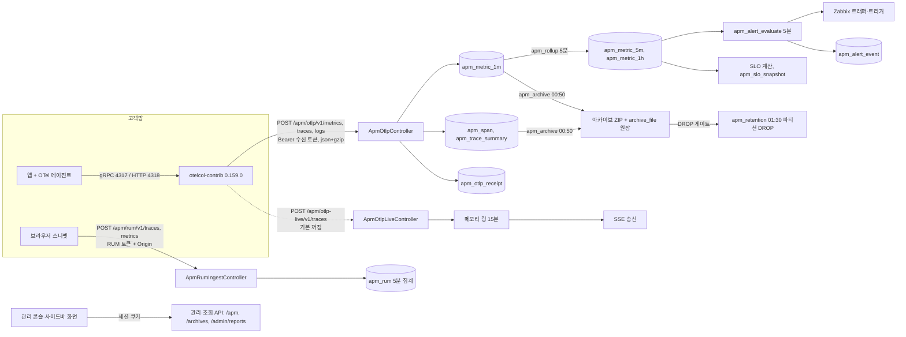

# APM 수집과 운영 기능 상세 가이드

> 이 문서는 MovesEye APM에서 **데이터를 넣고 지키는 쪽**을 다룬다. 대상 독자는 수집기를 설치하는 운영자, 알람·SLO·합성 감시를 설정하는 관리자, 수신·보존·아카이브 동작을 알아야 하는 개발·QA·지원 담당자다. 범위는 수집기 관리·수신 토큰·설치 가이드, OTLP·RUM·라이브 스팬 수신, 1분 집계·롤업·파티션, 알람 규칙·요청 걸림 장부, SLO, 합성 감시, 보존 설정, 데이터 내보내기, 콜드 아카이브, APM 배치 잡, 자체 텔레메트리, 라이선스 게이트다. 개요·서비스·트레이스·서비스 맵·RUM 조회 화면처럼 **보는 쪽**은 다루지 않는다. 모든 서술은 BE `e55948c`·FE `9dfcbe8` 소스를 정적으로 읽어 확인했으며, 빌드·테스트·서버 기동·HTTP 호출은 하지 않았다.

## 1. 한눈에 보기

| 기능 | 화면 주소·메뉴 위치 | 상태 | 권한·라이선스 | 한 줄 설명 |
|---|---|---|---|---|
| 수집기 상태 | 관리 콘솔 > APM 관리 > 수집기 `/setting/apm/collectors?tab=status` | 현재 | `apm.edit` + `APM` | Collector별 버전·마지막 수신·큐·전송 실패·폐기 사유·60초 수신 확인 |
| 수신 토큰 | `/setting/apm/collectors?tab=tokens` | 현재 | `apm.edit` + `APM` | 토큰 발급(원문 1회 표시)·회수·설정 yaml 동시 생성 |
| 설치 가이드 | `/setting/apm/collectors?tab=install` | 현재 | `apm.edit` + `APM` | OS(Linux·Windows·macOS)×스택(Java·.NET·Node·Python·Go)별 명령을 서버가 조립 |
| 등록 정책·전역 설정 | `/setting/apm/collectors?tab=registration` | 현재 | `apm.edit` + `APM` | 등록 모드·STALE 창·route 상한·원문 SQL 보관·회수 토큰 보존 일수 |
| RUM 토큰·스니펫 | `/setting/apm/collectors?tab=rum` | 현재 | `apm.edit` + `APM` | 브라우저용 공개 토큰·허용 Origin·예산·삽입 스니펫 |
| OTLP 수신 | 화면 없음(`POST /apm/otlp/v1/{metrics,traces,logs}`) | 현재 | 수신 토큰 + `APM` | Collector가 보내는 메트릭·트레이스·로그를 받는 기계 입구 |
| RUM 수신 | 화면 없음(`POST /apm/rum/v1/{traces,metrics}`) | 현재 | RUM 토큰 + Origin + `APM` | 브라우저가 보내는 페이지 로드·Web Vitals 수신 |
| 라이브 스팬 수신·송신 | 화면은 실시간 관제(조회 영역). 수신 `POST /apm/otlp-live/v1/traces` | 부분 | 수신 토큰 + `APM`, 기본 꺼짐 | 완료 요청을 메모리 링에 담아 SSE로 내보낸다. 수신 스위치 기본값이 꺼짐이다 |
| 1분 집계·롤업·파티션 | 화면 없음(스케줄러 `apm_rollup`·`apm_partition_maintain`) | 현재 | 라이선스 무관 실행 | 1m→5m→1h 집계, 일 단위 파티션 선생성 |
| 알람 규칙 | 관리 콘솔 > APM 관리 > 알람 규칙 `/setting/apm/alert-rules?tab=rules\|events\|stuck\|zabbix` | 현재 | 규칙·이력 `apm.edit`, 요청 걸림 목록 `apm.view` + `APM` | 8종 규칙을 5분마다 평가하고 Zabbix로 배달 |
| SLO | 사이드바·관리 콘솔 `/application-monitoring/slo`, 상세 `/application-monitoring/slo/:sloUid` | 현재 | 조회 `apm.view`, 변경 `apm.edit` + `APM` | 가용성·지연 목표, 오차 예산, 번 레이트 알람 |
| 합성 감시 | 사이드바 `/application-monitoring/synthetics`, 상세 `/application-monitoring/synthetics/:httptestId` | 현재 | 조회 `apm.view`, 변경 `apm.edit` + `APM` | Zabbix 웹 시나리오를 만들고 결과·달력을 본다 |
| APM 데이터 보존 | 화면 없음(스케줄러 `apm_retention`, 조회 `GET /apm/settings/retention`) | 부분 | 조회 `apm.view` | 보존 일수는 잡 옵션에 있고 전용 편집 화면이 없다 |
| APM 리포트 보존 | 관리 콘솔 > 운영 > 리포트 관리 `/setting/report-management?tab=apm` | 현재 | 관리자(userRole), 탭은 `APM` 보유 시 | 주간·월간 APM 리포트 자동 삭제 정책 |
| 데이터 내보내기 | 조회 화면의 내보내기 창(`GET /apm/exports/{dataset}`) | 현재 | `apm.view`, 원문은 관리자 | RED 시계열·엔드포인트·오류 그룹을 CSV/JSONL로 |
| 콜드 아카이브 | 관리 콘솔 > 운영 > 데이터 아카이브 `/setting/data-archive?tab=files\|apm\|settings` | 현재 | 관리자(userRole), APM 탭은 `APM` | 보존 만료 전 ZIP 보관, 보관 안 된 날은 지우지 않는 게이트 |
| APM 배치 잡 | 관리 콘솔 > 운영 > 스케줄러 `/setting/schedulers` | 현재 | 관리자 | APM 잡 10종의 주기·실행 이력·수동 실행 |
| 진행 중 요청 Java 확장 | 화면 없음(`moveseye-otel-extension`) | 부분 | — | 고객 JVM 안에서 처리 중 요청을 세어 보내는 확장. 설치 가이드에 배포 절차가 없다 |
| 옛 주소 호환 | `/application-monitoring/collectors`·`/application-monitoring/alert-rules` | 현재 | — | 쿼리째 `/setting/apm/**`으로 리다이렉트 |

상태 표기에서 `현재`는 소스에 구현돼 있다는 뜻이고 배포 여부를 뜻하지 않는다.

### 영역 구조

수신 입구 세 개(OTLP·라이브·RUM)는 브라우저 세션이 아니라 **토큰으로 인증하고 실제 HTTP 상태 코드로 답한다**. 나머지 관리·조회 API는 로그인 세션 쿠키와 `x-visitor-id`를 쓰고, 오류를 HTTP 200 + body `code`로 돌려준다.

## 2. 기능별 상세

### 2.1 수집기 상태

- **무엇을 하는가** — 설치한 Collector가 살아 있는지, 보내지 못하고 쌓인 것이 있는지, 서버가 받은 뒤 버린 것이 무엇인지 확인한다. 서비스가 "수신 끊김"일 때 원인이 앱인지 수집기인지 가르는 화면이다.
- **화면과 진입 경로** — 관리 콘솔 > APM 관리 > 수집기, 주소 `/setting/apm/collectors`, 기본 탭 `status`. 탭은 `?tab=`에 있다. 진입점은 헤더 ⚙ 관리 콘솔, 콘솔 내비·홈 카드, 전역 검색(`apm-collectors`, RUM은 `?tab=rum`), 서비스 목록의 온보딩 카드(`?tab=tokens`)다. 사이드바에는 없다. 옛 주소 `/application-monitoring/collectors`는 쿼리를 유지한 채 리다이렉트한다.
- **사용 방법**
  1. 표에서 Collector 한 줄을 고른다. 열은 토큰 라벨·인스턴스 ID·버전·마지막 수신·상태(UP/STALE)·큐 크기·전송 실패 누계·샘플링 폐기 누계·큐 진입 실패 누계다.
  2. 시간 범위를 정하면 선택한 Collector의 큐·실패 시계열이 그려진다. 시간 범위 툴바는 이 탭에서만 보인다.
  3. "수신 확인"은 선택한 토큰으로 최근 60초 안에 들어온 요청을 보여 준다.
  4. "폐기 통계"는 토큰·사유·지표 이름별 누적 건수다.
- **화면 값의 뜻** — 상태는 마지막 수신이 `apm_setting.stale_minutes`(기본 5분, 하한 1분) 안이면 UP이다. 큐·실패·폐기 값이 `—`이면 0이 아니라 그 지표가 오지 않았다는 뜻이다(서버가 null을 0으로 채우지 않는다). 누계는 Collector를 재시작하면 0부터 다시 센다.
- **동작 원리** — `ApmCollectorsPage` → `ApmCollectorStatusTab` → `useApmCollectors`·`useApmCollectorSeries`·`useApmIngestRecent`·`useApmIngestDrops` → `ApmCollectorController`·`ApmIngestStatusController`. Collector 행(`apm_collector`)은 수집기 자기 지표(`otelcol_exporter_queue_size`, `otelcol_exporter_send_failed*`, `otelcol_exporter_enqueue_failed*`, `otelcol_processor_tail_sampling*`)가 메트릭 배치에 섞여 올 때 `ApmCollectorStateService`가 갱신한다. 자기 지표의 시계열은 `apm_metric_1m`에 `service_id = 0`으로 저장한다. 시계열 간격은 60·300·3600초만 허용하고 범위가 6시간 이하이면 60초, 7일 이하이면 300초, 그 밖은 3600초를 고른다. 한 응답은 2,016점을 넘지 않는다. 수신 확인은 `ApmIngestRecentTracker`의 메모리 버퍼(60초 창, 토큰당 32건)에서 읽는다. 폐기 통계는 `ApmIngestDropStatRecorder`가 메모리에 모았다가 1,000건 또는 10초마다 `apm_ingest_drop_stat`에 더한다.
- **주요 API**

  | Method | Path | 용도 | 권한 |
  |---|---|---|---|
  | GET | `/apm/collectors` | Collector 목록(회수된 토큰의 것도 포함) | `apm.edit` |
  | GET | `/apm/collectors/{id}/series` | 큐·실패 시계열 | `apm.edit` |
  | GET | `/apm/collectors/{id}/live` | 최근 5분 라이브 파이프라인 관측 | `apm.edit`, **FE 미사용** |
  | GET | `/apm/ingest/recent?tokenId=` | 60초 수신 확인 | `apm.edit` |
  | GET | `/apm/ingest/drops` | 폐기 통계 | `apm.edit` |
  | GET | `/apm/ingest/drops/by-service` | 서비스 화면용 폐기 요약 | `apm.view` |

- **데이터** — `apm_collector`(V38, UNIQUE `(token_id, collector_instance_id)`, V68에서 큐 진입 실패 열 추가), `apm_collector_log_1m`(V59, 7일 지난 행을 1시간마다 삭제), `apm_ingest_drop_stat`(V38·V44, UNIQUE `(token_id, reason, metric_name, signal)`, 30일 보존).
- **폐기 사유** — `NOT_ALLOWLISTED`(허용목록 밖 지표), `ROUTE_OVERFLOW`(route 상한 초과로 `__other__`에 합침, 저장은 됨), `REBUCKETED`·`RAW_BOUNDS`·`BOUNDS_CONFLICT`(히스토그램 경계 처리), `UNKNOWN_SERVICE`, `PENDING`(승인 대기), `REJECTED`, `COLLECTION_PAUSED`(수집 중지), `SIGNAL_NOT_SUPPORTED`(저장하지 않는 로그), `CUMULATIVE_FIRST_SKIPPED`(누적형 첫 관측), `RAW_SQL_BLOCKED`, `RUM_UNAVAILABLE`·`RUM_ORIGIN_DENIED`·`RUM_RATE_LIMITED`·`RUM_BODY_TOO_LARGE`·`RUM_INVALID_PAYLOAD`·`RUM_PII_REMOVED`.
- **빈 값·실패·경계 상태** — Collector가 한 대도 없으면 빈 목록과 설치 안내를 보여 준다. `apm.view`만 있는 사용자는 라우트 가드(`permissionAxis="edit"`)에서 막힌다. 라이선스에 `APM`이 없으면 업셀 화면이 뜬다.
- **운영 주의** — 수신 확인 버퍼와 폐기 통계의 미반영분은 BE 프로세스 메모리에 있다. BE를 재시작하면 수신 확인은 비고, 아직 DB에 쓰지 않은 폐기 건수는 사라진다.

### 2.2 수신 토큰

- **무엇을 하는가** — Collector가 MovesEye에 데이터를 보낼 때 쓰는 Bearer 토큰을 발급·회수한다. 배포 마커 웹훅용 토큰도 같은 화면에서 만든다.
- **화면과 진입 경로** — `/setting/apm/collectors?tab=tokens`.
- **사용 방법**
  1. "토큰 발급"을 누르고 라벨(필수, 128자를 넘으면 잘림)을 적는다.
  2. 범위를 고른다. `ingest`는 OTLP 적재, `deploy`는 배포 웹훅이다. 지정하지 않으면 `ingest`다.
  3. "설정 파일도 함께 받기"를 켠 채 MovesEye 주소와 옵션을 적고 발급한다.
  4. 결과 창에서 토큰 원문을 복사하고 `config.yaml`을 내려받는다. 창을 닫으면 원문을 다시 볼 수 없다.
  5. 더 쓰지 않는 토큰은 "회수"한다. 회수는 되돌릴 수 없다.
- **설정 파일 옵션** — 느린 요청 임계 `slowMs`(기본 2000, 1~600,000), 정상 트레이스 표본 `normalPct`(기본 2%, 0~100), 메모리 상한 `memoryLimitMib`(기본 512, 64~65,536), 디스크 큐 경로 `queueDir`(OS별 기본값), 큐 크기 `queueSize`(기본 10,000 배치, 1,000~200,000, 메트릭·트레이스·로그 각각 적용), 재시도 유지 `retryMaxElapsedMin`(기본 30분, 5~1,440), 원문 SQL 보존 `keepRawSql`, Kubernetes 수집 블록 `kubernetes`, 실시간 스팬 전송 `liveSpans`, 프로세서 상세(`attributes/drop`·`redaction/pii`·`filter/metrics`별 기본 규칙 포함 여부와 추가 규칙 최대 50건·각 256자).
- **동작 원리** — `ApmCollectorTokensTab`·`ApmTokenIssueDrawer` → `POST /apm/receive-tokens` → `ApmReceiveTokenService.issue`. 토큰 원문은 `SecureRandom` 32바이트를 base64url로 만든 43자다. DB에는 SHA-256 16진수 64자(`apm_receive_token.token_hash char(64)`)만 저장하고 솔트·대칭 암호화는 쓰지 않는다. 설정 yaml은 `ApmCollectorConfigGenerator`가 `apm/collector-template.yaml`의 자리표시를 채워 만들며, 발급과 같은 요청에서만 토큰이 채워진 완성본을 만들 수 있다. yaml 생성이 실패하면 토큰 행까지 함께 롤백한다. 인증은 제시된 토큰을 해시해 `findByTokenHash`로 1회 조회한다. `last_seen_at`은 토큰당 60초에 한 번만 갱신한다.
- **주요 API**

  | Method | Path | 용도 | 권한 |
  |---|---|---|---|
  | GET | `/apm/receive-tokens` | 목록(회수분 포함, 해시는 내보내지 않음) | `apm.edit` |
  | POST | `/apm/receive-tokens` | 발급(+`withConfig`면 yaml 동봉) | `apm.edit` |
  | DELETE | `/apm/receive-tokens/{id}` | 회수(멱등) | `apm.edit` |
  | GET | `/apm/collectors/config-defaults` | 폼 기본값·기본 프로세서 규칙 | `apm.edit` |
  | POST | `/apm/collector-config` | 기존 토큰용 yaml 재생성(토큰 자리는 `${RECEIVE_TOKEN}`) | `apm.edit`, **FE 화면 미사용** |

- **데이터** — `apm_receive_token`(V38, UNIQUE `token_hash`; V57에서 RUM 열 추가). 종류는 `COLLECTOR`·`RUM`. 회수는 행 삭제가 아니라 `revoked_at` 기록이다. 회수 후 `revoked_token_retention_days`(기본 180일, V65)가 지나면 보존 배치가 토큰 행을 지우고, FK CASCADE로 그 토큰의 Collector·영수증·폐기 통계·수집기 로그가 함께 지워진다. 목록의 `purgeAfter`가 삭제 예정일이다.
- **권한·라이선스** — 토큰이 통과해도 종류가 `COLLECTOR`이고 범위에 `ingest`가 있어야 적재된다. 아니면 403이다. 범위가 비어 있는 행은 거부한다.
- **빈 값·실패·경계 상태** — 라벨이 없으면 `APM_TOKEN_LABEL_REQUIRED`, 모르는 종류·범위는 `APM_TOKEN_KIND_UNSUPPORTED`·`APM_TOKEN_SCOPE_UNSUPPORTED`, 주소·옵션 오류는 `APM_COLLECTOR_ENDPOINT_INVALID`·`APM_COLLECTOR_CONFIG_INVALID`다(모두 HTTP 200 + body `code:400`). 설정 재생성 API(`POST /apm/collector-config`)의 응답에는 `keepRawSql`이 켜졌을 때 헤더 `X-Apm-Warning: raw-sql`, 기본 마스킹 규칙을 뺐을 때 `masking-reduced`가 붙는다.
- **운영 주의** — 회수한 토큰을 쓰던 Collector는 다음 요청부터 401을 받고, exporter는 401을 재시도하지 않고 버린다. "잠시 막기"로 쓸 수 없다. 발급 응답의 `endpoint`는 요청에 적은 주소를 쓰고, 주소를 적지 않으면 `app.apm.collector.endpoint-hint`(기본값은 예시 도메인) 값을 쓴다.

### 2.3 설치 가이드

- **무엇을 하는가** — Collector와 앱 계측을 설치하는 명령을 OS·스택·경로에 맞춰 보여 준다.
- **화면과 진입 경로** — `/setting/apm/collectors?tab=install`. 수집기 화면 안의 안내 배너에서도 연다.
- **사용 방법**
  1. OS(Linux·Windows·macOS)와 스택(Java·.NET·Node·Python·Go)을 고른다.
  2. 설치 경로·설정 경로·큐 경로·에이전트 경로를 바꾸면 서버가 명령 전체를 다시 조립한다(FE가 문자열을 치환하지 않는다).
  3. Collector 단계(내려받기 → 압축 해제 → 설정 배치 → 큐 디렉터리 권한 → 포트 확인 → 서비스 등록 → 시작 → 기존 Collector 갱신), 앱 단계(내려받기 → 실행 → 재기동), 환경변수, 검증 단계를 차례로 따른다.
- **내부에서 정해지는 값** — Collector 버전 `0.159.0`, Java 에이전트 `2.31.1`은 코드 상수다. 포트는 4317(gRPC)·4318(HTTP)·13133(health, 127.0.0.1 전용)이다. 실시간 수집을 켠 설정은 로컬 관측용 127.0.0.1:4319도 쓴다. 내려받기 주소의 앞부분은 `app.apm.collector.download-base-url`(기본 GitHub)이며 사내 미러로 바꿀 수 있다. Windows 명령은 PowerShell 5.1 문법으로 통일돼 있다. Linux는 `otelcol` 시스템 계정과 systemd 유닛, macOS는 LaunchDaemon(`com.moveseye.otelcol`)을 쓴다. 실행 인자에 `--feature-gates=ottl.set.allowNil`이 들어간다.
- **스택별 주의**
  - Java: 실행 명령에 `-Dotel.instrumentation.http.server.emit-experimental-telemetry=true`가 포함된다. 이 옵션이 없으면 액티브 요청(`http.server.active_requests`) 카드가 빈다. 환경변수 `OTEL_EXPORTER_OTLP_METRICS_TEMPORALITY_PREFERENCE=delta`를 권장하고 `OTEL_SEMCONV_STABILITY_OPT_IN=database`를 안내한다.
  - .NET·Node·Python: `OTEL_SEMCONV_STABILITY_OPT_IN=http,database`를 넣어야 표준 지표 이름으로 온다. 이 세 스택의 런타임 지표는 받지 않는다고 가이드가 명시한다.
  - Go: 자동 계측이 아니라 수동 계측 절차를 안내한다.
  - 공통: `OTEL_SERVICE_NAME`, `OTEL_RESOURCE_ATTRIBUTES`(`deployment.environment.name`, `service.version`), `OTEL_EXPORTER_OTLP_ENDPOINT`(앱은 Collector로 보낸다), `OTEL_BSP_SCHEDULE_DELAY=1000`, `OTEL_BSP_MAX_QUEUE_SIZE=2048`.
- **동작 원리** — `ApmCollectorInstallTab` → `GET /apm/install-guide` → `ApmInstallGuideService`. DB나 외부 호출 없이 문자열을 조립한다. 경로는 `ApmInstallPaths.resolve`가 검증하고 틀린 경로는 400으로 거절한다. 응답의 참고 문서 목록은 각 단계가 인용한 문서에서 파생한다.
- **주요 API** — `GET /apm/install-guide?os=&stack=&installDir=&configDir=&queueDir=&agentDir=` (`apm.edit`).
- **Collector 설정이 하는 일** — 템플릿의 파이프라인은 네 개다. `metrics`(memory_limiter → resource_detection → attributes/drop → filter/metrics → batch), `metrics/self`(Collector 자기 지표), `traces`(… → redaction/pii → transform/sql → tail_sampling → batch), `logs`(… → redaction/pii → batch). tail 샘플링은 판정 대기 10초·동시 50,000 트레이스이고 느린 요청과 표본 비율로 남긴다. 배치는 5초·512건(최대 1,024건)이다. exporter는 `encoding: json`·gzip, 디스크 큐(`file_storage`), 소비자 10개, 재시도 예산 `max_elapsed_time`을 쓴다.
- **빈 값·실패·경계 상태** — 모르는 OS·스택은 기본 가이드로 접지 않고 body `code:400`으로 거절한다.
- **운영 주의** — Collector의 `redaction/pii`는 13자리 이상 숫자열을 카드번호 패턴으로 가린다. 로그 본문 JSON에 13자리 epoch ms를 넣으면 JSON이 깨진다. 진행 중 요청 Java 확장을 배포하는 절차는 이 가이드에 없다(4절 APC-14).

### 2.4 등록 정책과 APM 전역 설정

- **무엇을 하는가** — 새 서비스가 처음 수신됐을 때의 등록 방식과 APM 전체에 적용되는 기준값을 정한다.
- **화면과 진입 경로** — `/setting/apm/collectors?tab=registration`. 같은 탭에 승인 대기 서비스와 이름 없는 앱 목록이 함께 있다(서비스 등록 승인 자체는 서비스 영역 기능이다).
- **설정 항목과 기본값**

  | 항목 | 기본값 | 뜻 |
  |---|---|---|
  | `registrationMode` | `AUTO` | `AUTO`(첫 수신 즉시 등록)·`APPROVE`(승인 대기)·`ALLOWLIST`(사전 등록만) |
  | `hiddenAfterDays` | 14 | 마지막 수신 후 이 일수가 지나면 서비스를 자동으로 숨긴다(삭제 아님) |
  | `staleMinutes` | 5 | 수신 끊김 판정 창. 서비스 상태와 수집기 목록이 같은 값을 쓴다 |
  | `defaultErrorRatePct` | 5 | 서비스별 규칙이 없을 때의 오류율 기준(%) |
  | `defaultP95Ms` | 2000 | 서비스별 규칙이 없을 때의 p95 기준(ms) |
  | `maskSql` | true | SQL 마스킹 |
  | `keepRawSql` | false | 원문 SQL 보관. 켜면 생성되는 Collector 설정에서 `transform/sql` 프로세서가 빠진다 |
  | `routeLimit` | 500 | 서비스당 route 수 상한. 넘으면 `__other__`로 합친다 |
  | `revokedTokenRetentionDays` | 180 | 회수 토큰 삭제까지의 일수 |

- **동작 원리** — `ApmCollectorRegistrationTab` → `GET/PUT /apm/settings` → `ApmSettingService`. 저장은 부분 갱신이며 보내지 않은 필드는 유지한다. 한 필드라도 검증에 걸리면 그 요청의 모든 필드를 저장하지 않는다. 값은 `apm_setting`(V38, 키-값 표)에 있고 프로세스 안에서 30초 캐시한다. `keepRawSql`을 켜거나 `maskSql`을 끌 때 WARN 로그와 `updated_by`(V39)를 남긴다.
- **주요 API** — `GET /apm/settings`(`apm.edit`), `PUT /apm/settings`(`apm.edit`), `GET /apm/settings/retention`(`apm.view`, 2.13 참고).
- **운영 주의** — 설정 캐시는 저장한 BE 인스턴스에서만 즉시 비워진다. `apm_setting`에는 사람이 바꾸는 키 외에 롤업 워터마크 같은 배치용 행도 들어 있다.

### 2.5 RUM 토큰과 스니펫

- **무엇을 하는가** — 브라우저가 페이지 로드·Web Vitals를 보내도록 공개 토큰을 발급하고 삽입 코드를 내려 준다.
- **화면과 진입 경로** — `/setting/apm/collectors?tab=rum`. 전역 검색에도 이 탭으로 가는 항목이 있다.
- **사용 방법**
  1. 라벨(1~128자), 허용 Origin, 초당 요청 수 `rps`(기본 20, 1~1,000), 본문 상한 `bodyBytes`(기본 262,144, 1,024~8,388,608), 일 관측 상한 `dailyLimit`(기본 100,000, 1~10,000,000)을 정해 발급한다.
  2. 발급 직후에만 보이는 토큰 원문을 복사한다.
  3. "스니펫"에서 설치 명령과 코드를 복사해 웹 앱에 넣는다. 코드의 토큰 자리(`PASTE_ONCE_ISSUED_RUM_TOKEN`)에 원문을 넣는다.
  4. 허용 Origin은 발급 뒤에도 바꿀 수 있다. 회수한 토큰의 Origin은 바꿀 수 없다.
- **동작 원리** — `ApmCollectorRumTab`·`ApmRumSnippetGuide` → `apmRum.api.ts` → `ApmRumController` → `RumTokenService`·`RumSnippetService`. 토큰은 수신 토큰과 같은 표를 쓰고 종류 `RUM`, 범위 `["rum"]`이다. 스니펫은 `apm/rum-snippet.js`의 `__ENDPOINT__`·`__TOKEN_ID__`를 치환해 만든다. 수신 주소는 `app.apm.collector.endpoint-hint`의 스킴·호스트에 `/apm/rum`을 붙인 값이다.
- **스니펫의 전송 규칙** — Web Vitals는 429·502·503·504·네트워크 실패·5초 응답 초과일 때만 같은 본문으로 최대 3회 보낸다. 관측 유효 시간은 60초, 대기 관측은 전송 중 포함 20건·본문 합계 32KiB까지다. `Retry-After`를 지키고, 페이지 종료 시 예약된 재시도는 버린다. `consentGranted` 훅의 기본값은 false이며 동의 뒤에만 초기화한다.
- **주요 API**

  | Method | Path | 용도 | 권한 |
  |---|---|---|---|
  | GET | `/apm/rum/tokens` | RUM 토큰 목록 | `apm.edit` |
  | POST | `/apm/rum/tokens` | 발급 | `apm.edit` |
  | DELETE | `/apm/rum/tokens/{tokenId}` | 회수 | `apm.edit` |
  | DELETE | `/apm/rum/tokens?tokenId=` | 회수(쿼리 형태) | `apm.edit`, **FE 미사용** |
  | PUT | `/apm/rum/origins` | 허용 Origin 교체 | `apm.edit` |
  | GET | `/apm/rum/snippet?tokenId=` | 설치 명령·코드 | `apm.edit` |

- **운영 주의** — 이미 고객 애플리케이션에 복사된 스니펫은 서버를 올려도 바뀌지 않는다. 재전송 보완을 적용하려면 고객 쪽에서 스니펫을 교체해 다시 배포해야 한다. `endpoint-hint`를 설치본 주소로 설정하지 않으면 스니펫의 수신 주소가 예시 도메인으로 나온다(4절 APC-13).

### 2.6 OTLP 수신

- **무엇을 하는가** — Collector가 보내는 메트릭·트레이스·로그를 받아 저장한다. 화면은 없다.
- **입구** — `POST /apm/otlp/v1/metrics`, `/v1/traces`, `/v1/logs`. 경로를 두 번 붙인 오설정(`/v1/metrics/v1/metrics`)도 받아 주고 WARN 로그를 남긴다. `application/json`만 받는다(protobuf·gRPC는 415).
- **처리 순서와 응답 코드**

  | 단계 | 조건 | 응답 | Collector 동작 |
  |---|---|---|---|
  | 1 | Content-Type이 JSON이 아님 | 415 | 폐기 |
  | 2 | `Content-Length`가 회선 상한 초과(gzip 2MB, 비압축 8MB) | 413 | 폐기 |
  | 3 | 동시 적재 상한(기본 6) 초과 | 429 + `Retry-After: 2` | 재시도 |
  | 4 | 토큰 없음·불일치·회수 | 401 | 폐기 |
  | 5 | 토큰 종류·범위가 적재용이 아님 | 403 | 폐기 |
  | 6 | 라이선스에 `APM` 없음·만료 | 403 | 폐기(그 시각부터 손실) |
  | 7 | 본문이 상한 초과 / 끊김 | 413 / 400 | 폐기 |
  | 8 | gzip 해제 중 8MB 초과 / 압축 손상 | 413 / 400 | 폐기 |
  | 9 | JSON 파싱 실패 | 400 | 폐기 |
  | 10 | 이미 처리한 본문(영수증 적중) | 200 `{}` | 큐 비움 |
  | 11 | 적재 성공 | 200 `{}` | 큐 비움 |
  | 12 | 적재 중 예외·DB 장애·서비스 귀속 장애 | 503 | 백오프 재시도 |

  이 입구는 500을 내지 않는다. exporter가 재시도하는 코드는 429·502·503·504뿐이기 때문이다.
- **메트릭 적재** — `MetricIngestPipeline` → `MetricIngestor.ingestOnce`. 순서는 ① 수집기 자기 지표와 앱 지표 분리 ② 서비스·인스턴스 귀속(등록 엔진) ③ 허용목록(`ApmMetricAllowlist`) ④ 차원 정규화(`ApmDimsNormalizer`, route 상한 적용, 값 길이 256자) ⑤ 누적형(CUMULATIVE) 차분(`CumulativeDeltaTracker`) ⑥ `apm_metric_1m` UPSERT다. 영수증 `(token_id, body_sha256)` 선점과 1분 적재는 `ApmMetricBatchWriter`의 한 트랜잭션에서 커밋한다. 선점에 실패하면(이미 커밋된 같은 본문) 적재하지 않고 200을 준다. 중간에 실패하면 영수증과 데이터를 함께 롤백하고 503을 준다. 리소스 하나라도 귀속 장애가 나면 배치 전체를 503으로 돌려 재전송을 받는다. 파티션은 트랜잭션 전에 준비한다. 실시간 링·폐기 통계·히스토그램 경계 캐시·누적형 기준값은 커밋이 끝난 뒤에만 반영한다.
- **누적형 차분** — 직전값은 BE 프로세스 메모리(`ConcurrentHashMap`)에 있다. 첫 관측은 기준값으로만 쓰고 저장하지 않는다(`CUMULATIVE_FIRST_SKIPPED`, 유예 120초). 30분 동안 안 온 시리즈는 잊는다. 동시 배치는 `(serviceId, instanceId)` 기준 256개 잠금 구역을 정해진 순서로 잡는다. DELTA·GAUGE만 있는 배치는 이 잠금을 쓰지 않는다.
- **트레이스 적재** — 영수증 조회 → `TraceIngestPipeline`(스팬 `apm_span` 멱등 저장, `apm_trace_summary` 병합) → 영수증 기록 순서다. 메트릭과 달리 영수증과 적재가 한 트랜잭션이 아니며, 중복 방어는 스팬 저장의 멱등성에 의존한다.
- **로그 처리** — 범용 애플리케이션 로그는 저장하지 않는다. Collector 자기 관측 로그는 `apm_collector_log_1m`에 건수로 더하고, Java 확장의 처리 중 요청 목록 로그는 메모리에 반영한다. 둘 다 아니면 200으로 받고 `SIGNAL_NOT_SUPPORTED`로 센다. 로그 경로는 영수증 중복 판정을 하지 않는다.
- **데이터** — `apm_otlp_receipt`(V38, UNIQUE `(token_id, body_sha256)`, 2일 보존), `apm_metric_1m`(일 파티션), `apm_hist_bounds`(V38·V43, UNIQUE `(bounds, family)`).
- **권한·라이선스** — `SecurityConfig`에서 permitAll이고 컨트롤러가 토큰과 라이선스를 직접 본다(`@LicenseExempt` + 직접 판정). 401 응답에는 사유를 적지 않는다.
- **운영 주의** — 설정 키 `app.apm.otlp.max-concurrent`(1~64, 범위를 벗어나면 기동 실패), `max-body-bytes`(8MB), `max-compressed-bytes`(2MB). 같은 데이터를 두 토큰으로 보내면 중복으로 보지 않는다. 영수증은 2일 뒤 지워지므로 그보다 늦은 재전송은 다시 더해진다. 저장한 행이 0인 배치는 WARN 로그로 남는다.

### 2.7 RUM 수신

- **무엇을 하는가** — 브라우저 스니펫이 보낸 관측을 검증·제한·저장한다. 화면은 없다.
- **입구** — `POST /apm/rum/v1/traces`, `POST /apm/rum/v1/metrics`, 두 경로의 `OPTIONS`(preflight). 전용 보안 체인(`RumSecurityConfiguration`, 순서 1)이 CSRF·전역 CORS를 끄고 컨트롤러가 직접 CORS 헤더를 쓴다.
- **처리 순서** — ① `Origin` 헤더 형식과 개수(정확히 1개) ② Content-Type JSON·인코딩(`identity`/`gzip`) ③ 쿼리 `tokenId`로 토큰 설정 조회(없음·회수·종류 불일치는 403) ④ 토큰의 허용 Origin 대조(불일치 403) ⑤ Bearer 토큰 해시 대조와 `tokenId` 일치(401) ⑥ 라이선스(403) ⑦ 토큰별 초당 요청 수(429, `Retry-After: 1`) ⑧ 본문 읽기(토큰별 상한, gzip 회선은 최대 2MB, 초과 413) ⑨ 파싱·허용목록·개인정보 속성 제거(`RumParser`·`RumSanitizer`) ⑩ 일 관측 예산 차감(초과 429, `Retry-After`는 UTC 자정까지의 초) ⑪ 파티션 준비와 저장(`RumStore`) 순서다. 저장 중 서버 오류는 503이며 이때 차감한 예산을 되돌리고 `RUM_UNAVAILABLE`로 센다.
- **preflight** — 인증 전 전역 초당 100회로 제한한다. 허용 메서드는 POST, 허용 헤더는 `Authorization`·`Content-Type`·`Content-Encoding`·`traceparent`·`tracestate`, `Access-Control-Max-Age`는 60초다.
- **저장** — `RumStore`는 영수증(`apm_rum_receipt`)을 넣는 데 성공한 관측만 집계에 반영하고, 표마다 기본키 순서로 정렬해 `apm_rum_page_5m`·`apm_rum_session_5m`·`apm_rum_timing_5m`·`apm_rum_js_error_group`·`apm_rum_error_5m`·`apm_rum_span`에 쓴다(V57).
- **제한 상태의 위치** — 초당 요청 창과 일 예산은 BE 프로세스 메모리(`RumRateLimiter`)에 있다. 토큰 창은 최대 10,000개까지 두고 넘으면 새 토큰 요청을 503으로 돌린다. BE를 재시작하면 일 예산이 0부터 다시 시작한다.
- **빈 값·실패·경계 상태** — 일부만 거절되면 200 + `partialSuccess`(`rejectedSpans`/`rejectedDataPoints`)다. 스니펫은 `partialSuccess`와 401·403·500을 재시도하지 않는다.
- **운영 주의** — 국가 정보는 `CF-IPCountry`·`Accept-Language` 헤더에서 추정한다. RUM 보존(5분 집계 30일·스팬 7일·오류 그룹 90일)은 옵션이 없는 코드 상수다.

### 2.8 라이브 스팬 수신·링 버퍼·SSE 송신

- **무엇을 하는가** — 방금 끝난 요청을 초 단위로 화면에 흘려보내기 위한 별도 경로다. 저장 경로(2.6)와 독립이다. 화면(실시간 관제)은 조회 영역 문서가 다루고, 여기서는 수신과 송신 용량만 다룬다.
- **수신** — `POST /apm/otlp-live/v1/traces`. `LiveIngestGuardFilter`가 가장 앞에서 토큰별 요청 예산을 적용하고 오류 응답을 기계용 형식으로 고정한다. 그다음 `ApmOtlpLiveController`가 토큰(메모리 메타 캐시)·용도·라이선스·기능 스위치를 본다. 스위치 `app.apm.live.spans.enabled`의 기본값은 false이며 꺼져 있으면 503 `APM_LIVE_DISABLED`다.
- **수신 상한(기본값)** — 토큰당 초당 10회·버스트 20(인증 전에도 적용, 버킷 2,000개), 본문 2MiB(압축·해제 각각), 배치당 스팬 1,000개, 읽기 제한 3초, 동시 요청 4개, 중복 제거 키 120,000개. 받아들이는 스팬은 HTTP 메서드가 있는 SERVER 스팬이고 서비스 상태가 ACTIVE인 것뿐이다.
- **링 버퍼** — `LiveSpanRing`이 서비스별로 최대 900초를 메모리에 둔다. 전체 점 상한은 1,400,000이다. 서비스 수 상한은 `app.apm.live.max-services`(기본 200)다. 10초 칸 요약 링(`LiveBuffer`, 창 900초, 서비스당 route 200개, 힙 예산 384MB)은 메트릭 적재 커밋 뒤에 채워진다.
- **SSE 송신** — `GET /apm/live/spans/stream`. 동시 활성 연결 40(최대 500), 대기 10(최대 200), 계정당 4, 동시 스냅샷 2, 연결당 송신 큐 8MiB, write 제한 2,000ms, 송신 워커 4(1~32)다. 송신 작업 큐 크기는 활성+대기 상한의 합으로 잡고, 연결 하나에는 대기 작업 하나만 둔다. 닫힌 연결의 대기 작업은 즉시 제거한다.
- **운영 주의** — 링·중복 제거 색인·요청 예산은 모두 BE 프로세스 메모리다. BE를 재시작하면 창이 비고, BE가 여러 대이면 노드마다 다른 내용을 본다. Collector 쪽에서는 설정 생성 때 "실시간 스팬 전송"을 켜야 라이브 파이프라인이 생긴다.

### 2.9 1분 집계·롤업·파티션

- **무엇을 하는가** — 수신한 1분 행을 5분·1시간 표로 합치고, 일 단위 파티션을 미리 만든다. 화면은 스케줄러 실행 이력뿐이다.
- **롤업** — 잡 `apm_rollup`(5분 간격). `ApmRollupService`가 `apm_setting`의 워터마크를 읽어 1m→5m, 5m→1h를 만든다. 현재 시각에서 2분(LAG)을 뺀 지점까지만 집계한다. 한 회차에 5분 칸 60개(5시간), 1시간 칸 12개까지만 따라잡는다. 일 단위(1d) 단은 없다.
- **트레이스 롤업** — 잡 `apm_trace_rollup`(5분 간격). 서비스 간선·DB 쿼리·외부 의존·메시징·배치 실행(`ApmJobRollupStep`)을 만든다. 상세는 조회 영역 문서를 본다.
- **파티션** — 잡 `apm_partition_maintain`(매일 00:30, `aheadDays` 기본 2). 대상은 16개 표다: `apm_metric_1m/5m/1h`, `apm_span`, `apm_trace_summary`, `apm_service_edge_5m`, `apm_error_group_1h`, `apm_db_query_group_5m`, `apm_dependency_5m`, `apm_messaging_5m`, `apm_rum_page_5m`, `apm_rum_receipt`, `apm_rum_session_5m`, `apm_rum_timing_5m`, `apm_rum_error_5m`, `apm_rum_span`. DEFAULT 파티션은 두지 않는다. 선생성이 실패한 날에는 수신 경로가 요청 시점에 파티션을 만든다(`ApmPartitionService`).
- **운영 주의** — 롤업·파티션·보존 잡은 라이선스가 만료돼도 돈다. 파티션 존재 캐시는 프로세스 메모리다.

### 2.10 알람 규칙

- **무엇을 하는가** — 서비스·수집기·SLO·아카이브 상태를 주기적으로 재서 알람 이벤트를 열고 닫고, Zabbix로 값을 밀어 실제 알림(액션·미디어)을 태운다.
- **화면과 진입 경로** — 관리 콘솔 > APM 관리 > 알람 규칙 `/setting/apm/alert-rules`. 탭은 `rules`(규칙 표·편집·미리보기), `events`(발화 이력), `stuck`(요청 걸림 장부), `zabbix`(배달 경로 진단)다. `?serviceUid=`로 서비스를 좁히고 `?rule=`로 규칙을 가리킨다. 개요의 최근 알람, 서비스 상세, 전역 검색에서 들어온다. 옛 주소 `/application-monitoring/alert-rules`는 리다이렉트한다.
- **규칙 종류**

  | 종류 | 임계 단위 | 기본 심각도 | 재는 값 | 비고 |
  |---|---|---|---|---|
  | `ERROR_RATE` | % | 4 | 창 안의 5xx ÷ 전체 요청 × 100 | 서비스별·전역 |
  | `P95_LATENCY` | ms | 3 | 창 안의 히스토그램을 합쳐 보간한 p95 | 서비스별·전역 |
  | `STALE` | 분 | 3 | 마지막 수신 후 경과 분(임계를 넘었을 때만 그 값, 아니면 0) | 기동 직후 유예 있음 |
  | `COLLECTOR_FAILURE` | 건 | 2 | 창 안의 Collector 전송 실패·큐 진입 실패 증분 | 전역만(서비스 축 없음) |
  | `ACTIVE_REQUESTS_SPIKE` | 배수 | 2 | 최근 5분 평균 ÷ 직전 5분 평균 | 액티브 요청 지표 필요 |
  | `STUCK_REQUEST` | ms | 4 | 임계를 넘긴 채 처리 중인 요청의 최대 경과 | 1초 감시기가 판정, Java 확장 필요 |
  | `SLO_BURN` | 배수 | 3 | 1시간+5분, 6시간+30분 창의 번 레이트 | SLO 화면에서만 생성 |
  | `ARCHIVE_HOLD` | 건 | 3 | 열린 아카이브 보류 건수 | 시스템 규칙 1건, 켜고 끄기만 가능 |

- **사용 방법**
  1. `rules` 탭에서 "규칙 추가"로 종류·대상 서비스(비우면 전역)·임계·평가 창(1~1,440분)·활성 여부를 정한다. 종류와 대상은 만든 뒤 바꿀 수 없다.
  2. 미리보기는 과거 데이터에 같은 식을 적용해 몇 번 터졌을지 보여 준다(기본 24시간, 최대 2,000점).
  3. Zabbix 쪽 값과 어긋난 규칙(drift 배지)은 "재동기화"에서 우리 값 기준(`OURS`) 또는 Zabbix 값 기준(`THEIRS`)을 고른다.
  4. `events` 탭에서 발화·해소 시각과 값을 본다. 기본 범위는 최근 7일, 한 쪽 50건(최대 500건)이다.
  5. `stuck` 탭에서 요청 걸림 장부를 본다. `?open=`으로 아직 열린 것만 고른다.
  6. `zabbix` 탭에서 Zabbix 연결·호스트·아이템·트리거·액션 연결 상태를 본다.
- **동작 원리(평가)** — 잡 `apm_alert_evaluate`(5분 간격, 라이선스 필요) → `ApmAlertEvaluationService.evaluateAll`. 순서는 ① 못 바꾼 트리거 상태 재시도 ② 활성 규칙만 선택 ③ 규칙×대상마다 Zabbix 객체 확보 → 값 측정 → 이벤트 판정 ④ 대상에서 빠진 바인딩 정리(`ApmAlertOrphanSweeper`) ⑤ 모은 값을 `history.push` 한 번으로 전송 ⑥ Zabbix 이벤트 ID 짝 찾기 ⑦ 못 지운 Zabbix 객체 재삭제다. 전역 규칙은 ACTIVE 서비스마다 펼쳐지고, 서비스별 규칙이 있는 서비스는 전역 규칙 대상에서 빠진다.
- **판정 규칙** — 발화 조건은 `값 > 임계`이고 Zabbix 트리거 표현식(`last(...) > N`)과 같은 식이다. `STALE`·`SLO_BURN`·`STUCK_REQUEST`·`ARCHIVE_HOLD`는 서버가 판정해 양수(위반)·0(정상)·-1(측정 불가)을 민다. 중복 억제는 "같은 규칙·대상에 열린 이벤트가 있으면 새로 열지 않는다" 하나다. 값이 없는 회차(트래픽 0 등)는 push도 상태 변경도 하지 않는다. `STALE`은 BE 기동 후 `임계 + 평가 주기`가 지나기 전에는, 기동 뒤 아직 수신이 없는 서비스를 판정하지 않는다.
- **요청 걸림 장부** — `ApmStuckRequestMonitor`가 1초마다 메모리의 처리 중 요청 목록을 보고 임계를 넘긴 요청을 `apm_stuck_request`(V67)에 한 줄씩 연다. 닫는 사유는 `ENDED`(목록이 새로 왔는데 그 요청이 없음), `LOST`(15초 동안 못 봄), `RULE_OFF`(규칙이 꺼짐)다. 서비스에 걸린 요청이 0→1건이 되면 알람 이벤트를 열고 1→0건이 되면 닫는다. 규칙·대상은 10초마다 다시 읽고, 열린 행의 관측값은 15초마다 DB에 쓴다. 90초 동안 목록이 안 온 서비스는 5분 평가에 "관측 없음"으로 답한다.
- **Zabbix 연결** — `ZabbixAlertBridge`가 호스트 그룹·호스트 `MovesEye APM`에 트래퍼 아이템(키 `apm.<종류>[<서비스 UUID>]`, 수집기 축은 `collector`)과 트리거(`manual_close=1`, 태그 `owner=moveseye-apm`·`apm_uid`·`apm_service`·`apm_kind`)를 만든다. Zabbix 호출은 슈퍼 관리자 토큰으로 한다. 잡 `apm_alert_sync`(매일 02:00)가 규칙과 Zabbix 객체를 대조해 drift·미지원 상태를 표시한다.
- **주요 API**

  | Method | Path | 용도 | 권한 |
  |---|---|---|---|
  | GET | `/apm/alert-rules` | 규칙 목록 | `apm.edit` |
  | POST | `/apm/alert-rules` | 생성 | `apm.edit` |
  | PUT | `/apm/alert-rules/{ruleUid}` | 수정 | `apm.edit` |
  | DELETE | `/apm/alert-rules/{ruleUid}` | 삭제(열린 이벤트 해소, Zabbix 객체 제거) | `apm.edit` |
  | POST | `/apm/alert-rules/{ruleUid}/resync` | 재동기화 | `apm.edit` |
  | POST | `/apm/alert-rules/preview` | 미리보기 | `apm.edit` |
  | GET | `/apm/alert-rules/zabbix-status` | 배달 경로 진단 | `apm.edit` |
  | GET | `/apm/services/{uid}/alert-rules` | 서비스에 적용 중인 규칙(읽기) | `apm.view` |
  | GET | `/apm/alert-events` | 발화 이력 | `apm.edit` |
  | GET | `/apm/stuck-requests` | 요청 걸림 장부 | `apm.view` |

- **데이터** — `apm_alert_rule`(V38, V51에서 `slo_id`), `apm_alert_rule_binding`(V41·V42, 규칙×대상의 Zabbix 객체 ID·상태), `apm_alert_event`(V38, `resolved_at`이 NULL이면 열림), `apm_stuck_request`(V67, 90일 보존), `apm_zbx_cleanup`(V53, 삭제 재시도 큐).
- **빈 값·실패·경계 상태** — Zabbix에 연결하지 못하면 진단은 실패 대신 `reachable=false`를 돌려준다. 대상이 있는데 프로비저닝이 전부 실패하면 잡이 실패로 기록된다. 알 수 없는 종류의 규칙 행은 건너뛴다.
- **운영 주의** — 규칙을 끄거나 지우면 그 자리에서 열린 이벤트를 닫는다. `ARCHIVE_HOLD`는 아카이브가 꺼져 있으면 대상을 만들지 않는다.

### 2.11 SLO

- **무엇을 하는가** — 서비스별 목표(예: 30일 99.9%)와 남은 오차 예산을 보여 주고, 예산이 빨리 타면 알람을 낸다.
- **화면과 진입 경로** — 사이드바 어플리케이션 모니터링 > SLO, 관리 콘솔 > APM 관리 > SLO(같은 주소 `/application-monitoring/slo`), 상세 `/application-monitoring/slo/:sloUid`. `?serviceUid=`로 서비스를 좁힌다. 개요의 SLO 위험 목록과 서비스 상세 설정 탭에서 링크한다.
- **사용 방법**
  1. "SLO 추가"에서 서비스·종류(`AVAILABILITY` 또는 `LATENCY`)·이름(서비스 안에서 유일, 120자)·목표(0 초과 100 미만 %)·창(7일 또는 30일)을 정한다. `LATENCY`는 임계(ms)가 필수다. 서비스와 종류는 만든 뒤 바꿀 수 없다.
  2. "번 레이트 알람"을 켜면 `SLO_BURN` 규칙이 자동으로 생긴다. 임계를 비우면 창 길이에서 계산한다(30일 14.4, 7일 3.36).
  3. 상세에서 달성률·오차 예산·번 레이트 시계열(최대 500점)과 30일 달력을 본다.
- **화면 값의 뜻** — 상태는 `OK`·`WARN`(남은 예산 25% 미만)·`BREACH`·`UNKNOWN`이다. `UNKNOWN`의 사유는 `NO_REQUESTS`·`NOT_MEASURABLE`·`OUT_OF_RETENTION`이다. 트래픽이 0인 구간을 100% 달성으로 계산하지 않는다. 지연 SLO는 히스토그램 보간이라 근삿값이다.
- **동작 원리** — `ApmSloPage`·`ApmSloDetailPage` → `/apm/slos` → `ApmSloService`·`ApmSloCalculator`. 번 레이트는 빠른 줄(1시간 + 5분 확인 창, 예산 2%)과 느린 줄(6시간 + 30분, 예산 5%, 임계는 빠른 줄 ÷ 2.4)을 OR로 본다. 잡 `apm_slo_snapshot`(매일 00:50)이 일별 스냅샷 `apm_slo_snapshot`을 쓰고, 빠진 날은 최대 30일까지 거슬러 메운다. 오늘·어제는 매번 다시 쓰고 확정된 날은 건너뛴다.
- **주요 API** — `GET /apm/slos`, `GET /apm/slos/{sloUid}`, `GET /apm/slos/{sloUid}/series`(`apm.view`), `POST /apm/slos`, `PUT /apm/slos/{sloUid}`, `DELETE /apm/slos/{sloUid}`(`apm.edit`).
- **데이터** — `apm_slo`(V51, UNIQUE `slo_uid`, UNIQUE `(service_id, lower(name))`), `apm_slo_snapshot`(V51·V53, UNIQUE `(slo_id, day)`, 400일 보존).
- **운영 주의** — 5분 집계 보존이 30일이라 그보다 오래된 날은 다시 계산할 수 없다. 스냅샷 400일이 달력이 볼 수 있는 과거의 상한이다.

### 2.12 합성 감시

- **무엇을 하는가** — 바깥에서 URL을 주기적으로 호출해 서비스가 응답하는지 확인한다. 실행은 Zabbix 웹 시나리오가 하고 MovesEye는 시나리오를 만들고 결과를 읽는다.
- **화면과 진입 경로** — 사이드바 어플리케이션 모니터링 > 합성 감시 `/application-monitoring/synthetics`, 상세 `/application-monitoring/synthetics/:httptestId`. 서비스 상세의 합성 감시 탭에서 시나리오를 서비스에 연결·해제한다.
- **사용 방법**
  1. "시나리오 추가"에서 이름·대상 호스트·주기(1초~86,400초)·재시도(1~10)·에이전트·인증·프록시·변수·헤더·태그와 단계(URL·기대 상태 코드·필수 문자열·타임아웃·요청 본문·리다이렉트)를 정한다.
  2. 목록에서 마지막 결과·24시간 가용성·최근 60분 p95를 본다.
  3. 상세에서 단계별 응답 시간·속도·응답 코드 시계열(기본 최근 24시간)과 달력(기본 30일, 최대 90일)을 본다.
  4. 서비스에 연결하면 그 서비스의 중단 판정 근거로 쓰인다. 시나리오 하나는 서비스 하나에만 붙는다.
- **동작 원리** — `ApmSyntheticsPage` → `/apm/synthetics` → `ApmSyntheticService` → Zabbix `httptest.*`·`host.get`·`proxy.get`·`item.get`(`web.test.*`)·`history.get`. 목록 한 번은 시나리오 수와 무관하게 Zabbix 호출 6회다. 이력은 종류별로 20,000점씩 최대 25쪽까지 읽고, 화면 결과는 20,000점으로 자른 뒤 `truncated`로 알린다. 마지막 결과가 주기의 3배(하한 300초)보다 오래되면 STALE로 표시한다. 모든 Zabbix 호출은 슈퍼 관리자 토큰으로 한다. 로컬에는 서비스 연결(`apm_synthetic_binding`, V52)만 저장한다.
- **주요 API**

  | Method | Path | 용도 | 권한 |
  |---|---|---|---|
  | GET | `/apm/synthetics` | 목록(`serviceUid`·`hostId` 필터) | `apm.view` |
  | GET | `/apm/synthetics/{httptestId}` | 상세 | `apm.view` |
  | GET | `/apm/synthetics/{httptestId}/results` | 결과 시계열 | `apm.view` |
  | GET | `/apm/synthetics/{httptestId}/calendar` | 달력 | `apm.view` |
  | GET | `/apm/synthetics/proxies` | 실행 위치 후보 | `apm.view` |
  | GET | `/apm/synthetics/error-catalog` | 실패 사유 해설 | `apm.view` |
  | POST·PUT·DELETE | `/apm/synthetics`, `/apm/synthetics/{httptestId}` | 생성·수정·삭제 | `apm.edit` |
  | GET | `/apm/services/{serviceUid}/synthetics` | 서비스에 연결된 시나리오 | `apm.view` |
  | POST | `/apm/services/{serviceUid}/synthetics/bind`·`/unbind` | 연결·해제 | `apm.edit` |

- **빈 값·실패·경계 상태** — Zabbix에 연결하지 못하면 목록·결과 조회가 실패한다. 실행 위치를 알 수 없으면 "확인 불가"로 표시한다.
- **운영 주의** — 삭제는 Zabbix에서 시나리오를 지운 뒤 로컬 연결 행을 지운다. 실행 부하는 Zabbix 서버·프록시가 진다.

### 2.13 보존 설정

- **무엇을 하는가** — APM 데이터를 며칠 두고 지울지 정한다. 대상이 둘이다. (가) 수집 데이터(시계열·스팬·집계) 보존, (나) 주간·월간 APM 리포트 보존.
- **(가) 수집 데이터 보존** — 잡 `apm_retention`(매일 01:30)의 옵션(`scheduler_setting.options`)이 정본이다. 값이 0 이하이면 무시하고 기본값을 쓴다.

  | 대상 | 옵션 키 | 기본 | 삭제 방식 |
  |---|---|---|---|
  | `apm_metric_1m` | `raw1mDays` | 7일 | 파티션 DROP |
  | `apm_metric_5m` | `rollup5mDays` | 30일 | 파티션 DROP |
  | `apm_metric_1h` | `rollup1hDays` | 400일 | 파티션 DROP |
  | `apm_span`·`apm_trace_summary` | `spanDays`·`traceSummaryDays` | 7일 | 파티션 DROP |
  | `apm_service_edge_5m`·`apm_db_query_group_5m`·`apm_dependency_5m`·`apm_messaging_5m` | `edge5mDays` 등 | 30일 | 파티션 DROP |
  | `apm_error_group_1h` | `errorGroup1hDays` | 90일 | 파티션 DROP |
  | 오류 그룹·DB 쿼리 그룹 본체 | `errorGroupDays`·`dbQueryGroupDays` | 마지막 관측 후 90일 | DELETE |
  | `apm_instance` | `instanceIdleDays` | 30일 무수신 | DELETE |
  | `apm_ingest_drop_stat` | `dropStatDays` | 30일 | DELETE |
  | `apm_otlp_receipt` | `receiptDays` | 2일 | DELETE |
  | 회수 토큰 | `apm_setting.revoked_token_retention_days` | 180일 | DELETE(CASCADE) |
  | `apm_deployment` | `deploymentDays` | 400일 | DELETE |
  | `apm_slo_snapshot` | `sloSnapshotDays` | 400일 | DELETE |
  | `apm_job_run` | `jobRunDays` | 90일 | DELETE |
  | `apm_stuck_request` | `stuckRequestDays` | 90일 | DELETE |
  | RUM 5분 집계·영수증·세션 / RUM 스팬 / RUM 오류 그룹 | 옵션 없음 | 30일 / 7일 / 90일 | DROP / DROP / DELETE |
  | `apm_service` 자동 숨김 | `apm_setting.hidden_after_days` | 14일 | UPDATE(숨김) |

  단계마다 따로 실행하고 한 단계가 실패해도 나머지를 계속한다. 실패한 단계가 있으면 잡을 실패로 기록한다. 조회 API `GET /apm/settings/retention`(`apm.view`)이 잡과 같은 해석으로 유효 일수를 돌려주고, 조회 화면은 이 값으로 시간 범위 상한을 정한다(`ApmRetentionProvider`, 10분 캐시).
- **(나) APM 리포트 보존** — 관리 콘솔 > 운영 > 리포트 관리 `/setting/report-management?tab=apm`. 주간 리포트 보존 주 수(1~520, 기본 52), 월간 리포트 보존 개월 수(1~120, 기본 24), 자동 삭제 켜기를 저장한다. 값은 `report_retention_setting`의 `apm_*` 세 열(V66)에 있고 호스트 그룹 리포트 정책과 서로 덮지 않는다. 저장하지 않은 변경이 있으면 탭 전환·이탈 전에 확인 창이 뜬다. `APM` 라이선스가 없으면 APM 탭이 보이지 않고 `?tab=apm`은 호스트 그룹 탭으로 접힌다.
- **주요 API** — `GET /apm/settings/retention`(`apm.view`), `GET·PUT /admin/reports/retention/apm`(관리자).
- **운영 주의** — (가)의 보존 일수를 바꾸는 전용 화면은 없다. 조회 해상도 선택(`ApmResolution`)은 7·30·400일을 코드 상수로 따로 갖고 있다(4절 APC-11).

### 2.14 데이터 내보내기

- **무엇을 하는가** — 화면에서 보던 데이터를 기간을 정해 파일로 받는다.
- **화면과 진입 경로** — 서비스·오류 등 조회 화면의 "내보내기" 창. 전용 메뉴는 없다.
- **사용 방법**
  1. 데이터 종류(`red-series`·`endpoints`·`error-groups`), 기간, 해상도, 서비스, 형식(CSV·JSONL, gzip 선택)을 정한다.
  2. 창이 먼저 계획을 조회해 실제 창·해상도·예상 행 수·안내를 보여 준다. 상한을 넘으면 `allowed=false`다.
  3. "내려받기"를 누르면 계획 응답의 `planToken`을 함께 보내 계획과 같은 창·해상도로 파일을 만든다.
- **동작 원리** — `ApmExportController` → `ApmExportService` → `source/*Exporter`. 계획은 파일을 만들지 않는다. 다운로드는 노드당 동시 2건(`app.apm.export.max-concurrent`)만 허용하고 넘으면 `APM_EXPORT_BUSY`(429)다. 행 수가 `max-rows`(기본 200,000)를 넘으면 본문을 쓰기 전에 `APM_EXPORT_TOO_LARGE`로 거절한다. RED 시계열은 한 번에 1,440칸씩 읽는다. `planToken`은 `JWT_SECRET`에서 파생한 키로 서명하고 30분 동안 유효하다. 원문 텍스트(`rawText=true`)는 관리자만 받을 수 있다.
- **주요 API** — `GET /apm/exports/{dataset}/plan`, `GET /apm/exports/{dataset}`(둘 다 `apm.view`).
- **빈 값·실패·경계 상태** — 본문을 쓰기 전의 실패는 HTTP 200 + JSON envelope다. 보존 기간 밖 구간은 잘라 내고 응답 헤더·안내로 알린다. 세부 계약은 [APM 데이터 내보내기](../../features/solutions--APM-%EB%8D%B0%EC%9D%B4%ED%84%B0-%EB%82%B4%EB%B3%B4%EB%82%B4%EA%B8%B0.md)를 본다.

### 2.15 콜드 아카이브

- **무엇을 하는가** — 보존 기간이 지나 지워질 날짜의 데이터를 서버 디스크에 ZIP으로 남기고, 보관하지 못한 날은 보존 정리가 지우지 않게 막는다.
- **화면과 진입 경로** — 관리 콘솔 > 운영 > 데이터 아카이브 `/setting/data-archive`. 탭은 `files`(파일 목록·내려받기·무결성 검사·사유 필수 삭제), `apm`(APM 대상·실패 정책·상태·보류 목록·수동 실행), `settings`(저장 경로·여유 공간·연결 테스트)다. 보류가 있으면 APM 화면 상단에 관리자에게만 배너가 뜨고 `?tab=apm`으로 연결한다.
- **사용 방법**
  1. `settings` 탭에서 허용 루트 아래의 저장 경로를 정하고 "연결 테스트"를 통과시킨 뒤 저장한다.
  2. `apm` 탭에서 아카이브를 켜고 대상을 고른다. 기본 대상은 1시간 메트릭·트레이스 요약·SLO 스냅샷이다. 1분 메트릭과 스팬 원본은 선택 대상이다.
  3. 실패 정책을 고른다. `skipDrop`(기본)은 보관 실패 시 그 날짜를 지우지 않고 보류한다. `continue`는 실패해도 지운다. 보류 최대 일수(기본 7일, 최대 365일)가 지나면 지운다.
  4. `files` 탭에서 파일을 내려받거나, 행의 "검사"로 SHA-256을 다시 계산하거나, 사유를 적어 삭제한다(일괄 최대 500건).
- **동작 원리** — 잡 `apm_archive`(매일 00:50) → `ApmArchiveService` → `ArchiveWriter`(임시 `.partial` 파일에 쓰고 `manifest.json`·`checksums.txt`를 넣어 봉인한 뒤 게시) → 원장 `archive_file`(V69). 한 회차는 기본 20분(상한 25분, 강제 중단 28분)이다. 보존 정리(`ApmRetentionService`)는 아카이브가 켜져 있으면 대상 표의 파티션마다 `ApmArchiveDropGate`의 판정을 받는다. 판정은 "원장에 OK 행이 있고 그 파일이 관리 경로에 존재하면 DROP 허용"이다. 판정·DROP·삭제·게시는 같은 (소스, 데이터셋, 날짜) advisory lock 아래에서 한다. 아카이브가 꺼져 있으면(기본) 보존 정리는 게이트 없이 예전처럼 동작한다. APM 아카이브 설정 행이 손상되면 보존 정리가 멈춘다.
- **주요 API**

  | Method | Path | 용도 | 권한 |
  |---|---|---|---|
  | GET | `/archives`, `/archives/{id}` | 원장 목록(한 쪽 최대 200건)·상세 | 관리자 |
  | GET | `/archives/{id}/download` | ZIP 내려받기 | 관리자 |
  | DELETE | `/archives/{id}`, POST `/archives/delete-bulk` | 사유 필수 삭제 | 관리자 |
  | POST | `/archives/{id}/verify` | 무결성 검사 | 관리자 |
  | GET·PUT | `/archives/settings`, POST `/archives/path-check` | 경로 설정·연결 테스트 | 관리자 |
  | GET·PUT | `/archives/sources/apm/settings` | APM 대상·정책 | 관리자 + `APM` |
  | GET | `/archives/sources/apm/status`, `/holds` | 상태·보류 목록 | 관리자 + `APM` |
  | POST | `/archives/sources/apm/run` | 수동 실행 접수 | 관리자 + `APM` |

- **데이터** — `archive_file`·`archive_setting`·`apm_archive_hold`(V69). 원장 상태는 OK·SUPERSEDED·DELETED·FAILED·SOURCE_EXPIRED·HOLD_EXPIRED다.
- **운영 주의** — 환경변수 `ARCHIVE_ALLOWED_ROOTS`가 비어 있으면 기능이 켜지지 않는다. 컨테이너 배포는 그 경로를 볼륨으로 마운트해야 한다. 아카이브는 파일 보관이며 검색·복원 기능은 없다. 세부는 [APM 콜드 아카이브](../../features/solutions--APM-%EC%BD%9C%EB%93%9C-%EC%95%84%EC%B9%B4%EC%9D%B4%EB%B8%8C.md)를 본다.

### 2.16 APM 배치 잡

- **무엇을 하는가** — APM이 주기적으로 돌리는 서버 작업의 주기를 바꾸고 실행 이력을 확인한다.
- **화면과 진입 경로** — 관리 콘솔 > 운영 > 스케줄러 `/setting/schedulers`(관리자).

  | 잡 키 | 기본 주기 | 하는 일 | 라이선스 만료 시 |
  |---|---|---|---|
  | `apm_rollup` | 5분 | 1m→5m→1h 메트릭 롤업 | 계속 실행 |
  | `apm_trace_rollup` | 5분 | 간선·DB·의존·메시징·배치 실행 집계 | 계속 실행 |
  | `apm_alert_evaluate` | 5분 | 알람 평가·Zabbix push | 실행 안 함 |
  | `apm_partition_maintain` | 매일 00:30 | 파티션 선생성(D+2) | 계속 실행 |
  | `apm_slo_snapshot` | 매일 00:50 | SLO 일별 스냅샷 | 계속 실행 |
  | `apm_archive` | 매일 00:50 | 콜드 아카이브 | 계속 실행 |
  | `apm_retention` | 매일 01:30 | 보존 정리 | 계속 실행 |
  | `apm_alert_sync` | 매일 02:00 | 규칙↔Zabbix 대조 | 기본 규칙(라이선스 필요)을 따른다 |
  | `apm_report_weekly` | 월요일 10:10 | 주간 리포트 | 리포트 영역 문서 참고 |
  | `apm_report_monthly` | 매월 1일 10:40 | 월간 리포트 | 리포트 영역 문서 참고 |

- **동작 원리** — 잡은 공통 `SchedulerManager`가 실행하고 `scheduler_lease`(잡 키 단위, 유효 30분)로 겹침 실행을 막는다. 잡이 예외를 던지면 실패로 기록된다. 스케줄러 밖에서 도는 주기 작업이 셋 있다: 요청 걸림 감시(1초), 라이브 링 회전(1초), 수집기 로그 정리(1시간). 이 셋은 lease를 쓰지 않아 BE 인스턴스마다 돈다.
- **참고** — BE 패키지 `premium/apm/job`은 MovesEye의 배치가 아니라 **고객 애플리케이션의 배치 실행**을 스팬에서 뽑아 보여 주는 조회 기능(`GET /apm/jobs`, `/runs`, `/timeline`, 모두 `apm.view`)이다. 수집 쪽에서 관련되는 것은 `apm_trace_rollup`의 `ApmJobRollupStep`(시작 시각과 완료 시각 두 경로로 실행을 찾음)과 `apm_job_run` 90일 보존이다.

### 2.17 자체 텔레메트리와 OTel 공용 코드

- **OTLP 공용 패키지(`otel/`)** — OTLP JSON 리더(`OtlpJson`, `OtlpMetricsReader`, `OtlpTracesReader`), 히스토그램 재버킷(`HistogramRebucketer`, `CanonicalBounds`), 수신 토큰 생성·해시(`ReceiveTokenService`)가 있다. APM과 AI 계정 모니터링이 함께 쓴다. `otel` 패키지는 소비자 패키지를 import하지 않는다(`OtelArchitectureTest`).
- **Collector 자기 관측** — 템플릿의 `metrics/self` 파이프라인이 Collector 자기 지표를 같은 토큰으로 보낸다. 서버는 `service.name`이 `otelcol`이거나 `otelcol` 뒤에 `-`·`_`·`.`이 오는 이름(예: `otelcol-contrib`)인 리소스를 수집기로 분류해 서비스로 등록하지 않는다. 고객 서비스 이름을 `otelcol-`로 시작하게 지으면 수집기로 분류된다.
- **진행 중 요청 Java 확장(`moveseye-otel-extension` 0.2.0)** — OTel Java 에이전트 2.31.1의 확장 지점에서 HTTP 서버 요청의 시작·종료를 세어 1초마다 보낸다. 지표 `moveseye.http.server.active_requests{moveseye.age_bucket}`·`requests.started_recent`·`requests.ended_recent{moveseye.outcome}`와, 가장 오래된 처리 중 요청 N건(기본 30, 최대 100)을 담은 로그 한 줄이다. 서버는 이 값을 저장하지 않고 메모리에만 두며, 임계를 넘긴 요청만 장부(`apm_stuck_request`)로 옮긴다. 주요 설정은 시스템 프로퍼티 `moveseye.active-requests.max-active`(10,000)·`list.size`(30)·`slow-threshold-millis`(2,000)·`exclude-paths`다. 검증 조합은 JDK 17·Spring Boot 3.3.5·Tomcat 10.1이다. 다른 언어용 확장은 없다.
- **MovesEye 서버 자신의 APM 관측** — 제품 기능으로 켜는 경로는 없다(보류 상태).

### 2.18 권한과 라이선스 게이트

- **권한 축** — APM 관리 API는 `ApmAccessChecker`가 디무브 권한의 `apm.view`(`requireRead`)와 `apm.edit`(`requireEdit`)로 판정한다. 아카이브(`ArchiveAdminAccess`)와 리포트 관리는 `userRole`이 ADMIN 또는 SUPER_ADMIN인지로 판정한다. 거부는 HTTP 200 + body `code:403`이다.
- **화면 가드** — 수집기·알람 규칙 라우트는 `PageWrapper permissionAxis="edit"` + `FeatureGate feature="APM"`이다. SLO·합성 감시는 `apm.view` + `FeatureGate`다. 데이터 아카이브·리포트 관리는 `adminOnly`이고 `FeatureGate`를 걸지 않는다(APM 탭만 화면 안에서 라이선스로 가린다). 관리 콘솔 메뉴는 권한 응답이 오기 전에는 권한 축 항목을 감춘다.
- **라이선스** — 범위 안의 premium 컨트롤러는 모두 `@RequiresFeature(Feature.APM)`이다. 수신 입구 세 개는 `@LicenseExempt`를 달고 컨트롤러가 직접 판정해 403을 낸다(인터셉터에 맡기면 200으로 나가 exporter가 데이터를 버린다). 라이선스가 없는 설치본에서도 관리 콘솔의 APM 항목은 보이고, 누르면 업셀 화면이 뜬다.
- **데이터 범위** — APM 서비스에는 호스트 그룹 범위가 없다. `apm.view`가 있으면 모든 서비스를 본다.

## 3. 공통 동작과 설정

### 3.1 설정 키

| 키(환경변수) | 기본값 | 범위 | 뜻 |
|---|---|---|---|
| `app.apm.otlp.max-concurrent` (`APM_OTLP_MAX_CONCURRENT`) | 6 | 1~64 | OTLP 적재 동시 요청 상한. 초과는 429 |
| `app.apm.otlp.max-body-bytes` / `max-compressed-bytes` | 8MB / 2MB | — | 해제 후 본문 상한 / 압축 본문 상한(yml에 없고 코드 기본값) |
| `app.apm.collector.default-queue-dir.{linux,windows,macos}` | OS별 경로 | — | Collector 디스크 큐 기본 경로 |
| `app.apm.collector.download-base-url` (`APM_DOWNLOAD_BASE_URL`) | GitHub | — | 설치 가이드 내려받기 주소의 앞부분(사내 미러용) |
| `app.apm.collector.endpoint-hint` (`APM_ENDPOINT_HINT`) | 예시 도메인 | — | 설정 폼의 주소 예시, 주소 없는 토큰 발급 응답, RUM 스니펫 수신 주소의 원천 |
| `app.apm.export.max-rows` / `max-concurrent` / `chunk-cells` / `plan-token-ttl-seconds` | 200,000 / 2 / 1,440 / 1,800 | — | 내보내기 한도 |
| `app.apm.live.spans.enabled` (`APM_LIVE_SPANS_ENABLED`) | false | — | 라이브 스팬 수신 스위치 |
| `app.apm.live.spans.{max-body-bytes,max-spans,read-timeout-ms,max-concurrent-requests}` | 2MiB / 1,000 / 3,000 / 4 | 상한 2MiB·1,000·30,000·64 | 라이브 수신 한도 |
| `app.apm.live.spans.rate-limit.*` | 10rps / 버스트 20 / 버킷 2,000 | — | 토큰별 요청 예산(yml에 없고 코드 기본값) |
| `app.apm.live.spans.dedup.capacity` | 120,000 | 1~1,000,000 | 라이브 중복 제거 키 수 |
| `app.apm.live.spans.stream.{max-active,max-waiting,per-user,max-snapshots,queue-mib,write-timeout-ms,writer-threads}` | 40 / 10 / 4 / 2 / 8 / 2,000 / 4 | 500 / 200 / 16 / 16 / 8~64 / 200~30,000 / 1~32 | SSE 동시 시청·송신 한도 |
| `app.apm.live.{enabled,window-seconds,bucket-seconds,max-services,max-routes-per-service,max-heap-mb,stream-timeout-seconds,heartbeat-seconds}` | true / 900 / 10 / 200 / 200 / 384 / 600 / 30 | 각 `@Min/@Max` | 10초 칸 요약 링과 그 SSE |
| `app.archive.allowed-roots` (`ARCHIVE_ALLOWED_ROOTS`) | 빈 값 | — | 아카이브 허용 루트. 비면 기능이 켜지지 않는다 |
| `apm_setting` 표 | 2.4절 표 | — | 화면에서 바꾸는 APM 전역 설정 |
| `scheduler_setting.options` (`apm_retention`) | 2.13절 표 | 양수 | 보존 일수 |
| `archive_setting` (소스 `APM`) | 꺼짐 | — | 아카이브 대상·실패 정책·보류 일수 |

범위를 벗어난 `app.apm.*` 값은 조용히 접지 않고 기동을 실패시킨다.

### 3.2 캐시와 갱신 주기

| 대상 | 수명 | 위치 |
|---|---|---|
| APM 전역 설정 | 30초 | BE 프로세스 메모리 |
| 서비스 등록 판정(등록 엔진) | 10분, `last_seen_at` 쓰기는 60초에 한 번 | BE 프로세스 메모리 |
| 토큰 `last_seen_at` 쓰기 절제 | 60초 | BE 프로세스 메모리 |
| route 집합(서비스당 상한 판정) | 서비스 512개 LRU, 기동 후 최근 1일분으로 워밍 | BE 프로세스 메모리 |
| FE 수집기 설정 기본값 / 보존 일수 | 30분 / 10분 | 브라우저 쿼리 캐시 |
| FE 수집기·토큰·폐기 통계 폴링 | 화면의 새로고침 주기 선택값 | 브라우저 |

### 3.3 BE를 여러 대 띄울 때의 동작

현재 구조는 BE 한 대를 전제로 한 상태가 여럿 있다. DB에 있는 것(영수증, 스케줄러 lease, 아카이브 원장·잠금)은 노드 사이에서 공유되고, 아래 항목은 노드마다 따로 있다.

| 노드 로컬 상태 | 영향 |
|---|---|
| 누적형 지표의 직전값(`CumulativeDeltaTracker`) | 같은 시리즈의 배치가 다른 노드로 가면 차분이 맞지 않는다 |
| RUM 초당·일 예산(`RumRateLimiter`) | 노드 수만큼 허용량이 늘고 재시작하면 초기화된다 |
| 라이브 요청 예산·중복 제거 색인·링·SSE 연결 | 수신한 노드에서만 보인다 |
| 요청 걸림 감시 상태(`ApmStuckRequestMonitor`) | 처리 중 요청 목록을 받은 노드만 판정한다 |
| 수신 확인 버퍼, 폐기 통계 미반영분 | 요청을 받은 노드에만 있다 |
| 적재·내보내기 동시성 상한 | 노드마다 따로 센다 |
| 전역 설정·등록 판정 캐시 | 다른 노드에는 30초·최대 10분 늦게 반영된다 |

### 3.4 실패했을 때 공통 규칙

- 수신 입구는 재시도해도 결과가 같은 실패를 4xx로, 잠시 뒤 나을 실패를 429·503으로 답한다.
- 관리·조회 API는 오류를 HTTP 200 + body `code`로 답한다(401만 실제 상태 코드).
- 스케줄러 잡은 단계가 하나라도 실패하면 예외를 던져 실행 이력에 실패로 남긴다. 부분 실패는 요약 문자열에 건수로 남긴다.

## 4. 문제점 및 보완점 분석

### 4.1 요약

| ID | 제목 | 중요도 | 유형 | 증거 수준 | 상태 |
|---|---|---|---|---|---|
| APC-01 | 열린 알람 이벤트의 유일성 보장이 없어 요청 걸림 알람이 두 경로에서 중복으로 열릴 수 있다 | 높음 | 정확성 | 코드 확인 | 기존 백로그-유효 |
| APC-02 | BE를 여러 대 띄우면 누적형 차분·RUM 예산·라이브·걸림 장부가 노드마다 따로 돈다 | 높음 | 운영 | 코드 확인 | 기존 백로그-유효 |
| APC-03 | 합성 감시가 슈퍼 관리자 토큰으로 모든 Zabbix 웹 시나리오를 읽고 쓴다 | 높음 | 보안 | 코드 확인 | 신규 |
| APC-04 | 알람 이벤트에 보존 단계가 없고 이력 조회가 전량을 메모리로 읽는다 | 중간 | 규모 | 코드 확인 | 기존 백로그-유효 |
| APC-05 | 알람 판정의 잠금·트랜잭션 안에서 Zabbix를 호출한다 | 중간 | 운영 | 코드 확인 | 기존 백로그-유효 |
| APC-06 | 무결성 검사에서 불일치가 나와도 DROP 게이트는 그 파일을 보관 완료로 본다 | 중간 | 정확성 | 코드 확인 | 기존 백로그-유효 |
| APC-07 | `app.apm.live.max-services`를 201~2000으로 주면 검증은 통과하고 기동이 실패한다 | 중간 | 운영 | 코드 확인 | 기존 백로그-유효 |
| APC-08 | 메트릭 원자성 보완 뒤에도 누적형 직전값은 재시작·커밋 응답 유실에 취약하다 | 중간 | 정확성 | 기존 기록 | 기존 백로그-유효 |
| APC-09 | 원문 SQL 수집(`keepRawSql`)을 `apm.edit` 권한으로 켤 수 있다 | 중간 | 보안 | 코드 확인 | 기존 백로그-유효 |
| APC-10 | 알람 규칙·SLO·합성 감시 변경에 행위자 감사 기록이 없다 | 중간 | 보안 | 코드 확인 | 신규 |
| APC-11 | 보존 일수가 잡 옵션과 조회 상수 두 곳에 있고 바꾸는 화면이 없다 | 중간 | 운영 | 코드 확인 | 기존 백로그-유효(화면 부재는 신규) |
| APC-12 | SLO 번 알람은 측정 불가 회차에 열린 이벤트를 해소 처리한다 | 중간 | 정확성 | 코드 확인 | 기존 백로그-유효 |
| APC-13 | RUM 스니펫과 토큰 발급 응답의 수신 주소가 `endpoint-hint` 설정에 의존한다 | 중간 | 사용성 | 코드 확인 | 신규 |
| APC-14 | 설치 가이드에 진행 중 요청 Java 확장의 배포 절차가 없다 | 중간 | 미완성 | 코드 확인 | 기존 백로그-유효 |
| APC-15 | 설치 가이드의 .NET 설치 스크립트 주소가 미러 설정·버전 고정을 따르지 않는다 | 중간 | 운영 | 코드 확인 | 신규 |
| APC-16 | 합성 감시 결과 조회에 기간 상한이 없다 | 중간 | 규모 | 코드 확인 | 기존 백로그-유효 |
| APC-17 | 스케줄러 lease가 30분 고정이고 갱신이 없다 | 중간 | 운영 | 코드 확인 | 기존 백로그-유효 |
| APC-18 | 롤업 지연(2분) 뒤에 도착한 1분 데이터는 5분·1시간 표에 반영되지 않는다 | 중간 | 정확성 | 기존 기록 | 기존 백로그-유효 |
| APC-19 | 내보내기 계획 조회는 동시성 상한 밖에서 돈다 | 낮음 | 규모 | 코드 확인 | 기존 백로그-유효 |
| APC-20 | RUM 수신 POST는 인증 전 DB 조회에 전역 상한이 없다 | 낮음 | 보안 | 코드 확인 | 신규 |
| APC-21 | 실험 지표 옵션 안내가 Java에만 있다 | 낮음 | 사용성 | 코드 확인 | 기존 백로그-부분 해소 |
| APC-22 | 화면이 쓰지 않는 API와 그에 맞지 않는 가이드 문구가 남아 있다 | 낮음 | 미완성 | 코드 확인 | 신규 |
| APC-23 | 로그 수신은 중복 판정이 없고 트레이스 영수증은 적재와 분리돼 있다 | 낮음 | 정확성 | 코드 확인 | 기존 백로그-유효 |
| APC-24 | SLO 스냅샷 배치가 모든 SLO를 한 트랜잭션에서 처리한다 | 낮음 | 운영 | 코드 확인 | 기존 백로그-유효 |
| APC-25 | 요청 걸림 감시기가 대상에서 빠진 서비스의 관측 시각을 지우지 않는다 | 낮음 | 운영 | 코드 확인 | 기존 백로그-유효 |
| APC-26 | 코드 주석 일부가 현재 동작과 다르다 | 낮음 | 운영 | 코드 확인 | 신규(일부 기존) |
| — | 메트릭 영수증 선점과 1분 적재의 원자성 | — | 정확성 | 코드 확인 | 해소됨(`e55948c`) |
| — | SSE 송신 큐가 연결 상한보다 작던 문제 | — | 규모 | 코드 확인 | 해소됨(`e55948c`) |
| — | RUM·수집기 로그 저장의 잠금 순서 교착 | — | 정확성 | 코드 확인 | 해소됨(`5b6d5a0`) |

### 4.2 기존 지적의 현재 상태

`moveseye-docs/overview/apm-gap-report.md`(기준 2026-10-05, BE `3637c77`)의 R1~R6을 BE `e55948c`에서 다시 판정했다.

| 항목 | 10-05 지적 | 현재 판정 | 근거 |
|---|---|---|---|
| R1 | 메트릭 중복 확인과 저장이 한 작업이 아니다 | **해소됨(메트릭 HTTP 경로)**. 영수증 `INSERT … ON CONFLICT DO NOTHING` 선점과 1분 적재가 한 트랜잭션이다. 잔여 한계는 APC-02·APC-08·APC-23 | `moveseye-be-spring/src/main/java/com/dmove/moveseye/premium/apm/collector/ingest/receipt/ApmMetricBatchWriter.java:27-38`, `moveseye-be-spring/src/main/java/com/dmove/moveseye/premium/apm/collector/ingest/store/MetricIngestor.java:108-152`, `moveseye-be-spring/src/main/java/com/dmove/moveseye/premium/apm/collector/ingest/ApmOtlpController.java:509-511` |
| R2 | 요청 걸림 알람을 두 경로에서 열 수 있다 | **여전히 유효** → APC-01 | `moveseye-be-spring/src/main/java/com/dmove/moveseye/premium/apm/alert/evaluate/ApmStuckRequestLedger.java:110-125`, `moveseye-be-spring/src/main/java/com/dmove/moveseye/premium/apm/alert/evaluate/ApmAlertEvaluationService.java:367-376`, `moveseye-be-spring/src/main/resources/db/migration/V38__apm_p1.sql:388-402` |
| R3 | RUM 저장 실패가 브라우저 재전송으로 이어지지 않는다 | **부분 해소**. Web Vitals 전송만 유한 재전송한다. 트레이스 exporter는 SDK 기본 동작 그대로이고, 이미 배포된 스니펫은 교체해야 적용된다 | `moveseye-be-spring/src/main/resources/apm/rum-snippet.js:26-78` |
| R4 | 연결 수 설정과 송신 용량이 분리돼 있다 | **해소됨**. 작업 큐가 활성+대기 상한의 합이고 `writer-threads`(1~32) 설정이 생겼다. 실제 네트워크 부하 시험은 별개다 | `moveseye-be-spring/src/main/java/com/dmove/moveseye/premium/apm/overview/live/spans/LiveSpanStreamService.java:147-152`, `moveseye-be-spring/src/main/java/com/dmove/moveseye/premium/apm/overview/live/spans/ApmLiveStreamProperties.java:39-45` |
| R5 | 알람 판정의 락·DB 작업 안에 외부 호출이 있다 | **여전히 유효** → APC-05 | `moveseye-be-spring/src/main/java/com/dmove/moveseye/premium/apm/alert/evaluate/ApmStuckRequestMonitor.java:121`·`:207`, `moveseye-be-spring/src/main/java/com/dmove/moveseye/premium/apm/alert/evaluate/ApmStuckRequestLedger.java:112`·`:147`, `moveseye-be-spring/src/main/java/com/dmove/moveseye/premium/apm/alert/evaluate/ApmAlertEvaluationService.java:281-401` |
| R6 | 호스트 연결 반복 조회, 알람 이력 보존 없음 | **여전히 유효**. 호스트 연결기는 이름마다 자산 조회를 한다(조회 영역). 알람 이력 보존은 APC-04 | `moveseye-be-spring/src/main/java/com/dmove/moveseye/premium/apm/service/hostlink/ApmZabbixHostLinker.java:99-116`, `moveseye-be-spring/src/main/java/com/dmove/moveseye/premium/apm/core/batch/retention/ApmRetentionJob.java:137-174` |

`_workspace/features/apm/full-review-20260928/backlog_apm-full-review-2026-09-28.md`의 A·B 항목 가운데 이 영역에 해당하는 것의 상태다.

| 백로그 | 현재 판정 |
|---|---|
| A1 영수증 선점 + 단일 트랜잭션 | 해소됨(`e55948c`) |
| A2 SSE writer 풀 산정 | 해소됨(`e55948c`) |
| A3 열린 알람 이벤트 부분 UNIQUE | 유효 → APC-01. 백로그의 "V69+"는 V69가 아카이브에 쓰였으므로 새 번호를 다시 정해야 한다 |
| A4 `max-services` 상한 단일화 | 유효 → APC-07 |
| A5 `apm_alert_event` 보존 단계 | 유효 → APC-04 |
| B1 폐기 사유 `RESOLVER_FAILURE` 분리 | 메트릭 HTTP 경로에서는 귀속 장애가 배치 전체 503이 되어 `UNKNOWN_SERVICE`로 세지 않는다(`MetricIngestor.java:118-120`). 사유 코드 자체는 추가되지 않았다 |
| B3 롤업 지연 도착·보존 상수 단일화 | 유효 → APC-18·APC-11 |
| B6 파티션 DDL을 수신 스레드 밖으로 | 부분 완화. 메트릭은 영수증 트랜잭션 전에 파티션을 준비하지만 여전히 수신 스레드에서 한다(`MetricIngestor.java:129-133`) |
| B7·B8 알람 I/O 분리 | 유효 → APC-05·APC-25 |
| B10 합성 결과 기간 상한 | 유효 → APC-16 |
| B11 RUM 예산 재시작 내성 | 유효 → APC-02 |
| B13 `keepRawSql` 권한 | 유효 → APC-09 |
| B2·B4·B5·B9·B12 | 이 문서 범위 밖이거나 이번에 다시 확인하지 않았다 |

### APC-01. 열린 알람 이벤트의 유일성 보장이 없어 요청 걸림 알람이 두 경로에서 중복으로 열릴 수 있다
**중요도: 높음 · 유형: 정확성 · 증거: 코드 확인**
- 현상: `STUCK_REQUEST` 이벤트를 1초 감시기(`ApmStuckRequestLedger.fire`)와 5분 평가 배치(`ApmAlertEvaluationService.evaluateAll`)가 각각 "열린 이벤트 조회 → 없으면 INSERT"로 연다. 두 경로는 서로 다른 트랜잭션이고 공유 잠금이 없다. `apm_alert_event`에는 `(rule_id, service_id)`의 열린 행을 하나로 제한하는 인덱스가 없다(V38 이후 마이그레이션에도 없다). 감시기는 메모리 플래그 `alarmed`로 자기 상태를 기억하므로, 배치가 이벤트를 닫아도 그 사실을 모른다.
- 영향: 두 경로가 같은 순간에 빈 결과를 보면 같은 상황의 이벤트가 두 줄 생긴다(추론, 발생 빈도는 측정하지 않았다). 닫을 때는 열린 행을 모두 닫으므로 영구히 남지는 않는다. BE를 여러 대 띄우면 5분 배치는 lease로 한 대만 돌지만 1초 감시기는 노드마다 돌아 같은 창이 넓어진다.
- 보완 제안: 이벤트 생성·해제의 소유자를 감시기 하나로 정하고, DB에 `(rule_id, COALESCE(service_id, 0)) WHERE resolved_at IS NULL` 부분 UNIQUE 인덱스를 둔다. 인덱스를 만들기 전에 기존 중복 열린 행을 정리해야 한다. 열기 경로는 `ON CONFLICT DO NOTHING`으로 바꾼다. APC-05의 외부 호출 분리와 한 설계로 묶어야 한다(외부 호출만 밖으로 빼면 중복 발화가 늘 수 있다).
- 완료 조건: 실제 PostgreSQL에서 두 경로를 동시에 실행해 열린 이벤트가 한 줄만 남는지, 규칙 끄기·삭제·재기동 뒤에도 한 줄 이하인지 통합 테스트로 확인한다.
- 근거: `moveseye-be-spring/src/main/java/com/dmove/moveseye/premium/apm/alert/evaluate/ApmStuckRequestLedger.java:110-125`, `moveseye-be-spring/src/main/java/com/dmove/moveseye/premium/apm/alert/evaluate/ApmAlertEvaluationService.java:367-376`, `moveseye-be-spring/src/main/java/com/dmove/moveseye/premium/apm/alert/evaluate/ApmStuckRequestMonitor.java:201-215`, `moveseye-be-spring/src/main/resources/db/migration/V38__apm_p1.sql:388-402`, `_workspace/features/apm/full-review-20260928/backlog_apm-full-review-2026-09-28.md` A3, `_workspace/features/apm/deadlock-fixes/backlog_apm-improvements-2026-09-29.md` B2.

### APC-02. BE를 여러 대 띄우면 누적형 차분·RUM 예산·라이브·걸림 장부가 노드마다 따로 돈다
**중요도: 높음 · 유형: 운영 · 증거: 코드 확인**
- 현상: 3.3절 표의 상태가 모두 BE 프로세스 메모리에 있다. 누적형 지표의 직전값은 `ConcurrentHashMap`이고, RUM 예산은 `HashMap`이며 클래스 주석이 "단일 노드"임을 명시한다. 요청 걸림 감시기는 스케줄러 lease를 쓰지 않는 `@Scheduled`라 노드마다 돈다.
- 영향: 현재 배포(BE 한 대)에서는 문제가 아니다. BE를 수평 확장하고 Collector 요청이 노드에 나뉘어 들어가면, 누적형(CUMULATIVE)으로 오는 지표는 차분 기준이 어긋나 요청 수·합계가 틀려진다(DELTA로 보내는 Java 권장 설정에서는 해당 없음). RUM 일 예산은 노드 수만큼 늘어난다. 실시간 화면과 요청 걸림 알람은 접속한 노드에 따라 달라진다. 재시작 한 번으로도 RUM 일 예산과 라이브 창은 초기화된다.
- 보완 제안: 지원 범위를 "BE 한 대"로 문서와 설치 안내에 명시하는 것이 가장 싸다. 다중 BE를 지원하려면 누적형 직전값의 영속 checkpoint, RUM 예산의 Redis 원자 연산, 라이브 수신·시청의 노드 고정 라우팅 또는 fan-in, 걸림 감시의 단일 소유를 함께 설계한다. 일부만 옮기면 화면마다 정합성이 달라진다.
- 완료 조건: 2노드 구성에서 같은 시리즈를 번갈아 수신시켜 1분 집계가 단일 노드 결과와 같은지, 노드 하나를 재시작해도 수량이 보존되는지, RUM 일 예산 합계가 설정값을 넘지 않는지 확인한다.
- 근거: `moveseye-be-spring/src/main/java/com/dmove/moveseye/premium/apm/collector/ingest/normalize/CumulativeDeltaTracker.java:86-90`, `moveseye-be-spring/src/main/java/com/dmove/moveseye/premium/apm/rum/security/RumRateLimiter.java:12-19`, `moveseye-be-spring/src/main/java/com/dmove/moveseye/premium/apm/alert/evaluate/ApmStuckRequestMonitor.java:75-87`·`:107`, `moveseye-be-spring/src/main/java/com/dmove/moveseye/premium/apm/collector/ingest/status/ApmIngestRecentTracker.java:32-38`, `moveseye-be-spring/src/main/java/com/dmove/moveseye/premium/apm/collector/ingest/live/LiveTokenRateLimiter.java:29-31`, `moveseye-docs/overview/apm-scale-readiness.md` 3절, `_workspace/features/apm/hardening-20261006/apm-20261006-scale-audit.md` 3절.

### APC-03. 합성 감시가 슈퍼 관리자 토큰으로 모든 Zabbix 웹 시나리오를 읽고 쓴다
**중요도: 높음 · 유형: 보안 · 증거: 코드 확인**
- 현상: `ApmSyntheticService`의 목록·상세·결과·달력·생성·수정·삭제·연결이 모두 `zabbixUserService.getSuperAdminToken()`으로 Zabbix를 호출한다. 컨트롤러는 `apm.view`·`apm.edit`만 확인하고 로그인 사용자의 Zabbix 권한(호스트 그룹 범위)을 쓰지 않는다. 목록은 `hostids` 필터가 없으면 Zabbix의 웹 시나리오 전부를 읽는다. 삭제는 `httptestId`만 있으면 어느 호스트의 시나리오든 지운다.
- 영향: `apm.edit`를 가졌지만 Zabbix에서는 일부 호스트 그룹만 맡은 사용자가, 자기 범위 밖 호스트의 웹 시나리오를 만들고 고치고 지울 수 있다. `apm.view`만 있어도 모든 시나리오의 URL·호스트 이름·단계 정의가 보인다. APM 권한을 Zabbix 범위가 제한된 사용자에게 주는 설치본에서만 문제가 된다. APM 서비스에는 원래 호스트 그룹 범위가 없으므로 의도한 설계일 수 있으나, 그 결정을 적은 문서는 이번에 찾지 못했다.
- 보완 제안: (가) 합성 감시의 쓰기를 관리자 축으로 올리거나, (나) MovesEye가 만든 시나리오에 소유 태그를 달고 그 태그가 있는 것만 다루거나, (다) 로그인 사용자의 Zabbix 토큰으로 호출해 Zabbix 권한을 그대로 따르게 한다. (다)는 Zabbix 미연동 계정에서 화면이 비는 대가가 있다. 어느 쪽이든 결정을 계약 문서에 적는다.
- 완료 조건: 호스트 그룹이 제한된 계정으로 범위 밖 호스트의 시나리오 조회·수정·삭제를 시도해 거부되는지(또는 허용이 의도임이 문서화됐는지) 확인한다.
- 근거: `moveseye-be-spring/src/main/java/com/dmove/moveseye/premium/apm/synthetic/ApmSyntheticService.java:188`·`:306`·`:331`·`:359`·`:380`, `moveseye-be-spring/src/main/java/com/dmove/moveseye/premium/apm/synthetic/ApmSyntheticController.java:66-175`.

### APC-04. 알람 이벤트에 보존 단계가 없고 이력 조회가 전량을 메모리로 읽는다
**중요도: 중간 · 유형: 규모 · 증거: 코드 확인**
- 현상: `ApmRetentionJob`의 단계 목록에 `apm_alert_event`가 없다. 리포지토리의 `deleteByFiredAtBefore`는 호출처가 없다. 이력 API(`GET /apm/alert-events`)는 `events.findAll()`로 전부 읽은 뒤 자바에서 기간·서비스로 거르고 정렬·자른다. 규칙과 서비스도 전량을 읽어 이름을 붙인다. 응답 한도 500건은 읽는 양의 상한이 아니다. 한편 규칙이나 서비스를 지우면 FK CASCADE로 그 이력이 함께 지워진다.
- 영향: 이벤트는 임계를 넘을 때만 생기므로 증가 속도는 느리다. 대상이 많고 발화가 잦은 설치본을 오래 운영하면 이력 탭을 열 때마다 전체 이력을 읽는 비용이 커진다(추론). 반대로 규칙을 정리하면 사고 설명에 필요한 과거 이력이 사라진다.
- 보완 제안: 해소된 이벤트만 해소 시각 기준으로 지우는 보존 단계와 옵션 키를 추가한다(열린 이벤트는 지우지 않는다). 이력 조회는 DB에서 기간·서비스로 거르고 `(service_id, fired_at)` 인덱스로 페이지를 자른다. 규칙 삭제 시 이력을 남길지는 정책으로 정한다.
- 완료 조건: 이벤트 10만 건에서 최근 50건 조회가 인덱스 범위 스캔으로 끝나는지, 보존 배치를 두 번 돌려도 열린 이벤트가 남는지 확인한다.
- 근거: `moveseye-be-spring/src/main/java/com/dmove/moveseye/premium/apm/core/batch/retention/ApmRetentionJob.java:137-174`, `moveseye-be-spring/src/main/java/com/dmove/moveseye/premium/apm/core/domain/ApmAlertEventRepository.java:110`, `moveseye-be-spring/src/main/java/com/dmove/moveseye/premium/apm/alert/rule/ApmAlertService.java:286-303`, `_workspace/features/apm/hardening-20261006/apm-20261006-review-operations.md` 4번.

### APC-05. 알람 판정의 잠금·트랜잭션 안에서 Zabbix를 호출한다
**중요도: 중간 · 유형: 운영 · 증거: 코드 확인**
- 현상: 요청 걸림 감시기의 `evaluate` 전체가 `synchronized(lock)`이고 그 안에서 `ledger.fire`·`ledger.settle`이 Zabbix 프로비저닝과 `history.push`를 호출한다. 5분 배치의 `currentValue`도 같은 잠금을 잡는다. 5분 평가 `evaluateAll`은 하나의 `@Transactional` 안에서 프로비저닝·push·고아 정리·이벤트 ID 조회·삭제 재시도를 모두 한다.
- 영향: Zabbix 응답이 느리면 1초 감시가 그동안 멈추고, 5분 배치는 DB 커넥션을 쥔 채 기다린다(추론). 대상 수가 늘수록 트랜잭션이 길어진다. Zabbix push가 성공한 뒤 DB 커밋이 실패하면 두 시스템의 상태가 갈린다.
- 보완 제안: "DB에서 판정과 전송 의도 기록 → 잠금 밖에서 외부 전송 → 결과 기록" 세 단계로 나눈다. APC-01의 단일 소유·유일성과 함께 설계한다.
- 완료 조건: Zabbix 응답에 지연을 주입해 감시 주기, DB 풀 점유 시간, 중복 알람 수를 측정하고 기준을 넘지 않는지 확인한다.
- 근거: `moveseye-be-spring/src/main/java/com/dmove/moveseye/premium/apm/alert/evaluate/ApmStuckRequestMonitor.java:121`·`:207`·`:211`·`:246`, `moveseye-be-spring/src/main/java/com/dmove/moveseye/premium/apm/alert/evaluate/ApmStuckRequestLedger.java:112`·`:137`·`:147`, `moveseye-be-spring/src/main/java/com/dmove/moveseye/premium/apm/alert/evaluate/ApmAlertEvaluationService.java:281-401`, `_workspace/features/apm/deadlock-fixes/backlog_apm-improvements-2026-09-29.md` B1·B3.

### APC-06. 무결성 검사에서 불일치가 나와도 DROP 게이트는 그 파일을 보관 완료로 본다
**중요도: 중간 · 유형: 정확성 · 증거: 코드 확인**
- 현상: `POST /archives/{id}/verify`는 SHA-256을 다시 계산해 일치 여부를 응답으로만 돌려준다. 원장 상태를 바꾸거나 보류를 걸지 않는다. DROP 게이트는 "원장에 OK 행이 있고 파일이 관리 경로에 존재하는가"만 본다(내용 해시는 보지 않는다).
- 영향: 파일이 만들어진 뒤 손상됐고 관리자가 검사로 불일치를 확인했더라도, 다음 보존 정리에서 원본 파티션이 지워진다. 아카이브를 켠 설치본에서 파일 손상이 있을 때만 해당한다. 그 경우 손상된 파일만 남는다.
- 보완 제안: 검사 실패를 원장 상태(예: INVALID)와 보류에 반영하고 게이트가 그 상태를 DROP 거부로 읽게 한다. DROP 때마다 큰 파일을 다시 해시하는 방식은 피하고, 최근 검사 결과와 파일 크기·수정 시각을 함께 본다.
- 완료 조건: 아카이브 파일을 일부러 손상시킨 뒤 검사 → 보존 정리를 실행해 원본 파티션이 남는지 확인한다.
- 근거: `moveseye-be-spring/src/main/java/com/dmove/moveseye/archive/ArchiveFileService.java:132-163`, `moveseye-be-spring/src/main/java/com/dmove/moveseye/premium/apm/core/batch/archive/ApmArchiveDropGate.java:124-139`, `_workspace/features/apm/hardening-20261006/apm-20261006-review-operations.md` 7번.

### APC-07. `app.apm.live.max-services`를 201~2000으로 주면 검증은 통과하고 기동이 실패한다
**중요도: 중간 · 유형: 운영 · 증거: 코드 확인**
- 현상: `ApmLiveProperties`는 `maxServices`를 `@Max(2000)`으로 검증한다. 같은 값을 받는 `LiveSpanRing` 생성자는 1~200이 아니면 예외를 던진다.
- 영향: 서비스가 많은 설치본에서 운영자가 문서의 허용 범위 안인 값(예: 500)을 주면 BE가 뜨지 않는다. 기동 실패라 즉시 드러나지만 메시지("서비스 상한은 1~200입니다")가 어느 설정 키인지 말하지 않는다.
- 보완 제안: 상한을 한 곳(200)으로 맞추거나 링이 200 초과를 지원하게 한다. 예외 메시지에 설정 키를 넣는다.
- 완료 조건: 201을 줬을 때 프로퍼티 검증 단계에서 키 이름이 포함된 메시지로 거절되는지 단위 테스트로 확인한다.
- 근거: `moveseye-be-spring/src/main/java/com/dmove/moveseye/premium/apm/overview/live/ApmLiveProperties.java:95`, `moveseye-be-spring/src/main/java/com/dmove/moveseye/premium/apm/overview/live/spans/LiveSpanRing.java:139-147`.

### APC-08. 메트릭 원자성 보완 뒤에도 누적형 직전값은 재시작·커밋 응답 유실에 취약하다
**중요도: 중간 · 유형: 정확성 · 증거: 기존 기록**
- 현상: 영수증과 1분 적재는 한 트랜잭션이 됐지만 누적형 직전값은 커밋 뒤 메모리에만 반영한다. 영속 checkpoint가 없다. BE를 재시작하면 모든 누적형 시리즈가 "첫 관측"으로 돌아가 한 주기분을 저장하지 않는다. DB는 커밋했지만 애플리케이션이 커밋 결과를 확인하지 못한 경우 메모리와 DB가 어긋날 수 있다. 영수증은 2일 뒤 지워진다.
- 영향: 누적형으로 보내는 계측(Java에서 delta 설정을 빼먹은 경우 등)에서 재시작 직후 한 주기의 수치가 빠진다. 손실 규모는 측정하지 않았다.
- 보완 제안: 설치 가이드의 delta 권장을 유지하고, 누적형이 실제로 많이 쓰이면 직전값을 주기적으로 영속화한다.
- 완료 조건: 누적형 지표를 보내는 중에 BE를 재시작해 손실 구간이 한 주기 이내인지, 영속화 뒤에는 0인지 확인한다.
- 근거: `moveseye-docs/overview/apm-scale-readiness.md` 2절 "한계", `_workspace/features/apm/hardening-20261006/apm-20261006-ingest.md` "보장 범위와 남은 제한", `moveseye-be-spring/src/main/java/com/dmove/moveseye/premium/apm/collector/ingest/normalize/CumulativeDeltaTracker.java:77-90`.

### APC-09. 원문 SQL 수집(`keepRawSql`)을 `apm.edit` 권한으로 켤 수 있다
**중요도: 중간 · 유형: 보안 · 증거: 코드 확인**
- 현상: `PUT /apm/settings`와 Collector 설정 생성은 `requireEdit`만 확인한다. `keepRawSql`을 켜면 이후 만드는 Collector 설정에서 SQL 리터럴 마스킹 프로세서가 빠진다. 저장된 원문의 열람은 관리자만 가능하다. 변경 기록은 WARN 로그와 `apm_setting.updated_by` 한 칸이다.
- 영향: 원문을 볼 수 없는 권한의 사용자가 개인정보가 섞일 수 있는 원문의 수집을 시작시킬 수 있다. 누가 켰는지는 마지막 변경자만 남는다.
- 보완 제안: `keepRawSql` 변경과 마스킹 축소 옵션을 관리자 축으로 올리고, 변경 이력을 감사 표에 남긴다.
- 완료 조건: `apm.edit`만 가진 계정의 `keepRawSql=true` 요청이 body `code:403`으로 거절되는지 확인한다.
- 근거: `moveseye-be-spring/src/main/java/com/dmove/moveseye/premium/apm/collector/setting/ApmSettingController.java:129-135`, `moveseye-be-spring/src/main/java/com/dmove/moveseye/premium/apm/collector/ApmCollectorController.java:156-160`, `_workspace/features/apm/full-review-20260928/backlog_apm-full-review-2026-09-28.md` B13.

### APC-10. 알람 규칙·SLO·합성 감시 변경에 행위자 감사 기록이 없다
**중요도: 중간 · 유형: 보안 · 증거: 코드 확인**
- 현상: `ApmAlertService`·`ApmSloService`·`ApmSyntheticService`의 `create/update/delete`는 호출자 정보를 인자로 받지 않는다(컨트롤러가 요청 본문만 넘긴다). 로그에는 규칙·객체 ID와 건수만 남는다. `premium/apm` 아래에는 변경 이력 표(`ZabbixChangeLog`)에 쓰는 코드가 없다(유일한 언급은 알람 동기화의 "쓰지 않는다"는 주석이다). 수신 토큰 발급은 행위자를 INFO 로그로, 전역 설정 변경은 `updated_by`와 WARN 로그로 남긴다. RUM 토큰은 발급 시 `created_by`만 저장하고 발급·회수 로그가 없다.
- 영향: 알람이 꺼졌거나 Zabbix 웹 시나리오가 지워졌을 때 누가 했는지 확인할 방법이 없다. 합성 감시는 Zabbix 객체를 직접 바꾸는데 Zabbix 관리 화면이 쓰는 변경 이력에는 남지 않는다.
- 보완 제안: 세 서비스의 쓰기 메서드가 행위자를 받아 기존 변경 이력 표나 구조화 로그에 남긴다.
- 완료 조건: 규칙·SLO·시나리오를 만들고 고치고 지운 뒤 행위자·시각·대상이 조회되는지 확인한다.
- 근거: `moveseye-be-spring/src/main/java/com/dmove/moveseye/premium/apm/alert/rule/ApmAlertService.java:364`·`:429`·`:554`, `moveseye-be-spring/src/main/java/com/dmove/moveseye/premium/apm/alert/ApmAlertRuleController.java:135`·`:158`·`:181`, `moveseye-be-spring/src/main/java/com/dmove/moveseye/premium/apm/slo/ApmSloService.java:281`·`:329`·`:383`, `moveseye-be-spring/src/main/java/com/dmove/moveseye/premium/apm/synthetic/ApmSyntheticService.java:304`·`:329`·`:358`, `moveseye-be-spring/src/main/java/com/dmove/moveseye/premium/apm/alert/sync/ApmAlertSyncService.java:67`, `moveseye-be-spring/src/main/java/com/dmove/moveseye/premium/apm/rum/token/RumTokenService.java:35-63`·`:89-94`.

### APC-11. 보존 일수가 잡 옵션과 조회 상수 두 곳에 있고 바꾸는 화면이 없다
**중요도: 중간 · 유형: 운영 · 증거: 코드 확인**
- 현상: 보존 정리와 `GET /apm/settings/retention`은 `scheduler_setting.options`를 읽는다. 조회 해상도 선택(`ApmResolution`)은 7·30·400일을 코드 상수 사본으로 갖고 있다. RUM 보존(30·7·90일)은 옵션 키 자체가 없다. FE에는 `raw1mDays` 같은 옵션을 편집하는 화면이 없다(FE 소스에서 해당 키 검색 결과 0건).
- 영향: 옵션을 DB나 스케줄러 API로 바꾸면 보존 정리는 새 값으로 지우는데 해상도 승격 경계는 옛 값으로 남아, 이미 지운 구간을 1분 표에서 찾거나 남아 있는 구간을 더 거친 표로 보여 줄 수 있다(추론). 운영자는 보존 기간을 화면에서 바꿀 수 없다.
- 보완 제안: `ApmResolution`이 `ApmRetentionDays`의 유효 값을 읽게 하고, RUM 보존도 옵션으로 올린다. 보존 일수 편집은 데이터 아카이브나 등록 탭 옆에 둔다. 장기 보존 정책 자체는 보류 상태이므로 그 결정과 함께 간다.
- 완료 조건: `raw1mDays`를 3으로 바꾼 뒤 4일 전 구간 조회가 5분 표로 승격되는지 확인한다.
- 근거: `moveseye-be-spring/src/main/java/com/dmove/moveseye/premium/apm/core/metric/ApmResolution.java:20`·`:39-40`, `moveseye-be-spring/src/main/java/com/dmove/moveseye/premium/apm/core/batch/retention/ApmRetentionDays.java:22-23`·`:98-103`·`:114-135`, `_workspace/features/apm/retention/deferred_apm-retention-policy.md`.

### APC-12. SLO 번 알람은 측정 불가 회차에 열린 이벤트를 해소 처리한다
**중요도: 중간 · 유형: 정확성 · 증거: 코드 확인**
- 현상: 번 레이트를 잴 근거가 없으면 평가기가 -1을 돌려준다. 평가 배치는 `값 > 0`이 아니면 열린 이벤트를 닫는다. 또 SLO 상태와 번 레이트 계산에는 측정 비율(coverage)의 최소 기준이 없다.
- 영향: 수집이 완전히 끊기면 타고 있던 번 알람이 "해소"로 기록된다. 수신 끊김은 `STALE` 규칙이 따로 잡으므로 `STALE` 규칙이 꺼진 서비스에서 공백이 생긴다. 일부 요청만 지연이 측정된 경우 측정된 부분만으로 양호 판정이 날 수 있다. 계산식 오류가 아니라 설계 선택이다.
- 보완 제안: 측정 불가로 닫힌 이벤트에 해소 사유를 구분해 남기고, coverage·신선도 최소 기준과 "데이터 부족" 상태를 둔다.
- 완료 조건: 부분 관측·수집 단절·정상 무트래픽·실제 복구 네 경우가 화면과 이벤트 이력에서 구별되는지 확인한다.
- 근거: `moveseye-be-spring/src/main/java/com/dmove/moveseye/premium/apm/alert/evaluate/ApmSloBurnEvaluator.java:121-125`, `moveseye-be-spring/src/main/java/com/dmove/moveseye/premium/apm/alert/evaluate/ApmAlertEvaluationService.java:361`·`:380-387`, `_workspace/features/apm/hardening-20261006/apm-20261006-review-operations.md` 3번.

### APC-13. RUM 스니펫과 토큰 발급 응답의 수신 주소가 `endpoint-hint` 설정에 의존한다
**중요도: 중간 · 유형: 사용성 · 증거: 코드 확인**
- 현상: `RumSnippetService`는 스니펫의 수신 주소를 `app.apm.collector.endpoint-hint`의 스킴·호스트로 만든다. 이 설정의 기본값은 실재하지 않는 예시 도메인이다. 화면에서 주소를 입력받는 경로가 없다. 수신 토큰 발급도 `withConfig` 없이 발급하면 같은 값을 응답의 `endpoint`로 준다.
- 영향: `APM_ENDPOINT_HINT`를 설치본 주소로 설정하지 않은 설치본에서 스니펫을 그대로 붙이면 브라우저가 예시 도메인으로 보내고 RUM 화면은 계속 빈다. 오류는 고객 브라우저 콘솔에만 보인다.
- 보완 제안: 스니펫 요청에 주소를 받거나, 요청이 들어온 주소(프록시 헤더 포함)에서 파생하거나, 예시 도메인이 그대로일 때 화면에 "주소를 바꿔야 한다"는 경고를 띄운다.
- 완료 조건: `APM_ENDPOINT_HINT` 미설정 설치본에서 스니펫 화면이 올바른 주소를 보여 주거나 경고를 보여 주는지 확인한다.
- 근거: `moveseye-be-spring/src/main/java/com/dmove/moveseye/premium/apm/rum/snippet/RumSnippetService.java:27-29`, `moveseye-be-spring/src/main/java/com/dmove/moveseye/premium/apm/collector/token/ApmReceiveTokenService.java:281-293`, `moveseye-be-spring/src/main/resources/application.yml:154`.

### APC-14. 설치 가이드에 진행 중 요청 Java 확장의 배포 절차가 없다
**중요도: 중간 · 유형: 미완성 · 증거: 코드 확인**
- 현상: `STUCK_REQUEST` 규칙, 요청 걸림 장부, 처리 중 요청 목록은 `moveseye-otel-extension` jar가 고객 JVM에 붙어 있어야 값이 온다. 설치 가이드의 Java 단계는 공식 에이전트 jar와 실험 지표 옵션만 안내한다. BE 리소스와 FE 소스 어디에도 `-Dotel.javaagent.extensions` 안내나 확장 jar 내려받기 경로가 없다. 확장 저장소는 형상 관리 밖 폴더다.
- 영향: 가이드만 따라 설치한 고객은 요청 걸림 규칙을 만들어도 "관측 없음"으로 남는다. 화면 도움말은 "자바 확장이 보내는 목록"이라고만 말한다.
- 보완 제안: 확장을 제품에 넣을지 결정한 뒤, 넣는다면 jar 배포 경로·버전 호환표·실행 인자를 설치 가이드에 추가하고, 넣지 않는다면 규칙 종류 선택 화면에서 전제 조건을 안내한다.
- 완료 조건: 가이드만 따라 설치한 Java 앱에서 처리 중 요청 목록과 `STUCK_REQUEST` 판정이 동작하는지 확인한다.
- 근거: `moveseye-be-spring/src/main/java/com/dmove/moveseye/premium/apm/collector/install/ApmInstallGuideService.java:506-548`, `moveseye-otel-extension/README.md:23-29`, `_workspace/features/apm/backlog/backlog_apm-collector-tokens-and-extension.md` B3·B6.

### APC-15. 설치 가이드의 .NET 설치 스크립트 주소가 미러 설정·버전 고정을 따르지 않는다
**중요도: 중간 · 유형: 운영 · 증거: 코드 확인**
- 현상: Collector와 Java 에이전트의 내려받기 주소는 `download-base-url`과 검증한 버전 상수로 만든다. .NET 단계는 `raw.githubusercontent.com/open-telemetry/opentelemetry-dotnet-instrumentation/main/...` 주소가 코드에 그대로 적혀 있다. Node·Python·Go 단계는 공개 패키지 저장소에서 버전 지정 없이 설치한다.
- 영향: 폐쇄망 고객이 미러를 설정해도 .NET 단계는 GitHub를 가리킨다. `main` 브랜치의 스크립트는 시점마다 내용이 달라지므로 검증하지 않은 버전이 설치된다.
- 보완 제안: .NET 스크립트 주소도 미러 설정을 타게 하고 릴리스 태그로 고정한다. 패키지 설치 명령에는 검증한 버전을 명시하거나 "버전은 검증 범위 밖"임을 안내한다.
- 완료 조건: 미러를 설정한 설치본의 .NET 가이드에 GitHub 주소가 남지 않는지 단위 테스트로 확인한다.
- 근거: `moveseye-be-spring/src/main/java/com/dmove/moveseye/premium/apm/collector/install/ApmInstallGuideService.java:550-562`·`:579-584`·`:599-608`.

### APC-16. 합성 감시 결과 조회에 기간 상한이 없다
**중요도: 중간 · 유형: 규모 · 증거: 코드 확인**
- 현상: `results`는 `from`·`to`를 그대로 Zabbix `history.get` 범위로 쓴다. 기간 상한이 없고 종류(응답 시간·속도·응답 코드)별로 20,000점씩 최대 25쪽을 읽어 리스트에 쌓는다. 달력은 최대 90일로 제한돼 있다.
- 영향: 긴 기간을 직접 요청하면 Zabbix 호출 최대 75회와 150만 점의 중간 데이터가 생긴다(계산값, 실측하지 않았다). 화면의 기본 범위(24시간)에서는 해당 없다.
- 보완 제안: 결과 조회에 기간 상한을 두거나 Zabbix trends로 내려 읽는다.
- 완료 조건: 상한을 넘는 기간 요청이 Zabbix 호출 전에 거절되는지 확인한다.
- 근거: `moveseye-be-spring/src/main/java/com/dmove/moveseye/premium/apm/synthetic/ApmSyntheticService.java:379-409`·`:93-116`, `_workspace/features/apm/full-review-20260928/backlog_apm-full-review-2026-09-28.md` B10.

### APC-17. 스케줄러 lease가 30분 고정이고 갱신이 없다
**중요도: 중간 · 유형: 운영 · 증거: 코드 확인**
- 현상: `scheduler_lease`의 유효 시간은 30분 고정이고 실행 중 갱신(heartbeat)이 없다. 아카이브 잡만 28분 강제 중단을 따로 둔다.
- 영향: BE가 여러 대이고 알람 평가·SLO 스냅샷 같은 잡이 30분을 넘기면 다른 노드가 같은 잡을 시작할 수 있다(추론). 잡이 도는 중 프로세스가 죽으면 최대 30분 동안 그 잡이 잠긴다.
- 보완 제안: lease 갱신과 소유권 확인을 넣거나, 잡마다 시간 예산을 두고 작은 단위로 재개하게 한다.
- 완료 조건: 2노드에서 한 노드를 30분 넘게 멈췄다 재개했을 때 옛 실행의 쓰기가 막히는지 확인한다.
- 근거: `moveseye-be-spring/src/main/java/com/dmove/moveseye/scheduler/SchedulerLeaseService.java:40`, `_workspace/features/apm/hardening-20261006/apm-20261006-review-operations.md` 1번.

### APC-18. 롤업 지연(2분) 뒤에 도착한 1분 데이터는 5분·1시간 표에 반영되지 않는다
**중요도: 중간 · 유형: 정확성 · 증거: 기존 기록**
- 현상: 롤업은 현재 시각에서 2분을 뺀 지점까지 집계하고 워터마크를 전진시킨다. 기존 검토 기록은 워터마크 뒤로 늦게 들어온 1분 행을 다시 집계하는 창이 없다고 적었다. 이번에는 지연 상수만 확인했고 재집계 경로 유무는 다시 읽지 않았다.
- 영향: Collector 큐에 쌓였다가 BE 장애 복구 뒤 한꺼번에 들어온 과거 구간은 1분 표에는 있지만 5분·1시간 표에는 빠질 수 있다. 그 구간의 장기 조회와 SLO가 낮게 나온다.
- 보완 제안: 워터마크 뒤 일정 구간을 다시 집계하는 창을 두거나, 늦게 도착한 버킷을 표시해 다음 회차에 다시 합친다.
- 완료 조건: 30분 전 시각의 배치를 뒤늦게 넣은 뒤 5분 표 합계가 1분 표 합계와 같은지 확인한다.
- 근거: `moveseye-be-spring/src/main/java/com/dmove/moveseye/premium/apm/core/batch/rollup/ApmRollupService.java:95`·`:115-117`, `_workspace/features/apm/full-review-20260928/report_apm-full-review-2026-09-28.md` 🟠9.

### APC-19. 내보내기 계획 조회는 동시성 상한 밖에서 돈다
**중요도: 낮음 · 유형: 규모 · 증거: 코드 확인**
- 현상: 다운로드는 세마포어(기본 2)를 잡지만 계획 조회는 잡지 않는다. 계획은 행 수를 세기 위해 원천을 조회한다. 내보내기 전체의 시간 제한은 확인되지 않았다.
- 영향: 계획 요청이 몰리면 행 상한과 무관하게 조회 비용이 든다(추론).
- 보완 제안: 계획에도 동시성·시간 예산을 적용한다.
- 완료 조건: 계획 요청을 동시에 여러 건 보냈을 때 정해진 수만 실행되는지 확인한다.
- 근거: `moveseye-be-spring/src/main/java/com/dmove/moveseye/premium/apm/export/ApmExportService.java:147-152`·`:159-183`, `_workspace/features/apm/hardening-20261006/apm-20261006-review-operations.md` 5번.

### APC-20. RUM 수신 POST는 인증 전 DB 조회에 전역 상한이 없다
**중요도: 낮음 · 유형: 보안 · 증거: 코드 확인**
- 현상: preflight(OPTIONS)는 전역 초당 100회 제한을 먼저 적용한다. POST는 `tokenId`로 토큰을 조회하고 Bearer 해시로 한 번 더 조회한 뒤에야 토큰별 초당 제한에 도달한다.
- 영향: 형식이 맞는 `Origin`과 임의 `tokenId`로 POST를 반복하면 요청마다 기본키 조회가 한 번 이상 난다. 조회 자체는 가볍다. 공개 입구라 앞단 프록시의 제한이 없는 설치본에서만 의미가 있다.
- 보완 제안: POST에도 인증 전 전역 상한을 두거나 토큰 설정을 짧게 캐시한다.
- 완료 조건: 존재하지 않는 `tokenId`로 초당 수백 건을 보냈을 때 DB 조회 수가 상한 아래인지 확인한다.
- 근거: `moveseye-be-spring/src/main/java/com/dmove/moveseye/premium/apm/rum/ApmRumIngestController.java:76-81`·`:117-129`, `moveseye-be-spring/src/main/java/com/dmove/moveseye/premium/apm/rum/security/RumRateLimiter.java:27-36`.

### APC-21. 실험 지표 옵션 안내가 Java에만 있다
**중요도: 낮음 · 유형: 사용성 · 증거: 코드 확인**
- 현상: 액티브 요청 지표를 켜는 옵션은 Java 실행 명령에 포함돼 있다(2026-09-16 이후). .NET·Node·Go에는 해당 안내가 없고, Python은 "메서드 값이 비어 '(미지정)'으로 묶인다"는 안내만 있다. 코드 주석은 다른 스택을 실측하지 않았다고 적는다.
- 영향: Java가 아닌 서비스의 액티브 요청 카드와 `ACTIVE_REQUESTS_SPIKE` 규칙은 값이 없을 수 있다.
- 보완 제안: 스택별로 실측해 옵션을 넣거나, 지원하지 않는 스택의 카드에 그 사실을 표시한다.
- 완료 조건: 스택별 지원표(지표·런타임·액티브 요청·진행 중 요청)가 가이드에 있고 실제 수신 결과와 맞는지 확인한다.
- 근거: `moveseye-be-spring/src/main/java/com/dmove/moveseye/premium/apm/collector/install/ApmInstallVersions.java:121-140`, `moveseye-be-spring/src/main/java/com/dmove/moveseye/premium/apm/collector/install/ApmInstallGuideService.java:523-540`.

### APC-22. 화면이 쓰지 않는 API와 그에 맞지 않는 가이드 문구가 남아 있다
**중요도: 낮음 · 유형: 미완성 · 증거: 코드 확인**
- 현상: FE는 "설정 파일 다시 만들기" 카드를 제거했고(FE `81ab610`), `useGenerateApmCollectorConfig` 훅은 어느 화면도 쓰지 않는다. BE의 `POST /apm/collector-config`는 남아 있다. 설치 가이드의 설정 배치 단계는 여전히 "`${RECEIVE_TOKEN}` 자리에 토큰 원문을 넣으세요"라고 안내하는데, 현재 화면이 주는 yaml은 토큰이 이미 채워져 있다. `GET /apm/collectors/{id}/live`와 `DELETE /apm/rum/tokens?tokenId=`도 FE가 호출하지 않는다.
- 영향: 토큰을 다시 발급하지 않고 설정만 바꾸는 방법이 화면에 없다. 가이드 문구를 본 사용자가 없는 자리표시를 찾는다.
- 보완 제안: 쓰지 않는 훅·API를 정리하거나 용도를 문서에 남기고, 설치 가이드 문구를 현재 발급 흐름에 맞춘다.
- 완료 조건: 가이드의 설정 배치 단계 문구가 발급 화면의 결과물과 일치하는지 확인한다.
- 근거: `moveseyee_fe/src/hooks/useApmCollectors.ts:193`, `moveseye-be-spring/src/main/java/com/dmove/moveseye/premium/apm/collector/ApmCollectorController.java:81`·`:156`, `moveseye-be-spring/src/main/java/com/dmove/moveseye/premium/apm/collector/install/ApmInstallGuideService.java:222-229`·`:294-302`, `moveseye-be-spring/src/main/java/com/dmove/moveseye/premium/apm/rum/ApmRumController.java:109-113`.

### APC-23. 로그 수신은 중복 판정이 없고 트레이스 영수증은 적재와 분리돼 있다
**중요도: 낮음 · 유형: 정확성 · 증거: 코드 확인**
- 현상: 로그 경로는 영수증을 보지 않고 수집기 로그 건수를 더한다. 트레이스 경로는 영수증 조회 → 적재 → 영수증 기록이 서로 다른 트랜잭션이다. 영수증 키에는 신호 종류가 없다.
- 영향: 수집기 자기 로그가 재전송되면 경고 건수가 중복으로 더해진다(템플릿은 이 경로의 재시도를 꺼 두었다는 기존 기록이 있다). 트레이스는 스팬 저장이 멱등이라 데이터는 중복되지 않고, 기존 기록상 폐기 통계만 다시 증가한다.
- 보완 제안: 계약에 "로그 건수는 근삿값"임을 적거나 로그에도 영수증을 적용한다.
- 완료 조건: 같은 로그 배치를 두 번 보냈을 때의 건수 변화가 문서와 일치하는지 확인한다.
- 근거: `moveseye-be-spring/src/main/java/com/dmove/moveseye/premium/apm/collector/ingest/ApmOtlpController.java:452-476`·`:488-507`, `_workspace/features/apm/deadlock-fixes/backlog_apm-improvements-2026-09-29.md` D2.

### APC-24. SLO 스냅샷 배치가 모든 SLO를 한 트랜잭션에서 처리한다
**중요도: 낮음 · 유형: 운영 · 증거: 코드 확인**
- 현상: `ApmSloSnapshotService.snapshot`은 `@Transactional` 하나 안에서 활성 SLO 전부를 돌며 최대 30일을 메운다.
- 영향: SLO가 많거나 오래 실행하지 않은 뒤에는 트랜잭션이 길어지고, 뒤쪽에서 실패하면 앞의 계산이 함께 취소된다(추론).
- 보완 제안: SLO·일자 단위의 짧은 트랜잭션과 재개 지점으로 나눈다.
- 완료 조건: 한 SLO의 계산 실패가 다른 SLO의 스냅샷을 되돌리지 않는지 확인한다.
- 근거: `moveseye-be-spring/src/main/java/com/dmove/moveseye/premium/apm/slo/snapshot/ApmSloSnapshotService.java:99-125`, `_workspace/features/apm/hardening-20261006/apm-20261006-review-operations.md` 8번.

### APC-25. 요청 걸림 감시기가 대상에서 빠진 서비스의 관측 시각을 지우지 않는다
**중요도: 낮음 · 유형: 운영 · 증거: 코드 확인**
- 현상: 규칙이 꺼져 대상에서 빠진 서비스는 `open`·`alarmed` 맵에서 지우지만 `observedAt` 맵에서는 지우지 않는다.
- 영향: 서비스가 계속 생기고 사라지는 환경에서 맵이 조금씩 커진다. 항목 하나가 작아 실질 영향은 작다.
- 보완 제안: 대상에서 빠질 때 `observedAt`도 함께 지운다.
- 완료 조건: 대상 제거 뒤 세 맵의 크기가 함께 줄어드는지 단위 테스트로 확인한다.
- 근거: `moveseye-be-spring/src/main/java/com/dmove/moveseye/premium/apm/alert/evaluate/ApmStuckRequestMonitor.java:143-153`.

### APC-26. 코드 주석 일부가 현재 동작과 다르다
**중요도: 낮음 · 유형: 운영 · 증거: 코드 확인**
- 현상: (가) `ApmOtlpController.receive`의 단계 주석은 인증을 본문 읽기 뒤로, 영수증을 "성공 뒤에만" 남긴다고 적었으나, 실제로는 인증이 본문 읽기 앞이고 메트릭 영수증은 적재와 같은 트랜잭션에서 먼저 선점한다. (나) `ApmOtlpReceiptService` 클래스 주석도 "영수증은 적재에 성공한 뒤에 남긴다"를 전 신호의 규칙처럼 적었다. (다) `ApmAlertService.events` 주석은 이벤트 "보존은 400일"이라고 적었으나 보존 단계가 없다(APC-04).
- 영향: 다음 수정자가 주석을 믿고 순서를 되돌리거나 보존이 있다고 가정할 수 있다.
- 보완 제안: 세 주석을 현재 동작으로 고친다.
- 완료 조건: 주석의 단계 순서가 코드 순서와 일치한다.
- 근거: `moveseye-be-spring/src/main/java/com/dmove/moveseye/premium/apm/collector/ingest/ApmOtlpController.java:296-324`·`:385-419`, `moveseye-be-spring/src/main/java/com/dmove/moveseye/premium/apm/collector/ingest/receipt/ApmOtlpReceiptService.java:24-26`, `moveseye-be-spring/src/main/java/com/dmove/moveseye/premium/apm/alert/rule/ApmAlertService.java:262-265`.

## 5. 기존 문서와의 차이 (drift)

| 기존 문서 | 문서의 서술 | 현재 코드 | 조치 제안 |
|---|---|---|---|
| [수집기 설치](../pages/%EB%AA%A8%EB%8B%88%ED%84%B0%EB%A7%81/solutions--%EC%88%98%EC%A7%91%EA%B8%B0-%EC%84%A4%EC%B9%98.md) | `route: /application-monitoring/collectors`, 메뉴 "모니터링 > 어플리케이션 모니터링 > 수집기" | 주소는 `/setting/apm/collectors`, 메뉴는 관리 콘솔 > APM 관리 > 수집기. 옛 주소는 리다이렉트 | frontmatter와 화면 경로 문구 갱신 |
| 같은 문서 "설정 파일 옵션 ('설정 파일 다시 만들기')" | 토큰 발급 뒤 설정만 다시 만들 수 있고 `${RECEIVE_TOKEN}`을 손으로 채운다 | FE에 그 카드가 없다. 설정은 토큰 발급과 함께만 받는다(안내 문구 `apm.collectors.token.config_reissue_notice`) | 해당 절 삭제 또는 "토큰 재발급으로 받는다"로 수정 |
| [애플리케이션 모니터링](../pages/%EB%AA%A8%EB%8B%88%ED%84%B0%EB%A7%81/solutions--%EC%95%A0%ED%94%8C%EB%A6%AC%EC%BC%80%EC%9D%B4%EC%85%98-%EB%AA%A8%EB%8B%88%ED%84%B0%EB%A7%81.md) (기준 2026-09-01) | 수집기를 APM 사이드바 메뉴·`/application-monitoring/collectors` 경로로 서술 | 수집기·알람 규칙은 관리 콘솔 `/setting/apm/**` | 메뉴·경로 표 갱신 |
| [리포트 관리](../pages/%EC%84%A4%EC%A0%95/solutions--%EB%A6%AC%ED%8F%AC%ED%8A%B8-%EA%B4%80%EB%A6%AC.md) (기준 2026-08-11) | APM 탭과 APM 보존 정책 서술 없음 | `?tab=apm`, `GET·PUT /admin/reports/retention/apm`, V66 `apm_*` 세 열 | APM 탭 절 추가 |
| [스케줄러](../pages/%EC%84%A4%EC%A0%95/solutions--%EC%8A%A4%EC%BC%80%EC%A4%84%EB%9F%AC.md) (기준 2026-08-11) | APM 잡 서술 없음 | APM 잡 10종이 스케줄러 화면에 등록돼 있다 | 잡 표에 APM 잡 추가 |
| [APM 부족점 분석](../../overview/solutions--apm-gap-report.md) | 본문 R1·R4를 미해결로 서술(머리말에 10-06 후속 안내는 있음) | R1·R4 해소, R3 부분 해소(4.2절) | 본문 각 항목에 현재 상태 표시 |
| `_workspace/features/apm/full-review-20260928/backlog_apm-full-review-2026-09-28.md` | 상태 "미착수", DDL 번호 "V69+" | A1·A2는 `e55948c`로 처리됨. V69는 아카이브가 사용 | 상태 갱신, 번호를 V70 이후로 수정 |
| `_workspace/features/apm/backlog/backlog_apm-collector-tokens-and-extension.md` B1 | "구현 0, 큐에만 올림" | "설정 파일 다시 만들기" 카드는 FE에서 제거됨. BE API는 남음(APC-22) | B1 상태 갱신 |
| `moveseye-otel-extension/README.md` | 제품 배치 절이 실행 인자를 안내 | 제품 설치 가이드에는 확장 절차가 없다(APC-14) | 제품 채택 여부 결정 뒤 한쪽으로 맞춤 |
| BE 코드 주석 3곳 | APC-26 참고 | APC-26 참고 | 주석 수정 |

`moveseye-docs/features/APM-콜드-아카이브.md`와 `APM-데이터-내보내기.md`는 이 문서를 쓰며 참조한 범위에서 현재 코드와 어긋나는 서술을 찾지 못했다. 두 문서의 전 항목을 대조하지는 않았다.

## 6. 검증 상태와 미확인 사항

- **이번에 확인한 방법** — BE `e55948c`·FE `9dfcbe8` 소스, Flyway V38~V69, `application.yml`, Collector 템플릿, RUM 스니펫, 확장 README를 읽어 대조했다. 4절에서 "코드 확인"이라고 적은 항목은 해당 파일을 직접 열어 확인한 것이다.
- **확인하지 못한 것**
  - 런타임 동작 전부. 서버 기동, HTTP 호출, 브라우저 렌더, 실제 Collector·Zabbix 연동은 실행하지 않았다.
  - 문제 항목의 발생 빈도와 규모. 중복 이벤트, 누적형 차분 오차, 긴 트랜잭션의 실제 영향은 측정하지 않았다.
  - `ZabbixAlertBridge`(1,763행)·`ApmSloCalculator`(972행)·`ApmSyntheticService`(1,724행)·`ArchiveWriter`(890행)·`ApmCollectorConfigGenerator`(847행)의 세부 분기. 공개 메서드와 상수, 문제 항목과 관련된 구간만 읽었다.
  - 롤업의 지연 도착 재집계 경로 유무(APC-18), 트레이스 재전송 시 폐기 통계 재증가(APC-23). 기존 기록을 인용했다.
  - FE 화면의 세부 상호작용(폼 검증 문구, 빈 상태 그림, 번역 누락).
  - `apm_alert_sync`·리포트 잡의 라이선스 판정. 잡 클래스에 재정의가 없다는 것만 확인했다.
  - AI 서버의 APM 도구가 이 영역 API를 호출하는 방식.
- **과거 검증 기록 위치** — 10-06 보완의 시험 결과는 [APM 대규모 운영 준비 상태](../../overview/solutions--apm-scale-readiness.md) 4절과 `_workspace/features/apm/hardening-20261006/qa_apm-hardening-20261006.md`, 단계별 검증 현황은 `_workspace/guides/apm-handbook/13-verification.md`, 콜드 아카이브 검증은 [APM 콜드 아카이브](../../features/solutions--APM-%EC%BD%9C%EB%93%9C-%EC%95%84%EC%B9%B4%EC%9D%B4%EB%B8%8C.md)에 있다.

## 7. 관련 문서

- [기능별 상세 가이드 색인](solutions--README.md) · [전 제품 문제점·보완점 종합 리포트](../../overview/solutions--product-gap-report.md)

- 화면별 가이드: [수집기 설치](../pages/%EB%AA%A8%EB%8B%88%ED%84%B0%EB%A7%81/solutions--%EC%88%98%EC%A7%91%EA%B8%B0-%EC%84%A4%EC%B9%98.md), [애플리케이션 모니터링](../pages/%EB%AA%A8%EB%8B%88%ED%84%B0%EB%A7%81/solutions--%EC%95%A0%ED%94%8C%EB%A6%AC%EC%BC%80%EC%9D%B4%EC%85%98-%EB%AA%A8%EB%8B%88%ED%84%B0%EB%A7%81.md), [리포트 관리](../pages/%EC%84%A4%EC%A0%95/solutions--%EB%A6%AC%ED%8F%AC%ED%8A%B8-%EA%B4%80%EB%A6%AC.md), [스케줄러](../pages/%EC%84%A4%EC%A0%95/solutions--%EC%8A%A4%EC%BC%80%EC%A4%84%EB%9F%AC.md)
- 기능 문서: [APM 콜드 아카이브](../../features/solutions--APM-%EC%BD%9C%EB%93%9C-%EC%95%84%EC%B9%B4%EC%9D%B4%EB%B8%8C.md), [APM 데이터 내보내기](../../features/solutions--APM-%EB%8D%B0%EC%9D%B4%ED%84%B0-%EB%82%B4%EB%B3%B4%EB%82%B4%EA%B8%B0.md)
- 개요 묶음: [APM 부족점 분석](../../overview/solutions--apm-gap-report.md), [APM 대규모 운영 준비 상태](../../overview/solutions--apm-scale-readiness.md), [OpenTelemetry 설명](../../overview/solutions--opentelemetry-explained.md), [설계·구현 지도](../../overview/solutions--design-implementation-map.md)
- 계약: [features/apm/core/contract_apm.md](../../../_workspace/features/apm/core/solutions--contract_apm.md), [features/apm/core/contract_apm-read-api.md](../../../_workspace/features/apm/core/solutions--contract_apm-read-api.md), [features/apm/realtime/contract_apm-p5-live.md](../../../_workspace/features/apm/realtime/solutions--contract_apm-p5-live.md), [features/apm/cold-archive/contract_apm-cold-archive.md](../../../_workspace/features/apm/cold-archive/solutions--contract_apm-cold-archive.md), [features/apm/data-export/contract_apm-data-export.md](../../../_workspace/features/apm/data-export/solutions--contract_apm-data-export.md), [features/apm/hardening-20261006/contract_apm-hardening-20261006.md](../../../_workspace/features/apm/hardening-20261006/solutions--contract_apm-hardening-20261006.md)
- 설계: [devdesign_apm.md](../../../_workspace/features/apm/core/solutions--devdesign_apm.md), [devdesign_apm-ingest-resilience.md](../../../_workspace/features/apm/ingest-resilience/solutions--devdesign_apm-ingest-resilience.md), [devdesign_apm-cold-archive.md](../../../_workspace/features/apm/cold-archive/solutions--devdesign_apm-cold-archive.md), [devdesign_apm-retention-policy.md](../../../_workspace/features/apm/retention/solutions--devdesign_apm-retention-policy.md), [devdesign_apm-live-active-extension.md](../../../_workspace/features/apm/realtime/solutions--devdesign_apm-live-active-extension.md)
- 백로그·감사: [전체 검토 보고](../../../_workspace/features/apm/full-review-20260928/solutions--report_apm-full-review-2026-09-28.md), [전체 검토 조치 백로그](../../../_workspace/features/apm/full-review-20260928/solutions--backlog_apm-full-review-2026-09-28.md), [개선 백로그 09-29](../../../_workspace/features/apm/deadlock-fixes/solutions--backlog_apm-improvements-2026-09-29.md), [토큰·확장 백로그](../../../_workspace/features/apm/backlog/solutions--backlog_apm-collector-tokens-and-extension.md), [보존 정책 보류](../../../_workspace/features/apm/retention/solutions--deferred_apm-retention-policy.md), [수신 원자성 검토](../../../_workspace/features/apm/hardening-20261006/solutions--apm-20261006-ingest.md), [운영 기능 감사](../../../_workspace/features/apm/hardening-20261006/solutions--apm-20261006-review-operations.md), [대규모 처리 감사](../../../_workspace/features/apm/hardening-20261006/solutions--apm-20261006-scale-audit.md), [SSE 송신 용량 분석](../../../_workspace/features/apm/hardening-20261006/solutions--apm-20261006-stream-scale.md), [DB 성능 감사](../../../_workspace/features/apm/deadlock-fixes/solutions--audit_apm-db-performance.md)
- 안내서: [APM 안내서 운영 편](../../../_workspace/guides/apm-handbook/solutions--12-operations.md), [검증 현황](../../../_workspace/guides/apm-handbook/solutions--13-verification.md), [Collector 설정 해설](../../../_workspace/guides/solutions--apm-collector-config-explained.md), [OpenTelemetry 입문](../../../_workspace/guides/solutions--apm-opentelemetry-primer.md)

## 변경 이력

| 날짜 | 변경 |
|---|---|
| 2026-10-06 | 최초 작성 — 소스 정적 대조 기준 |
