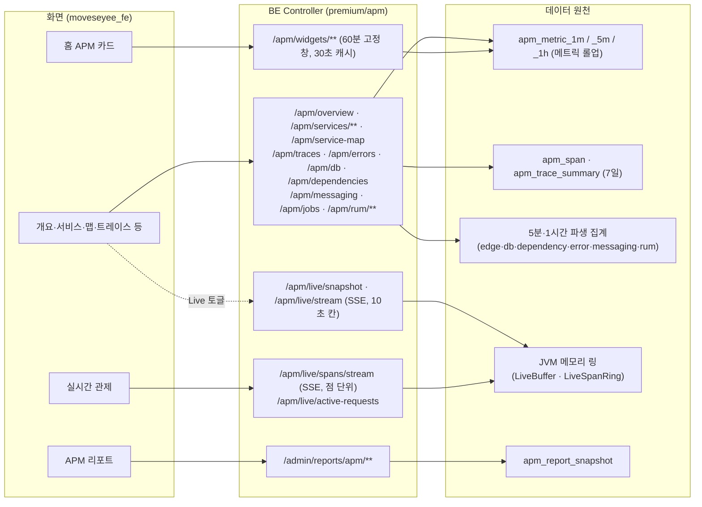

# APM 조회와 분석 기능 상세 가이드

> 이 문서는 APM(애플리케이션 모니터링)에서 **이미 수집된 데이터를 보는 화면 전부**를 기능 단위로 설명한다. 대상은 APM 개요, 서비스 목록·상세, 서비스 맵, 트레이스, 에러·DB·외부 호출, 배포, 메시징·배치, 실시간 관제, 사용자 경험(RUM), APM 리포트, 홈의 APM 카드다. 수신(OTLP)·수집기·토큰·설치 가이드·알람 규칙·SLO·합성 감시·보존/아카이브/내보내기는 같은 폴더의 "APM 수집과 운영" 가이드가 다루며, 여기서는 조회 화면이 그 결과를 소비하는 지점만 적는다. 내용은 BE `e55948c`·FE `9dfcbe8` 소스를 정적으로 읽어 대조한 결과다. 서버 기동·API 호출·브라우저 확인은 하지 않았다.

## 1. 한눈에 보기

### 1.1 기능 목록

상태 표기: `현재` = 소스에 구현됨(배포를 뜻하지 않음), `부분` = 일부만 동작하거나 조건부, `계획`, `보류`.

| 기능 | 화면 주소·메뉴 위치 | 상태 | 권한·라이선스 | 한 줄 설명 |
|---|---|---|---|---|
| 공통 조회 틀(기간·환경·새로고침) | 모든 APM 화면 상단 툴바 | 현재 | — | 기간·환경·자동 새로고침을 URL query로 유지한다 |
| APM 개요 | `/application-monitoring/overview` · 사이드바 > 어플리케이션 모니터링 > APM 개요 | 현재 | `apm.view` + `APM` | 전체 서비스의 요청·오류·지연·상태를 위젯 6종으로 본다. 위젯 배치는 사용자별로 저장된다 |
| 개요의 Live 패널 | 같은 화면 `?live=1` | 현재 | `apm.view` + `APM` | 10초 칸 메트릭을 SSE로 흘려 받는다(설정 `app.apm.live.enabled`, 기본 켜짐) |
| 서비스 목록 | `/application-monitoring/services` · 사이드바 | 현재 | `apm.view` + `APM` | 서비스별 상태·RED·가용성·추이를 표/카드로 비교한다 |
| 서비스 상세(탭 11개) | `/application-monitoring/services/:serviceUid?tab=` | 현재(로그 탭은 계획) | 조회 `apm.view`, 설정 저장·삭제 `apm.edit` | 개요(위젯)·트랜잭션·트레이스·에러·데이터베이스·외부 호출·런타임·인스턴스·배포·합성 감시·설정 |
| 서비스 맵 | `/application-monitoring/service-map` · 사이드바 | 현재 | `apm.view` + `APM` | 서비스·DB·외부 HTTP·큐 사이 호출을 그래프로 본다 |
| 트레이스 탐색 | `/application-monitoring/traces` · 사이드바 | 현재 | `apm.view` + `APM` | 산점도와 목록으로 요청 한 건을 고른다 |
| 트레이스 상세 | `/application-monitoring/traces/:traceId?tab=waterfall\|flame` | 현재 | `apm.view` + `APM`, 원문은 관리자 | 스팬 워터폴·플레임·크리티컬 패스 |
| 에러 분석 | `/application-monitoring/errors` · 전역 검색·주소(사이드바 없음), 서비스 상세 에러 탭 | 현재 | `apm.view` + `APM`, 스택 원문은 관리자 | 예외 그룹 목록·상세·추이 |
| DB 호출 분석 | `/application-monitoring/db-calls` · 전역 검색·주소, 서비스 상세 데이터베이스 탭 | 현재 | `apm.view` + `APM` | 정규화 SQL 그룹별 호출 수·총 소요·p95 |
| 외부 호출 분석 | `/application-monitoring/dependencies` · 전역 검색·주소, 서비스 상세 외부 호출 탭 | 현재 | `apm.view` + `APM` | 외부 대상별 호출 수·오류·p95 |
| 배포 | 서비스 상세 `?tab=deployments` | 현재 | `apm.view` + `APM` | 배포 이력과 전후 비교, 배포 뒤 새로 생긴 예외 |
| 메시징·배치 | `/application-monitoring/messaging` · 전역 검색·주소·트레이스 워터폴의 비동기 링크 | 부분(실 브로커 종단 검증 기록 없음) | `apm.view` + `APM` | 큐/토픽 처리량과 배치 잡 실행 이력 |
| 실시간 관제(요청 관제·X-View) | `/application-monitoring/realtime?tab=active\|xview` · 사이드바 | 부분(기본 꺼짐: `app.apm.live.spans.enabled=false`) | `apm.view` + `APM`, MCP 토큰 거부 | 끝난 요청을 메모리에서 SSE로 흘려 1초 단위로 본다 |
| 진행 중 요청 | 실시간 관제 > 요청 관제 탭 안 카드·목록 | 부분(자바 + MovesEye 확장 설치 서비스만) | `apm.view` + `APM` | 지금 처리 중인 요청 수와 목록(저장하지 않음, 90초) |
| 요청 걸림 장부 | `/setting/apm/alert-rules?tab=stuck` (관리 콘솔 > APM > 알람 규칙) | 현재 | BE는 `apm.view`, 화면 진입은 `apm.edit` | 임계를 넘긴 채 처리 중이던 요청 1건 = 1행 |
| 사용자 경험(RUM) | `/application-monitoring/rum`, `/application-monitoring/rum/pages/:groupId` · 사이드바 | 부분(실 브라우저 조합 검증 기록 제한적) | `apm.view` + `APM` | Web Vitals·페이지뷰·세션·JS 오류 |
| APM 리포트 | `/setting/report-management/apm?id=` 또는 `?periodType=&periodStart=` · 리포트 관리 목록, 개요의 "지난주 리포트" | 현재 | 관리자(userRole ADMIN/SUPER_ADMIN) + `APM` | 주간·월간 굳힌 리포트 본문 |
| 화면 자기설명 | 개요·서비스 목록·서비스 상세 개요/런타임/인스턴스 등 | 부분(미적용 화면 있음) | `apm.view` | 빈 값의 이유, 보존 기간 안내, 지표 뜻 한 줄 |
| 홈의 APM 카드 | 홈(`/`) 위젯 | 현재 | `apm.view` + `APM` | 최근 60분 상태 요약·느린 서비스·트래픽 합계·알람 |
| 합성 감시·SLO·알람 규칙·수집기·서비스 설정 탭 | — | 범위 밖 | — | "APM 수집과 운영" 가이드 참조 |

`apm.view`·`apm.edit`은 역할 편집 화면의 `applicationMonitoring > apm` 한 칸의 보기·편집 체크다. `APM`은 라이선스 기능 이름이다.

### 1.2 구조

조회 화면은 세 종류의 원천을 읽는다.

- **메트릭 롤업**(`apm_metric_1m`·`_5m`·`_1h`): 요청 수·오류 수·지연 히스토그램·런타임 게이지. 개요, 서비스 목록, 서비스 상세의 개요·트랜잭션·런타임·인스턴스가 여기서 나온다. 요청 수·오류율의 정본이다.
- **트레이스와 그 파생 집계**: 스팬 원본(`apm_span`)·요약(`apm_trace_summary`)과 5분·1시간 집계(서비스 맵 엣지, DB 쿼리, 외부 의존, 예외 그룹, 메시징). 수집기의 tail 샘플링을 통과한 트레이스만 들어 있으므로 **건수는 요청 수가 아니다**.
- **JVM 메모리 링**: 실시간 관제와 개요 Live 패널. DB를 거치지 않으며 BE를 재시작하면 비워진다.

## 2. 기능별 상세

### 2.1 공통 조회 틀 — 기간·환경·새로고침·URL 상태

**무엇을 하는가** — 모든 APM 화면이 같은 시간 범위와 환경(env)으로 데이터를 보도록 하고, 그 상태를 주소로 공유할 수 있게 한다.

**화면과 진입 경로** — 각 화면 상단의 `ApmToolbar`. 서비스 셀렉터, 환경 셀렉터, 기간 프리셋, 날짜 범위 선택기, 자동 새로고침 주기, "지금 새로고침" 버튼으로 구성된다. 서비스 상세의 설정·배포·합성 감시 탭과 트레이스 상세에서는 기간 컨트롤을 숨긴다.

**사용 방법**

1. 프리셋 `15분·1시간·6시간·24시간·7일·30일` 중 하나를 고른다. 기본은 1시간이다.
2. 다른 구간이 필요하면 날짜 범위 선택기로 시작·끝을 지정한다. 미래 날짜는 선택할 수 없고, 최대 길이 제한은 화면에 없다.
3. 환경 셀렉터로 env를 고른다(선택지는 서비스 목록 응답의 `envs`).
4. 자동 새로고침을 `끔(기본)·30초·1분·5분` 중에서 고른다.

**동작 원리**

- 상태는 전부 URL query에 있다: `preset`, `from`, `to`(ms 에폭), `env`, `refresh`. 훅 `useApmTimeRange`(`moveseyee_fe/src/hooks/useApmTimeRange.ts`)가 읽고 쓴다.
- 프리셋의 끝 시각은 현재 시각을 **분 경계로 내림**한 값이다. react-query 키가 렌더마다 바뀌지 않게 하기 위해서다. 자동 새로고침이 꺼져 있으면 창이 흐르지 않는다.
- `from`·`to`가 1e11 미만이면 초 단위로 보고 1000을 곱한다(다른 화면에서 복사한 링크 대응).
- 해상도(step)는 창 길이로 정한다: 6시간 이하 60초, 7일 이하 300초, 그 이상 3600초(`apmStepSeconds`). BE도 같은 규칙으로 테이블을 고르고, 창 **시작**이 그 테이블의 보존 밖이면 상위 테이블로 승격한다(`ApmResolution.choose`). 응답의 `step`이 요청과 다를 수 있다.
- BE는 뒤집히거나 비어 있는 창을 400으로 거절하지 않고 "끝 기준 최근 1시간"으로 바꾼다(`ApmTimeRange.of`). 응답이 실제로 쓴 `fromMs`·`toMs`를 돌려준다.
- 사이드바의 APM 메뉴 링크(`ApmNavLink`)는 메뉴를 옮길 때 `preset`·`from`·`to`·`env`·`refresh` 다섯 키만 다음 화면으로 넘긴다. 탭·페이지 번호·화면별 필터는 넘기지 않는다(`moveseyee_fe/src/utils/apmNavigation.ts`).
- 화면별 필터는 접두를 붙인 별도 키를 쓴다: 트레이스 `trService·trInvolved·trRoute·trStatus·trMin·trMax`, 서비스 맵 `mapEdge·mapService·mapQ·mapKinds·mapErrors·mapMinReq·mapLabel·mapOpen·mapGroup`, 에러 `errGroup·errQ·errService`, DB `dbGroup·dbQ·dbService·dbSystem`, 외부 호출 `depTarget·depService`, 메시징 `msgDest·msgSystem·msgService·msgGrouped`, 배치 `jobName·jobService·jobRunService·jobStatus`, 배포 `deploy·deployWindow`.

**빈 값·실패·경계 상태**

- 요청한 시간 격자가 상한을 넘으면 BE가 `APM_QUERY_TOO_MANY_POINTS`(HTTP 200 + body `code:400`)를 준다(3.3절). 화면에는 공통 오류 문구가 뜬다(APV-15).
- **환경 셀렉터는 화면에 따라 효과가 다르다.** 개요·서비스 목록·서비스 맵·Live 패널은 서버가 env로 거른다. 트레이스·에러·DB·외부 호출 화면은 서비스 드롭다운의 선택지만 좁아지고 결과 표는 그대로다(APV-02).

### 2.2 APM 개요

**무엇을 하는가** — "지금 전체가 괜찮은가"를 한 화면에서 답한다. 장애 대응의 첫 화면이다.

**화면과 진입 경로** — 사이드바 > 어플리케이션 모니터링 > APM 개요. `/application-monitoring`으로 들어오면 이 화면으로 보낸다. 홈의 APM 카드에서도 들어온다.

**사용 방법**

1. 위쪽 StatCard 4장에서 전체 초당 요청·오류율·p95·액티브 요청과 **같은 길이의 직전 구간** 대비 증감을 본다.
2. 서비스 상태 도넛에서 상태별 개수를, 서비스×시간 히트맵에서 오류율이 오른 서비스와 시각을 찾는다. 히트맵의 빈 칸은 "요청이 없었다"는 뜻이다.
3. 느린 서비스 Top 5·오류 서비스 Top 5에서 이름을 눌러 같은 기간·환경을 유지한 채 서비스 상세로 간다. 오류율 0%인 서비스는 오류 순위에 넣지 않는다.
4. 최근 알람 카드에서 이 구간에 발화한 알람 10건을 본다. 구간 이전에 발화해 아직 열려 있는 알람은 나오지 않는다.
5. "편집"으로 위젯을 추가·삭제·이동·크기 조정한다. "기본으로 되돌리기"가 기본 세트를 복구한다.
6. Live 토글을 켜면 화면 상단 패널이 10초마다 갱신된다(2.3절).
7. 관리자에게는 "지난주 리포트" 버튼이 보인다(2.19절).

**동작 원리**

- 데이터: `ApmOverviewPage` → `useApmOverview` → `GET /apm/overview` 하나가 위젯 6종을 모두 채운다. 환경 선택지는 `GET /apm/services/overview`의 `envs`에서 온다.
- `ApmOverviewQueryService.overview`는 서비스 목록 조립(`ApmServiceQueryService.overview`)을 그대로 재사용한다. 히트맵은 목록 행의 스파크라인 오류율 배열(24칸)을 옮긴 것이고, Top 5는 목록 행을 정렬한 것이다. 그래서 개요와 목록의 수치가 항상 같다.
- StatCard의 합계(`totals`)는 서비스별 값의 평균이 아니라 요청 수·오류 수를 먼저 더하고 히스토그램을 합친 뒤 계산한다. 직전 구간(`prev`)은 같은 길이만큼 뒤로 민 창이다.
- **모집단이 둘이다.** 도넛(`summary`)은 숨김·승인 대기 서비스를 뺀 목록과 같은 모집단이고, 합계(`totals`)는 숨김·승인 대기를 포함한 전체 트래픽이다. 두 숫자가 맞지 않는 것은 의도다.
- 위젯 배치: `useApmOverviewDashboard` → `/apm/dashboards/overview/widgets`. 사용자별로 저장되며, 한 건도 없으면 기본 세트 6종을 시드한다. 격자는 12열이고 같은 위젯은 대시보드당 1개다. 위젯 타입 정본은 BE `ApmDashboardWidgetType`이고 FE `constants/apmDashboardWidgets.ts`가 사본이다.

**주요 API**

| Method | Path | 용도 | 권한 |
|---|---|---|---|
| GET | `/apm/overview?from&to&env` | 개요 위젯 데이터 | `apm.view` |
| GET | `/apm/services/overview?from&to&env` | 환경 선택지(`envs`) | `apm.view` |
| GET·POST | `/apm/dashboards/overview/widgets` | 위젯 목록·추가 | `apm.view` |
| PATCH | `/apm/dashboards/overview/widgets/layout` | 배치 일괄 저장 | `apm.view` |
| PATCH·DELETE | `/apm/dashboards/overview/widgets/{widgetId}` | 위젯 수정·삭제 | `apm.view` |
| POST | `/apm/dashboards/overview/widgets/reset` | 기본 세트로 되돌리기 | `apm.view` |

**데이터** — 메트릭 롤업 3단, `apm_service`, `apm_alert_event`(최근 알람). 위젯 배치는 홈 위젯과 같은 저장소를 대시보드 키(`apm:overview`)로 나눠 쓴다(Flyway V58).

**권한·라이선스** — 모든 EP 첫 줄에서 `ApmAccessChecker.requireRead`(= `apm.view`)를 검사하고 클래스에 `@RequiresFeature(Feature.APM)`이 붙어 있다. 위젯 배치 쓰기도 `apm.view`다(개인 취향이며 관리 행위가 아니다).

**빈 값·실패·경계 상태**

- 서비스가 0건이고 env 필터가 없으면 온보딩 안내(수집기 설정 → 앱 계측 → 수신 대기)를 보여 준다.
- StatCard 값이 null이면 `—` 대신 이유를 적는다: 요청 없음, 수신 없음, 에이전트 옵션 필요, 보존 기간 밖(2.20절).
- 조회 실패는 화면 위 경고 한 줄로 표시한다. 권한 거부는 HTTP 200 + body `code:403`으로 오며 같은 경고로 표시된다.

**운영 주의** — 개요 한 번은 서비스 목록 조립 한 벌 + 합계 두 벌(현재·직전)을 실행한다. 서비스 목록보다 비싸다.

### 2.3 개요의 Live 패널 (10초 칸 스트림)

**무엇을 하는가** — 롤업을 기다리지 않고 최근 15분의 서비스별 요청·오류·p95를 10초 칸으로 본다. 2.16절의 실시간 관제와는 별개 기능이다.

**화면과 진입 경로** — APM 개요의 Live 토글(`?live=1`). 서비스 카드·히트맵 행 앞의 점도 이 스트림이 켠다.

**동작 원리**

- 수신 시점에 메트릭을 메모리 링(`LiveBuffer`)에 함께 쌓는다. 링은 서비스당 90칸(900초 ÷ 10초)이고, 엔드포인트 축은 최근 60초만 유지한다.
- 화면은 먼저 `GET /apm/live/snapshot`을 읽어 기능이 켜져 있는지(`enabled`)를 확인하고, 토글을 켜면 `EventSource`로 `GET /apm/live/stream`에 붙는다. 이벤트는 `snapshot`(연결 즉시 1회), `bucket`(10초마다 최근 6칸), `heartbeat`(30초마다)다. 화면은 `(serviceUid, ts)`로 덮어쓴다.
- `EventSource`는 헤더를 실을 수 없어 세션 대조용 `visitorId`를 쿼리로 보낸다. 액세스 토큰은 쿠키로만 간다.
- 엔드포인트 Top은 오류율 상위 10 + 최대 지연 상위 10의 합집합이며, 엔드포인트 창(60초) 안의 요청이 3건 미만인 경로는 순위에서 뺀다.
- 연결 하나의 수명은 600초다. 만료되면 브라우저가 스스로 재접속하고 그때 라이선스·권한을 다시 검사한다.

**주요 API**

| Method | Path | 용도 | 권한 |
|---|---|---|---|
| GET | `/apm/live/snapshot?serviceUid&env` | 창 전체 한 벌 | `apm.view` |
| GET (SSE) | `/apm/live/stream?serviceUid&env&visitorId` | 10초 증분 | `apm.view`(없으면 스트림을 열지 않고 200 + body `code:403`) |

**빈 값·실패·경계 상태** — `app.apm.live.enabled=false`면 스냅샷이 `enabled:false` + 빈 목록으로 오고 토글이 비활성으로 그려진다. 에이전트의 메트릭 내보내기 주기가 60초면 60초에 한 칸만 채워진다(상류 지연이 화면 지연을 정한다).

**운영 주의** — 설정 키는 3.2절. 이 스트림에는 동시 연결 상한이 없다(APV-05). 링은 JVM 메모리이므로 BE 재시작 시 비워지고 BE가 여러 대면 노드마다 다른 값을 가진다(APV-04).

### 2.4 서비스 목록

**무엇을 하는가** — 서비스를 한 줄씩 비교해 문제 서비스를 고른다.

**화면과 진입 경로** — 사이드바 > 서비스. URL query: `view`(표/카드), `includeHidden=true`, `status`, 태그 필터, `keyword`.

**사용 방법**

1. 표 또는 카드 보기를 고른다.
2. 상태 칩(정상·성능 저하·중단·수신 끊김·확인 불가)으로 거른다. 기본 정렬은 나쁜 상태부터다.
3. 검색어는 표시명·서비스 이름·env 부분일치다.
4. "숨긴 서비스 포함"을 켜면 숨김 상태도 보인다. 승인 대기 서비스는 이 화면에 나오지 않는다.
5. 행을 누르면 같은 기간·환경으로 서비스 상세로 간다.

화면에 보이는 값의 뜻:

| 값 | 계산 | 창 |
|---|---|---|
| 상태·판정 근거 | 미수신 여부, 오류율·p95 임계 초과 | **창 끝에서 5분**(미수신 판정은 현재 시각 기준 — APV-14) |
| 초당 요청(rps) | 창 안 요청 수 ÷ 창 길이(초). 요청 0건이면 null | 상단 기간 전체 |
| 오류율(%) | 오류 수 ÷ 요청 수 × 100. 요청 0건이면 null | 상단 기간 전체 |
| p50·p95·p99(ms) | 창 안 히스토그램을 합친 뒤 백분위 | 상단 기간 전체 |
| 액티브 요청 | `http.server.active_requests` 게이지 평균. 표본이 없으면 null | 상단 기간 전체 |
| 24시간 가용성(%) | 5분 칸 중 정상+성능 저하로 판정된 칸 ÷ 판정된 칸 | **창 끝 기준 24시간 고정** |
| Apdex | 히스토그램과 서비스의 Apdex T로 계산 | 상단 기간 전체 |
| 스파크라인 | 창을 24칸으로 나눈 rps·오류율·p95 | 상단 기간 전체 |
| 인스턴스 수·버전 | 창 시작 이후 신호가 있었던 인스턴스 | 상단 기간 전체 |

**동작 원리**

- `ApmServiceListPage` → `useApmServicesOverview` → `GET /apm/services/overview`.
- BE(`ApmServiceQueryService.overview`)는 `apm_service` 전량을 읽어 필터한 뒤, 대상 서비스 전체에 대해 배치 질의 여섯 벌(창 합산, 액티브 요청, 스파크 칸, 상태 판정용 5분 창, 런타임 패밀리, 수신 여부)과 24시간 가용성, 인스턴스 조회를 한 번씩 실행한다. 서비스 수만큼 질의를 반복하지 않는다.
- `env`·`q`·`includeHidden`은 서버가 거르고, 상태·태그 필터와 정렬은 브라우저가 한다. 서버 페이징은 없다.
- 캐시(모두 JVM 메모리): 24시간 가용성(키 = 서비스 id + 5분 격자, 최대 4,096건), 런타임 패밀리(TTL 10분), Zabbix 호스트 링크(TTL 5분, 최대 2,000건).
- 상태 판정(`ApmStatusJudge`) 순서: ① 미수신(`stale_minutes` 초과, 기본 5분)이고 배포 유예(새 버전 인스턴스 등장 후 10분) 밖이면, 등록된 수집기 전부도 같은 기준으로 조용할 때 `UNKNOWN`, 아니면 `STALE` → ② 최근 5분 오류율이 임계(기본 5%) 초과면 `DEGRADED` → ③ 최근 5분 p95가 임계(기본 2000ms, 서비스별 느림 임계가 있으면 그 값) 초과면 `DEGRADED` → ④ `UP`. 요청이 0건인 5분은 임계 검사를 건너뛴다.
- `DOWN`(중단)은 현재 코드에서 만들어지지 않는다(APV-03).

**주요 API**

| Method | Path | 용도 | 권한 |
|---|---|---|---|
| GET | `/apm/services/overview?from&to&env&includeHidden&q` | 목록 + 상태 요약 + 필터 선택지(`envs`·`tags`) | `apm.view` |

**데이터** — `apm_service`, `apm_instance`, `apm_collector`(마지막 보고 시각), 메트릭 롤업 3단.

**빈 값·실패·경계 상태** — 서비스가 0건이면 온보딩 안내, 필터 결과가 0건이면 빈 표. 값이 null인 칸은 이유(요청 없음·수신 없음 등)를 적는다. 14일 미수신 서비스는 자동으로 숨김이 된다(설정값).

**운영 주의** — 이 EP는 APM 화면 대부분이 서비스·환경 드롭다운을 채우려고 함께 호출한다(트레이스·에러·DB·외부 호출·서비스 맵·서비스 상세·메시징). 서비스 수가 늘면 모든 화면의 첫 응답이 함께 느려진다(APV-06).

### 2.5 서비스 상세 — 공통과 개요 탭

**무엇을 하는가** — 한 서비스의 상태와 원인 후보를 탭으로 좁힌다.

**화면과 진입 경로** — `/application-monitoring/services/:serviceUid`. 탭은 `?tab=` query다. 정의된 탭은 12개이고 화면에 보이는 탭은 11개다(로그 탭은 미구현이라 표시하지 않으며, `?tab=logs`로 들어오면 개요 탭으로 보낸다). 헤더에 상태 배지·env·버전·인스턴스 수·마지막 수신·연결된 Zabbix 호스트가 있고, 툴바의 서비스 셀렉터로 다른 서비스로 옮긴다.

| 탭(`tab` 값) | 다루는 절 |
|---|---|
| `overview` | 이 절 |
| `transactions` | 2.6 |
| `traces` | 2.10(서비스 고정) |
| `errors` | 2.11(서비스 고정) |
| `database` | 2.12(서비스 고정) |
| `dependencies` | 2.13(서비스 고정) |
| `runtime` | 2.7 |
| `instances` | 2.8 |
| `deployments` | 2.9 |
| `synthetics`·`settings` | 범위 밖("APM 수집과 운영" 가이드) |

**개요 탭 사용 방법** — 서비스 대시보드의 위젯을 본다. 기본 세트는 11종이다: RED 합계 카드, 요청 수, 오류율(알람 임계 점선), 응답시간 p50/p95/p99(배포 시점 표시), 응답시간 분포 히트맵, Apdex, 액티브 요청, 24시간 가용성 띠, 느린 엔드포인트, 오류 엔드포인트, 인스턴스. 상태코드 분포·메서드 분포 위젯은 추가할 수 있다. 편집 방식은 개요 화면과 같고 배치는 사용자별·서비스별로 저장된다.

**동작 원리**

- `GET /apm/services/{uid}`가 헤더와 합계 카드를 채운다. 목록 행과 같은 함수(`assembleRows`)가 만든다.
- 시계열은 `GET /apm/services/{uid}/red-series`(빈 칸도 점을 채우며 `requests=0`, 지연·오류율은 null), 히트맵은 `/latency-heatmap`, 가용성 띠는 `/availability`(칸 폭 기본 300초, 보존에 따른 승격 없음)다.
- 배포 마커는 `red-series` 응답의 `deployments`에 실린다(오래된 것부터 최대 200개).
- 호스트 링크는 인스턴스의 `host.name`(또는 설정의 호스트 수동 매핑)을 자산 DB에서 찾아 Zabbix hostid로 바꾼다(`ApmZabbixHostLinker`). Zabbix API는 부르지 않는다.
- 없는 `serviceUid`는 HTTP 200 + body `code:404` `APM_SERVICE_NOT_FOUND`다.

**주요 API**

| Method | Path | 용도 | 권한 |
|---|---|---|---|
| GET | `/apm/services/{uid}?from&to` | 상세(목록 행 + 임계·호스트·인스턴스·적용 알람 규칙) | `apm.view` |
| GET | `/apm/services/{uid}/red-series?from&to&step` | RED 시계열 + 배포 마커 | `apm.view` |
| GET | `/apm/services/{uid}/latency-heatmap?from&to&step` | 응답시간 분포 | `apm.view` |
| GET | `/apm/services/{uid}/availability?from&to&step` | 가용성 띠 | `apm.view` |
| GET | `/apm/services/{uid}/exemplars?metric&from&to&step&limit` | 차트 점 → 예시 트레이스(기본 200, 최대 1,000) | `apm.view` |
| GET·POST·PATCH·DELETE | `/apm/dashboards/services/{uid}/widgets[/layout\|/{widgetId}\|/reset]` | 서비스 대시보드 배치 | `apm.view` |
| PUT·DELETE | `/apm/services/{uid}` | 설정 수정·삭제(범위 밖) | `apm.edit` |

**빈 값·실패·경계 상태** — 액티브 요청 카드는 에이전트가 그 지표를 최근 7일 동안 보낸 적이 없으면 "에이전트 옵션 필요"로 안내한다. 창이 1분 데이터 보존(기본 7일)을 넘으면 인스턴스 카드의 지표가 빈다.

### 2.6 서비스 상세 — 트랜잭션(엔드포인트) 탭

**무엇을 하는가** — 어느 엔드포인트가 느리거나 실패하는지 찾는다.

**사용 방법**

1. 엔드포인트 표를 호출 수·rps·오류율·p50·p95·p99로 정렬한다. 기본은 p95 내림차순이다.
2. 검색어(경로·메서드 부분일치)와 메서드 필터(`httpMethod`)로 좁힌다.
3. 행을 누르면(`?route=&method=`) 그 엔드포인트의 요청·오류·지연 추이와 트레이스 산점도가 뜬다.
4. 상태코드 분포·메서드 분포는 **서비스 전체** 값이며 선택과 무관하다.

**동작 원리**

- `GET /apm/services/{uid}/endpoints`: 창 안의 전 route를 읽어 route×method로 합산한 뒤 **서버가** 필터·정렬·페이지를 처리한다. 백분위는 히스토그램에서 계산해야 해 DB가 정렬할 수 없기 때문이다. 페이지 크기 기본 50, 최대 500.
- 허용 정렬 키는 `route·requests·rps·errorRatePct·p50Ms·p95Ms·p99Ms`이고 그 밖의 값은 `APM_INVALID_SORT`(body `code:400`)로 거절한다. 지연이 null인 행은 오름·내림 어느 쪽에서도 끝에 온다.
- 서비스당 route 수가 상한(`apm_setting.route_limit`, 기본 500)을 넘으면 수신 시점에 `__other__`로 접힌다. 응답의 `otherRoutes`는 접힌 route 개수가 아니라 `__other__` **행 수**다.
- `GET /endpoints/series?route&method`는 route 완전일치 시계열이다. `activeRequests`는 항상 null이다(그 지표에 route 축이 없다).
- 원 상태코드는 저장하지 않는다. `status-codes`는 1xx~5xx 클래스 분포만 준다.
- 오류율은 5xx만 센다. 4xx는 오류가 아니다.

**주요 API**

| Method | Path | 용도 | 권한 |
|---|---|---|---|
| GET | `/apm/services/{uid}/endpoints?from&to&sort&order&limit&offset&q&method` | 엔드포인트 표 | `apm.view` |
| GET | `/apm/services/{uid}/endpoints/series?route&method&from&to&step` | 엔드포인트 시계열 | `apm.view` |
| GET | `/apm/services/{uid}/status-codes?from&to&step` | 상태 클래스 분포 | `apm.view` |
| GET | `/apm/services/{uid}/methods?from&to` | 메서드 분포 | `apm.view` |

### 2.7 서비스 상세 — 런타임 탭

**무엇을 하는가** — 메모리·GC·스레드·CPU·커넥션 풀 등 런타임 자원을 본다.

**동작 원리** — `GET /apm/services/{uid}/runtime?from&to&step&family`. 런타임 패밀리(JVM·.NET·Node·Python·Go)는 최근 지표 이름으로 판정해 10분 캐시한다(`ApmRuntimeFamilyResolver`). 응답은 슬롯별 시계열(`slots`)과 값이 없는 슬롯의 이유(`absentSlots`: `NOT_INGESTIBLE` = 수신 허용목록 밖, `NOT_RECEIVED` = 이 창에 받지 못함)를 함께 준다.

**빈 값·실패·경계 상태** — 값이 없는 카드는 이유와 다음 행동(설치 가이드·수집기 폐기 사유)을 적는다. 해결 경로 링크는 `apm.edit`이 있을 때만 보인다(대상 화면이 편집 권한 전용이다). 실제 앱으로 확인된 런타임은 JVM이다(기존 화면 가이드 기록).

### 2.8 서비스 상세 — 인스턴스 탭

**무엇을 하는가** — 인스턴스별 상태·버전·호스트·rps·오류율·p95를 비교한다. Kubernetes 앱이면 파드·노드·네임스페이스·디플로이먼트·재시작 횟수·OOM 배지를 보여 준다.

**동작 원리**

- `GET /apm/services/{uid}/instances`: 창 시작 이후 신호가 있었던 인스턴스만 `instanceId` 오름차순으로 준다. 상세 응답의 `instances`와 같은 함수가 만든다.
- 인스턴스 지표는 **1분 테이블에만** 있다. 창 시작이 1분 보존(기본 7일) 밖이면 지표가 전부 null이고 `metricsAvailable:false`가 실린다.
- 인스턴스 상태는 `UP`·`STALE` 둘뿐이며 창 끝 시각 기준 `stale_minutes`로 판정한다.
- `GET /instances/{instanceId}/series`: 1분 해상도 전용이다. 창이 보존을 넘으면 오류가 아니라 빈 시계열을 준다(응답 `step`이 60이 아니면 그 신호다).
- 화면은 최대 6개 인스턴스의 추이를 겹쳐 비교한다.

**빈 값·실패·경계 상태** — "7일" 프리셋은 창 시작이 보존 경계에 걸려 지표가 비는 일이 있다. 화면 안내가 "24시간 또는 직접 지정"을 권한다(APV-16).

### 2.9 서비스 상세 — 배포 탭

**무엇을 하는가** — 배포 시점과 그 전후의 p95·오류율·rps를 비교하고, 배포 뒤 새로 생긴 예외를 본다.

**사용 방법**

1. 배포 목록(버전·시각·출처 `AUTO`/`WEBHOOK`)에서 한 건을 고른다(`?deploy=`).
2. 비교 창을 15·30·60·180·360·1440분 중에서 고른다(`?deployWindow=`, 기본 60분).
3. 전후 수치와 새 예외 목록을 본다. 개선·악화 판정은 하지 않고 숫자만 보여 준다.

**동작 원리**

- 자동 감지: 새 `service.version`을 가진 인스턴스가 처음 관측되면 배포 1건을 기록한다(`ApmDeploymentDetector`, 30분 안의 같은 버전은 한 건으로 묶는다).
- 웹훅: `POST /apm/services/{uid}/deployments`를 deploy 범위 토큰으로 부른다(수신 쪽 기능).
- 목록 기본 창은 최근 30일, 페이지 기본 50·최대 500. 비교 창은 5~1,440분으로 잘린다. 새 예외 목록은 기본 50·최대 200.
- 전후 비교(`ApmSeriesQueryService.redWindow`)는 창 안 히스토그램을 한 번에 합친 뒤 백분위를 낸다(버킷별 p95의 평균이 아니다).

**주요 API**

| Method | Path | 용도 | 권한 |
|---|---|---|---|
| GET | `/apm/services/{uid}/deployments?from&to&limit&offset` | 배포 목록 | `apm.view` |
| GET | `/apm/deployments/{id}/compare?window` | 전후 비교 | `apm.view` |
| GET | `/apm/deployments/{id}/new-errors?window&limit` | 배포 뒤 처음 나타난 예외 그룹 | `apm.view` |

**빈 값·실패·경계 상태** — 같은 버전 재배포, `service.version`을 보내지 않는 앱은 자동 감지가 잡지 못한다. 방금 일어난 배포는 "후" 창 길이가 0이라 요청 0건으로 답한다.

### 2.10 트레이스 탐색·상세

**무엇을 하는가** — 느리거나 실패한 요청 한 건을 골라 어느 구간에서 시간을 썼는지 본다.

**화면과 진입 경로** — 사이드바 > 트레이스 탐색, 서비스 상세 트레이스 탭(서비스 고정), 트랜잭션 탭(선택 엔드포인트 고정, 산점도만). 에러 그룹·DB 쿼리 그룹·배치 실패·차트 예시 점·실시간 X-View의 점에서 상세로 들어온다.

**사용 방법**

1. 필터: 서비스, "거쳐 간 것 포함"(`trInvolved=1`), 루트 이름 부분일치, 상태(전체·오류·정상), 지연 범위(ms).
2. 산점도(가로 시간, 세로 지연 로그 눈금, 붉은 점 = 오류)에서 드래그로 범위를 좁힌다.
3. 목록에서 한 건을 눌러 상세로 간다.
4. 상세의 워터폴 탭에서 스팬 트리·시간 막대·크리티컬 패스를 보고, 플레임 탭(`?tab=flame`)에서 같은 이름 스팬을 합친 뷰를 본다. 선택 스팬은 `?span=`에 남는다.

**동작 원리**

- 목록·산점도는 `apm_trace_summary`를 읽는다. 목록은 `limit/offset` 페이징(기본 50, 최대 500; 화면은 10건씩), 정렬 키는 `startTs·durationMs·spanCount`다.
- 총 건수는 100,000에서 멈추고 `totalCapped:true`로 알린다.
- 서비스 필터는 기본이 "이 서비스에서 **시작한** 트레이스"(`root_service_id`)이고, "거쳐 간 것 포함"이면 `service_ids` 배열을 검사한다.
- 루트 이름 필터는 `root_name` 부분일치다. 요약 테이블에 `http.route` 컬럼은 없다.
- 산점도는 창을 `cells`칸(기본 120, 최대 600)으로 나누고 칸마다 느린 것부터 훑어 지연 로그 구간별 `perCell`개(기본 3, 최대 20)를 남긴다. 칸당 훑는 행 수는 `200,000 ÷ cells`(최소 200)다.
- 상세는 `apm_span`에서 한 트레이스의 스팬을 최대 5,000개 읽어 트리를 세운다. 넘으면 `truncated:true`다. 루트 스팬이 없거나 순환이 있으면 `rootMissing`·`cycleBroken`으로 알린다.
- 스팬 속성·이벤트는 원문 열람 판정(`ApmRawTextPolicy`)을 거친다(3.1절).
- 화면은 스팬 120행부터 가상 스크롤로 그린다.

**주요 API**

| Method | Path | 용도 | 권한 |
|---|---|---|---|
| GET | `/apm/traces?from&to&service&involved&route&status&minMs&maxMs&sort&order&limit&offset` | 목록 | `apm.view` |
| GET | `/apm/traces/scatter?…&cells&perCell` | 산점도 | `apm.view` |
| GET | `/apm/traces/{traceId}` | 상세(스팬 트리·크리티컬 패스) | `apm.view` |
| GET | `/apm/traces/{traceId}/flame` | 플레임 트리 | `apm.view` |
| POST | `/apm/traces/compare` | 두 트레이스의 경로별 자기 시간 차 — **FE 미사용** | `apm.view` |

**데이터** — `apm_span`·`apm_trace_summary`(Flyway V44, 일 파티션, 기본 보존 7일). 응답의 `oldestAvailableMs`가 보존 경계를 알려 준다.

**빈 값·실패·경계 상태**

- 보존을 넘긴 트레이스는 `APM_TRACE_NOT_FOUND`(body `code:404`)이고 화면은 "만료됨"으로 안내한다.
- "샘플 기준" 안내가 항상 선다. 느린 것·실패한 것은 전부 남고 정상 요청은 수집기 설정 비율만 남으므로, 건수는 요청 수가 아니고 오류 비중은 실제보다 크게 보인다.
- 환경 셀렉터는 이 화면의 결과를 거르지 않는다(APV-02).

### 2.11 에러 분석

**무엇을 하는가** — 같은 예외를 그룹으로 묶어 발생 추이, 영향 엔드포인트, 스택, 예시 트레이스를 본다.

**동작 원리**

- 그룹 기준은 서비스 + 예외 타입 + 정규화 메시지다. 그룹 본체는 `apm_error_group`, 발생 수는 1시간 버킷 `apm_error_group_1h`에 있다.
- 1시간 버킷을 읽으므로 창 시작을 **정시로 내려** 조회한다(`ApmTimeRange.fromTsHourFloor`). 15분 창을 물어도 발생 수는 그 창을 덮는 정시 버킷 전체의 합이다(최대 1시간분). 목록에 뜨는 그룹 자체는 `first_seen_at`·`last_seen_at`으로 한 번 더 거른다.
- 목록은 페이지 기본 50·최대 500, 검색어는 예외 타입·메시지 부분일치다.
- 상세의 `sampleStack`은 원문 열람 판정을 거친다(3.1절).

**주요 API**

| Method | Path | 용도 | 권한 |
|---|---|---|---|
| GET | `/apm/errors?from&to&service&q&sort&order&limit&offset` | 그룹 목록 | `apm.view` |
| GET | `/apm/errors/{groupId}?from&to` | 그룹 상세(스택·영향 엔드포인트 상위 5·예시 트레이스) | `apm.view` |
| GET | `/apm/errors/{groupId}/series?from&to` | 발생 추이 | `apm.view` |

**빈 값·실패·경계 상태** — 예시 트레이스 링크는 7일이 지나면 만료 안내로 떨어진다(그룹은 90일 보존). 조회 실패는 표 위 배너로 표시한다.

### 2.12 DB 호출 분석

**무엇을 하는가** — 정규화한 SQL 그룹별 호출 수·평균·p95·총 소요·오류를 비교한다. 기본 정렬은 총 소요다.

**동작 원리** — 그룹 본체 `apm_db_query_group`, 5분 집계 `apm_db_query_5m`. `GET /apm/db/systems`가 서비스→DB 흐름 카드를, `GET /apm/db/queries`가 표를 채운다(페이지 기본 50·최대 500, 검색은 정규화 SQL 부분일치, `system` 필터). 화면에 보이는 SQL은 리터럴이 `?`로 바뀐 정규화 문장이다.

**주요 API**

| Method | Path | 용도 | 권한 |
|---|---|---|---|
| GET | `/apm/db/queries?from&to&service&system&q&sort&order&limit&offset` | 쿼리 그룹 목록 | `apm.view` |
| GET | `/apm/db/systems?from&to&service` | DB 시스템별 요약 | `apm.view` |
| GET | `/apm/db/queries/{groupId}?from&to` | 그룹 한 건 | `apm.view` |
| GET | `/apm/db/queries/{groupId}/series?from&to` | 추이 | `apm.view` |

**운영 주의** — 5분 집계는 롤업 뒤에 보인다. 화면 안내 기준으로 최대 8분 늦다. 이 화면은 애플리케이션 요청에서 발생한 SQL 비용을 보는 곳이며 데이터베이스 자체의 상태 모니터링이 아니다.

### 2.13 외부 호출 분석

**무엇을 하는가** — 서비스가 부르는 외부 주소별 호출 수·오류율·p95·타임아웃 수를 본다.

**동작 원리** — 5분 집계 `apm_dependency_5m`. 목록은 최대 500행이고 대상은 주소(호스트)뿐이며 경로는 저장하지 않는다. 행을 누르면(`?depTarget=`) `GET /apm/dependencies/series`로 추이를 그린다.

| Method | Path | 용도 | 권한 |
|---|---|---|---|
| GET | `/apm/dependencies?from&to&service` | 대상 목록 | `apm.view` |
| GET | `/apm/dependencies/series?from&to&service&target` | 대상 하나의 추이 | `apm.view` |

**빈 값·실패·경계 상태** — 앱이 타임아웃을 삼키고 폴백하면 오류로 잡히지 않는다.

### 2.14 서비스 맵

**무엇을 하는가** — 누가 누구를 부르는지, 어느 경로가 느리거나 실패하는지 그림으로 본다.

**사용 방법**

1. 노드는 서비스·DB·외부 HTTP·큐다. 화살표 굵기는 호출 수, 색은 오류율, 라벨은 p95다.
2. 화살표를 누르면(`?mapEdge=`) 오른쪽 패널에 호출 수·오류율·p50/p95/p99와 추이가 뜬다.
3. 서비스 셀렉터는 이동이 아니라 필터다. 그 서비스에 닿는 1홉 이웃만 남긴다.
4. 검색(`mapQ`), 종류(`mapKinds`), 오류만(`mapErrors`), 최소 호출 수(`mapMinReq`), 그룹화(`mapGroup`)로 좁힌다.

**동작 원리**

- `GET /apm/service-map`은 5분 집계 `apm_service_edge_5m`을 창 안에서 합산한다. 엣지는 호출 수 내림차순으로 최대 2,000개이고 넘으면 `truncated`로 알린다.
- env 필터는 **호출하는 쪽** 서비스의 env에만 건다.
- 엣지 추이(`/edges/series`)의 해상도는 300·900·1800·3600초 중 요청값 이상인 가장 가까운 값이다. 그 창에 관측이 없으면 `APM_EDGE_NOT_FOUND`(body `code:404`)다.
- 화면은 React Flow + dagre로 배치한다. 같은 데이터면 같은 그림이 나오도록 입력을 정렬한다. 끌어 옮긴 위치는 저장되지 않는다.

| Method | Path | 용도 | 권한 |
|---|---|---|---|
| GET | `/apm/service-map?from&to&env&service` | 노드·엣지 | `apm.view` |
| GET | `/apm/service-map/edges/series?from&to&fromServiceUid&toKind&toRef&step` | 엣지 추이 | `apm.view` |

**빈 값·실패·경계 상태** — 방금 띄운 서비스는 5분 롤업이 돌 때까지 보이지 않는다. 점선 노드는 계측이 없어 상대편 스팬만 보고 그린 것이다. 샘플 기준이라 오류 비중이 실제보다 크게 보일 수 있다.

### 2.15 메시징·배치

**무엇을 하는가** — 요청-응답 밖에서 도는 큐/토픽 처리와 배치 잡을 본다.

**화면과 진입 경로** — `/application-monitoring/messaging`. 사이드바에 없다. 전역 검색, 주소 직접 입력, 트레이스 워터폴의 비동기 링크로 들어온다.

**동작 원리**

- 메시징: 5분 집계 `apm_messaging_5m`(Flyway V52)에서 목적지(큐/토픽)별 처리량·소비 지연을 읽는다. `GET /apm/messaging/destinations?from&to&service&system`(최대 500행), `GET /apm/messaging/series?destination&from&to&service&system&operation`(5분 칸).
- 배치: `job.name` 규약으로 보낸 스팬에서 만든 실행 기록 `apm_job_run`(V52)으로 잡별 마지막 실행·성공률·실행 목록·간트를 만든다. `GET /apm/jobs`(최대 500), `/apm/jobs/runs`(최대 2,000), `/apm/jobs/timeline`(레인당 막대 최대 200). 배치 조회 코드는 `premium/apm/job`에 있다.
- 권한은 다섯 EP 모두 `apm.view` + `APM` 라이선스다.
- 서비스 필터는 두 절이 따로 가진다(`msgService`·`jobService`). 기간은 공유한다.

**빈 값·실패·경계 상태** — 배치 화면이 비면 대개 앱이 `job.name` 규약대로 스팬을 보내지 않는 것이다. 빈 상태에 규약이 적혀 있다. 실행 중인 잡은 끝나야 나타난다.

### 2.16 실시간 관제 — 요청 관제·X-View·진행 중 요청

**무엇을 하는가** — 방금 끝난 요청을 1초 단위로 보고, 느린 점·오류 점을 골라 원인을 본다. 자바 확장을 붙인 서비스는 지금 처리 중인 요청도 본다.

**화면과 진입 경로** — 사이드바 > 실시간 관제(`/application-monitoring/realtime`). 탭은 `?tab=active`(요청 관제, 기본)·`?tab=xview`다. 두 탭은 함께 마운트된 채 보임만 바뀌며 SSE 연결 하나를 공유한다.

URL query: `svc`(서비스 UUID), `env`, `win`(재접속 때 받는 과거 범위, `300` 기본·`900`), `at`(일시 정지 시각), `mode=wall`(관제실 배치), `err`(`http5xx` 기본·`spanError`), `sort`, `lat`, `sel`(브러시 범위), `pt`(선택 점), `route`, `inst`.

**사용 방법**

1. 요청 관제 탭: 전체 TPS·p95·오류율 게이지, 서비스 타일, 지연 구간 차트를 본다. "관제실" 버튼은 사이드바·헤더를 덮는 전체 화면 배치로 바꾼다(Esc·전체화면 해제·새로고침으로 나간다).
2. 진행 중 요청 카드: 원판 3개(1초 미만·1~5초·5초 이상)와 요청 흐름 무대, 처리 중 요청 목록(경과·주소·지금 하는 일·trace)을 본다. 확장이 없는 서비스는 "확장 없음"이다(0건이 아니다).
3. X-View 탭: 점 하나 = 끝난 요청 하나. 드래그로 범위를 고르면 아래 표에 그 범위의 요청이 뜨고, 점을 누르면 상세 서랍과 트레이스 상세 링크가 뜬다. "표시 n / 관측 m" 배지가 항상 붙는다.
4. 화면 위 "내 연결 n/4 · 전체 시청 a/40"은 이 계정의 연결 수와 전체 연결 수다. 숨긴 탭도 센다. "연결 끊기"를 누르면 자리를 즉시 돌려준다.

**동작 원리**

- 데이터의 길이 저장과 다르다. 수집기의 라이브 전용 파이프라인이 HTTP 서버 스팬만 추려 `/apm/otlp-live/**`로 보내고, BE는 이를 DB에 넣지 않고 메모리 링(`LiveSpanRing`)에 둔다. 보관 창은 최대 900초, 전체 점 상한은 1,400,000이다.
- 화면은 `EventSource`로 `GET /apm/live/spans/stream`에 붙는다. 같은 화면 조건(서비스·env·범위)의 연결은 직렬화 결과를 공유한다. 끊겼다 붙으면 `sinceEpoch`·`sinceSeq`·`viewKey`와 `Last-Event-ID`로 이어 받는다.
- 연결 상한: 동시 활성 40, 대기 10, 계정당 4, 동시 스냅샷 생성 2, 연결당 송신 큐 8 MiB, 쓰기 한 번 2초. 송신 워커는 4개이고 작업 큐는 활성+대기 합이다. 상한을 넘으면 대기열에 들어가 heartbeat만 받고, 대기열도 차면 `429 APM_LIVE_TOO_MANY_CONNECTIONS`다.
- 느린 연결은 그 연결만 끊는다. 다른 사람 화면에는 영향을 주지 않는다.
- 진행 중 요청: 자바 확장이 1초마다 처리 중 목록을 보낸다. BE는 인스턴스별 마지막 한 장만 메모리에 두고 90초가 지나면 버린다. 스트림에는 서비스당 20건만 싣고, 목록 서랍을 연 화면만 `GET /apm/live/active-requests?serviceId=`를 2초마다 읽는다(서비스 합 최대 100건, 인스턴스당 40건·최대 16대).
- 주소와 "지금 하는 일"(SQL·외부 호출)은 **확장이 앱 쪽에서 가린 값**이다. BE는 길이만 자른다(주소 512자, 설명 200자).
- 브라우저 표시 상한: 투영 300,000점, 서비스 타일 60개(`realtime/liveSpans/constants.ts` — 기존 감사 기록 인용, 이번에 값은 재확인하지 않았다).

**주요 API**

| Method | Path | 용도 | 권한 |
|---|---|---|---|
| GET (SSE) | `/apm/live/spans/stream?visitorId&serviceUid&env&snapshot-seconds&sinceEpoch&sinceSeq&viewKey` | 점 스트림 | `apm.view`, MCP 토큰 거부 |
| GET | `/apm/live/spans/stats` | 내 연결 수·전체 연결 수·상한·거절 누적 | `apm.view`, MCP 토큰 거부 |
| GET | `/apm/live/active-requests?serviceId` | 처리 중 요청 전체 목록 | `apm.view` |

**권한·라이선스** — 스트림은 연결을 여는 요청에서만 권한·라이선스·세션을 검사한다. `EventSource`는 HTTP 상태와 본문을 읽지 못하므로 거절 사유를 **HTTP 200 + `event: control`** 한 건(`{type:"reject", code, errorCode, retryable}`)으로 내려 준다: `403 APM_VIEW_FORBIDDEN`(권한 없음·MCP 토큰), `403 APM_LICENSE_REQUIRED`, `503 APM_LIVE_DISABLED`, `429 APM_LIVE_TOO_MANY_CONNECTIONS`(재시도 가능, 15초 뒤). 세션 불일치는 HTTP 401, 잘못된 쿼리는 HTTP 400 `APM_LIVE_INVALID_QUERY`다(`LiveStreamRejectionAdvice`).

**빈 값·실패·경계 상태**

- 기본 설정에서는 꺼져 있다. 켜려면 네 가지가 함께 필요하다: BE 설정 `app.apm.live.spans.enabled=true`, 수집기 설정 생성 시 라이브 옵션, 수집기 실행줄의 feature gate, 앱 SDK의 전송 지연 설정. 하나라도 빠지면 화면이 "사용 안 함" 또는 빈 상태로 남는다(상세는 수집 쪽 가이드).
- BE를 재시작하면 빈 화면에서 다시 시작한다.
- 진행 중 요청은 자바 + MovesEye 확장 jar를 붙인 서비스에서만 값이 있다.

**운영 주의** — 설정 키는 3.2절. 활성 연결을 늘리면 힙이 아니라 송신 대역폭이 는다(최대 프레임 8 MiB × 연결 수). 프록시가 응답을 모으지 않도록 `X-Accel-Buffering: no`를 보내지만 아파치 `mod_proxy`는 이 헤더를 보지 않으므로 배포 설정(`flushpackets=on`)이 따로 필요하다(코드 주석 기록).

### 2.17 요청 걸림 장부

**무엇을 하는가** — 임계(기본 60초)를 넘긴 채 처리 중이던 요청을 한 건씩 남긴 기록을 본다. 실시간 화면의 진행 중 요청은 90초 뒤 사라지지만 이 장부는 남는다.

**화면과 진입 경로** — 관리 콘솔 > APM > 알람 규칙 > 요청 걸림 탭(`/setting/apm/alert-rules?tab=stuck`). 실시간 관제 화면에는 이 장부로 가는 링크가 없다.

**동작 원리** — 1초 감시기가 처리 중 목록에서 임계를 넘긴 요청을 `apm_stuck_request`(Flyway V67)에 기록한다(감시·알람 발화는 수집·운영 쪽 범위). 조회는 `GET /apm/stuck-requests?serviceUid&from&to&open&limit&offset`이고 기본 창은 최근 7일, 페이지 기본 50·최대 500이다. `resolvedAt`이 null이면 아직 걸려 있다. `endReason`은 `ENDED`(끝남)·`LOST`(관측 끊김 — 끝났는지 모른다)·`RULE_OFF`(규칙 꺼짐)다. 보존은 90일이다.

**권한·라이선스** — BE EP는 `apm.view`로 열린다. 그러나 이 탭이 들어 있는 알람 규칙 화면 라우트는 `apm.edit` 축이다. 보기 권한만 가진 사용자는 화면으로 이 장부에 닿을 수 없다(APV-12).

### 2.18 사용자 경험(RUM)

**무엇을 하는가** — 실제 사용자 브라우저에서 잰 Web Vitals(LCP·INP·CLS·TTFB·FCP)·페이지뷰·세션·JS 오류를 본다.

**화면과 진입 경로** — 사이드바 > 사용자 경험(RUM). 페이지 그룹을 누르면 `/application-monitoring/rum/pages/:groupId`. 편집 권한이 있으면 툴바에 "RUM 설정"(수집기 화면의 RUM 탭) 버튼이 보인다.

**동작 원리**

- 원천은 5분 집계 `apm_rum_page_5m`(키: 페이지 그룹 × 브라우저 × OS × 국가 힌트 × 버킷, Flyway V57)다.
- 목록 화면은 EP 4개를 함께 부른다: `/pages`(그룹 표, PV 내림차순 상위 500), `/vitals`(분포 카드), `/series`(PV·세션 추이), `/breakdown?by=browser|os|geo`. **네 EP 모두 같은 창의 원시 행을 최대 50,000행까지 각자 읽어** 메모리에서 집계한다. 넘으면 최신 버킷부터 남기고 `truncated:true`를 준다.
- 창은 5분 격자로 넓혀 조회하고 실제 쓴 창을 응답에 싣는다. 기본 1시간, **30일 초과는 400으로 거절**한다(다른 APM 화면과 다른 규칙).
- 세션 수는 "5분 버킷별 고유 세션의 합"(`DISTINCT_PER_PAGE_DIMENSION_5M_SUM`)이다. 다른 도구의 세션과 정의가 다르다.
- 상세(`/pages/{groupId}`)는 로드 timing(이름별), JS 오류 그룹, 연결된 백엔드 트레이스를 보여 준다. 세 질의 모두 51행까지만 읽는다(50건 초과 여부 판단용으로 보이며, 잘림 표시 방식은 이번에 확인하지 않았다).
- 토큰(사이트)별 필터가 없다. 여러 사이트가 RUM을 보내면 Vitals·추이는 전체 합이다(APV-10).

**주요 API**

| Method | Path | 용도 | 권한 |
|---|---|---|---|
| GET | `/apm/rum/pages?from&to` | 페이지 그룹 표 | `apm.view` |
| GET | `/apm/rum/pages/{groupId}?from&to` | 그룹 상세 | `apm.view` |
| GET | `/apm/rum/vitals?from&to` | Vitals 분포 | `apm.view` |
| GET | `/apm/rum/series?from&to` | PV·세션 추이 | `apm.view` |
| GET | `/apm/rum/breakdown?from&to&by` | 브라우저·OS·국가 분포 | `apm.view` |
| GET·POST·DELETE·PUT | `/apm/rum/tokens`, `/origins`, `/snippet` | 토큰·origin·스니펫(범위 밖) | `apm.edit` |

**빈 값·실패·경계 상태** — 데이터가 없으면 설치 안내가 뜬다. `truncated`면 화면이 잘림 안내를 표시한다. 국가는 GeoIP가 아니라 헤더·언어 힌트다.

### 2.19 APM 리포트

**무엇을 하는가** — 주간(월요일 시작)·월간(1일 시작) 단위로 굳힌 APM 요약을 연다. 본문은 기간 합계와 직전 기간 대비 증감, 서비스별 RED·가용성·배포·알람·SLO 성적, 상위 예외다.

**화면과 진입 경로** — 설정 > 리포트 관리 목록의 APM 행(`/setting/report-management/apm?id=`), 개요의 "지난주 리포트" 버튼(`?periodType=WEEK&periodStart=YYYY-MM-DD`). APM 메뉴 아래가 아니라 리포트 관리 아래에 둔 이유는 권한 축이 관리자이기 때문이다.

**동작 원리**

- 스케줄러 잡 `apm_report_weekly`·`apm_report_monthly`가 마감된 기간을 계산해 `apm_report_snapshot`(Flyway V55, `(period_type, period_start)` UNIQUE)에 upsert한다. 한 회차는 마지막으로 굳힌 기간 다음부터 최대 3개 기간을 메운다.
- `GET /admin/reports/apm/{id}`는 굳은 본문을 그대로 읽는다.
- `GET /admin/reports/apm/detail?periodType&periodStart`는 저장본이 없고 그 기간이 마감됐으면 **그 자리에서 계산해 저장한다**(GET이지만 부작용이 있다). 미마감 기간은 `REPORT_PERIOD_NOT_CLOSED`, 잘못된 값은 `APM_REPORT_PERIOD_INVALID`(둘 다 body `code:400`)다. `periodStart`는 기간 시작일이 아니어도 그 날짜가 속한 기간으로 정규화한다.
- 지나간 기간을 처음 열면 **지금 남아 있는 데이터**로 만든다. 5분 롤업(30일)·예외 그룹(90일)이 지난 기간은 그만큼 얇다.
- 기간 경계는 UTC다. 메트릭 조회 축은 서버 로컬 시간대다(APV-21).

**권한·라이선스** — `ReportAdminAccess`(userRole이 ADMIN 또는 SUPER_ADMIN). `apm.view`만으로는 열 수 없다. `@RequiresFeature(Feature.APM)`이 붙는다. 잡은 `requiresActiveLicense() = false`다.

### 2.20 화면 자기설명 — 빈 값 이유·보존 안내·지표 뜻

**무엇을 하는가** — 값이 비었을 때 "고장인가, 원래 이런가"를 화면이 스스로 말한다. 상세 명세는 [APM 화면 자기설명](../../features/solutions--APM-%ED%99%94%EB%A9%B4-%EC%9E%90%EA%B8%B0%EC%84%A4%EB%AA%85.md)이 정본이고 여기서는 현재 적용 범위만 정리한다.

| 부품 | 무엇을 말하나 | 판정 근거 | 적용된 화면(코드 기준) |
|---|---|---|---|
| `ApmEmptyReason` | 요청 없음 / 수신 없음 / 에이전트 옵션 필요 / 보존 기간 밖 / 수신 허용목록 밖 / 이 창에 받지 못함 | 응답의 `requests`·`received`·`activeRequestsLastSeenMs`·`absentSlots`, 보존 일수 | 개요, 서비스 목록, 서비스 상세 개요 위젯, 런타임 탭, 인스턴스 추이, 공용 차트 카드 |
| `ApmRetentionNotice` | 창이 보존 밖이거나 해상도가 승격됨 | `GET /apm/settings/retention`(`apm.view`) + 응답의 `oldestAvailableMs` | 개요, 서비스 상세 개요·런타임·인스턴스, 트레이스, 에러, DB, 외부 호출, 서비스 맵 |
| `ApmAggNotice` | "샘플 기준 · 집계 지연" | 고정 문구 | 서비스 맵, 에러, DB, 외부 호출 |
| `useApmMetricGuide`·`ApmMetricTerm` | 지표 뜻 한 줄 | 고정 문구 | 개요, 서비스 목록, 서비스 상세 개요·트랜잭션·인스턴스 |

적용되지 않은 화면: 메시징·배치, RUM, 배포, 실시간 관제에는 `ApmEmptyReason`·`ApmRetentionNotice`가 없다. 이 화면들은 각자의 빈 상태 문구를 쓴다.

보존 일수는 APM 라우트 루트의 `ApmRetentionProvider`가 한 번 읽어 화면 전체에 나눠 준다. 응답이 없거나 실패하면 FE 상수(1분 7일·5분 30일·1시간 400일 등)로 폴백한다.

### 2.21 홈의 APM 카드

**무엇을 하는가** — 홈 대시보드에서 APM 상태를 요약으로 본다. 상세 분석은 APM 화면에서 한다.

**동작 원리** — `GET /apm/widgets/status-summary|slow-services|traffic-totals|alerts`. 창은 **최근 60분 고정**이고 `limit`은 기본 5·최대 20이다. 합계는 개요의 `totals`와 같은 함수를 쓰므로 같은 창이면 개요와 같은 수치다. 결과는 JVM 메모리에 30초 캐시한다(`ApmWidgetService`). 권한은 `apm.view` + `APM` 라이선스다. 홈 화면이 카드를 노출하는 조건은 이번에 홈 코드를 열어 확인하지 않았다(6절).

## 3. 공통 동작과 설정

### 3.1 권한·라이선스·데이터 범위

| 축 | 판정 | BE 강제 위치 |
|---|---|---|
| 라이선스 | `Feature.APM` 보유 | 모든 조회 Controller의 `@RequiresFeature(Feature.APM)`(인터셉터). FE `FeatureGate("APM")`는 안내용 |
| 조회 | 역할의 `applicationMonitoring > apm` 보기(`apm.view`). 기본값 열림. ADMIN·SUPER_ADMIN은 항상 통과 | 각 EP 첫 줄 `ApmAccessChecker.requireRead` |
| 관리 | 같은 칸의 편집(`apm.edit`). 기본값 닫힘 | `ApmAccessChecker.requireEdit` |
| 리포트 | userRole ADMIN·SUPER_ADMIN | `ReportAdminAccess.require` |
| 원문 열람 | userRole ADMIN·SUPER_ADMIN | `ApmAccessChecker.canViewRawText` → `ApmRawTextPolicy` |
| 사람 세션 | `x-visitor-id` 헤더(SSE는 `visitorId` 쿼리)와 Redis 로그인 세션 대조 | `@VisitorIdCheck`·`VisitorSessionChecker` |

- 권한 거부는 HTTP 200 + body `code:403` `errorCode:"FORBIDDEN"`이다. 미인증만 HTTP 401이다.
- **서비스 단위 데이터 범위는 없다.** `apm.view`가 있으면 모든 서비스·환경의 데이터를 본다. 호스트 그룹 스코프는 APM 조회에 적용되지 않는다.
- 원문 판정표(현재 코드): 관리자는 항상 원문. 비관리자는 `keep_raw_sql`이 켜져 있으면 마스킹, **꺼져 있으면 저장값 그대로**다. 꺼져 있는 동안 적재된 값은 수신 시점에 이미 마스킹돼 있다는 전제다(APV-01).
- 라이선스는 SSE에서 연결 시점에만 검사한다. 스트림 수명(600초)이 회수 반영의 최대 지연이다.

### 3.2 설정 키

| 키(환경변수) | 기본값 | 뜻 |
|---|---|---|
| `app.apm.live.enabled` (`APM_LIVE_ENABLED`) | true | 개요 Live 패널의 링 버퍼·SSE |
| `app.apm.live.window-seconds` / `bucket-seconds` | 900 / 10 | 링이 담는 시간 / 칸 폭. 창은 칸의 배수여야 기동한다 |
| `app.apm.live.route-window-seconds` | 60 | 엔드포인트 축 유지 시간 |
| `app.apm.live.tick-buckets` | 6 | SSE tick 한 번에 겹쳐 보내는 칸 수 |
| `app.apm.live.max-services` / `max-routes-per-service` | 200 / 200 | 링을 가질 서비스 수 / 서비스당 route 수 |
| `app.apm.live.stream-timeout-seconds` / `heartbeat-seconds` | 600 / 30 | SSE 연결 수명 / heartbeat |
| `app.apm.live.max-heap-mb` | 384 | 링 힙 예산. 설정 조합의 추정치가 넘으면 기동 실패 |
| `app.apm.live.spans.enabled` (`APM_LIVE_SPANS_ENABLED`) | **false** | 실시간 관제(점 스트림) 수신 관문 |
| `app.apm.live.spans.stream.max-active` / `max-waiting` / `per-user` | 40 / 10 / 4 (상한 500 / 200 / 16) | 동시 시청·대기열·계정당 연결 |
| `app.apm.live.spans.stream.max-snapshots` / `queue-mib` / `write-timeout-ms` / `writer-threads` | 2 / 8 / 2000 / 4 | 스냅샷 동시 생성·연결당 송신 큐·쓰기 제한·송신 워커(1~32) |
| `apm_setting.stale_minutes` | 5 | 수신 끊김 판정(분) |
| `apm_setting` 기본 오류율·p95 임계 | 5% · 2000ms | 성능 저하 판정 |
| `apm_setting.route_limit` | 500 | 서비스당 route 상한(초과분 `__other__`) |
| `apm_setting.keep_raw_sql` | 꺼짐 | 원문 SQL·스택 보존(수집 쪽 설정, 조회의 원문 판정에 영향) |
| `apm_retention` 잡 옵션 | 1분 7일·5분 30일·1시간 400일·스팬 7일 등 | 보존 일수. 조회의 해상도 승격 기준은 `ApmResolution`의 **상수 사본**이다 |

범위를 벗어난 값이나 빈 값은 조용히 접지 않고 기동을 실패시킨다.

### 3.3 조회 자원 상한

| 대상 | 상한 | 넘으면 | 위치 |
|---|---|---|---|
| 일반 시계열 시간 격자(red-series·endpoints/series·instances/series·status-codes·latency-heatmap·runtime) | 20,000칸 | `APM_QUERY_TOO_MANY_POINTS`(HTTP 200 + body `code:400`, `data.maxPoints`·`requestedPoints`) | `ApmTimeRange.MAX_SERIES_POINTS` |
| 가용성 시간 격자 | 120,000칸 | 같은 오류 | `ApmTimeRange.MAX_AVAILABILITY_POINTS` |
| 엔드포인트·트레이스·에러·DB·배포·걸림 목록 페이지 | 기본 50, 최대 500 | 잘림 | 각 QueryService |
| 트레이스 총 건수 | 100,000 | `totalCapped:true` | `ApmTraceQueryService.COUNT_CAP` |
| 트레이스 상세 스팬 | 5,000 | `truncated:true` | `ApmTraceQueryService.MAX_SPANS` |
| 산점도 | 600칸 × 20점, 훑는 행 합계 약 200,000 | 잘림(`sampled`) | `ApmTraceQueryService` |
| 서비스 맵 엣지 | 2,000 | `truncated` | `ApmServiceMapQueryService.MAX_EDGES` |
| 외부 호출·메시징 목적지 | 500행 | 잘림 | 각 QueryService |
| 배치 잡 / 실행 / 간트 막대 | 500 / 2,000 / 레인당 200 | 잘림 | `ApmJobQueryService` |
| 예시 트레이스(exemplar) | 기본 200, 최대 1,000 | 잘림 | `ApmExemplarQueryService` |
| RUM 원시 행 | 50,000행(EP마다) | `truncated:true` | `RumQueryService.CAP` |
| RUM 조회 기간 | 30일 | body `code:400` | `RumQueryService.window` |
| 처리 중 요청 목록 | 서비스 합 100건(스트림은 20건) | `truncated` | `LiveRuntimeMetrics` |

공통 **기간** 상한은 없다. 20,000칸 상한은 시간 격자 한 개의 칸 수이며 여러 계열을 합친 응답 크기나 SQL 스캔량을 제한하지 않는다.

### 3.4 시간대와 해상도

- DB의 버킷 시각은 **서버 기본 시간대**의 벽시계 값이다. 조회는 ms 에폭을 같은 시간대로 변환해 읽는다(`ApmTimeRange.toLocal`). 서버 시간대를 바꾸면 기존 데이터와 어긋난다.
- 해상도 선택: 요청 `step` 또는 창 길이로 희망 해상도를 정한 뒤, 창 **시작**이 보존 밖이면 상위 테이블로 올린다. 내려가는 일은 없다. 보존 경계를 걸친 창은 통째로 상위 테이블에서 읽는다.
- 5분·1시간 롤업은 닫힌 버킷만 반영하므로 최근 몇 분이 비어 있을 수 있다. 가용성 계산은 그 구간을 1분 데이터로 보충한다.
- 트레이스 파생 집계(맵·DB·외부 호출·메시징)는 5분마다 접히며 화면 안내 기준 최대 8분 늦다(`APM_AGGREGATION_LAG_MINUTES`).

### 3.5 소비하는 스케줄러 잡

조회 화면은 다음 잡의 결과를 읽는다(잡 자체의 운영은 범위 밖). 메트릭 롤업(1분→5분→1시간), 트레이스·엣지·DB·의존·에러 롤업, 메시징 롤업, 파티션 유지·보존 정리, `apm_report_weekly`·`apm_report_monthly`. 잡이 멈추면 5분·1시간 해상도 화면과 파생 집계 화면이 멈춘 시점 이후로 비고, 1분 해상도 화면은 영향이 없다.

### 3.6 캐시와 다중 인스턴스

조회 경로의 캐시와 실시간 상태는 전부 **JVM 메모리**다. Redis를 쓰지 않는다.

| 상태 | 수명 | BE가 여러 대일 때 |
|---|---|---|
| Live 링(`LiveBuffer`)·점 링(`LiveSpanRing`)·처리 중 목록 | 15분·90초, 재시작 시 소멸 | 그 노드가 받은 것만 보인다. 수신과 시청이 다른 노드로 가면 화면이 비거나 일부만 보인다 |
| SSE 연결 수·상한 | 연결 수명 | 노드별로 센다. 전체 상한이 노드 수만큼 늘어난다 |
| 24시간 가용성 캐시 | 5분 격자 키, 최대 4,096 | 노드마다 따로 계산. 값은 같은 DB에서 나오므로 수렴한다 |
| 런타임 패밀리 캐시 | 10분 | 같음 |
| Zabbix 호스트 링크 캐시 | 5분(실패도 캐시) | 설정 변경 직후 그 노드만 즉시 반영 |
| 홈 위젯 캐시 | 30초 | 노드마다 최대 30초 차이 |
| 서비스별 폐기 요약(`/apm/ingest/drops/by-service`) | 프로세스 기동 이후 누계 | 노드별 값 |

현재 지원 구성은 설치형 1벌(BE 1대)이다. DB에서 읽는 조회 화면은 BE가 여러 대여도 같은 값을 보지만 실시간 화면은 그렇지 않다(APV-04).

## 4. 문제점 및 보완점 분석

### 4.1 요약

| ID | 제목 | 중요도 | 유형 | 증거 수준 | 상태 |
|---|---|---|---|---|---|
| APV-01 | `keep_raw_sql`을 켰다 끈 설치본에서 비관리자에게 원문이 그대로 내려간다 | 높음 | 보안 | 코드 확인 | 기존 백로그-유효 |
| APV-02 | 환경 필터가 트레이스·에러·DB·외부 호출 화면의 결과를 거르지 않는다 | 중간 | 정확성 | 코드 확인 | 신규 |
| APV-03 | 서비스 상태 `DOWN`(중단)을 만드는 코드가 없다 | 중간 | 미완성 | 코드 확인 | 신규 |
| APV-04 | 실시간 상태와 조회 캐시가 노드 로컬이라 BE 다중 구성에서 화면이 갈린다 | 중간 | 운영 | 코드 확인 | 기존 백로그-유효 |
| APV-05 | 개요 Live SSE(`/apm/live/stream`)에 연결 상한이 없고 구독마다 계산·DB 조회를 반복한다 | 중간 | 규모 | 코드 확인 | 기존 백로그-유효(연결 상한 부재는 신규) |
| APV-06 | 서비스 목록이 전 서비스를 통째로 조립하고, 여러 화면이 드롭다운용으로 같은 EP를 부른다 | 중간 | 규모 | 코드 확인 | 기존 백로그-유효 |
| APV-07 | 호스트 링크 조회가 이름마다 자산 검색을 하고 후보 20건 안에서만 일치를 찾는다 | 중간 | 규모 | 코드 확인 | 기존 백로그-유효(후보 상한은 신규) |
| APV-08 | 트레이스 목록의 OFFSET 페이징·배열 검사·부분일치 검색에 비용 상한이 없다 | 중간 | 규모 | 코드 확인(실행 계획 미확인) | 기존 백로그-유효 |
| APV-10 | RUM 화면 한 번에 최대 5만 행 원시 로드를 네 번 하고 사이트별 필터가 없다 | 중간 | 규모 | 코드 확인 | 신규 |
| APV-12 | 요청 걸림 장부를 BE는 보기 권한에 열었지만 화면 진입은 편집 권한 전용이다 | 중간 | 사용성 | 코드 확인 | 신규 |
| APV-18 | 처리 중 요청·걸림 장부의 주소·SQL 가림을 앱 쪽 확장에만 의존한다 | 중간 | 보안 | 코드 확인 | 기존 백로그-유효 |
| APV-09 | 에러·DB 목록이 정확 `count(*)`와 부분일치 검색을 매번 실행한다 | 낮음 | 규모 | 코드 확인(실행 계획 미확인) | 기존 백로그-유효 |
| APV-11 | 개요 최근 알람 카드의 링크가 편집 권한 전용 화면으로 간다 | 낮음 | 사용성 | 코드 확인 | 신규 |
| APV-13 | 요청 걸림 목록의 페이지 계산이 `offset`이 페이지 크기의 배수가 아닐 때 어긋난다 | 낮음 | 정확성 | 코드 확인 | 기존 백로그-유효 |
| APV-14 | 과거 구간을 볼 때 상태 판정의 기준 시각이 섞인다 | 낮음 | 정확성 | 코드 확인 | 신규 |
| APV-15 | 조회 포인트 상한 오류에 화면 전용 안내가 없다 | 낮음 | 사용성 | 코드 확인 | 신규 |
| APV-16 | 7일 프리셋에서 인스턴스 지표가 경계에 걸려 빈다 | 낮음 | 사용성 | 코드 확인 | 기존 백로그-유효 |
| APV-17 | 서비스 맵의 env 비교가 서비스 목록과 다르다(대소문자) | 낮음 | 정확성 | 코드 확인 | 신규 |
| APV-19 | SSE는 연결 시점에만 권한·라이선스를 검사한다 | 낮음 | 보안 | 코드 확인 | 기존 백로그-유효(승인된 정책) |
| APV-20 | 사이드바에 없는 화면의 진입점이 전역 검색과 주소뿐이다 | 낮음 | 사용성 | 코드 확인 | 신규 |
| APV-21 | 리포트 기간 경계(UTC)와 지표 축(서버 로컬)이 다르고, 조회 GET이 리포트를 저장한다 | 낮음 | 정확성 | 코드 확인 | 신규 |
| APV-22 | `ApmServiceRefLookup`이 요청마다 `apm_service`를 두세 번 전량 읽는다 | 낮음 | 규모 | 코드 확인 | 기존 백로그-유효 |
| APV-23 | `POST /apm/traces/compare`를 쓰는 화면이 없다 | 낮음 | 미완성 | 코드 확인 | 신규 |

### 4.2 해소 확인(기존 지적 재검증)

| 기존 지적 | 현재 코드 | 근거 |
|---|---|---|
| gap report R4 — SSE 송신 큐가 연결 상한과 무관하게 100 고정 | **해소됨**(BE `e55948c`). 워커 수는 설정(`writer-threads`), 큐는 활성+대기 합 | `moveseye-be-spring/src/main/java/com/dmove/moveseye/premium/apm/overview/live/spans/LiveSpanStreamService.java:147-152` |
| 시계열·가용성의 무제한 빈 격자 생성 | **해소됨**(BE `e55948c`). 20,000 / 120,000칸 상한을 집계 전에 검사 | `moveseye-be-spring/src/main/java/com/dmove/moveseye/premium/apm/core/metric/ApmTimeRange.java:33-46` |
| 백로그 C1 — 서비스 목록이 `apm_instance` 전량 로드 | **해소됨**(BE `79becc0`). 요청한 서비스만 배치 조회 | `moveseye-be-spring/src/main/java/com/dmove/moveseye/premium/apm/service/list/ApmServiceQueryService.java:787-796` |
| 백로그 C3 — 걸림 목록 행별 서비스 조회(N+1) | **해소됨**(BE `c1d14fb`). `findAllById` 1회 | `moveseye-be-spring/src/main/java/com/dmove/moveseye/premium/apm/alert/query/ApmStuckRequestQueryService.java:59` |
| UX 검수(10-01) P1 — 트레이스 "지금 새로고침"이 서비스 목록만 다시 읽음 | **해소됨**(FE `675b5ee`). 목록·산점도 키를 함께 무효화 | `moveseyee_fe/src/pages/application-monitoring/traces/ApmTracesPage.tsx:27-31` |
| UX 검수 P1 — 오류율 0% 서비스가 오류 Top 5에 붉은 막대로 표시 | **해소됨**. 0% 행 제외, 0은 막대 폭 0 | `moveseyee_fe/src/pages/application-monitoring/overview/components/ApmTopServicesCard.tsx:80,162` |
| UX 검수 P1 — 개요의 미연결 자리표시 카드 3장, 서비스 상세의 비활성 로그 탭 | **해소됨**. 자리표시 카드 없음, 준비된 탭만 표시 | `moveseyee_fe/src/pages/application-monitoring/overview/ApmOverviewPage.tsx`, `moveseyee_fe/src/pages/application-monitoring/services/ApmServiceDetailPage.tsx:46` |
| UX 검수 P2 — 사이드바로 메뉴를 옮기면 기간·환경이 초기화 | **해소됨**. `ApmNavLink`가 5개 키를 유지 | `moveseyee_fe/src/utils/apmNavigation.ts:3-22` |
| gap report R3 — RUM 전송 실패가 재전송되지 않음 | 범위 밖(수신). `apm-scale-readiness.md`가 해소로 기록 | — |
| gap report R1·R2·R5 — 수신 원자성·알람 중복·외부 I/O | 범위 밖(수집·운영 가이드) | — |

### 4.3 항목별 상세

### APV-01. `keep_raw_sql`을 켰다 끈 설치본에서 비관리자에게 원문이 그대로 내려간다
**중요도: 높음 · 유형: 보안 · 증거: 코드 확인**
- 현상: `ApmRawTextPolicy.viewFor`는 관리자가 아니면 `keep_raw_sql`이 켜져 있을 때만 마스킹하고, 꺼져 있으면 저장값을 그대로 준다. 꺼져 있을 때는 수신 시점에 이미 마스킹됐다는 전제다. 설정을 켠 동안 적재된 스팬 속성·이벤트와 예외 그룹의 `sample_stack`은 원문으로 DB에 남고, 설정을 꺼도 소급 마스킹은 없다.
- 영향: 설정을 켰다가 끈 설치본에서 `apm.view`만 가진 사용자가 트레이스 상세(`GET /apm/traces/{traceId}`)와 예외 그룹 상세(`GET /apm/errors/{groupId}`)에서 원문 SQL 리터럴·스택을 본다. 스팬은 보존 7일, 예외 그룹은 90일 동안 유지된다. 한 번도 켜지 않은 설치본은 해당하지 않는다.
- 보완 제안: 열람 자격이 없으면 설정과 무관하게 항상 마스킹한다. 마스킹은 리터럴을 `?`로 바꾸는 연산이라 이미 가려진 값에 다시 걸어도 결과가 같다(내보내기 기능이 같은 전제로 항상 마스킹한다). 스팬 수천 개짜리 트레이스에서 비관리자 상세 조회의 CPU 비용을 한 번 측정한다.
- 완료 조건: "설정 꺼짐 + 자격 없음 → MASKED" 단위 테스트와 마스킹 멱등성 테스트가 통과하고, 설정을 켰다 끈 dev DB에서 `apm.view` 계정의 두 EP 응답이 마스킹본이며 관리자 응답은 원문임을 확인한다.
- 근거: `moveseye-be-spring/src/main/java/com/dmove/moveseye/premium/apm/trace/query/ApmRawTextPolicy.java:48-53`, `moveseye-be-spring/src/main/java/com/dmove/moveseye/premium/apm/core/security/ApmAccessChecker.java:188-190`, [이슈 초안](../../../_workspace/features/apm/backlog/solutions--issue_apm-raw-text-exposure.md)(초안의 EP 경로 `/apm/errors/groups/{groupId}`는 실제 `/apm/errors/{groupId}`다)

### APV-02. 환경 필터가 트레이스·에러·DB·외부 호출 화면의 결과를 거르지 않는다
**중요도: 중간 · 유형: 정확성 · 증거: 코드 확인**
- 현상: 네 화면 모두 툴바에 환경 셀렉터를 그린다(`envOptions` 전달). 선택한 env는 서비스 드롭다운을 채우는 `GET /apm/services/overview`에만 실린다. 결과를 가져오는 EP(`/apm/traces`·`/apm/traces/scatter`·`/apm/errors`·`/apm/db/queries`·`/apm/db/systems`·`/apm/dependencies`)에는 `env` 파라미터가 없고, 화면도 결과를 env로 다시 거르지 않는다. 사이드바로 메뉴를 옮길 때 `env`는 유지된다.
- 영향: 개요에서 `env=prod`로 좁힌 뒤 트레이스 탐색으로 가면 툴바는 prod를 표시하지만, 서비스를 고르지 않은 상태의 산점도·목록은 전 환경의 트레이스다. 사용자는 prod 결과로 읽는다. 서비스를 하나 고르면(서비스는 env별로 따로 등록되므로) 문제가 드러나지 않는다.
- 보완 제안: (a) BE 네 계열 EP에 `env`를 추가해 호출 서비스의 env로 거른다(서비스 맵이 쓰는 방식). (b) 대안으로 이 화면들에서 환경 셀렉터를 숨기고 서비스 셀렉터 라벨(`표시명 (env)`)만 둔다. (a)는 요약·집계 테이블에 서비스 조인이 필요해 조회 비용을 재야 하고, (b)는 메뉴 간 env 유지와 어긋난다.
- 완료 조건: 두 env에 같은 이름의 서비스가 있는 데이터에서 env를 고르고 서비스를 고르지 않았을 때 네 화면의 결과가 그 env의 것만 나오거나, 환경 셀렉터가 화면에서 사라진다.
- 근거: `moveseyee_fe/src/pages/application-monitoring/traces/ApmTracesPage.tsx:26,47`, `moveseyee_fe/src/pages/application-monitoring/errors/ApmErrorsPage.tsx:22,36`, `moveseyee_fe/src/pages/application-monitoring/db/ApmDbCallsPage.tsx:34`, `moveseyee_fe/src/pages/application-monitoring/dependencies/ApmDependenciesPage.tsx:34`, `moveseye-be-spring/src/main/java/com/dmove/moveseye/premium/apm/trace/query/ApmTraceController.java:86-101`, `moveseye-be-spring/src/main/java/com/dmove/moveseye/premium/apm/trace/query/ApmTraceQueryService.java:125-162`(필터에 env 없음), `moveseyee_fe/src/utils/apmNavigation.ts:3`

### APV-03. 서비스 상태 `DOWN`(중단)을 만드는 코드가 없다
**중요도: 중간 · 유형: 미완성 · 증거: 코드 확인**
- 현상: 상태 판정 함수 `ApmStatusJudge.judge`는 `UNKNOWN`·`STALE`·`DEGRADED`·`UP`만 반환한다. 판정 입력에 합성 감시 결과가 없고, 서비스 목록 조립부(`ApmServiceQueryService`)는 합성 감시 클래스를 참조하지 않는다. `premium/apm` 전체에서 `DOWN`을 값으로 쓰는 곳은 상수 선언과 요약 집계의 0건 칸뿐이다. 코드 주석도 "`down`은 항상 0"이라고 적는다.
- 영향: 설계(`devdesign_apm.md` §2.2)와 화면 가이드는 "연결된 합성 감시가 실패하면 중단"이라고 안내한다. 실제로는 합성 감시를 연결하고 그 시나리오가 실패해도 서비스 상태는 메트릭만으로 정해진다. 계측 지표가 계속 오는 동안은 `UP`으로 보인다. 도넛과 상태 칩의 "중단"은 항상 0이다.
- 보완 제안: (a) 목록 조립 시 서비스에 연결된 시나리오의 마지막 결과를 배치로 읽어 판정 입력에 넣고 `DOWN`을 만든다. 합성 감시 정본이 Zabbix라 목록 조회마다 외부 호출이 생기지 않도록 주기 동기화한 결과를 읽어야 한다. (b) 구현 전까지 화면·도움말·가이드에서 "중단"을 현재 제공하지 않는 상태로 표기한다.
- 완료 조건: 연결된 시나리오가 실패한 서비스가 목록·개요·상세에서 `DOWN`으로 표시되고 근거 문구가 붙는다. 또는 문서와 화면에서 "중단" 안내가 정정된다.
- 근거: `moveseye-be-spring/src/main/java/com/dmove/moveseye/premium/apm/service/status/ApmStatusJudge.java:67`(상수)와 같은 파일의 `judge`(반환 분기 4종), `moveseye-be-spring/src/main/java/com/dmove/moveseye/premium/apm/service/list/ApmServiceQueryService.java:695-727,833-845`, [화면 가이드의 상태 표](../pages/%EB%AA%A8%EB%8B%88%ED%84%B0%EB%A7%81/solutions--%EC%95%A0%ED%94%8C%EB%A6%AC%EC%BC%80%EC%9D%B4%EC%85%98-%EB%AA%A8%EB%8B%88%ED%84%B0%EB%A7%81.md)

### APV-04. 실시간 상태와 조회 캐시가 노드 로컬이라 BE 다중 구성에서 화면이 갈린다
**중요도: 중간 · 유형: 운영 · 증거: 코드 확인**
- 현상: 3.6절의 상태가 전부 JVM 메모리에 있다. 수신이 A 노드로, 시청이 B 노드로 가면 B의 링에는 데이터가 없다. SSE 연결 상한도 노드별로 센다.
- 영향: 현재 지원 구성(BE 1대)에서는 문제가 없다. BE를 2대 이상으로 늘리면 실시간 관제와 Live 패널이 비거나 일부만 보이고, 새로고침할 때마다 붙는 노드에 따라 값이 달라진다(추론 — 다중 노드 시험 기록 없음). DB에서 읽는 조회 화면은 영향이 없다.
- 보완 제안: 다중 BE를 지원 구성으로 선언하기 전에 수신과 시청을 같은 노드로 보내는 라우팅 또는 노드 간 중계를 설계한다. 그 전까지 설치 문서에 "실시간 화면은 BE 1대 구성에서만 보장"을 명시한다.
- 완료 조건: 2노드 구성에서 수신 노드와 시청 노드가 달라도 실시간 화면의 관측 수가 같거나, 미지원 구성임이 설치 문서와 화면에 적힌다.
- 근거: `moveseye-be-spring/src/main/java/com/dmove/moveseye/premium/apm/overview/live/LiveBuffer.java`, `moveseye-be-spring/src/main/java/com/dmove/moveseye/premium/apm/overview/live/spans/LiveSpanRing.java`, `moveseye-be-spring/src/main/java/com/dmove/moveseye/premium/apm/overview/widget/ApmWidgetService.java:77,98`, `moveseye-be-spring/src/main/java/com/dmove/moveseye/premium/apm/service/status/ApmAvailabilityService.java:108-115`, [대규모 운영 준비 상태](../../overview/solutions--apm-scale-readiness.md) 3절

### APV-05. 개요 Live SSE(`/apm/live/stream`)에 연결 상한이 없고 구독마다 계산·DB 조회를 반복한다
**중요도: 중간 · 유형: 규모 · 증거: 코드 확인**
- 현상: `stream()`은 세션·권한을 확인한 뒤 구독을 맵에 넣기만 한다. 전체 상한도 계정당 상한도 없다. 10초 tick은 단일 스레드에서 구독마다 `snapshots.tick(serviceUid, env)`를 호출하고, 이 메서드는 구독마다 읽기 트랜잭션을 열어 `apm_service`를 `findAllById`로 조회한 뒤 블로킹 `emitter.send`로 보낸다. 실시간 관제(`/apm/live/spans/stream`)에 있는 활성·대기·계정당 상한과 느린 연결 격리가 이 경로에는 없다.
- 영향: Live 토글을 켠 탭 수만큼 10초마다 DB 조회와 직렬화가 반복된다. 느린 연결 하나의 전송이 막히면 같은 tick의 나머지 구독이 그만큼 늦게 받는다. 로그인한 사용자가 연결을 여러 개 열어 두는 것을 서버가 막지 않는다. 연결 수가 수십 개 수준이면 체감하기 어렵다(추론 — 부하 측정 기록 없음).
- 보완 제안: tick마다 화면 조건(서비스·env)별로 한 번만 계산해 구독들이 결과를 공유한다. 계정당·전체 연결 상한을 `ApmLiveProperties`에 추가한다. 전송을 tick 스레드 밖으로 옮기거나 쓰기 제한 시간을 둔다.
- 완료 조건: 같은 조건의 구독 N개에 대해 tick당 계산과 DB 조회가 1회임을 테스트로 고정하고, 상한 초과 연결이 거절되며, 전송이 막힌 연결 하나가 다른 구독의 수신 시각을 늦추지 않는다.
- 근거: `moveseye-be-spring/src/main/java/com/dmove/moveseye/premium/apm/overview/live/ApmLiveStreamController.java:283-296,336-364`, `moveseye-be-spring/src/main/java/com/dmove/moveseye/premium/apm/overview/live/ApmLiveSnapshotService.java:90-93,218-235`, `moveseye-be-spring/src/main/java/com/dmove/moveseye/premium/apm/overview/live/ApmLiveProperties.java`(연결 상한 필드 없음), [전체 검토 백로그](../../../_workspace/features/apm/full-review-20260928/solutions--backlog_apm-full-review-2026-09-28.md) B4

### APV-06. 서비스 목록이 전 서비스를 통째로 조립하고, 여러 화면이 드롭다운용으로 같은 EP를 부른다
**중요도: 중간 · 유형: 규모 · 증거: 코드 확인**
- 현상: `overview()`는 `services.findAll()`로 전량을 읽고 필터에 남은 서비스 전체에 대해 집계 질의 여섯 벌과 가용성·인스턴스 조회를 실행한다. 서버 페이징이 없다. 개요는 여기에 합계 두 벌을 더한다. 트레이스·에러·DB·외부 호출·서비스 맵·서비스 상세·메시징 화면은 서비스·환경 드롭다운을 채우려고 같은 EP를 부른다. 서비스 상세의 `detail()`은 호스트 이름을 정하려고 그 서비스의 인스턴스 행을 기간 제한 없이 모두 읽는다(`findByServiceId`).
- 영향: 서비스가 수백 개가 되면 APM 화면 대부분의 첫 응답이 이 EP의 비용만큼 늦어진다. 자동 새로고침을 켜면 주기마다 반복된다. 2026-09-01 합성 데이터 시험(약 1,400만 행)에서 목록 cold 조회가 13~14초였고 이후 개선 뒤 같은 규모의 재측정 기록이 없다(기존 기록). 파드 교체가 잦은 Kubernetes 서비스는 인스턴스 행이 수천 개가 될 수 있다(추론).
- 보완 제안: 드롭다운용 경량 EP(서비스 uid·표시명·env만)를 따로 둔다. 목록은 서버 필터·정렬·페이징으로 바꾸되, 백분위 정렬은 엔드포인트 표처럼 서버 메모리 정렬을 쓴다. `detail()`의 호스트 이름 조회는 최근 1건만 읽는 질의로 바꾼다.
- 완료 조건: 드롭다운만 필요한 화면이 집계 질의 없이 열리고, 서비스 500개 데이터에서 목록·개요의 p95 응답 시간을 측정해 목표치와 함께 기록한다.
- 근거: `moveseye-be-spring/src/main/java/com/dmove/moveseye/premium/apm/service/list/ApmServiceQueryService.java:179,287,613-691`, `moveseyee_fe/src/pages/application-monitoring/traces/ApmTracesPage.tsx:26`, `moveseyee_fe/src/pages/application-monitoring/services/ApmServiceDetailPage.tsx`(`useApmServicesOverview` 재사용), [10-06 규모 감사](../../../_workspace/features/apm/hardening-20261006/solutions--apm-20261006-scale-audit.md) 3절

### APV-07. 호스트 링크 조회가 이름마다 자산 검색을 하고 후보 20건 안에서만 일치를 찾는다
**중요도: 중간 · 유형: 규모 · 증거: 코드 확인**
- 현상: `ApmZabbixHostLinker.resolve`는 서로 다른 호스트 이름마다 `assetService.getList`(부분일치 검색, 상위 20건)를 호출하고 그 20건 안에서 정확히 같은 이름을 찾는다. 캐시(5분, 실패도 캐시)가 차면 전체를 비운다.
- 영향: 캐시가 비어 있을 때 인스턴스 탭이 인스턴스 수만큼 자산 검색을 실행한다. 호스트 이름이 다른 자산 이름의 부분 문자열이고 부분일치가 20건을 넘으면(예: `web`이 `web-01`~`web-30`에 걸림) 정확히 일치하는 자산이 후보 밖으로 밀려 링크가 붙지 않고, 그 "없음"이 5분 동안 캐시된다.
- 보완 제안: 정규화한 이름 집합을 한 번에 정확 일치로 조회하는 질의를 자산 서비스에 추가한다.
- 완료 조건: 인스턴스 N개의 링크 조회가 자산 질의 1회로 끝나고, 부분일치가 20건을 넘는 이름에서도 정확 일치 자산이 연결된다.
- 근거: `moveseye-be-spring/src/main/java/com/dmove/moveseye/premium/apm/service/hostlink/ApmZabbixHostLinker.java:69,110-115,153-171`, [개선 백로그](../../../_workspace/features/apm/deadlock-fixes/solutions--backlog_apm-improvements-2026-09-29.md) C2

### APV-08. 트레이스 목록의 OFFSET 페이징·배열 검사·부분일치 검색에 비용 상한이 없다
**중요도: 중간 · 유형: 규모 · 증거: 코드 확인(실행 계획 미확인)**
- 현상: 목록은 `limit ? offset ?`이고 `offset`에 상한이 없다. "거쳐 간 것 포함"은 `?::bigint = any(service_ids)`, 루트 이름 검색은 `root_name ilike '%…%'`다. 마이그레이션에서 `service_ids` GIN 인덱스나 trigram 인덱스는 확인되지 않았다. 건수 세기는 100,000에서 멈춘다.
- 영향: 요약 테이블 보존이 7일이라 스캔 범위는 그 안이다. 트레이스가 하루 수백만 건인 설치본에서 7일 창 + 포함 검색 또는 깊은 페이지는 느려진다(추론 — 운영 규모 `EXPLAIN` 기록 없음).
- 보완 제안: 운영 규모 데이터로 `EXPLAIN (ANALYZE, BUFFERS)`를 먼저 수집한다. 결과에 따라 keyset 페이징, `service_ids` GIN, `root_name` trigram 인덱스를 고른다. 인덱스는 수신 INSERT 비용과 함께 비교한다.
- 완료 조건: 목표 규모에서 목록·산점도 질의의 실행 계획과 p95를 기록하고 기준을 넘는 질의가 없다.
- 근거: `moveseye-be-spring/src/main/java/com/dmove/moveseye/premium/apm/trace/query/ApmTraceQueryService.java:139,146,188-205,234-241`, [전체 검토 백로그](../../../_workspace/features/apm/full-review-20260928/solutions--backlog_apm-full-review-2026-09-28.md) B9

### APV-10. RUM 화면 한 번에 최대 5만 행 원시 로드를 네 번 하고 사이트별 필터가 없다
**중요도: 중간 · 유형: 규모 · 증거: 코드 확인**
- 현상: `/apm/rum/pages`·`/vitals`·`/series`·`/breakdown`은 각각 `select * from apm_rum_page_5m … limit 50001`로 같은 창의 원시 행을 읽어 Java에서 집계한다. RUM 목록 화면은 네 EP를 함께 부른다. 조회 파라미터에 토큰(사이트)·서비스 축이 없다. 잘리면 최신 버킷부터 남긴다.
- 영향: 행 수는 페이지 그룹 × 브라우저 × OS × 국가 × 5분 버킷이다. 차원 조합이 많은 사이트에서 30일 창은 상한에 닿고, 그때 화면의 Vitals·PV는 창 전체가 아니라 최근 일부의 값이다(화면에 잘림 안내는 뜬다). 사이트 둘 이상이 RUM을 보내면 Vitals 카드가 두 사이트의 합이라 어느 사이트가 나쁜지 가를 수 없다. 페이지 표의 행에는 토큰 id가 표시된다.
- 보완 제안: 집계를 SQL로 옮긴다(그룹별 합산, 버킷별 합산). 최소한 네 EP가 한 번 읽은 결과를 공유하는 통합 EP를 둔다. 토큰(사이트) 필터를 조회 파라미터와 화면에 추가한다.
- 완료 조건: 30일 창에서 RUM 목록 화면이 실행하는 DB 질의 수와 전송 행 수를 기록하고, 사이트를 골랐을 때 Vitals가 그 사이트 값만 나온다.
- 근거: `moveseye-be-spring/src/main/java/com/dmove/moveseye/premium/apm/rum/page/RumQueryService.java:26,83-85,93-123`, `moveseyee_fe/src/pages/application-monitoring/rum/ApmRumPage.tsx:60-63,101`

### APV-12. 요청 걸림 장부를 BE는 보기 권한에 열었지만 화면 진입은 편집 권한 전용이다
**중요도: 중간 · 유형: 사용성 · 증거: 코드 확인**
- 현상: `GET /apm/stuck-requests`는 `requireRead`(`apm.view`)다. 주석은 "운영자가 보는 장부라 알람 이력의 편집 권한 축과 다르다"고 적는다. 이 EP를 쓰는 화면은 알람 규칙 화면의 요청 걸림 탭 하나이고, 그 라우트는 `permissionAxis="edit"`다. 실시간 관제 화면에는 장부로 가는 링크가 없다.
- 영향: 보기 권한만 가진 운영자는 실시간 화면에서 5초 이상 원판이 켜진 것을 보고도 "어떤 요청이 얼마나 걸려 있었는지"의 기록을 열 수 없다. BE가 의도한 권한 축이 화면에서 실현되지 않는다.
- 보완 제안: 장부를 보기 권한 화면으로 옮긴다. 후보는 실시간 관제의 세 번째 탭 또는 서비스 상세다. 알람 규칙 화면에는 링크만 남긴다.
- 완료 조건: `apm.view`만 가진 계정이 메뉴 또는 실시간 화면의 링크로 장부를 열 수 있고, 알람 규칙·이력은 여전히 열 수 없다.
- 근거: `moveseye-be-spring/src/main/java/com/dmove/moveseye/premium/apm/alert/ApmAlertRuleController.java:332-345`, `moveseyee_fe/src/routes/routes.tsx:922-927`, `moveseyee_fe/src/pages/application-monitoring/alert-rules/tabs/ApmAlertStuckTab.tsx:55`

### APV-18. 처리 중 요청·걸림 장부의 주소·SQL 가림을 앱 쪽 확장에만 의존한다
**중요도: 중간 · 유형: 보안 · 증거: 코드 확인**
- 현상: 처리 중 요청 목록의 `path`·`currentOp`는 자바 확장이 가린 값을 보낸다는 전제다. BE 수신부(`ActiveRequestListIngestor`)는 길이만 자르고(주소 512자, 설명 200자) 내용을 다시 검사하지 않는다. 조회 응답과 걸림 장부는 그 값을 `apm.view` 사용자에게 그대로 준다. 트레이스 상세에 있는 원문 열람 판정이 이 경로에는 없다.
- 영향: 확장의 가림 규칙이 놓치는 형태(경로 세그먼트에 든 식별자, 주석 안의 값 등)가 있으면 보기 권한 사용자에게 그대로 보인다. 확장 버전이 낮거나 직접 만든 송신기가 같은 규약으로 보내는 경우도 같다(추론 — 확장의 가림 규칙은 이번에 읽지 않았다).
- 보완 제안: BE 수신 시 `currentOp`에 수신 쪽 SQL 마스커를 한 번 더 적용한다(리터럴 치환이라 이미 가려진 값에는 변화가 없다). 주소는 숫자·UUID 세그먼트 치환을 서버에서도 적용한다.
- 완료 조건: 리터럴이 든 `currentOp`와 식별자가 든 주소를 보내는 시험 입력에서 조회 응답과 장부에 원값이 나타나지 않는다.
- 근거: `moveseye-be-spring/src/main/java/com/dmove/moveseye/premium/apm/collector/ingest/live/ActiveRequestListIngestor.java:47,145-149`, `moveseye-be-spring/src/main/java/com/dmove/moveseye/premium/apm/overview/live/ApmLiveActiveRequestsDto.java:27`, [전체 검토 백로그](../../../_workspace/features/apm/full-review-20260928/solutions--backlog_apm-full-review-2026-09-28.md) B13

### APV-09. 에러·DB 목록이 정확 `count(*)`와 부분일치 검색을 매번 실행한다
**중요도: 낮음 · 유형: 규모 · 증거: 코드 확인(실행 계획 미확인)**
- 현상: 에러 그룹 목록과 DB 쿼리 그룹 목록은 목록 질의와 별도로 같은 모집단에 `select count(*)`를 실행한다. 검색어는 `ilike '%…%'`다. 트레이스 목록에 있는 상한 세기(100,000)가 없다.
- 영향: 그룹 수가 수만 개 이상일 때 페이지를 넘길 때마다 전체 세기가 반복된다(추론).
- 보완 제안: 실측에서 병목으로 확인되면 트레이스 목록의 상한 세기 방식을 적용한다.
- 완료 조건: 목표 규모에서 두 목록 질의의 실행 계획과 응답 시간을 기록한다.
- 근거: `moveseye-be-spring/src/main/java/com/dmove/moveseye/premium/apm/trace/errors/ApmErrorQueryService.java:134,255`, `moveseye-be-spring/src/main/java/com/dmove/moveseye/premium/apm/trace/dbquery/ApmDbQueryService.java:89,111`, [개선 백로그](../../../_workspace/features/apm/deadlock-fixes/solutions--backlog_apm-improvements-2026-09-29.md) C6

### APV-11. 개요 최근 알람 카드의 링크가 편집 권한 전용 화면으로 간다
**중요도: 낮음 · 유형: 사용성 · 증거: 코드 확인**
- 현상: 카드의 각 알람과 "전체 보기"는 `/setting/apm/alert-rules?tab=events`로 연결된다. 그 화면과 `GET /apm/alert-events`는 `apm.edit` 전용이다. 카드는 편집 권한 여부를 확인하지 않고 링크를 그린다.
- 영향: 보기 권한만 가진 사용자는 개요에서 알람을 보고 눌렀을 때 접근 거부 화면에 닿는다. 같은 파일 군의 다른 해결 경로 링크는 `canEdit`일 때만 보이게 돼 있어 일관되지 않다.
- 보완 제안: `canEdit`이 아니면 링크 대신 문구로 그리거나, 알람 이력 조회를 보기 권한에 여는 결정을 내린다.
- 완료 조건: 보기 권한 계정에서 최근 알람 카드에 막다른 링크가 없다.
- 근거: `moveseyee_fe/src/pages/application-monitoring/overview/components/ApmRecentAlertsCard.tsx:124-125,152`, `moveseye-be-spring/src/main/java/com/dmove/moveseye/premium/apm/alert/ApmAlertRuleController.java:305-316`

### APV-13. 요청 걸림 목록의 페이지 계산이 `offset`이 페이지 크기의 배수가 아닐 때 어긋난다
**중요도: 낮음 · 유형: 정확성 · 증거: 코드 확인**
- 현상: `PageRequest.of(skip / size, size)`로 페이지 번호를 만든다. `offset=30, limit=50`이면 0번 페이지(0~49행)를 준다.
- 영향: 화면은 페이지 크기의 배수로만 호출하므로 드러나지 않는다. API를 직접 쓰는 호출자가 임의 `offset`을 주면 행이 겹치거나 빠진다.
- 보완 제안: offset 기반 질의로 바꾸거나 배수가 아닌 `offset`을 내림해 응답의 `offset`에 실제 값을 싣는다.
- 완료 조건: `offset=30, limit=50` 요청이 30번째 행부터 주거나 응답이 실제 시작 위치를 알려 준다.
- 근거: `moveseye-be-spring/src/main/java/com/dmove/moveseye/premium/apm/alert/query/ApmStuckRequestQueryService.java:45-54`

### APV-14. 과거 구간을 볼 때 상태 판정의 기준 시각이 섞인다
**중요도: 낮음 · 유형: 정확성 · 증거: 코드 확인**
- 현상: 서비스 목록 조립에서 오류율·p95 임계는 **조회 창 끝의 5분**으로 계산하지만(`range.lastMinutes(5)`), 미수신 판정에 넘기는 `now`는 `LocalDateTime.now()`다. 인스턴스 상태는 창 끝(`range.toTs()`)을 기준으로 판정한다.
- 영향: 어제 구간을 보면 "성능 저하" 여부는 어제 그 시각의 값이고 "수신 끊김" 여부는 지금의 값이다. 오늘 멈춘 서비스는 어제 구간에서도 수신 끊김으로 보인다. 같은 화면에서 서비스 상태와 인스턴스 상태의 기준 시각이 다르다.
- 보완 제안: 상태 배지를 "현재 상태"로 정의하고 임계 판정 창도 현재 기준으로 맞추거나, 과거 구간에서는 상태 배지에 "현재 기준"임을 표기한다. 마지막 수신 시각이 단일 현재값이라 과거 시점의 수신 끊김은 복원할 수 없다.
- 완료 조건: 과거 구간 조회에서 상태 배지의 기준 시각이 한 가지이거나 화면에 기준이 적힌다.
- 근거: `moveseye-be-spring/src/main/java/com/dmove/moveseye/premium/apm/service/list/ApmServiceQueryService.java:343,626-629,649`

### APV-15. 조회 포인트 상한 오류에 화면 전용 안내가 없다
**중요도: 낮음 · 유형: 사용성 · 증거: 코드 확인**
- 현상: BE는 `APM_QUERY_TOO_MANY_POINTS`에 "기간을 줄이거나 조회 간격을 늘려 주세요"라는 문구와 `maxPoints`·`requestedPoints`를 싣는다. FE의 오류 해석(`resolveApiError`)은 등록된 코드만 전용 문구로 바꾸며 이 코드는 등록돼 있지 않다. FE 소스에 이 코드 문자열이 없다.
- 영향: 날짜 범위 선택기에는 최대 길이 제한이 없다. 약 833일(20,000시간)을 넘는 직접 지정 구간을 고르면 서비스 상세 차트가 일반 오류 문구만 보여 주고 무엇을 바꿔야 하는지 알려 주지 않는다. 프리셋만 쓰면 발생하지 않는다.
- 보완 제안: 오류 코드에 전용 문구("조회 기간이 너무 깁니다. 기간을 줄여 주세요")를 등록한다. 날짜 범위 선택기에 최대 길이를 둔다.
- 완료 조건: 상한을 넘는 구간을 골랐을 때 기간을 줄이라는 문구가 보인다.
- 근거: `moveseye-be-spring/src/main/java/com/dmove/moveseye/premium/apm/core/metric/ApmTimeRange.java:39-46`, `moveseyee_fe/src/services/apiEnvelope.ts:37-46,69-77`, `moveseyee_fe/src/pages/application-monitoring/shared/components/ApmToolbar.tsx:139`

### APV-16. 7일 프리셋에서 인스턴스 지표가 경계에 걸려 빈다
**중요도: 낮음 · 유형: 사용성 · 증거: 코드 확인**
- 현상: 인스턴스 지표는 창 시작이 1분 보존 안일 때만 나온다(`choose(from, to, 60) == M1`, 여유 없음). 7일 프리셋의 시작은 "분 경계로 내린 현재 − 7일"이라 서버의 "지금 − 7일"보다 항상 조금 이르다.
- 영향: 7일 프리셋을 고르면 인스턴스 탭 지표가 전부 빈다. 화면 안내가 이유와 대안(24시간 또는 직접 지정)을 적는다.
- 보완 제안: BE 보존 판정에 수 분의 여유를 두거나 FE 7일 프리셋의 시작을 몇 분 늦춘다(기존 열린 결정).
- 완료 조건: 7일 프리셋에서 인스턴스 지표가 표시된다.
- 근거: `moveseye-be-spring/src/main/java/com/dmove/moveseye/premium/apm/core/metric/ApmResolution.java:182-185`, `moveseye-be-spring/src/main/java/com/dmove/moveseye/premium/apm/service/list/ApmServiceQueryService.java:333`, `moveseyee_fe/src/constants/apm.ts:645-653`, [APM 화면 자기설명](../../features/solutions--APM-%ED%99%94%EB%A9%B4-%EC%9E%90%EA%B8%B0%EC%84%A4%EB%AA%85.md) 6.7절·10절

### APV-17. 서비스 맵의 env 비교가 서비스 목록과 다르다(대소문자)
**중요도: 낮음 · 유형: 정확성 · 증거: 코드 확인**
- 현상: 서비스 목록은 env를 소문자로 정규화해 비교한다(`getEnvNorm`). 서비스 맵은 `s.env = ?`로 원문을 그대로 비교한다. 환경 선택지는 원문 값이다.
- 영향: `Prod`와 `prod`가 섞인 설치본에서 `prod`를 고르면 목록은 둘 다 보이고 맵은 한쪽만 보인다. env 표기가 통일된 설치본에서는 차이가 없다.
- 보완 제안: 맵 질의를 정규화 컬럼 비교로 바꾼다.
- 완료 조건: 대소문자만 다른 env를 가진 두 서비스가 목록과 맵에서 같은 필터 결과를 낸다.
- 근거: `moveseye-be-spring/src/main/java/com/dmove/moveseye/premium/apm/servicemap/ApmServiceMapQueryService.java:89`, `moveseye-be-spring/src/main/java/com/dmove/moveseye/premium/apm/service/list/ApmServiceQueryService.java:225,235`

### APV-19. SSE는 연결 시점에만 권한·라이선스를 검사한다
**중요도: 낮음 · 유형: 보안 · 증거: 코드 확인**
- 현상: 두 SSE 모두 연결을 여는 요청에서만 라이선스·권한·세션을 본다. 연결 수명(600초)이 끝나 재접속할 때 다시 검사한다. 개요 Live 스트림은 MCP 토큰을 따로 거르지 않는다(실시간 관제 스트림은 거른다).
- 영향: 역할에서 APM 보기를 끄거나 라이선스가 만료돼도 열려 있는 스트림은 최대 10분 더 흐른다. 승인된 정책으로 기록돼 있다.
- 보완 제안: 현 정책을 유지하되 권한 회수 이벤트가 발생하면 해당 사용자의 연결을 닫는 훅을 검토한다.
- 완료 조건: 권한 회수 뒤 스트림이 닫히는 최대 시간이 문서에 적힌 값과 같음을 시험으로 확인한다.
- 근거: `moveseye-be-spring/src/main/java/com/dmove/moveseye/premium/apm/overview/live/ApmLiveStreamController.java:75-81,266-274`, `moveseye-be-spring/src/main/java/com/dmove/moveseye/premium/apm/overview/live/spans/ApmLiveSpansStreamController.java:39-47`

### APV-20. 사이드바에 없는 화면의 진입점이 전역 검색과 주소뿐이다
**중요도: 낮음 · 유형: 사용성 · 증거: 코드 확인**
- 현상: 전 서비스 대상의 에러 분석·DB 호출 분석·외부 호출 분석 화면의 경로 상수를 참조하는 곳은 라우트, 브레드크럼, 전역 검색, 화면 도움말뿐이다. 메시징·배치는 여기에 트레이스 워터폴의 비동기 링크가 더해진다. 메시징 화면의 코드 주석은 "개요 카드·서비스 상세 탭"을 진입점으로 적지만 그런 링크는 없다.
- 영향: 전역 검색을 쓰지 않는 사용자는 메시징·배치 화면의 존재를 알기 어렵다. 에러·DB·외부 호출은 서비스 상세의 같은 이름 탭으로 대부분 대체된다.
- 보완 제안: 서비스 상세의 에러·DB·외부 호출 탭에 "전체 서비스에서 보기" 링크를 두고, 메시징·배치는 사이드바 또는 개요에 진입점을 둔다.
- 완료 조건: 전역 검색 없이 화면 안 링크만으로 네 화면에 닿는다.
- 근거: `moveseyee_fe/src/constants/navSearchEntries.ts:207-236`, `moveseyee_fe/src/pages/application-monitoring/traces/waterfall/apmAsync.ts:198`, `moveseyee_fe/src/pages/application-monitoring/messaging/ApmMessagingPage.tsx`(머리 주석)

### APV-21. 리포트 기간 경계(UTC)와 지표 축(서버 로컬)이 다르고, 조회 GET이 리포트를 저장한다
**중요도: 낮음 · 유형: 정확성 · 증거: 코드 확인**
- 현상: 리포트 기간 경계는 UTC로 계산한다(`ApmReportService` 주석). 메트릭 버킷과 조회 창은 서버 기본 시간대다. `GET /admin/reports/apm/detail`은 저장본이 없으면 계산해 저장하며 `periodStart`에 하한이 없다.
- 영향: 서버가 KST면 "주간" 리포트는 월요일 09:00~다음 월요일 09:00(KST) 구간이다. 화면에서 같은 주를 월요일 00:00 기준으로 조회한 수치와 9시간만큼 다르다. 관리자가 아주 오래된 날짜로 조회하면 내용이 거의 빈 리포트가 영구 저장된다.
- 보완 제안: 리포트 본문에 기간의 시간대를 표기한다. 백필 대상 기간에 하한(가장 긴 원재료 보존)을 둔다.
- 완료 조건: 리포트 화면에 기간 경계의 시간대가 보이고, 원재료 보존을 넘긴 기간은 저장하지 않거나 "데이터 없음"으로 표시된다.
- 근거: `moveseye-be-spring/src/main/java/com/dmove/moveseye/premium/apm/report/ApmReportService.java:116-129`(및 `runForClosedPeriods` 주석의 UTC 서술), `moveseye-be-spring/src/main/java/com/dmove/moveseye/premium/apm/report/ApmReportController.java:109-118`, `moveseye-be-spring/src/main/java/com/dmove/moveseye/premium/apm/core/metric/ApmTimeRange.java:176-178`

### APV-22. `ApmServiceRefLookup`이 요청마다 `apm_service`를 두세 번 전량 읽는다
**중요도: 낮음 · 유형: 규모 · 증거: 코드 확인**
- 현상: `byId()`와 `idByUid()`는 호출할 때마다 `apm_service` 전체를 읽는다. 엣지 추이 한 번은 `idByUid()` 2회 + `byId()` 1회, 서비스를 지정한 맵 조회는 2회다.
- 영향: 서비스 수백 개에서는 행이 작아 비용이 낮다. 서비스가 수천 개면 트레이스·맵·에러 계열 요청마다 전량 스캔이 겹친다.
- 보완 제안: 요청 하나 안에서 한 번 읽은 결과로 두 맵을 만드는 단일 스냅샷 API로 바꾼다.
- 완료 조건: 엣지 추이 요청 한 번에 `apm_service` 전량 조회가 1회다.
- 근거: `moveseye-be-spring/src/main/java/com/dmove/moveseye/premium/apm/trace/query/ApmServiceRefLookup.java:45-67`, `moveseye-be-spring/src/main/java/com/dmove/moveseye/premium/apm/servicemap/ApmServiceMapQueryService.java:71-76`, [개선 백로그](../../../_workspace/features/apm/deadlock-fixes/solutions--backlog_apm-improvements-2026-09-29.md) C4

### APV-23. `POST /apm/traces/compare`를 쓰는 화면이 없다
**중요도: 낮음 · 유형: 미완성 · 증거: 코드 확인**
- 현상: BE에 두 트레이스의 경로별 자기 시간 차를 내는 EP가 있고 테스트 대상이지만, FE `services/apm.api.ts`와 화면에 호출부가 없다.
- 영향: 기능이 사용자에게 닿지 않는다. EP는 조회 권한으로 열려 있어 유지 비용만 남는다.
- 보완 제안: 트레이스 상세에 "다른 트레이스와 비교" 진입을 만들거나, 계획이 없으면 계약에서 미사용으로 표시한다.
- 완료 조건: 화면에서 비교를 실행할 수 있거나 계약 문서에 미사용이 명시된다.
- 근거: `moveseye-be-spring/src/main/java/com/dmove/moveseye/premium/apm/trace/query/ApmTraceController.java:149-152`, `moveseyee_fe/src/services/apm.api.ts`(compare 호출 없음)

## 5. 기존 문서와의 차이 (drift)

| 기존 문서 | 문서의 서술 | 현재 코드 | 조치 제안 |
|---|---|---|---|
| `moveseye-docs/guides/pages/모니터링/애플리케이션-모니터링.md` | 사이드바 메뉴 9개에 "수집기"가 있고 경로에 `/application-monitoring/collectors`·`/alert-rules`가 있다 | 사이드바는 8개(개요·실시간 관제·서비스·서비스 맵·트레이스 탐색·합성 감시·SLO·RUM). 수집기·알람 규칙은 `/setting/apm/collectors`·`/setting/apm/alert-rules`(관리 콘솔)이고 옛 주소는 리다이렉트 | frontmatter `menu_path`·`route`와 "화면 구성" 표 갱신 |
| 같은 문서 "서비스 상태 5종" | 중단(DOWN) = 연결된 합성 감시가 실패했을 때 | `DOWN`을 만드는 코드가 없다(APV-03) | 구현 전까지 "현재 제공하지 않음"으로 정정 |
| 같은 문서 "APM 개요" | 아래 카드 3장(최근 배포 스트립·SLO 위험·서비스 맵 미니) | 위젯은 6종이며 그 세 카드는 없다 | 해당 문장 삭제 |
| 같은 문서 "서비스 상세" | 탭 12개 중 로그 탭만 "다음 단계" 배지로 비활성 표시 | 준비된 탭 11개만 표시하고 로그 탭은 보이지 않는다 | 문장 정정 |
| 같은 문서 "권한" | 편집 권한이 없으면 수집기 메뉴가 사이드바에서 보이지 않는다 | 수집기는 사이드바가 아니라 관리 콘솔에 있다 | 문장 정정 |
| 같은 문서 "알람 규칙 > 요청 걸림 탭" | 장부 설명만 있음 | BE는 `apm.view`, 화면은 `apm.edit` 전용(APV-12) | 권한 차이 추가 |
| `_workspace/guides/apm-handbook/05-menus-and-tabs.md` | 사이드바 9, 합성 감시가 "DOWN 판정의 유일한 근거" | 사이드바 8, `DOWN` 미구현 | 분책 상단에 현재 상태 안내 링크 |
| `moveseyee_fe/src/pages/application-monitoring/README.md` | `planned/` 폴더(메시징·SLO·RUM 미착수), 합성 감시 "플레이스홀더", 수집기·알람 규칙 주소가 `/application-monitoring/**`, 상세 탭 5개 | `planned/` 폴더 없음. 메시징·SLO·RUM·합성 감시·실시간(`realtime/`)·배포(`deployments/`) 폴더가 실화면. 주소는 `/setting/apm/**` | README의 폴더 표와 `shared/` 사용처 표 갱신 |
| `moveseyee_fe/src/routes/routes.tsx:108` 주석 | "지금은 전부 골격이다" | 전 화면 구현 | 주석 정정 |
| `moveseyee_fe/src/layouts/app/SideNav.tsx:306-309` 주석 | "사이드바에는 6개만", "나머지 7개(…SLO·RUM·알람 규칙)" | 8개 노출(실시간·SLO·RUM 포함) | 주석 정정 |
| `moveseyee_fe/src/pages/application-monitoring/services/detail/tabs/ApmServiceTransactionsTab.tsx` 머리 주석 | "`route` 정렬은 서버가 거부한다(400)" | BE `ALLOWED_SORTS`에 `route`가 있다 | 주석 정정 또는 표에 route 정렬 추가 |
| `moveseyee_fe/src/pages/application-monitoring/overview/ApmOverviewPage.tsx:68-69` 주석 | "P2/P3 위젯은 자리만 둔다" | 자리표시 카드 없음 | 주석 삭제 |
| `moveseye-be-spring/src/main/java/com/dmove/moveseye/premium/apm/overview/ApmOverviewController.java` 등 일부 Controller 주석 | 조회 권한을 "우리 역할 축에서는 ADMIN 이상"으로 서술 | 2026-09-03부터 `apm.view`(기본 열림) | 주석 정정 |
| `moveseye-be-spring/src/main/java/com/dmove/moveseye/premium/apm/service/list/ApmServiceQueryService.java:833` 주석 | "DOWN은 P3 합성 감시 전용" | P3 합성 감시가 구현됐지만 상태 연동은 없다 | APV-03 결정에 맞춰 정정 |
| `_workspace/features/apm/backlog/issue_apm-raw-text-exposure.md` | 재현 EP `GET /apm/errors/groups/{groupId}` | 실제 경로 `GET /apm/errors/{groupId}` | 경로 정정 |
| `moveseye-docs/overview/apm-gap-report.md` R4 | writer 4 스레드·100 큐 고정 | `e55948c`에서 해소(문서 상단 후속 안내가 이미 연결) | 조치 없음 |

## 6. 검증 상태와 미확인 사항

**이번에 한 것** — BE `e55948c`·FE `9dfcbe8`의 소스를 읽어 화면 → 훅 → API → Controller → Service → SQL 순서로 대조했다. 권한 검사는 조회 Controller 전체의 EP 선언과 `requireRead`/`requireEdit` 호출을 검색으로 전수 확인했다. 4절의 "코드 확인" 항목은 해당 파일을 직접 열어 본 것이다.

**하지 않은 것**

- 서버 기동, API 호출, DB 조회, 브라우저 렌더, 테스트 실행. 따라서 화면 문구·배치·응답 시간은 확인하지 않았다.
- SQL 실행 계획. APV-08·APV-09의 비용은 구조에서 추론한 것이다.
- 다중 BE 동작, 실시간 관제의 동시 연결 부하, 프록시 뒤 SSE.
- 자바 확장의 주소·SQL 가림 규칙(`moveseye-otel-extension`) — APV-18의 영향 범위는 확장 코드를 읽지 않은 추론이다.
- 다음 파일은 전체를 읽지 않고 머리 주석·상수·검색 결과로만 확인했다: `LiveSpanStreamService`·`LiveSpanRing`·`LiveBuffer`(실시간 내부), `ApmReportBuilder`(리포트 본문 조립), `ApmAvailabilityService` 본문, `ApmMetricStore` SQL, FE `realtime/**`의 무대·산점도 구현, `services/detail/widgets/registry.tsx`, 메시징·배치 섹션, RUM 상세.
- 실시간 화면의 브라우저 표시 상한 수치는 10-06 감사 문서의 인용이다.
- 홈 위젯의 노출 조건(`apmView AND apmLicensed`)은 세션 기억 기록이며 홈 화면 코드는 이번에 열지 않았다.
- FE 테스트 `apmHelpContent` 3건이 master에서 기존 실패라는 기록이 있다(세션 기억). 이번에 실행하지 않아 현재 상태는 미확인이다.

**과거 검증 기록 위치** — 단계별 QA·실측: [안내서 13 검증 현황](../../../_workspace/guides/apm-handbook/solutions--13-verification.md). 10-06 보완의 회귀 시험: [대규모 운영 준비 상태](../../overview/solutions--apm-scale-readiness.md) 4절. UX 검수(브라우저 캡처 포함): [10-01 UX 검수](../../../_workspace/apm-ux-review-20261001/review.md).

## 7. 관련 문서

- [기능별 상세 가이드 색인](solutions--README.md) · [전 제품 문제점·보완점 종합 리포트](../../overview/solutions--product-gap-report.md)

- 화면별 가이드: [어플리케이션 모니터링](../pages/%EB%AA%A8%EB%8B%88%ED%84%B0%EB%A7%81/solutions--%EC%95%A0%ED%94%8C%EB%A6%AC%EC%BC%80%EC%9D%B4%EC%85%98-%EB%AA%A8%EB%8B%88%ED%84%B0%EB%A7%81.md), [수집기 설치](../pages/%EB%AA%A8%EB%8B%88%ED%84%B0%EB%A7%81/solutions--%EC%88%98%EC%A7%91%EA%B8%B0-%EC%84%A4%EC%B9%98.md)
- 기능 문서: [APM 화면 자기설명](../../features/solutions--APM-%ED%99%94%EB%A9%B4-%EC%9E%90%EA%B8%B0%EC%84%A4%EB%AA%85.md), [APM 데이터 내보내기](../../features/solutions--APM-%EB%8D%B0%EC%9D%B4%ED%84%B0-%EB%82%B4%EB%B3%B4%EB%82%B4%EA%B8%B0.md), [APM 콜드 아카이브](../../features/solutions--APM-%EC%BD%9C%EB%93%9C-%EC%95%84%EC%B9%B4%EC%9D%B4%EB%B8%8C.md)
- 개요 묶음: [APM 쉬운 설명](../../overview/solutions--apm-explained.md), [부족점 분석](../../overview/solutions--apm-gap-report.md), [대규모 운영 준비 상태](../../overview/solutions--apm-scale-readiness.md), [설계·구현 지도](../../overview/solutions--design-implementation-map.md)
- 계약: [조회 API](../../../_workspace/features/apm/core/solutions--contract_apm-read-api.md), [P1](../../../_workspace/features/apm/core/solutions--contract_apm.md), [P3](../../../_workspace/features/apm/core/solutions--contract_apm-p3.md), [P4 RUM](../../../_workspace/features/apm/core/solutions--contract_apm-p4.md), [P5 실시간](../../../_workspace/features/apm/realtime/solutions--contract_apm-p5-live.md), [대시보드](../../../_workspace/features/apm/dashboards/solutions--contract_apm-dashboards.md), [조회 자원 상한](../../../_workspace/features/apm/hardening-20261006/solutions--contract_apm-query-resource-limits.md)
- 설계: [APM 설계](../../../_workspace/features/apm/core/solutions--devdesign_apm.md), [화면·WBS](../../../_workspace/features/apm/core/solutions--devdesign_apm-screens-wbs.md), [대시보드](../../../_workspace/features/apm/dashboards/solutions--devdesign_apm-dashboards.md), [실시간](../../../_workspace/features/apm/realtime/solutions--devdesign_apm-realtime.md)
- 안내서: [종합 안내서 목차](../../../_workspace/guides/apm-handbook/solutions--00-index.md), [메뉴와 탭](../../../_workspace/guides/apm-handbook/solutions--05-menus-and-tabs.md), [P5 실시간 관제](../../../_workspace/guides/apm-handbook/solutions--18-p5-realtime.md), [화면·차트 도움말](../../../_workspace/guides/solutions--apm-screen-chart-guide.md)
- 백로그·감사: [전체 검토 조치 목록](../../../_workspace/features/apm/full-review-20260928/solutions--backlog_apm-full-review-2026-09-28.md), [도메인 개선 백로그](../../../_workspace/features/apm/deadlock-fixes/solutions--backlog_apm-improvements-2026-09-29.md), [이해도 개선·AI 백로그](../../../_workspace/features/apm/backlog/solutions--backlog_apm-comprehension-and-ai.md), [원문 노출 이슈](../../../_workspace/features/apm/backlog/solutions--issue_apm-raw-text-exposure.md), [10-06 규모 감사](../../../_workspace/features/apm/hardening-20261006/solutions--apm-20261006-scale-audit.md), [10-06 SSE 검증](../../../_workspace/features/apm/hardening-20261006/solutions--apm-20261006-stream-scale.md), [DB 성능 감사](../../../_workspace/features/apm/deadlock-fixes/solutions--audit_apm-db-performance.md)

## 변경 이력

| 날짜 | 변경 |
|---|---|
| 2026-10-06 | 최초 작성 — 소스 정적 대조 기준 |
