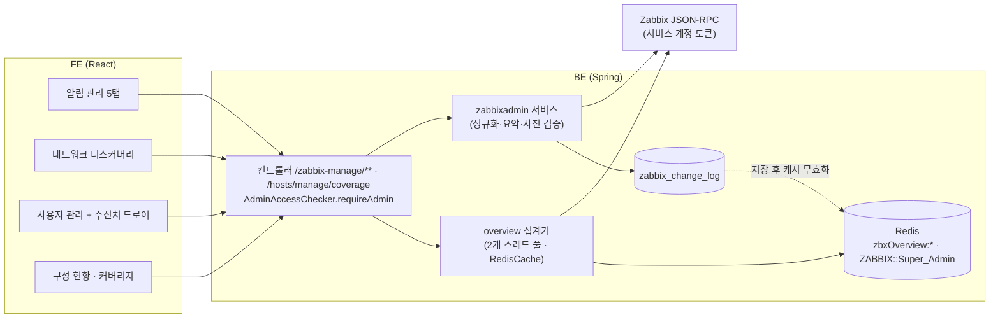

# Zabbix 운영 관리 기능 상세 가이드

> 이 문서는 MovesEye에서 "모니터링을 운영하는" 기능을 다룬다. 대상은 알림(액션·미디어 타입·사용자 수신처), 점검 기간, 스크립트, 네트워크 디스커버리, Zabbix 연동 사용자 관리, 구성 현황 대시보드, 모니터링 커버리지, Zabbix 연결 정보다. 이 기능들은 Zabbix 화면에 들어가지 않고도 "누구에게·어떻게·언제는 보내지 않을지·무엇을 실행할지"를 MovesEye에서 설정하려는 시스템 관리자를 위한 것이다. 호스트·템플릿·아이템·트리거·LLD·매크로·기기분류·엔티티 렌즈·에이전트 설치 가이드는 "Zabbix 구성 관리" 가이드가, MovesEye 자체 계정·역할·권한 판정은 인증·권한 가이드가 맡는다. 모든 내용은 BE `e55948c`·FE `9dfcbe8` 소스를 정적으로 대조해 작성했고, 서버 기동·HTTP 호출·실제 Zabbix 응답 확인은 하지 않았다.

## 1. 한눈에 보기

### 1.1 기능 목록

| 기능 | 화면 주소·메뉴 위치 | 상태 | 권한·라이선스 | 한 줄 설명 |
|---|---|---|---|---|
| 알림 관리(탭 묶음) | `/zabbix-management/alert-management` · 사이드바 Zabbix 관리 > 알림 관리 | 현재 | 관리자 전용(`userRole` ADMIN·SUPER_ADMIN), 라이선스 게이트 없음 | 대시보드·액션·미디어 타입·점검 기간·스크립트 5개 탭 |
| 액션 관리 | 위 화면 `?tab=actions&source=0..4` (기본 탭) | 현재 | 관리자 전용 | Zabbix 액션 5종(장애·디스커버리·자동등록·내부·서비스) 조회·생성·수정·삭제·활성 토글 |
| 미디어 타입 관리 | 위 화면 `?tab=media-types` | 현재 | 관리자 전용 | Email·Webhook·Script·SMS 미디어 타입 조회·생성·수정·삭제·활성 토글 |
| 점검 기간(Maintenance) | 위 화면 `?tab=maintenance` (구 주소 `/zabbix-management/maintenance-management`는 이 탭으로 이동) | 현재 | 관리자 전용 | 점검 중 알림 억제 또는 수집 중단 기간을 등록·수정·삭제 |
| 스크립트 관리·실행 | 위 화면 `?tab=scripts` + 호스트 상세 정보 탭의 "스크립트 실행" 버튼 | 부분 | 관리자 전용 | Zabbix 전역 스크립트 조회·생성·수정·삭제, 호스트 대상 수동 실행. 이벤트 범위 실행은 화면 진입점 없음 |
| 알림 대시보드 탭 | 위 화면 `?tab=dashboard` | 현재 | 관리자 전용 | 액션·미디어·스크립트·점검 기간의 등록 수와 실제 사용 수 |
| 네트워크 디스커버리 | `/zabbix-management/network-discovery` · 사이드바 Zabbix 관리 > 네트워크 디스커버리 | 부분 | 관리자 전용 | IP 대역 스캔 규칙 조회·생성·수정·삭제·토글, 발견 장비 조회, 디스커버리 액션 연결. SNMPv3 보안 입력은 없음 |
| 사용자 관리(Zabbix 연동) | `/setting/user-management?tab=users\|roles\|user-groups` · 관리 콘솔(⚙) > 사용자 관리 | 현재 | 관리자 전용 | 사용자·역할·사용자 그룹 관리와 Zabbix 동기화 |
| 사용자 알림 수신처 | 사용자 관리 > 사용자 탭의 "알림 수신처" 열 → 드로어 | 현재 | 관리자 전용 | Zabbix 사용자 미디어(수신 주소·심각도·시간대) 전체 교체 편집 |
| 구성 현황 대시보드 | `/zabbix-management/configuration-overview` · 사이드바 Zabbix 관리 맨 위 | 현재 | 관리자 전용 | 호스트·템플릿·아이템·트리거·알림 구성의 집계와 "만든 것 대 쓰는 것" 비교 |
| 모니터링 커버리지 | `/zabbix-management/monitoring-coverage` · 사이드바 Zabbix 관리 > 호스트 묶음 | 현재 | 관리자 전용 | 템플릿 없음·아이템 없음·트리거 없음·에이전트 불통 호스트 진단 |
| Zabbix 연결 정보 | `/setting/integrations?provider=zabbix` (구 주소 `/zabbix-management/connection-info`, `/setting/zabbix-info`는 여기로 이동) | 현재 | 관리자 전용 | Zabbix API URL·서비스 계정 등록. 상세는 데이터 소스 연동 가이드 소관 |
| 구성 변경 이력 조회 | 화면 없음. `GET /zabbix-manage/change-logs` | 부분 | 관리자 전용 | 관리 화면에서 일어난 쓰기·스크립트 실행 기록. FE는 14일 추이 차트로만 사용 |
| 프록시 관리 | 화면 없음 | 계획 | - | `proxy.get`으로 이름 목록만 읽는다. 등록·수정·상태 화면은 미구현 |

### 1.2 영역 구조

이 영역의 모든 관리 화면은 같은 틀을 쓴다. FE는 `services/zabbix-*.api.ts`로 BE `/zabbix-manage/**`를 부르고, BE 컨트롤러는 첫 줄에서 관리자 여부를 확인한 뒤 서비스로 넘긴다. 서비스는 Zabbix 서비스 계정 토큰으로 Zabbix JSON-RPC를 호출하고, 쓰기에 성공하면 `zabbix_change_log` 테이블에 한 줄을 남긴다. 설정 데이터 자체는 MovesEye DB에 저장하지 않으며 Zabbix가 정본이다. 예외는 사용자 관리로, 사용자·사용자 그룹·호스트 그룹은 MovesEye DB에 사본을 두고 동기화한다.

## 2. 기능별 상세

### 2.1 알림 관리 화면(탭 구조)

**무엇을 하는가** — 알림과 관련된 네 가지 설정을 한 화면에 모았다. 액션은 "누구에게 보낼지", 미디어 타입은 "어떻게 보낼지", 점검 기간은 "언제는 보내지 않을지", 스크립트는 "무엇을 실행할지"를 정한다.

**화면과 진입 경로**
- 주소는 `/zabbix-management/alert-management`이고 탭은 `?tab=` 쿼리로 정한다. 값은 `dashboard`, `actions`, `media-types`, `maintenance`, `scripts`다.
- `?tab=`이 없으면 액션 탭이 열린다. 대시보드 탭은 탭 순서에서만 맨 앞이다.
- 진입점은 사이드바(Zabbix 관리 > 알림 관리), 전역 검색, 구성 현황의 작업 큐 링크, 네트워크 디스커버리의 "액션 없음" 경고다.
- 탭을 바꾸면 검색어·페이지·상태 필터 쿼리가 지워진다.

**동작 원리** — `AlertManagementPage.tsx`가 탭을 그리고 비활성 탭은 언마운트한다(`destroyInactiveTabPane`). 액션 탭과 미디어 타입 탭 위에는 KPI 띠(`ActionKpiBand`, `MediaTypeKpiBand`)가 붙으며, 이 띠는 `GET /zabbix-manage/overview/alerts`(2.9절)를 읽는다.

### 2.2 액션 관리

**무엇을 하는가** — Zabbix 액션을 종류별로 관리한다. 종류(eventsource)는 장애(0), 디스커버리(1), 자동등록(2), 내부(3), 서비스(4)다. 종류마다 쓸 수 있는 조건과 오퍼레이션이 다르다.

**화면과 진입 경로**
- `?tab=actions&source=0..4`. `source`가 없으면 장애(0)다.
- 딥링크 `?source=1&create=1&druleid=N`은 디스커버리 규칙 조건(조건 종류 18)을 미리 채운 생성 폼을 연다.
- 딥링크 `?edit=<actionid>`는 그 액션의 수정 폼을 연다. 대상 액션이 현재 목록 페이지에 있을 때만 열린다(4절 ZOP-15).

**사용 방법**
1. 상단 세그먼트에서 종류를 고른다. 종류를 바꾸면 필터와 페이지가 초기화된다.
2. 목록에서 이름, 조건 요약, 오퍼레이션 요약, 활성 스위치를 본다. 디스커버리·자동등록 종류에서 호스트를 만들지 않는 액션은 "호스트를 만들지 않음" 경고가 붙는다.
3. "액션 생성" 또는 행의 "수정"으로 드로어를 연다. 드로어는 액션 탭(이름·조건·활성), 오퍼레이션 탭, 복구 탭, 갱신 탭으로 나뉜다. 복구 탭은 장애·내부·서비스에만, 갱신 탭은 장애·서비스에만 있다.
4. 조건은 계산 방식(And/Or, And, Or, 사용자 정의 수식)과 조건 목록으로 편집한다. 조건 종류 선택지는 종류별 허용표로 좁혀진다.
5. 오퍼레이션은 종류를 고르고 하위 값을 채운다. 메시지는 수신 사용자 그룹·사용자·미디어·사용자 정의 제목/본문, 호스트 그룹 추가/제거는 그룹, 템플릿 연결/해제는 템플릿, 인벤토리 모드, 호스트 태그, 원격 명령은 스크립트 ID를 입력한다.
6. 장애·내부·서비스 종류는 기본 단계 간격(`esc_period`, 기본 입력값 `1h`)과 오퍼레이션별 단계 범위(시작~끝, 끝 0은 무한)를 정한다.
7. 저장하면 오퍼레이션이 1개 이상이어야 한다. 없으면 저장이 거부된다.

**동작 원리**
- 목록은 `ZabbixActionManageService.list`가 `action.get`을 `selectFilter`·`selectOperations`·`selectRecoveryOperations`·`selectUpdateOperations` 전부 `extend`로 한 번 호출해 받는다. 정렬은 이름순이고, 페이징은 받은 전체를 메모리에서 `skip`/`limit`으로 자른다. 기본 20건, 최대 200건이다.
- 목록 행에는 Zabbix 원본 `filter`·`operations`가 그대로 실려 있어, 수정 폼은 상세 조회 없이 행 데이터로 열린다.
- 조건 요약과 오퍼레이션 요약은 BE `ActionSummary`가 한국어 문장으로 만든다. 요약에 쓰는 이름(미디어 타입·사용자·사용자 그룹·호스트 그룹·템플릿·디스커버리 규칙)은 목록 한 번에 종류당 1회씩 추가 조회한다. 이름 조회가 실패하면 ID를 그대로 보여 주고 목록은 계속 나온다.
- 폼 선택지는 `GET /zabbix-manage/actions/options?eventsource=`가 한 번에 준다. 메시지 오퍼레이션이 허용되는 종류에만 사용자·사용자 그룹·미디어 타입(활성만)을, 장애·내부·디스커버리·자동등록에 호스트 그룹·템플릿을, 디스커버리에 규칙·검사를, 디스커버리·자동등록에 프록시를 채운다. 하위 조회 하나가 실패해도 그 항목만 빈 배열이 된다. FE는 이 응답을 60초 동안 신선한 것으로 본다.
- 저장 전 BE가 종류별 허용표(`ActionEventSource`)로 조건 종류와 오퍼레이션 종류를 검사한다. 어긋나면 `ACTION_INVALID_FOR_EVENTSOURCE: conditiontype N (eventsource M)` 형태로 어느 값인지 알려 준다.
- 수정(`PUT`)에서 `filter`·`operations`·`recoveryOperations`·`updateOperations`는 보내면 전체 교체, 생략하면 유지다. FE 폼은 넷을 항상 전부 보낸다. 종류(eventsource)는 수정에서 바꿀 수 없고 검증은 저장돼 있는 종류 기준이다.
- `filter`는 `ActionFilterNormalizer`를 거쳐 Zabbix가 받는 모양으로 정리된다. 이 정규화는 `action.get`이 돌려준 조건을 그대로 되돌려 보낼 때 생기는 거부를 막는다. 제거 대상은 `eval_formula`, 조건의 `conditionid`·`actionid`, 태그 값 조건(26)이 아닌 조건의 `value2`, 계산 방식이 사용자 정의(3)가 아닐 때의 `formula`·`formulaid`다.
- `operations` 계열 배열에는 같은 정규화가 없다. FE가 보낸 구조가 그대로 `action.update`로 간다.

**주요 API**

| Method | Path | 용도 | 권한 |
|---|---|---|---|
| GET | `/zabbix-manage/actions?eventsource=&search=&status=&limit=&offset=` | 목록. `eventsource` 없으면 `ACTION_EVENTSOURCE_REQUIRED` | 관리자 |
| GET | `/zabbix-manage/actions/options?eventsource=` | 폼 선택지 | 관리자 |
| GET | `/zabbix-manage/actions/{actionid}` | 상세. FE 화면은 호출하지 않음(훅만 정의) | 관리자 |
| POST | `/zabbix-manage/actions` | 생성 | 관리자 |
| PUT | `/zabbix-manage/actions/{actionid}` | 수정(배열 4종은 전체 교체) | 관리자 |
| PATCH | `/zabbix-manage/actions/{actionid}/status` | 활성/비활성 | 관리자 |
| DELETE | `/zabbix-manage/actions` (body `actionIds`) | 삭제 | 관리자 |

**데이터** — 액션 자체는 저장하지 않는다. 쓰기마다 `zabbix_change_log`에 `entity_type=ACTION`으로 한 줄이 남는다(2.12절).

**권한·라이선스** — 사이드바는 `useIsUserRoleAdmin`이 참일 때만 메뉴를 보여 주고, 라우트는 `adminOnly`로 막는다. BE는 모든 메서드 첫 줄에서 `AdminAccessChecker.requireAdmin`을 호출한다. 거부 응답은 HTTP 200에 본문 `code: 403`이다. 데이터 범위(호스트 그룹 스코프)는 적용하지 않는다.

**빈 값·실패·경계 상태**
- 조건이 없는 액션은 요약 칸에 조건 없음으로 보이고, 그 종류의 모든 이벤트에 적용된다.
- 저장 오류 중 `ACTION_OPERATIONS_REQUIRED`는 번역된 문구로, 나머지는 서버 메시지 그대로 6초 토스트로 보인다.
- Zabbix가 거부한 원문 오류도 그대로 토스트에 나온다.

**운영 주의**
- 일반 액션 폼에서 조건을 전부 지우고 저장하는 것은 막지 않는다. "전역 액션이 되는 해제 거부" 규칙(`ACTION_UNLINK_MAKES_GLOBAL`)은 네트워크 디스커버리 규칙의 액션 탭에서만 동작한다(2.6절).
- 원격 명령 오퍼레이션은 스크립트 ID를 숫자로 직접 입력한다. 스크립트 탭 목록에는 ID가 표시되지 않는다(4절 ZOP-09).

### 2.3 미디어 타입 관리

**무엇을 하는가** — 알림 전송 수단을 관리한다. 종류는 Email(0), Script(1), SMS(2), Webhook(4)이다.

**화면과 진입 경로** — `?tab=media-types`. 필터는 검색어, 상태, 종류다. 구성 현황 작업 큐의 "쓰이지 않는 미디어" 항목이 이 탭으로 연결된다.

**사용 방법**
1. 목록에서 이름·설명, 종류, 종류별 대상 요약(SMTP 서버:포트, 스크립트 경로, 모뎀, 웹훅 파라미터 수), 사용 중 액션 수, 활성 스위치를 본다.
2. "미디어 타입 생성" 또는 "수정"으로 드로어를 연다. 종류 라디오에 따라 입력 필드가 바뀐다.
3. Email은 SMTP 서버·포트·HELO·발신 주소·보안(없음/STARTTLS/SSL·TLS)·인증·계정·암호·본문 형식을 입력한다.
4. Webhook은 파라미터(이름·값), 스크립트(JavaScript), 타임아웃을 입력한다.
5. 공통으로 동시 세션 수, 재시도 횟수, 재시도 간격, 설명을 입력한다. 새로 만들 때 기본값은 세션 1, 재시도 3, 간격 `10s`, SMTP 포트 `25`, 타임아웃 `30s`다.
6. 사용 중 액션 수가 1 이상이면 삭제 버튼이 비활성화되고 이유가 툴팁으로 보인다.

**동작 원리**
- 목록은 `mediatype.get`(`output: extend`)을 한 번 호출한다. Zabbix가 이름 정렬을 받지 않아 BE가 대소문자 무시 이름순으로 정렬한 뒤 메모리에서 페이징한다. 기본 20건, 최대 200건이다.
- 사용 중 액션 수는 `mediatype.get`의 `selectActions`를 쓰지 않고, `action.get`을 오퍼레이션 3종과 함께 한 번 받아 `opmessage.mediatypeid`로 직접 센다. `mediatypeid`가 `0`(모든 미디어)인 오퍼레이션은 세지 않는다. 이 계산은 목록·상세·삭제 호출마다 다시 한다.
- 응답에서 SMTP 암호 `passwd`는 항상 제거된다. 수정 시 암호 칸을 비워 두면 BE가 파라미터에서 빼므로 Zabbix의 기존 값이 유지된다.
- 웹훅 `parameters`는 원문 그대로 왕복한다. 파라미터에 토큰을 넣었다면 조회 응답과 수정 폼에 그대로 보인다. 폼은 웹훅 영역에 이 사실을 알리는 안내를 띄운다.
- 메시지 템플릿(`messageTemplates`)은 상세 조회에만 실리며 FE 폼은 편집하지 않는다. FE는 이 필드를 보내지 않으므로 기존 템플릿이 유지된다.
- 삭제는 대상 중 하나라도 액션이 쓰고 있으면 전체를 거부하고 `MEDIA_TYPE_IN_USE: 미디어명 ← 액션명, …` 메시지를 준다.

**주요 API**

| Method | Path | 용도 | 권한 |
|---|---|---|---|
| GET | `/zabbix-manage/media-types?search=&type=&status=&limit=&offset=` | 목록 | 관리자 |
| GET | `/zabbix-manage/media-types/{mediatypeid}` | 상세(메시지 템플릿·원본 포함) | 관리자 |
| POST | `/zabbix-manage/media-types` | 생성(`name`·`type` 필수) | 관리자 |
| PUT | `/zabbix-manage/media-types/{mediatypeid}` | 부분 수정 | 관리자 |
| PATCH | `/zabbix-manage/media-types/{mediatypeid}/status` | 활성/비활성 | 관리자 |
| DELETE | `/zabbix-manage/media-types` (body `mediaTypeIds`) | 삭제 | 관리자 |

**빈 값·실패·경계 상태**
- 액션 조회가 실패하면 사용 수가 0으로 계산되고 로그에 경고가 남는다. 이 경우 삭제 판정은 Zabbix의 거부에 맡겨진다.
- 테스트 발송 기능은 없다. Zabbix 7.0 API에 미디어 타입 테스트 메서드가 없다.

**운영 주의** — 요청의 `extra` 필드는 Zabbix 필드명을 그대로 통과시킨다. 이름 붙은 필드와 겹치면 이름 붙은 필드가 우선한다.

### 2.4 점검 기간(Maintenance)

**무엇을 하는가** — 예정된 작업 시간에 알림이 나가지 않게 한다. 유형은 "수집 유지, 알림만 억제"(0)와 "수집도 중단"(1) 두 가지다.

**화면과 진입 경로** — `?tab=maintenance`. 구 주소 `/zabbix-management/maintenance-management`는 이 탭으로 자동 이동한다. 구성 현황 작업 큐의 "점검 기간 없음" 항목이 이 탭으로 연결된다.

**사용 방법**
1. 목록에서 이름·설명, 상태(진행 중/예정/만료), 지금 점검 중인 호스트 수, 유효 기간, 기간 요약, 대상(호스트 그룹·호스트·태그), 유형을 본다. 상태 필터와 검색어는 받은 전체 목록을 브라우저에서 거른다.
2. "점검 기간 생성" 또는 "수정"으로 드로어를 연다.
3. 유효 기간(시작~끝)을 분 단위로 고른다. 새로 만들 때 기본값은 지금부터 24시간이다.
4. 대상으로 호스트 그룹과 호스트를 고른다. 둘 중 하나는 반드시 있어야 한다.
5. 기간(timeperiod)을 1개 이상 추가한다. 유형은 1회(0), 매일(2), 매주(3), 매월(4)이다. 1회는 시작 일시와 길이, 매일은 N일마다·시작 시각·길이, 매주는 N주마다·요일·시작 시각·길이, 매월은 달·(날짜 또는 N번째 요일)·시작 시각·길이를 입력한다. 길이 기본값은 1시간이다.
6. 필요하면 문제 태그 조건(포함/일치)과 계산 방식(And/Or, Or)을 넣는다.

**화면에 보이는 값의 뜻**
- 상태는 유효 기간만으로 정한다. 지금이 시작 전이면 예정, 끝 뒤면 만료, 그 사이면 진행 중이다. 유효 기간 안의 반복 슬롯에 실제로 들어와 있는지는 반영하지 않는다.
- "지금 점검 중인 호스트 수"는 Zabbix가 실제로 점검 상태로 표시한 호스트 수다.

**동작 원리**
- 목록은 `maintenance.get`을 호스트 그룹·호스트·기간·태그 선택자와 함께 한 번 호출하고 이름순으로 정렬한다. 페이징은 없다.
- 점검 중 호스트 수는 `host.get`에 `maintenanceids`와 `maintenance_status=1` 필터를 걸어 한 번 더 조회해 점검별로 센다. 이 조회가 실패하면 수가 0으로 나오고 목록은 계속 보인다.
- 기간 요약은 BE `MaintenanceSummary`가 한국어 문장으로 만든다. 1회 기간의 시작 일시는 BE 프로세스의 시스템 시간대로 표기한다.
- 저장 시 기간 배열은 `MaintenanceTimeperiodNormalizer`를 거친다. Zabbix 7.0은 기간 유형에 없는 필드가 하나라도 있으면 거부하는데 조회 응답은 모든 필드를 돌려주므로, 유형별 허용 필드만 남긴다. 1회는 `start_date`·`period`, 매일은 `every`·`start_time`·`period`, 매주는 여기에 `dayofweek`, 매월은 `month`·`start_time`·`period`와 (`day`가 0보다 크면 `day`, 아니면 `every`·`dayofweek`)다.
- 수정에서 호스트 그룹·호스트·기간·태그 배열은 보내면 전체 교체, 생략하면 유지다. 호스트 그룹과 호스트 중 하나만 보내면 BE가 나머지를 현재 값으로 채워 둘 다 명시해 보낸다.
- BE 사전 검증은 이름 없음(`MAINTENANCE_NAME_REQUIRED`), 대상 없음(`MAINTENANCE_TARGET_REQUIRED`), 기간 없음(`MAINTENANCE_TIMEPERIODS_REQUIRED`), 끝이 시작 이하(`MAINTENANCE_RANGE_INVALID`)다.
- 폼 선택지 `GET /zabbix-manage/maintenances/options`는 호스트 그룹 전체와 호스트 전체(ID·이름)를 한 번에 준다. FE는 이 응답을 60초, 목록을 15초 동안 신선한 것으로 본다.

**주요 API**

| Method | Path | 용도 | 권한 |
|---|---|---|---|
| GET | `/zabbix-manage/maintenances` | 전체 목록(이름순) | 관리자 |
| GET | `/zabbix-manage/maintenances/options` | 호스트 그룹·호스트 선택지 | 관리자 |
| GET | `/zabbix-manage/maintenances/{maintenanceid}` | 상세. FE 화면은 호출하지 않음 | 관리자 |
| POST | `/zabbix-manage/maintenances` | 생성 | 관리자 |
| PUT | `/zabbix-manage/maintenances/{maintenanceid}` | 부분 수정 | 관리자 |
| DELETE | `/zabbix-manage/maintenances` (body `ids`) | 삭제 | 관리자 |

**운영 주의**
- Zabbix는 유효 기간을 분 단위로 잘라 저장한다. FE도 초를 버리고 보낸다.
- 반복 기간의 시작 시각은 "하루 중 초"로 저장되며 화면은 시간대 변환 없이 그대로 보여 준다(4절 ZOP-07).
- AI 어시스턴트의 점검 기간 툴도 같은 EP를 쓴다.

### 2.5 스크립트 관리·실행

**무엇을 하는가** — Zabbix 전역 스크립트를 관리하고, 호스트를 대상으로 수동 실행한다. 스크립트 범위(scope)는 액션 오퍼레이션(1), 호스트 수동 실행(2), 이벤트 수동 실행(4)이고, 유형(type)은 스크립트(0), IPMI(1), SSH(2), Telnet(3), Webhook(5), URL(6)이다.

**화면과 진입 경로**
- 관리: 알림 관리 `?tab=scripts`. 범위 필터와 검색어(이름·명령·설명)는 브라우저에서 거른다. 페이징은 없다.
- 실행 진입점 ①: 스크립트 탭에서 범위가 호스트(2)인 행의 "테스트 실행" 버튼. 호스트를 고른 뒤 실행 모달이 열린다.
- 실행 진입점 ②: 호스트 관리 > 호스트 상세 > 정보 탭의 "스크립트 실행" 드롭다운. 그 호스트에서 실행 가능한 범위 2 스크립트가 메뉴 경로(`menu_path`)별로 묶여 나온다.
- 범위가 이벤트(4)인 스크립트를 실행하는 화면 진입점은 없다.

**사용 방법**
1. 스크립트 탭에서 이름·메뉴 경로·설명, 범위, 유형(스크립트 유형은 실행 위치 포함), 명령 또는 URL, 실행 허용 호스트 그룹·사용자 그룹, 사용 중 액션 수를 본다.
2. "생성" 또는 "수정"으로 드로어를 연다. 유형에 따라 명령·URL·SSH 인증(암호 또는 공개키)·Webhook 파라미터를 입력한다. 범위가 수동 실행이면 메뉴 경로, 확인 문구, 필요한 호스트 권한(읽기/쓰기), 실행 허용 호스트 그룹·사용자 그룹을 정한다.
3. 실행 모달에서 대상과 확인 문구를 확인하고, 입력값이 필요한 스크립트면 값을 넣은 뒤 실행한다.
4. 결과는 모달 안에 성공/실패, 출력 원문, 흔한 원인 안내로 표시된다. 다시 실행할 수 있다.

**동작 원리**
- 목록은 `script.get`(`output: extend`, 호스트 그룹·사용 액션 선택자 포함)을 한 번 호출하고, 사용자 그룹 이름을 붙이려고 `usrgrp.get`을 한 번 더 호출한다.
- 응답의 `raw`에서 `password`와 `privatekey`는 제거된다. 수정 시 두 값을 비워 두면 기존 값이 유지된다. 공개키, 명령 본문, Webhook 파라미터는 그대로 내려간다.
- 생성 시 유형 기본값은 스크립트(0), 범위 기본값은 호스트(2), 스크립트 유형의 실행 위치 기본값은 서버·프록시(2)다. `timeout`은 Webhook 유형에서만 보내고 다른 유형에서는 BE가 제거한다.
- 삭제는 액션이 쓰는 스크립트가 하나라도 있으면 전체를 거부하고 `SCRIPT_IN_USE: 스크립트 ← 액션들` 메시지를 준다.
- 실행(`POST /{scriptid}/execute`)은 범위가 액션(1)이면 `SCRIPT_NOT_MANUAL`, 대상이 없으면 `SCRIPT_EXECUTE_TARGET_REQUIRED`로 거부한다. `hostid`가 있으면 호스트 대상, 없으면 `eventid` 대상으로 `script.execute`를 부른다.
- Zabbix가 실행을 거부하거나 실패해도 응답은 HTTP 200에 `success=false`, `output`(원문), `hint`다. 안내 문구는 세 가지 경우에만 붙는다. "Remote commands are not enabled"는 에이전트 원격 명령 설정 안내, "Timeout"은 제한 시간 안내, "Cannot connect"·"Connection refused"는 연결 확인 안내다.
- 호스트에서 실행 가능한 목록은 `script.getscriptsbyhosts`에 호스트 ID 하나를 넘겨 받고 범위 2만 남긴다.
- 실행은 성공·실패 모두 `zabbix_change_log`에 `entity_type=SCRIPT`, `action=EXECUTE`로 남는다. 기록되는 내용은 스크립트 ID·이름, `hostid`, `eventid`, 성공 여부, 실행한 MovesEye 사용자 이름이다.

**주요 API**

| Method | Path | 용도 | 권한 |
|---|---|---|---|
| GET | `/zabbix-manage/scripts` | 전체 목록(이름순) | 관리자 |
| GET | `/zabbix-manage/scripts/hosts/{hostid}` | 그 호스트에서 실행 가능한 범위 2 스크립트 | 관리자 |
| GET | `/zabbix-manage/scripts/{scriptid}` | 상세. FE 화면은 호출하지 않음 | 관리자 |
| POST | `/zabbix-manage/scripts` | 생성 | 관리자 |
| PUT | `/zabbix-manage/scripts/{scriptid}` | 부분 수정(`parameters`는 전체 교체) | 관리자 |
| DELETE | `/zabbix-manage/scripts` (body `ids`) | 삭제 | 관리자 |
| POST | `/zabbix-manage/scripts/{scriptid}/execute` (body `hostid` 또는 `eventid`, `manualinput`) | 실행 | 관리자 |

**권한·라이선스**
- 관리와 실행 모두 MovesEye 관리자 판정 하나로 허용된다. 별도의 재인증이나 추가 확인 단계는 없다.
- BE는 모든 Zabbix 호출을 서비스 계정 토큰으로 한다. 스크립트에 설정한 "실행 허용 사용자 그룹"과 "필요한 호스트 권한"은 Zabbix가 서비스 계정 기준으로 평가하므로, MovesEye에서 실행하는 관리자 개인에게는 적용되지 않는다(4절 ZOP-01).

**운영 주의**
- 스크립트 유형을 "서버"에서 실행하도록 만들면 Zabbix 서버(또는 프록시) 프로세스 권한으로 명령이 돈다. 에이전트 실행은 대상 호스트 에이전트가 원격 명령을 허용해야 한다.
- 입력값이 필요한 스크립트(`manualinput`)는 실행 모달에서 값을 받지만, 스크립트 폼에는 이 옵션을 설정하는 칸이 없다.

### 2.6 네트워크 디스커버리

**무엇을 하는가** — IP 대역을 주기적으로 스캔하는 규칙(drule)을 관리하고, 발견된 장비와 그 규칙에 걸린 디스커버리 액션을 본다. 발견된 장비가 호스트로 등록되려면 호스트를 만드는 오퍼레이션이 든 디스커버리 액션이 있어야 한다.

**화면과 진입 경로** — `/zabbix-management/network-discovery`. 사이드바 Zabbix 관리 > 신호 묶음, 전역 검색에서 들어온다. LLD(저수준 디스커버리)는 이 화면이 아니라 호스트·템플릿 상세의 디스커버리 탭이다.

**사용 방법**
1. 목록에서 이름, IP 범위와 대상 주소 수, 스캔 주체(서버 또는 프록시), 주기, 동시 실행 수, 검사 종류, 액션 연계, 활성 스위치를 본다.
2. 액션 연계 칸은 세 가지를 보여 준다. 이 규칙에 명시 연결된 액션 수, 모든 규칙에 적용되는 전역 액션 수, 호스트를 만드는 액션 수다. 연결 0건이면 "액션 없음" 경고가 뜨고 누르면 수정 폼의 액션 탭이 열린다.
3. 행을 누르면 상세 드로어가 열린다. 발견 장비 탭은 IP·서비스 수·상태(Up/Down)·마지막 Up/Down 시각을, 액션 탭은 연결된 액션 이름·오퍼레이션·상태를 보여 준다.
4. "규칙 생성" 또는 "수정" 드로어의 기본 탭에서 이름, IP 범위, 스캔 주체, 주기, 동시 실행 수, 검사 목록(종류·키·포트·SNMP 커뮤니티), 고유성 기준 검사, 호스트명 출처를 입력한다.
5. 수정 드로어의 액션 탭에서 디스커버리 액션을 체크로 연결·해제하고 "적용"한다. "표준 액션 빠른 생성"은 이름과 호스트 그룹·템플릿을 고르면 액션을 하나 만든다.
6. 삭제는 규칙과 발견 기록만 지운다. 이미 등록된 호스트는 남는다.

**동작 원리**
- 목록은 `drule.get`(검사 포함)과 `action.get`(디스커버리 종류 전체)을 각각 한 번 호출해 규칙마다 대조한다. 페이징은 메모리에서 하고 기본 20건, 최대 200건이다.
- 대상 주소 수는 BE `IpRangeCounter`가 IP 범위 문자열로 계산한다. 단일 주소, 옥텟 범위(`1-254`), 다중 옥텟 범위, `/16`~`/30` 마스크, 쉼표 나열을 지원한다. IPv6나 해석할 수 없는 형식, 합계 65,536 초과는 값을 내지 않고 화면은 표시를 생략한다.
- 액션과 규칙의 관계는 세 가지로 판정한다. 조건에 이 규칙(조건 종류 18) 또는 이 규칙의 검사(조건 종류 19)가 있으면 "명시 연결", 18·19 조건이 하나도 없으면 "전역", 다른 규칙·검사만 가리키면 "무관"이다. 서비스 종류(8)·상태(10)·IP 같은 조건은 범위를 좁히는 조건으로 보지 않는다.
- 호스트를 만드는 액션은 오퍼레이션에 호스트 추가(2), 호스트 그룹 추가(4), 템플릿 연결(6) 중 하나가 있는 액션이다.
- 액션 연결 적용(`PUT /rules/{druleid}/actions`)은 요청의 액션 ID 집합에 맞춰 각 액션의 조건 목록에 규칙 조건(18)을 넣거나 뺀다. 액션의 현재 `filter`를 읽어 조건만 고친 뒤 `ActionFilterNormalizer`를 거쳐 통째로 되돌려 보낸다. 전역 액션은 건드리지 않는다.
- 해제하려는 규칙 조건이 그 액션의 유일한 범위 조건이면 BE가 `ACTION_UNLINK_MAKES_GLOBAL: 액션명`으로 거부한다. 이 조건을 빼면 액션이 모든 규칙에 적용되기 때문이다.
- 빠른 생성은 조건 "규칙 = 이 규칙"과 "디스커버리 상태 = Up", 오퍼레이션 "호스트 추가" + (선택한 그룹 추가) + (선택한 템플릿 연결) + (인벤토리 자동, 기본 켬)으로 액션을 만든다.
- 수정에서 검사 목록(`checks`)은 보내면 전체 교체다. FE는 상세를 다시 조회해 기존 검사를 `dcheckid`와 함께 전부 되돌려 보낸다. `dcheckid`가 빠진 검사는 Zabbix가 새로 만들고 기존 것을 지운다. 활성 토글은 상태만 보내므로 검사를 건드리지 않는다.
- 사전 검증은 검사 없음(`DISCOVERY_CHECKS_REQUIRED`)과 고유성 기준 2개 이상(`DISCOVERY_UNIQ_CONFLICT`)이다.
- 상세 응답의 검사에서 SNMPv3 인증·암호화 암호 두 값은 제거된다. SNMP 커뮤니티는 그대로 내려간다.
- 발견 장비는 `dhost.get`(서비스 포함)을 규칙 ID로 한 번 호출해 전부 받는다. 서버 페이징은 없다.

**주요 API**

| Method | Path | 용도 | 권한 |
|---|---|---|---|
| GET | `/zabbix-manage/network-discovery/rules?limit=&offset=` | 목록 | 관리자 |
| GET | `/zabbix-manage/network-discovery/rules/{druleid}` | 상세(검사 원본 포함) | 관리자 |
| GET | `/zabbix-manage/network-discovery/rules/{druleid}/discovered` | 발견 장비 | 관리자 |
| GET | `/zabbix-manage/network-discovery/rules/{druleid}/actions` | 이 규칙에 걸린 액션(명시+전역) | 관리자 |
| GET | `/zabbix-manage/network-discovery/rules/{druleid}/actions/all` | 디스커버리 액션 전부 + 관계(`_linkage`) | 관리자 |
| PUT | `/zabbix-manage/network-discovery/rules/{druleid}/actions` (body `actionIds`) | 연결 집합 적용 | 관리자 |
| POST | `/zabbix-manage/network-discovery/rules/{druleid}/actions/quick` | 표준 액션 빠른 생성 | 관리자 |
| POST | `/zabbix-manage/network-discovery/rules` | 생성 | 관리자 |
| PUT | `/zabbix-manage/network-discovery/rules/{druleid}` | 부분 수정(검사는 전체 교체) | 관리자 |
| PATCH | `/zabbix-manage/network-discovery/rules/{druleid}/status` | 활성/비활성 | 관리자 |
| DELETE | `/zabbix-manage/network-discovery/rules` (body `druleIds`) | 삭제 | 관리자 |

**빈 값·실패·경계 상태**
- 디스커버리 액션 조회가 실패하면 액션 연계 수가 전부 0으로 나오고 규칙 목록은 계속 보인다. 이때 화면은 "액션 없음"과 조회 실패를 구분해 보여 주지 않는다.
- 발견 장비의 마지막 Up/Down 시각이 `0`이면 이력 없음으로 표시한다.
- 변경 이력에는 검사 원본이 아니라 검사 건수만 남는다. SNMP 값이 이력 테이블에 쌓이지 않게 하기 위해서다.

**운영 주의** — 폼의 검사 종류에는 SNMPv3가 있지만 SNMPv3 보안 이름·보안 수준·암호를 입력하는 칸은 없다(4절 ZOP-02).

### 2.7 사용자 관리(Zabbix 연동 관점)

**무엇을 하는가** — MovesEye 계정, 역할, 사용자 그룹을 관리한다. 이 문서는 Zabbix와의 관계만 다룬다. 역할의 권한 매트릭스와 로그인·세션 동작은 인증·권한 가이드 소관이다.

**화면과 진입 경로**
- 주소는 `/setting/user-management`, 탭은 `?tab=users|roles|user-groups`(기본 `users`)다. 역할 생성·편집은 `/setting/user-management/roles/:utility`다.
- 진입점은 관리 콘솔(헤더 ⚙)이다. 사이드바 Zabbix 관리 메뉴에는 이 항목이 없다.
- 구 주소 `/zabbix-management/user-management`, `/zabbix-management/user-management/roles/:utility`, `/users-roles/**`는 쿼리를 유지한 채 새 주소로 이동한다.
- 화면 컴포넌트 파일은 여전히 `pages/zabbix-management/user-management/UserManagementPage.tsx`에 있다.

**MovesEye 계정과 Zabbix 계정의 관계**
- 계정은 두 종류다. Zabbix 연동 계정은 `zabbix_userid`가 채워져 있고 Zabbix 사용자와 1:1로 묶인다. MovesEye 전용 계정은 생성 시 "Zabbix에 생성" 옵션(`createInZabbix`)을 끈 계정으로 `zabbix_userid`가 비어 있다.
- 사용자 그룹과 호스트 그룹은 Zabbix의 사용자 그룹·호스트 그룹을 MovesEye DB에 복사해 둔 사본이다. "어떤 호스트 그룹을 볼 수 있는가"는 Zabbix 사용자 그룹의 권한을 따른다.
- 화면의 관리자 판정은 MovesEye `userRole`(ADMIN·SUPER_ADMIN)만 본다. Zabbix 역할 타입은 관리자 판정에 쓰지 않는다.
- 이 문서의 모든 관리 화면은 로그인한 사용자의 Zabbix 토큰이 아니라 서비스 계정 토큰으로 Zabbix를 호출한다. 따라서 MovesEye 전용 관리자 계정도 Zabbix 관리 화면을 쓸 수 있다.

**동기화**
- 사용자 관리 화면의 동기화 버튼은 `POST /users/sync`를 호출한다. 주기 동기화 잡 `user_sync`는 스케줄러 설정으로 켜고 끄며 기본은 꺼짐이다.
- 동기화는 준비와 적용 두 단계다. 준비 단계는 트랜잭션 밖에서 로컬 스냅샷을 먼저 뜨고 Zabbix에서 호스트 그룹·사용자 그룹·사용자를 조회한다. 적용 단계는 한 트랜잭션에서 DB 작업만 한다.
- 호스트 그룹과 사용자 그룹은 전체 삭제 후 재삽입한다. 이때 ID 시퀀스가 1부터 다시 시작한다.
- 사용자는 Zabbix 사용자 ID로 대조한다. Zabbix에 있고 로컬에 없으면 생성(비밀번호 없음, 플랫폼 ZABBIX), 양쪽에 있으면 이름 계열 필드만 갱신, 로컬에만 있으면 삭제한다. 삭제·대조 대상은 `zabbix_userid`가 있고 역할이 ADMIN이 아닌 계정뿐이다. MovesEye 전용 계정은 건드리지 않는다.
- 삭제되거나 비활성화된 사용자의 세션과 재발급 토큰은 같은 트랜잭션 안에서 폐기된다.
- 준비 이후 로컬 그룹·소속이 바뀌었으면 적용을 포기하고 `ZABBIX_SYNC_CONFLICT`로 실패한다. 잠금 대기가 10초를 넘으면 전체 롤백되고 화면에는 잠금 획득 실패로 나온다.

**운영 주의** — 주기 동기화를 켜면 Zabbix에서 지운 사용자가 MovesEye에서도 지워진다. Zabbix 연동 계정은 비밀번호가 비어 있는 상태로 생성되며 최초 비밀번호 발급 절차는 인증·권한 가이드를 따른다.

### 2.8 사용자 알림 수신처(사용자 미디어)

**무엇을 하는가** — Zabbix 사용자별 알림 수신 주소를 관리한다. 액션이 "이 사용자에게 보내라"고 해도 그 사용자에게 활성 수신처가 없으면 알림이 가지 않는다.

**화면과 진입 경로** — 사용자 관리 > 사용자 탭의 "알림 수신처" 열. 열에는 수신처 수와 사용 중 수 요약이 보이고, 누르면 편집 드로어가 열린다. MovesEye 전용 계정은 Zabbix 사용자가 아니므로 버튼이 비활성이다.

**사용 방법**
1. 드로어에서 수신처 카드를 추가하거나 지운다.
2. 카드마다 미디어 타입, 수신 주소, 심각도(6단계 체크), 수신 시간대, 사용 여부를 정한다.
3. 이메일 미디어는 주소를 여러 개 넣을 수 있고, 나머지 미디어는 1개다.
4. 저장하면 그 사용자의 수신처 전체가 드로어의 목록으로 교체된다. 카드를 지우고 저장하면 그 수신처는 사라진다.

**동작 원리**
- 요약(`GET /zabbix-manage/user-medias`)은 `user.get`에 `selectMedias`를 붙여 전 사용자를 한 번에 받아 센다. FE는 30초 동안 신선한 것으로 본다.
- Zabbix의 `active` 값은 0이 사용, 1이 중지다. BE가 `enabled` 불리언으로 뒤집어 준다.
- `sendto`는 Zabbix에서 이메일만 배열이고 나머지는 문자열이다. BE 응답은 항상 배열이고, 저장 시 미디어 타입 종류를 보고 이메일이면 배열, 아니면 첫 값을 문자열로 보낸다.
- 심각도는 비트마스크다. 기본값은 63(전체)이다. 수신 시간대 기본값은 `1-7,00:00-24:00`이다.
- 저장(`PUT /zabbix-manage/user-medias/{userid}`)은 `user.update`에 `medias` 전체를 보낸다. 미디어 타입이 없으면 `USER_MEDIA_TYPE_INVALID`, 수신 주소가 비면 `USER_MEDIA_SENDTO_REQUIRED`다.
- 드로어의 미디어 타입 선택지는 미디어 타입 목록 EP를 `limit=500`으로 호출해 얻는다. BE 상한은 200건이다(4절 ZOP-12).

**주요 API**

| Method | Path | 용도 | 권한 |
|---|---|---|---|
| GET | `/zabbix-manage/user-medias` | 전 사용자 수신처 요약 | 관리자 |
| GET | `/zabbix-manage/user-medias/{userid}` | 한 사용자의 수신처 목록(`userid`는 Zabbix 사용자 ID) | 관리자 |
| PUT | `/zabbix-manage/user-medias/{userid}` | 전체 교체 | 관리자 |

**빈 값·실패·경계 상태** — 수신처가 가리키는 미디어 타입이 삭제됐거나 선택지에 없으면 카드에 "삭제된 미디어 타입" 표시가 붙는다.

### 2.9 구성 현황 대시보드

**무엇을 하는가** — Zabbix 구성 전체를 숫자와 차트로 요약한다. "얼마나 만들었는가"와 "실제로 쓰이는가"를 나란히 보여 주고, 손봐야 할 항목을 작업 큐로 모은다.

**화면과 진입 경로**
- 통합 화면: `/zabbix-management/configuration-overview`. 사이드바 Zabbix 관리 메뉴 맨 위 "구성 현황".
- 도메인 대시보드 탭: 호스트 관리·템플릿 관리·아이템 렌즈·트리거 렌즈·알림 관리의 `?tab=dashboard`. 각 목록 화면 위 KPI 띠도 같은 데이터를 쓴다.
- 통합 화면의 호스트 그룹 범위 선택은 화면 내부 상태다. URL에 실리지 않는다.

**사용 방법**
1. 상단 KPI 띠에서 호스트·호스트 그룹·템플릿·에이전트 정상 수 등을 본다. KPI를 누르면 해당 관리 화면으로 이동한다.
2. 호스트 그룹을 고르면 호스트 계열 지표(연결 상태·파이프라인·커버리지 작업 큐)가 그 그룹으로 좁혀진다. 템플릿·아이템·트리거·알림 지표는 항상 전체 기준이다.
3. 새로고침 버튼은 캐시를 무시하고 다시 집계한다.
4. 작업 큐 항목을 누르면 해당 화면으로 이동한다.

**화면에 보이는 값의 뜻**

| 값 | 정의 |
|---|---|
| 연결 상태 | 호스트를 위에서부터 한 가지로만 분류: 비활성 → 인터페이스 없음 → 에이전트 정상 → 에이전트 불통 → 미확인. SNMP·JMX 전용 호스트는 미확인에 들어간다 |
| 파이프라인 | 전체 → 활성 → 템플릿 있음 → 아이템 있음 → 트리거 있음. 각 단계는 앞 단계를 통과한 호스트만 센다 |
| 아이템 정의 수 | 템플릿 또는 호스트에 직접 정의된 아이템(상속 사본·LLD 생성분 제외) |
| 아이템 수집 수 | 호스트에 실재하는 아이템(상속 사본·LLD 생성분 포함) |
| 만든 것 대 쓰는 것 | 템플릿=호스트에 연결됨, 미디어 타입=액션이 참조함, 액션=활성, 스크립트=액션이 참조함, 아이템=상태가 정상 |
| 작업 큐 | 템플릿 없음·아이템 없음·트리거 없음·에이전트 불통(커버리지 판정), 미분류 호스트, 인터페이스 없음, 미사용 템플릿, 켜져 있지만 쓰이지 않는 미디어, 점검 기간 0건 |
| 변경 추이 | 최근 14일의 일자별·대상 종류별 구성 변경 건수(`host_change_log` + `zabbix_change_log`) |
| 점검 기간 진행 중 | 유효 기간 안에 있는 점검 수. 반복 슬롯은 보지 않는다 |

**동작 원리**
- 통합 EP `GET /zabbix-manage/overview`는 먼저 호스트 스냅샷을 읽는다. 스냅샷은 `HostSnapshotReader`가 `host.get` 한 번으로 전 호스트(또는 한 그룹)의 상태·그룹·인터페이스·연결 템플릿·태그·아이템 수·트리거 수를 받는 것이다. 이 스냅샷은 캐시하지 않는다.
- 그다음 여섯 섹션(호스트 집계, 커버리지 판정, 템플릿, 아이템, 알림, 변경 추이)을 섹션 전용 스레드 풀에서 병렬로 돌린다. 트리거 섹션은 아이템 총계가 필요해 병렬 묶음 뒤에 따로 실행한다.
- 각 섹션 안의 Zabbix 집계 호출(`countOutput`)은 호출 전용 스레드 풀에서 병렬로 돈다. 두 풀은 각각 6스레드 고정이다. 기다림에는 60초 기한이 있고, 기한을 넘긴 작업은 인터럽트하고 실패로 처리한다.
- 아이템 집계는 `item.get countOutput` 10회와 "정의 아이템 전건 스캔" 1회로 이뤄진다. 스캔은 타입·값 타입·수집 주기 분포를 만들기 위해 정의 아이템 전부를 4개 필드만 받아 센다. 정의 아이템 수가 상한(`app.overview.item-scan-cap`, 기본 100,000)을 넘으면 스캔을 건너뛰고 세 차트를 비운다.
- 알림 집계는 `action.get countOutput` 10회(종류 5 × 활성/비활성)와, 미디어 타입·스크립트·점검 기간 관리 서비스의 목록 조회를 그대로 재사용한다.
- 섹션 하나가 실패해도 전체가 실패하지 않는다. 응답의 `degraded` 배열에 실패한 부분의 코드가 실리고 그 섹션만 빈다. 코드는 `hosts`, `coverage`, `templates`, `items`, `triggers`, `alerts`, `changes`, `itemDefinitionScan`, `itemCounts`, `actionCounts`, `mediaTypes`, `scripts`, `maintenances`다.
- 도메인별 결과는 Redis에 캐시한다. 키는 `zbxOverview:{domain}:{groupId 또는 all}`이고, TTL은 호스트 60초, 템플릿·아이템·트리거·알림 300초다. 캐시 계층(`RedisCache`)은 같은 키의 동시 미스를 한 번의 계산으로 합치고, Redis 장애 시 캐시 없이 계산한다.
- 관리 화면에서 구성을 바꾸면 변경 이력 행이 저장된 뒤(커밋 이후) `zbxOverview:*` 키 전체가 지워진다. 무효화 실패는 무시하고 TTL에 맡긴다.
- 응답에는 집계 시각(`collectedAt`)이 실린다.
- FE는 응답을 10초 동안만 신선한 것으로 본다. 새로고침 버튼은 `refresh=true`로 직접 받아 화면 캐시에 넣는다.
- 통합 화면은 그룹 선택지를 얻으려고 호스트 도메인 EP(`/overview/hosts`, 전체 범위)를 함께 호출한다.

**주요 API**

| Method | Path | 용도 | 권한 |
|---|---|---|---|
| GET | `/zabbix-manage/overview?groupId=&refresh=` | 통합 요약 | 관리자 |
| GET | `/zabbix-manage/overview/hosts?groupId=&refresh=` | 호스트 도메인 상세 | 관리자 |
| GET | `/zabbix-manage/overview/templates?refresh=` | 템플릿 도메인 | 관리자 |
| GET | `/zabbix-manage/overview/items?refresh=` | 아이템 도메인 | 관리자 |
| GET | `/zabbix-manage/overview/triggers?refresh=` | 트리거 도메인 | 관리자 |
| GET | `/zabbix-manage/overview/alerts?refresh=` | 알림 도메인 | 관리자 |

**빈 값·실패·경계 상태**
- 집계 호출이 하나라도 실패한 수는 0으로 채워지지만 `degraded`에 코드가 실린다. 화면은 이 코드로 "0건"과 "못 가져옴"을 구분해야 한다.
- 정의 아이템이 스캔 상한을 넘는 환경에서는 타입·값 타입·수집 주기 차트가 항상 비고 `itemDefinitionScan`이 실린다.

**운영 주의** — AI 어시스턴트의 구성 현황 툴도 통합 EP를 호출한다.

### 2.10 모니터링 커버리지

**무엇을 하는가** — 등록은 됐지만 실제로는 감시되지 않는 호스트를 찾는다.

**화면과 진입 경로** — `/zabbix-management/monitoring-coverage`. 사이드바 Zabbix 관리 > 호스트 묶음, 전역 검색, 구성 현황 작업 큐에서 들어온다. 호스트 그룹·비활성 포함·분류 선택은 화면 내부 상태이며 URL에 실리지 않는다.

**사용 방법**
1. 호스트 그룹을 고르거나 전체로 둔다. "비활성 호스트 포함"을 켜면 비활성 호스트도 판정한다.
2. 상단에서 커버리지 점수, 판정 대상 수, 사각지대 호스트 수, 제외된 비활성 수, 전체 호스트 수를 본다.
3. 분류 세그먼트(템플릿 없음 / 아이템 없음 / 트리거 없음 / 에이전트 불통)를 골라 호스트 목록을 본다. 목록은 호스트(상세로 연결), 소속 그룹, 아이템 수 / 트리거 수, 판정 사유를 보여 준다. 한 페이지 10건이다.
4. "AI로 분석" 버튼과 행의 대화 아이콘은 현재 범위를 담은 질문과 함께 AI 어시스턴트 화면을 연다.

**화면에 보이는 값의 뜻**
- 템플릿 없음: 연결된 템플릿이 0개.
- 아이템 없음: 아이템 수가 0.
- 트리거 없음: 아이템은 있고 트리거 수가 0.
- 에이전트 불통: 에이전트 인터페이스가 있고 그 가용 상태가 2(unavailable). SNMP·ICMP 전용 호스트는 판정에서 제외한다.
- 사각지대 호스트 수: 위 분류 중 하나 이상에 해당하는 고유 호스트 수.
- 커버리지 점수: `100 - 반올림(사각지대 호스트 수 × 100 ÷ 판정 대상 수)`, 최소 0. 판정 대상이 0이면 100.

**동작 원리** — `GET /hosts/manage/coverage`는 `HostSnapshotReader`로 스냅샷을 한 번 읽고 `MonitoringCoverageService.judge`가 메모리에서 판정한다. 호스트별 추가 조회는 없다. 응답은 분류별 호스트 전체 목록을 담는다. BE 캐시는 없다. 구성 현황의 작업 큐 건수는 같은 판정 함수를 비활성 제외 조건으로 호출해 얻으므로 두 화면의 수가 같은 기준이다.

**주요 API**

| Method | Path | 용도 | 권한 |
|---|---|---|---|
| GET | `/hosts/manage/coverage?groupId=&includeDisabled=` | 커버리지 진단 | 관리자 |

**운영 주의** — AI 어시스턴트의 커버리지 점검 툴이 같은 EP를 쓴다. 응답의 판정 사유 문장은 한국어 고정, 안내 문구(`note`)는 영어 고정이다.

### 2.11 Zabbix 연결 정보

**무엇을 하는가** — MovesEye가 붙을 Zabbix API 주소와 서비스 계정을 등록한다.

**화면과 진입 경로** — 실제 화면은 관리 콘솔의 데이터 소스 연동(`/setting/integrations?provider=zabbix`)이다. 구 주소 `/zabbix-management/connection-info`와 `/setting/zabbix-info`는 이 주소로 자동 이동한다. 화면 사용법은 데이터 소스 연동 가이드 소관이다.

**`ZabbixInfo.tsx`의 정체** — `moveseyee_fe/src/pages/zabbix-management/ZabbixInfo.tsx`는 예전 "Zabbix API 계정" 단독 화면이다. URL·계정·비밀번호·만료 시간을 한 카드에 보여 주고 `/settings/zabbix`를 호출한다. 현재 어떤 라우트나 컴포넌트도 이 파일을 불러오지 않는다. 같은 API는 `pages/setting/integrations/DataSourceSettingsPage.tsx`가 쓴다.

**동작 원리(이 영역과의 접점)**
- BE는 Zabbix API 주소를 설정 테이블의 Zabbix 항목에서 먼저 찾고, 없으면 환경 설정값(`app.zabbix.api-url`)을 쓴다. 주소는 프로세스 메모리에 60초 캐시한다.
- 서비스 계정 자격증명도 설정 테이블 값이 우선이고 없으면 환경 설정값이다. 저장된 비밀번호는 암호화돼 있고 읽을 때 복호화한다.
- 서비스 계정 토큰은 Redis 키 `ZABBIX::Super_Admin`에 TTL 60초로 캐시한다. 캐시가 없으면 `user.login`으로 새 토큰을 받는다.
- 설정 조회 응답에서 비밀번호는 제거된다. 비밀번호 칸을 비워 저장하면 기존 값이 유지된다.

### 2.12 구성 변경 이력(감사 기록)

**무엇을 하는가** — 관리 화면에서 일어난 쓰기와 스크립트 실행을 "누가·무엇을·언제"로 남긴다.

**화면과 진입 경로** — 전용 조회 화면은 없다. 구성 현황의 14일 변경 추이 차트가 건수만 보여 준다. 조회 EP `GET /zabbix-manage/change-logs`는 FE가 호출하지 않고 AI 어시스턴트의 장애 분석 툴이 사용한다.

**동작 원리**
- 이 영역의 서비스는 쓰기에 성공한 뒤 `zabbix_change_log`에 한 줄을 저장한다. 기록 저장이 실패해도 이미 끝난 Zabbix 변경은 되돌리지 않고 경고 로그만 남긴다.
- 대상 종류(`entity_type`)는 이 영역에서 `ACTION`, `MEDIA_TYPE`, `MAINTENANCE`, `SCRIPT`, `DISCOVERY_RULE`, `USER_MEDIA`다. 동작(`action`)은 `CREATE`, `UPDATE`, `ENABLE`, `DISABLE`, `DELETE`, `EXECUTE`다.
- 행위자(`actor`)는 토큰의 사용자 ID로 조회한 MovesEye 사용자 이름이다.
- 조회 EP는 기간(기본 최근 7일)으로 먼저 좁힌 뒤 `host_change_log`와 합쳐 최신순으로 준다. 한 번에 기본 50건, 최대 200건이며 DB 페이징은 없다.

**데이터**

| 테이블 | Flyway | 주요 컬럼 | 보존 |
|---|---|---|---|
| `zabbix_change_log` | V12(생성), V26(`origin`·`origin_ref` 추가) | `entity_type`, `entity_id`, `entity_name`, `action`, `payload`(JSONB), `actor`, `created_at`, `origin`(기본 `UI`), `origin_ref` | 정리 규칙 없음 |

**운영 주의** — Zabbix 자체 감사 로그에는 이 변경들의 행위자가 서비스 계정으로 남는다. 실제로 누가 했는지는 `zabbix_change_log`에만 있다.

### 2.13 Zabbix 래핑 범위

**무엇을 하는가** — MovesEye가 감싸고 있는 Zabbix API 범위를 정리한다. 원칙은 Zabbix를 쓰기 쉽게 감싸는 것이며 MovesEye 고유 로직은 Zabbix가 해 주지 않는 것(요약 문장, 사전 검증, 사용처 계산, 응답 정규화)에만 얹는다.

**감싸고 있는 Zabbix 객체(이 영역)** — `engine-zabbix`의 `ZabbixMethod` 기준.

| Zabbix 객체 | 메서드 | 화면 |
|---|---|---|
| `action` | get·create·update·delete | 액션 관리, 디스커버리 액션 연결 |
| `mediatype` | get·create·update·delete | 미디어 타입 관리 |
| `maintenance` | get·create·update·delete | 점검 기간 |
| `script` | get·getscriptsbyhosts·create·update·delete·execute | 스크립트 관리·실행 |
| `drule` / `dhost` / `dservice` | drule 4종, dhost·dservice get | 네트워크 디스커버리 |
| `user` / `usergroup` / `role` / `token` | CRUD, login/logout, token 발급 | 사용자 관리, 수신처 |
| `proxy` | get(이름 목록만) | 폼 선택지 |

**감싸지 않는 것(미지원)**

| 대상 | 현재 상태 |
|---|---|
| 알림 발송 이력(`alert.get`) | 미지원. "알림이 실제로 나갔는지"를 볼 화면이 없다 |
| 프록시 등록·수정·삭제·상태, 프록시 그룹 | 계획(작업 목록만 있음). 현재는 이름 목록 조회뿐 |
| 일반 그래프 생성·수정·삭제 | 미지원(`graph.get`만). LLD 그래프 프로토타입은 구성 관리 영역에서 지원 |
| 서비스·SLA | 미지원. 서비스 종류 액션은 만들 수 있지만 서비스 선택지는 텍스트 입력 |
| 인증 설정(LDAP·SAML·MFA), 사용자 디렉터리 | 미지원 |
| 미디어 타입 테스트 발송 | 미지원(Zabbix 7.0 API에 없음) |
| 자동등록 설정, 이벤트 상관관계, 값 매핑, 정규식, 하우스키핑 등 일반 관리 설정 | 미지원 |
| Zabbix 감사 로그 조회(`auditlog.get`) | 미지원 |

## 3. 공통 동작과 설정

### 3.1 권한 판정

- 화면 노출: 사이드바 "Zabbix 관리" 메뉴는 `userRole`이 ADMIN 또는 SUPER_ADMIN일 때만 보인다. 라우트는 전부 `adminOnly`다.
- BE 강제: 이 영역의 모든 EP는 메서드 첫 줄에서 `AdminAccessChecker.requireAdmin`을 호출하고 `@VisitorIdCheck`로 방문자 ID를 확인한다.
- 거부 응답: 권한 거부는 HTTP 200에 본문 `code: 403`이다. 인증 실패만 HTTP 401이다.
- 데이터 범위: 호스트 그룹 스코프를 적용하지 않는다. 관리자는 Zabbix 서비스 계정이 볼 수 있는 전체를 본다.
- 라이선스: 이 영역의 메뉴와 라우트에는 기능 라이선스 게이트가 없다. 라이선스 잠금 상태에서는 다른 화면과 같이 잠금 화면이 뜬다.

### 3.2 오류 응답 규약

- 업무 오류(필수값 누락, 사용 중, 종류 불일치)는 HTTP 200에 본문의 오류 코드로 온다. FE는 `unwrapEnvelope`로 이를 예외로 바꿔 토스트로 보여 준다.
- 메시지에 사용자가 고칠 정보가 든 오류(`MEDIA_TYPE_IN_USE`, `SCRIPT_IN_USE`, `ACTION_INVALID_FOR_EVENTSOURCE`, `ACTION_UNLINK_MAKES_GLOBAL`)는 서버 메시지를 그대로 보여 준다.
- Zabbix가 거부한 원문 오류도 그대로 전달된다.

### 3.3 설정 키·캐시·스레드

| 항목 | 값 | 위치 |
|---|---|---|
| 아이템 정의 스캔 상한 | `app.overview.item-scan-cap`, 기본 100,000 | `ItemOverviewAggregator` |
| 구성 현황 캐시 TTL | 호스트 60초, 그 외 300초 | `ZabbixOverviewService` |
| 구성 현황 캐시 키 | `zbxOverview:{domain}:{groupId 또는 all}` | 위와 같음 |
| 집계 스레드 풀 | 호출 풀 6 + 섹션 풀 6, 기다림 60초 | `OverviewCallExecutor` |
| 서비스 계정 토큰 캐시 | Redis `ZABBIX::Super_Admin`, TTL 60초 | `RedisZabbixSessionStore` |
| Zabbix API 주소 캐시 | 프로세스 메모리 60초 | `SettingBackedZabbixConnectionResolver` |
| 목록 페이지 크기 | 기본 20, 최대 200(액션·미디어 타입·디스커버리 규칙) | 각 요청 DTO·컨트롤러 |
| 변경 이력 조회 | 기본 7일·50건, 최대 200건 | `ChangeLogService` |
| FE 신선 시간 | 구성 현황 10초, 점검 목록 15초, 스크립트·수신처 요약 30초, 폼 선택지 60초 | 각 훅 |

### 3.4 스케줄러

이 영역 전용 배치는 `user_sync` 하나다. 켜고 끄기와 주기는 스케줄러 설정 화면에서 정하고 기본은 꺼짐이다. 구성 현황과 커버리지는 배치 없이 요청 시점에 집계한다.

### 3.5 다중 인스턴스에서의 동작

- 구성 현황 캐시와 서비스 계정 토큰은 Redis에 있어 인스턴스끼리 공유한다.
- 같은 키의 동시 계산을 합치는 장치와 집계 스레드 풀은 인스턴스마다 따로다. 인스턴스가 여러 대면 캐시 미스 시 인스턴스 수만큼 집계가 동시에 돌 수 있다.
- Zabbix API 주소 캐시는 인스턴스 메모리에 있다. 한 인스턴스에서 주소를 바꾸면 다른 인스턴스는 최대 60초 동안 이전 주소를 쓴다.

## 4. 문제점 및 보완점 분석

### 4.1 요약

| ID | 제목 | 중요도 | 유형 | 증거 수준 | 상태 |
|---|---|---|---|---|---|
| ZOP-01 | 스크립트 생성·실행이 MovesEye 관리자 판정 하나로 서비스 계정 권한으로 수행된다 | 높음 | 보안 | 코드 확인 | 신규 |
| ZOP-02 | 네트워크 디스커버리 폼에 SNMPv3 보안 입력이 없다 | 중간 | 미완성 | 코드 확인(영향은 추론) | 신규 |
| ZOP-03 | 구성 현황 통합 조회와 커버리지가 요청마다 전 호스트 스냅샷을 캐시 없이 읽는다 | 중간 | 규모 | 코드 확인 | 기존 백로그-유효(감사 E12) |
| ZOP-04 | 디스커버리 액션 연결 적용이 부분 실패하면 일부만 반영되고 이력도 남지 않는다 | 중간 | 정확성 | 코드 확인 | 신규 |
| ZOP-05 | 감사 기록을 볼 화면이 없고, 기록 실패가 조용히 넘어가며, 보존 규칙이 없다 | 중간 | 운영 | 코드 확인 | 신규 |
| ZOP-06 | 발견 장비 목록과 호스트 선택지가 상한 없이 전량을 내려보낸다 | 중간 | 규모 | 코드 확인 | 기존 백로그-유효(감사 E24, E21·E22 관련) |
| ZOP-07 | 점검 기간의 시각이 화면마다 다른 시간대로 표시된다 | 중간 | 정확성 | 코드 확인(Zabbix 해석은 추론) | 신규 |
| ZOP-08 | 래핑 공백: 알림 발송 이력·프록시·SLA·인증 설정을 MovesEye에서 다룰 수 없다 | 중간 | 미완성 | 코드 확인 | 기존 백로그-유효 |
| ZOP-09 | 액션 폼의 원격 명령·오퍼레이션 조건 편집이 반쪽이고 오퍼레이션 왕복 검증 기록이 없다 | 중간 | 미완성 | 코드 확인(왕복 결과는 미확인) | 신규 |
| ZOP-10 | 구성 현황 작업 큐의 커버리지 링크가 분류와 그룹 범위를 전달하지 못한다 | 낮음 | 사용성 | 코드 확인 | 신규 |
| ZOP-11 | 규칙-액션 연결 판정이 조건 연산자를 보지 않는다 | 낮음 | 정확성 | 코드 확인 | 신규 |
| ZOP-12 | 미디어 타입 200건 상한과 호출부가 기대하는 상한이 다르다 | 낮음 | 정확성 | 코드 확인 | 신규 |
| ZOP-13 | 통합 화면 새로고침이 아이템 집계를 두 번 실행한다 | 낮음 | 규모 | 코드 확인 | 신규 |
| ZOP-14 | 스크립트: 이벤트 범위 실행 진입점과 입력값 옵션 설정이 없다 | 낮음 | 미완성 | 코드 확인 | 신규 |
| ZOP-15 | 액션 수정 딥링크(`?edit=`)가 현재 페이지 20건 안에서만 동작한다 | 낮음 | 사용성 | 코드 확인 | 신규 |
| ZOP-16 | 서버가 만든 문장이 한국어·영어로 고정돼 있다 | 낮음 | 사용성 | 코드 확인 | 신규 |
| ZOP-17 | SNMP 커뮤니티와 웹훅 파라미터가 조회 응답에 평문으로 실린다 | 낮음 | 보안 | 코드 확인 | 신규(웹훅은 설계 주석에 기록됨) |
| ZOP-18 | 죽은 코드와 낡은 주석이 남아 있다 | 낮음 | 미완성 | 코드 확인 | 신규 |
| ZOP-19 | 점검 유형이 "수집 중단"일 때도 태그 조건 입력이 열려 있다 | 낮음 | 사용성 | 추론 | 신규 |
| ZOP-20 | 구성 현황 집계 교착(감사 X1) | - | 규모 | 코드 확인 | 해소됨(BE `8fa5ec2`) |
| ZOP-21 | 커버리지가 서비스 계정 토큰으로 전 호스트를 조회한다(감사 S3) | 낮음 | 보안 | 코드 확인 | 기존 백로그-관리자 전용으로 범위 제한 |

### 4.2 항목별 상세

### ZOP-01. 스크립트 생성·실행이 MovesEye 관리자 판정 하나로 서비스 계정 권한으로 수행된다
**중요도: 높음 · 유형: 보안 · 증거: 코드 확인**
- 현상: 스크립트 CRUD와 실행 EP는 `AdminAccessChecker.requireAdmin`만 통과하면 된다. 서비스는 모든 호출에 `getSuperAdminToken()`으로 받은 서비스 계정 토큰을 쓴다. 관리자는 "서버에서 실행"하는 스크립트를 만들고 임의 호스트를 대상으로 곧바로 실행할 수 있다. 스크립트에 설정하는 "실행 허용 사용자 그룹"(`usrgrpid`)과 "필요한 호스트 권한"(`host_access`)은 Zabbix가 호출자(서비스 계정) 기준으로 평가한다. 실행 전 재인증이나 2단계 확인은 없고, FE 모달의 확인 문구는 스크립트에 `confirmation`이 있을 때만 뜬다.
- 영향: MovesEye `userRole` ADMIN은 Zabbix Super admin과 다른 사람일 수 있다. 그런 조직에서는 MovesEye 관리자 계정 하나가 탈취되거나 오용되면 Zabbix 서버와 에이전트 호스트에서 명령이 실행된다(추론: 실행 주체 권한은 Zabbix 서버·에이전트 설정에 따른다). 또한 스크립트 폼이 보여 주는 사용자 그룹·호스트 권한 제한이 MovesEye 실행에는 효력이 없어, 설정한 사람이 제한이 걸렸다고 오해할 수 있다.
- 보완 제안: ① 스크립트 생성·수정·실행을 일반 관리자와 분리된 권한(예: SUPER_ADMIN 전용 또는 별도 권한 칸)으로 올린다. ② 실행 직전에 대상·명령 요약을 보여 주는 확인을 스크립트 설정과 무관하게 항상 요구한다. ③ 폼의 사용자 그룹·호스트 권한 칸에 "Zabbix 화면에서 실행할 때만 적용된다"는 안내를 넣거나, MovesEye 사용자에게 연결된 Zabbix 사용자의 그룹으로 BE가 직접 판정한다. ①은 구현이 작지만 기존 관리자의 사용 범위가 줄어든다. ③의 BE 판정은 MovesEye 전용 계정에는 적용할 기준이 없다는 한계가 있다.
- 완료 조건: 권한이 낮은 관리자 계정으로 `POST /zabbix-manage/scripts`와 `/execute`를 호출했을 때 거부되는 계약 테스트가 있다. 실행 모달이 `confirmation`이 빈 스크립트에서도 대상과 명령을 확인받는다.
- 근거: `moveseye-be-spring/src/main/java/com/dmove/moveseye/zabbixadmin/ZabbixScriptManageController.java`(전 메서드 `requireAdmin`), `moveseye-be-spring/src/main/java/com/dmove/moveseye/zabbixadmin/ZabbixScriptManageService.java:87`, `:152-180`, `:184`, `moveseye-be-spring/src/main/java/com/dmove/moveseye/auth/security/AdminAccessChecker.java`, `moveseyee_fe/src/pages/zabbix-management/alert-management/ScriptExecuteModal.tsx`, 계약 `_workspace/features/zabbix-ops/alert-actions-media/contract_script.md`

### ZOP-02. 네트워크 디스커버리 폼에 SNMPv3 보안 입력이 없다
**중요도: 중간 · 유형: 미완성 · 증거: 코드 확인(영향은 추론)**
- 현상: 폼의 검사 종류 선택지에 SNMPv3가 있다. SNMP 계열 검사에 대해 폼이 그리는 입력은 커뮤니티 한 칸뿐이며 SNMPv3 보안 이름·보안 수준·인증/암호화 프로토콜·암호를 넣는 칸이 없다. BE 요청 DTO와 FE 타입에는 이 필드들이 정의돼 있고, BE는 상세 응답에서 SNMPv3 암호 두 값을 제거한다. 폼 안내문은 "SNMPv3 암호는 불러오지 않으므로 다시 입력하라"고 하지만 입력할 곳이 없다.
- 영향: SNMPv3 검사를 MovesEye에서 올바르게 만들 수 없다. 이미 Zabbix에 인증이 걸린 SNMPv3 검사가 있는 규칙을 MovesEye에서 수정하면, 검사 전체 교체 요청에 암호가 빠진 채 나간다. 이때 Zabbix가 요청을 거부하는지 암호를 비우는지는 확인하지 못했다(추론). 암호가 비워진다면 이름만 바꾼 수정으로도 그 검사가 동작하지 않게 된다.
- 보완 제안: 검사 종류가 SNMPv3일 때 보안 이름·수준·프로토콜·암호 입력을 그린다. 암호가 비어 있고 기존 검사(`dcheckid` 있음)가 인증 수준이면 저장 전에 경고하거나, BE가 현재 값을 유지하는 방법이 없으므로 저장을 막는다. 당장 입력을 추가하지 않는다면 SNMPv3 검사가 든 규칙의 수정 저장을 막고 Zabbix에서 고치라고 안내한다.
- 완료 조건: 인증이 걸린 SNMPv3 검사가 있는 규칙을 MovesEye에서 이름만 바꿔 저장한 뒤 Zabbix에서 그 검사의 보안 설정이 그대로인지 실서버로 확인한다.
- 근거: `moveseyee_fe/src/pages/zabbix-management/discovery/NetworkDiscoveryFormDrawer.tsx:432-436`, `moveseyee_fe/src/constants/zabbix-discovery.ts`(`DISCOVERY_CHECK_TYPE_OPTIONS`, `SNMP_CHECK_TYPES`), `moveseyee_fe/src/types/zabbix-discovery.ts:331-337`, `moveseye-be-spring/src/main/java/com/dmove/moveseye/zabbixadmin/ZabbixNetworkDiscoveryManageService.java:454-492`, `:660-682`

### ZOP-03. 구성 현황 통합 조회와 커버리지가 요청마다 전 호스트 스냅샷을 캐시 없이 읽는다
**중요도: 중간 · 유형: 규모 · 증거: 코드 확인**
- 현상: `HostSnapshotReader.read`는 `host.get` 한 번으로 전 호스트의 그룹·인터페이스·템플릿·태그와 호스트별 아이템 수·트리거 수(`selectItems: count`, `selectTriggers: count`)를 받는다. 통합 EP `overview()`는 이 스냅샷을 캐시 밖에서 매 요청 읽는다. 커버리지 EP도 캐시 없이 매 요청 읽는다. 호스트 도메인 EP만 60초 캐시를 탄다. 통합 화면을 열면 통합 EP와 호스트 도메인 EP가 함께 호출된다.
- 영향: 호스트 5천·아이템 1천만 규모에서는 호스트별 아이템·트리거 수 계산이 Zabbix DB에 무거운 조회가 된다(추론). 통합 화면 진입, 호스트 그룹 범위 변경, 커버리지 화면 진입·새로고침, AI 툴 호출마다 이 조회가 반복된다. 관리자 전용 화면이라 동시 사용자는 적다.
- 보완 제안: 스냅샷을 `RedisCache`에 `groupId` 축으로 60초 캐시하고 통합 EP·호스트 EP·커버리지 EP가 공유한다. 캐시하면 두 화면이 같은 시점의 값을 보게 되어 "두 화면의 수가 같아야 한다"는 설계 의도와도 맞는다. 대안으로 통합 화면의 그룹 선택지를 호스트 도메인 EP 대신 가벼운 그룹 목록 EP에서 얻어 호출 하나를 줄인다.
- 완료 조건: 통합 화면을 60초 안에 두 번 열었을 때 `host.get` 호출이 한 번만 나가는지 BE 로그로 확인한다. 대규모 모의 환경에서 통합 EP 응답 시간을 잰다.
- 근거: `moveseye-be-spring/src/main/java/com/dmove/moveseye/host/snapshot/HostSnapshotReader.java:41-42`, `moveseye-be-spring/src/main/java/com/dmove/moveseye/zabbixadmin/overview/ZabbixOverviewService.java:64-70`, `:122-136`, `moveseye-be-spring/src/main/java/com/dmove/moveseye/host/coverage/MonitoringCoverageService.java:30-32`, `moveseyee_fe/src/pages/zabbix-management/overview/ZabbixOverviewPage.tsx`(`useZabbixOverview` + `useHostOverview`), `_workspace/features/infra/scale-call-guard/audit_scale-5000-hosts.md`(E12)

### ZOP-04. 디스커버리 액션 연결 적용이 부분 실패하면 일부만 반영되고 이력도 남지 않는다
**중요도: 중간 · 유형: 정확성 · 증거: 코드 확인**
- 현상: `setLinkedActions`는 디스커버리 액션을 순서대로 돌며 바꿀 것이 있으면 그 자리에서 `action.update`를 호출한다. "해제하면 전역이 된다" 검사(`ACTION_UNLINK_MAKES_GLOBAL`)와 Zabbix 호출 실패는 반복 도중에 예외로 빠진다. 그 시점까지 이미 수정된 액션은 그대로 남는다. 변경 이력 기록은 반복이 끝난 뒤 한 번만 하므로 예외가 나면 기록되지 않는다.
- 영향: 액션 여러 개를 한 번에 연결·해제하다가 하나가 거부되면, 화면은 오류를 보여 주지만 앞선 액션들은 이미 바뀌어 있다. 사용자는 아무것도 적용되지 않았다고 생각하기 쉽다. 그 변경은 감사 기록에도 없다.
- 보완 제안: 반복을 두 번으로 나눈다. 첫 번째에서 바꿀 목록을 계산하면서 거부 조건을 모두 검사하고, 통과했을 때만 두 번째에서 `action.update`를 호출한다. Zabbix 호출 중간 실패에 대비해 성공한 액션 ID를 모아 예외 시에도 이력에 남긴다.
- 완료 조건: 연결 1건과 "전역이 되는 해제" 1건을 한 요청에 넣었을 때 어느 액션도 바뀌지 않는 단위 테스트가 있다.
- 근거: `moveseye-be-spring/src/main/java/com/dmove/moveseye/zabbixadmin/ZabbixNetworkDiscoveryManageService.java:206-259`(반복 `:213`, 거부 `:247`, 호출 `:253`, 이력 `:256`)

### ZOP-05. 감사 기록을 볼 화면이 없고, 기록 실패가 조용히 넘어가며, 보존 규칙이 없다
**중요도: 중간 · 유형: 운영 · 증거: 코드 확인**
- 현상: ① FE에는 `/zabbix-manage/change-logs`를 호출하는 코드가 없다. 관리자가 "누가 이 액션을 지웠는지", "누가 스크립트를 실행했는지"를 화면에서 볼 수 없다. ② 각 서비스의 `writeLog`는 저장 예외를 잡아 경고 로그만 남긴다. 스크립트 실행 기록도 같다. ③ 액션·미디어 타입·디스커버리 규칙 삭제 기록은 첫 ID만 `entity_id`에 넣고 이름은 비운다(ID 목록은 `payload`에 있다). 스크립트 실행 기록에는 호스트 이름과 입력값(`manualinput`)이 없다. ④ `zabbix_change_log`를 지우는 코드가 없다. ⑤ Zabbix 감사 로그에는 행위자가 서비스 계정으로만 남는다.
- 영향: 원격 명령 실행과 알림 설정 변경은 사고 조사에서 행위자 추적이 필요한 작업이다. 지금은 DB를 직접 조회해야 하고, DB 장애 중에 실행된 작업은 기록이 없다. 테이블은 계속 커진다(행이 작아 증가 속도는 느리다).
- 보완 제안: 관리 콘솔에 변경 이력 화면을 추가한다(대상 종류·기간·행위자 필터). 스크립트 실행만큼은 실행 전에 "시도" 행을 먼저 저장하고 저장에 실패하면 실행하지 않는다. 삭제 기록에 삭제 전 이름 목록을 넣는다. 보존 기간 설정과 정리 배치를 둔다.
- 완료 조건: 화면에서 스크립트 실행 이력을 실행자·대상 호스트와 함께 조회할 수 있다. DB 저장을 실패시킨 상태에서 스크립트 실행이 거부되는 테스트가 있다.
- 근거: `moveseye-be-spring/src/main/java/com/dmove/moveseye/zabbixadmin/ChangeLogController.java:40`, `moveseye-be-spring/src/main/java/com/dmove/moveseye/zabbixadmin/ZabbixScriptManageService.java:171-178`, `:291-299`, `moveseye-be-spring/src/main/java/com/dmove/moveseye/zabbixadmin/ZabbixActionManageService.java:204`, `moveseye-be-spring/src/main/resources/db/migration/V12__zabbix_change_log.sql`, FE 전체에서 `change-logs` 검색 결과 없음

### ZOP-06. 발견 장비 목록과 호스트 선택지가 상한 없이 전량을 내려보낸다
**중요도: 중간 · 유형: 규모 · 증거: 코드 확인**
- 현상: ① 발견 장비 EP는 규칙의 `dhost` 전부를 서비스 목록과 함께 `output: extend`로 받아 그대로 응답한다. 규칙 하나의 대상은 최대 65,536개다. ② 점검 기간 폼 선택지 EP는 전 호스트의 ID·이름을 한 번에 준다. 스크립트 "테스트 실행"의 호스트 선택도 같은 EP를 쓴다. ③ 점검 기간 목록과 스크립트 목록은 페이징이 없다.
- 영향: 큰 대역을 스캔하는 규칙의 상세 드로어를 열면 응답과 브라우저 표가 무거워진다(추론). 호스트 5천 규모에서 점검 폼을 열 때마다 5천 건 선택지가 내려오고 드롭다운이 느려질 수 있다(추론).
- 보완 제안: 발견 장비에 서버 페이징과 상태 필터를 넣는다. 호스트 선택지는 검색어 기반 조회(입력 시 서버 검색, 상한 있음)로 바꾼다.
- 완료 조건: 발견 장비 EP가 `limit`·`offset`을 받고 총 건수를 돌려준다. 호스트 선택지 응답 건수에 상한이 있다.
- 근거: `moveseye-be-spring/src/main/java/com/dmove/moveseye/zabbixadmin/ZabbixNetworkDiscoveryManageService.java:133-139`, `moveseye-be-spring/src/main/java/com/dmove/moveseye/zabbixadmin/ZabbixMaintenanceManageService.java:79-92`, `moveseyee_fe/src/pages/zabbix-management/alert-management/ScriptManagementTab.tsx`(`useMaintenanceOptions`), `_workspace/features/infra/scale-call-guard/audit_scale-5000-hosts.md`(E24, E21·E22)

### ZOP-07. 점검 기간의 시각이 화면마다 다른 시간대로 표시된다
**중요도: 중간 · 유형: 정확성 · 증거: 코드 확인(Zabbix 해석은 추론)**
- 현상: 목록의 유효 기간 열은 FE가 브라우저 시간대로 표시한다. 같은 행의 기간 요약 문장은 BE가 프로세스 시스템 시간대(`ZoneId.systemDefault()`)로 1회 기간의 시작 일시를 표기한다. 반복 기간의 시작 시각은 "하루 중 초" 값을 시간대 변환 없이 입력받고 표시한다.
- 영향: BE 컨테이너 시간대가 브라우저와 다르면(예: 서버 UTC, 사용자 KST) 한 행 안에서 유효 기간과 요약의 시각이 9시간 어긋나 보인다. 반복 기간의 시작 시각은 Zabbix가 자기 기준 시간대로 해석하므로(추론), 사용자가 자기 시간대로 생각하고 넣은 시각과 실제 점검 시각이 다를 수 있다. 점검 시간이 어긋나면 작업 중 알림이 나가거나 작업 외 시간에 알림이 억제된다.
- 보완 제안: 요약 문장을 FE에서 만들거나, BE가 시각을 문장에 넣지 않고 epoch 값으로 주어 FE가 포맷한다. 반복 기간 입력 옆에 "Zabbix 서버 시간대 기준"임을 표시하고, 가능하면 Zabbix 시간대를 조회해 보여 준다.
- 완료 조건: BE 시간대를 UTC로, 브라우저를 KST로 둔 환경에서 1회 기간의 요약 시각과 유효 기간 시각이 같은 기준으로 보인다. 매일 02:00 점검을 등록한 뒤 Zabbix에서 실제 점검 시작 시각을 확인한다.
- 근거: `moveseye-be-spring/src/main/java/com/dmove/moveseye/zabbixadmin/MaintenanceSummary.java:22`, `:33`, `moveseyee_fe/src/pages/zabbix-management/maintenance/MaintenancePage.tsx`(유효 기간 `dayjs.unix` 포맷), `moveseyee_fe/src/pages/zabbix-management/maintenance/TimeperiodEditor.tsx`(`StartTimeInput`)

### ZOP-08. 래핑 공백: 알림 발송 이력·프록시·SLA·인증 설정을 MovesEye에서 다룰 수 없다
**중요도: 중간 · 유형: 미완성 · 증거: 코드 확인**
- 현상: `ZabbixMethod`에 `alert.get`, `proxy.create/update/delete`, `service.*`, `sla.*`, `authentication.*`, `userdirectory.*`, `auditlog.get`이 없다. 프록시는 이름 목록만 읽는다. 일반 그래프는 조회만 있다.
- 영향: "알림이 왜 안 왔는가"를 확인할 때 액션·미디어·수신처 설정까지는 MovesEye에서 보지만 실제 발송 결과는 Zabbix 화면에서 봐야 한다. 프록시 상태 확인과 등록, SLA, 외부 인증 설정도 Zabbix로 가야 한다.
- 보완 제안: 우선순위는 발송 이력 조회(읽기 전용, 문제 상세나 알림 관리에 탭 추가) → 프록시 조회·상태(작업 목록 T1·T4) → 프록시 CRUD 순이 운영 가치가 크다. SLA·인증 설정은 요구가 생길 때 착수한다.
- 완료 조건: 문제 한 건에 대해 발송된 알림의 수신자·미디어·상태·오류 문구를 MovesEye에서 볼 수 있다.
- 근거: `moveseye-be-spring/engine-zabbix/src/main/java/com/dmove/moveseye/zabbix/client/ZabbixMethod.java`, `_workspace/features/zabbix-ops/proxy-management/tasks_zabbix-proxy-management.md`, `_workspace/features/platform/zabbix-api-reference/zabbix-api-7.0-methods.md`

### ZOP-09. 액션 폼의 원격 명령·오퍼레이션 조건 편집이 반쪽이고 오퍼레이션 왕복 검증 기록이 없다
**중요도: 중간 · 유형: 미완성 · 증거: 코드 확인(왕복 결과는 미확인)**
- 현상: ① 원격 명령 오퍼레이션은 스크립트 ID를 텍스트로 입력받는다. 폼 선택지 EP는 스크립트를 주지 않고, 스크립트 탭 목록에는 ID가 보이지 않는다. ② 명령 대상은 "현재 호스트"로 고정 생성되며 대상 호스트·그룹을 바꾸는 입력이 없다. ③ 오퍼레이션 조건(`opconditions`, 예: 확인 여부)을 편집하는 입력이 없다. 기존 값은 원본 그대로 유지된다. ④ `filter`는 정규화를 거치지만 `operations`·`recoveryOperations`·`updateOperations`는 `action.get`이 돌려준 구조(`operationid`, `actionid` 등 포함)가 그대로 `action.update`로 간다. 이 왕복이 Zabbix에서 통과하는지에 대한 실서버 검증 기록을 찾지 못했다.
- 영향: 스크립트를 쓰는 액션을 만들려면 Zabbix 화면이나 API로 스크립트 ID를 따로 알아내야 한다. ④가 거부되는 경우 기존 액션은 이름만 바꾸는 수정도 저장되지 않는다(미확인).
- 보완 제안: 선택지 EP에 범위가 액션(1)인 스크립트 목록을 넣고 폼을 선택 상자로 바꾼다. `filter`와 같은 방식의 오퍼레이션 정규화기를 두고 실서버 왕복 테스트를 1회 수행한다.
- 완료 조건: 기존 장애 액션을 MovesEye에서 열어 이름만 바꿔 저장한 뒤 Zabbix에서 오퍼레이션이 그대로인지 확인한다. 원격 명령 오퍼레이션을 스크립트 이름으로 고를 수 있다.
- 근거: `moveseyee_fe/src/pages/zabbix-management/alert-management/ActionOperationEditor.tsx:131`, `:273-276`, `moveseye-be-spring/src/main/java/com/dmove/moveseye/zabbixadmin/ZabbixActionManageService.java:216-264`, `:340-343`, `moveseye-be-spring/src/main/java/com/dmove/moveseye/zabbixadmin/ActionFilterNormalizer.java`

### ZOP-10. 구성 현황 작업 큐의 커버리지 링크가 분류와 그룹 범위를 전달하지 못한다
**중요도: 낮음 · 유형: 사용성 · 증거: 코드 확인**
- 현상: 작업 큐 링크는 `/zabbix-management/monitoring-coverage?category=noTrigger` 같은 주소를 만든다. 커버리지 화면은 분류·그룹·비활성 포함을 모두 컴포넌트 내부 상태로만 갖고 URL 쿼리를 읽지 않는다. 구성 현황의 그룹 범위도 내부 상태다.
- 영향: "트리거 없음 12건"을 눌러도 항상 "템플릿 없음" 분류, 전체 그룹으로 열린다. 화면 주소를 공유하거나 새로고침하면 선택이 사라진다.
- 보완 제안: 두 화면의 선택 상태를 URL 쿼리(`category`, `groupId`, `includeDisabled`)로 옮기고 작업 큐 링크에 그룹 범위를 함께 싣는다.
- 완료 조건: 그룹을 고른 구성 현황에서 "트리거 없음"을 누르면 커버리지 화면이 같은 그룹, 트리거 없음 분류로 열린다.
- 근거: `moveseyee_fe/src/pages/zabbix-management/overview/ZabbixOverviewPage.tsx:39`, `:58`, `moveseyee_fe/src/pages/zabbix-management/monitoring-coverage/MonitoringCoveragePage.tsx:62-64`

### ZOP-11. 규칙-액션 연결 판정이 조건 연산자를 보지 않는다
**중요도: 낮음 · 유형: 정확성 · 증거: 코드 확인**
- 현상: `linkage`와 `setLinkedActions`는 조건 종류가 18이고 값이 이 규칙 ID이면 연산자와 무관하게 "명시 연결"로 본다. 조건이 "규칙 ≠ 이 규칙"이어도 연결로 센다. 계산 방식(Or, 사용자 정의 수식)도 보지 않는다.
- 영향: "이 규칙만 제외"로 만든 액션이 이 규칙에 연결된 것으로 표시된다. 그런 액션이 흔하지는 않다.
- 보완 제안: 연산자가 "같음"(0)일 때만 명시 연결로 보고, "같지 않음"은 다른 규칙들에 대한 연결로 표시한다.
- 완료 조건: "규칙 ≠ X" 조건 액션이 규칙 X의 연결 수에 포함되지 않는 단위 테스트가 있다.
- 근거: `moveseye-be-spring/src/main/java/com/dmove/moveseye/zabbixadmin/ZabbixNetworkDiscoveryManageService.java:220-222`, `:600-622`

### ZOP-12. 미디어 타입 200건 상한과 호출부가 기대하는 상한이 다르다
**중요도: 낮음 · 유형: 정확성 · 증거: 코드 확인**
- 현상: 미디어 타입 목록 요청의 `safeLimit()`은 200으로 자른다. 알림 집계는 1,000건을 요청하고 받은 건수를 "전체 미디어 수"로 쓴다. 수신처 드로어는 500건을 요청해 선택지로 쓴다.
- 영향: 미디어 타입이 200개를 넘는 환경에서만 발생한다. 대시보드의 미디어 수가 200으로 고정되고, 수신처 드로어에서 이름순 200번째 이후 미디어를 쓰는 수신처는 "삭제된 미디어 타입"으로 잘못 표시된다. 기본 설치의 미디어 타입은 수십 개 수준이다.
- 보완 제안: 집계와 선택지용으로 페이징 없는 내부 메서드(ID·이름·종류·상태만)를 따로 두고 목록 EP를 재사용하지 않는다.
- 완료 조건: 미디어 타입 201개 모의 응답에서 집계 총수가 201로 나오는 테스트가 있다.
- 근거: `moveseye-be-spring/src/main/java/com/dmove/moveseye/zabbixadmin/dto/MediaTypeListReqDto.java:36`, `moveseye-be-spring/src/main/java/com/dmove/moveseye/zabbixadmin/overview/AlertOverviewAggregator.java:45`, `:111`, `moveseyee_fe/src/pages/user-roles/UserMediaDrawer.tsx:19`

### ZOP-13. 통합 화면 새로고침이 아이템 집계를 두 번 실행한다
**중요도: 낮음 · 유형: 규모 · 증거: 코드 확인**
- 현상: `overview(refresh=true)`는 병렬 섹션에서 `items(true)`를 실행하고, 이어서 `triggers(true)`를 실행한다. `triggers`의 계산 함수는 안에서 다시 `items(true)`를 호출한다. `RedisCache.reload`는 캐시를 읽지 않고 항상 계산하므로 아이템 집계(집계 호출 10회 + 정의 아이템 스캔)가 연달아 두 번 돈다.
- 영향: 새로고침 한 번에 Zabbix 호출이 불필요하게 늘고 응답이 느려진다. 정의 아이템이 수만 건이면 스캔 비용이 두 배다.
- 보완 제안: 통합 EP에서는 먼저 얻은 아이템 결과의 총계를 트리거 집계에 넘긴다.
- 완료 조건: `refresh=true` 통합 호출 한 번에 아이템 정의 스캔이 한 번만 나가는 테스트가 있다.
- 근거: `moveseye-be-spring/src/main/java/com/dmove/moveseye/zabbixadmin/overview/ZabbixOverviewService.java:96`, `:138`, `:144`, `moveseye-be-spring/src/main/java/com/dmove/moveseye/common/redis/RedisCache.java:95-97`

### ZOP-14. 스크립트: 이벤트 범위 실행 진입점과 입력값 옵션 설정이 없다
**중요도: 낮음 · 유형: 미완성 · 증거: 코드 확인**
- 현상: BE 실행 EP는 `eventid`를 받지만 FE에서 `eventid`로 실행하는 화면이 없다. 실행 모달을 쓰는 곳은 스크립트 탭(범위 2만)과 호스트 상세뿐이다. 스크립트 폼에는 입력값 요구(`manualinput`)와 그 프롬프트·기본값을 설정하는 칸이 없다. URL 유형 스크립트에도 "테스트 실행" 버튼이 보이며 누르면 Zabbix 오류가 실패 결과로 나온다(오류 내용은 미확인).
- 영향: 범위가 이벤트인 스크립트는 MovesEye에서 만들 수는 있지만 실행할 수 없다. 입력값 스크립트는 Zabbix에서 설정해야 한다.
- 보완 제안: 문제 상세 화면에 "스크립트 실행"을 추가한다. 폼에 입력값 옵션을 넣는다. URL 유형은 실행 대신 링크 열기로 처리한다.
- 완료 조건: 문제 상세에서 범위 4 스크립트를 실행하고 결과를 볼 수 있다.
- 근거: `moveseyee_fe/src/pages/zabbix-management/alert-management/ScriptManagementTab.tsx:108`, `moveseyee_fe/src/pages/zabbix-management/host-management/HostScriptRunButton.tsx`, `moveseye-be-spring/src/main/java/com/dmove/moveseye/zabbixadmin/ZabbixScriptManageService.java:156-163`

### ZOP-15. 액션 수정 딥링크(`?edit=`)가 현재 페이지 20건 안에서만 동작한다
**중요도: 낮음 · 유형: 사용성 · 증거: 코드 확인**
- 현상: 액션 탭은 `?edit=<actionid>`가 있으면 현재 목록 페이지의 행에서 그 ID를 찾아 폼을 연다. 목록은 이름순 20건이다. 대상이 다른 페이지에 있으면 아무 일도 일어나지 않고 안내도 없다.
- 영향: 같은 종류의 액션이 20개를 넘는 환경에서 디스커버리 화면의 액션 링크가 폼을 열지 못하는 경우가 생긴다.
- 보완 제안: `?edit=`가 있고 현재 페이지에 없으면 상세 EP(`GET /actions/{id}`, 이미 있음)로 받아 폼을 연다.
- 완료 조건: 21번째 액션의 `?edit=` 링크로 수정 폼이 열린다.
- 근거: `moveseyee_fe/src/pages/zabbix-management/alert-management/ActionManagementTab.tsx:82`, `moveseyee_fe/src/hooks/useZabbixAlert.ts`(`useActionDetail` 미사용)

### ZOP-16. 서버가 만든 문장이 한국어·영어로 고정돼 있다
**중요도: 낮음 · 유형: 사용성 · 증거: 코드 확인**
- 현상: 액션의 조건·오퍼레이션 요약, 점검 기간 요약, 스크립트 실패 안내, 커버리지 판정 사유는 BE가 한국어 문자열로 만든다. 커버리지 안내 문구(`note`)는 영어 문자열이다. 스크립트 폼의 확인 문구 예시도 한국어 고정이다.
- 영향: 화면 언어를 영어로 쓰는 사용자에게 한국어 문장이 섞여 보이고, 한국어 사용자에게는 커버리지 안내가 영어로 보인다.
- 보완 제안: BE는 코드와 값만 주고 문장은 FE i18n으로 조립한다. 당장은 커버리지 `note`만이라도 FE 번역 키로 바꾼다.
- 완료 조건: 영어 화면에서 위 문장들이 영어로, 한국어 화면에서 한국어로 보인다.
- 근거: `moveseye-be-spring/src/main/java/com/dmove/moveseye/zabbixadmin/ActionSummary.java`, `moveseye-be-spring/src/main/java/com/dmove/moveseye/zabbixadmin/MaintenanceSummary.java`, `moveseye-be-spring/src/main/java/com/dmove/moveseye/zabbixadmin/ZabbixScriptManageService.java:202-210`, `moveseye-be-spring/src/main/java/com/dmove/moveseye/host/coverage/MonitoringCoverageService.java:59-83`

### ZOP-17. SNMP 커뮤니티와 웹훅 파라미터가 조회 응답에 평문으로 실린다
**중요도: 낮음 · 유형: 보안 · 증거: 코드 확인**
- 현상: 디스커버리 규칙 상세는 SNMPv3 암호는 제거하지만 SNMPv1/v2 커뮤니티 문자열은 그대로 준다. 미디어 타입과 스크립트의 Webhook 파라미터는 원문 그대로 왕복한다. 스크립트의 명령 본문도 그대로 내려간다.
- 영향: 관리자 전용 EP라 노출 범위는 관리자와 그 브라우저·프록시 로그로 제한된다. 웹훅 파라미터에 토큰을 넣은 경우 화면 공유나 화면 캡처로 새어 나갈 수 있다.
- 보완 제안: 커뮤니티 문자열을 SNMPv3 암호와 같은 규칙(응답 제거, 비우면 유지)으로 다룰지 결정한다. 웹훅 파라미터는 이름에 `token`·`password`·`secret`이 든 값을 화면에서 가려 보여 주고 "보기"로 드러내게 한다. Zabbix의 비밀 매크로 사용을 폼에서 안내한다.
- 완료 조건: 결정 사항이 계약서에 기록되고, 가림 처리를 한다면 화면에서 기본 상태로 값이 보이지 않는다.
- 근거: `moveseye-be-spring/src/main/java/com/dmove/moveseye/zabbixadmin/ZabbixNetworkDiscoveryManageService.java:674`, `moveseye-be-spring/src/main/java/com/dmove/moveseye/zabbixadmin/dto/ManagedMediaTypeDto.java`(클래스 주석), `moveseye-be-spring/src/main/java/com/dmove/moveseye/zabbixadmin/ZabbixScriptManageService.java:281-288`

### ZOP-18. 죽은 코드와 낡은 주석이 남아 있다
**중요도: 낮음 · 유형: 미완성 · 증거: 코드 확인**
- 현상: ① `ZabbixInfo.tsx`는 어디서도 불러오지 않는다. ② `constants/routes.ts`·`SideNav.tsx`·`NetworkDiscoveryPage.tsx`의 주석은 네트워크 디스커버리를 "조회 전용"이라고 하지만 생성·수정·삭제가 구현돼 있다. ③ `ZabbixOverviewService` 클래스 주석은 "쓰기 직후 무효화는 일부러 하지 않는다"고 하지만 `OverviewCacheInvalidator`가 변경 이력 저장 시 캐시를 지운다. ④ `UserManagementPage.tsx`는 주소가 `/setting/**`로 옮겨졌는데 파일은 `pages/zabbix-management/` 아래에 있다. ⑤ FE 서비스의 `getActionDetail`·점검 `getDetail`·스크립트 `getDetail`은 화면에서 쓰이지 않는다.
- 영향: 코드를 읽는 사람이 현재 동작을 잘못 이해한다. 사용자 영향은 없다.
- 보완 제안: 고아 파일을 지우고 주석을 현재 동작에 맞춘다.
- 완료 조건: `ZabbixInfo.tsx`가 삭제되고 위 주석 세 곳이 고쳐진다.
- 근거: `moveseyee_fe/src/pages/zabbix-management/ZabbixInfo.tsx`, `moveseyee_fe/src/constants/routes.ts:371`, `moveseyee_fe/src/layouts/app/SideNav.tsx:576`, `moveseye-be-spring/src/main/java/com/dmove/moveseye/zabbixadmin/overview/ZabbixOverviewService.java:34-37`, `moveseye-be-spring/src/main/java/com/dmove/moveseye/zabbixadmin/overview/OverviewCacheInvalidator.java`

### ZOP-19. 점검 유형이 "수집 중단"일 때도 태그 조건 입력이 열려 있다
**중요도: 낮음 · 유형: 사용성 · 증거: 추론**
- 현상: 점검 폼은 유형과 무관하게 태그 조건과 계산 방식을 입력받아 그대로 보낸다. BE도 유형과 태그의 조합을 검사하지 않는다.
- 영향: Zabbix는 문제 태그 조건을 "수집 유지" 유형에서만 지원하는 것으로 알려져 있다. "수집 중단" 유형에 태그를 넣어 저장하면 Zabbix 원문 오류가 토스트로 나올 수 있다(실서버 미확인).
- 보완 제안: 유형이 "수집 중단"이면 태그 영역을 비활성화하고 보내지 않는다.
- 완료 조건: 실서버에서 조합을 확인하고, 거부되는 조합이면 폼이 미리 막는다.
- 근거: `moveseyee_fe/src/pages/zabbix-management/maintenance/MaintenanceFormDrawer.tsx`(태그 영역에 유형 조건 없음), `moveseye-be-spring/src/main/java/com/dmove/moveseye/zabbixadmin/ZabbixMaintenanceManageService.java:116-117`

### ZOP-20. 구성 현황 집계 교착(감사 X1) — 해소됨
**증거: 코드 확인**
- 감사 당시: 6스레드 풀 하나에 섹션 작업과 그 안의 집계 호출이 함께 들어가고 기한 없이 기다려, 관리자 몇 명이 캐시 미스에 동시에 들어오면 멈출 수 있었다.
- 현재: 섹션 풀과 호출 풀이 분리돼 있고, 같은 풀 안의 중첩 호출은 직렬로 돌며, 기다림에 60초 기한과 인터럽트가 있다. `OverviewCallExecutorTest`가 있다.
- 근거: `moveseye-be-spring/src/main/java/com/dmove/moveseye/zabbixadmin/overview/OverviewCallExecutor.java`, BE 커밋 `8fa5ec2`, `_workspace/features/infra/scale-call-guard/audit_scale-5000-hosts.md`(X1)

### ZOP-21. 커버리지가 서비스 계정 토큰으로 전 호스트를 조회한다(감사 S3)
**중요도: 낮음 · 유형: 보안 · 증거: 코드 확인**
- 현상: `HostSnapshotReader`는 서비스 계정 토큰으로 조회한다. 커버리지 EP와 구성 현황 EP는 `requireAdmin`으로 관리자만 호출할 수 있다.
- 영향: 관리자가 아닌 사용자는 이 EP를 직접 호출해도 거부된다. 남는 차이는 "Zabbix에서 일부 호스트 그룹만 볼 수 있는 관리자"도 MovesEye에서는 전체를 본다는 점이다. 이는 이 영역 전체의 설계(관리자는 전체 범위)와 같다.
- 보완 제안: 설계대로 유지하되, 관리자에게도 데이터 범위를 적용해야 하는 고객 요구가 생기면 영역 전체에서 함께 다룬다.
- 완료 조건: 해당 없음(현 상태 유지 결정을 문서화).
- 근거: `moveseye-be-spring/src/main/java/com/dmove/moveseye/host/coverage/MonitoringCoverageController.java`, `moveseye-be-spring/src/main/java/com/dmove/moveseye/host/snapshot/HostSnapshotReader.java`, `_workspace/features/infra/scale-call-guard/audit_scale-5000-hosts.md`(S3)

## 5. 기존 문서와의 차이 (drift)

| 기존 문서 | 문서의 서술 | 현재 코드 | 조치 제안 |
|---|---|---|---|
| [`../pages/Zabbix-관리/사용자-관리.md`](../pages/Zabbix-관리/사용자-관리.md) | 경로 `/zabbix-management/users-roles`, 사이드바 "Zabbix 관리 > 사용자 관리" | 경로 `/setting/user-management`, 진입점은 관리 콘솔(⚙). `/zabbix-management/users-roles`라는 라우트는 없다 | 경로·메뉴 위치 정정, 폴더를 설정 쪽으로 이동 검토 |
| 같은 문서 | 알림 수신처(사용자 미디어) 편집 언급 없음 | 사용자 탭에 "알림 수신처" 열과 편집 드로어가 있다 | 수신처 절 추가 |
| [`../자주-묻는-질문.md`](../자주-묻는-질문.md) (네트워크 디스커버리·매크로·점검 기간 문항) | "그래프·스크립트·Web 시나리오·프록시·SLA 관리는 [예정]" | 스크립트 관리·실행은 알림 관리 > 스크립트 탭에 구현돼 있다 | "스크립트"를 예정 목록에서 빼고 제공으로 정정 |
| 같은 문서 ("알림이 안 옵니다" 문항) | "액션 조건을 전부 해제하면 전역 액션으로 승격되므로 제품이 거부한다(`ACTION_UNLINK_MAKES_GLOBAL`)" | 이 거부는 네트워크 디스커버리 규칙의 액션 탭에서 규칙 연결을 해제할 때만 동작한다. 일반 액션 폼에서 조건을 모두 지우는 것은 막지 않는다 | 적용 범위를 디스커버리 액션 연결 해제로 한정해 서술 |
| 같은 문서 (구성 현황·커버리지 문항) | 커버리지가 "에이전트·템플릿·핵심 아이템이 갖춰졌는지" 진단 | 판정은 템플릿 0개, 아이템 0개, 트리거 0개, 에이전트 불통 네 가지다. "핵심 아이템" 판정은 없다 | 네 분류로 정정 |
| [`../../../_workspace/guides/guide_zabbix-management.md`](../../../_workspace/guides/guide_zabbix-management.md) | "알림 관리 (3탭)": 액션·미디어 타입·점검 기간 | 5탭: 대시보드·액션·미디어 타입·점검 기간·스크립트 | 탭 수와 스크립트·대시보드 절 추가 |
| 같은 문서 | 사용자 관리 주소 `/zabbix-management/user-management` | `/setting/user-management`(구 주소는 리다이렉트) | 주소 정정 |
| 같은 문서 | 메뉴 표에 구성 현황·모니터링 커버리지 없음 | 두 화면이 사이드바에 있다 | 항목 추가 |
| 같은 문서 | "탭·필터·페이지는 전부 URL 쿼리" | 구성 현황의 그룹 범위, 커버리지의 그룹·분류·비활성 포함은 URL에 없다 | 예외 명시 또는 ZOP-10 수정 후 유지 |
| `moveseye-docs/guides/pages/Zabbix-관리/` | 알림 관리·네트워크 디스커버리·구성 현황·모니터링 커버리지 화면 가이드 없음 | 네 화면 모두 구현돼 있다 | 화면별 가이드 신설 |

## 6. 검증 상태와 미확인 사항

**이번에 확인한 방법** — BE `e55948c`와 FE `9dfcbe8`의 소스를 읽어 화면 → 훅 → API 클라이언트 → 컨트롤러 → 서비스 → Zabbix 호출 순서로 대조했다. 빌드·테스트·서버 기동·HTTP 호출은 하지 않았다.

**확인하지 못한 것**
- `action.get`이 돌려준 오퍼레이션 구조를 그대로 `action.update`에 보냈을 때 Zabbix 7.0이 받아들이는지(ZOP-09).
- 암호 없이 SNMPv3 검사를 되돌려 보냈을 때 Zabbix가 거부하는지 암호를 비우는지(ZOP-02).
- 반복 점검 기간의 시작 시각을 Zabbix가 어느 시간대로 해석하는지, BE 컨테이너의 실제 시간대(ZOP-07).
- "수집 중단" 유형 점검에 태그를 넣었을 때의 Zabbix 응답(ZOP-19).
- URL 유형 스크립트를 실행 EP로 호출했을 때의 Zabbix 응답(ZOP-14).
- 호스트 5천·아이템 1천만 규모에서 스냅샷 조회와 아이템 집계의 실제 응답 시간(ZOP-03, ZOP-13).
- 서비스 계정 토큰을 60초마다 새로 로그인해 받을 때 Zabbix 쪽 세션이 쌓이는지 여부.
- 브라우저에서의 실제 렌더와 토스트 문구, i18n 키 누락 여부.
- AI 어시스턴트 툴이 이 영역 EP를 호출할 때의 확인 게이트 동작(AI 가이드 소관).

**과거 검증 기록 위치**
- 액션 조건 번호·미디어 타입 사용 수 계산의 실서버 대조: `_workspace/features/zabbix-ops/alert-actions-media/contract_alert-management.md`.
- 점검 기간·스크립트·사용자 미디어의 실서버 확인 사항: 각 계약서(`features/zabbix-ops/alert-actions-media/contract_maintenance.md`, `features/zabbix-ops/alert-actions-media/contract_script.md`, `features/zabbix-ops/alert-actions-media/contract_user-media.md`)와 BE 클래스 주석의 "실측" 표기.
- 구성 현황 검수 기록: `_workspace/features/zabbix-config/config-overview/review_zabbix-config-overview.md`.
- 자동 테스트: BE `src/test/java/com/dmove/moveseye/zabbixadmin/`(액션·미디어 타입·점검·스크립트·디스커버리·사용자 미디어 서비스 테스트, `ActionFilterNormalizerTest`, `IpRangeCounterTest`, overview 6종), FE `src/__tests__/`(`AlertManagement`, `MaintenanceManagement`, `ScriptManagement`, `NetworkDiscoveryPage`, `NetworkDiscoveryActionsTab`, `UserMediaDrawer`, `UserManagementPage`). 이번에 실행하지는 않았다.

## 7. 관련 문서

- [기능별 상세 가이드 색인](solutions--README.md) · [전 제품 문제점·보완점 종합 리포트](../../overview/solutions--product-gap-report.md)

**화면별 가이드·안내**
- [사용자 관리 화면 가이드](../pages/Zabbix-%EA%B4%80%EB%A6%AC/solutions--%EC%82%AC%EC%9A%A9%EC%9E%90-%EA%B4%80%EB%A6%AC.md)
- [데이터 소스 관리 화면 가이드](../pages/%EC%84%A4%EC%A0%95/solutions--%EB%8D%B0%EC%9D%B4%ED%84%B0-%EC%86%8C%EC%8A%A4-%EA%B4%80%EB%A6%AC.md)
- [관리자 가이드](../solutions--%EA%B4%80%EB%A6%AC%EC%9E%90-%EA%B0%80%EC%9D%B4%EB%93%9C.md)
- [자주 묻는 질문](../solutions--%EC%9E%90%EC%A3%BC-%EB%AC%BB%EB%8A%94-%EC%A7%88%EB%AC%B8.md)

**계약(BE↔FE)**
- [알림 관리](../../../_workspace/features/zabbix-ops/alert-actions-media/solutions--contract_alert-management.md) · [점검 기간](../../../_workspace/features/zabbix-ops/alert-actions-media/solutions--contract_maintenance.md) · [스크립트](../../../_workspace/features/zabbix-ops/alert-actions-media/solutions--contract_script.md) · [디스커버리](../../../_workspace/features/zabbix-ops/discovery/solutions--contract_discovery.md) · [사용자 미디어](../../../_workspace/features/zabbix-ops/alert-actions-media/solutions--contract_user-media.md) · [구성 현황](../../../_workspace/features/zabbix-config/config-overview/solutions--contract_zabbix-overview.md) · [모니터링 커버리지](../../../_workspace/features/zabbix-ops/monitoring-coverage/solutions--contract_monitoring-coverage.md)

**설계**
- [알림 관리 설계](../../../_workspace/features/zabbix-ops/alert-actions-media/solutions--devdesign_alert-management.md) · [디스커버리 설계](../../../_workspace/features/zabbix-ops/discovery/solutions--devdesign_discovery.md) · [구성 현황 설계](../../../_workspace/features/zabbix-config/config-overview/solutions--devdesign_zabbix-config-overview.md) · [사용자 관리 설계](../../../_workspace/features/auth-license/user-management/solutions--devdesign_user-management.md)

**백로그·감사·분석**
- [프록시 관리 작업 목록](../../../_workspace/features/zabbix-ops/proxy-management/solutions--tasks_zabbix-proxy-management.md)
- [대규모(호스트 5천) 전수 감사](../../../_workspace/features/infra/scale-call-guard/solutions--audit_scale-5000-hosts.md)
- [대용량 호출 방어 후속 백로그](../../../_workspace/features/infra/scale-call-guard/solutions--backlog_zm-159-%ED%9B%84%EC%86%8D.md)
- [Zabbix API 7.0 메서드 목록](../../../_workspace/features/platform/zabbix-api-reference/solutions--zabbix-api-7.0-methods.md)
- [Zabbix 관리 메뉴 기능 안내(작업용)](../../../_workspace/guides/solutions--guide_zabbix-management.md)

## 변경 이력

| 날짜 | 변경 |
|---|---|
| 2026-10-06 | 최초 작성 — 소스 정적 대조 기준 |
