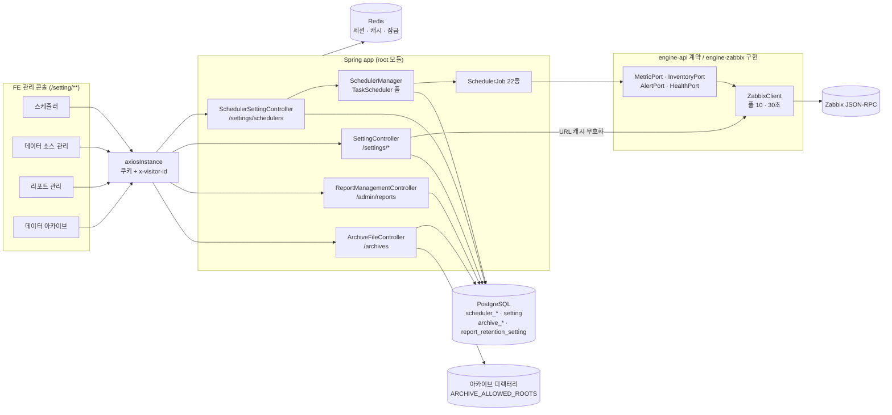

# 설정과 운영 기반 기능 상세 가이드

> 이 문서는 시스템 관리자와 운영·지원 담당자가 "제품이 무엇을 언제 자동으로 실행하는가, 외부 시스템(Zabbix·Redis·PostgreSQL·SMTP)에 어떻게 붙는가, 설정을 바꾸면 언제 반영되는가"를 한곳에서 확인하도록 만든 것이다. 범위는 관리 콘솔의 운영 화면(스케줄러·데이터 소스 관리·리포트 관리 공통 구조·데이터 아카이브 공통 기반)과 그 아래의 플랫폼 공통 계층(응답·오류 규약, Redis, Zabbix 호출 계층, DB·Flyway, 설정 키, 로그, 종료, 배포)이다. 각 도메인 기능의 내용, 인증·권한·라이선스 세부, 관리 콘솔의 틀은 범위 밖이다. 모든 내용은 BE `e55948c`·FE `9dfcbe8` 소스를 정적으로 대조해 작성했으며, 서버 기동·API 호출·브라우저 확인은 하지 않았다.

## 1. 한눈에 보기

| 기능 | 화면 주소·메뉴 위치 | 상태 | 권한·라이선스 | 한 줄 설명 |
|---|---|---|---|---|
| 스케줄러 | `/setting/schedulers` · 관리 콘솔 › 운영 | 현재 | 관리자(userRole ADMIN·SUPER_ADMIN), 라이선스 무관 | 배치 22종의 사용 여부·주기·옵션·실행 이력·수동 실행 |
| 데이터 소스 관리 | `/setting/integrations?provider=` · 관리 콘솔 › 데이터 소스 | 현재(Zabbix) / 계획(Prometheus·Elasticsearch·Datadog는 카탈로그 표시만) | 관리자 | Zabbix 접속 정보 저장과 저장 시점 연결 검증 |
| 데이터 소스 워크스페이스 | `/setting/integrations/:provider` | 부분 | 관리자 | 소스별 관리 화면으로 가는 진입 카드. Zabbix만 실제 화면에 연결 |
| 알람 동기화 범위 | 데이터 소스 관리 화면 하단 카드(Zabbix 선택 시) | 현재 | 관리자 | 알람 사본에 담을 범위(그룹·심각도·억제·규칙 상태) 저장 |
| 클라우드 인프라 설정 저장 | `/setting/cloud-infra-info` | 현재(저장 구조만 이 문서) | 관리자 | AWS 자격 증명·유료 API 옵트인·수집 리전을 `setting` 표에 저장 |
| AI(LLM) 설정 저장 | `/setting/ai` | 현재(저장 구조만 이 문서) | 관리자 | LLM 접속 정보를 `setting` 표에 저장하고 AI 서버에 변경을 알림 |
| 리포트 관리(공통 구조) | `/setting/report-management?tab=` · 관리 콘솔 › 운영 | 현재 | 관리자. APM 탭은 APM 라이선스 필요 | 저장된 리포트 목록·삭제와 계열별 보존 정책, 정리 배치 |
| 데이터 아카이브(공통 기반) | `/setting/data-archive?tab=files\|apm\|settings` · 관리 콘솔 › 운영 | 부분(소스는 APM 1종, 파일 자동 만료 없음) | 관리자. 공통 목록·설정은 라이선스 무관, APM 탭만 APM 라이선스 | 보존 만료 전 데이터를 ZIP으로 남긴 파일의 원장·경로 정책·무결성 |
| 이메일 발송 | 화면 없음 | 부분 | — | 비밀번호 재설정 OTP·안내 메일 발송(SMTP) |
| 수집 엔진 모듈 경계 | 화면 없음 | 현재 | — | `engine-api`(계약)와 `engine-zabbix`(구현) 분리, 포트 4종 |
| 공통 응답·오류 규약 | 화면 없음 | 현재 | — | HTTP 200 + 본문 `code`·`errorCode`, 401만 실제 상태 |
| Redis 사용(세션·캐시·잠금) | 화면 없음 | 현재 | — | 세션·토큰·rate limit·읽기 통과 캐시 |
| Zabbix 호출 계층 | 화면 없음 | 현재 | — | 커넥션 풀·타임아웃·호출 상한·호출 계측 로그 |
| DB·Flyway | 화면 없음 | 현재 | — | V1~V69 + 반복 마이그레이션 1개, 기동 시 자동 적용 |
| 로그·종료·배포 | 화면 없음 | 현재(헬스 엔드포인트 없음) | — | 프로필별 로그, graceful shutdown, Docker·파이프라인 |
| FE 공통 기반 | 화면 없음 | 현재 | — | axios 인터셉터, `useDmoveQuery`, 환경 변수, 빌드 |

영역의 구조는 다음과 같다. 관리 콘솔 화면은 모두 공통 axios 인스턴스를 거쳐 BE의 관리자 전용 컨트롤러를 부르고, 컨트롤러는 설정을 PostgreSQL에 저장한다. 저장된 설정은 `SchedulerManager`(배치 등록)와 `ZabbixConnectionResolver`(Zabbix 주소·계정 해석)가 읽는다.

## 2. 기능별 상세

### 2.1 스케줄러

**무엇을 하는가**

제품이 주기적으로 실행하는 배치의 사용 여부와 주기를 화면에서 바꾼다. 배치는 코드에 고정된 cron이 아니라 `scheduler_setting` 표의 행을 따른다. 관리자는 배치가 마지막에 성공했는지 확인하고, 필요하면 주기와 무관하게 한 번 실행할 수 있다.

**화면과 진입 경로**

- 주소: `/setting/schedulers`
- 메뉴: 헤더 ⚙(관리 콘솔) › 운영 › 스케줄러. 사이드바에는 없다.
- URL query: 없음. 펼친 행·편집 모달 상태는 주소에 남지 않는다.
- 다른 진입점: 홈의 시스템 상태 위젯이 관리자에게 스케줄러 요약을 보여 준다(`GET /home/system-status`의 `schedulers`).

**사용 방법**

1. 목록에서 작업별 사용 여부, 주기, 다음 실행, 마지막 실행 결과를 확인한다.
2. 행 왼쪽의 펼침 버튼을 누르면 그 작업의 실행 이력(최근 20건)이 조회된다.
3. [편집]을 누르면 사용 여부, 주기 종류(간격마다·매일·매주·매월), 간격 또는 실행 시각, 실행 로그 정책(성공도 기록·보관 건수), 작업별 옵션을 바꾼다.
4. [저장]을 누르면 요청을 받은 서버에서 즉시 재등록된다. 재기동은 필요 없다.
5. 재생 아이콘([지금 실행])을 누르면 주기와 무관하게 1회 실행이 접수된다. 사용 중지된 작업도 실행된다. 결과는 실행 이력에서 확인한다.

화면에 보이는 값의 뜻은 다음과 같다.

| 값 | 뜻 |
|---|---|
| 주기 `N분마다` | 이전 실행이 끝난 시점부터 N분 뒤에 다시 실행한다(고정 지연). 실행 시간이 길면 실제 간격은 N분보다 길다 |
| 주기 `매일 HH:mm` 등 | 서버 JVM 시간대 기준 시각이다. 컨테이너 배포는 UTC다 |
| 다음 실행 | 서버가 계산한 예정 시각을 브라우저 현지 시각으로 표시한다. 사용 중지면 "예정 없음" |
| 마지막 실행 | 실행 이력의 가장 최근 1건. 성공을 기록하지 않는 작업은 실패했을 때만 값이 생긴다 |
| 소요 | 1,000ms 이상이면 초 단위(소수 1자리), 미만이면 ms |
| 보관 건수 | 작업별로 남길 실행 이력 수. 0이면 이력을 남기지 않는다. 상한 1,000 |

편집 모달의 제약은 다음과 같다.

| 입력 | 제약 |
|---|---|
| 실행 간격 | 선택지 1·5·10·30·60·180·360·720·1440분. 서버 하한 1분 |
| 실행 시각 | 시 0~23, 분 0~59. 화면은 5분 단위로 고른다 |
| 요일 | 1(월)~7(일) |
| 실행일 | 1~28. 29~31일은 없는 달이 있어 받지 않는다 |
| 자산 동기화 전용 | "Zabbix에 값 반영"(`writeBackToZabbix`) 스위치 |
| 클라우드 상태 수집 전용 | 구성 정보 수집 주기(`configIntervalMinutes`) 0·15·30·60·120·360·1440분. 0은 매 실행마다. 미설정 시 30분 |

**동작 원리**

- FE: `SchedulerManagement.tsx` → `useSchedulers`·`useUpdateScheduler`·`useRunSchedulerNow`·`useSchedulerRunLogs`(`hooks/useSchedulers.ts`) → `services/scheduler.api.ts`. 목록과 이력은 `staleTime: 0`으로 매번 다시 조회한다. 작업 이름·설명은 `constants/scheduler.ts`의 `SCHEDULER_JOB_CATALOG`와 i18n 키가 정하고, 카탈로그에 없는 작업은 `job_key`가 그대로 표시된다.
- BE 등록: `SchedulerManager`가 기동 완료(`ApplicationReadyEvent`) 뒤 `scheduler_setting` 전 행을 읽어 `TaskScheduler`에 올린다. `SchedulerJob` 빈이 있는데 설정 행이 없거나 사용 중지면 경고 로그만 남기고 등록하지 않는다.
- 트리거: `interval`은 `PeriodicTrigger`(고정 지연, 첫 실행은 등록 시점 + 주기)다. `interval_seconds` 값이 있으면 분 값보다 우선한다. `daily`·`weekly`·`monthly`는 6필드 cron으로 바꾼 `CronTrigger`이며 시간대를 지정하지 않아 JVM 기본 시간대를 쓴다.
- 실행 한 건의 순서(`SchedulerManager.execute`):
  1. 종료 중이면 건너뛴다.
  2. `requiresActiveLicense()`가 참인데 라이선스 접근 모드가 쓰기 불가이면 건너뛴다. 이 경우 실행 이력에 남기지 않고 INFO 로그만 남긴다.
  3. `scheduler_lease`에서 잠금을 얻는다. 얻지 못하면 "다른 인스턴스가 실행 중" 로그를 남기고 건너뛴다.
  4. 작업을 실행한다. 정상 반환이면 성공(요약 문자열 포함), 예외면 실패로 기록한다. 예외가 나도 다음 주기는 유지된다.
  5. 성공·실패와 무관하게 잠금을 반납한다.
- 잠금: `SchedulerLeaseService`가 조건부 UPDATE와 PK 충돌로 원자적으로 획득한다. 수명은 30분이고 실행 중 연장하지 않는다. 소유자 식별자는 `호스트명:PID`다.
- 실행 이력: `SchedulerRunLogService`가 기록할 때마다 작업별 보관 건수를 넘는 오래된 행을 지운다. 이력 저장이 실패해도 배치 결과는 바뀌지 않는다.
- 수동 실행: `POST .../run`은 작업 존재만 동기 확인하고 `taskScheduler.schedule(..., Instant.now())`로 넘긴 뒤 즉시 응답한다. 같은 실행 경로를 타므로 잠금·라이선스·종료 검사가 그대로 적용된다.
- 저장: `SchedulerSettingService.update`가 검증 후 저장하고 같은 흐름에서 `reschedule`을 부른다. 실행 중인 작업은 끊지 않는다(`cancel(false)`).

등록된 작업은 다음 22종이다. 주기는 마이그레이션 시드 값이고, 시각은 서버 시간대(컨테이너는 UTC) 기준이다.

| 작업 키 | 화면 이름 | 기본 주기 | 기본 사용 | 하는 일 | 라이선스 만료·잠금 시 | 성공 기록 기본값 / 보관 |
|---|---|---|---|---|---|---|
| `asset_sync` | 자산 목록 동기화 | 60분마다 | 사용 | Zabbix 호스트를 자산으로 가져온다. 옵션 `mode`(기본 `add_update`), `writeBackToZabbix`(기본 꺼짐) | 멈춤 | 기록 / 100 |
| `event_sync` | 이벤트 동기화 | 15초마다(`interval_seconds`, 분 값은 1) | 사용 | Zabbix 문제를 알람 사본으로 동기화 | 멈춤 | 실패만 / 50 |
| `user_sync` | 사용자·역할 동기화 | 10분마다 | **중지** | Zabbix 사용자·역할 미러링. Zabbix에 없는 연동 계정을 삭제 | 멈춤 | 기록 / 50 |
| `report_weekly` | 주간 리포트 집계 | 매주 월 03:00 | 사용 | 지난 주 호스트 그룹 리포트 생성 | 멈춤 | 기록 / 30 |
| `report_monthly` | 월간 리포트 집계 | 매월 1일 03:30 | 사용 | 지난 달 호스트 그룹 리포트 생성 | 멈춤 | 기록 / 24 |
| `report_cleanup` | 리포트 정리 | 매일 04:00 | 사용 | 보존 기간이 지난 리포트 스냅샷 삭제(계열별 설정) | 계속 실행 | 실패만 / 30 |
| `event_cleanup` | 이벤트 정리 | 매일 00:00 | 사용 | 오래된 해소 이벤트 삭제 | 계속 실행 | 실패만 / 30 |
| `cloud_snapshot` | 클라우드 상태 수집 | 5분마다 | 사용 | AWS 자원 상태 기록. 옵션 `configIntervalMinutes`(기본 30) | 멈춤 | 실패만 / 30 |
| `cloud_snapshot_cleanup` | 클라우드 스냅샷 정리 | 매일 01:00 | 사용 | 스냅샷 보존 정리. 옵션 `retentionDays`(시드 30) | 계속 실행 | 실패만 / 30 |
| `cloud_cost_sync` | 클라우드 실청구액 동기화 | 매일 05:00 | 사용 | AWS 실청구액 수집. 옵션 `lookbackDays`(시드 35). 유료 API 옵트인이 꺼져 있으면 건너뛴 요약만 남김 | 멈춤 | 실패만 / 30 |
| `ai_monitor_usage_poll` | AI 사용량 수집 | 60분마다 | 사용 | AI 계정의 시간별 사용량 수집. 옵션 `lookbackHours`(시드 48) | 멈춤 | 실패만 / 30 |
| `ai_monitor_cost_poll` | AI 비용·인벤토리 수집 | 매일 04:30 | 사용 | 비용 재조회·키 목록 동기화. 옵션 `costLookbackDays`(시드 3) | 멈춤 | 실패만 / 30 |
| `apm_rollup` | APM 지표 롤업 | 5분마다 | 사용 | 1분 지표를 5분·1시간으로 접음. 옵션 `maxBuckets5m`(288)·`maxBuckets1h`(48) | 계속 실행 | 실패만 / 30 |
| `apm_trace_rollup` | APM 트레이스 집계 | 5분마다 | 사용 | 스팬을 집계표로 접음. 옵션 `maxBuckets`(288) | 계속 실행 | 실패만 / 30 |
| `apm_alert_evaluate` | APM 알람 평가 | 5분마다 | 사용 | 알람 규칙 평가 | 멈춤 | 실패만 / 30 |
| `apm_alert_sync` | APM 알람 동기화 | 매일 02:00 | 사용 | 알람 규칙과 Zabbix 쪽 객체 대조 | 멈춤 | 실패만 / 30 |
| `apm_partition_maintain` | APM 파티션 선생성 | 매일 00:30 | 사용 | 앞으로 `aheadDays`(시드 2)일치 파티션 생성 | 계속 실행 | 실패만 / 30 |
| `apm_slo_snapshot` | APM SLO 일 스냅샷 | 매일 00:50 | 사용 | SLO 일 집계. 옵션 `backfillDays` | 계속 실행 | 실패만 / 30 |
| `apm_archive` | APM 콜드 아카이브 | 매일 00:50 | 사용(기능 스위치는 아카이브 설정) | 곧 지워질 APM 데이터를 ZIP으로 보관. 옵션 `leadDays` 2·`maxRunMinutes` 20·`fetchSize` 10000 | 계속 실행 | 기록 / 90 |
| `apm_retention` | APM 보존 정리 | 매일 01:30 | 사용 | 보존 초과 파티션 삭제. 옵션 `raw1mDays` 7·`rollup5mDays` 30·`rollup1hDays` 400·`instanceIdleDays` 30·`dropStatDays` 30 | 계속 실행 | 실패만 / 30 |
| `apm_report_weekly` | APM 주간 리포트 집계 | 매주 월 10:10 | 사용 | 지난 주 APM 리포트 생성 | 계속 실행 | 실패만 / 30 |
| `apm_report_monthly` | APM 월간 리포트 집계 | 매월 1일 10:40 | 사용 | 지난 달 APM 리포트 생성 | 계속 실행 | 실패만 / 30 |

"계속 실행"인 작업은 외부 수집 소스에 나가지 않고 제품 DB만 읽고 쓰는 정리·파생 계열이다. 새 작업은 기본값이 "멈춤"이다(`SchedulerJob.requiresActiveLicense()` 기본 `true`).

**주요 API**

| Method | Path | 용도 | 권한 |
|---|---|---|---|
| GET | `/settings/schedulers` | 목록(설정 + 다음 실행 + 마지막 실행 + 유효 로그 정책) | 관리자 |
| PUT | `/settings/schedulers/{jobKey}` | 설정 수정. 위반 시 `SCHEDULER_INVALID_SCHEDULE`, 없는 키는 `SCHEDULER_NOT_FOUND` | 관리자 |
| GET | `/settings/schedulers/{jobKey}/logs?limit=20` | 실행 이력(최신순). `limit`은 보관 건수를 넘지 못한다 | 관리자 |
| POST | `/settings/schedulers/{jobKey}/run` | 1회 실행 접수. 완료를 기다리지 않는다 | 관리자 |

네 개 모두 FE가 호출한다.

**데이터**

| 테이블 | Flyway | 주요 컬럼 | 보존 |
|---|---|---|---|
| `scheduler_setting` | V15(생성·시드 7), V28·V30·V32·V38·V41·V45·V51·V55·V69(시드 추가), V50(`interval_seconds`) | `job_key`(유일), `enabled`, `schedule_type`, `interval_minutes`, `interval_seconds`, `at_hour`, `at_minute`, `day_of_week`, `day_of_month`, `options`(jsonb), `updated_at`, `updated_by` | 영구 |
| `scheduler_run_log` | V16 | `job_key`, `started_at`, `duration_ms`, `status`(success·failed), `summary`(500자), `error_message`(2,000자) | 기록할 때마다 작업별 최신 N건만 남김 |
| `scheduler_lease` | V21 | `job_key`(PK), `owner`, `expires_at`, `acquired_at` | 실행이 끝나면 행 삭제 |

**권한·라이선스**

- 메뉴 노출과 라우트 가드: `adminOnly`(userRole이 ADMIN 또는 SUPER_ADMIN).
- BE: 네 엔드포인트 모두 첫 줄에서 `AdminAccessChecker.requireAdmin`. 거부는 HTTP 200 + 본문 `code: 403`.
- 라이선스: 화면과 API는 라이선스와 무관하게 열린다. 개별 작업의 실행만 위 표의 규칙을 따른다.

**빈 값·실패·경계 상태**

| 상황 | 화면·응답 |
|---|---|
| 실행 이력 없음 | "이력 없음". 펼친 표는 성공도 기록하는 작업이면 "실행 이력이 없습니다", 아니면 "실패 이력이 없습니다. 이 작업은 실패했을 때만 기록합니다" |
| 부분 실패 | 성공으로 기록되고 요약에 `ok=38 fail=2` 형태로 남는다. 전부 실패하면 실패로 기록된다 |
| 저장 실패 | 원인과 무관하게 "실패" 토스트 한 종류 |
| 수동 실행 접수 | "실행을 시작했습니다". 잠금 미획득·라이선스 차단·종료 중으로 건너뛰어도 같은 문구가 나온다 |
| 보관 건수 1,000 초과 입력 | 서버가 1,000으로 접어 저장한다 |
| 카탈로그에 없는 작업 | `job_key`가 이름으로 표시되고 설명은 비어 있다 |

**운영 주의**

- 화면에서 `event_sync`를 저장하면 `interval_seconds`가 비워져 분 단위 주기로 바뀐다. 화면은 초 단위 주기를 표시하거나 입력하지 못한다.
- 저장 요청의 `options`는 기존 값을 통째로 교체한다. 화면은 기존 옵션에 병합해 보내지만, API를 직접 부를 때 일부 키만 보내면 나머지 키가 사라진다.
- 배치 스레드 풀은 `SCHEDULER_POOL_SIZE`(기본 4)다. 이 풀은 화면에 나오는 22개 작업과 `@Scheduled` 주기 작업(§3.3)이 함께 쓴다.
- 종료 시 진행 중 배치는 10초까지 기다린 뒤 중단된다. 종료가 시작된 뒤 트리거된 배치는 시작하지 않는다.
- `user_sync`는 기본 중지다. 켜면 Zabbix에 없는 연동 계정이 삭제되므로 대상 Zabbix 주소를 먼저 확인한다.

### 2.2 데이터 소스 관리

**무엇을 하는가**

제품이 관측 데이터를 가져오는 외부 시스템의 접속 정보를 관리한다. 실제로 연결되는 소스는 Zabbix 하나다. Prometheus·Elasticsearch·Datadog은 카탈로그와 미리보기 화면만 있고 저장·연결 기능이 없다.

**화면과 진입 경로**

- 목록·연결 설정: `/setting/integrations`. 선택한 소스는 `?provider=zabbix|prometheus|elasticsearch|datadog`로 주소에 남는다. 알 수 없는 값은 Zabbix로 처리한다.
- 워크스페이스: `/setting/integrations/:provider`. 알 수 없는 `provider`는 목록으로 되돌린다.
- 메뉴: 관리 콘솔 › 데이터 소스 › 데이터 소스 관리.
- 옛 주소 `/setting/zabbix-info`와 Zabbix 관리의 연결 정보 주소는 `/setting/integrations?provider=zabbix`로 이동한다.

**사용 방법**

1. 소스 카드에서 Zabbix를 고른다.
2. API Endpoint(예: `https://zabbix.example.com/api_jsonrpc.php`), API 사용자, API 비밀번호를 입력한다. 비밀번호를 비워 두면 저장된 값을 유지한다.
3. [저장]을 누른다. 서버가 새 정보로 Zabbix에 로그인해 보고, 실패하면 저장을 되돌린다.
4. [워크스페이스 열기]를 누르면 소스별 관리 화면 진입 카드가 나온다. Zabbix는 호스트·템플릿·아이템·트리거·네트워크 탐색·알림 관리·모니터링 커버리지 7개 카드가 실제 화면으로 연결된다.

화면 값의 뜻은 다음과 같다.

| 값 | 뜻 |
|---|---|
| 카드 배지 "설정됨" | 저장된 Zabbix 사용자 이름이 있고 조회가 실패하지 않았다는 뜻이다. 현재 연결 가능 여부를 실측한 값이 아니다 |
| "런타임 어댑터 1 / 4" | 화면에 고정된 숫자다 |
| 능력 태그(메트릭·인벤토리·알람·관리) | FE 정적 카탈로그(`constants/dataSources.ts`) 값이다 |
| 자격 증명 만료 | 응답의 `expiredTime`을 표시한다. BE가 항상 `null`을 보내므로 "-"로 보인다 |

**동작 원리**

- FE: `DataSourceSettingsPage.tsx` → `SettingService.getZabbixInfoDetail`·`updateZabbixInfoDetail`(`services/setting.api.ts`) → `GET`·`POST /settings/zabbix`.
- BE 저장(`SettingService.storageInfo`): `setting` 표에서 `type = ZABBIX`인 첫 행을 찾아 값(jsonb)을 교체한다. 비밀번호가 비어 오면 저장된 값을 유지하고, 저장된 값도 없으면 `SETTING_PASSWORD_REQUIRED`로 거부한다. 비밀번호는 저장 직전에 AES-256-GCM으로 암호화한다(`enc:v1:` 접두).
- 연결 검증: 저장 직후 같은 트랜잭션에서 URL 캐시를 비우고 `ZabbixUserService.getSuperAdminToken(true)`로 재로그인한다. 실패하면 예외가 나가 트랜잭션이 롤백된다. 별도의 "연결 테스트" 버튼과 엔드포인트는 없다.
- 주소·계정 해석(`SettingBackedZabbixConnectionResolver`): 호출 시점에 `setting(ZABBIX).value.url`을 우선 쓰고, 없으면 프로퍼티 `app.zabbix.api-url`을 쓴다. 해석한 URL은 노드 메모리에 60초 캐시한다. 계정은 `setting` 행이 있으면 그 값을, 없으면 `app.zabbix.sadmin-username`·`sadmin-password`를 쓴다.
- 슈퍼어드민 토큰은 Redis 키 `ZABBIX::Super_Admin`에 60초 캐시한다.
- 능력 판정: BE에는 `DataSourceRegistry`(§2.8)가 있어 소스 1개(`zabbix-default`)와 능력 5종(`METRICS`·`INVENTORY`·`ALERTS`·`ALERT_ACK`·`ZABBIX_ADMIN`)을 선언한다. 이 값을 FE에 내려 주는 엔드포인트는 없고, 홈 시스템 상태(`HomeSystemStatusService`)만 레지스트리를 순회해 연결 상태를 실측한다.
- 실측 연결 상태: `ZabbixHealthAdapter`가 무인증 메서드 `apiinfo.version`을 4초 제한으로 호출해 UP·DOWN·NOT_CONFIGURED를 돌려준다. 이 결과는 홈 화면에서만 보인다.

**주요 API**

| Method | Path | 용도 | 권한 |
|---|---|---|---|
| GET | `/settings/zabbix` | 저장된 접속 정보(비밀번호 키 제거). 미설정이면 `data: null` | 관리자 |
| POST | `/settings/zabbix` | 저장 + 재로그인 검증. 본문 `username`(필수)·`password`·`url` | 관리자 |

**데이터**

`setting` 표(V1 기준선): `id`, `type`(PG enum `setting_type_enum`: `CLOUD`·`ZABBIX`·`LLM`(V24)·`EVENT_SYNC`(V63)), `value`(jsonb), `created_at`, `updated_at`. ZABBIX 값의 키는 `username`·`password`(암호문)·`url`(선택)이다. 변경자 컬럼과 변경 이력 표는 없다.

**권한·라이선스**

- FE 라우트·메뉴: `adminOnly`.
- BE: `AdminAccessChecker.requireAdmin`(ADMIN ∪ SUPER_ADMIN).
- 응답에서 `password`·`secretKey`·`token`·`apiKey` 키를 제거한다. 화면은 비밀번호를 다시 받지 못한다.

**빈 값·실패·경계 상태**

| 상황 | 동작 |
|---|---|
| 미설정 | 상태 "미설정", 폼은 빈 값 |
| 조회 실패 | 오류 알림과 [다시 시도] 버튼 |
| 저장 실패(주소 오류·계정 오류) | "저장에 실패했습니다" 토스트 한 종류. 서버의 실패 사유는 화면에 표시하지 않는다 |
| Endpoint를 비우고 저장 | `url` 키를 저장하지 않는다. 이때 주소는 `app.zabbix.api-url` 프로퍼티로 넘어간다 |
| 계획 소스 선택 | 필요한 입력 항목 목록과 "어댑터가 필요합니다" 안내만 표시. 저장 폼 없음 |

**운영 주의**

- 이 설정이 틀리면 Zabbix를 읽는 화면(모니터링·이벤트·자산 실시간 값·Zabbix 관리)이 동시에 실패한다.
- 저장 즉시 반영된다. 여러 노드를 띄운 경우 다른 노드는 URL 캐시가 만료되는 최대 60초 뒤에 새 주소를 쓴다.
- Zabbix 서버를 다른 서버로 바꿔도 이전 서버에서 가져온 알람 사본·자산·리포트·사용자 연동 정보는 자동으로 지워지지 않는다.
- `app.zabbix.*` 프로퍼티는 `application.yml`에 매핑이 없다. 이 값이 필요하면 `APP_ZABBIX_API_URL` 형태의 환경 변수로 직접 줘야 한다(§3.1).

### 2.3 알람 동기화 범위

**무엇을 하는가**

`event_sync`가 Zabbix에서 가져와 알람 사본에 담는 범위를 좁힌다. 열린 알람이 많아 동기화가 무겁거나 1회 상한에 닿는 설치본에서 쓰는 운영 수단이다. 좁힌 만큼 알림 벨·문제 목록 기본 모드·홈 위젯에서도 보이지 않는다.

**화면과 진입 경로**

데이터 소스 관리 화면에서 Zabbix를 고르면 하단에 카드로 나온다(`EventSyncScopeCard.tsx`). 별도 주소는 없다.

**주요 API**

| Method | Path | 용도 | 권한 |
|---|---|---|---|
| GET | `/settings/event-sync-scope` | 저장된 범위. 미설정이면 `data: null`(제한 없음) | 관리자 |
| POST | `/settings/event-sync-scope` | 저장. `groupIds`(문자열 배열), `minSeverity`(0~5), `excludeSuppressed`, `enabledRulesOnly` | 관리자 |

**데이터**

`setting` 표의 `type = EVENT_SYNC` 행(V63). 값은 `{groupIds: [], minSeverity?, excludeSuppressed, enabledRulesOnly}`. `groupIds`가 비면 전체 그룹, `minSeverity`가 없으면 심각도 제한 없음이다.

**운영 주의**

- 서버는 `minSeverity` 범위만 검증한다. `groupIds`가 실제 Zabbix 그룹인지는 저장 시 확인하지 않는다.
- 범위 적용과 사본 정리 동작은 이벤트·알림 영역 문서에서 다룬다.

### 2.4 설정 저장소 공통 구조(`setting` 표)와 비밀값

**무엇을 하는가**

Zabbix·AWS·LLM 접속 정보와 알람 동기화 범위를 한 표에 종류별 한 행으로 저장한다. 비밀값은 설치본마다 다른 키로 암호화한다.

**동작 원리**

| 종류 | 저장 EP | 비밀값 키 | 저장 직후 동작 |
|---|---|---|---|
| `ZABBIX` | `POST /settings/zabbix` | `password` | URL 캐시 무효화 + 슈퍼어드민 재로그인(실패 시 롤백) |
| `CLOUD` | `POST /settings/cloud-infra` | `password` | 트랜잭션 커밋 뒤 플릿 지표 캐시(`FleetMetricsCache`) 무효화 |
| `LLM` | `POST /settings/llm` | `apiKey`(프로바이더가 OLLAMA면 없어도 됨) | AI 서버에 `POST {AI_BASE_URL}/internal/settings/changed` 비동기 통지. 실패해도 저장은 유효 |
| `EVENT_SYNC` | `POST /settings/event-sync-scope` | 없음 | 없음 |

- 조회 응답(`SettingResponseDto`)은 값에서 비밀값 키를 지운다. 가리는 문자열을 넣지 않는 이유는 폼이 그 문자열을 되돌려 보내 실제 값을 덮어쓰기 때문이다.
- 암호화(`SettingSecretCodec`): AES-256-GCM, IV 12바이트, 저장 형식 `enc:v1:<base64(iv‖암호문‖태그)>`. 접두어가 없는 값은 암호화 도입 전 평문으로 보고 그대로 읽으며, 다음 저장 때 암호문으로 바뀐다. 키는 `CREDENTIAL_ENCRYPTION_KEY`(base64 32바이트)이고 없거나 길이가 다르면 기동이 실패한다.
- 내부 엔드포인트: AI 서버는 `GET /internal/settings/llm`을 헤더 `x-internal-token`으로 호출해 `apiKey` 평문을 받는다. `INTERNAL_API_TOKEN`이 비어 있으면 항상 403이다. 비교는 상수 시간 비교(`MessageDigest.isEqual`)다.
- 입력 검증: `CloudInfraInfoDto`는 리전 이름 형식과 개수(최대 64), `LlmInfoDto`는 프로바이더 4종·`maxTokens` 256~128,000·월 예산 0~1,000,000을 검증한다. `ZabbixInfoDto`는 `username` 필수만 검증하고 `url` 형식은 검증하지 않는다.

**데이터**

`setting(id, type, value jsonb, created_at, updated_at)`. `type`에 유일 제약이 없고 서비스가 "종류별 첫 행"(`findFirstByType`)을 쓴다.

**운영 주의**

- `CREDENTIAL_ENCRYPTION_KEY`를 잃으면 저장된 비밀값을 복호화할 수 없다. 설정 화면에서 비밀번호·키를 다시 입력하면 복구된다.
- 키를 교체하는 절차(재암호화)는 구현돼 있지 않다. 저장 형식의 버전 접두(`v1`)만 준비돼 있다.
- 클라우드·LLM 설정 화면의 사용 방법은 각 영역 문서에서 다룬다.

### 2.5 리포트 관리(공통 구조)

**무엇을 하는가**

배치가 만든 주간·월간 리포트 스냅샷의 목록·삭제와 보존 정책을 관리한다. 리포트 계열은 호스트 그룹과 APM 두 가지이며 탭으로 나뉜다. 탭 안의 내용은 각 영역 문서에서 다룬다.

**화면과 진입 경로**

- 주소: `/setting/report-management`. 활성 탭은 `?tab=`에 남는다(호스트 그룹 탭이 기본, APM 탭은 `?tab=apm`).
- APM 리포트 본문: `/setting/report-management/apm`(목록 행의 `id` 또는 `periodType`+`periodStart` 쿼리).
- 메뉴: 관리 콘솔 › 운영 › 리포트 관리.
- APM 라이선스가 없으면 APM 탭이 숨고, `?tab=apm`으로 들어오면 호스트 그룹 탭으로 접으면서 주소도 고친다.
- 보존 설정 폼을 고친 채 탭이나 화면을 떠나려 하면 확인 창이 뜬다(`useBlocker`).

**동작 원리**

- 보존 설정은 `report_retention_setting`의 단일 행(id = 1)이다. 호스트 그룹용 3열과 APM용 3열이 한 행에 있고, 두 탭은 각자 자기 열만 고친다. 저장은 행 잠금(`findByIdForUpdate`)으로 직렬화한다.
- 정리 배치 `report_cleanup`(매일 04:00): `ReportManagementService.runCleanup(오늘 UTC 날짜)`가 계열마다 자기 스위치와 기간을 읽는다. 주간은 `period_start < 오늘 − N주`, 월간은 `period_start < 오늘 − N개월`인 스냅샷을 지운다. 한 계열이 꺼져 있으면 그 계열만 건너뛴다.
- 실행 이력 요약은 `deleted=… hostGroup=… apm=…` 형태로 계열별 건수를 남긴다.
- 보존 값을 줄이면 다음 정리 실행 때 범위 밖 스냅샷이 삭제된다. 저장 즉시 삭제되지는 않는다.

**주요 API**

| Method | Path | 용도 | 권한 |
|---|---|---|---|
| GET | `/admin/reports` | 저장된 리포트 목록(계열 필터·페이지) | 관리자 |
| DELETE | `/admin/reports` | 선택 삭제 | 관리자 |
| GET·PUT | `/admin/reports/retention` | 호스트 그룹 보존 설정 | 관리자 |
| GET·PUT | `/admin/reports/retention/apm` | APM 보존 설정 | 관리자 |

`PUT` 본문은 `enabled`(필수), `weekRetentionWeeks`(1~520), `monthRetentionMonths`(1~120)다.

**데이터**

`report_retention_setting`(V4 생성·시드, V66 APM 열 추가): `enabled`·`week_retention_weeks`(기본 52)·`month_retention_months`(기본 24)와 `apm_enabled`·`apm_week_retention_weeks`·`apm_month_retention_months`. V66은 기존 값을 APM 열로 복사해 업그레이드 전후 동작을 같게 했다.

**권한·라이선스**

모든 엔드포인트가 `ReportAdminAccess.require`(관리자)다. `report_cleanup`은 라이선스가 만료돼도 실행된다.

### 2.6 데이터 아카이브(공통 기반)

**무엇을 하는가**

보존 기간이 끝나 지워질 데이터를 서버 디스크에 ZIP 파일로 남기고, 그 파일의 목록·다운로드·삭제·무결성 검사·저장 경로를 관리한다. 지금 이 기반을 쓰는 소스는 APM 콜드 아카이브 하나다. APM 전용 설정·상태·보류는 APM 영역 문서에서 다룬다.

**화면과 진입 경로**

- 주소: `/setting/data-archive`. 탭은 `?tab=files`(파일 목록, 기본)·`apm`(APM 설정·상태)·`settings`(공통 경로 설정).
- 메뉴: 관리 콘솔 › 운영 › 데이터 아카이브.
- APM 라이선스가 없으면 APM 탭이 숨는다. 파일 목록과 공통 설정은 라이선스와 무관하게 열린다.

**사용 방법**

1. 운영자가 서버에 `ARCHIVE_ALLOWED_ROOTS`(허용 루트, 쉼표 구분 절대 경로)를 설정하고 재기동한다. 비어 있으면 기능이 켜지지 않고 화면에서 고칠 수 없다.
2. 공통 설정 탭에서 저장 경로(허용 루트 아래), 최소 여유 공간(1~10,000GB, 기본 10), ZIP 안 파일 하나의 크기 한도(64~4,096MB, 기본 1,024)를 입력한다.
3. [경로 검사]로 저장 없이 규칙과 실제 쓰기를 확인한다. [저장]은 같은 검사를 통과해야 성공한다.
4. 파일 목록 탭에서 소스·데이터셋·상태·기간으로 거르고, 행에서 다운로드·무결성 검사·삭제(사유 필수)를 한다.

**동작 원리**

- 원장(`ArchiveLedger`, 표 `archive_file`): 파일 하나 또는 "만들지 못한 사실" 하나가 한 행이다. 상태는 `RUNNING`·`OK`·`SUPERSEDED`·`DELETED`·`FAILED`·`SOURCE_EXPIRED`·`HOLD_EXPIRED`다. 같은 (소스, 데이터셋, 날짜)의 유효본(`OK`)은 부분 유일 인덱스로 하나만 허용한다.
- 작성기(`ArchiveWriter`): `.partial` 파일에 쓰고, 다시 읽어 행 수와 SHA-256을 검증한 뒤 원자적으로 이동한다. 기존 파일을 덮어쓰지 않으며 같은 날을 다시 만들면 옛 파일은 `SUPERSEDED`로 남는다.
- 경로 정책(`ArchivePathPolicy`): 절대 경로만(R1), `..`과 비정규 표기 금지(R2), 허용 루트 아래(R3), 심볼릭 링크를 풀어도 허용 루트 아래(R4), 제어 문자·큰따옴표·`${`·512자 초과·윈도우 예약 이름 금지(R5), 로그 디렉터리(`LOG_PATH`)와 겹치지 않음(R6). 실검사는 디렉터리 생성·쓰기·이동·여유 공간을 확인한다.
- 직렬화(`ArchiveDayLock`): PostgreSQL 트랜잭션 advisory lock을 (소스, 데이터셋, 날짜) 단위로 잡는다. 대기는 유한하다(보존 배치 30초, 관리자 작업 60초). 한도를 넘기면 관리자 작업은 `ARCHIVE_BUSY`로 끝난다.
- 목록은 조회할 때마다 파일 실물 존재를 확인해 `fileExists`로 돌려준다. 한 페이지는 기본 50건, 최대 200건이다.
- 삭제는 파일만 지우고 행은 `DELETED`로 남긴다(누가·언제·사유). 대상은 `OK`·`SUPERSEDED`뿐이고 선택 삭제는 한 번에 500건까지다.
- 다운로드·삭제·설정 저장은 애플리케이션 로그에 `[소스-ARCHIVE] action=…` 줄로 남는다. 사용자 입력은 `LogSafe`로 이스케이프한다.

**주요 API**

| Method | Path | 용도 | 권한 |
|---|---|---|---|
| GET | `/archives` | 목록. `source`·`dataset`·`status`·`includeDeleted`·`from`·`to`·`page`·`limit` | 관리자 |
| GET | `/archives/{id}` | 상세(manifest 포함) | 관리자 |
| GET | `/archives/{id}/download` | ZIP 다운로드. 본문 전 실패는 JSON(`ARCHIVE_NOT_FOUND`·`ARCHIVE_FILE_MISSING`) | 관리자 |
| DELETE | `/archives/{id}` | 삭제(사유 필수, 255자 이내) | 관리자 |
| POST | `/archives/delete-bulk` | 선택 삭제(최대 500건) | 관리자 |
| POST | `/archives/{id}/verify` | SHA-256 재계산 | 관리자 |
| GET·PUT | `/archives/settings` | 공통 설정 조회·저장. 실패 `ARCHIVE_NOT_CONFIGURED`·`ARCHIVE_PATH_INVALID`·`ARCHIVE_SETTING_INVALID` | 관리자 |
| POST | `/archives/path-check` | 경로 검사(저장 안 함) | 관리자 |

`/archives/sources/apm/*`(설정·상태·보류·수동 실행)는 APM 영역이다.

**데이터**

| 테이블 | Flyway | 내용 |
|---|---|---|
| `archive_file` | V69 | 원장. `source`, `dataset`, `period_day`(서버 시간대 날짜), `file_path`, `bytes`, `source_rows`, `sha256`, `manifest`(jsonb), `status`, `fail_reason`, `deleted_at`·`deleted_by`·`delete_reason`, `run_id` |
| `archive_setting` | V69 | 소스별 1행(`COMMON`·`APM`·`ZABBIX`). `options`(jsonb), `updated_at`, `updated_by` |

**권한·라이선스**

- 모든 `/archives` 엔드포인트가 `ArchiveAdminAccess.require`(관리자)다. 기능 권한(`archive.*`)은 없다.
- 공통 엔드포인트는 라이선스 게이트 밖이다. 라이선스가 만료돼도 이미 만든 파일을 받고 정리할 수 있다.

**빈 값·실패·경계 상태**

| 상황 | 동작 |
|---|---|
| 허용 루트 미설정 | 설정 조회가 `configured: false`를 돌려주고 저장은 `ARCHIVE_NOT_CONFIGURED` |
| 원장에는 있는데 파일이 없음 | 목록의 `fileExists: false`, 다운로드·검사는 `ARCHIVE_FILE_MISSING` |
| 원장 경로가 허용 루트 밖 | 다운로드·삭제를 거절하고 로그에 `…-rejected` 기록(`ARCHIVE_FILE_REJECTED`) |
| 같은 날짜 작업과 겹침 | 대기 한도 뒤 `ARCHIVE_BUSY` |

**운영 주의**

- 컨테이너 배포는 허용 루트를 볼륨으로 마운트해야 한다. BE 배포 파이프라인은 `-v /data/moveseye-archive:/data/archive`와 `-e ARCHIVE_ALLOWED_ROOTS=/data/archive`를 함께 넣는다.
- 파일 보관 기간(`archiveRetentionDays`)은 항상 0(무기한)으로 저장된다. 보관 기간이 지난 파일을 지우는 배치는 없다. 디스크 정리는 관리자가 화면에서 삭제해야 한다.
- 아카이브 디렉터리는 백업 대상이다. 보존 기간이 지난 데이터의 유일한 사본이기 때문이다.

### 2.7 이메일 발송

**무엇을 하는가**

비밀번호 재설정 OTP 메일과 안내 메일을 SMTP로 보낸다. 설정 화면은 없고 서버 환경 변수로만 구성한다.

**동작 원리**

- `EmailServiceImpl`이 `JavaMailSender`를 `ObjectProvider`로 받는다. 발송 가능 조건(`isConfigured()`)은 세 가지가 모두 참일 때다: `JavaMailSender` 빈 존재, `app.mail` 설정 존재, 보내는 주소(`MAIL_FROM_EMAIL`) 존재.
- 템플릿 메일(`sendVerifyEmail`·`sendResetPassword`): `@Async`로 비동기 발송한다. 본문을 `email` 표에 `PENDING`으로 먼저 저장하고, 발송에 성공하면 `DONE`으로 바꾼다. SMTP가 구성되지 않았거나 발송이 실패하면 행은 `PENDING`으로 남고 호출한 쪽(로그인·사용자 흐름)에는 오류가 전달되지 않는다. 재시도는 없다.
- 평문 메일(`sendPlainText`): 동기 발송이고 DB에 남기지 않는다. 미구성이면 `IllegalStateException`을 던진다. 본문을 로그에 남기지 않는다.
- `sendWelcome`은 아무것도 보내지 않는다.
- `JavaMailSender` 빈은 Spring Boot가 `spring.mail.host` 프로퍼티가 있을 때만 만든다. 현재 `application.yml`에는 `spring.mail.*` 매핑이 없으므로 SMTP 접속 정보는 `SPRING_MAIL_HOST`·`SPRING_MAIL_PORT`·`SPRING_MAIL_USERNAME`·`SPRING_MAIL_PASSWORD` 환경 변수(필요하면 `SPRING_MAIL_PROPERTIES_MAIL_SMTP_SSL_ENABLE`)로 줘야 한다.

**데이터**

`email` 표(V1 기준선): `type`, `title`(100자), `to`(100자), `content`(5,000자), `status`(PG enum, `PENDING`·`DONE` 등), `created_at`, `updated_at`. 정리 배치는 없다.

**운영 주의**

- 메일이 오지 않을 때는 `email` 표에서 해당 행의 `status`와 서버 로그의 `[email] SMTP not configured` 경고를 확인한다.
- 시드 관리자 계정은 이메일이 비어 있어 비밀번호 찾기를 쓸 수 없다(반복 마이그레이션이 시드 주소를 지운다). 실제 주소를 내 정보에서 등록해야 한다.

### 2.8 수집 엔진 모듈 경계

**무엇을 하는가**

Zabbix 외의 데이터 소스를 붙일 수 있도록 "무엇을 읽는가"(계약)와 "Zabbix에서 어떻게 읽는가"(구현)를 Gradle 모듈로 나눈다.

**동작 원리**

| 모듈 | 역할 | 의존 |
|---|---|---|
| root(app) | REST·JPA·Redis·비즈니스 로직. 부팅 모듈 | `implementation(project(":engine-api"))`, `runtimeOnly(project(":engine-zabbix"))` |
| `engine-api` | 계약. `engine/`(소스 중립 포트·정규화 모델) + `zabbix/`(Zabbix 전용 계약, 추상화 없음) + 레거시 예외(`common.exception`) | Spring Boot 플러그인 없음. `jackson-annotations`, `spring-web`(HttpStatus) |
| `engine-zabbix` | Zabbix 구현. JSON-RPC 클라이언트·어댑터·키 카탈로그 | `engine-api`, `spring-context`, `spring-web`, Apache HttpClient 5 |

- 컴파일 의존 차단: app은 `engine-zabbix`를 `runtimeOnly`로만 가진다. app의 프로덕션 코드가 구현 타입을 참조하면 컴파일이 실패한다. 테스트 소스만 `testImplementation`으로 구현을 볼 수 있다.
- 배포 산출물은 JAR 1개다. Boot fat jar가 두 모듈을 `BOOT-INF/lib/`에 넣는다.
- 소스 중립 포트 4종(`engine/port`):

| 포트 | 답하는 것 | Zabbix 구현 |
|---|---|---|
| `MetricPort` | 최신값·시계열·추세 | `ZabbixMetricAdapter` + `ZabbixMetricCatalog` |
| `InventoryPort` | 호스트·그룹 목록 | `ZabbixInventoryAdapter` |
| `AlertPort` | 열린 알람·이력·확인 처리 | `ZabbixAlertAdapter` |
| `HealthPort` | 소스에 지금 붙을 수 있는가 | `ZabbixHealthAdapter` |

- 레지스트리(`DataSourceRegistry`): `list()`가 소스 서술자(`id`·`type`·`displayName`·`capabilities`)를, `port(포트 타입, 소스 id)`가 구현을 돌려준다. 구현은 `ZabbixDataSourceRegistry` 하나이고 소스 `zabbix-default` 1개를 코드에 고정했다. 능력 enum은 `METRICS`·`INVENTORY`·`ALERTS`·`ALERT_ACK`·`LOGS`·`ZABBIX_ADMIN` 6종이며 Zabbix는 `LOGS`를 뺀 5종을 선언한다. 소스를 저장하는 DB 표는 없다.
- Zabbix 전용 계약(`engine-api`의 `zabbix/`): 호스트·호스트 그룹·아이템·템플릿·트리거·LLD·디스커버리·유지보수·미디어 타입·액션·스크립트·프록시·웹 시나리오·사용자 매크로·이벤트·문제·이력·추세·사용자·사용자 그룹·역할·토큰 서비스 인터페이스. 관리 화면과 계정 연동이 쓴다.
- SPI(app이 구현해 엔진에 주입): `ZabbixConnectionResolver`(주소·슈퍼어드민 계정, 구현 `SettingBackedZabbixConnectionResolver`), `ZabbixSessionStore`(토큰 저장소, 구현 `RedisZabbixSessionStore`).
- 오류 전달: 어댑터는 `EngineException(kind)`을 던지고 `GlobalExceptionHandler`가 `UNAUTHORIZED`만 HTTP 401로, 나머지는 HTTP 200 + 본문 코드로 바꾼다.

**운영 주의**

- 두 번째 소스(Prometheus 등) 어댑터는 구현돼 있지 않다. 데이터 소스 화면의 나머지 3종은 FE 카탈로그 항목일 뿐이다.

### 2.9 공통 응답·예외·오류 코드

**동작 원리**

- 성공 응답: `ApiResult` — `{status: "success", code: 200, data, syncTime}`. `message`는 넘겨받았을 때만 `"OK"`로 나온다. `null`인 최상위 필드는 생략된다.
- `syncTime`: `SyncTimeResponseAdvice`가 성공한 `ApiResult` 응답마다 Redis 키 `SYNC_TIME_KEY`를 읽어 붙인다. 이 키는 사용자 동기화가 끝날 때 10분 TTL로 기록되므로, 그 밖의 시간에는 `null`이다.
- 오류 응답 규약(`GlobalExceptionHandler`):

| 원인 | HTTP 상태 | 본문 |
|---|---|---|
| 비즈니스 오류(`ApiError`) | 200 | `{status: "error", code: 400(기본), errorCode, message, data?}` |
| 권한 거부(`ForbiddenError`·`HttpError`) | 200 | `code: 403`. `errorCode: "FORBIDDEN"`은 코드를 실은 호출부에서만 나온다 |
| 인증 실패(`UnauthorizedError`, 엔진 `UNAUTHORIZED`) | **401** | `{status: "error", code: 401, message}` |
| 엔진 오류(`EngineException`) | 200 | `FORBIDDEN`→403, `NOT_FOUND`→404, `BAD_QUERY`→400, `UNSUPPORTED`→501, `SOURCE_UNAVAILABLE`→502, 그 외 500 |
| 입력 검증 실패(`@Valid`·바인딩·타입 불일치·본문 파싱·필수 파라미터 누락) | 200 | `code: 400`, `errorCode: "INVALID_DATA"`, 고정 문구 |
| 업로드 크기 초과 | 200 | `COST_UPLOAD_FILE_TOO_LARGE` |
| 라이선스 게이트·키 등록 거부 | 200 | 라이선스 오류 코드 |
| 낙관적 잠금 충돌 | 200 | `code: 409`, `ASSET_CONFLICT` |
| 없는 경로 / 메서드 불일치 / 미디어 타입 불일치 | 404 / 405 / 415 | `{statusCode, message}` |
| 처리되지 않은 예외 | 500 | `{statusCode: 500, message: "요청을 처리하지 못했습니다. 잠시 후 다시 시도해 주세요."}` |

- 실제 401만 FE의 자동 토큰 재발급을 일으킨다. 그래서 권한·라이선스·검증 오류는 200으로 나간다.
- SSE 요청(`Accept: text/event-stream`만 보낸 요청)의 401은 핸들러가 응답을 직접 쓴다.
- 오류 코드는 `engine-api`의 `ErrorCode` enum(300여 개)이 정본이다. `ApiError(문자열)` 생성자는 메시지의 `:` 앞부분이 enum 값이면 `errorCode`로 분리한다.
- 인터셉터 실행 순서(`WebConfig`): 역할 검사 → MCP 접근 제한 → 방문자 세션 검사 → 라이선스 접근 모드 → 기능 게이트.

### 2.10 Redis 사용

**동작 원리**

- 접속 설정은 `REDIS_HOST`(기본 `localhost`)·`REDIS_PORT`(기본 6379) 두 개다. 비밀번호·TLS·DB 번호·명령 타임아웃은 `application.yml`에 키가 없어 Spring Boot 표준 환경 변수(`SPRING_DATA_REDIS_PASSWORD` 등)로만 줄 수 있다.
- `RedisClientService`: JSON 직렬화 `get`·`set`(기본 TTL 60초, 0이면 만료 없음), 해시, `SCAN` 기반 개수 세기·패턴 삭제(`KEYS` 미사용), `SET NX PX` 잠금(기본 3초)과 Lua 해제, Lua 원자 카운터.
- `RedisCache`(읽기 통과 캐시의 공통 구현): `getOrLoad(key, type, ttl, loader)`·`reload(...)`·`evict(key)`.
  - Redis 읽기·쓰기 실패는 캐시 미스로 처리하고 원본을 계산한다.
  - 역직렬화가 실패한 값은 키를 지운다.
  - 같은 키의 동시 미스는 `SingleFlightExecutor`로 합쳐 로더를 한 번만 부른다. 합류자는 30초까지 기다린 뒤 스스로 계산한다.
  - 로더가 `null`을 주면 저장하지 않는다.
  - `reload`는 별도 합류 키를 써서 진행 중인 일반 조회에 합류하지 않는다.
  - 합류는 한 JVM 안에서만 일어난다.
- Redis 버전 가정: Lua 스크립트(`cjson` 포함)와 `SET … EX`·`SET NX PX`를 쓴다. `GETDEL` 같은 6.2 이상 전용 명령은 코드에 없다. 다중 키 Lua 스크립트를 쓰므로 Redis Cluster는 전제하지 않는다.

**데이터 — Redis 키 목록**

| 키 | 값 | TTL | 쓰는 곳 |
|---|---|---|---|
| `USER_LOGIN_KEY_{userId}` | 방문자 식별자(세션) | refresh 만료와 같음(기본 8시간) | 인증 |
| `REFRESH_TOKEN:{token}` | refresh 토큰 데이터 | refresh 만료 | 인증 |
| `REFRESH_GEN:{userId}` | refresh 세대 카운터 | 스크립트가 관리 | 인증 |
| `REFRESH_FAMILY_REVOKED:{family}` | 로그아웃한 계열 표식 | 남은 수명 | 인증 |
| `REFRESH_CONSUMED:{token}` | 회전으로 소비된 토큰 → 계열 | 600초 | 인증 |
| `REFRESH_SESSION_FAMILY:{userId}` | 현재 세션의 계열 | refresh 만료 | 인증 |
| `REDIS_USER_API_TOKEN`(해시, 필드 = Zabbix userid) | `토큰:토큰id:만료초` | 키 TTL 없음(값 안의 만료초로 판정) | Zabbix 개인 토큰 |
| `LOCK_KEY_USER_API_TOKEN:{userid}` | 토큰 재발급 잠금 | 3초 | 인증 필터 |
| `ZABBIX::Super_Admin` | 슈퍼어드민 세션 | 60초 | Zabbix 계층 |
| `RATE_LOGIN:`·`RATE_LOGIN_IP:`·`RATE_OTP:`·`RATE_OTP_SEND_IP:` | 시도 횟수 | 고정 창(로그인·OTP 발송 IP 기본 900초) | rate limit |
| `SYNC_TIME_KEY` | 마지막 사용자 동기화 시각 | 600초 | 사용자 동기화 |
| `HOME_SUMMARY:{범위}` | 홈 요약 | 60초 | 홈(`RedisCache`) |
| `HOME_SYSTEM_STATUS` | 시스템 상태 | 30초 | 홈(`RedisCache`) |
| `ASSET_LIVE_STATUS:{범위}` | 자산 실시간 상태 | 60초 | 자산(`RedisCache`) |
| `zbxOverview:*` | Zabbix 구성 현황 | 호스트 60초 / 구성 300초 | Zabbix 관리(`RedisCache`) |
| `EVENT_VISIBLE_HOSTS:{principal}` | 가시 호스트 | 60초 | 이벤트(`RedisCache`) |
| `EVENT_TAG_FILTERS_ACTIVE` | 태그 필터 사용 여부 | 300초 | 이벤트(`RedisCache`) |
| `HOST_LIST:groups:{principal}` · `HOST_LIST:server:{principal}:{그룹}` | 호스트 그룹·서버 목록 스냅샷 | 30초 | 호스트(직접 호출) |
| `host-group:problems:…` · `host-group:resource-trend:…` · `host-group:alert-trend:…` | 그룹 문제 요약·자원 추세·알람 추세 | 60초 | 호스트(직접 호출) |

**빈 값·실패·경계 상태**

- `RedisCache`를 쓰는 조회는 Redis가 없어도 원본을 계산해 응답한다.
- 인증된 모든 요청은 방문자 세션 검사(`VisitorSessionChecker`)에서 Redis를 읽고, 성공 응답은 `SyncTimeResponseAdvice`에서 Redis를 다시 읽는다. 두 곳에는 실패 격리가 없으므로 Redis가 응답하지 않으면 로그인된 화면 전체가 실패한다.
- Redis 데이터가 사라지면 모든 사용자가 다시 로그인해야 한다. 캐시는 다음 조회 때 다시 채워진다.

### 2.11 Zabbix 호출 계층

**동작 원리**

- 모든 Zabbix 호출은 `ZabbixClient.callRaw` 한 곳을 지난다. 전송은 Apache HttpClient 5 직접 호출이고 본문은 길이가 확정된 바이트 배열이다.
- 커넥션 풀: 총량과 경로당 상한이 같다. 풀이 곧 동시 호출 상한이다.

| 설정 키 | 기본값 | 뜻 |
|---|---|---|
| `zabbix.client.max-connections` | 10 | Zabbix 방향 동시 호출 상한 |
| `zabbix.client.pool-wait-ms` | 5000 | 풀에서 연결을 기다리는 최대 시간. 넘으면 실패 |
| (코드 고정) 연결 타임아웃 | 10초 | |
| (코드 고정) 응답 타임아웃 | 30초 | |

- 호출 상한(`ZabbixCallLimits`): 잘못된 값이면 기동이 실패한다.

| 설정 키 | 기본값 | 뜻 |
|---|---|---|
| `zabbix.call.max-response-bytes` | 64MiB | 응답 1회 바이트 상한. 넘는 순간 요청을 취소 |
| `zabbix.call.max-held-rows` | 10,000 | 결과를 모아 돌려주는 조회의 보유 행 상한 |
| `zabbix.call.max-total-rows` | 500,000 | 논리 조회 1건이 받는 행 예산 |
| `zabbix.call.max-scan-rows` | 2,000,000 | 흘려보내는 스캔의 받은 행 예산 |
| `zabbix.call.max-history-rows` | 100,000 | 원시 시계열 1건이 보유하는 포인트 상한 |
| `zabbix.call.max-calls` | 2,000 | 논리 조회 1건의 RPC 횟수 상한 |
| `zabbix.call.deadline-ms` | 120,000 | 논리 조회 1건의 전체 시간 상한 |
| `zabbix.call.policy.{method}.max-ids` / `max-rows` / `window-seconds` | 메서드별(아래) | RPC 1회의 입력 id 수·반환 행 수·기간 분할 창 |

| 메서드 | max-ids | max-rows | window-seconds |
|---|---|---|---|
| `trend.get` | 500 | 100,000 | 86,400 |
| `history.get` | 200 | 10,000 | 3,000 |
| `event.get`·`problem.get`·`host.get` | 500 | 10,000 | 86,400 |
| `item.get` | 50 | 50,000 | 86,400 |
| `trigger.get` | 500 | 50,000 | 86,400 |
| 그 외 | 500 | 10,000 | 86,400 |

`policy.history.get.max-rows`는 `max-history-rows`보다 작아야 한다. 같거나 크면 기동이 실패한다.

- 호출 계측(`ZabbixCallMetrics`): 호출마다 메서드·소요 시간·실패 여부를 메모리 창에 쌓고 60초마다 한 줄로 요약해 INFO 로그에 남긴다. 호출이 없던 창은 로그를 남기지 않는다. 형식은 `[zabbix-calls] last 63s: 42 calls, 1 errors — problem.get×12 avg=95ms max=310ms; …`이다.
- 오류 매핑: Zabbix 오류 코드가 -32602·-32500이고 메시지가 인증·권한 문구(`not authori`·`session terminated`·`no permission`·`login name or password`·`incorrect user` 등)일 때만 HTTP 401로 바꾼다. 그 밖의 Zabbix 오류와 통신 오류는 HTTP 200 + `code: 400`으로 원문 메시지를 싣는다.
- 인증 토큰 없이 인증이 필요한 메서드를 부르면 Zabbix로 나가기 전에 `FORBIDDEN`으로 끊는다. 무인증 허용 메서드는 `user.login`·`apiinfo.version` 둘이다.

**운영 주의**

- 화면 요청과 배치가 같은 풀(10)을 쓴다. 풀이 차면 5초 뒤 실패한다.
- `[zabbix-calls]` 로그는 노드마다 따로 남는다.

### 2.12 DB·Flyway

**동작 원리**

- 접속: `DB_HOST`·`DB_PORT`·`DB_NAME`·`DB_USER`·`DB_PASS`. 기본값이 없어 하나라도 빠지면 기동이 실패한다.
- 커넥션 풀: `spring.datasource.hikari.*` 설정이 없어 HikariCP 기본값(최대 10)을 쓴다.
- JPA: `ddl-auto: none`, 식별자 전부 따옴표 처리, `open-in-view: false`.
- Flyway: 기동 시 자동 적용. `baseline-on-migrate: true`, `baseline-version: 1`. 버전 마이그레이션 V1~V69와 반복 마이그레이션 `R__clear_seed_admin_public_mailbox.sql` 1개가 있다. `outOfOrder`는 기본값(꺼짐)이다.
- 빈 DB는 V1이 전체 스키마를 만든다. Flyway 이력이 없는 기존 DB는 V1로 기준선 처리하고 V2부터 적용한다.
- AI 서버는 같은 DB에 별도 이력 표(`flyway_schema_history_ai`)로 자기 테이블을 관리한다.

**운영 주의**

- 적용된 마이그레이션 파일을 고치면 체크섬 불일치로 기동이 실패한다. 스키마 변경은 새 버전 파일로만 한다.
- 마이그레이션은 자동으로 되돌려지지 않는다. V69는 파일 머리 주석에 수동 롤백 SQL이 있다.
- PostgreSQL은 DDL이 트랜잭션에 묶이므로 실패한 마이그레이션 하나는 통째로 취소된다. 그 앞까지 적용된 버전은 남는다.
- `ALTER TYPE … ADD VALUE`(V24·V63)는 PostgreSQL 12 이상을 전제한다.

### 2.13 로그·헬스 확인·종료

**동작 원리 — 로그(`logback-spring.xml`)**

| 프로필 | 레벨 | 출력 |
|---|---|---|
| `dev` | root INFO, `com.dmove` DEBUG, Zabbix 클라이언트 DEBUG | 콘솔 |
| `it` | root WARN, `com.dmove` INFO | 콘솔 |
| 그 외(미지정 포함 = 운영) | root INFO, `com.dmove` INFO, Zabbix 클라이언트 INFO | 콘솔 + 파일 `${LOG_PATH:-./logs}/moveseye.log`. 일 단위 + 50MB 분할, 30일·총 2GB |

- 환경 변수 `LOG_LEVEL_ROOT`·`LOG_LEVEL_APP`·`LOG_LEVEL_ZABBIX`·`LOG_LEVEL_SQL`(기본 OFF)·`LOG_LEVEL_LICENSE`(기본 INFO)로 레벨을 바꾼다. 설정 파일을 주기적으로 다시 읽지 않으므로(`scan="false"`) 바꾼 값은 프로세스를 재기동해야 적용된다.
- 로그 형식은 평문 한 줄이다. 요청 ID·사용자 ID 같은 상관 키는 형식에 없다.

**동작 원리 — 헬스 확인**

- Spring Boot Actuator 의존성이 없다. `/actuator/health`는 존재하지 않는다.
- `SecurityConfig`는 `/`를 인증 없이 열어 두었지만 그 경로를 처리하는 컨트롤러가 없어 404가 나온다.
- 로그인한 사용자용 상태 조회는 `GET /home/system-status`다. 사용자 수, 데이터 소스 연결(Zabbix `apiinfo.version` 4초 제한 실측), DB(`SELECT 1`)·Redis·AWS 점검, (관리자에게만) 스케줄러 요약을 돌려준다. 스케줄러 요약을 뺀 나머지는 30초 캐시다.
- 컨테이너에 `HEALTHCHECK`가 없다. 재시작은 `--restart always`가 프로세스 종료를 기준으로 한다.

**동작 원리 — 종료**

- `server.shutdown: graceful`. 새 요청을 거절하고 처리 중인 요청을 `SHUTDOWN_PHASE_TIMEOUT`(기본 20초)까지 기다린다.
- SSE 3곳(`EventStreamHub`·`ApmLiveStreamController`·`LiveSpanStreamService`)은 `ContextClosedEvent`에서 연결을 먼저 닫는다. 닫지 않으면 열린 SSE가 처리 중 요청으로 남아 매번 상한까지 기다린다.
- 배치: 종료 시작 뒤 트리거된 배치는 시작하지 않는다. 진행 중 배치는 10초 기다린 뒤 중단된다.
- 서비스 관리자(systemd·Docker)의 정지 제한 시간은 20초 + 10초 + 여유보다 커야 한다. Docker의 기본 정지 제한(10초)은 이보다 짧다.

### 2.14 빌드·배포 토폴로지

**동작 원리**

| 구성 요소 | 빌드 | 배포(저장소의 `bitbucket-pipelines.yml`, `master` 브랜치) |
|---|---|---|
| BE(`moveseye-be-spring`) | Docker 멀티스테이지. `gradlew bootJar -x test`(테스트 생략). 실행 이미지는 JRE 17 | self-hosted 러너에서 `docker build` → 기존 컨테이너 `stop`·`rm` → `docker run -d --restart always --env-file /home/.env -e ARCHIVE_ALLOWED_ROOTS=/data/archive -v /data/moveseye-archive:/data/archive -p 80:3000` → `docker image prune -f` |
| AI 서버(`moveseye-ai`) | 같은 구조의 Dockerfile(Boot 4) | `docker run … --env-file /home/.env -e PORT=3100 -v /home/moves-ai/artifacts:… --add-host=host.docker.internal:host-gateway -p 3100:3100` |
| FE(`moveseyee_fe`) | `npm ci --legacy-peer-deps` → `VITE_API_URL=… VITE_AI_URL=… npm run build`(`tsc && vite build`) | `/var/www/html/*` 삭제 후 `dist/*` 복사(Apache 정적 서빙) |

- BE 컨테이너 진입점은 `exec java $BE_JAVA_OPTS -Duser.timezone=UTC -jar app.jar`다. `BE_JAVA_OPTS` 기본값은 `-XX:MaxRAMPercentage=75.0`이고, 시간대 옵션은 뒤에 있어 덮어쓸 수 없다.
- BE와 AI 서버는 env 파일 하나(`/home/.env`)를 함께 쓴다. 겹치는 `PORT`만 `-e`로 덮는다.
- 브라우저는 FE(Apache), BE(80), AI 서버(3100)에 각각 직접 붙는다. Apache는 프록시를 하지 않는다. 따라서 BE의 `CORS_ALLOWED_ORIGINS`에 FE 오리진이 있어야 한다.
- 프로필: 운영용 프로필 파일은 없다. 프로필을 지정하지 않은 상태가 운영 기본값이고, `dev` 프로필(`application-dev.yml`)은 로컬 도커 DB 주소·Swagger 노출·`Secure` 쿠키 해제·오류 메시지 노출을 켠다.
- 설치용 묶음(compose 파일, 오프라인 이미지, env 템플릿, 설치 스크립트)과 웹서버 설정 파일은 저장소에 없다.

**운영 주의**

- 배포는 컨테이너를 내렸다가 새로 띄우는 방식이라 그 사이 요청이 실패한다.
- 이미지 태그는 `latest` 하나다. 배포 끝에 쓰지 않는 이미지를 지우므로 직전 이미지가 호스트에 남지 않는다.
- HTTP로 서비스하면서 `COOKIE_SECURE`를 기본값(`true`)으로 두면 로그인 뒤 모든 요청이 401이 된다.
- 리버스 프록시 뒤에 두면 인증 IP 제한이 프록시 주소 하나로 묶인다. `FORWARD_HEADERS_STRATEGY=native`를 켠다.

### 2.15 FE 공통 기반

**동작 원리**

- API 클라이언트(`services/axiosInstance.ts`의 `createDmoveApi`): `baseURL = VITE_API_URL`, 타임아웃 60초, `withCredentials: true`(HttpOnly 쿠키). AI 서버용 인스턴스도 같은 팩토리로 만든다.
- 요청 인터셉터:
  - `localStorage`의 방문자 식별자를 `x-visitor-id` 헤더로 싣는다.
  - `METHOD:전체 URL`이 같은 요청이 진행 중이면 앞선 요청을 취소한다.
  - 계정이 바뀐 뒤에 도착한 쓰기 요청(`sessionEpoch` 불일치)은 보내지 않는다.
- 응답 인터셉터:
  - 성공이면 `response.data`(BE의 `ApiResult`)를 돌려준다. 이것이 언랩 1겹이다.
  - 본문의 `errorCode`가 라이선스 게이트 코드면 창 이벤트를 쏜다. GET 응답이 권한 거부면 권한 거부 이벤트를 쏜다.
  - HTTP 401이면 `/auth/refresh`를 한 번 호출하고(동시 401은 한 번으로 합침) 원요청을 한 번 재시도한다. 재발급이 실패하면 로그인 화면으로 보낸다.
- `useDmoveQuery`: `ApiResult`가 실패 형태(`status: "error"` 등)면 `ApiEnvelopeError`를 던져 조회 오류로 만들고, 성공이면 `data`만 꺼내 돌려준다. 이것이 언랩 2겹째다. 소비자는 payload를 직접 받는다. `syncTime`도 함께 돌려준다. 비즈니스 오류는 재시도하지 않고 네트워크·5xx만 1회 재시도한다.
- 변경(뮤테이션)은 전역 처리가 없다. 서비스 함수가 실패 envelope을 예외로 올리거나(`unwrapSettingMutation`·`SchedulerApiError`·`ArchiveApiError`) 화면이 반환값의 `errorCode`를 검사한다.
- QueryClient 기본값: `staleTime` 60초, `retry` 1회.
- query key: `constants/queryKey.ts`에 도메인별 상수 객체로 둔다(`SCHEDULER_QUERY_KEY`·`SETTING_QUERY_KEY`·`REPORT_MANAGEMENT_QUERY_KEY`·`ARCHIVE_QUERY_KEY` 등). 키 배열의 첫 원소가 상수, 뒤에 파라미터가 온다. 응답 모양이 같아도 계열이 다르면 키를 나눈다.
- 환경 변수: `VITE_API_URL`(BE 주소), `VITE_AI_URL`(AI 서버 주소, 없으면 `http://localhost:3100`), `VITE_MAPTILER_KEY`(지도 타일 키). 빌드 시점에 번들에 박히므로 주소를 바꾸려면 다시 빌드해야 한다. `import.meta.env` 접근은 `constants/apiBaseUrl.ts`·`aiBaseUrl.ts`·`env.ts`에 모아 두었다.
- 빌드 스크립트: `build`(`tsc && vite build`), `build:dev`, `build:qa`, `typecheck:contract`(계약 픽스처 타입 검사), `test`(jest).

**운영 주의**

- SPA라 웹서버가 모든 경로를 `index.html`로 넘겨야 새로고침·주소 직접 입력이 동작한다. 저장소에는 Netlify 형식의 `public/_redirects`만 있고 Apache용 설정은 없다.
- 같은 URL로 보내는 연속 요청은 뒤의 요청만 남는다. 본문만 다른 POST를 같은 주소로 연달아 보내면 앞의 응답을 받지 못한다(서버 처리는 이미 됐을 수 있다).

## 3. 공통 동작과 설정

### 3.1 서버 설정 키(`application.yml`과 코드 기본값)

값은 환경 변수로 주입한다. Spring은 `.env` 파일을 읽지 않는다.

| 환경 변수 | 프로퍼티 | 기본값 | 뜻 |
|---|---|---|---|
| `PORT` | `server.port` | 3000 | 리스닝 포트 |
| `FORWARD_HEADERS_STRATEGY` | `server.forward-headers-strategy` | `none` | 프록시 뒤면 `native` |
| `SHUTDOWN_PHASE_TIMEOUT` | `spring.lifecycle.timeout-per-shutdown-phase` | `20s` | 종료 단계별 대기 상한 |
| `SCHEDULER_POOL_SIZE` | `spring.task.scheduling.pool.size` | 4 | 배치·주기 작업 스레드 수 |
| `DB_HOST`·`DB_PORT`·`DB_NAME`·`DB_USER`·`DB_PASS` | `spring.datasource.*` | 없음(필수) | PostgreSQL 접속 |
| `REDIS_HOST`·`REDIS_PORT` | `spring.data.redis.*` | `localhost`·6379 | Redis 접속 |
| `JWT_SECRET` | `app.jwt.secret` | 없음(필수, 32바이트 이상) | 토큰 서명 키 |
| `JWT_ACCESS_EXPIRATION_SECONDS` | `app.jwt.access-expiration-seconds` | 1800 | access 토큰 수명 |
| `JWT_REFRESH_EXPIRATION_SECONDS` | `app.jwt.refresh-expiration-seconds` | 28800 | refresh 토큰·세션 수명 |
| `CREDENTIAL_ENCRYPTION_KEY` | `app.security.credential-encryption-key` | 빈 값 → 기동 실패(필수) | 설정 비밀값 암호화 키(base64 32바이트) |
| `INTERNAL_API_TOKEN` | `app.security.internal-api-token` | 빈 값 → `/internal/**` 항상 403 | BE·AI 서버 공유 토큰 |
| `COOKIE_SECURE`·`COOKIE_SAME_SITE` | `app.cookie.*` | `true`·`Strict` | 인증 쿠키 속성 |
| `CORS_ALLOWED_ORIGINS` | `app.cors.allowed-origins` | `http://localhost:5173,http://localhost:3000` | 허용 오리진(쉼표 구분) |
| `AUTH_LOGIN_IP_MAX_FAILURES`·`AUTH_LOGIN_IP_WINDOW_SECONDS` | `app.auth.rate-limit.*` | 50·900 | 로그인 IP 제한 |
| `AUTH_OTP_SEND_IP_MAX`·`AUTH_OTP_SEND_IP_WINDOW_SECONDS` | `app.auth.rate-limit.*` | 20·900 | OTP 발송 IP 제한 |
| `AI_BASE_URL` | `app.ai.base-url` | `http://localhost:3100` | LLM 설정 변경 통지 대상 |
| `MAIL_FROM_NAME`·`MAIL_FROM_EMAIL` | `app.mail.*` | 빈 값 | 보내는 사람 |
| `BASE_PATH`·`FE_PATH_WEB` | `app.base-path`·`app.fe-path-web` | `/auth/`·빈 값 | 메일 링크 조립 |
| `LENS_CAP` | `app.lens.cap` | 50000 | 아이템·트리거 렌즈 ID 목록 안전 상한 |
| `ARCHIVE_ALLOWED_ROOTS` | `app.archive.allowed-roots` | 빈 값 → 아카이빙 꺼짐 | 아카이브 허용 루트 |
| `SYNC_ENABLED` | `app.sync.enabled` | `false` | 프로퍼티만 있고 읽는 코드가 없다. `user_sync` 스위치는 스케줄러 화면이다 |
| `SPRINGDOC_ENABLED` | `springdoc.*.enabled` | `false` | Swagger 노출(`/api`) |
| `APM_*` | `app.apm.*` | 각 기본값 | APM 수신·실시간 관제·내보내기 상한(APM 영역 문서) |
| (매핑 없음) `ZABBIX_CLIENT_MAX_CONNECTIONS` 형태 | `zabbix.client.*`·`zabbix.call.*` | §2.11 | Zabbix 풀·호출 상한. 표준 환경 변수 바인딩으로 준다 |
| (매핑 없음) `APP_ZABBIX_API_URL`·`APP_ZABBIX_SADMIN_USERNAME`·`APP_ZABBIX_SADMIN_PASSWORD` | `app.zabbix.*` | 없음 | `setting(ZABBIX)`가 비었을 때 쓰는 폴백 |
| (매핑 없음) `SPRING_MAIL_HOST` 등 | `spring.mail.*` | 없음 → 메일 발송 꺼짐 | SMTP 접속 |
| `LOG_PATH`·`LOG_LEVEL_*` | logback | `./logs`·§2.13 | 로그 위치·레벨 |
| `BE_JAVA_OPTS` | (Dockerfile) | `-XX:MaxRAMPercentage=75.0` | JVM 옵션 |
| (고정) | `spring.servlet.multipart.max-file-size`·`max-request-size` | 10MB·11MB | 업로드 한도 |
| (고정) | `app.apm.export.plan-token-ttl-seconds` | 1800 | 내보내기 계획 토큰 수명 |

### 3.2 설정이 반영되는 시점

| 설정 | 저장 위치 | 반영 시점 | 재기동 |
|---|---|---|---|
| 스케줄러 사용 여부·주기·옵션 | `scheduler_setting` | 저장 즉시(요청을 받은 노드) | 불필요 |
| Zabbix 접속 정보 | `setting(ZABBIX)` | 저장 즉시. 다른 노드는 최대 60초 뒤 | 불필요 |
| 클라우드 자격 증명·옵트인 | `setting(CLOUD)` | 저장 즉시(플릿 지표 캐시는 커밋 뒤 비움) | 불필요 |
| LLM 접속 정보 | `setting(LLM)` | AI 서버가 통지를 받으면 즉시. 통지 실패 시 AI 서버의 주기 확인에 따름 | 불필요 |
| 알람 동기화 범위 | `setting(EVENT_SYNC)` | 이벤트 동기화가 다음에 설정을 읽을 때 | 불필요 |
| 리포트 보존 | `report_retention_setting` | 다음 `report_cleanup` 실행 | 불필요 |
| 아카이브 경로·한도 | `archive_setting(COMMON)` | 다음 아카이브 실행·게이트 판정 | 불필요 |
| 아카이브 허용 루트, 풀 크기, 타임아웃, 쿠키·CORS, 로그 레벨 | 환경 변수 | 프로세스 기동 시 | **필요** |
| FE의 BE·AI 주소 | 빌드 시 `VITE_*` | 번들 빌드 시 | 재빌드·재배포 |

### 3.3 스케줄러 화면에 나오지 않는 주기 작업

다음 작업은 `@Scheduled`로 고정돼 있어 화면에서 끄거나 주기를 바꿀 수 없다. 잠금과 라이선스 검사를 거치지 않고, 실행 이력에도 남지 않는다. 스케줄러 화면의 작업과 같은 스레드 풀을 쓴다.

| 위치 | 주기 | 하는 일 |
|---|---|---|
| `ZabbixCallMetrics.logSummary` | 60초 지연 | Zabbix 호출 요약 로그 |
| `CostBulkUploadJobService.purgeExpiredJobs` | 매시 15분 | 만료 7일 지난 업로드 작업 삭제 |
| `ApmCollectorLogStore.expire` | 1시간 지연 | 7일 지난 수집기 로그 집계 삭제 |
| `ApmStuckRequestMonitor` | 1초 지연(기동 5초 뒤) | 걸린 요청 감시 |
| `LiveSpanRing.tick` | 1초 지연 | 실시간 스팬 링의 초 단위 회전 |

SSE 하트비트(`EventStreamHub`, `ApmLiveStreamController`, `LiveSpanStreamService`)는 각자 전용 단일 스레드 실행기를 쓴다.

### 3.4 다중 인스턴스에서 노드마다 따로 갖는 상태

제품은 고객사당 BE 1대 배포를 전제로 한다. BE를 2대 이상 띄우면 아래 상태는 노드마다 다르다.

| 상태 | 위치 | 2대 이상일 때 |
|---|---|---|
| 배치 등록(주기·사용 여부) | `SchedulerManager.running` | 저장 요청을 받은 노드만 재등록. 다른 노드는 재기동 전까지 옛 주기 |
| 배치 중복 실행 방어 | `scheduler_lease`(DB) | 공유됨. 단 수명 30분 고정 |
| `@Scheduled` 작업(§3.3) | 각 노드 | 노드마다 실행. 삭제·로그 계열은 중복돼도 결과가 같다 |
| SSE 구독(알람 벨·APM 실시간) | `EventStreamHub` 등 | 연결을 받은 노드의 구독자에게만 전달 |
| single-flight 합류 | `SingleFlightExecutor` | 노드 안에서만 합류 |
| Zabbix URL 캐시(60초) | `SettingBackedZabbixConnectionResolver` | 노드별 최대 60초 차이 |
| 라이선스 판정 캐시(60초) | `SignedKeyLicenseProvider` | 노드별 최대 60초 차이 |
| 기기 분류 스냅샷 | `DeviceClassificationRegistry` | 변경한 노드만 즉시 무효화 |
| 플릿 지표 캐시·CloudWatch 거부 기억·EC2 매칭 색인 | `FleetMetricsCache`·`CloudWatchAvailability`·`Ec2ZabbixMatcher` | 노드별 |
| 이벤트 동기화 커서·상태 플래그 | `EventSyncService` | 노드별(실행은 잠금이 직렬화) |
| Zabbix 호출 계측 창 | `ZabbixCallMetrics` | 노드별 로그 |
| APM 실시간 링·걸린 요청 장부 | `premium/apm/overview/live` 등 | 노드별 |
| 세션·토큰·rate limit·읽기 통과 캐시 | Redis | 공유됨 |
| 아카이브 직렬화 | PostgreSQL advisory lock | 공유됨 |

### 3.5 시간대

| 구간 | 기준 |
|---|---|
| BE JVM | 컨테이너는 `-Duser.timezone=UTC` 고정. JAR를 직접 실행할 때는 같은 옵션을 직접 줘야 한다 |
| DB 컬럼 | `timestamp without time zone`. JVM 현지 시각(`LocalDateTime.now()`)을 그대로 저장 |
| API 응답 시각 | `yyyy-MM-dd'T'HH:mm:ss.SSS'Z'` 고정 패턴. `Z`는 문자 그대로 붙이는 글자다 |
| 배치 실행 시각(`at_hour`) | JVM 기본 시간대 |
| 리포트·정리 배치의 "오늘" | UTC 날짜 |
| 아카이브 `period_day` | 서버 기본 시간대 날짜(파티션과 같은 기준) |
| Zabbix | epoch 초로 주고받아 시간대와 무관 |
| 브라우저 | 응답의 `Z` 시각을 현지 시각으로 바꿔 표시(dayjs) |

JVM 시간대가 UTC가 아니면 응답 시각이 실제와 그 차이만큼 어긋난다.

## 4. 문제점 및 보완점 분석

"코드 확인"은 해당 파일을 직접 열어 확인한 항목이다. "기존 기록"은 감사·백로그 문서에 있던 항목을 현재 코드로 다시 확인한 것이고, "추론"은 코드 사실에서 영향을 미루어 본 것이다. 런타임 재현은 하지 않았다.

| ID | 제목 | 중요도 | 유형 | 증거 수준 | 상태 |
|---|---|---|---|---|---|
| OPS-01 | SMTP 접속 설정 매핑이 사라져 문서화된 `MAIL_*` 환경 변수로는 메일이 발송되지 않는다 | 높음 | 운영 | 코드 확인 | 신규 |
| OPS-02 | Zabbix 폴백 프로퍼티 매핑이 사라졌고 설치 가이드의 필수 환경 변수가 코드와 다르다 | 중간 | 운영 | 코드 확인 | 신규 |
| OPS-03 | 스레드 4개짜리 풀 하나를 배치 22종과 1초 주기 작업이 함께 쓴다 | 중간 | 규모 | 코드 확인 + 기존 기록 | 기존 백로그-유효(범위 확대) |
| OPS-04 | 화면에서 `event_sync`를 저장하면 15초 주기가 분 단위로 바뀌고, 화면은 처음부터 "1분마다"로 표시한다 | 중간 | 정확성 | 코드 확인 | 신규 |
| OPS-05 | 배치 실행 시각을 서버 시간대로 해석하는데 화면에 시간대 표시가 없다 | 중간 | 사용성 | 코드 확인 | 신규 |
| OPS-06 | UTC 전제가 컨테이너 진입점 옵션에만 걸려 있다 | 중간 | 정확성 | 코드 확인 | 신규 |
| OPS-07 | "지금 실행"이 건너뛰어져도 성공으로 안내하고, 파괴적 작업도 확인 없이 실행된다 | 중간 | 사용성 | 코드 확인 | 신규 |
| OPS-08 | 배치 실패·건너뜀을 알리는 수단이 실행 이력과 로그뿐이다 | 중간 | 운영 | 코드 확인 | 신규 |
| OPS-09 | BE를 2대 이상 띄우면 스케줄 변경이 한 노드에만 반영되고, 배치 잠금은 30분 고정이다 | 중간 | 운영 | 코드 확인 + 기존 기록 | 기존 백로그-유효 |
| OPS-10 | Redis가 응답하지 않을 때의 격리·타임아웃 설정이 없다 | 중간 | 실패처리 | 코드 확인 + 추론 | 신규 |
| OPS-11 | 인증 없이 부를 수 있는 헬스 엔드포인트가 없다 | 중간 | 운영 | 코드 확인 | 신규 |
| OPS-12 | 배포 파이프라인이 테스트를 건너뛰고, 정지 제한이 graceful 대기보다 짧고, 직전 이미지를 지운다 | 중간 | 운영 | 코드 확인 + 추론 | 신규 |
| OPS-13 | 설치용 묶음과 운영 프로필이 없다 | 중간 | 미완성 | 기존 기록 + 코드 확인 | 기존 백로그-유효 |
| OPS-14 | 설정 변경과 수동 실행의 감사 기록이 없다 | 중간 | 보안 | 코드 확인 | 신규 |
| OPS-15 | DB 커넥션 풀이 기본값(10)이다 | 중간 | 규모 | 코드 확인 + 기존 기록 | 기존 백로그-유효 |
| OPS-16 | 호스트 영역 캐시 5곳이 공통 캐시를 쓰지 않아 실패 격리와 동시 미스 방어가 없다 | 중간 | 실패처리 | 코드 확인 | 신규 |
| OPS-17 | 아카이브 파일의 보관 기간 자동 삭제가 구현되지 않았다 | 중간 | 미완성 | 코드 확인 | 신규 |
| OPS-18 | Zabbix 서버를 바꿔도 이전 서버 기준 데이터·캐시를 정리하지 않는다 | 중간 | 정확성 | 추론 | 신규 |
| OPS-19 | Zabbix 연결 저장 실패의 원인을 화면에 보여 주지 않고, 계정 오류는 자동 재시도로 로그인이 두 번 나간다 | 낮음 | 사용성 | 코드 확인 + 추론 | 신규 |
| OPS-20 | 데이터 소스의 능력·어댑터 수·만료 표시가 FE에 고정된 값이다 | 낮음 | 미완성 | 코드 확인 | 신규 |
| OPS-21 | 간격 작업의 "다음 실행"은 실제 예정 시각이 아니라 조회 시각 + 주기다 | 낮음 | 정확성 | 코드 확인 + 추론 | 신규 |
| OPS-22 | 작업 옵션을 서버가 검증하지 않고 통째로 교체한다 | 낮음 | 보안 | 코드 확인 | 신규 |
| OPS-23 | 실행 이력의 빈 상태 문구가 FE 고정 목록을 따른다 | 낮음 | 사용성 | 코드 확인 | 신규 |
| OPS-24 | `setting` 표의 종류에 유일 제약이 없다 | 낮음 | 정확성 | 코드 확인 | 신규 |
| OPS-25 | Zabbix 통신 오류 메시지에 내부 주소가 실려 사용자 응답으로 나간다 | 낮음 | 보안 | 코드 확인 | 신규 |
| OPS-26 | 검증 오류 응답에 필드 정보가 없고, 비즈니스 오류가 모두 ERROR 로그로 남는다 | 낮음 | 사용성 | 코드 확인 | 신규 |
| OPS-27 | 발송하지 못한 메일은 재시도되지 않고 `email` 표는 정리되지 않는다 | 낮음 | 운영 | 코드 확인 | 신규 |
| OPS-28 | 아카이브 다운로드가 파일 전체를 브라우저 메모리에 올린다 | 낮음 | 규모 | 코드 확인 + 추론 | 신규 |
| OPS-29 | 쓰이지 않는 설정 키와 이전 구조의 잔재가 남아 있다 | 낮음 | 미완성 | 코드 확인 | 일부 기존 백로그-유효 |
| OPS-30 | FE 배포가 삭제 후 복사 방식이고 SPA 폴백 설정이 저장소에 없다 | 낮음 | 운영 | 코드 확인(일부 미확인) | 신규 |

기존 기록 가운데 이번에 해소를 확인한 항목은 다음과 같다.

| 기존 기록 | 현재 상태 | 근거 |
|---|---|---|
| 스케줄러 다중 인스턴스 잠금 부재 | 해소됨 | `scheduler_lease`(V21) + `SchedulerLeaseService`. 남은 제약은 OPS-09 |
| 설정 응답에 비밀값 노출, 평문 jsonb 저장 | 해소됨 | `SettingResponseDto`의 키 제거, `SettingSecretCodec`(AES-256-GCM) |
| AI 서버 Dockerfile 부재(아키텍처 감사 R1 일부) | 해소됨 | `moveseye-ai/Dockerfile`·`bitbucket-pipelines.yml` 존재 |
| Redis 6.2 전용 명령(`GETDEL`) 의존 | 해소됨 | BE 소스에 `GETDEL` 없음. 원자 처리는 Lua 스크립트 |
| 읽기 통과 캐시 복붙·동시 미스 | 부분 해소 | `common/redis/RedisCache` 6곳 적용. 호스트 영역 5곳은 OPS-16 |
| "BE에 SSE 없음"(아키텍처 감사 §2.2) | 더 이상 사실 아님 | SSE 허브 3곳이 생겼고 노드 로컬이다(§3.4) |

### OPS-01. SMTP 접속 설정 매핑이 사라져 문서화된 `MAIL_*` 환경 변수로는 메일이 발송되지 않는다

**중요도: 높음 · 유형: 운영 · 증거: 코드 확인**

- 현상: `application.yml`에 `spring.mail.*` 블록이 없다. 커밋 `f84f4ec`(2026-08-25, AWS 모니터링 기능 커밋)의 diff에서 `spring.mail.host: ${MAIL_HOST:}`·`port`·`username`·`password`·SSL 속성이 삭제됐다. `EmailServiceImpl`은 `JavaMailSender` 빈이 없으면 메일 행을 `PENDING`으로 남기고 WARN 로그만 찍는다. 코드 주석·`MailProperties` 주석·설치 가이드는 여전히 `MAIL_HOST`·`MAIL_PORT`·`MAIL_USER`·`MAIL_PASS`를 안내한다.
- 영향: 가이드대로 `MAIL_*`만 설정한 설치본은 SMTP가 꺼진 상태로 기동한다. 비밀번호 찾기 OTP와 Zabbix 연동 계정의 최초 비밀번호 발급 메일이 나가지 않는데, 호출부에는 오류가 전달되지 않아 화면은 정상처럼 보인다. 삭제가 의도였는지는 확인하지 못했다. 환경에 `SPRING_MAIL_*`를 직접 준 경우에는 동작한다.
- 보완 제안: `application.yml`에 `spring.mail.*` 매핑을 되살리거나(대안 1), `SPRING_MAIL_*`로 가기로 했다면 코드 주석·설치 가이드·env 템플릿을 그 이름으로 고친다(대안 2). 어느 쪽이든 기동 로그에 "SMTP 구성됨/미구성"을 한 줄 남기고, 관리자 화면(시스템 상태)에 메일 구성 여부를 표시한다.
- 완료 조건: 문서에 적힌 환경 변수만 넣은 빈 환경에서 `isConfigured()`가 참이 되고, 비밀번호 찾기 요청 뒤 `email` 표의 행이 `DONE`으로 바뀐다. 미구성 환경에서는 화면이 "메일을 보낼 수 없음"을 알린다.
- 근거: `moveseye-be-spring/src/main/resources/application.yml:86-97`(redis 다음이 flyway), `:278-280`(`app.mail.from-*`만 존재), `moveseye-be-spring/src/main/java/com/dmove/moveseye/email/EmailServiceImpl.java:27-28,37,67-71,133-138`, `moveseye-be-spring/src/main/java/com/dmove/moveseye/config/MailProperties.java:5-9`, `moveseye-docs/operations/설치-배포-가이드.md:132`, 커밋 `f84f4ec`의 `application.yml` diff

### OPS-02. Zabbix 폴백 프로퍼티 매핑이 사라졌고 설치 가이드의 필수 환경 변수가 코드와 다르다

**중요도: 중간 · 유형: 운영 · 증거: 코드 확인**

- 현상: `ZabbixProperties`는 `app.zabbix.api-url`·`sadmin-username`·`sadmin-password`를 읽는데 `application.yml`에 `app.zabbix` 블록이 없다(같은 커밋 `f84f4ec`에서 삭제). 환경 변수 `ZABBIX_API_URL`·`ZABBIX_SADMIN_*`는 어디에도 바인딩되지 않는다. 반대로 `CREDENTIAL_ENCRYPTION_KEY`는 없으면 기동이 실패하는데 설치 가이드의 환경 변수 표에 없다.
- 영향: 설치 가이드대로 `ZABBIX_*`를 넣고 기동하면, `setting(ZABBIX)`가 빈 새 설치본에서 Zabbix 주소가 `null`로 해석돼 Zabbix를 읽는 화면이 전부 실패한다. 관리자가 데이터 소스 화면에서 주소·계정을 저장해야 풀린다. 가이드에 없는 암호화 키 때문에 첫 기동이 실패하는 것도 같은 문서 문제다(오류 메시지가 생성 방법을 안내하기는 한다).
- 보완 제안: 폴백을 유지할 것이면 `app.zabbix.*` 매핑을 복구한다. 화면 입력만을 정본으로 할 것이면 `ZabbixProperties`와 폴백 분기를 지우고, 미설정 상태에서 화면이 "데이터 소스를 먼저 등록하세요"로 안내하게 한다. 설치 가이드의 필수 표를 현재 코드(`DB_*`·`JWT_SECRET`·`CREDENTIAL_ENCRYPTION_KEY`)로 고친다.
- 완료 조건: 빈 DB + 가이드의 필수 환경 변수만으로 기동이 성공하고, Zabbix 미설정 상태의 안내 문구가 화면에 보인다.
- 근거: `moveseye-be-spring/src/main/java/com/dmove/moveseye/config/ZabbixProperties.java:6`, `moveseye-be-spring/src/main/java/com/dmove/moveseye/zabbixadmin/spi/SettingBackedZabbixConnectionResolver.java:43-58,74-86`, `moveseye-be-spring/src/main/java/com/dmove/moveseye/setting/SettingSecretCodec.java:58-80`, `moveseye-be-spring/src/test/resources/application-it.yml:20-22`, `moveseye-docs/operations/설치-배포-가이드.md:92-104,162-163`

### OPS-03. 스레드 4개짜리 풀 하나를 배치 22종과 1초 주기 작업이 함께 쓴다

**중요도: 중간 · 유형: 규모 · 증거: 코드 확인 + 기존 기록**

- 현상: `spring.task.scheduling.pool.size` 기본값은 4이고 주석은 "등록된 job 수(현재 7개)"라고 적혀 있다. 지금 등록 작업은 22종이다. 별도 `TaskScheduler` 빈이 없어 `SchedulerManager`의 작업과 `@Scheduled` 작업 5개(1초 주기 2개 포함)가 같은 풀을 쓴다. 수동 실행도 같은 풀에 들어간다.
- 영향: 오래 도는 배치 4개가 겹치면 그동안 `event_sync`(15초)와 1초 주기 감시가 시작하지 못한다(추론). 매일 00:50에는 `apm_slo_snapshot`과 `apm_archive`(시간 예산 20분)가 같은 시각에 시작하고, 5분 주기 작업 4종이 같은 경계에 몰린다. 호스트 수천 대에서 `asset_sync`·리포트 집계가 길어질수록 조건이 쉽게 맞는다.
- 보완 제안: 풀 크기 기본값을 작업 수에 맞춰 올리고 주석을 고친다. 더 나은 방법은 짧은 주기 작업(`event_sync`, 1초 감시)과 긴 배치를 다른 풀로 나누는 것이다(풀 분리는 스레드가 늘지만 서로 굶기지 않는다). 풀 포화 시 대기 시간을 로그로 남긴다.
- 완료 조건: 긴 배치 4개를 동시에 돌린 상태에서 `event_sync` 실행 간격이 설정값 + 실행 시간 범위를 벗어나지 않는다.
- 근거: `moveseye-be-spring/src/main/resources/application.yml:41-45`, `moveseye-be-spring/src/main/java/com/dmove/moveseye/scheduler/SchedulerManager.java:111,141`, `moveseye-be-spring/src/main/java/com/dmove/moveseye/MoveseyeApplication.java:11`, `moveseye-be-spring/engine-zabbix/src/main/java/com/dmove/moveseye/zabbix/client/ZabbixCallMetrics.java:56`, `moveseye-be-spring/src/main/java/com/dmove/moveseye/premium/apm/alert/evaluate/ApmStuckRequestMonitor.java:107`, `moveseye-be-spring/src/main/java/com/dmove/moveseye/premium/apm/overview/live/spans/LiveSpanRing.java:382`, `_workspace/features/infra/scale-call-guard/audit_scale-5000-hosts.md`(R5·C7)

### OPS-04. 화면에서 `event_sync`를 저장하면 15초 주기가 분 단위로 바뀌고, 화면은 처음부터 "1분마다"로 표시한다

**중요도: 중간 · 유형: 정확성 · 증거: 코드 확인**

- 현상: V50이 `event_sync`에 `interval_seconds = 15`를 넣었고 트리거는 초 값을 우선한다. 응답 DTO에는 `intervalSeconds`가 없어 화면은 `intervalMinutes`(1)만 보고 "1분마다"로 그린다. 편집 모달을 저장하면 `SchedulerSetting.apply`가 `intervalSeconds`를 `null`로 만든다. 모달에서 고를 수 있는 최소 간격은 1분이다.
- 영향: 관리자가 `event_sync`의 로그 보관 건수만 바꿔도 알람 사본 갱신 주기가 15초에서 1분으로 바뀐다. 화면 표시는 전후가 같아서 알아챌 수 없고, 화면으로 되돌릴 방법이 없다(DB를 직접 고쳐야 한다).
- 보완 제안: 응답에 `intervalSeconds`를 싣고 화면이 초 단위 주기를 표시·보존하게 한다. 초 단위 입력을 열지 않더라도, 주기 필드를 건드리지 않은 저장은 초 값을 유지해야 한다.
- 완료 조건: `event_sync`의 로그 정책만 바꿔 저장한 뒤에도 `interval_seconds`가 15로 남고, 목록의 주기 칸에 "15초마다"가 보인다.
- 근거: `moveseye-be-spring/src/main/java/com/dmove/moveseye/scheduler/domain/SchedulerSetting.java:100`, `moveseye-be-spring/src/main/java/com/dmove/moveseye/scheduler/dto/SchedulerSettingDto.java:12-31`, `moveseye-be-spring/src/main/java/com/dmove/moveseye/scheduler/SchedulerManager.java:226-229`, `moveseye-be-spring/src/main/resources/db/migration/V50__event_sync_interval_seconds.sql`, `moveseyee_fe/src/pages/setting/scheduler/SchedulerManagement.tsx:63`, `moveseyee_fe/src/pages/setting/scheduler/SchedulerEditModal.tsx:92,118,193-199`, `moveseyee_fe/src/constants/scheduler.ts:169`

### OPS-05. 배치 실행 시각을 서버 시간대로 해석하는데 화면에 시간대 표시가 없다

**중요도: 중간 · 유형: 사용성 · 증거: 코드 확인**

- 현상: `CronTrigger`를 시간대 없이 만들어 `at_hour`·`at_minute`를 JVM 시간대(컨테이너는 UTC)로 해석한다. 편집 모달의 시각 입력과 목록의 "매일 HH:mm"은 저장된 숫자를 그대로 쓰고 시간대 문구가 없다. 같은 표의 "다음 실행"은 브라우저 현지 시각으로 바뀌어 표시된다.
- 영향: 한국 시간대 사용자가 "매일 03:00"을 입력하면 실제로는 12:00(KST)에 돈다. 같은 행에 "매일 03:00"과 "다음 실행 12:00"이 함께 보인다. 리포트·정리 배치를 업무 시간 밖에 두려는 의도가 반대로 적용될 수 있다.
- 보완 제안: 입력·표시를 한 시간대로 통일한다. 화면에서 현지 시각으로 입력받아 UTC로 바꿔 저장하거나(일광 절약 시간대 고객에서는 계절마다 어긋남), 입력 옆에 "서버 시간(UTC)"을 명시하고 현지 환산값을 함께 보여 준다.
- 완료 조건: KST 브라우저에서 입력한 실행 시각과 "다음 실행"에 보이는 시각이 서로 모순되지 않는다.
- 근거: `moveseye-be-spring/src/main/java/com/dmove/moveseye/scheduler/SchedulerManager.java:239-260`, `moveseye-be-spring/src/main/resources/db/migration/V15__scheduler_setting.sql`(at_hour 주석), `moveseyee_fe/src/pages/setting/scheduler/SchedulerEditModal.tsx:119-120,236`, `moveseyee_fe/src/pages/setting/scheduler/SchedulerManagement.tsx:60,149`, `moveseye-be-spring/Dockerfile:41`

### OPS-06. UTC 전제가 컨테이너 진입점 옵션에만 걸려 있다

**중요도: 중간 · 유형: 정확성 · 증거: 코드 확인**

- 현상: 응답 시각은 `LocalDateTime`에 문자 `Z`를 붙이는 고정 패턴이다. JVM 시간대를 UTC로 만드는 것은 Dockerfile의 `-Duser.timezone=UTC`뿐이고, 애플리케이션 코드에는 시간대를 고정하는 설정(`TimeZone.setDefault`, `hibernate.jdbc.time_zone`)이 없다. `SchedulerSettingDto`는 `ZoneId.systemDefault()`로 바꾼 시각에 `Z`를 붙인다.
- 영향: JAR 직접 실행이나 `bootRun`에서 옵션을 빼먹으면 스케줄러의 다음 실행·마지막 실행, 설정의 생성·수정 시각 등이 시간대 차이만큼 틀리게 표시된다. 리포트 배치의 "오늘"(UTC)과 `LocalDateTime.now()` 기반 값의 기준도 갈린다. 로컬 개발 기동 스크립트에는 이 옵션이 없다.
- 보완 제안: 기동 시 JVM 시간대가 UTC가 아니면 실패시키거나 `main`에서 기본 시간대를 UTC로 고정한다. 장기적으로는 `Instant`/`OffsetDateTime` 직렬화로 바꿔 `Z` 문자 고정을 없앤다(FE 계약 변경이 따라온다).
- 완료 조건: 시간대 옵션 없이 KST 호스트에서 기동해도 응답 시각이 실제 UTC와 같다(또는 기동이 명확한 메시지로 거부된다).
- 근거: `moveseye-be-spring/Dockerfile:38-41`, `moveseye-be-spring/src/main/java/com/dmove/moveseye/scheduler/dto/SchedulerSettingDto.java:26,47`, `moveseye-be-spring/src/main/java/com/dmove/moveseye/scheduler/SchedulerManager.java:174`, `moveseye-be-spring/src/main/java/com/dmove/moveseye/MoveseyeApplication.java`, `_tools/run_be_3000_dev.ps1`

### OPS-07. "지금 실행"이 건너뛰어져도 성공으로 안내하고, 파괴적 작업도 확인 없이 실행된다

**중요도: 중간 · 유형: 사용성 · 증거: 코드 확인**

- 현상: `runNow`는 실행을 풀에 넘기고 바로 성공을 돌려준다. 실제 실행은 종료 중·라이선스 차단·잠금 미획득이면 로그만 남기고 끝나며 실행 이력에도 남지 않는다. 화면은 항상 "실행을 시작했습니다"를 띄운다. 재생 버튼에는 확인 창이 없고, `user_sync`의 삭제 경고는 편집 모달에서 사용 여부를 켰을 때만 나온다. 버튼의 로딩 표시는 모든 행이 공유한다.
- 영향: 정기 실행 중에 수동 실행을 누르면 아무 일도 일어나지 않는데 사용자는 실행됐다고 믿는다. 기본 중지인 `user_sync`의 재생 버튼을 한 번 누르면 Zabbix에 없는 연동 계정이 삭제되는 동기화가 바로 돈다. 대상 Zabbix 주소가 잘못된 상태였다면 복구가 필요하다.
- 보완 제안: 접수 응답에 결과(`accepted`·`skipped`와 사유)를 싣거나, 건너뜀을 실행 이력에 별도 상태로 남긴다. 파괴적 작업 목록(`SCHEDULER_DESTRUCTIVE_JOBS`)에 대해서는 수동 실행 전에 확인 창을 띄운다.
- 완료 조건: 실행 중인 작업에 수동 실행을 누르면 "이미 실행 중"이 화면에 보인다. `user_sync` 수동 실행은 확인을 거친다.
- 근거: `moveseye-be-spring/src/main/java/com/dmove/moveseye/scheduler/SchedulerManager.java:106-112,153-172`, `moveseye-be-spring/src/main/java/com/dmove/moveseye/scheduler/SchedulerSettingController.java:80-87`, `moveseyee_fe/src/pages/setting/scheduler/SchedulerManagement.tsx:88-95,224-231`, `moveseyee_fe/src/pages/setting/scheduler/SchedulerEditModal.tsx:167-174`, `moveseye-be-spring/src/main/java/com/dmove/moveseye/scheduler/BuiltInJobs.java:49-52`

### OPS-08. 배치 실패·건너뜀을 알리는 수단이 실행 이력과 로그뿐이다

**중요도: 중간 · 유형: 운영 · 증거: 코드 확인**

- 현상: 실패는 `scheduler_run_log`의 실패 행과 ERROR 로그로만 남는다. 스케줄러 패키지에는 메일·알람·이벤트를 내보내는 코드가 없다. 라이선스 차단으로 건너뛴 실행은 이력에 남지 않는다. 성공을 기록하지 않는 작업(대부분)은 "마지막으로 성공한 시각"을 알 수 없다. 보관 건수를 0으로 두면 실패도 남지 않는다.
- 영향: `event_sync`·`apm_partition_maintain`·`apm_retention` 같은 작업이 계속 실패해도 관리자가 스케줄러 화면이나 홈 위젯을 열어 보기 전에는 알 수 없다. 설치형이라 공급사가 대신 볼 수도 없다.
- 보완 제안: 작업별 마지막 성공 시각을 설정 행이나 별도 표에 기록해 "N회 연속 실패"·"예정 주기의 K배 동안 성공 없음"을 판정하고, 관리 콘솔 배너 또는 기존 알람 경로로 알린다. 건너뜀은 이력에 상태로 남긴다.
- 완료 조건: 한 작업을 강제로 3회 연속 실패시키면 스케줄러 화면을 열지 않아도 관리자에게 표시가 보인다.
- 근거: `moveseye-be-spring/src/main/java/com/dmove/moveseye/scheduler/SchedulerManager.java:182-186,208-219`, `moveseye-be-spring/src/main/java/com/dmove/moveseye/scheduler/SchedulerRunLogService.java`(`recordSuccess`·`recordFailure`의 정책 분기), `moveseye-be-spring/src/main/java/com/dmove/moveseye/scheduler/SchedulerRunLogPolicy.java:42-59`

### OPS-09. BE를 2대 이상 띄우면 스케줄 변경이 한 노드에만 반영되고, 배치 잠금은 30분 고정이다

**중요도: 중간 · 유형: 운영 · 증거: 코드 확인 + 기존 기록**

- 현상: `SchedulerSettingService.update`는 저장 뒤 자기 JVM의 `SchedulerManager.reschedule`만 부른다. 다른 노드에 알리는 경로가 없다. 잠금 수명은 30분이고 실행 중 연장이 없다.
- 영향: 단일 노드 배포에서는 문제가 없다. 2대 이상이면 한 노드에서 끈 작업을 다른 노드가 계속 돌린다. 30분을 넘는 배치는 잠금이 만료돼 다른 노드가 같은 작업을 시작할 수 있고, 실행 중 노드가 죽으면 그 작업이 최대 30분 멈춘다.
- 보완 제안: 실행 직전에 DB의 사용 여부·주기를 다시 읽어 끈 작업은 건너뛰게 하고(가장 작은 수정), 주기 변경은 Redis pub/sub나 주기적 재동기화로 전파한다. 잠금은 실행 중 주기적으로 `expires_at`을 연장한다.
- 완료 조건: 노드 2대에서 한 쪽에 저장한 "중지"가 다른 노드의 다음 트리거에서 지켜진다. 40분짜리 배치가 한 번만 실행된다.
- 근거: `moveseye-be-spring/src/main/java/com/dmove/moveseye/scheduler/SchedulerSettingService.java:77-79`, `moveseye-be-spring/src/main/java/com/dmove/moveseye/scheduler/SchedulerManager.java:88-90`, `moveseye-be-spring/src/main/java/com/dmove/moveseye/scheduler/SchedulerLeaseService.java:23-40`, `_workspace/features/infra/scale-call-guard/audit_scale-5000-hosts.md`(X8·C8), `_workspace/features/platform/architecture/audit_architecture-onprem-scaleout.md`(S2)

### OPS-10. Redis가 응답하지 않을 때의 격리·타임아웃 설정이 없다

**중요도: 중간 · 유형: 실패처리 · 증거: 코드 확인 + 추론**

- 현상: Redis 설정은 호스트·포트뿐이고 명령 타임아웃을 지정하지 않는다. 인증된 요청은 `VisitorSessionChecker`에서, 성공 응답은 `SyncTimeResponseAdvice`에서 예외 처리 없이 Redis를 읽는다. `RedisCache`의 실패 격리는 캐시 조회에만 적용된다.
- 영향: Redis가 죽거나 느려지면 로그인된 모든 요청이 500이 되거나 클라이언트 기본 타임아웃(추론: Lettuce 기본 60초)까지 요청 스레드를 붙잡는다. 세션이 Redis에 있으므로 전면 장애 자체는 피할 수 없지만, 타임아웃이 길면 톰캣 스레드가 소진돼 로그인 화면까지 멎는다. `syncTime` 한 값을 위해 모든 성공 응답이 Redis 왕복을 한 번 더 한다.
- 보완 제안: `spring.data.redis.timeout`·`connect-timeout`을 짧게(예: 1~2초) 명시하고 비밀번호·TLS 키를 `application.yml`에 매핑한다. `SyncTimeResponseAdvice`는 실패 시 `null`로 접는다. 세션 조회 실패는 500이 아니라 "일시적으로 인증을 확인할 수 없음"으로 구분한다.
- 완료 조건: Redis를 내린 상태에서 요청이 설정한 타임아웃 안에 일관된 오류로 끝나고, Redis 복구 뒤 재기동 없이 정상화된다.
- 근거: `moveseye-be-spring/src/main/resources/application.yml:86-89`, `moveseye-be-spring/src/main/java/com/dmove/moveseye/common/web/SyncTimeResponseAdvice.java:36-43`, `moveseye-be-spring/src/main/java/com/dmove/moveseye/auth/security/VisitorSessionChecker.java:66`, `moveseye-be-spring/src/main/java/com/dmove/moveseye/common/redis/RedisClientService.java:39-49`

### OPS-11. 인증 없이 부를 수 있는 헬스 엔드포인트가 없다

**중요도: 중간 · 유형: 운영 · 증거: 코드 확인**

- 현상: Actuator 의존성이 없다. `SecurityConfig`가 `/`를 "헬스체크"로 열어 두었지만 그 경로의 컨트롤러가 없어 404다. 상태 조회는 로그인이 필요한 `GET /home/system-status`뿐이다. Dockerfile에 `HEALTHCHECK`가 없다.
- 영향: 로드 밸런서·컨테이너 오케스트레이터·모니터링 도구가 "프로세스는 떠 있는데 DB·Redis에 못 붙는" 상태를 판별할 수 없다. 배포 직후 기동 완료 여부도 로그를 읽어야 안다. 프로덕션 런북의 "새 버전 health 확인" 단계에 쓸 대상이 없다.
- 보완 제안: 인증 없는 `GET /healthz`(프로세스 생존)와 `GET /readyz`(DB·Redis 연결, Flyway 완료)를 추가한다. Actuator를 넣을 경우 `health`만 노출하고 상세는 숨긴다. Zabbix 연결은 준비 상태 판정에 넣지 않는다(외부 장애로 재시작이 반복된다).
- 완료 조건: 로그인 없이 준비 상태를 200/503으로 구분해 받을 수 있고, 컨테이너 헬스 체크가 이를 쓴다.
- 근거: `moveseye-be-spring/build.gradle.kts:43-48`, `moveseye-be-spring/src/main/java/com/dmove/moveseye/config/SecurityConfig.java:92`, `moveseye-be-spring/Dockerfile`, `moveseye-be-spring/src/main/java/com/dmove/moveseye/home/HomeController.java:119`, `moveseye-docs/operations/프로덕션-런북.md:67`

### OPS-12. 배포 파이프라인이 테스트를 건너뛰고, 정지 제한이 graceful 대기보다 짧고, 직전 이미지를 지운다

**중요도: 중간 · 유형: 운영 · 증거: 코드 확인 + 추론**

- 현상: 이미지 빌드는 `bootJar -x test`다. 파이프라인은 `docker stop`을 제한 시간 지정 없이 부르고(Docker 기본 10초), 컨테이너를 지운 뒤 `latest` 태그로 새로 띄우고, 끝에 `docker image prune -f`를 실행한다. 컨테이너는 `--restart always`다.
- 영향: (1) 실패하는 테스트가 있어도 배포된다. (2) graceful 종료가 20초 + 배치 10초를 기다리도록 설정돼 있지만 10초 뒤 강제 종료되므로, 처리 중인 수신 요청과 배치가 끊길 수 있다(추론). (3) 새 버전의 Flyway 마이그레이션이 실패하면 컨테이너가 재시작을 반복하고, 직전 이미지는 지워졌으므로 되돌리려면 이전 커밋을 다시 빌드해야 한다(추론). (4) 정지와 기동 사이에 서비스가 끊긴다.
- 보완 제안: 파이프라인에 테스트 단계를 넣고, `docker stop -t 40`처럼 제한을 graceful 합계보다 크게 준다. 이미지에 버전 태그를 붙여 직전 1~2개를 남긴다. 기동 후 준비 상태(OPS-11)를 확인하고 실패하면 직전 이미지로 되돌리는 단계를 둔다. 마이그레이션이 있는 릴리스는 배포 전 DB 백업을 강제한다.
- 완료 조건: 실패 테스트가 있으면 배포가 멈춘다. 배포 중 처리 중이던 요청이 정상 완료된다. 기동 실패 시 직전 버전으로 5분 안에 복귀하는 절차가 문서와 스크립트로 있다.
- 근거: `moveseye-be-spring/Dockerfile:20`, `moveseye-be-spring/bitbucket-pipelines.yml:12-44`, `moveseye-be-spring/src/main/resources/application.yml:6-10,31-40`

### OPS-13. 설치용 묶음과 운영 프로필이 없다

**중요도: 중간 · 유형: 미완성 · 증거: 기존 기록 + 코드 확인**

- 현상: 세 저장소(BE·AI·FE)에 compose 파일, 오프라인 이미지 묶음, env 템플릿(BE), 웹서버 설정, 설치·업그레이드 스크립트가 없다. 배포는 자사 서버를 대상으로 한 파이프라인뿐이다. 운영 전용 프로필이 없어 "프로필 미지정"이 운영이고, `dev` 프로필 파일이 운영 JAR에 함께 들어간다.
- 영향: 고객사 설치는 문서를 보고 수작업으로 해야 하며 재현성이 없다. 운영 환경에서 `SPRING_PROFILES_ACTIVE=dev`를 주면 Swagger가 열리고 `Secure` 쿠키가 꺼지며 DB 주소가 로컬 테스트 값으로 바뀐다. 백업·복구는 가이드에 대상만 적혀 있고 실행 절차와 검증 기록이 없다.
- 보완 제안: compose(웹서버 + BE + AI + PostgreSQL + Redis) + env 템플릿 + 오프라인 이미지 tar를 1벌 만들고, 빈 장비에서 설치·업그레이드·복구를 한 번 리허설해 가이드를 검증한다. `dev` 프로필 파일은 운영 산출물에서 빼거나, 운영 표식이 있으면 `dev` 활성화를 거부한다.
- 완료 조건: 빈 장비에서 묶음과 문서만으로 설치가 끝나고, 한 버전 올리기와 백업에서 복구하기를 수행한 기록이 남는다.
- 근거: `moveseye-be-spring/bitbucket-pipelines.yml`, `moveseye-be-spring/src/main/resources/application-dev.yml:11-39`, `_workspace/features/platform/architecture/audit_architecture-onprem-scaleout.md`(R1·R4·R5), `moveseye-docs/operations/프로덕션-런북.md`(결정 필드 TBD)

### OPS-14. 설정 변경과 수동 실행의 감사 기록이 없다

**중요도: 중간 · 유형: 보안 · 증거: 코드 확인**

- 현상: `setting` 표에는 변경자 컬럼이 없고 변경 이력 표도 없다. Zabbix·AWS·LLM 접속 정보와 알람 동기화 범위를 누가 언제 바꿨는지 남지 않는다. `scheduler_setting`은 마지막 변경자만 덮어쓴다. 수동 실행은 INFO 로그 한 줄(작업 키만, 사용자 없음)이다. 리포트 보존 설정도 로그뿐이다.
- 영향: Zabbix 주소가 바뀌어 전 화면이 실패했거나 파괴적 동기화가 실행됐을 때 행위자를 추적할 수 없다. 로그 파일은 30일·2GB에서 순환된다.
- 보완 제안: 관리 설정 변경용 감사 표(대상, 변경 전후 요약(비밀값 제외), 행위자, 시각, 출처)를 두고 설정 저장·스케줄 변경·수동 실행·리포트 보존 변경을 기록한다. 기존 Zabbix 변경 로그 구조를 재사용할 수 있다.
- 완료 조건: 데이터 소스 저장, 스케줄 변경, 수동 실행 각각에 대해 "누가·언제·무엇을"이 DB에서 조회된다.
- 근거: `moveseye-be-spring/src/main/java/com/dmove/moveseye/setting/domain/Setting.java:38-59`, `moveseye-be-spring/src/main/java/com/dmove/moveseye/setting/SettingService.java:65-99`, `moveseye-be-spring/src/main/java/com/dmove/moveseye/scheduler/SchedulerSettingService.java:84-88`, `moveseye-be-spring/src/main/java/com/dmove/moveseye/report/ReportManagementService.java:184-190`

### OPS-15. DB 커넥션 풀이 기본값(10)이다

**중요도: 중간 · 유형: 규모 · 증거: 코드 확인 + 기존 기록**

- 현상: `spring.datasource.hikari.*` 설정이 없다. HikariCP 기본 최대 10개를 화면 요청, OTLP 수신(동시 6으로 제한), 배치, 내보내기(동시 2)가 함께 쓴다. `application.yml` 주석도 "Hikari 10"을 전제로 수신 상한을 정했다.
- 영향: 긴 트랜잭션을 잡는 배치와 수신 폭주가 겹치면 화면 요청이 커넥션을 기다리다 실패할 수 있다(추론). 풀 크기를 환경 변수 하나로 조정할 수 있는 키가 문서에 없다.
- 보완 제안: `maximum-pool-size`·`connection-timeout`을 `application.yml`에 환경 변수와 함께 명시하고, 수신·배치·화면의 몫을 주석이 아니라 설정으로 관리한다. 설치 가이드에 PostgreSQL `max_connections`와의 관계를 적는다.
- 완료 조건: 풀 크기를 환경 변수로 바꿀 수 있고, 부하 시험에서 화면 요청의 커넥션 대기 실패가 없다.
- 근거: `moveseye-be-spring/src/main/resources/application.yml:65-68,132-135,156-161`, `_workspace/features/infra/scale-call-guard/audit_scale-5000-hosts.md`(R5·C1)

### OPS-16. 호스트 영역 캐시 5곳이 공통 캐시를 쓰지 않아 실패 격리와 동시 미스 방어가 없다

**중요도: 중간 · 유형: 실패처리 · 증거: 코드 확인**

- 현상: `HostService`의 그룹 문제 요약, 자원 추세, 알람 추세, 그룹 목록, 서버 목록 캐시는 `redisService.get`/`set`을 직접 부른다. 예외 처리와 single-flight가 없다.
- 영향: 캐시 만료 순간 같은 키로 몰린 요청이 각자 Zabbix 다중 호출을 수행한다(서버 목록은 요청당 `host.get` 2회 + `item.get` + `problem.get`). 깨진 캐시 값이 있으면 TTL 동안 매 요청이 500이 된다.
- 보완 제안: 다섯 곳을 `RedisCache.getOrLoad`로 바꾼다. 키와 TTL은 그대로 둔다.
- 완료 조건: 같은 키로 동시 10요청을 보냈을 때 Zabbix 호출 묶음이 1회만 나간다.
- 근거: `moveseye-be-spring/src/main/java/com/dmove/moveseye/host/HostService.java:389-394,486,966-972,1049,1075-1077,1153,1364-1372,1511-1517`, `moveseye-be-spring/src/main/java/com/dmove/moveseye/common/redis/RedisCache.java`

### OPS-17. 아카이브 파일의 보관 기간 자동 삭제가 구현되지 않았다

**중요도: 중간 · 유형: 미완성 · 증거: 코드 확인**

- 현상: `ArchiveCommonSettings`의 `archiveRetentionDays`는 읽을 때도 저장할 때도 항상 0(무기한)이다. 보관 기간이 지난 파일을 지우는 배치는 없다. 원장에는 그 사유 코드(`RETENTION_EXPIRED`)만 준비돼 있다.
- 영향: 아카이브를 켠 설치본은 파일이 계속 쌓인다. 여유 공간이 `minFreeSpaceGb` 아래로 내려가면 내보내기가 시작되지 않고, 그 상태가 이어지면 보존 정리의 보류로 번진다(APM 영역). 정리는 관리자가 화면에서 사유를 적고 지워야 한다.
- 보완 제안: 보관 일수 입력과 정리 배치(`archive_cleanup`)를 추가한다. 무기한이 기본이어야 한다면 여유 공간 임계에 가까워질 때 경고를 먼저 내는 것만으로도 운영 부담이 준다.
- 완료 조건: 보관 일수를 넘긴 파일이 다음 정리 실행에서 `DELETED`(사유 `RETENTION_EXPIRED`)로 바뀐다.
- 근거: `moveseye-be-spring/src/main/java/com/dmove/moveseye/archive/setting/ArchiveCommonSettings.java:13-14,29`, `moveseye-be-spring/src/main/java/com/dmove/moveseye/archive/setting/ArchiveSettingService.java`(`update`의 `new ArchiveCommonSettings(…, 0)`), `moveseye-be-spring/src/main/java/com/dmove/moveseye/archive/ledger/ArchiveStatus.java`(`DELETE_RETENTION_EXPIRED`)

### OPS-18. Zabbix 서버를 바꿔도 이전 서버 기준 데이터·캐시를 정리하지 않는다

**중요도: 중간 · 유형: 정확성 · 증거: 추론**

- 현상: Zabbix 설정 저장 시 하는 일은 URL 캐시 무효화와 슈퍼어드민 재로그인뿐이다(코드 확인). 사용자별 Zabbix 토큰 해시, 읽기 통과 캐시, 알람 사본, 자산의 연결 호스트 id, 리포트 스냅샷, 사용자·그룹 미러는 건드리지 않는다.
- 영향: 주소를 다른 Zabbix 서버로 바꾸면 캐시는 TTL(최대 300초) 뒤 새 값으로 바뀌지만, id 기반으로 저장된 사본·연결 정보는 이전 서버의 id를 가리킨 채 남는다(추론). 이 상태에서 `user_sync`를 켜면 새 서버에 없는 연동 계정이 삭제된다.
- 보완 제안: 저장 시 주소의 호스트가 바뀌었는지 판정해 경고와 확인을 요구하고, 확인 시 사용자 토큰 해시·관련 캐시 키를 지운다. 서버 교체 절차(사본 재동기화, 자산 재연결, 사용자 재연동)를 문서로 제공한다.
- 완료 조건: 주소 호스트를 바꿔 저장하면 경고가 뜨고, 저장 직후 이전 서버 기준 캐시·토큰이 남아 있지 않다.
- 근거: `moveseye-be-spring/src/main/java/com/dmove/moveseye/setting/SettingService.java:73-83`, `moveseye-be-spring/README.md`(⚠️ #6)

### OPS-19. Zabbix 연결 저장 실패의 원인을 화면에 보여 주지 않고, 계정 오류는 자동 재시도로 로그인이 두 번 나간다

**중요도: 낮음 · 유형: 사용성 · 증거: 코드 확인 + 추론**

- 현상: 화면은 저장 실패를 한 가지 문구로만 알린다. 서버는 Zabbix 로그인 오류 문구가 인증 표식에 해당하면 HTTP 401을 돌려주고, FE 인터셉터는 401을 세션 만료로 보고 토큰을 재발급한 뒤 같은 저장을 한 번 더 보낸다. 저장 없이 연결만 확인하는 기능은 없다.
- 영향: 비밀번호를 잘못 넣으면 Zabbix에 실패 로그인이 2회 기록된다(추론: Zabbix의 로그인 실패 문구가 표식과 일치할 때). 주소 오타·방화벽·계정 오류를 화면에서 구분할 수 없다.
- 보완 제안: 설정 저장 경로의 Zabbix 로그인 실패는 401이 아니라 전용 오류 코드(예: 주소 도달 불가 / 인증 실패 / 응답 형식 오류)로 돌려주고 화면이 사유를 표시한다. `HealthPort`를 쓰는 "연결 테스트" 버튼을 추가한다.
- 완료 조건: 틀린 비밀번호 저장 시 Zabbix 로그인 시도가 1회이고 화면에 "인증 실패"가 보인다.
- 근거: `moveseyee_fe/src/pages/setting/integrations/DataSourceSettingsPage.tsx:90-102`, `moveseye-be-spring/engine-zabbix/src/main/java/com/dmove/moveseye/zabbix/client/ZabbixClient.java:195-197,410-423`, `moveseyee_fe/src/services/axiosInstance.ts:214-224`

### OPS-20. 데이터 소스의 능력·어댑터 수·만료 표시가 FE에 고정된 값이다

**중요도: 낮음 · 유형: 미완성 · 증거: 코드 확인**

- 현상: 능력 태그와 "런타임 어댑터 1 / 4"는 FE 상수다. BE `DataSourceRegistry`의 선언을 내려 주는 엔드포인트가 없다. "설정됨" 배지는 사용자 이름 유무로 정하고 실측 연결 상태를 쓰지 않는다. "자격 증명 만료"는 BE가 항상 `null`을 보내 늘 "-"다.
- 영향: 어댑터가 늘거나 능력이 바뀌면 FE와 BE를 따로 고쳐야 한다. 연결이 끊긴 상태에서도 카드에 "설정됨"이 보인다.
- 보완 제안: `GET /data-sources`(레지스트리 목록 + `HealthPort` 결과)를 추가해 화면이 그것으로 배지를 그린다. 쓰이지 않는 "자격 증명 만료" 줄은 지운다.
- 완료 조건: Zabbix를 내린 상태에서 카드 배지가 "연결 실패"로 바뀐다.
- 근거: `moveseyee_fe/src/constants/dataSources.ts:26-67`, `moveseyee_fe/src/pages/setting/integrations/DataSourceSettingsPage.tsx:88,117-121,277-282`, `moveseye-be-spring/src/main/java/com/dmove/moveseye/setting/dto/response/SettingResponseDto.java:40`, `moveseye-be-spring/engine-zabbix/src/main/java/com/dmove/moveseye/zabbix/metric/ZabbixDataSourceRegistry.java:30-38`

### OPS-21. 간격 작업의 "다음 실행"은 실제 예정 시각이 아니라 조회 시각 + 주기다

**중요도: 낮음 · 유형: 정확성 · 증거: 코드 확인 + 추론**

- 현상: `nextRunAt`은 빈 실행 맥락(`new SimpleTriggerContext()`)으로 트리거에 물어 계산한다. 고정 지연 트리거는 이전 실행 정보가 없으면 "지금 + 초기 지연(= 주기)"을 돌려준다(추론: Spring `PeriodicTrigger` 동작).
- 영향: 60분 주기 작업의 "다음 실행"은 화면을 새로 고칠 때마다 60분 뒤로 밀려 보인다. 시각 지정 작업은 정확하다.
- 보완 제안: 등록된 `ScheduledFuture`의 남은 지연(`getDelay`)으로 계산한다.
- 완료 조건: 간격 작업의 "다음 실행"이 새로고침해도 같은 시각을 가리키고 실제 실행 시각과 일치한다.
- 근거: `moveseye-be-spring/src/main/java/com/dmove/moveseye/scheduler/SchedulerManager.java:115-121,234-237`

### OPS-22. 작업 옵션을 서버가 검증하지 않고 통째로 교체한다

**중요도: 낮음 · 유형: 보안 · 증거: 코드 확인**

- 현상: `PUT`의 `options`는 `logKeep` 상한 접기 말고는 검증이 없다. 값이 오면 기존 옵션 전체를 교체한다. 보존 일수·조회 범위 같은 작업별 옵션의 형식·범위는 각 작업이 읽을 때 기본값으로 접는 데 의존한다(작업별 하한 처리는 확인하지 못했다).
- 영향: 화면은 기존 옵션에 병합해 보내므로 정상 사용에서는 문제가 없다. API를 직접 부르거나 자동화 도구가 일부 키만 보내면 다른 키가 사라져 코드 기본값으로 돌아간다. 보존 일수 같은 값이 화면 밖에서 바뀌어도 기록이 남지 않는다(OPS-14).
- 보완 제안: 작업별 옵션 스키마(허용 키·형·범위)를 `SchedulerJob`이 선언하게 하고 저장 시 검증한다. 요청에 없는 키는 유지(병합)로 바꾼다.
- 완료 조건: 알 수 없는 키·범위 밖 값이 거부되고, 일부 키만 보낸 저장이 나머지 키를 지우지 않는다.
- 근거: `moveseye-be-spring/src/main/java/com/dmove/moveseye/scheduler/SchedulerSettingService.java:121-130`, `moveseye-be-spring/src/main/java/com/dmove/moveseye/scheduler/domain/SchedulerSetting.java:105-107`, `moveseye-be-spring/src/main/resources/db/migration/V69__archive_ledger_apm_cold_archive.sql`(archive_setting 주석)

### OPS-23. 실행 이력의 빈 상태 문구가 FE 고정 목록을 따른다

**중요도: 낮음 · 유형: 사용성 · 증거: 코드 확인**

- 현상: 빈 이력 문구는 FE 상수 `SCHEDULER_SUCCESS_LOGGED_JOBS`(4종)로 고른다. 서버 응답의 유효값 `logSuccess`를 쓰지 않는다. BE 기본 정책은 `apm_archive`도 성공을 기록하고, 관리자가 작업별로 바꿀 수도 있다.
- 영향: `apm_archive`나 성공 기록을 켠 작업의 이력이 비었을 때 "실패했을 때만 기록합니다"라는 틀린 안내가 나온다.
- 보완 제안: `row.logSuccess`를 넘긴다. 상수는 지운다.
- 완료 조건: 성공 기록을 켠 작업의 빈 이력 문구가 "실행 이력이 없습니다"로 나온다.
- 근거: `moveseyee_fe/src/constants/scheduler.ts:134-139`, `moveseyee_fe/src/pages/setting/scheduler/SchedulerManagement.tsx:271`, `moveseye-be-spring/src/main/java/com/dmove/moveseye/scheduler/SchedulerRunLogPolicy.java:44-59`

### OPS-24. `setting` 표의 종류에 유일 제약이 없다

**중요도: 낮음 · 유형: 정확성 · 증거: 코드 확인**

- 현상: `setting.type`에 유일 인덱스가 없고 서비스는 정렬 없는 `findFirstByType`을 쓴다. 행이 없을 때의 첫 저장은 조회 후 삽입이다.
- 영향: 같은 종류의 첫 저장이 동시에 두 번 들어오면 행이 2개 생길 수 있고, 이후 어느 행이 읽힐지 정해지지 않는다. 관리자 전용 화면이라 발생 가능성은 낮다.
- 보완 제안: `UNIQUE (type)`을 새 마이그레이션으로 추가한다(중복 행이 있으면 먼저 정리).
- 완료 조건: 같은 종류의 두 번째 행 삽입이 DB에서 거부된다.
- 근거: `moveseye-be-spring/src/main/resources/db/migration/V1__baseline.sql:477-483`, `moveseye-be-spring/src/main/java/com/dmove/moveseye/setting/repository/SettingRepository.java:10`, `moveseye-be-spring/src/main/java/com/dmove/moveseye/setting/SettingService.java:67-68`

### OPS-25. Zabbix 통신 오류 메시지에 내부 주소가 실려 사용자 응답으로 나간다

**중요도: 낮음 · 유형: 보안 · 증거: 코드 확인**

- 현상: 통신 오류 시 `I/O error on POST request for "<Zabbix URL>": …` 메시지로 `ApiError`를 만든다. `ApiError`의 메시지는 응답 본문 `message`로 나간다.
- 영향: Zabbix가 내려가 있으면 일반 사용자의 화면 요청 응답에 내부 Zabbix 주소가 노출된다.
- 보완 제안: 응답 메시지는 고정 문구("데이터 소스에 연결하지 못했습니다")와 오류 코드로 바꾸고 주소는 서버 로그에만 남긴다.
- 완료 조건: Zabbix 연결 실패 응답에 주소 문자열이 없다.
- 근거: `moveseye-be-spring/engine-zabbix/src/main/java/com/dmove/moveseye/zabbix/client/ZabbixClient.java:235-239`, `moveseye-be-spring/src/main/java/com/dmove/moveseye/common/exception/GlobalExceptionHandler.java:36-44`

### OPS-26. 검증 오류 응답에 필드 정보가 없고, 비즈니스 오류가 모두 ERROR 로그로 남는다

**중요도: 낮음 · 유형: 사용성 · 증거: 코드 확인**

- 현상: `@Valid`·바인딩 실패 응답의 `message`는 "입력값을 확인해 주세요." 고정이고 어느 필드가 틀렸는지는 서버 로그에만 남는다. `ApiError`·`HttpError`는 사용자가 고칠 수 있는 입력 오류까지 `log.error`로 기록한다. 로그 형식에는 요청·사용자를 잇는 상관 키가 없다.
- 영향: 화면이 필드별 안내를 할 수 없다. ERROR 로그가 정상 업무 오류로 채워져 실제 장애를 찾기 어렵고, 한 요청의 로그 줄을 묶어 볼 수 없다.
- 보완 제안: 검증 실패 응답의 `data`에 필드별 오류 목록을 싣는다. 4xx 계열 비즈니스 오류는 WARN 이하로 낮춘다. MDC에 요청 ID와 사용자 ID를 넣어 로그 패턴에 포함한다.
- 완료 조건: 검증 실패 응답에서 필드 이름을 읽을 수 있고, 정상 업무 오류가 ERROR 레벨로 남지 않는다.
- 근거: `moveseye-be-spring/src/main/java/com/dmove/moveseye/common/exception/GlobalExceptionHandler.java:42,151,193-204,337-348`, `moveseye-be-spring/src/main/resources/logback-spring.xml:18-19`

### OPS-27. 발송하지 못한 메일은 재시도되지 않고 `email` 표는 정리되지 않는다

**중요도: 낮음 · 유형: 운영 · 증거: 코드 확인**

- 현상: 템플릿 메일은 본문(OTP 코드 포함)을 `email.content`에 저장한 뒤 발송한다. 실패하거나 SMTP가 없으면 `PENDING`으로 남고 다시 보내는 경로가 없다. 표를 정리하는 배치도 없다.
- 영향: 일시적인 SMTP 장애 중의 메일은 유실된다(사용자가 다시 요청해야 한다). 표는 계속 커지고, 만료된 OTP 코드가 평문 본문으로 남는다(코드 유효 시간이 3분이라 위험은 낮다).
- 보완 제안: `PENDING` 재시도(횟수 제한)와 보관 기간 정리를 정리 배치에 추가한다. OTP 본문은 발송 뒤 지우거나 저장하지 않는다.
- 완료 조건: SMTP 복구 뒤 대기 중이던 메일이 발송되거나 실패로 확정되고, 보관 기간이 지난 행이 삭제된다.
- 근거: `moveseye-be-spring/src/main/java/com/dmove/moveseye/email/EmailServiceImpl.java:122-130,133-138,152-155`, `moveseye-be-spring/src/main/java/com/dmove/moveseye/email/domain/Email.java`

### OPS-28. 아카이브 다운로드가 파일 전체를 브라우저 메모리에 올린다

**중요도: 낮음 · 유형: 규모 · 증거: 코드 확인 + 추론**

- 현상: 다운로드는 axios `responseType: "blob"`으로 받아 Blob으로 넘긴다. `x-visitor-id` 헤더가 필요해 브라우저 기본 다운로드(`<a href>`)를 쓰지 않는다.
- 영향: ZIP 안 항목 하나의 한도가 최대 4,096MB이므로 파일이 수 GB가 되면 브라우저 탭 메모리 한계에 걸려 다운로드가 실패할 수 있다(추론). 서버 디스크에서 직접 복사하는 방법만 남는다.
- 보완 제안: 짧은 수명의 1회용 다운로드 토큰을 발급해 브라우저 기본 다운로드로 받게 하거나, 스트림 저장 API(File System Access)를 지원 브라우저에서 쓴다.
- 완료 조건: 2GB 이상 파일을 화면에서 내려받을 수 있다.
- 근거: `moveseyee_fe/src/services/archive.api.ts:78-112`, `moveseye-be-spring/src/main/java/com/dmove/moveseye/archive/setting/ArchiveSettingService.java`(`fileSizeLimitMb` 64~4096)

### OPS-29. 쓰이지 않는 설정 키와 이전 구조의 잔재가 남아 있다

**중요도: 낮음 · 유형: 미완성 · 증거: 코드 확인**

- 현상: (1) `app.sync.enabled`(`SYNC_ENABLED`)는 읽는 코드가 없다. (2) `application.yml`에 Vault 주석 블록과 대상 없는 꼬리 주석("CloudWatch 자격증명 …")이 남아 있다. (3) `ErrorCode`에 다른 제품의 코드(`MERCHANT_*`·`RAFFLE_*`·`TICKET_*`·소셜 로그인)가 있다. (4) BE 파이프라인에 구 컨테이너(`moves-be`) 정리 루프가 있다. (5) `start_3001.ps1`이 구 저장소 경로의 env를 읽는다. (6) Swagger 설명이 실행 이력 경로를 `…/run-logs`로 적었는데 실제는 `…/logs`다. (7) `application.yml`의 "현재 7개" 주석이 낡았다.
- 영향: 운영자가 `SYNC_ENABLED`로 동기화를 제어할 수 있다고 오해한다(문서도 그렇게 적혀 있다). 죽은 코드와 주석이 원인 조사를 늦춘다.
- 보완 제안: 위 항목을 지우거나 고치는 정리 커밋 1개.
- 완료 조건: `SYNC_ENABLED`가 코드·문서에서 사라지고, 나머지 잔재가 정리된다.
- 근거: `moveseye-be-spring/src/main/resources/application.yml:41-43,47-63,110-114,284`, `moveseye-be-spring/engine-api/src/main/java/com/dmove/moveseye/common/exception/ErrorCode.java:40-80`, `moveseye-be-spring/bitbucket-pipelines.yml:14-31`, `moveseye-be-spring/start_3001.ps1`, `moveseye-be-spring/src/main/java/com/dmove/moveseye/scheduler/SchedulerSettingController.java:67,78`, `_workspace/features/platform/architecture/audit_architecture-onprem-scaleout.md`(R3)

### OPS-30. FE 배포가 삭제 후 복사 방식이고 SPA 폴백 설정이 저장소에 없다

**중요도: 낮음 · 유형: 운영 · 증거: 코드 확인(일부 미확인)**

- 현상: FE 파이프라인은 웹 루트를 비운 뒤 `dist/*`를 복사한다. 저장소에는 Netlify 형식의 `public/_redirects`만 있고 Apache용 재작성 규칙 파일이 없다. 설치 가이드는 Nginx 예시만 싣고 있다. 실제 서버의 Apache 설정은 확인하지 못했다.
- 영향: 복사가 끝나기 전의 접속은 빈 화면이나 404를 받는다. 서버에 재작성 규칙이 없다면 `/setting/schedulers` 같은 주소를 새로고침하거나 직접 입력할 때 404가 난다(미확인).
- 보완 제안: 새 디렉터리에 풀고 심볼릭 링크를 바꾸는 방식으로 교체한다. Apache `.htaccess`(또는 가상 호스트 설정)를 저장소에 넣고 가이드에 Apache 예시를 추가한다.
- 완료 조건: 배포 중에도 이전 번들이 끊김 없이 제공되고, 임의의 SPA 경로 새로고침이 200이다.
- 근거: `moveseyee_fe/bitbucket-pipelines.yml:14-23`, `moveseyee_fe/public/_redirects`, `moveseye-docs/operations/설치-배포-가이드.md:232-262`

## 5. 기존 문서와의 차이 (drift)

| 기존 문서 | 문서의 서술 | 현재 코드 | 조치 제안 |
|---|---|---|---|
| [스케줄러](../pages/%EC%84%A4%EC%A0%95/solutions--%EC%8A%A4%EC%BC%80%EC%A4%84%EB%9F%AC.md) | 등록 배치 7종 표 | 22종(`SCHEDULER_JOB_CATALOG`, V15~V69 시드) | 표를 22종으로 갱신하거나 이 문서 §2.1로 연결 |
| 같은 문서 | `event_sync`는 "1분 수준" | `interval_seconds = 15`(V50). 화면 저장 시 분 단위로 바뀜 | 주기와 주의 사항 수정 |
| 같은 문서 | "사이드바 설정 > 스케줄러" | 관리 콘솔(⚙) › 운영 › 스케줄러 | 메뉴 경로 수정 |
| 같은 문서 | `user_sync`는 서버 설정 `SYNC_ENABLED`가 기본 꺼짐. 옵션 'Zabbix 반영 / 가져오기만'을 확인 | `SYNC_ENABLED`를 읽는 코드 없음. 스위치는 스케줄러 행. 'Zabbix 반영' 옵션은 `asset_sync` 것 | 두 문장 수정 |
| 같은 문서 | 라이선스와 무관하게 도는 것은 `event_cleanup`·`report_cleanup` | 정리·파생 계열 11종이 계속 실행 | 목록 갱신 |
| [데이터 소스 관리](../pages/%EC%84%A4%EC%A0%95/solutions--%EB%8D%B0%EC%9D%B4%ED%84%B0-%EC%86%8C%EC%8A%A4-%EA%B4%80%EB%A6%AC.md) | Zabbix 워크스페이스 모듈 4종 | 7종(네트워크 탐색·알림 관리·모니터링 커버리지 추가) | 표 갱신 |
| 같은 문서 | Endpoint를 비우면 "서버에 설정된 기본 URL 사용" | `app.zabbix.*` 매핑이 없어 기본 URL이 `null`(OPS-02) | 코드 복구 여부 결정 후 문구 수정 |
| 같은 문서 | (없음) | 알람 동기화 범위 카드가 같은 화면에 있음 | 절 추가 |
| [리포트 관리](../pages/%EC%84%A4%EC%A0%95/solutions--%EB%A6%AC%ED%8F%AC%ED%8A%B8-%EA%B4%80%EB%A6%AC.md) | 저장된 리포트·보존 설정 2영역 | 호스트 그룹·APM 탭(`?tab=`), 계열별 보존 스위치, APM 리포트 본문 주소 | 탭 구조 반영 |
| [설치·배포 가이드](../../operations/solutions--%EC%84%A4%EC%B9%98-%EB%B0%B0%ED%8F%AC-%EA%B0%80%EC%9D%B4%EB%93%9C.md) | 필수 환경 변수에 `ZABBIX_API_URL`·`ZABBIX_SADMIN_*` | 바인딩 없음. `CREDENTIAL_ENCRYPTION_KEY`가 필수인데 표에 없음 | §4-1 재작성 |
| 같은 문서 | `MAIL_HOST`/`MAIL_PORT`/`MAIL_USER`/`MAIL_PASS` | `spring.mail.*` 매핑 없음(OPS-01) | 코드 복구 또는 변수 이름 수정 |
| 같은 문서 | Flyway 최신 `V20`(본문), "등록 배치는 7개" | V69 + 반복 마이그레이션 1개, 배치 22종 | 수치 갱신 |
| 같은 문서 | FE는 Nginx 예시(프록시 포함) | 파이프라인은 Apache 정적 서빙, 프록시 없음 | Apache 예시 추가 |
| 같은 문서 | `COOKIE_SECURE`·`CORS_ALLOWED_ORIGINS` 기본값 "—", Redis 6 이상 | 기본값 `true`·`localhost` 오리진. 6.2 전용 명령은 쓰지 않음 | 기본값 기입, 최소 버전 근거 재확인 |
| 같은 문서 | `SYNC_ENABLED`가 `false`인지 확인(§7-2) | 효과 없는 변수 | 스케줄러 `user_sync` 확인으로 교체 |
| [데이터 모델](../../technical/solutions--%EB%8D%B0%EC%9D%B4%ED%84%B0-%EB%AA%A8%EB%8D%B8.md) | 기준 V1~V19. `scheduler_setting`은 "cron/주기, 실행 상한", `scheduler_run_log`는 "종료·처리 건수" | V69. 컬럼은 `schedule_type`·`interval_*`·`at_*`·`options` / `started_at`·`duration_ms`·`status`·`summary`·`error_message`. `scheduler_lease`·`archive_*` 누락 | 표 갱신 |
| [아키텍처](../../technical/solutions--%EC%95%84%ED%82%A4%ED%85%8D%EC%B2%98.md) | (SSE 허브·아카이브 디렉터리 언급 확인 필요) | 노드 로컬 SSE 3곳, 로컬 디스크 쓰기(아카이브) 존재 | §3.4와 대조해 보강 |
| `moveseye-be-spring/CLAUDE.md` §2 | 로그 레벨을 env로 "재기동 없이" 변경 | `scan="false"`라 프로세스 재기동 필요(재빌드만 불필요) | 문구 수정 |
| `moveseye-be-spring/README.md` ⚠️ #6 | URL은 env(`ZABBIX_API_URL`) 폴백 | 폴백 프로퍼티는 `app.zabbix.api-url`이고 매핑 없음 | 문구 수정 |
| `_workspace/features/platform/architecture/audit_architecture-onprem-scaleout.md` | "SSE/WebSocket 없음", "AI 서버 Dockerfile 없음", Flyway V26 | SSE 3곳, Dockerfile 존재, V69 | 감사 문서에 후속 주석 |

## 6. 검증 상태와 미확인 사항

**이번에 확인한 방법**

- BE `e55948c`·FE `9dfcbe8` 소스 정적 대조. `scheduler/`·`setting/`(기기 분류 제외)·`archive/`의 컨트롤러·서비스·설정·경로 정책 머리 주석과 핵심 메서드, `email/`, `common/`의 응답·예외·Redis·single-flight, `config/`의 보안·웹 설정, `engine-api`의 레지스트리·헬스 계약, `engine-zabbix`의 클라이언트·상한·계측·헬스 어댑터, `application*.yml`, `logback-spring.xml`, Dockerfile, 세 저장소의 파이프라인, 관련 Flyway 파일(V1 일부·V4·V15·V16·V21·V50·V63·V66·V69·반복 1개), FE의 스케줄러·데이터 소스 화면과 서비스·훅·상수, `axiosInstance`·`useDmoveQuery`.
- 작업 22종의 키·주기·옵션은 각 마이그레이션 시드와 `SchedulerJob` 구현의 `jobKey()`·`requiresActiveLicense()`를 대조했다.
- `application.yml`의 메일·Zabbix 매핑 삭제는 `git log -S`와 커밋 `f84f4ec`의 diff로 확인했다.

**확인하지 못한 것**

- 런타임 동작 전체: 서버 기동, API 호출, 브라우저 렌더, 실제 Zabbix·Redis·SMTP 응답. 이 문서의 모든 "영향"은 코드에서 미루어 본 것이다.
- 실제 배포 서버의 환경 변수(예: `SPRING_MAIL_*`가 직접 주입돼 있는지), Apache 설정, 방화벽, Docker 정지 제한.
- OPS-19의 Zabbix 로그인 실패 문구가 버전별로 `isAuthError` 표식과 일치하는지.
- OPS-21의 Spring `PeriodicTrigger` 동작은 프레임워크 소스를 열어 확인하지 않았다.
- 작업별 옵션의 하한·상한 처리(OPS-22), `EVENT_SYNC` 설정을 동기화가 읽는 시점, AI 서버의 설정 재확인 주기.
- `ArchiveWriter`(890줄)·`ArchiveLedger`(418줄)·`ArchivePathPolicy`(586줄)의 본문 전체는 읽지 않았다. 머리 주석·상수·오류 문구·호출 지점 기준으로 서술했다.
- `HomeSystemStatusService`는 DB(`SELECT 1`)·Redis·AWS 설정 점검 메서드가 있다는 것까지만 확인했다. 응답 필드와 화면 표시는 홈 영역 문서 소관이다.
- 호스트·이벤트·자산 영역이 쓰는 Redis 키의 무효화 규칙은 각 영역 문서 소관이다.
- FE 테스트(`DataSourceSettingsPage.test.tsx`·`SchedulerCloudConfigInterval.test.tsx`·`DataArchivePage.test.tsx` 등)와 BE 테스트(`SchedulerManagerTest`·`SchedulerLeaseServiceIT`·`SettingServiceTest` 등)는 존재만 확인했고 실행하지 않았다.

**과거 검증 기록 위치**

- 스케줄러 잠금의 동시 획득 검증: `moveseye-be-spring/src/test/java/com/dmove/moveseye/scheduler/SchedulerLeaseServiceIT.java`
- Redis 캐시 공통화: `_workspace/guides/guide_redis-cache.md`
- 커넥션 풀·호출 계측: [ZM-129 개선 기록](../../improvements/solutions--ZM-129-%EC%BB%A4%EB%84%A5%EC%85%98-%ED%92%80%EA%B3%BC-%ED%98%B8%EC%B6%9C-%EA%B3%84%EC%B8%A1.md)
- 아카이브: `_workspace/features/apm/cold-archive/contract_apm-cold-archive.md`, `_workspace/features/apm/cold-archive/devdesign_apm-cold-archive.md`

## 7. 관련 문서

- [기능별 상세 가이드 색인](solutions--README.md) · [전 제품 문제점·보완점 종합 리포트](../../overview/solutions--product-gap-report.md)

- 화면별 가이드: [스케줄러](../pages/%EC%84%A4%EC%A0%95/solutions--%EC%8A%A4%EC%BC%80%EC%A4%84%EB%9F%AC.md) · [데이터 소스 관리](../pages/%EC%84%A4%EC%A0%95/solutions--%EB%8D%B0%EC%9D%B4%ED%84%B0-%EC%86%8C%EC%8A%A4-%EA%B4%80%EB%A6%AC.md) · [리포트 관리](../pages/%EC%84%A4%EC%A0%95/solutions--%EB%A6%AC%ED%8F%AC%ED%8A%B8-%EA%B4%80%EB%A6%AC.md)
- 운영: [관리자 가이드](../solutions--%EA%B4%80%EB%A6%AC%EC%9E%90-%EA%B0%80%EC%9D%B4%EB%93%9C.md) · [설치·배포 가이드](../../operations/solutions--%EC%84%A4%EC%B9%98-%EB%B0%B0%ED%8F%AC-%EA%B0%80%EC%9D%B4%EB%93%9C.md) · [운영자 런북](../../operations/solutions--%EC%9A%B4%EC%98%81%EC%9E%90-%EB%9F%B0%EB%B6%81.md) · [프로덕션 런북](../../operations/solutions--%ED%94%84%EB%A1%9C%EB%8D%95%EC%85%98-%EB%9F%B0%EB%B6%81.md) · [시크릿 보호 정책](../../operations/solutions--%EC%8B%9C%ED%81%AC%EB%A6%BF-%EB%B3%B4%ED%98%B8-%EC%A0%95%EC%B1%85.md) · [자빅스 성능 책임 경계](../../operations/solutions--%EC%9E%90%EB%B9%85%EC%8A%A4-%EC%84%B1%EB%8A%A5-%EC%B1%85%EC%9E%84-%EA%B2%BD%EA%B3%84.md)
- 기술: [아키텍처](../../technical/solutions--%EC%95%84%ED%82%A4%ED%85%8D%EC%B2%98.md) · [데이터 모델](../../technical/solutions--%EB%8D%B0%EC%9D%B4%ED%84%B0-%EB%AA%A8%EB%8D%B8.md) · [API 카탈로그](../../technical/solutions--API-%EC%B9%B4%ED%83%88%EB%A1%9C%EA%B7%B8.md)
- 개선 기록: [ZM-129 커넥션 풀과 호출 계측](../../improvements/solutions--ZM-129-%EC%BB%A4%EB%84%A5%EC%85%98-%ED%92%80%EA%B3%BC-%ED%98%B8%EC%B6%9C-%EA%B3%84%EC%B8%A1.md)
- 설계·계약: [수집 엔진 설계](../../../_workspace/features/platform/collector-engine/solutions--devdesign_collector-engine.md) · [데이터 아카이빙 기반 설계](../../../_workspace/features/platform/data-archiving/solutions--devdesign_data-archiving.md) · [APM 콜드 아카이브 설계](../../../_workspace/features/apm/cold-archive/solutions--devdesign_apm-cold-archive.md) · [콜드 아카이브 계약](../../../_workspace/features/apm/cold-archive/solutions--contract_apm-cold-archive.md) · [리포트 관리 APM 분리 계약](../../../_workspace/features/infra/report-management/solutions--contract_report-management-apm-split.md) · [Redis 캐시 가이드](../../../_workspace/guides/solutions--guide_redis-cache.md)
- 감사·백로그: [설치형·스케일아웃 감사](../../../_workspace/features/platform/architecture/solutions--audit_architecture-onprem-scaleout.md) · [호스트 5천 대 규모 감사](../../../_workspace/features/infra/scale-call-guard/solutions--audit_scale-5000-hosts.md) · [규모 보강 티켓](../../../_workspace/features/infra/scale-call-guard/solutions--tickets_scale-hardening.md) · [백로그 2026-09-16](../../../_workspace/planning/sprint-zm-151-156/solutions--tasks_backlog-2026-09-16.md)
- 모듈 문서: `moveseye-be-spring/README.md` · `moveseye-be-spring/CLAUDE.md` · `moveseye-be-spring/engine-api/README.md` · `moveseye-be-spring/engine-zabbix/README.md`

## 변경 이력

| 날짜 | 변경 |
|---|---|
| 2026-10-06 | 최초 작성 — 소스 정적 대조 기준 |
