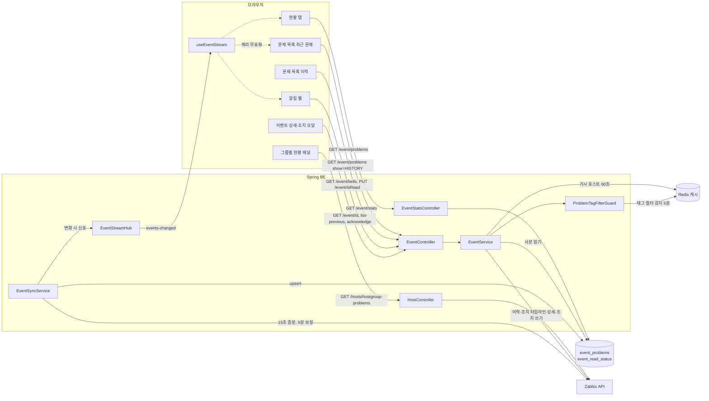

# 이벤트와 알림(Problem) 기능 상세 가이드

> 이 영역은 운영자가 "지금 무엇이 터졌는가"를 보고(문제 목록·헤더 알림 벨), 그 자리에서 조치를 기록하며(확인·메시지·심각도 변경·억제·닫기), "요즘 어떤 문제가 얼마나 자주, 얼마나 오래 가는가"를 돌아보는(현황 탭) 흐름을 다룬다. 문서 범위는 Zabbix 트리거가 만든 문제(Problem) 이벤트의 조회·조치·읽음 표시·실시간 갱신이며, Zabbix 액션·미디어 등 발송 규칙 관리와 APM 알람 규칙은 다루지 않는다. 모든 서술은 BE `e55948c`·FE `9dfcbe8` 소스를 직접 읽어 대조한 결과이고, 서버 기동·API 호출·브라우저 확인은 하지 않았다.

## 1. 한눈에 보기

### 1.1 기능 목록

| 기능 | 화면 주소·메뉴 위치 | 상태 | 권한·라이선스 | 한 줄 설명 |
|---|---|---|---|---|
| 문제 목록(최근 문제) | 사이드바 **이벤트/알림** → `/event-alert/problem` (탭 `문제 목록`, 기본) | 현재 | 화면: `eventAlert.byHost` 보기 / 목록 API는 로그인 사용자 공용 | 열려 있는 문제와 최근 5분 안에 해결된 문제를 로컬 사본에서 읽어 보여 준다 |
| 문제 목록(이력) | 같은 화면, 표시 `이력` (`?show=HISTORY`) | 현재 | 위와 같음 | 선택 기간에 발생한 사건 전부(해결분 포함)를 Zabbix에서 직접 읽는다. 최대 20,000건까지 검사 |
| 호스트 그룹별 현황 패널 | 같은 화면 상단 접이 패널 | 현재 | API는 로그인 사용자 공용 | 그룹 × 심각도별 발생 건수 표. 숫자를 누르면 아래 목록이 그 그룹·심각도·이력 모드로 바뀐다 |
| 구 "호스트 그룹별" 화면 | `/event-alert/by-hostgroup`, `/event-alert/by-hostgroup/:groupId` | 현재(리다이렉트만) | — | 화면은 없어졌고 문제 목록(그룹 필터)으로 이동시킨다 |
| 문제 조치(Problem 업데이트) | 목록·상세·호스트 상세 이벤트 표의 편집 버튼 → 모달 | 현재 | 조회: `byHost`·`serverMonitoring`·`networkMonitoring` 중 하나 보기 / 저장: `eventAlert.byTemplate` 편집 | 확인·확인 취소·메시지·심각도 변경·억제·억제 해제·닫기·원인 전환을 Zabbix에 기록한다 |
| 이벤트 상세 | `/event-alert/problem/:id` | 현재 | `eventAlert.byHost` 보기 | 트리거 조건, 이벤트 정보, 조치 타임라인, 같은 트리거의 이전 20건 |
| 이벤트 현황(통계) | 같은 화면 탭 `현황` (`?tab=overview`) | 현재 | `eventAlert.byHost` 보기 + 비관리자는 가시 범위로 축소 | 발생·미해소·해결 소요 중앙값·방치 건수, 일자별 추이, 상위 호스트·반복 문제 |
| 헤더 알림 벨 | 모든 화면 헤더 우측 종 아이콘 | 현재 | 로그인 사용자 공용 | 최근 30일에 발생해 아직 열려 있는 문제를 호스트별로 묶어 보여 주고 안 읽은 건수를 배지로 표시 |
| 읽음 표시 | 벨 항목 클릭 | 현재 | 로그인 사용자 공용 | 사용자별 읽음 상태. 조치를 남긴 사용자는 자동으로 읽음 처리 |
| 새 알람 토스트·소리 알림 | — | 해당 없음 | — | 구현이 없다. 새 알람은 벨 배지와 목록 갱신으로만 드러난다 |
| 알람 사본 동기화 | 화면 없음(배치 `event_sync`), 주기는 관리 콘솔 **스케줄러** | 현재 | 라이선스가 쓰기 가능 상태일 때만 실행 | Zabbix의 열린 문제를 15초(증분)·5분(보정) 주기로 `event_problems`에 복사한다 |
| 알람 사본 정리 | 배치 `event_cleanup`(매일 00:00) + 보정 사이클 내부 정리 | 현재 | 라이선스와 무관하게 실행 | 해결 후 30일 지난 행 삭제, 갱신이 2일 멈춘 미해소 행 삭제 |
| 열린 알람 1만 건 초과분 적재 | — | 보류 | — | 1회 조회 상한(10,000건)을 넘는 설치본용 커서 분할 적재. 설계만 있고 구현되지 않았다 |
| SSE 알람 푸시 | `GET /event/stream` (화면 없음, 벨 컴포넌트가 구독) | 현재(단일 인스턴스 전제) | 로그인 + 세션 대조 | 사본이 바뀌면 "바뀌었다"는 신호만 밀어 화면이 다시 조회하게 한다 |
| 알람 동기화 범위 설정 | 관리 콘솔 **데이터 소스 관리**(`/setting/integrations`)의 카드 | 현재 | 관리자 전용 | 사본에 담을 알람을 그룹·최소 심각도·억제 제외·꺼진 규칙 제외로 좁힌다 |

### 1.2 영역 전체 구조

이 영역의 화면은 **두 가지 데이터 원천**을 섞어 쓴다. 문제 목록의 기본 모드·알림 벨·현황 탭은 MovesEye DB의 사본(`event_problems`)을 읽는다. 이력 모드·그룹별 현황 패널·이벤트 상세·조치 이력은 Zabbix API를 요청 시점에 직접 부른다. 사본은 배치(`event_sync`)가 시스템 계정으로 채우므로, 사용자별 권한 범위는 읽는 쪽 서비스가 다시 계산해 적용한다.

## 2. 기능별 상세

### 2.1 문제 목록 — 최근 문제 모드

- **무엇을 하는가** — 지금 열려 있는 문제와 방금(기본 5분 이내) 해결된 문제를 본다. 장애 대응 중 가장 자주 여는 화면이다.
- **화면과 진입 경로**
  - 사이드바 `이벤트/알림`(`moveseyee_fe/src/layouts/app/SideNav.tsx:435-441`), 모바일 사이드바, 전역 검색(`moveseyee_fe/src/constants/navSearchEntries.ts:308-315`), 그룹 모니터링의 알림 추이 차트 딥링크(`moveseyee_fe/src/utils/problemLink.ts`)에서 들어온다. 알림 벨은 목록이 아니라 이벤트 상세(2.5)로 보낸다.
  - 주소는 `/event-alert/problem`. 탭은 `현황`·`문제 목록` 두 개이고 `?tab=`이 없으면 `문제 목록`이 열린다(`moveseyee_fe/src/pages/event-alert/problem/ProblemList.tsx:457-489`).
  - 필터·페이지·정렬은 전부 URL query에 실린다(기간 `from`·`to`, `offset`·`limit`, `groupId`, `hostId`, 심각도 `status`, `show`, 검색어, 억제 표시, 정렬).
- **사용 방법**
  1. 화면에 들어오면 발생 일시 기본 범위(최근 30일, 시작일 00:00 ~ 진입 시각)가 URL에 채워진다(`moveseyee_fe/src/hooks/useSetDefaultDate.ts:7-20`).
  2. 호스트 그룹·호스트 선택, 검색어(문제 **이름** 부분 일치, 대소문자 무시), 심각도 칩으로 좁힌다. 검색어는 호스트 이름을 찾지 않는다.
  3. `숨겨진 problem 표시`를 켜면 억제(점검 중)된 문제도 나온다. 기본은 숨김이다.
  4. 원인-증상 관계가 있는 문제는 원인 행 아래로 증상 행이 접혀 있다. 펼침 아이콘 옆 숫자가 증상 건수다.
  5. 행의 연필 버튼으로 조치 모달(2.4)을, 발생 일시 링크로 상세(2.5)를 연다. `작업` 열의 아이콘을 누르면 종류별 조치 이력(최대 20건)이 뜬다.
  - 열의 뜻: `상태`는 PROBLEM(빨강)·RESOLVED(초록), `처리 일시`는 해결 시각이며 미해결이면 `-`, 심각도는 Zabbix 6단계(미분류·정보·경고·평균·높음·재해).
- **동작 원리**
  - FE `ProblemListBody`가 URL query 문자열 그대로 `GET /event/problems`를 부른다(`ProblemList.tsx:308-313`). 주기 폴링은 없고, SSE 신호(2.10)·창 포커스·필터 변경 때 다시 조회한다.
  - BE `EventService.getEventProblems`(`moveseye-be-spring/src/main/java/com/dmove/moveseye/event/EventService.java:314-392`)의 처리 순서는 다음과 같다.
    1. `event_problems`에서 `clock`(발생 시각)이 `from`~`to` 사이인 행을 전부 읽는다(`EventService.java:508-510`).
    2. 가장 최근 갱신이 15분보다 오래됐으면 경고 로그를 남긴다(분당 1회, 응답은 그대로 보낸다 — `EventService.java:742-759`).
    3. 행마다 필터를 건다: 해결된 지 `event.recent-window-seconds`(기본 300초)가 지난 행 제외 → 권한(2.9) → 꺼진 규칙(`rule_enabled=false`) 제외 → 호스트 → 이름 검색어 → 그룹 → 처리 일시 범위(`EventService.java:518-551`).
    4. 태그 필터가 설정된 설치본이면 남은 후보 id를 사용자 토큰으로 Zabbix에 되물어 걸러낸다(2.9).
    5. 억제 표시가 꺼져 있으면 억제된 행을 뺀 뒤 **심각도 칩 건수**를 세고, 그 다음에 심각도 필터를 건다. 그래서 칩 숫자는 선택한 심각도와 무관하게 유지된다.
    6. `cause_event_id`로 원인-증상 트리를 만들고, 루트 행을 정렬해 `offset`·`limit`으로 자른다.
    7. 화면에 보이는 페이지의 행(자식 포함)만 Zabbix `event.get`(조치 이력 포함) 1콜로 조치 타임라인을 채운다(`EventService.java:602-613`). 조치가 하나라도 있으면 조치자 이름을 얻는 사용자 조회 1콜이 더해진다. 호스트·그룹·시각·심각도는 사본 값이다.
  - 응답은 `items`(트리), `total`, `statusCounts`, `truncated`, `scanLimit`이다. 최근 문제 모드에서 `truncated`는 항상 false다.
- **주요 API**

| Method | Path | 용도 | 권한 |
|---|---|---|---|
| GET | `/event/problems` | 문제 목록(최근·이력 공용). `from`·`to`는 epoch 초이며 생략하면 0으로 읽혀 0건이 된다 | 로그인 사용자 공용(역할 권한 검사 없음). 데이터는 호출자 가시 범위로 축소 |
| GET | `/hosts/hostgroups` 등 | 그룹·호스트 필터 선택지(다른 영역 API) | 해당 영역 규칙 |

- **데이터** — `event_problems`(2.8 참조). 정렬 가능 열은 호스트, 문제 이름, 발생 일시, 처리 일시, 심각도이며 BE가 정렬한다.
- **권한·라이선스** — 메뉴와 라우트는 `eventAlert.byHost` 보기 권한이 있어야 열린다(`moveseyee_fe/src/routes/routes.tsx:856-862`). `GET /event/problems`는 홈 알람 위젯도 쓰는 공용 API라 역할 권한을 검사하지 않고(`EventController.java:61-68`), 대신 결과를 호출자의 가시 호스트·태그 범위로 줄인다. Zabbix 계정이 연결되지 않은 비관리자는 가시 호스트를 계산할 수 없어 HTTP 200 + 본문 `code:403`을 받는다.
- **빈 값·실패·경계 상태**
  - 기간(`from`/`to`)이 URL에 없으면 조회 자체를 보류한다(`enabled` 조건).
  - Zabbix가 응답하지 않으면 7단계(조치 타임라인)에서 예외가 올라와 목록 전체가 오류가 된다. 가시 호스트 캐시(60초)가 만료된 뒤에는 3단계 이전에서도 실패한다(4절 EVT-11).
  - 페이지 하이드레이션에서 빠진 사건(경합 삭제)은 사본 값만으로 표시한다.
  - `total`은 증상(자식) 포함 건수인데 페이지는 원인(루트) 기준으로 잘라, 증상이 많으면 뒤쪽 페이지가 빌 수 있다(EVT-13).
- **운영 주의**
  - 화면이 여는 시점의 `to`가 URL에 고정된다. 화면을 열어 둔 채로는 그 뒤에 발생한 문제가 조회 범위 밖이다(EVT-02).
  - 표 우측의 동기화 버튼과 시각은 알람 동기화가 아니라 **사용자 동기화**(`POST /users/sync`)다(EVT-21).

### 2.2 문제 목록 — 이력 모드

- **무엇을 하는가** — 이미 해결된 과거 사건까지 포함해 "그 기간에 무슨 일이 있었나"를 본다. Zabbix는 해결된 문제를 짧은 시간(기본 5분)만 열린 문제 목록에 남기므로, 과거 이력은 별도 질의로만 볼 수 있다.
- **화면과 진입 경로** — 문제 목록의 `표시` 선택을 `이력`으로 바꾼다(`?show=HISTORY`). 그룹별 현황 패널의 숫자·그룹 모니터링의 알림 추이 차트에서 넘어올 때도 이 모드로 열린다(`moveseyee_fe/src/utils/problemLink.ts:47-64`).
- **사용 방법**
  1. `이력`을 고르면 페이지가 처음으로 돌아간다.
  2. 이 모드에서만 `처리 일시` 기간 필터가 나타난다. 지정하면 해결된 사건 중 그 범위에 해결된 것만 남는다.
  3. 호스트 열 정렬은 꺼져 있다.
  4. 기간에 사건이 20,000건을 넘으면 표 위에 "최근 N건까지만 확인했습니다" 안내가 뜬다. 이때 목록·총 건수·심각도 칩·원인-증상 묶음이 모두 검사한 일부 기준이다.
- **동작 원리**
  - `EventService.listHistoryForScreen`이 Zabbix `event.get`을 **경량 8필드**(`eventid, clock, severity, name, r_eventid, cause_eventid, suppressed, acknowledged`)로, 발생 사건만(`value=1`), 발생 시각 내림차순, `limit=20,001`로 부른다(`EventService.java:246-262`, `ZabbixAlertAdapter.java:81-82`). 20,001번째가 오면 잘린 것으로 표시하고 20,000건만 쓴다.
  - 발생 사건에는 복구 사건의 **식별자**만 있고 해결 시각이 없으므로, 복구 식별자들을 모아 `event.get`을 한 번 더 불러 해결 시각을 채운다(`EventService.java:264-276`).
  - 필터·칩 집계·트리·정렬·페이지 자르기는 BE 메모리에서 한다. 화면에 보이는 페이지의 사건만 `event.get`(전체 필드 + 호스트 + 조치)과 `host.get`(전 호스트의 소속 그룹)으로 호스트·그룹·조치를 채운다(`EventService.java:399-411`, `:280-291`).
  - 호출자 본인의 Zabbix 토큰으로 조회하므로 권한 범위는 Zabbix가 적용한다. 꺼진 규칙 제외는 적용하지 않는다(지난 사건은 현재 규칙 상태와 무관).
  - `sortBy`가 `host`·`totalActions`이면 BE가 발생 시각 정렬로 바꾼다(`EventService.java:335-337`).
- **주요 API** — `GET /event/problems?show=HISTORY&from=&to=…` (2.1과 같은 엔드포인트, 추가 파라미터 `resolutionFrom`·`resolutionTo` epoch 초).
- **데이터** — 저장하지 않는다. 사본 보존 범위(해결 후 30일)·동기화 범위 설정(2.11)과 무관하다.
- **권한·라이선스** — 2.1과 같다.
- **빈 값·실패·경계 상태**
  - 기간이 길어 Zabbix가 오류를 내면 목록 조회가 실패한다.
  - 20,000건 상한에 닿으면 `truncated=true`, `scanLimit=20000`을 응답하고 FE가 안내 배너를 띄운다(`moveseyee_fe/src/pages/event-alert/problem/ProblemTruncationNotice.tsx`). 상한을 넘은 오래된 사건은 검사하지 않는다.
- **운영 주의** — 이 모드의 한 번 조회는 Zabbix 호출 2회(스캔 + 복구 시각) + 페이지 채우기 2회다. 호스트가 많은 설치본에서는 페이지를 넘길 때마다 전 호스트의 그룹 정보를 다시 받는다(EVT-17).

### 2.3 호스트 그룹별 현황 패널

- **무엇을 하는가** — 어느 그룹에 문제가 몰려 있는지 그룹 × 심각도 표로 본다. 예전의 독립 화면 "호스트 그룹별"을 문제 목록 위 접이 패널로 합친 것이다.
- **화면과 진입 경로** — 문제 목록 상단의 `호스트 그룹별 현황` 접이 패널. 기본은 접힘이고 열림 여부는 브라우저 `localStorage`에 기억한다. 구 주소 `/event-alert/by-hostgroup`(+`/:groupId`)은 문제 목록으로 리다이렉트하며 `:groupId`는 `groupId` 필터로 옮긴다(`moveseyee_fe/src/routes/routes.tsx:208-219`).
- **사용 방법**
  1. 패널을 열면 현재 화면의 기간(`from`~`to`)으로 그룹별 건수를 불러온다.
  2. 그룹 이름을 누르면 아래 목록이 그 그룹 + 이력 모드로 바뀐다. 심각도 숫자를 누르면 심각도까지 함께 걸린다.
  3. 그룹 필터가 걸려 있으면 패널 제목 줄에 해제 버튼이 나타나고, 누르면 그룹·심각도 필터가 지워진다.
  - 숫자의 뜻은 "기간 안에 **발생한 사건 수**(해결분 포함)"이다. 지금 열려 있는 건수가 아니다.
- **동작 원리**
  - FE `HostGroupSummaryPanel`이 `GET /hosts/hostgroup-problems?from&to&offset=0&limit=500`을 부르고(패널이 열렸을 때만, 10분 폴링) 합계 내림차순으로 정렬한다(`moveseyee_fe/src/pages/event-alert/problem/HostGroupSummaryPanel.tsx:20`, `:49-61`).
  - BE `HostService.getProblemsByHostGroup`은 그룹 목록(멤버 호스트 포함)을 받고, 기간 내 발생 사건을 `event.get` 경량 출력 + 호스트 조인으로 **페이지 단위로 흘려 받으며** 그룹별로 센다. 한 사건이 여러 그룹에 걸친 호스트를 가지면 각 그룹에 1건씩 센다(`moveseye-be-spring/src/main/java/com/dmove/moveseye/host/HostService.java:420-488`).
  - 결과는 호출자(principal·role)와 분 단위 기간별로 Redis에 60초 캐시한다. 스캔을 끝까지 못 하면 부분 합계를 내지 않고 오류로 끝낸다.
- **주요 API**

| Method | Path | 용도 | 권한 |
|---|---|---|---|
| GET | `/hosts/hostgroup-problems` | 그룹 × 심각도 발생 건수 | 로그인 사용자 공용(홈 위젯 공유). 호출자 토큰으로 조회 |
| GET | `/hosts/hostgroup/problems/{groupid}` | 그룹 헤더용 건수(이 화면에서는 쓰지 않음) | `monitoring.hostGroup` 또는 `eventAlert.byHost` 보기 |

- **빈 값·실패·경계 상태** — 조회가 실패하면 빈 표 대신 "기간이 너무 길어 집계를 가져오지 못했습니다" 경고를 보여 준다. 그룹이 500개를 넘으면 501번째부터는 표에 나오지 않는다(BE가 자른 뒤 FE가 정렬).
- **운영 주의** — 스캔 예산은 `zabbix.call.max-scan-rows`(기본 2,000,000행)이다. 10만 건 이상을 읽으면 BE 경고 로그가 남는다.

### 2.4 문제 조치(Problem 업데이트)

- **무엇을 하는가** — 문제에 대해 "봤다·조치 중이다"를 기록하고, 필요하면 심각도를 바꾸거나 알림을 억제하거나 수동으로 닫는다. 조치는 Zabbix의 이벤트 조치 이력으로 저장되며 MovesEye 자체 저장소에는 쓰지 않는다.
- **화면과 진입 경로** — 문제 목록·이벤트 상세의 이전 이벤트 표·서버/네트워크 상세의 이벤트 표에서 연필 버튼을 누르면 `Problem 업데이트` 모달(`moveseyee_fe/src/components/Modal/UpdateProblemModal.tsx`)이 열린다.
- **사용 방법**
  1. 적용 범위를 고른다: `선택한 Problem만` 또는 같은 트리거에서 열려 있는 문제 전부(괄호 안 숫자가 대상 건수).
  2. 필요한 항목을 바꾼다: 메시지, 심각도 변경, 억제(무기한 또는 종료 시각), 확인/확인 취소, 원인으로 전환, Problem 닫기.
  3. `업데이트`를 누른다. 바뀐 항목이 하나도 없으면 저장되지 않고 안내 문구가 뜬다. 억제 종료 시각이 과거면 저장되지 않는다.
  - `Problem 닫기`는 (역할의 Zabbix 권한에 `close_problems`가 켜져 있음) 그리고 (트리거가 수동 종료 허용) 그리고 (호스트가 활성)일 때만 선택할 수 있다.
  - `원인으로 전환`은 그 문제가 현재 다른 문제의 증상일 때만 선택할 수 있다.
  - 저장 권한(`eventAlert.byTemplate` 편집)이 없으면 저장 버튼이 숨겨지고 입력이 비활성화된다.
- **동작 원리**
  - 모달이 열리면 `GET /event/problems/{id}?status=`로 현재 상태(이름·심각도·확인 여부·억제 여부·억제 종료·같은 트리거의 열린 문제 수·닫기 가능 여부)를, `GET /event/{id}/acknowledge`로 조치 이력을 받는다.
  - 저장은 `PUT /event/{id}/acknowledge`. BE `EventService.acknowledge`가 요청을 조치 종류 집합으로 바꾸고(`EventService.java:119-161`), 어댑터가 Zabbix `event.acknowledge`의 action 비트합으로 조립한다(`ZabbixAlertAdapter.java:724-761`).

| 요청 필드 | 조치 | Zabbix action 비트 |
|---|---|---|
| `closeProblem: true` | Problem 닫기 | 1 |
| `acknowledge: true` / `false` | 확인 / 확인 취소 | 2 / 16 |
| `message` | 메시지 추가 | 4 |
| `severity` | 심각도 변경 | 8 |
| `suppress: true` 또는 `suppressUntil` 지정 | 억제(종료 시각 없으면 무기한 `suppress_until=0`) | 32 |
| `suppress: false` | 억제 해제 | 64 |
| `convertToCause: true` | 원인으로 전환 | 128 |

  - 범위가 "같은 트리거 전부"이면 그 트리거의 **열려 있는** 문제 id를 Zabbix에서 다시 조회해 대상으로 삼는다(`EventService.java:197-204`).
  - 조치가 성공하면 순서대로 ① 조치자의 읽음 상태를 기록하고 ② 조치한 사건만 Zabbix에서 다시 읽어 사본을 즉시 갱신하고 ③ SSE 신호를 보낸다(`EventService.java:163-179`). ①·②가 실패해도 조치 자체는 성공으로 응답하며 다음 동기화 주기가 따라잡는다.
- **주요 API**

| Method | Path | 용도 | 권한 |
|---|---|---|---|
| GET | `/event/problems/{id}?status=PROBLEM\|RESOLVED` | 조치 모달용 현재 상태 | `byHost`·`serverMonitoring`·`networkMonitoring` 중 하나 보기 |
| GET | `/event/{id}/acknowledge` | 조치 이력 타임라인(발생·해결 표시 포함) | 위와 같음 |
| PUT | `/event/{id}/acknowledge` | 조치 실행 | `eventAlert.byTemplate` 편집 |

- **데이터** — 조치 이력은 Zabbix에 있다. 사본에는 조치 수(`total_actions`, 정렬용 근사치)만 저장한다.
- **권한·라이선스** — 저장 권한은 BE가 강제한다(`EventController.java:56`). 조치는 호출자 본인의 Zabbix 토큰으로 실행되므로 Zabbix 쪽 권한도 함께 적용된다. 관리자(ADMIN·SUPER_ADMIN)는 시스템 토큰으로 실행된다. 라이선스가 읽기 전용 상태이면 쓰기 요청이 HTTP 계층에서 막힌다.
- **빈 값·실패·경계 상태**
  - `status=PROBLEM`으로 조회했는데 그 사건이 이미 해결됐으면 `PROBLEM_NOT_FOUND`가 온다. 문제 목록의 편집 버튼은 행의 상태를 넘기지 않아 해결된 행에서 모달이 빈 채로 열린다(EVT-14).
  - Zabbix는 조치를 전체 성공 아니면 오류로 처리한다. 부분 성공 응답은 없다.
- **운영 주의** — 확인(acknowledge)은 문제를 닫지 않는다. 문제는 트리거가 정상으로 돌아오거나 수동으로 닫을 때 해결된다.

### 2.5 이벤트 상세

- **무엇을 하는가** — 한 사건이 왜 문제로 판정됐는지(트리거 조건), 누가 무엇을 했는지(조치), 같은 문제가 예전에도 있었는지(이전 20건)를 본다.
- **화면과 진입 경로** — `/event-alert/problem/:id`. 문제 목록의 발생 일시 링크, 알림 벨 항목 클릭(읽음 처리 후 이동)으로 들어온다. 벨에서 `byHost` 보기 권한이 없으면 이동하지 않고 권한 안내만 띄운다.
- **사용 방법** — 좌측에 트리거 세부(호스트·트리거 이름·심각도·문제 조건식·복구 조건식·이벤트 생성 방식·수동 종료 허용·활성 여부)와 이벤트 세부(이름·운영 데이터·심각도·시각·확인 여부·태그·설명·원인/증상 구분), 우측에 조치 표와 `이벤트 목록 [이전 20]` 표가 있다. 이전 이벤트 표의 경과 시간 열(age)은 발생 후 지난 시간(1분마다 갱신), 지속 시간 열(duration)은 해결까지 걸린 시간이며 미해결이면 지금까지의 경과를 보여 준다.
- **동작 원리**
  - `GET /event/{id}` — BE가 호출자 토큰으로 `event.get`(태그·조치·호스트·억제 정보 포함)과 `trigger.get`(조건식 확장)을 직접 부른다(`EventService.java:1101-1156`).
  - `GET /event/{id}/list-previous?triggerId=&limit=20` — 같은 트리거의 사건을 이 사건 id 이하에서 최신순으로 `limit×2+1`건 받아 복구 사건을 걸러 내고 20건으로 자른다(`EventService.java:1161-1205`). 첫 행이 현재 사건이고, 화면의 조치 표는 그 첫 행의 조치 목록을 쓴다.
- **주요 API**

| Method | Path | 용도 | 권한 |
|---|---|---|---|
| GET | `/event/{id}` | 이벤트 + 트리거 세부 | `eventAlert.byHost` 보기 |
| GET | `/event/{id}/list-previous` | 같은 트리거의 이전 사건(조치 포함) | `eventAlert.byHost` 보기 |

- **빈 값·실패·경계 상태** — 사건이 없으면 `EVENT_NOT_FOUND`, 트리거가 삭제됐으면 `TRIGGER_NOT_FOUND`. 이 화면은 SSE 신호로 갱신되지 않으며 조치 저장 후에만 다시 읽는다.

### 2.6 이벤트 현황(통계) 탭

- **무엇을 하는가** — 기간 동안 문제가 얼마나 발생했고, 얼마나 빨리 해결됐으며, 어떤 호스트·어떤 문제가 반복되는지 본다. 알림 피로의 원인을 찾는 용도다.
- **화면과 진입 경로** — `/event-alert/problem?tab=overview`. 기간은 문제 목록 탭과 공유한다(탭을 바꿔도 `from`·`to` 유지, 검색어·페이지는 초기화).
- **사용 방법** — 화면에 보이는 값의 뜻:

| 표시 | 뜻 | 단위 |
|---|---|---|
| 발생 | 기간 안에 발생 시각이 든 사건 수. 보조로 영향 호스트 수(대표 호스트 기준)·문제 종류 수(이름 기준) | 건 |
| 안 끝난 문제 | 위 사건 중 해결 시각이 없는 것. 보조로 끝난 문제 건수 | 건 |
| 보통 해결까지 | 해결된 사건의 (해결 시각 − 발생 시각) 중앙값. 해결분이 없으면 `—` | 초 → 일·시간·분으로 표기 |
| 하루 넘게 방치 | 안 끝난 문제 중 발생 후 24시간이 넘은 것. 보조로 가장 오래된 것의 경과 시간 | 건 |
| 날짜별 발생 | 날짜 × 심각도 발생 건수(막대 누적). 발생이 없는 날은 화면이 0으로 채운다 | 건 |
| 심각도 분포 | 심각도별 발생 건수 | 건 |
| 가장 자주 반복된 문제 / 문제가 많은 호스트 | 이름·호스트별 상위 10 | 건 |
| 해결까지 걸린 시간 | 5분 미만 · 30분 미만 · 1시간 미만 · 1일 미만 · 1일 이상(끝난 문제만) | 건 |
| 안 끝난 문제가 열려 있는 기간 | 1시간 미만 · 1일 미만 · 1주 미만 · 1주 이상 | 건 |

- **동작 원리** — FE `useEventStats`가 `GET /event/stats?from&to`를 부른다(staleTime 30초). BE `EventStatsService`는 `event_problems`에 SQL 7개를 실행한다(`moveseye-be-spring/src/main/java/com/dmove/moveseye/event/stats/EventStatsService.java:108-210`). Zabbix는 부르지 않는다. 해결 관련 값은 `r_clock > 0`인 행만 센다. 기간을 생략하면 최근 7일이다.
- **주요 API**

| Method | Path | 용도 | 권한 |
|---|---|---|---|
| GET | `/event/stats` | 현황 집계 | `eventAlert.byHost` 보기. 관리자는 전체, 비관리자는 가시 사건 id 집합으로 축소, Zabbix 미연결 비관리자는 거부 |

- **데이터** — 사본만 본다. 해결된 사건은 30일 뒤 지워지므로 그보다 긴 기간의 통계는 미해소분만 남은 값이 된다.
- **권한·라이선스** — 비관리자는 기간 내 사본 행 중 볼 수 있는 사건 id 집합(`EventService.visibleEventIds`, 2.9와 같은 판정)을 구해 모든 SQL에 `event_id = ANY(...)` 조건으로 건다. 태그 필터 검증이 실패하면 0건을 보여 주지 않고 거부한다(`EventService.java:653-666`).
- **빈 값·실패·경계 상태** — 데이터가 없으면 카드마다 빈 상태를 표시한다. 하루 넘게 방치된 문제가 있으면 상단에 경고 배너가 뜬다.
- **운영 주의** — 이 통계는 "동기화가 사본에 담은 사건"만 센다. 동기화 범위를 좁혔거나(2.11) 두 동기화 사이에 발생·해결된 초단명 사건이 `recent` 창에도 잡히지 않았다면 통계에 없다. 목록과 달리 꺼진 규칙·억제된 문제를 빼지 않는다(EVT-18).

### 2.7 헤더 알림 벨과 읽음 표시

- **무엇을 하는가** — 어느 화면에 있든 새 문제가 생겼는지 알아채고, 내가 아직 확인하지 않은 문제를 구분한다.
- **화면과 진입 경로** — 헤더 우측 종 아이콘. 누르면 오른쪽에서 `알림` 패널이 열린다(폭 조절 가능).
- **사용 방법**
  1. 배지 숫자는 안 읽은 문제 수다.
  2. 패널은 호스트별로 접혀 있고, 호스트 줄에 최근 발생 시각과 그 호스트의 안 읽은 건수가 보인다.
  3. 상단의 색 점으로 심각도별로 걸러 본다.
  4. 문제를 누르면 읽음으로 바뀌고 이벤트 상세로 이동한다. 스크롤을 끝까지 내리면 다음 30개 호스트를 더 불러온다.
- **동작 원리**
  - FE `NotificationList`가 `GET /event/bells?offset&limit=30&from=(지금−30일)&to=(지금)`을 무한 스크롤로 부른다(`moveseyee_fe/src/components/Notification/index.tsx:125-150`). SSE가 살아 있으면 5분, 아니면 60초마다 폴링한다.
  - BE `EventService.getEventBells`(`EventService.java:793-905`)는 사본에서 기간 내 행을 읽어 **열려 있는 것만** 남기고, 권한(2.9)·태그 필터·심각도를 적용한 뒤 호출자의 읽음 상태(`event_read_status`)를 붙인다. 호스트 표시 이름으로 묶어 그룹마다 최신 발생 시각·안 읽은 건수를 계산하고, 최신순으로 정렬해 호스트 그룹 단위로 페이지를 자른다.
  - 읽음 처리는 `PUT /event/isRead {eventId, isRead}`. 행이 없으면 만들고 있으면 바꾼다(`EventService.java:910-926`).
  - 읽음 상태는 세 경로로 만들어진다: ① 벨에서 클릭 ② 조치 직후 조치자 자동 읽음 ③ 5분 보정 동기화가 "조치 이력에 그 사용자가 있으면 읽음"으로 승격(읽음 → 안 읽음으로는 되돌리지 않음).
- **주요 API**

| Method | Path | 용도 | 권한 |
|---|---|---|---|
| GET | `/event/bells` | 벨 목록(호스트별 묶음 + 심각도 칩 + 페이지 안 읽은 합계) | 로그인 사용자 공용 |
| PUT | `/event/isRead` | 사용자별 읽음 표시 | 로그인 사용자 공용 |

- **데이터** — `event_read_status(event_id, user_id, is_read, read_at)`, `(event_id, user_id)` 유일, `event_id`는 `event_problems.event_id`를 참조하며 사건 행이 지워지면 함께 지워진다(V1). `user_id`는 MovesEye 내부 사용자 id다.
- **권한·라이선스** — 역할 권한 검사가 없다. 데이터는 가시 범위로 축소된다.
- **빈 값·실패·경계 상태**
  - 조회 중이거나 조회가 실패하면 종 아이콘 자체를 그리지 않는다(`Notification/index.tsx:325-326`).
  - 배지 숫자와 심각도 필터는 **지금까지 불러온 페이지** 기준이다(EVT-22).
  - 벨은 꺼진 규칙·억제된 문제도 보여 준다(EVT-07). 30일보다 오래전에 발생해 아직 열려 있는 문제는 나오지 않는다(EVT-06).
- **운영 주의** — 벨 컴포넌트가 SSE 구독 지점이다. 벨이 그려지지 않아도 구독 훅은 계속 동작한다.

### 2.8 알람 사본과 동기화 배치

- **무엇을 하는가** — 화면이 Zabbix를 직접 조회하지 않도록, 열린 문제를 MovesEye DB에 복사해 둔다. 접속자 수와 Zabbix 부하를 분리하는 것이 목적이다.
- **화면과 진입 경로** — 전용 화면은 없다. 주기·켜고 끄기·실패 이력은 관리 콘솔 `스케줄러` 화면의 `event_sync`·`event_cleanup` 항목에서 본다.
- **동작 원리** — 스케줄러가 `event_sync` 주기(기본 15초, 이전 실행이 끝난 뒤부터 잰다)마다 `EventSyncService.syncEventProblems`를 부른다. 서비스는 마지막 보정 후 5분이 지났으면 **보정**, 아니면 **증분**을 실행한다(`moveseye-be-spring/src/main/java/com/dmove/moveseye/event/EventSyncService.java:130-146`). 프로세스가 기동한 뒤 첫 실행은 항상 보정이다.

| 경로 | 주기·시점 | Zabbix 호출 | 하는 일 |
|---|---|---|---|
| 증분 | 15초 | `problem.get` 1콜(경량, 시간창 없음, `recent:true`, `limit 10000`) + 필요 시 추가 | 사본에 없는 신규는 표적 완전 동기화, 아는 문제는 이름·심각도·억제·원인만 값이 바뀐 행에 한해 UPDATE, 최근 해결분은 해결 시각 즉시 채움, 응답에서 사라진 문제는 되짚기 |
| 보정 | 5분 | `problem.get`(규칙·조치 포함) + `trigger.get` + `user.get` + 복구 시각 `event.get` | 전 행 upsert(호스트·그룹·규칙 활성·조치 수 포함), 읽음 상태 행 생성·승격, 되짚기, 건강 조건을 만족하면 미해소 좀비 삭제, SSE 신호 |
| 표적 재동기화 | 조치 직후, 증분의 신규 처리 | `event.get`(규칙·조치 포함) 1~2콜 | 지정한 사건만 다시 읽어 upsert |
| 되짚기 | 증분·보정 안 | `event.get` 2콜(사라진 사건 → 복구 식별자 → 복구 시각) | 사본에는 열려 있는데 응답에 없는 사건의 해결 시각을 채운다. 한 번에 500건, (발생 시각, 사건 id) 커서로 순회 |
| 정리 | 매일 00:00(`event_cleanup`) | 없음 | 해결 후 30일 지난 행 삭제, 내부 사용자와 연결되지 않는 읽음 행 삭제 |

  - 사본 upsert는 해결이 확정된 행(`r_clock > 0`)을 미해결로 되돌리지 않는다(`EventSyncService.java:510-518`).
  - 응답이 상한(10,000건)에 닿은 회차는 "불완전"으로 본다. 불완전 회차에서는 되짚기와 좀비 삭제를 하지 않는다(`EventSyncService.java:166`, `:253-261`).
  - 미해소 좀비 삭제 조건: 연속 완전 보정 3회 이상 + 마지막 완전 보정이 15분 이내 + 직전 삭제 후 1시간 경과. 대상은 미해소이면서 `updated_at`이 2일보다 오래된 행이다(`EventSyncService.java:103-109`, `:382-410`).
  - 증분은 신규·해결·값 변화가 하나라도 있었던 회차에만, 모든 DB 반영이 끝난 뒤 한 번 SSE 신호를 보낸다. 보정은 항상 보낸다.
- **데이터**

| 테이블 | Flyway | 주요 컬럼 | 보존·정리 |
|---|---|---|---|
| `event_problems` | V1(기본), V49(목록 서빙용 확장) | `event_id`(유일), `name varchar(255)`, `severity`(0~5), `clock`·`r_clock`(epoch 초, 미해결은 0), `r_event_id`(없으면 "0"), `host_id`·`host_name`(대표 호스트), `host_ids`(전체 호스트 JSON), `group_refs`(그룹 JSON), `suppressed`, `cause_event_id`, `rule_enabled`, `total_actions`, `updated_at` | 해결 후 30일 삭제 / 미해소는 갱신이 2일 멈추면 삭제(조건부) |
| `event_read_status` | V1 | `event_id`, `user_id`(내부 사용자), `is_read`, `read_at` | 사건 행 삭제 시 함께 삭제(FK cascade) |
| `scheduler_setting` | V15(시드), V50(`interval_seconds`) | `job_key='event_sync'` 간격 1분 + 초 단위 override 15, `job_key='event_cleanup'` 매일 00:00 | — |
| `setting`(유형 `EVENT_SYNC`) | V63 | 동기화 범위 JSON | — |

- **권한·라이선스** — 동기화는 시스템(슈퍼 관리자) 토큰으로 조회한다. 라이선스가 쓰기 불가 상태이면 `event_sync`는 건너뛰고 `event_cleanup`은 계속 돈다(`moveseye-be-spring/src/main/java/com/dmove/moveseye/scheduler/SchedulerManager.java:208-219`).
- **빈 값·실패·경계 상태**
  - 동기화가 실패하면 예외를 던져 스케줄러 실행 이력에 실패로 남는다(성공은 이력에 남기지 않는다).
  - 되짚기 실패는 삼키고 다음 주기에 재시도한다. 그동안 화면에는 미해결로 보인다.
  - 사본이 15분 넘게 갱신되지 않으면 목록·벨 요청 때 BE 경고 로그(`event_problems copy looks stale`)가 남는다. 화면 표시는 없다.
- **운영 주의**
  - 문제 이름이 255자를 넘으면 upsert가 실패한다(EVT-01).
  - 스케줄러 화면에서 `event_sync`를 저장하면 초 단위 주기(15초)가 지워지고 분 단위로 돌아간다(EVT-10).
  - 프로세스가 동기화 도중 비정상 종료하면 잠금이 최대 30분 남는다(EVT-09).

### 2.9 권한 범위 재현

- **무엇을 하는가** — 사본은 전 호스트의 문제를 담고 있으므로, 사용자가 볼 수 있는 문제만 골라 보여 준다. Zabbix가 사용자 토큰으로 해 주던 필터를 MovesEye가 다시 계산한다.
- **동작 원리** — 판정은 세 층이다.

| 층 | 무엇을 보나 | 어디서 | 실패 시 |
|---|---|---|---|
| 역할 권한 | 화면·엔드포인트 접근(보기/편집) | `DmovePermissionChecker`(컨트롤러 첫 줄) | HTTP 200 + 본문 `code:403` |
| 호스트 축 | 사건에 걸린 **모든** 호스트가 호출자의 가시 호스트 집합에 있어야 노출 | `EventService.isRowVisible`(`EventService.java:713-720`) | `host_ids`가 빈 배열이면 숨김. NULL(구버전 행)은 대표 `host_id`로 판정 |
| 태그 축 | Zabbix 사용자 그룹에 태그 필터가 하나라도 있는 설치본에서만, 후보 사건 id를 호출자 토큰으로 `event.get` 재조회해 돌아온 것만 노출 | `ProblemTagFilterGuard.active` + `EventService.tagVisibleEventIds` | 감지 실패는 "태그 제한 있음"으로 간주. 재조회 실패 시 목록·벨은 빈 결과, 통계는 거부 |

  - 가시 호스트 집합은 호출자 컨텍스트로 `host.get`을 불러 얻고, Redis 키 `EVENT_VISIBLE_HOSTS:{principal}`에 60초 캐시한다(`EventService.java:671-692`). 권한 변경은 최대 60초 늦게 반영된다.
  - 태그 필터 감지 결과는 Redis 키 `EVENT_TAG_FILTERS_ACTIVE`에 5분 캐시한다. 실패는 캐시하지 않는다(`ProblemTagFilterGuard.java:30-47`).
  - 호출자 컨텍스트 변환(`moveseye-be-spring/src/main/java/com/dmove/moveseye/common/metric/CallerContexts.java:41-58`): ADMIN·SUPER_ADMIN → 시스템(전 호스트), Zabbix 계정이 연결된 사용자 → 그 계정, 연결되지 않은 비관리자 → 거부(200 + `code:403`).
  - 이력 모드·이벤트 상세·조치는 사본을 거치지 않고 호출자 토큰으로 Zabbix를 부르므로 Zabbix가 직접 권한을 적용한다.
- **엔드포인트별 역할 권한 요약**

| 엔드포인트 | 역할 권한 |
|---|---|
| `GET /event/problems`, `GET /event/bells`, `PUT /event/isRead`, `GET /event/stream`, `GET /hosts/hostgroup-problems` | 검사 없음(로그인만) |
| `GET /event/stats`, `GET /event/{id}`, `GET /event/{id}/list-previous` | `eventAlert.byHost` 보기 |
| `GET /event/problems/{id}`, `GET /event/{id}/acknowledge` | `byHost`·`serverMonitoring`·`networkMonitoring` 중 하나 보기 |
| `PUT /event/{id}/acknowledge` | `eventAlert.byTemplate` 편집 |
| `GET /event/{id}/events` 외 호스트 이벤트 3종 | `serverMonitoring` 또는 `networkMonitoring` 보기 |
| `GET/POST /settings/event-sync-scope` | 관리자 |

- **운영 주의** — 호스트 축은 호스트 **전부** 보임(AND)이 조건이다. 여러 호스트에 걸친 트리거의 문제는 그중 하나라도 권한이 없으면 보이지 않는다.

### 2.10 SSE 알람 푸시

- **무엇을 하는가** — 화면이 1분마다 묻는 대신, 사본이 바뀐 순간 서버가 신호를 보내 화면이 그때만 다시 조회하게 한다.
- **동작 원리**
  - 연결: FE `useEventStream`(`moveseyee_fe/src/hooks/useEventStream.ts`)이 `EventSource`로 `GET /event/stream?visitorId=…`를 연다. 인증은 `accessToken` 쿠키, 세션 대조는 `visitorId` 쿼리(또는 `x-visitor-id` 헤더)다. 액세스 토큰은 쿼리에 싣지 않는다.
  - 서버: `EventStreamController`가 세션을 대조한 뒤(`VisitorSessionChecker`, 값이 없거나 Redis의 현재 로그인 세션과 다르면 401) `EventStreamHub.subscribe`로 등록한다. 등록 직후 `events-changed`를 1회 보낸다.
  - 이벤트 종류: `events-changed`(`{"at": 밀리초}`)와 `heartbeat`(`{"ts": 밀리초}`) 두 가지. 알람 내용·건수는 싣지 않는다.
  - 하트비트: 25초마다 모든 연결에 대해 세션을 다시 대조하고, 무효면 그 연결을 닫는다(`EventStreamHub.java:192-210`).
  - 연결 수명: 30분. 만료되면 브라우저가 다시 접속하며 그때 인증·세션 대조를 다시 받는다.
  - 신호 발생 지점: 증분 동기화(변화가 있던 회차), 보정 동기화(항상), 조치 직후.
  - FE 반응: `events-changed`를 받으면 2초 스로틀(창 안의 마지막 신호는 창 끝에 한 번 실행)로 알람 계열 쿼리 키 7종(벨 목록, 이벤트 목록, 문제 목록, 현황 통계, 그룹별 현황·상세, 홈 문제 위젯)을 무효화한다.
  - 응답 헤더 `X-Accel-Buffering: no`, `Cache-Control: no-cache`로 프록시 버퍼링을 막는다.
  - SSE·비동기 요청의 종료 디스패치(`ASYNC`)와 연결 끊김 시의 오류 디스패치(`ERROR`)는 인가를 다시 묻지 않는다(`moveseye-be-spring/src/main/java/com/dmove/moveseye/config/SecurityConfig.java:89`). 브라우저가 `/error`를 직접 요청하면 여전히 인증이 필요하다.
  - 종료: 애플리케이션 종료 이벤트에서 모든 연결을 먼저 닫아 graceful shutdown이 SSE 때문에 지연되지 않게 한다.
- **주요 API**

| Method | Path | 용도 | 권한 |
|---|---|---|---|
| GET | `/event/stream` | `text/event-stream` 알람 변경 신호 | 로그인 + 세션 대조. 역할 권한 검사 없음 |

- **빈 값·실패·경계 상태**
  - `EventSource`가 없는 환경에서는 연결하지 않고 폴링만 남는다.
  - 연결 오류 시 FE 상태가 `reconnecting`이 되고 벨 폴링이 60초로 돌아간다. 재접속은 브라우저 내장 동작에 맡긴다.
  - 문제 목록·현황 탭에는 자체 폴링이 없다. SSE가 끊긴 동안에는 창 포커스·수동 조작 때만 갱신된다(EVT-08).
- **운영 주의** — 허브는 프로세스 메모리에 연결을 들고 있다. BE를 여러 대로 띄우면 동기화를 실행한 인스턴스에 붙은 브라우저만 신호를 받는다(EVT-15). 리버스 프록시의 유휴 연결 타임아웃이 25초보다 짧으면 재접속이 잦아진다.

### 2.11 알람 동기화 범위 설정

- **무엇을 하는가** — 열린 문제가 매우 많은 설치본에서 사본에 담을 알람을 줄여 동기화 부담을 낮추고 1회 상한(10,000건) 안으로 들어오게 한다.
- **화면과 진입 경로** — 관리 콘솔 `데이터 소스 관리`(`/setting/integrations`)의 알람 동기화 범위 카드(`moveseyee_fe/src/pages/setting/integrations/components/EventSyncScopeCard.tsx`). 관리자 전용.
- **사용 방법** — 네 가지 축을 고른다: 담을 호스트 그룹(비우면 전체), 최소 심각도(이 등급 이상만), 억제된 알람 제외, 꺼진 규칙의 알람 제외. 저장하면 다음 동기화 회차부터 적용된다.
- **동작 원리** — 값은 설정 테이블의 `EVENT_SYNC` 유형에 JSON으로 저장되고, 매 동기화 회차가 읽어 Zabbix 질의 조건(`groupids`·`severities`·`suppressed:false`·활성 트리거 id 묶음)으로 싣는다(`moveseye-be-spring/src/main/java/com/dmove/moveseye/event/EventSyncScope.java:97-113`). 설정을 읽지 못하면 제한 없음으로 동작한다. 범위 밖 행은 되짚기 대상에서 빠지고, 조치 직후 표적 재동기화도 범위 밖 알람은 사본에 넣지 않는다.
- **주요 API**

| Method | Path | 용도 | 권한 |
|---|---|---|---|
| GET | `/settings/event-sync-scope` | 현재 범위(없으면 null) | 관리자 |
| POST | `/settings/event-sync-scope` | 범위 저장(`minSeverity`는 0~5) | 관리자 |

- **빈 값·실패·경계 상태** — 범위를 좁히면 그만큼 벨·문제 목록(최근 문제)·홈 알람 위젯·현황 탭에서 보이지 않는다. 이력 모드·그룹별 현황 패널·리포트는 영향받지 않는다.
- **운영 주의** — 범위를 좁힌 직후 이미 사본에 있던 범위 밖 행은 바로 사라지지 않는다. 갱신이 멈춘 채 남아 있다가 미해소 좀비 정리(2일 + 조건)로 지워진다(EVT-12).

### 2.12 다른 화면이 이 데이터를 쓰는 경로(요약)

| 소비 화면 | 경로 | 원천 | 비고 |
|---|---|---|---|
| 홈 `알람 목록` 위젯 | `GET /event/problems`(`from=0`, `to`=요청 시각, 60초 폴링) | 사본 | 문제 목록과 같은 판정. SSE 신호로도 갱신 |
| 홈 알람 KPI·심각도 도넛 | `GET /home/summary` → `AlertPort.countActiveBySeverity`(켜진 규칙만) | Zabbix 직접 | 사본과 축이 다르다(사본은 동기화 범위·recent 창 적용) |
| 홈 그룹 현황 위젯 | `GET /hosts/hostgroup-problems`(최근 30일) | Zabbix 직접 | 2.3과 같은 API |
| 서버·네트워크 상세의 이벤트 탭 | `GET /event/{hostId}/events`(+기본 정보·서비스 상세·로그) | Zabbix 직접(`HostEventService`) | 열린 문제 목록 + 심각도 칩, 호스트 텍스트 아이템·로그 최근 30건 |
| 지리 맵·네트워크 맵·자산 라이브 상태 | `HostLiveAggregator`·`AssetService` → `AlertPort` | Zabbix 직접 | 최근 해결분 포함 실시간 판정 |
| 리포트 | `ReportService` → `AlertPort.listHistory`/`scanHistory` | Zabbix 직접 | 기간 내 발생 사건 집계 |
| AI 어시스턴트 | 문제 조회·상세·브리핑·확인 도구가 `/event/problems`, `/event/problems/{id}`, `/event/{id}/acknowledge`, `/event/{id}/list-previous`를 사용자 쿠키로 호출 | 위 각 API와 동일 | 확인(쓰기)은 확인 카드 후 실행 |

## 3. 공통 동작과 설정

### 3.1 설정 키와 상수

| 항목 | 위치 | 기본값 | 뜻 |
|---|---|---|---|
| `event.recent-window-seconds` | BE 프로퍼티(`application.yml`에는 키가 없고 코드 기본값) | 300 | 최근 문제 모드에서 해결된 문제를 계속 보여 주는 시간. Zabbix의 `ok_period`와 맞춘다 |
| `event_sync` 주기 | `scheduler_setting` | 15초(`interval_seconds`), 없으면 1분 | 동기화 호출 간격. 이전 실행 종료 후부터 잰다 |
| 보정 주기 | 코드 상수 `FULL_SYNC_INTERVAL_MS` | 5분 | 전체 보정 간격 |
| 동기화 1회 상한 | 코드 상수 `SYNC_LIMIT` | 10,000건 | `problem.get` 1콜 상한 |
| 되짚기 배치 | 코드 상수 `RECONCILE_BATCH_LIMIT` | 500건 | 한 회차에 되짚는 사건 수 |
| 미해소 좀비 기한 | 코드 상수 `STALE_UNRESOLVED_DAYS` | 2일 | `updated_at` 기준 |
| 해결분 보존 | 코드 상수 `THIRTY_DAYS_SECONDS` | 30일 | `event_cleanup`이 삭제 |
| 이력 스캔 상한 | 코드 상수 `HISTORY_SCAN_LIMIT` | 20,000건 | 이력 모드 1회 조회 상한 |
| 가시 호스트 캐시 | Redis `EVENT_VISIBLE_HOSTS:{principal}` | 60초 | 권한 변경 반영 지연 |
| 태그 필터 감지 캐시 | Redis `EVENT_TAG_FILTERS_ACTIVE` | 300초 | 성공한 감지만 저장 |
| 그룹별 현황 캐시 | Redis `host-group:problems:{principal}:{role}:{from분}:{to분}` | 60초 | 완전한 결과만 저장 |
| SSE 연결 수명 / 하트비트 | 코드 상수 | 30분 / 25초 | |
| FE 신호 스로틀 | `useEventStream` | 2초 | leading + trailing |
| 벨 폴링 | `Notification` | SSE 정상 5분 / 아니면 60초 | |
| 액세스 토큰 수명 | `app.jwt.access-expiration-seconds`(환경변수 `JWT_ACCESS_EXPIRATION_SECONDS`) | 1,800초 | SSE 재접속 인증에 영향 |
| 스캔 예산 | `zabbix.call.max-scan-rows` | 2,000,000행 | 그룹별 현황 스캔 |
| 동기화 범위 | 설정 `EVENT_SYNC` | 제한 없음 | 2.11 |

### 3.2 스케줄러 잡

| 잡 | 기본 주기 | 라이선스 차단 | 실행 이력 | 비고 |
|---|---|---|---|---|
| `event_sync` | 15초 | 쓰기 불가 상태면 건너뜀 | 실패만 기록(최근 50건 보존) | 증분·보정을 서비스가 스스로 고른다 |
| `event_cleanup` | 매일 00:00(서버 로컬 시각) | 계속 실행 | 실패만 기록(최근 30건 보존) | 해결분 30일 삭제 + 고아 읽음 행 삭제 |

두 잡 모두 실행 직전 DB 잠금(`scheduler_lease`, 수명 30분)을 잡고 끝나면 반납한다. 한 프로세스 안에서는 `isSyncing` 플래그로도 중복 실행을 막는다.

### 3.3 다중 인스턴스 시 동작

- 동기화는 잠금 덕분에 한 번에 한 인스턴스만 실행한다. 다만 보정 시각·연속 완전 보정 횟수·되짚기 커서·마지막 좀비 삭제 시각은 **프로세스 메모리**에 있어, 실행 인스턴스가 바뀌면 각자 다시 센다(보정이 더 자주 돌고, 좀비 삭제 조건이 늦게 충족된다).
- SSE 허브는 인스턴스 로컬이다. 신호는 동기화·조치를 처리한 인스턴스에 연결된 브라우저에만 간다. FE의 5분 안전 폴링(벨)이 이 공백을 메운다.
- 가시 호스트·태그 감지·그룹별 현황 캐시는 Redis에 있어 인스턴스 간 공유된다. 동시 미스 합류(single-flight)는 인스턴스 안에서만 동작한다.

### 3.4 환경 의존

- Zabbix `ok_period`(해결된 문제를 열린 목록에 남기는 시간)가 5분이 아니면 `event.recent-window-seconds`를 맞춰야 화면 문구("최근 5분 내 해결분")와 동작이 일치한다.
- 리버스 프록시가 SSE 응답을 버퍼링하지 않아야 한다.
- 현황 탭의 일자 구분은 DB 세션 시간대에 따른다(EVT-18).

## 4. 문제점 및 보완점 분석

### 4.0 요약

| ID | 제목 | 중요도 | 유형 | 증거 수준 | 상태 |
|---|---|---|---|---|---|
| EVT-01 | 문제 이름이 255자를 넘는 알람 하나가 동기화를 반복 실패시킨다 | 높음 | 정확성 | 코드 확인(Zabbix 측 길이는 외부 스키마 전제) | 신규 |
| EVT-02 | 문제 목록·현황 탭의 `to`가 진입 시각에 고정돼 이후 발생한 문제가 조회 범위 밖이다 | 높음 | 정확성 | 코드 확인 | 신규 |
| EVT-03 | 열린 알람이 1만 건을 넘으면 초과분이 사본에 실리지 않는다 | 높음 | 규모 | 코드 확인 + 기존 기록 | 기존 백로그-유효 |
| EVT-04 | 벨·문제 목록이 요청마다 기간 내 사본 전량을 메모리에 올려 거른다 | 높음 | 규모 | 코드 확인 + 기존 기록 | 기존 백로그-유효 |
| EVT-05 | 읽음 상태를 "열린 알람 × 사용자" 행렬로 만들고 5분마다 전량 대조한다 | 높음 | 규모 | 코드 확인 + 기존 기록 | 기존 백로그-유효 |
| EVT-06 | 30일보다 오래전에 발생한 미해소 문제가 벨과 기본 목록에서 빠진다 | 중간 | 정확성 | 코드 확인 | 신규 |
| EVT-07 | 벨은 꺼진 규칙·억제된 문제를 거르지 않아 목록·홈과 건수 축이 다르다 | 중간 | 정확성 | 코드 확인 | 신규 |
| EVT-08 | SSE 재접속이 401을 받으면 스트림이 되살아나지 않고, 문제 목록은 폴링이 없다 | 중간 | 실패처리 | 코드 확인 + 추론 | 신규 |
| EVT-09 | 동기화 중 비정상 종료 시 `event_sync`가 최대 30분 잠긴다 | 중간 | 운영 | 코드 확인 + 기존 기록 | 기존 기록-유효 |
| EVT-10 | 스케줄러 화면에서 저장하면 15초 주기가 분 단위로 돌아가고 화면으로 되돌릴 수 없다 | 중간 | 운영 | 코드 확인 | 신규 |
| EVT-11 | Zabbix가 응답하지 않으면 사본이 있어도 목록·벨이 실패한다 | 중간 | 실패처리 | 코드 확인 | 신규 |
| EVT-12 | 원본이 사라졌거나 범위 밖이 된 알람이 최대 2일 넘게 "열린 문제"로 남는다 | 중간 | 정확성 | 코드 확인 + 기존 기록 | 기존 기록-유효 |
| EVT-13 | 정렬·페이지 계산 결함(발생 일시 방향 반전, 심각도 문자열 정렬, 총 건수와 페이지 기준 불일치) | 중간 | 정확성 | 코드 확인 + 기존 기록 | 기존 기록-유효(일부 신규) |
| EVT-14 | 문제 목록에서 해결된 행의 조치 모달이 빈 채로 열린다 | 중간 | 사용성 | 코드 확인 | 신규 |
| EVT-15 | SSE 허브가 인스턴스 로컬이고 연결 수 상한이 없으며 전송이 동기 방식이다 | 중간 | 운영 | 코드 확인 + 기존 기록 | 기존 기록-유효(상한은 신규) |
| EVT-16 | 태그 필터 설치본은 요청마다 후보 전량을 Zabbix에 재검증하고, 통계는 id 배열을 7번 싣는다 | 중간 | 규모 | 코드 확인 + 기존 기록 | 기존 백로그-유효 |
| EVT-17 | 이력 모드가 페이지마다 전 호스트 그룹 정보를 다시 받고 복구 시각을 한 번에 최대 2만 id로 묻는다 | 중간 | 규모 | 코드 확인 | 신규 |
| EVT-18 | 현황 통계의 날짜 구분·모집단이 화면의 다른 숫자와 어긋날 수 있다 | 중간 | 정확성 | 코드 확인(시간대 영향은 추론) | 신규 |
| EVT-19 | 사본이 멈춰도 화면에는 표시가 없고 경고는 로그에만 남는다 | 중간 | 운영 | 코드 확인 + 기존 기록 | 기존 기록-유효 |
| EVT-20 | 보정 동기화의 규칙·사용자 조회와 되짚기 `NOT IN`이 분할 없이 최대 1만 id를 싣는다 | 중간 | 규모 | 코드 확인 + 기존 기록 | 기존 백로그-유효 |
| EVT-21 | 문제 목록의 동기화 버튼·시각이 알람이 아니라 사용자 동기화다 | 중간 | 사용성 | 코드 확인 | 신규 |
| EVT-22 | 벨 배지·심각도 필터가 불러온 페이지 기준이고, 오류 시 벨이 사라진다 | 낮음 | 사용성 | 코드 확인 + 기존 기록 | 기존 백로그-유효(일부 신규) |
| EVT-23 | `PUT /event/isRead`가 사건 존재·가시성을 확인하지 않는다 | 낮음 | 보안 | 코드 확인 | 신규 |
| EVT-24 | 목록 `limit`에 상한이 없다 | 낮음 | 규모 | 코드 확인 | 신규 |
| EVT-25 | 한국어 리소스 미번역·고정 영문 문구 | 낮음 | 사용성 | 코드 확인 | 신규 |
| EVT-26 | 쓰이지 않는 코드·엔드포인트와 실제와 다른 주석·로그 문구 | 낮음 | 미완성 | 코드 확인 | 신규 |
| EVT-27 | 통계 서비스·주요 화면에 자동 테스트가 없다 | 낮음 | 미완성 | 코드 확인 | 신규 |

기존 감사 항목 중 **해소된 것**: 이력 모드 2만 건 절단이 표시 없이 일어나던 문제(감사 E3)는 응답의 `truncated`·`scanLimit`과 FE 안내 배너로 해소됐다(`EventService.java:248-262`, `ProblemTruncationNotice.tsx`). 절단 자체(검사 상한 20,000건)는 유지된다. 1만 건 상한에서 장기 장애가 좀비로 삭제되던 문제(티켓 T-A의 삭제 부분)는 불완전 회차의 되짚기·삭제 중단으로 해소됐다(`EventSyncService.java:253-261`, `:396-410`). 가시 호스트 계산의 동시 미스 중복(감사 E6의 일부)은 공용 캐시의 합류로 해소됐다.

### EVT-01. 문제 이름이 255자를 넘는 알람 하나가 동기화를 반복 실패시킨다
**중요도: 높음 · 유형: 정확성 · 증거: 코드 확인(Zabbix 측 이름 길이는 외부 스키마 전제, 런타임 미재현)**
- 현상: `event_problems.name`은 `varchar(255)`이고 이후 마이그레이션에서 넓히지 않았다. 동기화는 Zabbix가 준 이름을 자르지 않고 그대로 upsert·UPDATE 파라미터로 넣는다. 배치 INSERT가 길이 초과로 실패하면 `fullSync`가 예외를 잡아 `ZABBIX_API_ERROR`로 다시 던진다. `lastFullSyncMillis`는 보정이 성공해야 갱신되므로, 그 알람이 열려 있는 동안 매 주기(15초)가 무거운 보정을 다시 시도하고 같은 자리에서 실패한다. 증분 경로도 신규 알람 표적 동기화와 이름 UPDATE에서 같은 값으로 실패한다.
- 영향: Zabbix의 이벤트 이름은 매크로가 펼쳐진 문자열이라 255자를 넘을 수 있다(Zabbix 스키마상 이벤트 이름은 그보다 훨씬 길게 허용된다 — 이 전제는 이번에 실물로 확인하지 못했다). 그런 알람이 하나 열리면 그 배치 조각 이후의 행 갱신·읽음 상태·되짚기·SSE 신호가 전부 멈추고, 오류 메시지는 Zabbix 장애처럼 보인다. 벨·목록은 멈춘 사본을 계속 보여 준다.
- 보완 제안: ① `name`을 `text`로 넓히는 마이그레이션(V70+) ② 동시에 적재 직전 길이 방어(행 단위 격리: 한 행 실패가 전체를 막지 않게 조각 실패 시 행별 재시도 또는 건너뛰고 경고) ③ 예외를 원인별로 구분해 DB 오류를 `ZABBIX_API_ERROR`로 덮지 않기.
- 완료 조건: 300자 이름의 알람을 포함한 응답으로 `fullSync`·`incrementalSync` 단위 테스트가 통과하고, 실 DB 통합 테스트에서 해당 행이 적재되며 나머지 행도 갱신된다.
- 근거: `moveseye-be-spring/src/main/resources/db/migration/V1__baseline.sql:200`, `moveseye-be-spring/src/main/resources/db/migration/V49__event_problem_list_columns.sql`(이름 컬럼 변경 없음), `moveseye-be-spring/src/main/java/com/dmove/moveseye/event/EventSyncService.java:542`(이름 그대로 적재), `:504-524`(upsert), `:313-325`(증분 UPDATE), `:137-139`(성공해야 보정 시각 갱신), `:265-269`(예외 재포장)

### EVT-02. 문제 목록·현황 탭의 `to`가 진입 시각에 고정돼 이후 발생한 문제가 조회 범위 밖이다
**중요도: 높음 · 유형: 정확성 · 증거: 코드 확인(런타임 미확인)**
- 현상: 문제 목록에 들어오면 `useSetDefaultDate`가 `from`(30일 전 00:00)과 `to`(진입 시각, epoch 초)를 URL에 한 번 써 넣는다. 이후 조회는 URL query 문자열을 그대로 보내고, BE는 사본에서 `clock <= to`인 행만 읽는다. SSE 신호로 다시 조회해도 `to`는 그대로다. 새로고침(F5)도 URL이 유지돼 같은 `to`를 쓴다. 알림 벨과 홈 위젯은 요청할 때마다 현재 시각을 계산하므로 이 문제가 없다.
- 영향: 문제 목록을 열어 둔 운영자(상황판 포함)에게, 화면을 연 뒤 발생한 문제가 목록·심각도 칩·현황 탭에 나타나지 않는다. 벨 배지는 늘어나는데 목록에는 없는 상태가 된다. 해결·조치 같은 기존 행의 변화는 반영된다.
- 보완 제안: ① 기간을 사용자가 직접 고르지 않은 기본 상태에서는 `to`를 URL에 고정하지 말고 요청 시점에 계산(홈 위젯 방식) ② 또는 "최근 N일" 상대 기간을 기본으로 하고 절대 기간은 사용자가 고른 경우에만 URL에 싣기 ③ 최근 문제 모드에서는 BE가 `to`를 무시하고 현재 시각을 쓰는 방법도 있다(이력 모드는 유지).
- 완료 조건: 문제 목록을 연 뒤 새 문제를 발생시키고 SSE 신호 이후 화면 조작 없이 그 문제가 목록 첫 페이지에 나타난다. 딥링크로 받은 절대 기간은 그대로 유지된다.
- 근거: `moveseyee_fe/src/hooks/useSetDefaultDate.ts:13-19`, `moveseyee_fe/src/hooks/useQueryParams.tsx:39-44`, `moveseyee_fe/src/pages/event-alert/problem/ProblemList.tsx:308-313`, `moveseye-be-spring/src/main/java/com/dmove/moveseye/event/EventService.java:508-510`, 대조: `moveseyee_fe/src/components/Notification/index.tsx:132-133`, `moveseyee_fe/src/hooks/useHome.ts:59-63`

### EVT-03. 열린 알람이 1만 건을 넘으면 초과분이 사본에 실리지 않는다
**중요도: 높음 · 유형: 규모 · 증거: 코드 확인 + 기존 기록**
- 현상: 보정·증분 모두 `problem.get`을 `limit 10000` 한 번으로 부른다. 정렬 조건을 싣지 않으므로 어느 10,000건이 오는지는 Zabbix의 기본 순서에 달려 있다. 상한에 닿으면 경고 로그를 남기고 되짚기·좀비 삭제를 멈춘다(데이터 삭제는 막았다). 초과분은 사본에 들어오지 않아 벨·목록·홈 위젯·현황 탭에서 보이지 않는다.
- 영향: 열린 문제가 1만 건을 넘는 설치본에서 일부 문제가 화면에 없다. 어떤 문제가 빠지는지 예측할 수 없다. 불완전 회차가 계속되면 되짚기가 멈춰 해결 시각 반영도 `recent` 창(5분)에 잡힌 것만 된다.
- 보완 제안: 설계가 있는 커서 분할 적재(회차 식별자 + 재개 토큰 + 부분 인덱스)를 별도 티켓으로 진행한다. 그 전까지의 운영 수단은 동기화 범위 설정(2.11)이다. 최소한 상한 도달 사실을 화면(관리 콘솔 또는 문제 목록 배너)에 노출한다.
- 완료 조건: 열린 문제 1만 건 초과 합성 환경에서 사본 건수가 Zabbix의 열린 문제 수와 일치하고, 상한 도달 경고가 더 이상 나오지 않는다.
- 근거: `moveseye-be-spring/src/main/java/com/dmove/moveseye/event/EventSyncService.java:103`, `:162-166`, `:287-290`, `:617-622`, `moveseye-be-spring/engine-zabbix/src/main/java/com/dmove/moveseye/zabbix/alert/ZabbixAlertAdapter.java:978-1007`(정렬 파라미터 없음), `_workspace/features/infra/scale-call-guard/backlog_zm-159-후속.md` §1, `_workspace/features/infra/scale-call-guard/devdesign_zm-159-ta2-problem-cursor.md`

### EVT-04. 벨·문제 목록이 요청마다 기간 내 사본 전량을 메모리에 올려 거른다
**중요도: 높음 · 유형: 규모 · 증거: 코드 확인 + 기존 기록**
- 현상: `/event/problems`(최근 문제)와 `/event/bells`는 `clock` 범위만 SQL로 걸고 나머지(해결 여부·권한·규칙·검색어·그룹·심각도·정렬·페이지)는 JPA 엔티티 목록을 받아 Java에서 처리한다. 벨은 열린 문제만 필요한데도 30일 창의 해결분까지 전부 읽는다. `/event/stats`의 비관리자 경로도 같은 조회로 id 집합을 만든다.
- 영향: 사본 행 수는 "30일간 동기화가 한 번이라도 본 사건 수"다. 이 수가 수십만 이상인 설치본에서는(추론) 벨 폴링·SSE 신호 직후의 동시 재조회마다 큰 목록이 힙에 올라 응답 지연과 메모리 압박이 생긴다. 기존 감사는 최악 규모에서 요청 1회 OOM 가능성을 지적했다.
- 보완 제안: 벨은 `r_clock = 0` 조건과 정렬·페이지를 SQL로 내리고, 권한은 가시 호스트 id를 임시 테이블 또는 `host_ids` 정규화 테이블과 조인한다. 목록은 최소한 "해결 후 recent 창 경과 행 제외"·`rule_enabled`·검색어·심각도를 SQL로 옮긴다. `(r_clock, clock)` 부분 인덱스를 추가한다.
- 완료 조건: 사본 100만 행 합성 데이터에서 벨 1회 조회가 읽는 행 수가 열린 문제 수에 비례하고, 힙 사용이 페이지 크기에 묶인다.
- 근거: `moveseye-be-spring/src/main/java/com/dmove/moveseye/event/repository/EventProblemRepository.java:82`, `moveseye-be-spring/src/main/java/com/dmove/moveseye/event/EventService.java:508-510`, `:641-642`, `:802-821`, `_workspace/features/infra/scale-call-guard/audit_scale-5000-hosts.md`(E1)

### EVT-05. 읽음 상태를 "열린 알람 × 사용자" 행렬로 만들고 5분마다 전량 대조한다
**중요도: 높음 · 유형: 규모 · 증거: 코드 확인 + 기존 기록**
- 현상: 보정 동기화는 응답의 모든 알람에 대해 Zabbix 사용자 전원(내부 계정과 매핑되는 사용자)의 읽음 행을 만들 후보로 조립한다. 기존 행은 `event_id IN (전체)`로 한 번에 읽어 온다. 아직 행이 없는 조합은 안 읽음(`false`)으로도 INSERT한다. 벨 조회는 행이 없으면 안 읽음으로 취급하므로 이 "안 읽음" 행은 화면 결과에 기여하지 않는다.
- 영향: 열린 알람 1만 × 사용자 200이면 5분마다 200만 조합을 메모리에 만들고, 테이블에는 최대 200만 행이 쌓인다(사건이 지워질 때 함께 지워짐). 보정 시간이 길어지면 15초 증분이 그만큼 밀린다.
- 보완 제안: 읽음 행은 "읽은 것만" 저장한다. 보정은 조치 이력에 등장한 (사건, 조치자) 쌍만 UPSERT하고, 안 읽음 행 생성을 없앤다. 기존 안 읽음 행은 마이그레이션으로 삭제한다.
- 완료 조건: 보정 1회가 만드는 읽음 후보 수가 조치 건수에 비례하고, 벨의 읽음·안 읽음 표시가 변경 전과 같다.
- 근거: `moveseye-be-spring/src/main/java/com/dmove/moveseye/event/EventSyncService.java:182-235`, `:705-717`, `moveseye-be-spring/src/main/java/com/dmove/moveseye/event/EventService.java:870`, `_workspace/features/infra/scale-call-guard/audit_scale-5000-hosts.md`(E2)

### EVT-06. 30일보다 오래전에 발생한 미해소 문제가 벨과 기본 목록에서 빠진다
**중요도: 중간 · 유형: 정확성 · 증거: 코드 확인**
- 현상: 동기화는 시간창 없이 열린 문제를 전부 사본에 담는다(오래 열린 장애가 사라지지 않게 하려는 의도). 그런데 읽는 쪽은 발생 시각(`clock`)이 `from`~`to` 안인 행만 본다. 벨의 `from`은 "지금 − 30일"로 고정이고, 문제 목록의 기본값도 30일이다.
- 영향: 31일 전에 발생해 아직 열려 있는 문제는 벨에 나타나지 않고, 문제 목록에서도 사용자가 기간을 넓혀야 보인다. 홈 알람 목록 위젯은 `from=0`이라 보이므로 화면 간 건수가 어긋난다. 현황 탭의 "미해소"도 기간 안에 발생한 것만 센다.
- 보완 제안: 최근 문제 모드와 벨의 모집단을 "열려 있는 전부 + 기간 안에 발생·해결된 것"으로 바꾼다(SQL: `r_clock = 0 OR clock BETWEEN …`). 기간 필터의 뜻을 화면에 명시한다.
- 완료 조건: 발생 시각이 `from` 이전인 미해소 행을 둔 테스트에서 벨과 최근 문제 목록이 그 행을 반환한다.
- 근거: `moveseyee_fe/src/components/Notification/index.tsx:132`, `moveseyee_fe/src/hooks/useSetDefaultDate.ts:7`, `moveseye-be-spring/src/main/java/com/dmove/moveseye/event/EventService.java:508-510`, `:802-804`, 의도 주석 `EventSyncService.java:156-158`

### EVT-07. 벨은 꺼진 규칙·억제된 문제를 거르지 않아 목록·홈과 건수 축이 다르다
**중요도: 중간 · 유형: 정확성 · 증거: 코드 확인**
- 현상: 최근 문제 목록은 `rule_enabled=false` 행을 빼고, 억제된 행을 기본으로 숨긴다. 홈 KPI는 켜진 규칙만 센다. 벨(`getEventBells`)의 필터에는 해결 여부·권한·검색어·태그·심각도만 있고 규칙 활성·억제 조건이 없다.
- 영향: 꺼진 트리거의 문제나 점검 중 억제된 문제가 벨 배지와 목록에 섞인다. 벨 숫자가 문제 목록·홈 KPI보다 크게 나오고, 벨에서 본 문제를 목록에서 찾을 수 없는 경우가 생긴다(상세 화면으로는 이동된다).
- 보완 제안: 벨에 목록과 같은 두 조건을 적용한다(억제는 숨김 고정 또는 사용자 선택). 판정 코드를 한 메서드로 묶어 목록·벨·통계가 공유한다.
- 완료 조건: `rule_enabled=false`·`suppressed=true` 행을 둔 단위 테스트에서 벨 결과와 칩 건수에 그 행이 없다.
- 근거: `moveseye-be-spring/src/main/java/com/dmove/moveseye/event/EventService.java:526-528`(목록), `:358`(억제 숨김), `:809-821`(벨 필터)

### EVT-08. SSE 재접속이 401을 받으면 스트림이 되살아나지 않고, 문제 목록은 폴링이 없다
**중요도: 중간 · 유형: 실패처리 · 증거: 코드 확인(FE 로직) + 추론(브라우저 `EventSource`의 비-200 응답 처리, 런타임 미확인)**
- 현상: SSE 연결 수명(30분)과 액세스 토큰 수명(기본 1,800초)이 같다. 토큰 갱신은 axios 요청이 401을 받았을 때만 일어난다. `useEventStream`은 `EventSource`를 마운트 시 한 번 만들고, 오류 때는 상태만 `reconnecting`으로 바꾼다. 재생성 로직이 없다. 표준 동작상 `EventSource`는 재접속 응답이 200이 아니면 재시도를 멈춘다.
- 영향: (추론) 로그인 후 약 30분 시점에 스트림이 만료되어 재접속할 때 토큰도 막 만료된 상태면 401을 받고 스트림이 영구 종료된다. 하트비트의 세션 재검이 Redis 순단으로 실패해 연결이 닫힌 뒤 재접속이 실패하는 경우도 같다. 벨은 60초 폴링으로 돌아가지만, 문제 목록과 현황 탭에는 주기 폴링이 없어 창 포커스나 수동 조작 전까지 갱신되지 않는다.
- 보완 제안: ① `onerror`에서 `readyState === CLOSED`이면 토큰 갱신 후 지수 백오프로 `EventSource`를 다시 만든다 ② 문제 목록·현황 탭에 "SSE가 죽었을 때만" 60초 폴링 폴백을 둔다 ③ 스트림 수명을 토큰 수명과 어긋나게 잡는다.
- 완료 조건: 스트림 재접속에 401을 주입한 테스트에서 일정 시간 안에 새 연결이 열리고, 스트림이 죽은 상태의 문제 목록이 60초 안에 새 데이터를 받는다.
- 근거: `moveseyee_fe/src/hooks/useEventStream.ts:61-112`, `moveseyee_fe/src/pages/event-alert/problem/ProblemList.tsx:308-313`, `moveseye-be-spring/src/main/java/com/dmove/moveseye/event/stream/EventStreamHub.java:51`, `:192-219`, `moveseye-be-spring/src/main/resources/application.yml:253`, `moveseyee_fe/src/services/axiosInstance.ts:211-222`

### EVT-09. 동기화 중 비정상 종료 시 `event_sync`가 최대 30분 잠긴다
**중요도: 중간 · 유형: 운영 · 증거: 코드 확인(구조) + 기존 기록, 발생 조건은 추론**
- 현상: 배치 잠금은 수명 30분에 하트비트가 없고, 소유자는 `호스트명:PID`다. 정상 종료(성공·실패)에는 즉시 반납하지만 프로세스가 실행 도중 강제 종료되면 행이 남는다. 재기동한 프로세스는 PID가 달라 만료 전까지 잠금을 얻지 못하고 "다른 인스턴스가 실행 중" 로그만 남기며 건너뛴다.
- 영향: 15초 주기 잡에 30분 잠금이 걸리므로, 동기화가 도는 순간(보정은 초 단위로 걸린다) 프로세스가 죽으면 재기동 후 최대 30분 동안 벨·목록이 갱신되지 않는다. 사본 정지 경고(15분)는 그 중간에야 뜬다.
- 보완 제안: `event_sync`처럼 짧은 잡은 잡별 잠금 수명을 주기의 수 배(예: 2분)로 두거나, 기동 시 자기 호스트명으로 남은 잠금을 회수한다. 장기 잡은 하트비트를 넣는다.
- 완료 조건: `event_sync` 잠금 행을 남긴 채 기동한 통합 테스트에서 설정한 짧은 수명 안에 동기화가 재개된다.
- 근거: `moveseye-be-spring/src/main/java/com/dmove/moveseye/scheduler/SchedulerLeaseService.java:40`, `moveseye-be-spring/src/main/java/com/dmove/moveseye/scheduler/SchedulerManager.java:163-166`, `moveseye-be-spring/CLAUDE.md`(스케줄러 다중 인스턴스 잠금 항목의 "크래시하면 최대 30분 잠긴다")

### EVT-10. 스케줄러 화면에서 저장하면 15초 주기가 분 단위로 돌아가고 화면으로 되돌릴 수 없다
**중요도: 중간 · 유형: 운영 · 증거: 코드 확인**
- 현상: 15초 주기는 `scheduler_setting.interval_seconds`(V50)로만 표현된다. 스케줄러 화면의 저장은 `SchedulerSetting.apply`를 타고, 이 메서드는 항상 `interval_seconds`를 `null`로 만든다. 화면은 분 단위만 입력받는다.
- 영향: 운영자가 `event_sync`를 켜고 끄거나 주기를 다시 저장하면 알람 반영 지연이 15초에서 1분 이상으로 바뀐다. 화면에서 15초로 되돌릴 방법은 없다(DB 직접 수정 필요). 화면·문서는 15초를 전제로 설명한다.
- 보완 제안: 스케줄러 화면이 초 단위 주기를 표시·편집하게 하거나, 켜고 끄기만 바꾸는 저장은 초 단위 값을 보존한다.
- 완료 조건: 화면에서 `event_sync`를 끄고 다시 켠 뒤 `interval_seconds`가 유지되고, 화면에 실제 주기가 초 단위로 보인다.
- 근거: `moveseye-be-spring/src/main/java/com/dmove/moveseye/scheduler/domain/SchedulerSetting.java:93-100`, `moveseye-be-spring/src/main/resources/db/migration/V50__event_sync_interval_seconds.sql`, `moveseye-be-spring/src/main/java/com/dmove/moveseye/scheduler/SchedulerManager.java:225-229`

### EVT-11. Zabbix가 응답하지 않으면 사본이 있어도 목록·벨이 실패한다
**중요도: 중간 · 유형: 실패처리 · 증거: 코드 확인**
- 현상: 최근 문제 목록은 페이지 자르기 뒤 `hydrateRecentActions`에서 `event.get`을 예외 처리 없이 부른다. 목록·벨·통계 모두 가시 호스트 집합이 필요한데, Redis 캐시(60초)가 만료되면 `host.get`을 부르고 실패는 그대로 전파된다(캐시는 로더 예외를 저장하지 않는다). 관리자도 같은 경로를 탄다.
- 영향: Zabbix 순단 시 문제 목록은 즉시, 벨은 최대 60초 뒤부터 오류가 된다. 벨은 오류 시 아이콘을 그리지 않는다. "Zabbix가 죽어도 알람 화면은 유지된다"는 기대와 다르다.
- 보완 제안: ① 조치 타임라인 하이드레이션 실패는 사본 값만으로 응답하고 응답에 "조치 정보 일부 누락" 표시를 싣는다 ② 가시 호스트 집합은 만료된 값을 일정 시간(예: 10분) stale 허용하고 그 사실을 로그·응답에 남긴다 ③ 관리자는 가시 호스트 조회를 생략한다.
- 완료 조건: Zabbix 호출이 전부 실패하도록 한 테스트에서 문제 목록과 벨이 사본 기준 결과를 반환한다(권한 캐시가 한 번이라도 채워진 사용자에 한해).
- 근거: `moveseye-be-spring/src/main/java/com/dmove/moveseye/event/EventService.java:387`, `:602-613`, `:682-692`, `moveseye-be-spring/src/main/java/com/dmove/moveseye/common/redis/RedisCache.java:75-88`, `moveseyee_fe/src/components/Notification/index.tsx:325-326`

### EVT-12. 원본이 사라졌거나 범위 밖이 된 알람이 최대 2일 넘게 "열린 문제"로 남는다
**중요도: 중간 · 유형: 정확성 · 증거: 코드 확인 + 기존 기록(의도된 절충)**
- 현상: 응답에서 사라진 사건은 복구 사건을 찾아야 해결 처리된다. Zabbix에서 트리거·호스트 삭제 등으로 원본 사건이 없어지면 복구 사건도 없어 사본 행은 미해결로 남고, `updated_at`이 2일 지난 뒤(연속 완전 보정 3회, 1시간 간격 조건 충족 시) 삭제된다. 동기화 범위를 좁힌 뒤의 범위 밖 행도 되짚기 대상에서 빠져 같은 경로로만 지워진다.
- 영향: 그 기간 동안 벨·목록·현황 탭의 미해소 건수에 실제로는 없는 문제가 포함된다. BE가 여러 대이고 실행 인스턴스가 번갈아 바뀌면 "연속 3회" 조건이 늦게 충족돼 더 길어질 수 있다(추론).
- 보완 제안: 되짚기에서 "원본 사건이 Zabbix에 존재하지 않음"을 확인한 행은 즉시 종결 표시(별도 상태 또는 삭제)한다. 범위 변경 저장 시 범위 밖 미해소 행을 한 번에 정리한다.
- 완료 조건: `event.get`이 빈 결과를 돌려주는 사건에 대해 다음 완전 회차 안에 사본에서 열린 문제로 조회되지 않는다.
- 근거: `moveseye-be-spring/src/main/java/com/dmove/moveseye/event/EventSyncService.java:440-459`, `:468-471`, `:396-410`, `moveseye-be-spring/src/main/java/com/dmove/moveseye/event/repository/EventProblemRepository.java:39-40`

### EVT-13. 정렬·페이지 계산 결함
**중요도: 중간 · 유형: 정확성 · 증거: 코드 확인 + 기존 기록**
- 현상: ① 발생 일시 정렬은 `(b − a) × direction`으로 계산해 `ASC`가 최신순, `DESC`가 오래된 순이다. 화면에서 발생 일시 헤더의 내림차순을 고르면 오래된 순으로 나온다(홈 위젯은 이 사실을 알고 `ASC`를 보낸다). ② 심각도 정렬은 enum **이름 문자열** 비교라 AVERAGE·DISASTER·HIGH·INFORMATION·NOT_CLASSIFIED·WARNING 순이 된다. ③ `total`은 증상(자식) 포함 건수인데 페이지는 원인(루트) 목록을 자른다. ④ 처리 일시 정렬은 문자열 비교이고 미해결 값 "Pending"이 섞인다.
- 영향: 심각도 높은 순으로 보려는 기본적인 사용이 불가능하다. 발생 일시 화살표와 실제 순서가 반대다. 증상이 많은 환경에서 마지막 페이지들이 비어 보인다.
- 보완 제안: 발생 일시 비교를 다른 열과 같은 방향으로 고치고 홈 위젯의 보정을 함께 제거한다. 심각도는 등급 숫자로 비교한다. `total`을 루트 건수로 바꾸거나 응답에 루트 건수를 추가한다.
- 완료 조건: 정렬 열 × 방향 조합 단위 테스트가 기대 순서를 고정하고, 증상 포함 데이터에서 마지막 페이지가 비지 않는다.
- 근거: `moveseye-be-spring/src/main/java/com/dmove/moveseye/event/EventService.java:1331-1334`, `:1359`, `:385-390`, `moveseyee_fe/src/hooks/useHome.ts:64-67`, `moveseye-be-spring/src/main/java/com/dmove/moveseye/event/dto/EventProblemResListDto.java:13-14`

### EVT-14. 문제 목록에서 해결된 행의 조치 모달이 빈 채로 열린다
**중요도: 중간 · 유형: 사용성 · 증거: 코드 확인(런타임 미확인)**
- 현상: 문제 목록은 편집 버튼에서 사건 id만 넘기고 행의 상태를 넘기지 않는다. 모달의 상태 기본값은 PROBLEM이라 `GET /event/problems/{id}?status=PROBLEM`이 호출되고, BE는 열린 문제 범위에서만 찾아 해결된 사건에는 `PROBLEM_NOT_FOUND`를 준다. 모달은 이 오류를 표시하지 않는다. 이벤트 상세의 이전 이벤트 표는 상태를 넘긴다.
- 영향: 이력 모드나 최근 해결분 행에서 편집을 누르면 이름·심각도가 비어 있는 모달이 뜬다. 범위 값이 채워지지 않아 저장도 검증 오류가 된다. 해결된 사건에 메시지를 남기는 작업을 목록에서 할 수 없다.
- 보완 제안: 목록에서 `record.status`를 모달에 넘기고, 모달은 상세 조회 실패 시 오류 문구와 함께 닫기만 허용한다.
- 완료 조건: 해결된 행에서 연 모달에 사건 이름·현재 심각도가 채워지고, 조회 실패 주입 시 오류 문구가 보인다.
- 근거: `moveseyee_fe/src/pages/event-alert/problem/ProblemList.tsx:177-187`, `:430-437`, `moveseyee_fe/src/components/Modal/UpdateProblemModal.tsx:47`, `:74-83`, `moveseye-be-spring/src/main/java/com/dmove/moveseye/event/EventService.java:1046-1055`, 대조: `moveseyee_fe/src/pages/event-alert/problem/EventDetail.tsx:298-302`

### EVT-15. SSE 허브가 인스턴스 로컬이고 연결 수 상한이 없으며 전송이 동기 방식이다
**중요도: 중간 · 유형: 운영 · 증거: 코드 확인 + 기존 기록, 영향은 추론**
- 현상: 연결은 프로세스 메모리의 맵에 보관한다. 등록 시 개수 제한이 없다. 브로드캐스트는 호출 스레드(동기화 스레드 또는 조치 요청 스레드)가 모든 연결에 순서대로 쓰고, 하트비트는 단일 스레드가 연결마다 Redis 세션 조회 후 쓴다.
- 영향: BE 다중 인스턴스에서는 일부 브라우저만 신호를 받는다(벨은 5분 폴링으로 보완, 문제 목록은 EVT-08과 같은 공백). 탭마다 연결이 하나씩 생기므로 HTTP/1.1에서 같은 사용자가 탭을 여러 개 열면 브라우저의 출처당 동시 연결 한도에 닿아 일반 요청이 대기할 수 있다. 연결이 매우 많거나 느린 클라이언트가 있으면 동기화 스레드가 전송에 붙잡힐 수 있다.
- 보완 제안: Redis pub/sub로 인스턴스 간 신호 전달, 사용자당·전체 연결 상한, 전송 전용 실행기 분리, 탭 간 공유(SharedWorker 또는 BroadcastChannel)를 검토한다.
- 완료 조건: 두 인스턴스 구성에서 어느 쪽에 붙은 브라우저든 신호를 받고, 상한 초과 연결은 명확한 응답으로 거절된다.
- 근거: `moveseye-be-spring/src/main/java/com/dmove/moveseye/event/stream/EventStreamHub.java:37-39`, `:59`, `:138-151`, `:192-210`, `:221-242`, `_workspace/features/platform/architecture/audit_architecture-onprem-scaleout.md`

### EVT-16. 태그 필터 설치본은 요청마다 후보 전량을 Zabbix에 재검증하고, 통계는 id 배열을 7번 싣는다
**중요도: 중간 · 유형: 규모 · 증거: 코드 확인 + 기존 기록**
- 현상: 태그 필터가 감지된 설치본에서는 목록·벨 요청마다 필터를 통과한 후보 사건 id 전부를 한 번의 `event.get`(전체 필드 + 억제 상세)으로 재조회한다. 분할이 없다. 통계의 비관리자 경로는 가시 사건 id 전부를 문자열 배열로 만들어 7개 SQL에 각각 바인딩한다.
- 영향: 후보가 수천~수만 건이면 요청당 큰 Zabbix 호출이 생기고, 벨 폴링과 SSE 재조회마다 반복된다. 태그 필터 감지가 실패하면 모든 설치본이 이 경로를 탄다(fail-closed).
- 보완 제안: 검증 결과를 사용자·후보 집합 해시 기준으로 짧게 캐시하고, id를 묶음으로 나눠 경량 출력(`eventid`만)으로 조회한다. 통계는 가시 호스트 기준 조인으로 바꾸거나 id 집합을 임시 테이블에 한 번만 적재한다.
- 완료 조건: 후보 1만 건 테스트에서 검증 호출이 묶음 단위로 나뉘고, 같은 사용자의 연속 요청은 캐시를 탄다.
- 근거: `moveseye-be-spring/src/main/java/com/dmove/moveseye/event/EventService.java:572-575`, `:585-595`, `:824-829`, `moveseye-be-spring/engine-zabbix/src/main/java/com/dmove/moveseye/zabbix/alert/ZabbixAlertAdapter.java:384-396`, `moveseye-be-spring/src/main/java/com/dmove/moveseye/event/stats/EventStatsService.java:72-106`, `_workspace/features/infra/scale-call-guard/audit_scale-5000-hosts.md`(E9·E18)

### EVT-17. 이력 모드가 페이지마다 전 호스트 그룹 정보를 다시 받고 복구 시각을 한 번에 최대 2만 id로 묻는다
**중요도: 중간 · 유형: 규모 · 증거: 코드 확인**
- 현상: 이력 페이지 하이드레이션은 화면의 10여 건을 채우려고 `host.get`을 조건 없이(전 호스트, 그룹·인터페이스 포함) 부른다. 복구 시각 2단 조회는 스캔 결과의 복구 id 전부(최대 20,000개)를 한 번의 `event.get`에 싣는다.
- 영향: 호스트 5천 대 설치본에서 이력 모드의 페이지 이동·필터 변경마다 전 호스트 응답을 받는다. 2만 id 단일 호출은 요청 본문·응답이 커 Zabbix 쪽 지연 요인이 된다.
- 보완 제안: 그룹 조회를 페이지에 등장한 호스트 id로 한정하고, 복구 시각 조회를 id 묶음(예: 500개)으로 나눈다.
- 완료 조건: 이력 페이지 1회 조회의 `host.get`이 페이지 호스트 수만큼만 요청하고, 복구 조회가 묶음으로 나뉜다.
- 근거: `moveseye-be-spring/src/main/java/com/dmove/moveseye/event/EventService.java:264-272`, `:280-291`, `:409`, `moveseye-be-spring/engine-zabbix/src/main/java/com/dmove/moveseye/zabbix/host/ZabbixInventoryAdapter.java:82-108`

### EVT-18. 현황 통계의 날짜 구분·모집단이 화면의 다른 숫자와 어긋날 수 있다
**중요도: 중간 · 유형: 정확성 · 증거: 코드 확인(시간대 영향은 추론)**
- 현상: ① 일자별 추이는 `to_char(to_timestamp(clock), 'YYYY-MM-DD')`로 DB 세션 시간대의 날짜를 쓴다. 이 서버는 UTC 운영을 전제하므로 한국 시간 00:00~09:00의 사건은 전날로 묶인다. ② 통계는 꺼진 규칙·억제된 문제를 빼지 않는다(목록은 뺀다). ③ "미해소"는 기간 안에 **발생한** 사건 중 미해결만 세므로 기간 이전부터 열려 있는 문제는 빠진다. ④ "영향 호스트 수"·상위 호스트는 대표 호스트 하나만 본다. ⑤ FE는 일자 문자열을 UTC로 파싱해 로컬 시각으로 하루씩 더한다.
- 영향: 운영자가 본 날짜(한국 시간)와 추이 막대의 날짜가 하루 어긋날 수 있고, 현황 탭의 발생·미해소 건수가 목록 탭의 건수와 다르게 나온다.
- 보완 제안: 요청에 시간대(또는 오프셋)를 받아 버킷을 계산하고, 통계 모집단에 목록과 같은 규칙·억제 조건을 적용하거나 차이를 화면에 명시한다.
- 완료 조건: 한국 시간 00:30에 발생한 사건이 그날 막대에 들어가고, 같은 기간·필터에서 현황 탭 발생 건수와 이력이 아닌 사본 기준 목록 건수의 차이가 문서화된 규칙으로 설명된다.
- 근거: `moveseye-be-spring/src/main/java/com/dmove/moveseye/event/stats/EventStatsService.java:108-128`, `:144-153`, `:155-166`, `moveseyee_fe/src/pages/event-alert/problem/EventStatsTab.tsx:127-150`, `moveseye-be-spring/CLAUDE.md`(날짜는 UTC 전제)

### EVT-19. 사본이 멈춰도 화면에는 표시가 없고 경고는 로그에만 남는다
**중요도: 중간 · 유형: 운영 · 증거: 코드 확인 + 기존 기록**
- 현상: 사본 신선도 점검은 목록·벨 요청이 들어올 때 최신 `updated_at`이 15분을 넘었는지 보고 경고 로그를 남기는 것이 전부다. 응답에는 신선도 정보가 없다. 라이선스 차단으로 동기화가 건너뛰어질 때는 실행 이력에도 남지 않는다. 조용한 시간대(열린 문제가 없어 행이 없음)에는 판단하지 않는다.
- 영향: 동기화가 멈춘 동안 운영자는 화면만 보고는 "문제가 없다"와 "수집이 멈췄다"를 구분할 수 없다.
- 보완 제안: 마지막 성공 동기화 시각을 별도로 기록해 목록·벨 응답과 시스템 상태 화면에 싣고, 임계 초과 시 문제 목록 상단에 배너를 띄운다.
- 완료 조건: 동기화를 끈 상태에서 임계 시간이 지나면 문제 목록에 "마지막 동기화 N분 전" 경고가 보인다.
- 근거: `moveseye-be-spring/src/main/java/com/dmove/moveseye/event/EventService.java:742-759`, `moveseye-be-spring/src/main/java/com/dmove/moveseye/scheduler/SchedulerManager.java:208-219`, `moveseye-be-spring/src/main/java/com/dmove/moveseye/scheduler/SchedulerRunLogPolicy.java:50`

### EVT-20. 보정 동기화의 규칙·사용자 조회와 되짚기 `NOT IN`이 분할 없이 최대 1만 id를 싣는다
**중요도: 중간 · 유형: 규모 · 증거: 코드 확인 + 기존 기록**
- 현상: 보정은 응답의 모든 트리거 id를 한 번의 `trigger.get`(호스트·그룹 조인)에 싣고, Zabbix 사용자 전체를 조회한다. 되짚기 후보 SQL은 열린 사건 id 전부를 `NOT IN` 파라미터로 넘긴다. 증분의 기존 id 확인도 `IN (전체)`다.
- 영향: 열린 문제가 수천~1만 건인 설치본에서 5분마다 큰 요청·큰 SQL이 반복된다(추론: JDBC 파라미터 수와 실행 계획 비용이 커진다).
- 보완 제안: 트리거 id를 묶음으로 나누고(어댑터에 이미 500개 묶음 상수가 있다), 되짚기는 "이번 회차에 본 표시" 컬럼 방식으로 바꿔 `NOT IN`을 없앤다(EVT-03의 회차 식별자 설계와 같은 방향).
- 완료 조건: 열린 문제 1만 건 합성 테스트에서 단일 Zabbix 호출·단일 SQL의 id 수가 묶음 크기 이하다.
- 근거: `moveseye-be-spring/engine-zabbix/src/main/java/com/dmove/moveseye/zabbix/alert/ZabbixAlertAdapter.java:830-840`, `moveseye-be-spring/src/main/java/com/dmove/moveseye/event/EventSyncService.java:172-173`, `:299-300`, `:426-430`, `_workspace/features/infra/scale-call-guard/audit_scale-5000-hosts.md`(B4·E17)

### EVT-21. 문제 목록의 동기화 버튼·시각이 알람이 아니라 사용자 동기화다
**중요도: 중간 · 유형: 사용성 · 증거: 코드 확인**
- 현상: 문제 목록 표의 동기화 버튼은 `useSyncUser`(`POST /users/sync`, 관리자 전용 Zabbix 사용자·그룹 미러 동기화)를 호출한 뒤 목록을 다시 조회한다. 표시되는 동기화 시각도 응답 공통 필드 `syncTime`(Redis의 동기화 시각 키)이며 알람 사본의 갱신 시각이 아니다.
- 영향: 운영자는 이 버튼이 알람을 지금 다시 가져온다고 이해하기 쉽다. 실제로는 알람 사본과 무관한 작업이 돌고, 비관리자는 "동기화 실패" 메시지를 본다. 알람 사본의 마지막 동기화 시각은 화면 어디에도 없다.
- 보완 제안: 이 화면의 버튼을 단순 새로고침으로 바꾸고, 시각 표시는 알람 사본의 마지막 동기화 시각으로 교체한다(EVT-19와 함께).
- 완료 조건: 문제 목록에서 버튼을 눌렀을 때 `/users/sync`가 호출되지 않는다.
- 근거: `moveseyee_fe/src/pages/event-alert/problem/ProblemList.tsx:352-354`, `:400-403`, `moveseyee_fe/src/hooks/useSyncUser.ts:27-30`, `moveseye-be-spring/src/main/java/com/dmove/moveseye/user/UserController.java:477-481`, `moveseye-be-spring/src/main/java/com/dmove/moveseye/common/web/SyncTimeResponseAdvice.java:38`, `moveseye-be-spring/src/main/java/com/dmove/moveseye/user/UserService.java:1404`(이 키를 쓰는 곳은 사용자 동기화뿐)

### EVT-22. 벨 배지·심각도 필터가 불러온 페이지 기준이고, 오류 시 벨이 사라진다
**중요도: 낮음 · 유형: 사용성 · 증거: 코드 확인 + 기존 기록**
- 현상: 배지 숫자는 지금까지 불러온 페이지(호스트 30개 단위)의 안 읽은 합계다. BE의 `totalUnRead`도 그 페이지의 합이다. 심각도 필터는 불러온 항목에만 적용된다. 조회 중·오류 시 컴포넌트가 아무것도 그리지 않는다. 모두 읽음 처리 기능이 없다.
- 영향: 문제 호스트가 30개를 넘으면 배지가 실제보다 작다. 오류와 "알림 없음"을 구분할 수 없다.
- 보완 제안: 응답에 전체 안 읽은 건수를 추가하고, 심각도 필터를 서버 파라미터(`status`)로 보낸다. 오류 시 아이콘을 유지하고 경고 표시를 붙인다.
- 완료 조건: 문제 호스트 31개 이상 데이터에서 배지가 전체 안 읽은 수와 같다.
- 근거: `moveseyee_fe/src/components/Notification/index.tsx:170-184`, `:325-326`, `moveseye-be-spring/src/main/java/com/dmove/moveseye/event/EventService.java:902-904`, `_workspace/features/infra/scale-call-guard/audit_scale-5000-hosts.md`(F7)

### EVT-23. `PUT /event/isRead`가 사건 존재·가시성을 확인하지 않는다
**중요도: 낮음 · 유형: 보안 · 증거: 코드 확인**
- 현상: 요청의 `eventId`가 사본에 있는지, 호출자가 볼 수 있는 사건인지 확인하지 않고 본인(`user_id`) 행을 만든다. 사본에 없는 id면 외래 키 위반 예외가 난다. 같은 사용자의 동시 요청은 유일 제약 충돌이 날 수 있다(조치 경로는 UPSERT로 바꿨지만 이 경로는 조회 후 저장이다).
- 영향: 다른 사용자의 데이터는 바뀌지 않으므로 권한 우회는 아니다. 잘못된 id에 서버 오류가 날 수 있고, 볼 수 없는 사건의 존재 여부를 응답 차이로 추정할 여지가 있다.
- 보완 제안: 조치 경로와 같은 UPSERT로 바꾸고, 없는 id는 조용히 성공 또는 404로 통일한다.
- 완료 조건: 존재하지 않는 id와 동시 요청 테스트에서 500이 나지 않는다.
- 근거: `moveseye-be-spring/src/main/java/com/dmove/moveseye/event/EventController.java:118-124`, `moveseye-be-spring/src/main/java/com/dmove/moveseye/event/EventService.java:910-926`, `moveseye-be-spring/src/main/resources/db/migration/V1__baseline.sql:939-940`

### EVT-24. 목록 `limit`에 상한이 없다
**중요도: 낮음 · 유형: 규모 · 증거: 코드 확인**
- 현상: `BasePageDto.limit`은 기본 10이고 최대값 검증이 없다. 큰 `limit`를 주면 그만큼의 사건 id로 조치 타임라인 하이드레이션(`event.get` 전체 필드)을 한다.
- 영향: 직접 API 호출이나 AI 도구가 큰 값을 주면 Zabbix 호출과 응답이 커진다.
- 보완 제안: `limit` 최대값(예: 200)을 서버에서 강제한다.
- 완료 조건: 상한 초과 요청이 상한으로 잘리거나 400을 받는다.
- 근거: `moveseye-be-spring/src/main/java/com/dmove/moveseye/common/response/BasePageDto.java:14`, `moveseye-be-spring/src/main/java/com/dmove/moveseye/event/EventService.java:385-387`

### EVT-25. 한국어 리소스 미번역·고정 영문 문구
**중요도: 낮음 · 유형: 사용성 · 증거: 코드 확인**
- 현상: 한국어 리소스의 `change_severity`("Change severity"), `selected_and_all_other_problems_of_related_triggers`가 영문 그대로다. 벨 툴팁은 코드에 "Notification"으로 고정돼 있다. 최근 문제 안내 문구의 "5분"은 BE 설정값과 연동되지 않는다.
- 보완 제안: 번역을 채우고, 툴팁을 번역 키로 바꾼다.
- 완료 조건: 한국어 화면의 조치 모달·벨에 영문 문구가 남지 않는다.
- 근거: `moveseyee_fe/src/locales/kr.json:4534`, `:4700`, `:8771`, `moveseyee_fe/src/components/Notification/index.tsx:330`

### EVT-26. 쓰이지 않는 코드·엔드포인트와 실제와 다른 주석·로그 문구
**중요도: 낮음 · 유형: 미완성 · 증거: 코드 확인**
- 현상: `EventProblemRepository.findVanishedCandidates`(커서 없는 버전), `EventService.getStatusCounts`, `EventSyncService`의 `asList`·`str`·`strOrNull`·`toNullableLong`·`parseLong`, FE `AlertService.getListAlert`는 호출처가 없다. 벨의 두 번째 검색어 필터(`EventService.java:874-880`)는 앞 단계가 이름 일치만 남긴 뒤라 결과를 바꾸지 못한다. `GET /hosts/hostgroup/problems/{groupid}`는 문제 목록 화면에서 쓰지 않는다. `cleanupOldEvents`의 로그는 미해소 좀비를 지운 것처럼 적지만 그 삭제는 이 메서드에서 하지 않는다. 여러 주석이 동기화 주기를 "1분"으로 적고 있다.
- 보완 제안: 미사용 코드를 지우고 로그·주석을 현재 동작에 맞춘다.
- 완료 조건: 정적 분석에서 미사용 경고가 없고, 정리 배치 로그가 실제 수행한 삭제만 말한다.
- 근거: `moveseye-be-spring/src/main/java/com/dmove/moveseye/event/repository/EventProblemRepository.java:50-53`, `moveseye-be-spring/src/main/java/com/dmove/moveseye/event/EventService.java:216-227`, `:874-880`, `moveseye-be-spring/src/main/java/com/dmove/moveseye/event/EventSyncService.java:377-378`, `:743-776`, `moveseyee_fe/src/services/alert.ts:10-16`

### EVT-27. 통계 서비스·주요 화면에 자동 테스트가 없다
**중요도: 낮음 · 유형: 미완성 · 증거: 코드 확인**
- 현상: BE에는 `EventService`·`EventSyncService`·`EventSyncScope`·`ProblemTagFilterGuard`·스트림 2종·호스트 이벤트 테스트가 있으나 `EventStatsService`(SQL 7개)의 단위·통합 테스트가 없다. FE에는 `useEventStream`·`ProblemTruncationNotice`·`problemLink` 테스트만 있고 `ProblemList`·`Notification`·`EventDetail`·`UpdateProblemModal`·`EventStatsTab` 테스트가 없다.
- 영향: EVT-02·13·14 같은 화면 동작 결함이 자동으로 잡히지 않는다.
- 보완 제안: 통계 SQL은 실 DB 통합 테스트로, 화면은 기간 파라미터·정렬·모달 상태 전달을 고정하는 컴포넌트 테스트로 보강한다.
- 완료 조건: 위 대상에 대한 테스트가 CI에서 실행된다.
- 근거: `moveseye-be-spring/src/test/java/com/dmove/moveseye/event/`(파일 8개, stats 없음), `moveseyee_fe/src/__tests__/`(이벤트 관련 3개)

## 5. 기존 문서와의 차이 (drift)

| 기존 문서 | 문서의 서술 | 현재 코드 | 조치 제안 |
|---|---|---|---|
| [pages/이벤트-알림/Problem.md](../pages/%EC%9D%B4%EB%B2%A4%ED%8A%B8-%EC%95%8C%EB%A6%BC/solutions--Problem.md) (기준 2026-08-11) | 메뉴 `이벤트/알림 > Problem`, 탭 없는 단일 목록, 발생·처리 일시 필터 | 사이드바는 단일 항목 `이벤트/알림`. 화면에 `현황`·`문제 목록` 탭, 표시 모드(최근 문제/이력), 그룹별 현황 패널이 있다. 처리 일시 필터는 이력 모드에서만 나온다. 검색은 문제 이름 기준 | 화면 구성·필터·표시 모드·현황 탭을 반영해 다시 쓴다 |
| 같은 문서 "알림 벨" 절 | 벨은 주기적으로 갱신 | SSE 신호 + 폴링(정상 5분·오류 60초). 조회 실패 시 벨 아이콘이 그려지지 않는다 | 갱신 방식과 실패 시 모습을 정정한다 |
| [pages/이벤트-알림/호스트-그룹별.md](../pages/%EC%9D%B4%EB%B2%A4%ED%8A%B8-%EC%95%8C%EB%A6%BC/solutions--%ED%98%B8%EC%8A%A4%ED%8A%B8-%EA%B7%B8%EB%A3%B9%EB%B3%84.md) | 독립 화면 `/event-alert/by-hostgroup`와 그룹 상세 화면, 정본 `pages/event-alert/by-host-group/*.tsx` | 화면과 소스 폴더가 없다. 두 주소는 문제 목록으로 리다이렉트하고, 기능은 문제 목록 상단 패널로 합쳐졌다. 숫자는 "기간 내 발생 수(해결 포함)"이다 | 문서를 보관 처리하고 Problem 가이드의 패널 절로 통합한다 |
| [improvements/ZM-125-알람-사본-서빙과-권한-재현.md](../../improvements/solutions--ZM-125-%EC%95%8C%EB%9E%8C-%EC%82%AC%EB%B3%B8-%EC%84%9C%EB%B9%99%EA%B3%BC-%EA%B6%8C%ED%95%9C-%EC%9E%AC%ED%98%84.md) | "알람 화면의 Zabbix 호출 0건", "Zabbix가 죽어도 화면 유지" | 목록은 요청마다 조치 타임라인 `event.get` 1콜이 필수이고 실패 시 오류다. 가시 호스트 캐시(60초) 만료 후에는 벨도 `host.get`이 필요하다(EVT-11) | 결과 서술을 "벨은 캐시가 유효한 동안 0콜, 목록은 1콜"로 고치고 순단 시 동작을 정정한다 |
| 같은 문서 §3 적용 범위 | 사본 사용처: 목록·벨 | 현황 통계(`/event/stats`)와 홈 알람 목록 위젯도 사본을 쓴다 | 표에 추가한다 |
| [improvements/ZM-127-동기화-이원화와-데이터-청소.md](../../improvements/solutions--ZM-127-%EB%8F%99%EA%B8%B0%ED%99%94-%EC%9D%B4%EC%9B%90%ED%99%94%EC%99%80-%EB%8D%B0%EC%9D%B4%ED%84%B0-%EC%B2%AD%EC%86%8C.md) | 좀비는 `updated_at` 2일 기준으로 청소, 주기는 스케줄러 화면에서 조정 가능(저장값 우선) | 좀비 삭제는 정리 배치가 아니라 보정 사이클 안에서, 연속 완전 보정 3회·1시간 간격 조건으로 한다. 스케줄러 화면 저장은 초 단위 주기를 지운다(EVT-10). 동기화 범위 설정(V63)이 추가됐다 | 삭제 조건·화면 저장의 영향·범위 설정을 반영한다 |
| [improvements/ZM-128-SSE-알람-푸시.md](../../improvements/solutions--ZM-128-SSE-%EC%95%8C%EB%9E%8C-%ED%91%B8%EC%8B%9C.md) | 신호 `data: {}`, 하트비트는 "주석 한 줄", 갱신 대상에 "그룹 현황 화면" | 신호는 `{"at":…}`, 하트비트는 이름 있는 `heartbeat` 이벤트(`{"ts":…}`). 그룹 현황은 패널이다. `ERROR` 디스패치 허용(2026-09-29)이 추가됐다. 재접속이 401이면 되살아나지 않는 점이 빠져 있다 | 이벤트 형식·보안 설정·재접속 한계를 보완한다 |
| [technical/모니터링-갱신과-SSE.md](../../technical/solutions--%EB%AA%A8%EB%8B%88%ED%84%B0%EB%A7%81-%EA%B0%B1%EC%8B%A0%EA%B3%BC-SSE.md) (기준 2026-09-07) | 알람 SSE·사본 설명 | 내용은 현재 코드와 맞다. 이후 추가된 동기화 범위 설정과 좀비 삭제 조건은 없다 | 다음 개정 때 두 항목을 한 줄씩 추가한다 |
| BE 코드 주석(`EventStatsDto`, `SchedulerRunLogPolicy`, `EventService`, `EventSyncService.resyncEvents`) | 동기화 주기 "1분" | 기본 15초(증분)·5분(보정) | 주석 정정(EVT-26) |
| FE 화면 문구 `problem_show_recent_hint` | "최근 5분 내 해결분" | BE 설정 `event.recent-window-seconds`에 따라 달라질 수 있다 | 설정을 바꾸는 설치본은 문구를 맞춘다 |

## 6. 검증 상태와 미확인 사항

- **이번에 한 것**: FE 라우트·사이드바·검색·화면 컴포넌트·훅·서비스, BE `event/` 패키지 전 파일과 관련 스케줄러·보안 설정·Flyway, `engine-api`·`engine-zabbix`의 알람 포트와 어댑터를 읽고 호출 흐름을 대조했다. 기존 가이드·개선 문서·감사·백로그·작업 기록과 비교했다.
- **하지 않은 것**: 서버 기동, API 호출, 브라우저 확인, 테스트 실행, DB 조회.
- **확인하지 못한 것**
  - Zabbix `problem.get`이 `limit`만 주고 정렬을 주지 않았을 때 돌려주는 순서(EVT-03에서 어떤 문제가 빠지는지).
  - 실제 운영 Zabbix에서 255자를 넘는 문제 이름의 존재 여부와 그때의 DB 오류 형태(EVT-01).
  - 트리거·호스트를 비활성화했을 때 Zabbix가 그 문제를 응답에서 어떻게 다루는지, 그에 따른 사본 행의 최종 상태.
  - `EventSource`가 재접속에서 401을 받았을 때의 브라우저별 실제 동작과 발생 빈도(EVT-08).
  - 태그 필터를 실제로 쓰는 Zabbix에서의 목록·벨·통계 동작.
  - 리버스 프록시 뒤에서의 SSE 버퍼링·유휴 타임아웃, BE 다중 인스턴스 동작.
  - DB 세션 시간대와 현황 탭 날짜 구분의 실제 어긋남(EVT-18).
  - 문제 목록 정렬 헤더의 실제 표시와 순서(EVT-13), 해결된 행의 조치 모달 화면(EVT-14).
- **과거 검증 기록 위치**
  - 사본 서빙·동기화·SSE의 개발 서버 실측: [ZM-125](../../improvements/solutions--ZM-125-%EC%95%8C%EB%9E%8C-%EC%82%AC%EB%B3%B8-%EC%84%9C%EB%B9%99%EA%B3%BC-%EA%B6%8C%ED%95%9C-%EC%9E%AC%ED%98%84.md), [ZM-127](../../improvements/solutions--ZM-127-%EB%8F%99%EA%B8%B0%ED%99%94-%EC%9D%B4%EC%9B%90%ED%99%94%EC%99%80-%EB%8D%B0%EC%9D%B4%ED%84%B0-%EC%B2%AD%EC%86%8C.md), [ZM-128](../../improvements/solutions--ZM-128-SSE-%EC%95%8C%EB%9E%8C-%ED%91%B8%EC%8B%9C.md)의 "해결된 것" 절.
  - 이력 모드 성능 재설계 실측: [`_workspace/features/events/event-stats-history/review_event-history-redesign.md`](../../../_workspace/features/events/event-stats-history/review_event-history-redesign.md), [`_workspace/features/apm/alerts/wip_event-alert-history.md`](../../../_workspace/features/apm/alerts/wip_event-alert-history.md).
  - 현황 통계 설계·검수: [`_workspace/features/events/event-stats-history/devdesign_event-stats.md`](../../../_workspace/features/events/event-stats-history/devdesign_event-stats.md), [`_workspace/features/events/event-stats-history/review_event-stats.md`](../../../_workspace/features/events/event-stats-history/review_event-stats.md).
  - 대용량 호출 방어(잘림 표시·좀비 삭제 보호·동기화 범위)의 런타임 확인: [`_workspace/features/infra/scale-call-guard/zm-159_scale-call-guard.md`](../../../_workspace/features/infra/scale-call-guard/zm-159_scale-call-guard.md).
  - 역할 권한 강제 매핑과 검증: [`_workspace/features/auth-license/zm-157-permission/contract_zm-157-permission-enforcement.md`](../../../_workspace/features/auth-license/zm-157-permission/contract_zm-157-permission-enforcement.md), [`_workspace/features/auth-license/zm-157-permission/INDEX_zm-157-permission.md`](../../../_workspace/features/auth-license/zm-157-permission/INDEX_zm-157-permission.md).

## 7. 관련 문서

- [기능별 상세 가이드 색인](solutions--README.md) · [전 제품 문제점·보완점 종합 리포트](../../overview/solutions--product-gap-report.md)

- 화면별 가이드: [Problem](../pages/%EC%9D%B4%EB%B2%A4%ED%8A%B8-%EC%95%8C%EB%A6%BC/solutions--Problem.md), [호스트 그룹별](../pages/%EC%9D%B4%EB%B2%A4%ED%8A%B8-%EC%95%8C%EB%A6%BC/solutions--%ED%98%B8%EC%8A%A4%ED%8A%B8-%EA%B7%B8%EB%A3%B9%EB%B3%84.md), [홈](../pages/solutions--%ED%99%88.md), [스케줄러](../pages/%EC%84%A4%EC%A0%95/solutions--%EC%8A%A4%EC%BC%80%EC%A4%84%EB%9F%AC.md), [데이터 소스 관리](../pages/%EC%84%A4%EC%A0%95/solutions--%EB%8D%B0%EC%9D%B4%ED%84%B0-%EC%86%8C%EC%8A%A4-%EA%B4%80%EB%A6%AC.md)
- 개선 기록: [ZM-124·126 호출 병합과 캐시](../../improvements/solutions--ZM-124-126-%ED%98%B8%EC%B6%9C-%EB%B3%91%ED%95%A9%EA%B3%BC-%EC%BA%90%EC%8B%9C.md), [ZM-125 알람 사본 서빙과 권한 재현](../../improvements/solutions--ZM-125-%EC%95%8C%EB%9E%8C-%EC%82%AC%EB%B3%B8-%EC%84%9C%EB%B9%99%EA%B3%BC-%EA%B6%8C%ED%95%9C-%EC%9E%AC%ED%98%84.md), [ZM-127 동기화 이원화와 데이터 청소](../../improvements/solutions--ZM-127-%EB%8F%99%EA%B8%B0%ED%99%94-%EC%9D%B4%EC%9B%90%ED%99%94%EC%99%80-%EB%8D%B0%EC%9D%B4%ED%84%B0-%EC%B2%AD%EC%86%8C.md), [ZM-128 SSE 알람 푸시](../../improvements/solutions--ZM-128-SSE-%EC%95%8C%EB%9E%8C-%ED%91%B8%EC%8B%9C.md)
- 기술 문서: [모니터링 갱신과 SSE](../../technical/solutions--%EB%AA%A8%EB%8B%88%ED%84%B0%EB%A7%81-%EA%B0%B1%EC%8B%A0%EA%B3%BC-SSE.md), [API 카탈로그](../../technical/solutions--API-%EC%B9%B4%ED%83%88%EB%A1%9C%EA%B7%B8.md), [데이터 모델](../../technical/solutions--%EB%8D%B0%EC%9D%B4%ED%84%B0-%EB%AA%A8%EB%8D%B8.md)
- 기능 문서: [자빅스 부하 절감 아키텍처](../../features/solutions--%EC%9E%90%EB%B9%85%EC%8A%A4-%EB%B6%80%ED%95%98-%EC%A0%88%EA%B0%90-%EC%95%84%ED%82%A4%ED%85%8D%EC%B2%98.md), [권한 강제와 세션 회수](../../features/solutions--%EA%B6%8C%ED%95%9C-%EA%B0%95%EC%A0%9C%EC%99%80-%EC%84%B8%EC%85%98-%ED%9A%8C%EC%88%98.md)
- 운영: [운영자 런북](../../operations/solutions--%EC%9A%B4%EC%98%81%EC%9E%90-%EB%9F%B0%EB%B6%81.md), [자빅스 성능 책임 경계](../../operations/solutions--%EC%9E%90%EB%B9%85%EC%8A%A4-%EC%84%B1%EB%8A%A5-%EC%B1%85%EC%9E%84-%EA%B2%BD%EA%B3%84.md)
- 작업 증거(설계·감사·백로그)
  - [`_workspace/features/events/zabbix-load-relief/INDEX_zabbix-performance.md`](../../../_workspace/features/events/zabbix-load-relief/INDEX_zabbix-performance.md) — 자빅스 성능 작업 문서 지도
  - [`_workspace/features/infra/scale-call-guard/INDEX_zm-159-scale-call-guard.md`](../../../_workspace/features/infra/scale-call-guard/INDEX_zm-159-scale-call-guard.md) — 대용량 호출 방어 문서 지도
  - [`_workspace/features/infra/scale-call-guard/audit_scale-5000-hosts.md`](../../../_workspace/features/infra/scale-call-guard/audit_scale-5000-hosts.md) — 호스트 5천 규모 전수 감사(E1·E2·E3·E6·E8·E9·E17·E18·B4·F7)
  - [`_workspace/features/platform/architecture/audit_architecture-onprem-scaleout.md`](../../../_workspace/features/platform/architecture/audit_architecture-onprem-scaleout.md) — 설치형·스케일아웃 진단
  - [`_workspace/features/infra/scale-call-guard/backlog_zm-159-후속.md`](../../../_workspace/features/infra/scale-call-guard/backlog_zm-159-후속.md) — 열린 알람 1만 건 초과분 등 남은 일
  - [`_workspace/features/infra/scale-call-guard/tickets_scale-hardening.md`](../../../_workspace/features/infra/scale-call-guard/tickets_scale-hardening.md) — 규모 강화 티켓 초안
  - [`_workspace/features/infra/scale-call-guard/devdesign_zm-159-ta2-problem-cursor.md`](../../../_workspace/features/infra/scale-call-guard/devdesign_zm-159-ta2-problem-cursor.md) — 커서 분할 적재 설계(보류)
  - [`_workspace/features/infra/scale-call-guard/devdesign_zm-159-c7-truncation-notice.md`](../../../_workspace/features/infra/scale-call-guard/devdesign_zm-159-c7-truncation-notice.md) — 이력 모드 잘림 표시 설계
  - [`_workspace/features/infra/scale-call-guard/review_zm-159-event-sync-scope.md`](../../../_workspace/features/infra/scale-call-guard/review_zm-159-event-sync-scope.md) — 동기화 범위 설정 검수
  - [`_workspace/features/apm/alerts/alert-sync.html`](../../../_workspace/features/apm/alerts/alert-sync.html), [`_workspace/features/apm/alerts/alert-sync-cycle.html`](../../../_workspace/features/apm/alerts/alert-sync-cycle.html) — 알람 동기화 구조·회차 도식

## 변경 이력

| 날짜 | 변경 |
|---|---|
| 2026-10-06 | 최초 작성 — 소스 정적 대조 기준 |
