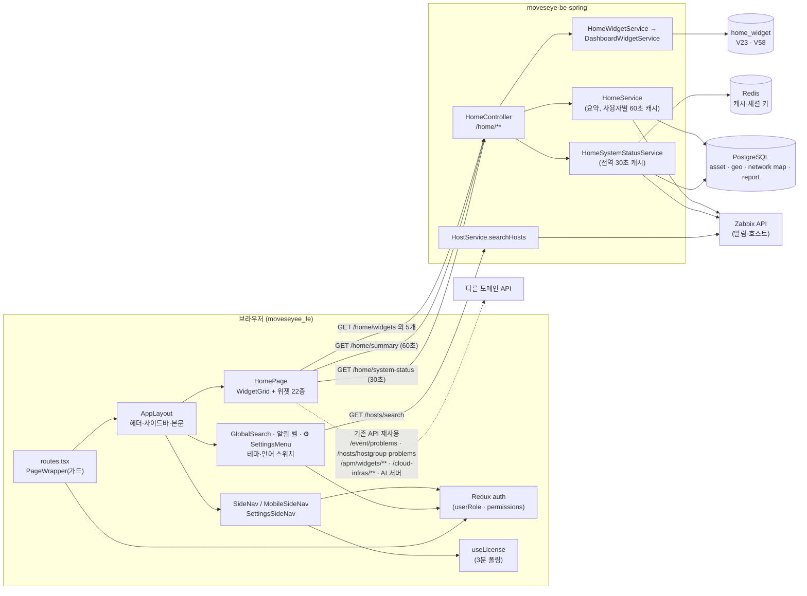

# 홈과 공통 화면 틀 기능 상세 가이드

> 이 문서는 로그인 직후 보는 **홈(사용자별 위젯 대시보드)** 과, 모든 화면을 둘러싼 **공통 틀**(사이드바·모바일 메뉴·헤더·⚙ 관리 콘솔·전역 검색·사용자 카드·다크 모드·화면 도움말·브레드크럼·오류 화면·라우트 가드·옛 주소 리다이렉트)을 설명한다. "어떤 메뉴가 어떤 조건으로 보이는가"를 전수로 정리한 **메뉴 전체 지도**(3.1)가 이 문서에 있다. 각 메뉴가 여는 화면 자체의 기능과 로그인·권한 판정 로직은 다른 영역 문서가 다루고, 여기서는 틀이 그 판정을 **어떻게 소비하는지**까지만 다룬다. 내용은 2026-10-06 소스(BE `e55948c`, FE `9dfcbe8`)를 정적으로 대조한 결과이며, 서버·브라우저를 실행해 확인한 것이 아니다.

## 1. 한눈에 보기

| 기능 | 화면 주소·메뉴 위치 | 상태 | 권한·라이선스 | 한 줄 설명 |
|---|---|---|---|---|
| 홈 위젯 대시보드 | `/home` · 사이드바 최상단 "홈" · `/` 진입 시 자동 이동 | 현재 | 로그인한 모든 사용자 | 사용자마다 위젯을 고르고 배치하는 첫 화면 |
| 홈 위젯 카탈로그 22종 | 홈 > 편집 > 위젯 추가 | 현재(21종 노출) / 보류(`ai_monitor_cost` 1종) | 위젯별: 관리자 전용 4종, APM 4종은 `apm.view` + APM 라이선스 | 시스템·모니터링·자산·맵·AI·리포트 묶음의 카드 |
| 홈 요약·시스템 상태 API | `GET /home/summary`, `GET /home/system-status` | 현재 | 로그인한 모든 사용자(일부 필드만 관리자) | KPI 카드와 시스템 카드의 데이터 원천 |
| 호스트 상세 사용자 정의 차트 | 서버·네트워크 모니터링 상세 화면 안 | 현재 | 보기 `serverMonitoring`/`networkMonitoring` view, 편집 edit | 호스트 한 대에 붙는 공용 차트 위젯(홈 위젯과 별개 테이블) |
| 앱 공통 틀(헤더·본문) | 로그인 뒤 모든 화면 | 현재 | — | 사이드바 접기, 브레드크럼, 검색, 테마·언어, 알림 벨, ⚙ |
| 사이드바(데스크톱) | 화면 왼쪽 | 현재 | 항목별 조건(3.1) | 업무 영역 3묶음의 메뉴 트리 |
| 모바일 메뉴 | 화면 폭 767px 이하 | 현재 | 사이드바와 같은 축(구성은 일부 다름) | 전체 화면 서랍형 메뉴 |
| ⚙ 설정 메뉴·관리 콘솔 | 헤더 오른쪽 ⚙ · `/setting/**` | 현재 | 개인 설정은 전원, 관리 항목은 관리자 또는 `apm` 권한 | 설정 화면 14개를 5묶음으로 모은 별도 내비 |
| 전역 검색 | 헤더 검색 버튼 · `Ctrl+K`/`⌘K` | 현재 | 항목별 조건(3.1) | 화면 이름과 호스트 이름·IP로 바로 이동 |
| 사용자 카드 | 사이드바 맨 아래 | 현재 | — | 이름·역할 표시와 로그아웃 |
| 다크 모드·언어 전환 | 헤더 스위치 2개(모바일은 메뉴 서랍 상단) | 현재 | — | 라이트/다크, 한국어/영어 |
| 화면 도움말·용어 힌트 | 화면 제목 옆 물음표 | 현재(일부 화면 미연결) | — | 화면별 설명·할 수 있는 일·용어 풀이 패널 |
| 브레드크럼·페이지 제목 | 헤더 왼쪽, 본문 상단 | 현재 | — | 주소 세그먼트로 만든 위치 표시와 제목 |
| 라우트 가드·라이선스 게이트 | 모든 라우트 | 현재 | 권한 키·관리자·라이선스 기능 | 주소 직접 입력을 막는 화면 단 차단 |
| 오류 화면 | `/errors/400·403·404·500·503`, 없는 주소 | 부분(404만 실제 사용) | — | 권한 없음·없는 주소는 404 화면 |
| 옛 주소 리다이렉트 | 25개 경로(3.4) | 현재 | — | 메뉴 이동 전 북마크·공유 링크 보존 |
| 기능 스위치 | `AI_MONITOR_ENABLED = false` | 보류 | — | AI 계정 모니터링을 화면에서만 감춤 |
| 공용 컴포넌트 | 여러 화면 | 현재 | — | 크기 조절 패널·공용 표·차트 드릴다운 |

### 전체 구조

틀은 데이터를 거의 갖지 않는다. 메뉴·검색·가드가 읽는 것은 로그인 뒤 서버에서 받은 **역할(`userRole`)**, **권한 맵(`permissions`)**, **라이선스 상태**, 그리고 AI 서버·AWS 자격증명의 **준비 상태** 네 가지뿐이다. 홈은 자기 전용 API 3종(`/home/summary`·`/home/system-status`·`/home/widgets`)과 다른 영역의 기존 조회 API를 함께 쓴다.

## 2. 기능별 상세

### 2.1 홈 위젯 대시보드

**무엇을 하는가**

로그인 직후(`/` 진입 포함) 열리는 화면이다. 사용자마다 자기 위젯 목록과 배치를 갖고, 편집 모드에서 추가·삭제·이동·크기 변경·이름 변경·설정을 한다. 홈에서 원인을 끝까지 파는 것이 아니라 카드의 "더보기"나 차트 조각을 눌러 해당 화면으로 내려가는 것이 의도된 흐름이다.

**화면과 진입 경로**

- 주소 `/home`. `/`로 들어오면 `/home`으로 바뀐다(`moveseyee_fe/src/routes/routes.tsx:236-239`).
- 진입점: 사이드바·모바일 메뉴 최상단 "홈", 전역 검색 "홈", 관리 콘솔 내비의 "모니터링으로 돌아가기", 브레드크럼 첫 칸 "홈".
- 홈에서는 본문 상단의 페이지 제목 줄을 그리지 않는다. 브레드크럼이 이미 "홈"을 보여 주고 그 자리를 위젯 툴바가 쓴다(`moveseyee_fe/src/components/PageHeader/PageHeader.tsx:39-41`).
- URL query는 쓰지 않는다. 편집 모드 여부·열린 모달은 화면 안 상태라 새로고침하면 보기 모드로 돌아간다.

**사용 방법**

1. 오른쪽 위 **편집**을 누른다. 버튼이 **완료**로 바뀌고 **위젯 추가**·**기본값으로 초기화**가 활성화된다. 보기 모드에서는 두 버튼이 비활성이다.
2. 카드 몸통을 끌어 옮기고, 오른쪽 아래 모서리를 끌어 크기를 바꾼다. 격자는 12칸, 한 줄 높이 30px, 카드 간격 8px이다. 카드 높이는 `38 × h − 8`px이다.
3. 카드 제목을 누르면 그 자리에서 이름을 바꾼다(최대 60자). 이름을 비우면 기본 제목으로 돌아간다.
4. 톱니 버튼은 설정이 있는 위젯에만 보인다. 설정 항목은 **표시 건수**(5·10·20, 기본 5)와 **최소 심각도**(알람 목록 전용) 두 가지다.
5. 휴지통 버튼은 삭제다. 시스템 위젯 3종(라이선스·사용자·데이터소스 연결)에는 휴지통이 없다.
6. **위젯 추가**는 묶음별 체크 목록에서 여러 개를 한 번에 고른다. 하나만 둘 수 있는 위젯이 이미 있으면 "이미 추가됨" 표시와 함께 고를 수 없다. 새 위젯은 맨 아래 줄에 왼쪽부터 놓인다.
7. **기본값으로 초기화**는 확인 창을 거쳐 내 위젯을 모두 지우고 기본 세트를 다시 깐다.
8. **완료**를 눌러 보기 모드로 돌아간다. 보기 모드에서는 끌기·크기 변경이 막히고 카드 안 링크가 정상 동작한다.

> 배치 저장과 기본값 초기화의 서버 처리에는 정적 분석으로 확인된 결함 의심이 있다. 운영에 쓰기 전에 4절 HOME-01을 먼저 확인한다.

**동작 원리**

- 화면: `HomePage`(`moveseyee_fe/src/pages/home/HomePage.tsx`) → 공용 편집 훅 `useWidgetDashboardEditor` → 공용 격자 `WidgetGrid`(react-grid-layout v2) → 위젯별 컴포넌트(`pages/home/widgets/registry.tsx`). 같은 편집 부품을 APM 개요·서비스 대시보드가 함께 쓴다.
- 목록: `useHomeWidgets` → `useDashboardWidgets` → `GET /home/widgets`. `staleTime`은 0이다. 서버는 내 위젯이 0건이면 기본 세트를 DB에 만들어 준 뒤 돌려준다. 그래서 화면에 보이는 모든 카드에 실제 `id`가 있다.
- 배치 저장: 편집 모드에서 격자가 바뀔 때마다 `PATCH /home/widgets/layout`을 보낸다. 보기 모드에서는 보내지 않는다(창 폭이 바뀌어도 격자가 변경 이벤트를 내기 때문이다). 저장 뒤 목록을 다시 읽지 않는다(`moveseyee_fe/src/hooks/useDashboardWidgets.ts:64-69`).
- 추가: 고른 타입을 **하나씩 차례로** `POST /home/widgets` 한다. 공용 HTTP 계층이 같은 주소의 요청이 겹치면 앞 요청을 취소하기 때문이다. 좌표는 화면이 정한다(기존 위젯의 가장 아래 줄, 12칸을 넘으면 다음 줄).
- 수정·삭제는 성공·실패 모두 목록을 다시 읽는다. 다른 탭에서 이미 지운 위젯이 유령 카드로 남지 않게 하기 위해서다.
- 서버: `HomeController` → `HomeWidgetService` → `DashboardWidgetService`. 범위는 항상 `(user_id, dashboard_key)` 쌍이다. 홈의 `dashboard_key`는 `home`, APM 개요는 `apm:overview`, 서비스별은 `apm:service:<uuid>`다(`moveseye-be-spring/src/main/java/com/dmove/moveseye/home/DashboardKey.java`).
- 저장 정책(무엇을 저장할 수 있는가)은 서버 `HomeWidgetType` enum이 정본이다. 크기·제목·설정 항목·렌더러는 화면(`constants/homeWidgets.ts`)이 정본이다. 타입을 추가하려면 서버 enum, 화면 카탈로그, 렌더러 매핑 세 곳을 함께 채운다.
- 노출 거르기: 화면은 받은 목록에서 ① `ai_monitor_cost`(기능 스위치 꺼짐) ② APM 위젯 4종(`apm.view` 없음 또는 APM 라이선스 없음)을 **그리지 않는다**. 서버의 행은 지우지 않으므로 조건이 돌아오면 제자리에 다시 나타난다. 서버는 관리자 전용 타입을 비관리자 목록에서 뺀다.

**기본 세트**

| 줄 | 비관리자(13개) | 관리자(15개) |
|---|---|---|
| 1 | 라이선스 4×8 · 사용자 4×8 · 데이터소스 연결 4×8 | 같음 |
| 2 | 현재 알람 6×5 · 인프라 가용성 6×5 | 같음 |
| 3 | 현재 발생 알람 6×11 · 호스트그룹 상태 6×11 | 같음 |
| 4 | — | 최근 리포트 6×10 · 배치·동기화 상태 6×10 |
| 5 | APM 트래픽 12×5 | 같음 |
| 6 | APM 상태 요약 6×8 · APM 알람·SLO 위험 6×8 | 같음 |
| 7 | 맵 요약 12×5 | 같음 |
| 8 | 대표 네트워크 맵 6×12 · 대표 지리 맵 6×12 | 같음 |

좌표 정본은 `moveseye-be-spring/src/main/java/com/dmove/moveseye/home/HomeWidgetDefaults.java`다. 줄마다 높이를 같게, 오른쪽을 비우지 않게 둔 이유는 격자가 편집 모드에 들어가는 순간 위쪽 빈칸으로 카드를 끌어올리기 때문이다. APM 라이선스가 없는 설치본에서는 5·6줄의 APM 카드 3개가 화면에 그려지지 않는다.

**주요 API**

| Method | Path | 용도 | 권한 |
|---|---|---|---|
| GET | `/home/widgets` | 내 위젯 목록(0건이면 기본 세트 생성) | 로그인 |
| POST | `/home/widgets` | 위젯 추가 | 로그인. 관리자 전용 타입은 관리자만 |
| PATCH | `/home/widgets/layout` | 배치 일괄 저장 | 로그인(내 위젯만, 남의 id는 그 항목만 무시) |
| PATCH | `/home/widgets/{widgetId}` | 제목·설정 수정 | 로그인(내 위젯만) |
| DELETE | `/home/widgets/{widgetId}` | 삭제 | 로그인(고정 위젯은 거부) |
| POST | `/home/widgets/reset` | 기본 세트로 초기화 | 로그인 |
| GET | `/home/summary` | 알람·인프라·자산·맵·최근 리포트 요약 | 로그인(최근 리포트만 관리자) |
| GET | `/home/system-status` | 사용자·데이터소스·인프라·배치 상태 | 로그인(배치만 관리자) |

오류는 HTTP 200에 본문 `code`·`errorCode`로 온다. 코드는 `WIDGET_TYPE_INVALID`(모르는 타입, 400), `WIDGET_DUPLICATE`(하나만 둘 수 있는 타입 중복, 400), `WIDGET_ADMIN_ONLY`(400), `WIDGET_PINNED`(고정 위젯 삭제, 400), `WIDGET_NOT_FOUND`(없거나 남의 위젯, 404)다. 화면이 호출하지 않는 `/home/**` 엔드포인트는 없다.

**데이터**

- 테이블 `home_widget`(Flyway V23, V58에서 `dashboard_key` 추가). 주요 컬럼: `user_id`(사용자 삭제 시 함께 삭제), `dashboard_key`(기본 `home`), `widget_type`(varchar 64, enum 아님), `title`(null이면 화면의 기본 제목), `config`(jsonb), `pos_x`·`pos_y`·`width`·`height`, `pinned`.
- 인덱스는 `(user_id)`와 `(user_id, dashboard_key)` 두 개다. 유일 제약은 없다. "대시보드당 1개" 규칙은 서버 코드가 건수를 세어 판정한다.
- 보존·정리 배치는 없다. 사용자가 지워지면 외래 키로 함께 지워진다.

**권한·라이선스**

- 홈 화면과 `/home/**`는 권한 칸을 보지 않는다. 로그인만 하면 연다.
- 관리자 전용 위젯 4종(배치·동기화 상태, AI 알림 분석, AI 계정 비용, 최근 리포트)은 카탈로그에서 비관리자에게 감추고, 서버도 추가 요청을 거부하며, 목록에서도 뺀다.
- APM 위젯 4종은 역할이 아니라 권한 칸 `apm`의 view와 APM 라이선스로 갈린다. 서버 카탈로그에는 이 축이 없어 화면이 감추고, 데이터 API(`/apm/widgets/**`)가 최종 거부한다.
- 관리자 판정은 화면·서버 모두 `userRole ∈ {ADMIN, SUPER_ADMIN}` 한 축이다.

**빈 값·실패·경계 상태**

| 상황 | 화면 |
|---|---|
| 첫 로딩 | 격자 대신 스피너 |
| 위젯 0건 | "위젯이 없습니다. 편집을 켜고 위젯을 추가하세요." (목록 조회 실패도 같은 문구 — HOME-03) |
| 서버에만 있는 새 타입 | 그 칸에 "현재 화면 버전이 지원하지 않는 위젯 유형입니다." + 타입 코드 |
| 추가·삭제·수정 실패 | 오류 토스트(추가는 모달이 열린 채 남음) |
| 배치 저장 실패 | 오류 토스트만. 화면 배치는 되돌리지 않는다 |
| 요약의 한 묶음 실패 | 그 카드만 `-` 표시, 나머지는 정상 |

**운영 주의**

- 화면 카탈로그와 서버 enum의 타입·크기 값은 양쪽 테스트(`homeWidgetRegistry.test.tsx`, `HomeWidgetCatalogTest`)가 맞춘다. 한쪽만 바꾸면 "저장은 됐는데 못 그리는" 위젯이 생긴다.
- 위젯별 폴링이 켜져 있어 홈을 띄워 둔 사용자 수만큼 조회가 반복된다. 주기는 2.2 표를 본다.

### 2.2 홈 위젯 카탈로그(22종)

**무엇을 하는가**

카드 한 장이 한 가지 질문에 답한다. 아래 표가 전체 목록이다. "하나만"은 대시보드당 1개 제한, "고정"은 삭제 불가, "기본"은 기본 세트 포함 여부(관리자/비관리자)다.

| 묶음 | 타입 코드 | 카드 이름 | 기본 크기(최소) | 하나만 | 고정 | 관리자 전용 | 설정 | 기본 |
|---|---|---|---|---|---|---|---|---|
| 시스템 | `system_license` | 라이선스 | 4×8 (3×3) | ○ | ○ | — | — | ○/○ |
| 시스템 | `system_users` | 사용자 | 4×8 (3×3) | ○ | ○ | — | — | ○/○ |
| 시스템 | `system_datasources` | 데이터소스 연결 | 4×8 (3×3) | ○ | ○ | — | — | ○/○ |
| 시스템 | `system_scheduler` | 배치·동기화 상태 | 6×10 (3×3) | ○ | — | ○ | — | ○/— |
| 모니터링 | `alarm_kpi` | 현재 알람 | 6×5 (3×3) | ○ | — | — | — | ○/○ |
| 모니터링 | `infra_kpi` | 인프라 가용성 | 6×5 (3×3) | ○ | — | — | — | ○/○ |
| 모니터링 | `alarm_list` | 현재 발생 알람 | 6×11 (3×3) | — | — | — | 건수·최소 심각도 | ○/○ |
| 모니터링 | `alarm_severity_pie` | 알람 심각도 분포 | 4×8 (3×3) | — | — | — | — | —/— |
| 모니터링 | `hostgroup_status` | 호스트그룹 상태 | 6×11 (3×3) | — | — | — | 건수 | ○/○ |
| 모니터링 | `apm_traffic_kpi` | APM 트래픽 | 12×5 (6×4) | ○ | — | — | — | ○/○ |
| 모니터링 | `apm_status` | APM 상태 요약 | 6×8 (3×5) | ○ | — | — | 건수 | ○/○ |
| 모니터링 | `apm_slow_services` | 느린 서비스 | 4×8 (3×5) | ○ | — | — | 건수 | —/— |
| 모니터링 | `apm_alerts` | APM 알람 · SLO 위험 | 6×10 (3×6), 기본 세트에서는 6×8 | ○ | — | — | 건수 | ○/○ |
| 모니터링 | `cloud_fleet` | 클라우드 플릿 | 6×8 (3×5) | ○ | — | — | — | —/— |
| 자산 | `asset_kpi` | 자산 현황 | 4×5 (3×3) | ○ | — | — | — | —/— |
| 맵 | `map_summary` | 맵 요약 | 6×5 (3×3), 기본 세트에서는 12×5 | ○ | — | — | — | ○/○ |
| 맵 | `main_network_map` | 대표 네트워크 맵 | 6×12 (3×6) | ○ | — | — | — | ○/○ |
| 맵 | `main_geo_map` | 대표 지리 맵 | 6×12 (3×6) | ○ | — | — | — | ○/○ |
| AI | `ai_alert_digest` | AI 알림 분석 | 6×10 (4×6) | ○ | — | ○ | — | —/— |
| AI | `ai_usage` | AI 사용량 | 4×6 (3×3) | ○ | — | — | — | —/— |
| AI | `ai_monitor_cost` | AI 계정 비용 | 4×6 (3×3) | ○ | — | ○ | — | —/— (화면에서 숨김) |
| 리포트 | `recent_reports` | 최근 리포트 | 6×10 (3×3) | ○ | — | ○ | — | ○/— |

**동작 원리 — 카드별 데이터 원천과 갱신**

| 카드 | 데이터 원천 | 갱신 주기 | 보이는 값의 뜻 | "더보기"·눌러서 가는 곳 |
|---|---|---|---|---|
| 라이선스 | 라이선스 상태 조회(`useLicense`, 틀과 같은 캐시) | 3분 | 상태 배지, 등급, 고객사, 만료일(영구면 "만료 없음"), 남은 일수, 보유 기능 태그 | `/setting/license` |
| 사용자 | `/home/system-status`.users | 30초 | 전체·활성·비활성·관리자 수(DB 건수), 현재 접속(세션 키 개수). 접속 수가 `-`이면 세션 저장소 장애다(0명과 다르다) | `/setting/user-management` |
| 데이터소스 연결 | `/home/system-status`.dataSources + .infrastructure | 30초 | 등록된 데이터소스마다 실측 결과(Zabbix는 버전 조회), DB는 `SELECT 1`, Redis는 `PING`, AWS는 **설정 유무만**. 상태는 정상·장애·미설정·설정됨 4종이고 응답 시간(ms)과 점검 시각을 함께 보인다 | `/setting/integrations` |
| 배치·동기화 상태 | `/home/system-status`.schedulers | 30초 | 배치별 켜짐/꺼짐, 마지막 실행 성공/실패, 다음 실행 시각. 관리자가 아니면 "관리자만 볼 수 있습니다." | `/setting/schedulers` |
| 현재 알람 | `/home/summary`.alarm | 60초 | 지금 열려 있는 문제 수와 심각도별 수. 활성 트리거의 문제만, 억제된 문제는 제외 | `/event-alert/problem` |
| 인프라 가용성 | `/home/summary`.infra | 60초 | 가용성 %(인터페이스가 살아 있는 호스트 비율, 소수 1자리), 건강도 점수, 전체·가용 호스트 수 | `/monitoring/host-group` |
| 현재 발생 알람 | `GET /event/problems`(기간 0~지금, 최신순) | 60초 | 심각도·호스트·발생 시각·문제 이름. 최소 심각도를 걸면 최신 50건을 받아 화면에서 거른 뒤 건수만큼 자른다 | `/event-alert/problem` |
| 알람 심각도 분포 | `/home/summary`.alarm(추가 조회 없음) | 60초 | 도넛(0건 조각은 그리지 않음). 차트↔표 전환 가능, 표는 6등급 전부 표시 | 조각·툴팁 링크·표 행 → 그 심각도로 거른 문제 목록(기간 0~지금) |
| 호스트그룹 상태 | `GET /hosts/hostgroup-problems`(최근 30일 고정) | 60초 | 그룹별 문제 총수와 심각도 칩. 제목 옆에 "최근 30일" 표시 | `/monitoring/host-group` |
| APM 트래픽 | `GET /apm/widgets/traffic-totals` | 10분 | 요청/s·오류율·p95·활성 요청과 직전 창 대비 변화. 창은 서버가 정한다(60분) | `/application-monitoring/overview` |
| APM 상태 요약 | `GET /apm/widgets/status-summary?limit=` | 10분 | 서비스 수, 상태별 분포, 오류율 상위(최대 20) | `/application-monitoring/overview` |
| 느린 서비스 | `GET /apm/widgets/slow-services?limit=` | 10분 | p95 상위. p95를 잴 수 없는 서비스는 순위에서 빠진다 | `/application-monitoring/services` |
| APM 알람 · SLO 위험 | `GET /apm/widgets/alerts?limit=` | 10분 | 최근 발화한 알람과 에러 버짓이 위험한 SLO | `apm` edit 권한이 있으면 알람 발화 이력, 없으면 APM 개요 |
| 클라우드 플릿 | `GET /cloud-infras/overview?range=1h`, `GET /cloud-infras/cost-estimate` | 10분 | EC2 CPU 상위, 활성 CloudWatch 알람 수, 낭비 리소스 수와 월 추정액(USD). 플릿 지표가 꺼져 있으면 안내만 표시 | `/cloud-infra-monitoring/ec2-dashboard`, 낭비 태그 → 자산 비용의 Cloud 탭 |
| 자산 현황 | `/home/summary`.asset | 60초 | 전체 자산 수, 관리/비관리 분해 | `/asset/list` |
| 맵 요약 | `/home/summary`.map | 60초 | 지리 클러스터 수, 문제 있는 클러스터 수와 최악 심각도, 네트워크 맵 수 | 숫자 → `/asset/geo-map`, `/monitoring/network-map` |
| 대표 네트워크 맵 | 네트워크 맵 목록에서 대표로 지정된 맵 → 상세 + 실시간 상태 | 해당 화면 훅의 주기 | 읽기 전용 미리보기. 보기 모드에서 이동·확대만 된다 | 그 맵의 편집기 |
| 대표 지리 맵 | 지리 맵 목록에서 대표로 지정된 맵 → 상세 + 실시간 상태 | 해당 화면 훅의 주기 | 핀·연결선 미리보기. 핀을 누르면 전체 지도로 간다 | 그 지리 맵 상세 |
| AI 알림 분석 | AI 서버의 알람 요약 캐시 | 수동 | 일간/주간 전환. **자동 생성하지 않는다** — "지금 분석"을 눌러야 LLM 호출이 일어난다. 요약문과 서버가 센 숫자를 함께 보인다 | `/ai-assistant` |
| AI 사용량 | AI 서버의 이번 달 사용량(관리자는 전체, 그 외는 본인) | 해당 훅의 주기 | 토큰·비용·예산 대비. LLM을 부르지 않는다 | `/setting/ai` |
| AI 계정 비용 | `GET /ai-monitor/usage/compact` | — | 화면에서 숨김(2.14) | — |
| 최근 리포트 | `/home/summary`.recentReports | 60초 | 최근 호스트그룹 리포트 5건(서버 고정). 관리자가 아니면 "관리자만 볼 수 있습니다." | `/setting/report-management` |

**빈 값·실패·경계 상태**

- 요약 카드(현재 알람·인프라·자산·맵)는 그 묶음 집계가 실패하면 숫자 대신 `-`를 보인다. 0과 구분하기 위해서다.
- 대표 맵 카드는 대표로 지정된 맵이 없으면 안내 문구와 해당 목록으로 가는 버튼을 보인다.
- APM 카드 4종은 조회 오류를 카드 안에 빨간 문구로 보인다.
- 현재 발생 알람·호스트그룹 상태·클라우드 플릿 카드는 조회가 실패해도 "없음" 또는 0으로 보인다(HOME-03).

### 2.3 홈 요약·시스템 상태 API

**무엇을 하는가**

KPI 카드와 시스템 카드가 여러 도메인 API를 각자 부르지 않도록, 서버가 한 번에 모아 준다.

**동작 원리 — `GET /home/summary`**

- `HomeService.getSummary`가 다섯 묶음을 각각 독립된 예외 처리로 모은다. 한 묶음이 실패하면 그 필드만 `null`이고 응답은 200이다.

| 필드 | 계산 | 범위 |
|---|---|---|
| `alarm` | 알람 포트의 심각도별 활성 건수 1회 호출(Zabbix `problem.get`). 활성 트리거만, 억제 제외. 키는 `"0"`~`"5"` | 호출자 Zabbix 권한 |
| `infra` | 볼 수 있는 호스트 전체를 받아 가용 호스트 수·가용성 %·건강도 계산(`HostService.computeInfraKpi`) | 호출자 Zabbix 권한 |
| `asset` | 자산 테이블 집계(`AssetService.getSummary`) | 전체(사용자 구분 없음) |
| `map` | 지리 클러스터 실시간 집계 + 네트워크 맵 건수 | 지리 클러스터의 문제 수는 호출자 컨텍스트로 조회, 네트워크 맵 수는 전체 |
| `recentReports` | 리포트 최근 5건(기간 시작 내림차순) + 그룹 이름 | 관리자만, 그 외 `null` |

- 캐시: Redis 키 `HOME_SUMMARY:{사용자 id}`, 60초. 보이는 범위가 사용자마다 달라 사용자별로 캐시한다. 같은 사용자의 동시 요청은 한 번만 계산한다.
- 화면 폴링도 60초다(`moveseyee_fe/src/hooks/useHome.ts:19`).

**동작 원리 — `GET /home/system-status`**

- 사용자·데이터소스·인프라 세 묶음은 사용자마다 다르지 않아 전역 Redis 키 `HOME_SYSTEM_STATUS`에 30초 캐시한다. 배치 목록은 캐시에 넣지 않고 관리자 요청마다 DB에서 읽는다.
- 사용자 수는 DB 건수 4개, 현재 접속 수는 Redis의 로그인 세션 키를 `SCAN`으로 센다. Redis가 죽으면 접속 수만 `null`이다.
- 데이터소스는 등록된 소스를 모두 돌며 상태 점검 포트를 부른다. 점검 수단이 없는 소스는 "미설정", 예외는 "장애 + 사유"다. Zabbix 소스는 접속 주소를 `scheme://host[:port]`까지만 내려 준다.
- AWS는 실제 호출 없이 클라우드 설정에 키가 있는지만 본다. 그래서 상태가 "정상"이 아니라 "설정됨"이다.

**권한·라이선스**

두 API 모두 로그인만 요구한다. 관리자가 아닌 사용자에게는 `recentReports`와 `schedulers`만 `null`로 생략한다. 나머지 필드는 모든 사용자에게 같은 내용이 간다(HOME-02).

**운영 주의**

- 서버 시각은 `yyyy-MM-dd'T'HH:mm:ss.SSS'Z'` 문자열로 나간다. 컨테이너 실행은 JVM 시간대를 UTC로 고정한다(`moveseye-be-spring/Dockerfile:41`). 다른 방식으로 띄운 서버가 UTC가 아니면 점검 시각이 어긋난다.
- 30초·60초 캐시 수명은 코드 상수다. 설정 키가 없다.

### 2.4 호스트 상세의 사용자 정의 차트 위젯

**무엇을 하는가**

서버·네트워크 모니터링 상세 화면에서 호스트의 수집 아이템을 골라 차트 카드로 붙인다. 홈 위젯과 달리 **사용자별이 아니라 호스트 공용**이다. 한 사람이 바꾸면 그 호스트를 보는 모두의 화면이 바뀐다. 화면 자체의 사용법은 모니터링 영역 문서가 다루고, 여기서는 저장 구조만 적는다.

**동작 원리**

- 화면 `CustomChartsDashboard` → `useWidgets(hostId)` → `host/{id}/widgets` 5개 엔드포인트 → `WidgetsService` → 테이블 `dashboard_widget`(Flyway V2).
- 표준 템플릿 1종(`server-basic`, `constants/dashboard-templates.ts`)이 있다. 아이템 키 접두사로 맞는 수집 항목을 찾아 CPU 사용률·부하 평균·메모리 사용량·메모리 사용률·스왑·네트워크·디스크 I/O·디스크 사용량·디스크 사용률 9개 카드를 한 번에 만든다. 맞는 아이템이 없는 카드는 빼고 나머지를 빈칸 없이 다시 배치한다.
- 쓰기 요청은 "작업을 시작한 로그인 세션"을 함께 싣는다. 도중에 계정이 바뀌면 요청을 보내지 않고 결과도 버린다.

**주요 API**

| Method | Path | 용도 | 권한 |
|---|---|---|---|
| GET | `/host/{id}/widgets` | 목록 | `serverMonitoring` 또는 `networkMonitoring` view + 그 호스트가 내게 보이는가 |
| POST | `/host/{id}/widgets` | 추가 | 같은 두 칸 중 하나의 edit + 호스트 가시성 |
| PATCH | `/host/{id}/widgets/layout` | 배치 저장 | 위와 같음 |
| PATCH | `/host/{id}/widgets/{widgetId}` | 제목·차트 종류·아이템 수정 | 위와 같음 |
| DELETE | `/host/{id}/widgets/{widgetId}` | 삭제 | 위와 같음 |

**데이터**

`dashboard_widget`: `host_id`(varchar), `title`, `chart_type`(기본 `line`), `config`(jsonb, `{itemIds}`), 좌표·크기. 호스트가 Zabbix에서 지워져도 행은 남는다(정리 배치 없음).

### 2.5 앱 공통 틀(AppLayout)

**무엇을 하는가**

로그인 뒤 모든 화면이 같은 뼈대 안에서 열린다. 왼쪽 내비, 위쪽 헤더, 라이선스 경고 띠, 본문, 오른쪽 아래 AI 버튼으로 이루어진다.

**화면 구성**

| 위치 | 요소 | 동작 |
|---|---|---|
| 헤더 왼쪽 | 사이드바 접기 버튼 | 펼침 ↔ 아이콘 레일(64px). 선택은 브라우저에 저장된다 |
| 헤더 왼쪽 | 브레드크럼 | 2.11 |
| 헤더 왼쪽 | 전역 검색 버튼 | 2.8 |
| 헤더 오른쪽 | 테마 스위치·언어 스위치 | 2.10. 모바일 폭에서는 메뉴 서랍 상단으로 옮겨진다 |
| 헤더 오른쪽 | 알림 벨 | 최근 알람 알림 목록. 실시간 연결이 살아 있으면 5분, 아니면 1분마다 다시 읽는다(상세는 이벤트·알림 영역 문서) |
| 헤더 오른쪽 | ⚙ 설정 | 2.7 |
| 헤더 아래 | 라이선스 경고 띠 | 만료 임박·유예·읽기 전용일 때만 상시 표시. "관리" 링크는 `/setting/license` |
| 본문 상단 | 페이지 제목 + 도움말 물음표 + 한 줄 설명 | 2.9, 2.11 |
| 본문 오른쪽 아래 | 맨 위로 버튼, AI 어시스턴트 버튼(관리자) | AI 버튼은 화면이 바뀌어도 대화가 끊기지 않게 본문 바깥에 둔다 |

**동작 원리**

- 사이드바 폭은 오른쪽 경계를 끌어 160~400px로 조절한다(기본 200px). 폭과 접힘 상태는 `localStorage`(`siderWidth`, `siderCollapsed`)에 남는다. 관리 콘솔 내비와 같은 값을 공유한다.
- 화면 폭 767px 이하에서는 사이드바 대신 전체 화면 서랍 메뉴가 뜬다.
- 본문은 **주소 경로(pathname)** 가 바뀔 때만 전환 애니메이션(300ms)과 함께 다시 마운트된다. 같은 화면에서 쿼리(`?tab=`·필터·페이지)만 바뀌면 다시 마운트되지 않는다.
- `/setting/**`에서는 같은 뼈대에 내비만 관리 콘솔용으로 바뀌고 본문 바탕색이 달라진다.
- 틀은 두 가지 전역 신호를 한 번씩만 구독한다. ① 조회가 권한 때문에 거부되면(HTTP 200 + 본문 `code` 403) "이 작업을 수행할 권한이 없습니다" 안내를 **화면 경로당 한 번** 띄운다. ② 라이선스 때문에 막히면 라이선스 상태를 즉시 다시 읽고 안내를 띄운다(같은 코드는 3초 안에 한 번만).

### 2.6 사이드바와 모바일 메뉴

**무엇을 하는가**

업무 영역을 세 묶음으로 나눠 보여 준다: **운영 관제**(AI 어시스턴트·모니터링·네트워크 맵·클라우드·APM·DB·GPU·이벤트/알림), **자산과 구성**(자산 관리), **데이터 소스 관리**(Zabbix 관리). 설정 묶음은 사이드바에 없고 헤더 ⚙로 갔다. 메뉴별 노출 조건 전수는 3.1에 있다.

**사용 방법과 보이는 것**

- 설명이 붙은 상위 메뉴(AI 어시스턴트·모니터링·이벤트/알림·자산 관리·Zabbix 관리)는 이름 아래에 한 줄 설명이 보인다. 접힌 레일에서는 설명과 묶음 제목을 만들지 않고 아이콘만 남긴다.
- 서브메뉴는 여러 개를 동시에 열어 둘 수 있다. 화면을 옮기면 현재 화면이 속한 묶음이 **추가로** 열리고, 열어 둔 다른 묶음은 닫지 않는다.
- 메뉴가 보이지만 못 누르는 경우는 세 가지다.

| 모양 | 뜻 | 사용자가 할 일 |
|---|---|---|
| 자물쇠 + 흐린 글씨 | 라이선스에 없는 프리미엄 기능(APM·DB·GPU). 툴팁이 "구매하지 않은 기능"과 "만료되어 닫힘"을 구분한다 | 라이선스 등급 상향 또는 갱신 |
| 흐린 글씨 + 설명 "설정 > AI에서 LLM 접속정보를 먼저 입력하세요" 또는 "AI 서버에 연결할 수 없습니다" | AI 서버가 준비되지 않음 | 관리 콘솔 > AI 어시스턴트 설정, 또는 AI 서버 상태 확인 |
| 흐린 글씨 + 설명 "설정 > 클라우드 인프라에서 AWS 자격증명을 먼저 입력하세요" | AWS 자격증명 없음 | 관리 콘솔 > 클라우드 인프라 |

- 잠긴 상위 메뉴는 열리지 않으므로 그 아래 링크에 닿을 수 없다. 주소를 직접 입력해도 라우트 단의 게이트가 안내 화면을 대신 보인다.

**동작 원리**

- 데스크톱은 `SideNav.tsx`, 모바일은 `MobileSideNav.tsx`가 **각자** 메뉴 트리를 적는다. 판정 재료는 같다: `canViewFeature(permissions, 키)`, `useIsUserRoleAdmin()`, `useLicense().allowsFeature(기능)`, `useAiHealth()`, `useCloudStatus()`.
- 권한 맵을 아직 못 받은 동안(`permissions`가 없음)에는 메뉴 전체를 그리지 않는다. 권한이 하나도 없는 빈 맵은 정상 상태로 취급해 조건 없는 메뉴를 그린다.
- 라이선스·AI·클라우드 상태는 **읽는 중에는 잠그지 않는다**. 새로고침마다 자물쇠가 깜빡이는 것을 막기 위해서다.
- 선택 강조는 주소의 앞 세 세그먼트 중 마지막 값을 메뉴 key로 쓴다(예: `/monitoring/network-map` → `network-map`). 그래서 메뉴 key와 주소 세그먼트가 같아야 한다.
- 메뉴는 데이터 소스의 연결 여부나 제공 능력을 보지 않는다. Zabbix가 연결되지 않은 설치본에서도 관리자에게 "Zabbix 관리"가 보인다.

**모바일 메뉴가 데스크톱과 다른 점**(소스 기준)

| 항목 | 데스크톱 | 모바일 |
|---|---|---|
| 묶음 제목(운영 관제 등) | 있음 | 없음 |
| 순서 | 홈 → AI → 모니터링 → 네트워크 맵 → 클라우드 → APM → DB → GPU → 이벤트/알림 → 자산 → Zabbix | 홈 → 모니터링 → 네트워크 맵 → 클라우드 → APM → DB → GPU → 이벤트/알림 → AI → Zabbix → 자산 |
| Zabbix 관리 아래 "사용자 관리" | 없음(관리 콘솔로 이동) | 있음(`/setting/user-management`로 연결) |
| AI 사용 현황 항목 | 정의는 있으나 스위치로 숨김 | 정의 없음 |
| AI 잠금 사유 문구 | 미설정/연결 불가를 구분 | 일반 설명만 |
| 서브메뉴 열림 | 여러 개 유지 | 화면 이동 시 현재 경로의 묶음만 열림 |
| 하위 항목 아이콘 | 있음 | 대부분 없음 |

### 2.7 ⚙ 설정 메뉴와 관리 콘솔

**무엇을 하는가**

"보는 화면"(관제)과 "만지는 화면"(설정)을 나눈다. 헤더 ⚙ 드롭다운에는 개인 설정 2개와 "관리 콘솔" 한 줄만 있고, 관리 항목은 `/setting` 아래 별도 내비에서 묶음별로 고른다. 관리 콘솔은 별도 앱이 아니라 같은 화면 앱 안의 라우트 묶음이다.

**화면과 진입 경로**

- ⚙ 드롭다운: 마이 페이지, 연결된 앱, (구분선) 관리 콘솔. "관리 콘솔" 줄은 관리 항목 중 하나라도 볼 수 있는 계정에게만 보인다. 즉 관리자, 또는 `apm` 권한 칸이 열린 계정이다.
- 관리 콘솔 홈 `/setting`: 묶음별 카드로 모든 설정 화면을 설명과 함께 편다.
- 콘솔 왼쪽 내비: 맨 위 "모니터링으로 돌아가기"(홈으로), "관리 콘솔"(콘솔 홈), 이어서 묶음 5개. 색은 관제 내비(청록)와 다른 남색 계열이고 맨 위에 "ADMIN CONSOLE" 표지가 붙는다.
- 전역 검색에서도 "관리 콘솔 › 묶음 이름" 경로와 함께 찾는다.

**관리 콘솔 항목 14개**

| 묶음 | 항목 | 주소 | 노출 조건 | 라우트 가드 |
|---|---|---|---|---|
| 내 계정 | 마이 페이지 | `/setting/my-page` | 전원 | 로그인 |
| 내 계정 | 연결된 앱 | `/setting/connected-apps` | 전원 | 로그인 |
| 계정·접근 | 사용자 관리 | `/setting/user-management` | 관리자 | 관리자 |
| 계정·접근 | 라이선스 | `/setting/license` | 관리자 | 관리자(잠금 상태에서도 열림) |
| 데이터 소스 | 데이터 소스 관리 | `/setting/integrations` | 관리자 | 관리자 |
| 데이터 소스 | 클라우드 인프라 | `/setting/cloud-infra-info` | 관리자 | 관리자 |
| 데이터 소스 | AI 어시스턴트 | `/setting/ai` | 관리자 | 관리자 |
| 운영 | 스케줄러 | `/setting/schedulers` | 관리자 | 관리자 |
| 운영 | 리포트 관리 | `/setting/report-management` | 관리자 | 관리자 |
| 운영 | 데이터 아카이브 | `/setting/data-archive` | 관리자 | 관리자 |
| 운영 | 기기분류 관리 | `/setting/device-classification` | 관리자 | 관리자 |
| APM 관리 | 알람 규칙 | `/setting/apm/alert-rules` | `apm` **edit** | `apm` edit + APM 라이선스 게이트 |
| APM 관리 | SLO | `/application-monitoring/slo` | `apm` view | `apm` view + APM 라이선스 게이트(관제 레이아웃에서 열림) |
| APM 관리 | 수집기 | `/setting/apm/collectors` | `apm` **edit** | `apm` edit + APM 라이선스 게이트 |

**동작 원리**

- 항목 정의의 정본은 `moveseyee_fe/src/constants/adminConsole.tsx`의 `ADMIN_CONSOLE_GROUPS` 하나다. ⚙ 드롭다운, 콘솔 내비(데스크톱·모바일), 콘솔 홈, 전역 검색이 모두 이 배열과 판정 함수 `isAdminConsoleEntryVisible`을 쓴다.
- 권한 맵을 아직 못 받았으면 권한 축 항목을 감춘다.
- 현재 위치 표시는 세그먼트 단위로 비교한다. `/setting/license/apply`·`/setting/integrations/zabbix`·`/setting/report-management/apm` 같은 하위 화면은 부모 항목이 선택된 것으로 표시된다.
- APM 관리 항목은 라이선스 축으로 가리지 않는다. APM 라이선스가 없는 설치본에서도 항목이 보이고, 누르면 구매 안내 화면이 뜬다.
- SLO는 조회 화면이라 APM 주소 그대로다. 콘솔에서 누르면 관제 레이아웃으로 넘어간다.

### 2.8 전역 검색

**무엇을 하는가**

메뉴가 깊어 찾기 어려운 화면을 글자로 찾고, 호스트 이름이나 IP로 호스트 상세에 바로 간다.

**사용 방법**

1. 헤더의 검색 버튼을 누르거나 `Ctrl+K`(맥은 `⌘K`)를 누른다. 입력 중인 폼 안에서도 열린다.
2. 글자를 치면 **화면** 결과(최대 8개)와 **호스트** 결과(최대 6개)가 뜬다. 띄어 쓴 단어는 모두 포함돼야 맞는다(공백 무시, 대소문자 무시). 화면은 이름·상위 메뉴 이름·한 줄 설명·주소 중 어디에 있어도 맞는다.
3. `↑`/`↓`로 고르고 `Enter`로 연다. `Esc`로 닫는다. 한글 조합 중의 `Enter`는 선택으로 처리하지 않는다.
4. 빈 검색어에서는 화면 목록의 앞 8개만 보인다.

**동작 원리**

- 화면 후보는 두 곳에서 온다: 사이드바의 평탄 사본 `NAV_SEARCH_ENTRIES`(41개)와 관리 콘솔 항목(14개). 주소가 같은 항목(APM 알람 규칙·SLO·수집기)은 사이드바 쪽 한 줄만 남긴다. 조건은 사이드바·콘솔과 같은 함수로 거른다.
- 라이선스에 없는 화면은 "잠김" 표시로 보이고 눌러도 이동하지 않는다.
- 호스트 검색은 **2글자 이상**, 입력이 멈추고 **250ms** 뒤에 `GET /hosts/search?keyword=&limit=6`을 부른다. 같은 검색어는 30초 동안 다시 부르지 않는다. 서버·네트워크 모니터링 보기 권한이 둘 다 없으면 호출 자체를 하지 않는다.
- 결과는 기기 유형이 네트워크면 네트워크 모니터링 상세로, 그 외는 서버 모니터링 상세로 보낸다. 목적지 화면 권한이 없는 호스트는 결과에서 뺀다.
- 맞는 호스트가 6대를 넘으면 "6 / N건 표시 — 더 좁혀 보세요"를 보인다.
- 서버는 호출자에게 보이는 호스트 전체를 받아 이름·인터페이스 주소에 검색어가 포함된 것을 고르고 이름순으로 정렬한다(`moveseye-be-spring/src/main/java/com/dmove/moveseye/host/HostService.java:1776-1803`).

### 2.9 화면 도움말과 용어 힌트

**무엇을 하는가**

화면 제목 옆 물음표를 누르면 오른쪽에 도움말 패널이 열린다. 패널은 세 부분이다: 이 화면이 무엇인가(요약), 여기서 할 수 있는 일(목록), 이 화면에 나오는 용어 풀이. AI 어시스턴트를 쓰지 않는 설치본에서도 완결되도록 문구는 모두 화면 앱 안에 있다.

**동작 원리**

- 주소로 도움말을 찾는다. 등록 표는 `moveseyee_fe/src/constants/page-guide.ts`의 `ENTRIES`이고, 문구는 번역 파일의 `page_guide.<키>.summary`·`.detail`, 용어는 `glossary.<용어>`다. 번역 파일에는 도움말 키 69개, 용어 49개가 있다.
- 매칭은 **긴 경로 우선**의 접두사 비교다. 목록과 상세가 같은 경로로 시작하면 목록 쪽에 "이 경로만" 표시를 붙여 가른다.
- 탭이 `?tab=`인 화면(APM 서비스 상세, 수집기, 데이터 아카이브)은 탭 값에 따라 도움말이 바뀐다. 탭 값이 없거나 모르는 값이면 화면 전체 도움말을 쓴다.
- 요약 문구는 제목 아래 **한 줄 설명**으로도 쓰인다. Zabbix 관리 화면들은 요약보다 짧은 전용 문구를 쓴다.
- 등록되지 않은 화면에는 물음표가 붙지 않는다. 사전에 없는 용어는 조용히 건너뛴다.
- 용어 옆 작은 물음표(`TermHint`)는 같은 `glossary` 문구를 툴팁으로 보인다.
- 패널 폭은 끌어서 조절하고 브라우저에 기억된다(2.15).

### 2.10 다크 모드·팔레트·언어

**사용 방법**

- 테마 스위치: 켜짐(달)이 다크, 꺼짐(해)이 라이트다.
- 언어 스위치: 켜짐이 한국어(`kr`), 꺼짐이 영어(`en`)다.

**동작 원리**

- 테마는 Redux `theme` 조각에 있고 브라우저 저장소에 유지된다. 첫 방문 기본값은 라이트다. 운영체제의 다크 설정은 따르지 않는다.
- 색의 정본은 `moveseyee_fe/src/constants/palette.ts`다. 모드가 바뀌면 CSS 변수와 모듈 값을 한 곳(`setPaletteMode`)에서 갱신하고, 화면은 `usePalette` 훅으로, 차트는 등록된 ECharts 테마로 따라간다. 첫 페인트 전에 저장된 테마를 먼저 주입해 깜빡임을 막는다.
- 내비 색은 모드와 무관하게 어두운 면이다(관제 `NAV` 청록, 콘솔 `CONSOLE_NAV` 남색).
- 심각도 색은 색만으로 구분하지 않고 항상 라벨을 함께 낸다.
- 언어는 `localStorage`의 `language` 키에 남는다. 값이 없으면 **영어**로 시작한다(`moveseyee_fe/src/lib/i18n/index.ts:18-19`). 계정이 아니라 브라우저에 묶인 설정이다.
- 번역 파일은 `locales/en.json`(8,177키)과 `locales/kr.json`(8,172키) 두 개다.
- 한글 글꼴(Pretendard)은 외부 CDN이 아니라 번들에 싣는다. 폐쇄망 설치를 위해서다.

### 2.11 브레드크럼과 페이지 제목

**동작 원리**

- 브레드크럼은 주소를 `/`로 나눈 세그먼트에서 만든다. 첫 칸은 항상 "홈"이다. `/home`에서는 "홈 > 홈"이 되지 않도록 세그먼트를 뺀다.
- 라벨은 ① 경로 전체를 키로 한 예외표(`constants/breadcrumbSegments.ts`, APM·관리 콘솔 APM 묶음·APM 리포트) ② `{세그먼트}.title` ③ `{세그먼트}` 순서로 번역 키를 찾는다. 세그먼트의 `-`는 `_`로 바꾼다.
- 중간 칸은 그 경로로 가는 링크다. 첫 세그먼트와 마지막 칸은 링크가 아니다.
- 세 번째 세그먼트가 번역 키에 없는 값(호스트 id 등)이면 이름으로 바뀔 때까지 스켈레톤을 보이고, 상세 화면이 `replacePathBreadcrumb`로 이름을 넣는다. 4초 안에 바뀌지 않으면 원래 값(id)을 그대로 보인다.
- 본문 상단의 **페이지 제목**은 브레드크럼 마지막 칸과 같은 값이다.
- 중간 세그먼트에 화면이 없는 경우를 위해 리다이렉트 라우트를 둔다(`/setting/apm` → 콘솔 홈, `/asset/cost/hw` → 비용 HW 탭, `/application-monitoring/rum/pages` → RUM).

### 2.12 라우트 가드와 라이선스 게이트

**무엇을 하는가**

메뉴를 감추는 것만으로는 주소 직접 입력을 막지 못한다. 모든 화면 라우트는 `PageWrapper`로 감싸고, 프리미엄 화면은 `FeatureGate`로 한 번 더 감싼다. 화면 단 차단은 안내이고, 최종 차단은 서버가 한다.

**판정 순서**(`moveseyee_fe/src/routes/PageWrapper.tsx`, `pageAccess.ts`)

1. 라이선스가 **잠금** 상태(키 없음·검증 실패)이고 읽기가 끝났으면, `/setting/license`로 시작하는 주소를 제외한 모든 화면을 잠금 안내 화면으로 바꾼다.
2. 조건이 없는 화면(로그인만 필요)은 바로 연다.
3. 관리자 전용 화면은 **이번 로그인 세션에 서버가 확인해 준 역할**이 관리자일 때만 연다. 브라우저에 저장돼 있던 이전 값으로는 열지 않는다.
4. 권한 키가 있는 화면은 서버가 준 권한 맵에서 그 칸의 view(지정된 경우 edit)가 참일 때만 연다.
5. 판정 재료를 아직 못 받았으면 스피너로 **기다린다**. 조회가 실패했으면 "권한 정보를 불러오지 못했습니다" 화면과 **다시 시도** 버튼을 보인다. 거부면 `/errors/404`로 보낸다.
6. 로그인 계정이 바뀌면 화면 트리를 통째로 다시 마운트한다.

관리자 전용과 권한 키를 한 라우트에 같이 주면 관리자 판정이 우선해 권한 키가 무시된다.

**라이선스 게이트**

- `FeatureGate`는 `allowsFeature(기능)`만 본다. 보유 목록이 아니라 "지금 쓸 수 있는가"다(상태가 정상·만료 임박·유예일 때만 참).
- 읽는 중에는 아무것도 그리지 않고, 못 쓰면 구매·갱신 안내 화면을 그린다.
- 적용 화면: APM 화면 전부(관리 콘솔의 알람 규칙·수집기 포함), DB 모니터링, GPU 모니터링.

**그 밖의 화면 단 게이트**

- 클라우드 인프라 화면 묶음은 AWS 자격증명이 없으면 자식 화면 대신 설정 안내를 그린다(`CloudInfraGate`).
- AI 어시스턴트·알람 인텔리전스는 AI 서버가 준비되지 않았으면 안내를 그린다(`AiAssistantGate`).

라우트별 가드 요약은 3.1의 "라우트 가드" 열에 있다.

### 2.13 오류 화면

- 없는 주소(`*`)와 권한 거부는 404 화면을 보인다. 권한 거부를 403이 아니라 404로 보내는 것은 의도된 동작이다.
- 화면을 그리다 예외가 나면 라우트의 오류 화면("Oops!")이 뜨고, 뒤로 가기·새로고침 버튼과 복사 가능한 오류 문구를 보인다.
- `/errors/400`·`/errors/403`·`/errors/500`·`/errors/503` 라우트는 등록돼 있으나 화면 앱 안에서 그 주소로 보내는 코드는 없다.
- 오류 화면 문구는 번역 파일을 쓰지 않는 영어 고정 문구다.

### 2.14 기능 스위치

- `moveseyee_fe/src/constants/featureFlags.ts`의 `AI_MONITOR_ENABLED`가 유일한 스위치이고 현재 `false`다.
- 꺼져 있으면 다섯 곳이 함께 닫힌다: 사이드바 "AI 사용 현황", 라우트 `/monitoring/ai-account-usage`(정의 자체를 뺌 → 없는 주소와 똑같이 404), 전역 검색 항목, 홈 위젯 `ai_monitor_cost`(카탈로그와 이미 붙은 카드 모두), 화면 도움말.
- 서버의 `/ai-monitor/**` 엔드포인트와 배치 2종은 그대로 동작한다. 수집까지 멈추려면 스케줄러 화면에서 해당 배치를 끈다.
- 값은 빌드 시점 상수다. 바꾸려면 화면 앱을 다시 빌드·배포한다.

### 2.15 공용 컴포넌트(사용자가 체감하는 것)

| 컴포넌트 | 사용자에게 보이는 동작 | 내부 |
|---|---|---|
| 크기 조절 패널 `ResizableDrawer` | 사이드 패널 가장자리를 끌어 폭 조절(420~1,400px, 창 폭 −80px 이내). 키보드 ←/→ 24px씩, 더블클릭으로 기본 폭. 모바일은 전체 폭 고정 | 폭을 패널 종류별로 `localStorage`(`dmove:drawerw:<키>`)에 기억 |
| 공용 표 `DmoveTable` | 페이지·정렬이 주소 쿼리(`offset`·`limit`)에 실려 새로고침·공유가 된다. 열 폭을 끌어 바꾸면 기억된다 | 열 폭은 `localStorage` |
| 차트 드릴다운 | 차트 조각·툴팁 링크·표 행을 누르면 그 조건으로 거른 목록으로 이동. 카드 오른쪽 위에서 차트↔표 전환 | 뷰 선택은 탭 세션(`sessionStorage`, `chartView:<카드 id>`)에만 남는다 |
| 용어 힌트·도움말 패널 | 2.9 | — |

## 3. 공통 동작과 설정

### 3.1 메뉴 전체 지도

조건 표기: **관리자** = `userRole`이 `ADMIN` 또는 `SUPER_ADMIN`. **`키.view`/`키.edit`** = 역할의 권한 칸. **라이선스 X** = 그 기능이 지금 사용 가능해야 함(없으면 "잠금" 표시이지 숨김이 아님). 관리자는 권한 칸이 모두 열린 것으로 취급된다.

#### (가) 사이드바 — 데스크톱

| 묶음 | 메뉴 | 주소 | 노출 조건 | 비활성·잠금 조건 | 라우트 가드 |
|---|---|---|---|---|---|
| — | 홈 | `/home` | 없음 | — | 로그인 |
| 운영 관제 | AI 어시스턴트 › AI 어시스턴트 | `/ai-assistant` | 관리자 | AI 서버 미설정·연결 불가 시 상위 메뉴 비활성 | 관리자 + AI 준비 게이트 |
| 운영 관제 | AI 어시스턴트 › 알람 인텔리전스 | `/ai-assistant/alert-intelligence` | 관리자 | 위와 같음 | 관리자 + AI 준비 게이트 |
| 운영 관제 | 모니터링 › 호스트 그룹 | `/monitoring/host-group` | `hostGroup.view` | — | `hostGroup.view` |
| 운영 관제 | 모니터링 › 서버 모니터링 | `/monitoring/server-monitoring` | `serverMonitoring.view` | — | `serverMonitoring.view` |
| 운영 관제 | 모니터링 › 네트워크 모니터링 | `/monitoring/network-monitoring` | `networkMonitoring.view` | — | `networkMonitoring.view` |
| 운영 관제 | 네트워크 맵 | `/monitoring/network-map` | 없음 | — | 로그인 |
| 운영 관제 | AI 사용 현황 | `/monitoring/ai-account-usage` | 관리자 **그리고** `AI_MONITOR_ENABLED`(현재 꺼짐 → 숨김) | — | 라우트 미등록(404) |
| 운영 관제 | 클라우드 인프라 모니터링 › AWS 클라우드 개요 | `/cloud-infra-monitoring/ec2-dashboard` | `awsResources.view` | AWS 자격증명 없으면 비활성 | `awsResources.view` + 자격증명 게이트 |
| 운영 관제 | 클라우드 인프라 모니터링 › EC2 목록 | `/cloud-infra-monitoring/ec2-list` | `awsResources.view` | 위와 같음 | 위와 같음 |
| 운영 관제 | 클라우드 인프라 모니터링 › VPC 그룹 목록 | `/cloud-infra-monitoring/vpc-group-list` | `awsResources.view` | 위와 같음 | 위와 같음 |
| 운영 관제 | 애플리케이션 모니터링 › APM 개요 | `/application-monitoring/overview` | `apm.view` | 라이선스 APM 없으면 상위 메뉴 잠금 | `apm.view` + 라이선스 APM |
| 운영 관제 | 애플리케이션 모니터링 › 실시간 관제 | `/application-monitoring/realtime` | `apm.view` | 위와 같음 | 위와 같음 |
| 운영 관제 | 애플리케이션 모니터링 › 서비스 | `/application-monitoring/services` | `apm.view` | 위와 같음 | 위와 같음 |
| 운영 관제 | 애플리케이션 모니터링 › 서비스 맵 | `/application-monitoring/service-map` | `apm.view` | 위와 같음 | 위와 같음 |
| 운영 관제 | 애플리케이션 모니터링 › 트레이스 탐색 | `/application-monitoring/traces` | `apm.view` | 위와 같음 | 위와 같음 |
| 운영 관제 | 애플리케이션 모니터링 › 합성 감시 | `/application-monitoring/synthetics` | `apm.view` | 위와 같음 | 위와 같음 |
| 운영 관제 | 애플리케이션 모니터링 › SLO | `/application-monitoring/slo` | `apm.view` | 위와 같음 | 위와 같음 |
| 운영 관제 | 애플리케이션 모니터링 › 사용자 경험(RUM) | `/application-monitoring/rum` | `apm.view` | 위와 같음 | 위와 같음 |
| 운영 관제 | DB 모니터링 | `/database-monitoring/` | 없음 | 라이선스 DB_MONITORING 없으면 잠금 | 로그인 + 라이선스 DB_MONITORING |
| 운영 관제 | GPU 모니터링 | `/gpu-monitoring/` | 없음 | 라이선스 GPU_MONITORING 없으면 잠금 | 로그인 + 라이선스 GPU_MONITORING |
| 운영 관제 | 이벤트/알림 | `/event-alert/problem` | `byHost.view` | — | `byHost.view` |
| 자산과 구성 | 자산 관리 › 대시보드 | `/asset/dashboard` | 없음 | — | 로그인 |
| 자산과 구성 | 자산 관리 › 자산 목록 | `/asset/list` | 없음 | — | 로그인 |
| 자산과 구성 | 자산 관리 › 비용 | `/asset/cost` | 없음 | — | 로그인 |
| 자산과 구성 | 자산 관리 › 지리 맵 | `/asset/geo-map` | 없음 | — | 로그인 |
| 데이터 소스 관리 | Zabbix 관리 › 구성 현황 | `/zabbix-management/configuration-overview` | 관리자 | — | 관리자 |
| 데이터 소스 관리 | Zabbix 관리 › (감시 대상) 호스트 관리 | `/zabbix-management/host-management` | 관리자 | — | 관리자 |
| 데이터 소스 관리 | Zabbix 관리 › (감시 대상) 모니터링 커버리지 | `/zabbix-management/monitoring-coverage` | 관리자 | — | 관리자 |
| 데이터 소스 관리 | Zabbix 관리 › (감시 대상) 템플릿 관리 | `/zabbix-management/template-management` | 관리자 | — | 관리자 |
| 데이터 소스 관리 | Zabbix 관리 › (수집과 알림) 아이템 관리 | `/zabbix-management/item-lens` | 관리자 | — | 관리자 |
| 데이터 소스 관리 | Zabbix 관리 › (수집과 알림) 트리거 관리 | `/zabbix-management/trigger-lens` | 관리자 | — | 관리자 |
| 데이터 소스 관리 | Zabbix 관리 › (수집과 알림) 네트워크 디스커버리 | `/zabbix-management/network-discovery` | 관리자 | — | 관리자 |
| 데이터 소스 관리 | Zabbix 관리 › (수집과 알림) 알림 관리 | `/zabbix-management/alert-management` | 관리자 | — | 관리자 |
| 데이터 소스 관리 | Zabbix 관리 › (공통 설정) 매크로 관리 | `/zabbix-management/macro-management` | 관리자 | — | 관리자 |

상위 메뉴 "모니터링"과 "자산 관리"에는 자체 조건이 없다. "클라우드 인프라 모니터링"은 `awsResources.view`, "애플리케이션 모니터링"은 `apm.view`, "AI 어시스턴트"와 "Zabbix 관리"는 관리자일 때만 보인다.

#### (나) 사이드바에 없고 다른 길로 들어가는 화면

| 화면 | 주소 | 들어가는 길 | 라우트 가드 |
|---|---|---|---|
| APM 에러 분석·DB 호출 분석·외부 호출 분석·메시징·배치 | `/application-monitoring/errors` · `/db-calls` · `/dependencies` · `/messaging` | 전역 검색, APM 개요 카드, 서비스 상세 탭 | `apm.view` + 라이선스 APM |
| APM 알람 규칙·수집기 | `/setting/apm/alert-rules` · `/setting/apm/collectors` | 관리 콘솔 APM 관리, 전역 검색 | `apm.edit` + 라이선스 APM |
| 에이전트 설치 가이드 | `/zabbix-management/agent-install-guide` | 호스트 관리 화면 안 링크 | 관리자 |
| 호스트·템플릿 상세, 각종 상세 화면 | `…/:id` 형태 | 목록의 행 | 목록과 같은 조건 |
| 자산 비용 HW 상각 스케줄 | `/asset/cost/hw/:assetId` | 비용 HW 탭의 행 | 로그인 |
| APM 리포트 본문 | `/setting/report-management/apm` | 리포트 관리 목록 | 관리자 |
| 라이선스 적용 | `/setting/license/apply` | 라이선스 화면 | 관리자 |
| 데이터 소스 작업 공간 | `/setting/integrations/:provider` | 데이터 소스 관리 | 관리자 |
| 역할 편집 | `/setting/user-management/roles/:utility` | 사용자 관리 역할 탭 | 관리자 |
| 지도 보기·서버 위치(구 화면) | `/asset/mapview` · `/asset/serverlocation` | 메뉴 없음(주소 직접 입력) | 로그인 |
| MCP 연결 동의 | `/oauth/consent` | 외부 AI 앱이 보낸 주소 | 화면이 직접 로그인 확인(가드·라이선스 잠금 미적용) |

#### (다) 모바일 메뉴

항목과 조건은 (가)와 같은 판정 함수를 쓴다. 구성 차이는 2.6의 표와 같다: 묶음 제목 없음, 순서 다름, Zabbix 관리 아래 "사용자 관리" 추가, "AI 사용 현황" 정의 없음.

#### (라) ⚙ 드롭다운과 관리 콘솔

2.7의 "관리 콘솔 항목 14개" 표가 전수다. ⚙ 드롭다운은 그중 "내 계정" 묶음 2개와 "관리 콘솔" 진입 1줄만 보인다.

#### (마) 전역 검색

| 구분 | 항목 수 | 조건 |
|---|---|---|
| 홈 | 1 | 없음 |
| AI 어시스턴트·알람 인텔리전스 | 2 | 관리자 |
| 호스트 그룹·서버·네트워크 모니터링 | 3 | 각 권한 칸 view |
| 네트워크 맵 | 1 | 없음 |
| AI 사용 현황 | 0(스위치 꺼짐) | 관리자 + 스위치 |
| 클라우드 3종(VPC 그룹 목록·AWS 클라우드 개요·EC2 목록) | 3 | `awsResources.view` (자격증명 미설정 여부는 보지 않음) |
| APM 12종(개요·실시간 관제·서비스·서비스 맵·트레이스 탐색·에러 분석·DB 호출 분석·외부 호출 분석·메시징·배치·합성 감시·SLO·RUM) | 12 | `apm.view`, 라이선스 APM 없으면 "잠김" |
| APM 관리 3종(RUM 수집 설정·알람 규칙·수집기) | 3 | `apm.edit`, 라이선스 APM 없으면 "잠김" |
| DB 모니터링·GPU 모니터링 | 2 | 없음, 라이선스 없으면 "잠김" |
| 이벤트/알림 | 1 | `byHost.view` |
| 자산 목록·비용·지리 맵 | 3 | 없음 |
| 클라우드 비용(자산 비용의 Cloud 탭) | 1 | `awsResources.view` |
| Zabbix 관리 9종 | 9 | 관리자 |
| 관리 콘솔 항목(주소가 겹치지 않는 11개) | 11 | 2.7 표와 같음 |
| 호스트 | 검색어별 최대 6 | `serverMonitoring.view` 또는 `networkMonitoring.view` |

자산 **대시보드**(`/asset/dashboard`)와 에이전트 설치 가이드는 검색 항목에 없다.

### 3.2 틀이 읽는 상태와 갱신 주기

| 상태 | 원천 | 갱신 | 틀에서 쓰는 곳 |
|---|---|---|---|
| 내 정보(역할) | 내 프로필 조회 | 1분 동안 신선, 화면 이동·창 포커스 시 재확인 | 관리자 판정(메뉴·검색·가드·사용자 카드) |
| 내 권한 맵 | 내 권한 조회(서버가 확인한 내 id로) | 1분 | 메뉴·검색·가드 |
| 라이선스 상태 | 라이선스 상태 조회 | 3분 폴링 + 차단 응답을 받으면 즉시 | 잠금 화면, 자물쇠, 경고 띠, 홈 라이선스 카드, APM 카드 노출 |
| AI 서버 준비 상태 | AI 서버 상태 조회(관리자일 때만) | 화면 진입 시 | AI 메뉴 비활성, AI 화면 게이트 |
| AWS 자격증명 상태 | `GET /cloud-infras/status`(`awsResources.view`가 있을 때만) | 화면 진입 시 | 클라우드 메뉴 비활성, 클라우드 화면 게이트 |
| 테마·언어·사이드바 폭/접힘·패널 폭 | 브라우저 저장소 | 사용자 조작 시 | 틀 전반 |

### 3.3 설정 키·캐시·배치

| 항목 | 값 | 위치 |
|---|---|---|
| 홈 요약 캐시 | Redis `HOME_SUMMARY:{사용자 id}`, 60초 | `HomeService` 상수 |
| 시스템 상태 캐시 | Redis `HOME_SYSTEM_STATUS`(전역), 30초 | `HomeSystemStatusService` 상수 |
| 홈 요약 폴링 | 60초 | `useHome.ts` |
| 시스템 상태 폴링 | 30초 | `constants/home.ts` |
| 알람 목록 필터 창 | 50건 | `constants/home.ts` |
| APM·클라우드 카드 폴링 | 10분 | 각 위젯 |
| 호스트 검색 | 최소 2글자, 250ms 대기, 결과 6건, 30초 재사용 | `GlobalSearch.tsx` |
| 화면 결과 상한 | 8건 | `GlobalSearch.tsx` |
| 사이드바 폭 | 160~400px(기본 200), 레일 64px | `useResizableSidebar.ts` |
| 모바일 전환 폭 | 767px 이하 | `useMediaSize.ts` |
| 브레드크럼 스켈레톤 종료 | 4초 | `useBreadcrumbs.tsx` |
| 기능 스위치 | `AI_MONITOR_ENABLED = false`(빌드 상수) | `constants/featureFlags.ts` |

- 이 영역 전용의 `application.yml` 키, 설정 테이블 값, 스케줄러 배치는 **없다**. 위 수치는 모두 코드 상수다.
- **다중 인스턴스**: 홈 위젯 배치는 DB, 요약·시스템 상태 캐시는 Redis에 있어 인스턴스 간에 공유된다. 이 영역에 인스턴스 로컬 상태는 없다. 다만 시스템 상태의 DB·Redis·데이터소스 점검은 "요청을 받은 인스턴스 기준"의 실측값이 30초 동안 모든 인스턴스에 공유된다.
- 화면 쪽 HTTP 계층은 **같은 메서드·같은 주소(쿼리 포함)** 의 요청이 겹치면 앞 요청을 취소한다(본문은 비교하지 않는다). 홈 위젯 추가를 차례로 보내는 이유다.

### 3.4 옛 주소 리다이렉트 전수

| 옛 주소 | 새 주소 | 보존되는 것 |
|---|---|---|
| `/` | `/home` | — |
| `/users-roles/users` · `/user-groups` · `/roles` | `/setting/user-management?tab=users|user-groups|roles` | 기존 쿼리 |
| `/users-roles/roles/:utility` | `/setting/user-management/roles/:utility` | 경로 값·쿼리 |
| `/zabbix-management/user-management` | `/setting/user-management` | 쿼리 |
| `/zabbix-management/user-management/roles/:utility` | `/setting/user-management/roles/:utility` | 경로 값·쿼리 |
| `/zabbix-management/connection-info`, `/setting/zabbix-info` | `/setting/integrations?provider=zabbix` | — |
| `/setting/host-management` | `/zabbix-management/host-management` | — |
| `/zabbix-management/maintenance-management` | `/zabbix-management/alert-management?tab=`(점검 기간 탭) | — |
| `/zabbix-management/configuration` · `/item-template-management` · `/trigger-management` | 호스트 관리·템플릿 관리의 목록 또는 상세 탭(쿼리에 따라 결정) | 탭·대상 id·검색어·페이지 |
| `/event-alert/by-hostgroup`, `/event-alert/by-hostgroup/:groupId` | `/event-alert/problem`(그룹 필터 포함) | 쿼리, 그룹 id |
| `/cloud-infra-monitoring/cost` | 자산 비용의 Cloud 탭 | 권한·자격증명 게이트 **밖**에서 조건 없이 이동 |
| `/application-monitoring` | `/application-monitoring/overview` | — |
| `/application-monitoring/alert-rules` · `/collectors` | `/setting/apm/alert-rules` · `/setting/apm/collectors` | 쿼리·해시 |
| `/application-monitoring/rum/pages` | `/application-monitoring/rum` | — |
| `/setting/apm` | `/setting` | — |
| `/asset/network-map`, `/asset/network-map/:id` | `/monitoring/network-map`, `/monitoring/network-map/:id` | 맵 id·쿼리 |
| `/asset/cost/hw` | `/asset/cost?tab=hw` | — |

모두 화면 앱 안의 교체(replace) 이동이라 브라우저 뒤로 가기에 옛 주소가 남지 않는다.

## 4. 문제점 및 보완점 분석

### 요약

| ID | 제목 | 중요도 | 유형 | 증거 수준 | 상태 |
|---|---|---|---|---|---|
| HOME-01 | 홈 위젯 서비스가 트랜잭션 프록시를 거치지 않아 배치 저장이 반영되지 않고 초기화가 실패한다 | 높음 | 정확성 | 코드 확인(런타임 미재현) | 신규 |
| HOME-02 | `/home/system-status`가 모든 로그인 사용자에게 계정 수·내부 주소·버전·내부 오류 문구를 준다 | 중간 | 보안 | 코드 확인 | 신규 |
| HOME-03 | 홈의 목록·클라우드 카드와 위젯 목록이 조회 실패·권한 거부를 "없음/0"으로 보인다 | 중간 | 실패처리 | 코드 확인 | 신규 |
| HOME-04 | 알람 목록의 최소 심각도 필터가 최신 50건 안에서만 동작한다 | 중간 | 정확성 | 코드 확인 | 신규 |
| HOME-05 | 기본 세트 생성과 "하나만" 판정에 DB 제약·잠금이 없어 동시 요청에서 중복이 생긴다 | 중간 | 정확성 | 코드 확인 + 기존 기록 | 기존 백로그-유효 |
| HOME-06 | 홈 인프라 KPI가 사용자마다 전 호스트를 받아 다시 계산한다 | 중간 | 규모 | 코드 확인 + 기존 기록 | 기존 백로그-유효 |
| HOME-07 | 전역 검색의 호스트 조회가 입력마다 전 호스트를 받아 서버 메모리에서 거른다 | 중간 | 규모 | 코드 확인 + 기존 기록 | 기존 백로그-유효 |
| HOME-08 | 메뉴 정의가 사이드바·모바일·검색·AI 화면 목록 네 곳에 사본으로 있어 서로 어긋나 있다 | 중간 | 사용성 | 코드 확인 | 신규 |
| HOME-09 | 고정 시스템 카드와 AI 사용량 카드의 "더보기"가 비관리자에게 404로 이어진다 | 중간 | 사용성 | 코드 확인 | 신규 |
| HOME-10 | 화면 도움말 2건이 주소 매칭에 걸리지 않고, 알람 인텔리전스에는 다른 화면 도움말이 붙는다 | 낮음 | 미완성 | 코드 확인 | 신규 |
| HOME-11 | 이벤트/알림·AI 어시스턴트 화면에서 사이드바 선택 강조가 붙지 않는다 | 낮음 | 사용성 | 코드 확인(렌더 미확인) | 신규 |
| HOME-12 | 위젯 추가·수정 요청에 값 검증과 개수 상한이 없다 | 낮음 | 보안 | 코드 확인 | 신규 |
| HOME-13 | 전역 검색에 자산 대시보드가 없고 DB·GPU의 상위 이름이 사이드바와 다르다 | 낮음 | 사용성 | 코드 확인 | 신규 |
| HOME-14 | 오류 화면이 영어 고정이고 503 화면은 500으로 표시되며 404 외에는 쓰이지 않는다 | 낮음 | 미완성 | 코드 확인 | 신규 |
| HOME-15 | 기본 언어가 영어이고 언어·테마가 계정이 아니라 브라우저에 저장되며 일부 문구가 번역되지 않는다 | 낮음 | 사용성 | 코드 확인 | 신규 |
| HOME-16 | 볼 수 있는 하위 항목이 없어도 "모니터링" 상위 메뉴가 빈 채로 남는다 | 낮음 | 사용성 | 코드 확인(렌더 미확인) | 신규 |
| HOME-17 | 브레드크럼의 "홈"이 전체 새로고침 링크이고 역할 편집 경로의 중간 링크가 없는 주소를 가리킨다 | 낮음 | 사용성 | 코드 확인 | 신규 |
| HOME-18 | 목록 카드의 행에서 상세로 바로 가는 길이 없다 | 낮음 | 사용성 | 코드 확인 | 신규 |
| HOME-19 | 틀의 작은 결함 묶음(로고 링크·콘솔 사용자 카드 색·스크롤 리스너·잔존 코드) | 낮음 | 미완성 | 코드 확인(일부 렌더 미확인) | 신규 |
| HOME-20 | 같은 주소를 다른 조회 키로 동시에 부르면 앞 조회가 끝나지 않을 수 있다 | 낮음 | 실패처리 | 추론 | 신규 |
| HOME-21 | 호스트그룹 카드가 60초마다 30일 창을 조회한다 | 낮음 | 규모 | 코드 확인 + 기존 기록 | 기존 백로그-유효(서버 쪽 완화 여부 미확인) |
| HOME-22 | 홈 알람 KPI가 등급마다 Zabbix를 따로 부른다 | — | 규모 | 기존 기록 | 해소됨 |

### HOME-01. 홈 위젯 서비스가 트랜잭션 프록시를 거치지 않아 배치 저장이 반영되지 않고 초기화가 실패한다

**중요도: 높음 · 유형: 정확성 · 증거: 코드 확인(정적 분석, 런타임 미재현)**

- 현상:
  - `HomeWidgetService`는 본체를 스프링 빈으로 주입받지 않고 생성자에서 `new DashboardWidgetService(widgetRepository)`로 직접 만든다. 직접 만든 객체는 프록시가 아니므로 본체 메서드의 `@Transactional`이 홈 경로에서는 적용되지 않는다. `HomeWidgetService` 자신과 `HomeController`에는 `@Transactional`이 없다.
  - 설정은 `spring.jpa.open-in-view: false`다. 트랜잭션 밖에서 리포지토리가 돌려준 엔티티는 분리(detached) 상태다.
  - `updateLayout`은 `findByIdAndUserIdAndDashboardKey`로 읽은 엔티티의 좌표만 바꾸고 `save`를 부르지 않는다(변경 감지에 의존). 트랜잭션이 없으면 이 변경은 DB에 기록되지 않는다. 응답은 성공(200)으로 나간다.
  - `reset`은 파생 삭제 메서드 `deleteByUserIdAndDashboardKey`를 부른다. Spring Data JPA는 인터페이스에 선언한 조회·삭제 메서드에 기본 트랜잭션을 걸지 않으므로, 트랜잭션 없이 `remove`가 호출돼 예외가 난다(지울 행이 1건 이상일 때 — 고정 위젯 3개가 항상 있다).
  - 같은 본체를 빈으로 주입받는 APM 대시보드(`ApmDashboardController`)는 프록시를 거치므로 정상이다. 2026-09-15 리팩터링(`9575442`) 이전에는 `HomeWidgetService`의 메서드마다 `@Transactional`이 붙어 있었다.
  - 추가(`save`)·수정(`save` 호출 있음)·삭제(`delete`)·목록(`saveAll`)은 리포지토리 기본 메서드가 자체 트랜잭션을 가져 동작한다.
- 영향: 홈에서 카드를 옮기거나 크기를 바꾸면 화면에서는 바뀐 것처럼 보이지만(저장 뒤 목록을 다시 읽지 않는다), 새로고침·재로그인·다른 기기에서는 이전 배치로 돌아간다. "기본값으로 초기화"는 항상 실패 토스트가 뜬다. 모든 사용자에게 해당한다. 단위 테스트는 리포지토리를 모의 객체로 대체해 이 차이를 잡지 못한다.
- 보완 제안: `HomeWidgetService`가 `DashboardWidgetService` 빈을 주입받게 바꾼다(단위 테스트는 본체를 직접 생성해 넘기도록 수정). 대안으로 `HomeWidgetService` 메서드에 `@Transactional`을 다시 붙이는 방법이 있으나 본체와 선언이 두 벌이 된다. 함께 `updateLayout`에서 명시적으로 저장하거나, 파생 삭제 메서드가 있는 리포지토리에 `@Transactional`을 두어 프록시 유무에 덜 의존하게 한다.
- 완료 조건: 실제 DB를 쓰는 통합 테스트에서 ① `PATCH /home/widgets/layout` 뒤 `GET /home/widgets`가 바뀐 좌표를 돌려주고 ② `POST /home/widgets/reset`이 200과 기본 세트를 돌려준다. 브라우저에서 배치를 바꾸고 새로고침해 유지되는지 확인한다.
- 근거: `moveseye-be-spring/src/main/java/com/dmove/moveseye/home/HomeWidgetService.java:24-28`, `moveseye-be-spring/src/main/java/com/dmove/moveseye/home/DashboardWidgetService.java:92-107`, `moveseye-be-spring/src/main/java/com/dmove/moveseye/home/DashboardWidgetService.java:118-127`, `moveseye-be-spring/src/main/java/com/dmove/moveseye/home/domain/HomeWidgetRepository.java:24`, `moveseye-be-spring/src/main/resources/application.yml:84`, `moveseye-be-spring/src/main/java/com/dmove/moveseye/premium/apm/dashboard/ApmDashboardController.java:55`, `moveseyee_fe/src/hooks/useDashboardWidgets.ts:64-69`, 리팩터링 커밋 `9575442`

### HOME-02. `/home/system-status`가 모든 로그인 사용자에게 계정 수·내부 주소·버전·내부 오류 문구를 준다

**중요도: 중간 · 유형: 보안 · 증거: 코드 확인**

- 현상: `getStatus`는 관리자 여부를 `schedulers`에만 적용한다. `users`(전체·활성·비활성·관리자 수·현재 접속 수), `dataSources`(Zabbix 버전, 접속 주소 `scheme://host:port`, 실패 시 예외 문구), `infrastructure`(DB·Redis 실패 시 예외 문구)는 누구에게나 같은 값이 간다. 예외 문구는 `Throwable.getMessage()`를 그대로 쓴다. 이 카드 3종은 고정 위젯이라 모든 사용자 홈에 깔린다.
- 영향: 일반 사용자가 관리자 계정 수, 내부 모니터링 서버 주소·버전, 장애 시 드라이버·연결 오류 문구(호스트 이름·포트가 섞일 수 있음 — 추론)를 볼 수 있다. 계약 문서에는 "인증 사용자 전체 접근"으로 적혀 있어 의도된 설계이지만, 고객사 보안 점검에서 정보 노출로 지적될 수 있다.
- 보완 제안: 비관리자에게는 상태 등급(정상/장애/미설정)과 응답 시간만 주고 `detail`·`endpoint`·관리자 수는 생략한다. 대안은 현행 유지 + 예외 문구를 사전 정의한 분류 문구로 바꾸는 것이다(진단 정보는 서버 로그에 남긴다).
- 완료 조건: 비관리자 토큰으로 호출했을 때 `endpoint`·`detail`·`admins`가 응답에 없거나 `null`이고, 관리자 응답은 그대로다.
- 근거: `moveseye-be-spring/src/main/java/com/dmove/moveseye/home/HomeSystemStatusService.java:82-93`, `:168-188`, `:196-205`, `:293-296`, `moveseye-be-spring/src/main/java/com/dmove/moveseye/home/HomeController.java:115-122`, `_workspace/features/home/home-widgets/contract_home-widgets.md`

### HOME-03. 홈의 목록·클라우드 카드와 위젯 목록이 조회 실패·권한 거부를 "없음/0"으로 보인다

**중요도: 중간 · 유형: 실패처리 · 증거: 코드 확인**

- 현상:
  - `HomePage`는 위젯 목록 훅의 오류 상태를 읽지 않는다. `GET /home/widgets`가 실패하면 빈 배열이 되어 "위젯이 없습니다. 편집을 켜고 위젯을 추가하세요."가 뜬다.
  - 현재 발생 알람 카드는 조회가 실패해도 "발생 중인 알람이 없습니다"를, 호스트그룹 상태 카드는 "호스트그룹이 없습니다"를 보인다.
  - 클라우드 플릿 카드는 `awsResources.view`가 없거나 AWS 자격증명이 없어 서버가 거부해도 "알람: 0", "낭비 리소스: 0 · -", "수집된 지표 데이터가 없습니다"를 보인다. 이 카드는 카탈로그에서 권한·자격증명 조건 없이 누구나 추가할 수 있다.
  - APM 카드 4종은 오류를 카드 안에 표시한다(대조).
- 영향: Zabbix 연결이 끊긴 순간 홈의 알람 목록이 "알람 없음"으로 읽힌다. 요약 카드는 `-`로 바뀌므로 같은 화면이 서로 다른 말을 한다. 운영자가 장애를 정상으로 오판할 수 있다.
- 보완 제안: 공용 카드 셸에 "조회 실패" 상태(문구 + 다시 시도)를 넣고 세 카드와 `HomePage`가 오류 상태를 넘기게 한다. 클라우드 플릿은 카탈로그 노출과 그리기에 `awsResources.view`와 자격증명 상태를 태운다(APM 카드와 같은 방식).
- 완료 조건: 각 조회를 실패시키는 테스트에서 "없음" 문구 대신 실패 문구가 보이고, 권한 없는 계정의 카탈로그에 클라우드 플릿이 없다.
- 근거: `moveseyee_fe/src/pages/home/HomePage.tsx:39-49`, `:82-95`, `moveseyee_fe/src/pages/home/widgets/monitoring/AlarmListWidget.tsx:32`, `:84-88`, `moveseyee_fe/src/pages/home/widgets/monitoring/HostGroupStatusWidget.tsx:30-32`, `:81-85`, `moveseyee_fe/src/pages/home/widgets/cloud/CloudFleetWidget.tsx:27-44`, `moveseye-be-spring/src/main/java/com/dmove/moveseye/aws/CloudInfraController.java:157-161`, `:183-190`

### HOME-04. 알람 목록의 최소 심각도 필터가 최신 50건 안에서만 동작한다

**중요도: 중간 · 유형: 정확성 · 증거: 코드 확인**

- 현상: `GET /event/problems`에 심각도 조건이 없어, 최소 심각도를 설정한 카드는 최신순 50건을 받아 화면에서 거른 뒤 건수만큼 자른다.
- 영향: 열린 문제가 50건을 넘고 최근 50건이 낮은 등급 위주이면, 그보다 오래된 높은 등급 문제가 카드에서 빠진다. 극단적으로는 "재해 이상" 카드가 "발생 중인 알람이 없습니다"를 보이는데 같은 화면의 현재 알람 카드에는 재해가 1건 이상으로 표시된다. 알람이 많은 환경일수록 발생한다.
- 보완 제안: 문제 목록 API에 최소 심각도 조건을 추가해 서버에서 거른다(이벤트·알림 영역과 협의). 그 전까지는 카드에 "최근 50건 중" 표기를 넣는다.
- 완료 조건: 열린 문제 60건(최근 55건 경고, 오래된 5건 재해) 조건에서 최소 심각도 "재해" 카드가 5건을 보인다.
- 근거: `moveseyee_fe/src/pages/home/widgets/monitoring/AlarmListWidget.tsx:28-44`, `moveseyee_fe/src/constants/home.ts:9-16`, `moveseyee_fe/src/hooks/useHome.ts:57-77`

### HOME-05. 기본 세트 생성과 "하나만" 판정에 DB 제약·잠금이 없어 동시 요청에서 중복이 생긴다

**중요도: 중간 · 유형: 정확성 · 증거: 코드 확인 + 기존 기록**

- 현상: 목록 조회는 "0건이면 기본 세트 저장", 추가는 "같은 타입 건수가 0이면 저장" 순서로 동작하고, `home_widget`에는 유일 제약이 없다. 홈 경로는 HOME-01 때문에 건수 확인과 저장이 한 트랜잭션도 아니다.
- 영향: 첫 로그인 직후 홈을 두 탭에서 동시에 열면 기본 세트가 2벌 깔릴 수 있다(조건: 두 요청이 같은 순간에 0건을 읽음). 고정 위젯은 삭제할 수 없어 복구 수단이 초기화뿐인데, HOME-01이 사실이면 초기화도 실패한다. 계약 문서는 이 경합을 "확률 낮음, 초기화로 복구"로 수용했다.
- 보완 제안: 사용자·대시보드 단위의 잠금(예: 트랜잭션 수준 advisory lock)을 건 뒤 건수를 확인한다. 대안으로 "하나만" 타입에 한해 `(user_id, dashboard_key, widget_type)` 부분 유일 인덱스를 두는 방법은 타입 목록을 SQL에 복제해야 한다는 기존 반대 사유가 있다.
- 완료 조건: 같은 사용자로 `GET /home/widgets` 20개를 동시에 보내는 테스트에서 기본 세트가 정확히 1벌이다.
- 근거: `moveseye-be-spring/src/main/java/com/dmove/moveseye/home/DashboardWidgetService.java:40-49`, `:63-66`, `moveseye-be-spring/src/main/resources/db/migration/V23__home_widget.sql`(유일 제약 없음, 주석 8~11행), `_workspace/features/home/home-widgets/contract_home-widgets.md`(알려진 제약 A1)

### HOME-06. 홈 인프라 KPI가 사용자마다 전 호스트를 받아 다시 계산한다

**중요도: 중간 · 유형: 규모 · 증거: 코드 확인 + 기존 기록**

- 현상: `computeInfraKpi`는 호출자에게 보이는 호스트 전체를 인벤토리 포트로 받아 가용 호스트를 세고 건강도를 계산한다. 결과 캐시는 사용자별 60초다. 홈을 띄워 둔 사용자는 60초마다 다시 요청한다.
- 영향: 호스트 5천 대, 동시 사용자 수십 명이면 같은 전량 조회·계산이 사용자 수만큼 매분 반복된다(추론: 부하 크기는 측정하지 않았다). 대용량 감사 문서가 같은 지적(H10, 묶음 R4)을 했고 현재 코드에서 구조가 그대로다.
- 보완 제안: 가시 범위가 같은 사용자끼리 공유하는 스냅샷(권한으로 거르는 방식)으로 바꾼다. 감사 문서는 서버 목록·홈 KPI·가시 호스트를 묶은 공용 스냅샷을 "설계 먼저" 항목으로 분류했다.
- 완료 조건: 같은 권한의 사용자 N명이 홈을 열어도 호스트 전량 조회가 캐시 수명당 1회다(호출 계측 로그로 확인).
- 근거: `moveseye-be-spring/src/main/java/com/dmove/moveseye/host/HostService.java:749-757`, `moveseye-be-spring/src/main/java/com/dmove/moveseye/home/HomeService.java:52-53`, `:64-76`, `_workspace/features/infra/scale-call-guard/audit_scale-5000-hosts.md`(H10·R4)

### HOME-07. 전역 검색의 호스트 조회가 입력마다 전 호스트를 받아 서버 메모리에서 거른다

**중요도: 중간 · 유형: 규모 · 증거: 코드 확인 + 기존 기록**

- 현상: `searchHosts`는 태그·그룹을 포함한 호스트 전체를 받아 이름·주소 포함 여부를 자바에서 거르고 정렬한 뒤 앞 `limit`건을 돌려준다. 서버 캐시는 없다. 화면은 2글자 이상, 250ms 대기, 같은 검색어 30초 재사용으로 호출을 줄인다.
- 영향: 호스트 5천 대에서 검색어를 고쳐 칠 때마다 전량 조회가 나간다. 여러 사용자가 동시에 검색하면 Zabbix 호출이 겹친다(추론). 감사 문서의 H12와 같은 내용이며 현재 코드에서 유효하다.
- 보완 제안: Zabbix의 검색 조건(이름·주소)과 건수 제한을 포트 조회로 내린다. 대안은 가시 호스트 스냅샷(HOME-06과 공유)을 검색 원천으로 쓰는 것이다.
- 완료 조건: 검색 1회의 호스트 조회가 결과 건수 수준의 응답만 받고, 전량 조회가 발생하지 않는다.
- 근거: `moveseye-be-spring/src/main/java/com/dmove/moveseye/host/HostService.java:1776-1803`, `moveseyee_fe/src/components/GlobalSearch/GlobalSearch.tsx:37-41`, `:216-228`, `_workspace/features/infra/scale-call-guard/audit_scale-5000-hosts.md`(H12)

### HOME-08. 메뉴 정의가 사이드바·모바일·검색·AI 화면 목록 네 곳에 사본으로 있어 서로 어긋나 있다

**중요도: 중간 · 유형: 사용성 · 증거: 코드 확인**

- 현상:
  - 데스크톱(`SideNav.tsx`)과 모바일(`MobileSideNav.tsx`)이 메뉴 트리를 각자 적는다. 현재 차이: 모바일에만 Zabbix 관리 아래 "사용자 관리"가 남아 있고(주석은 "데스크톱과 동일"이라 적혀 있다), 순서와 묶음 제목이 다르며, AI 잠금 사유 문구가 다르다.
  - 전역 검색(`navSearchEntries.ts`)은 사이드바의 손 사본이다(HOME-13의 누락이 그 결과다).
  - AI 서버의 화면 목록(`moveseye-ai/src/main/resources/docs/screens.json`)에는 옮겨 간 옛 주소 3개(`/asset/network-map`, `/event-alert/by-hostgroup`, `/zabbix-management/maintenance-management`)가 남아 있고 `/setting/data-archive`·실시간 관제·RUM·`/monitoring/network-map`이 없다.
  - 관리 콘솔은 정의가 한 곳(`ADMIN_CONSOLE_GROUPS`)이라 이 문제가 없다.
- 영향: 화면 폭에 따라 같은 제품의 메뉴 구조가 다르게 보인다. 메뉴를 옮길 때마다 네 곳을 고쳐야 하고 빠뜨린 곳이 조용히 낡는다. 과거에도 진입점 한 곳만 보고 메뉴를 중복 추가한 일이 기록돼 있다.
- 보완 제안: 사이드바 메뉴를 데이터 배열 하나(주소·라벨 키·아이콘·조건·묶음)로 정의하고 데스크톱·모바일·검색이 그것을 읽게 한다(관리 콘솔과 같은 구조). AI 화면 목록은 빌드 단계에서 같은 정의와 대조하는 검사를 둔다.
- 완료 조건: 메뉴 항목 하나를 추가하는 변경이 한 파일에서 끝나고, 데스크톱·모바일·검색의 항목 집합이 같음을 테스트가 확인한다.
- 근거: `moveseyee_fe/src/layouts/app/MobileSideNav.tsx:429-435`, `:302-326`, `moveseyee_fe/src/layouts/app/SideNav.tsx:162-624`, `moveseyee_fe/src/constants/navSearchEntries.ts:17-24`, `moveseye-ai/src/main/resources/docs/screens.json`

### HOME-09. 고정 시스템 카드와 AI 사용량 카드의 "더보기"가 비관리자에게 404로 이어진다

**중요도: 중간 · 유형: 사용성 · 증거: 코드 확인**

- 현상: 라이선스·사용자·데이터소스 연결 카드는 모든 사용자에게 고정으로 깔리고 "더보기"가 각각 `/setting/license`·`/setting/user-management`·`/setting/integrations`를 가리킨다. 세 라우트는 관리자 전용이라 비관리자는 404 화면으로 간다. AI 사용량 카드(비관리자도 추가 가능)의 "더보기"도 관리자 전용 `/setting/ai`다.
- 영향: 비관리자 기본 홈의 첫 줄 카드 3개가 모두 죽은 링크를 가진다. 사용자는 "페이지가 없다"로 읽는다.
- 보완 제안: 공용 카드 셸의 "더보기"에 노출 조건을 받을 수 있게 하고, 관리자 전용 목적지는 관리자에게만 그린다.
- 완료 조건: 비관리자 계정의 홈에서 해당 카드에 "더보기"가 보이지 않는다.
- 근거: `moveseyee_fe/src/pages/home/widgets/system/SystemLicenseWidget.tsx:50`, `moveseyee_fe/src/pages/home/widgets/system/SystemUsersWidget.tsx:35`, `moveseyee_fe/src/pages/home/widgets/system/SystemDataSourcesWidget.tsx:57`, `moveseyee_fe/src/pages/home/widgets/ai/AiUsageWidget.tsx:30`, `moveseyee_fe/src/routes/routes.tsx:980-983`, `:994-995`, `:1009-1010`, `:1018-1019`

### HOME-10. 화면 도움말 2건이 주소 매칭에 걸리지 않고, 알람 인텔리전스에는 다른 화면 도움말이 붙는다

**중요도: 낮음 · 유형: 미완성 · 증거: 코드 확인**

- 현상: 도움말 등록 표의 `monitoring_host_group_detail`과 `asset_cost_schedule`은 경로에 `:id`·`:assetId`가 들어 있는 상수를 그대로 쓴다. 매칭은 문자열 일치·접두사 비교라 실제 주소(`/monitoring/host-group/10084`)와 맞지 않는다. 그 결과 호스트 그룹 상세에는 목록 도움말이, 상각 스케줄 화면에는 비용 화면 도움말이 뜬다. 또 `/ai-assistant/alert-intelligence`는 `/ai-assistant` 엔트리의 접두사에 걸려 AI 어시스턴트 도움말("채팅으로 묻고 지시하는 화면")이 붙는다.
- 영향: 써 둔 도움말 2건이 화면에 나오지 않고, 한 화면은 틀린 설명이 붙는다.
- 보완 제안: 두 경로에서 파라미터 세그먼트를 뗀 접두사를 쓴다(호스트 관리 상세가 이미 쓰는 방식). 목록 쪽에 "이 경로만" 표시를 붙인다. 알람 인텔리전스에는 전용 엔트리를 추가한다.
- 완료 조건: `resolvePageGuide("/monitoring/host-group/1")`이 상세 키를, `resolvePageGuide("/asset/cost/hw/1")`이 상각 스케줄 키를 돌려주는 테스트가 통과한다.
- 근거: `moveseyee_fe/src/constants/page-guide.ts:126-130`, `:168-178`, `:226`, `:402-411`, `moveseyee_fe/src/constants/routes.ts:49`, `:473`

### HOME-11. 이벤트/알림·AI 어시스턴트 화면에서 사이드바 선택 강조가 붙지 않는다

**중요도: 낮음 · 유형: 사용성 · 증거: 코드 확인(브라우저 렌더 미확인)**

- 현상: 선택 강조는 주소 앞 세 세그먼트의 마지막 값을 메뉴 key로 쓴다. `/event-alert/problem`은 `problem`이 되는데 메뉴 key는 `event-alert`다. `/ai-assistant`는 `ai-assistant`(상위 메뉴 key)가 되고 하위 key는 `ai-assistant-chat`이며, `/ai-assistant/alert-intelligence`는 `alert-intelligence`이고 하위 key는 `ai-alert-intelligence`다. AI 상위 메뉴는 조상 key가 없어 자동으로 펼쳐지지도 않는다. 모바일도 같은 계산이다.
- 영향: 두 영역에서 현재 위치가 메뉴에 표시되지 않는다.
- 보완 제안: 메뉴 정의에 주소를 함께 두고 "현재 주소로 시작하는 가장 긴 항목"을 선택으로 계산한다(관리 콘솔의 `adminConsoleActiveKeys` 방식). HOME-08의 데이터화와 함께 처리한다.
- 완료 조건: 각 메뉴 주소에서 `selectedKeys`가 그 메뉴 key와 같음을 확인하는 테스트.
- 근거: `moveseyee_fe/src/layouts/app/SideNav.tsx:687-706`, `:178-209`, `:435-441`, `moveseyee_fe/src/layouts/app/MobileSideNav.tsx:531-541`

### HOME-12. 위젯 추가·수정 요청에 값 검증과 개수 상한이 없다

**중요도: 낮음 · 유형: 보안 · 증거: 코드 확인**

- 현상: 홈 위젯 생성·배치 저장은 좌표·크기를 그대로 저장한다(음수, 12칸 초과, 매우 큰 높이). 제목은 컬럼이 255자인데 서버 검증이 없다(화면은 60자 제한). `config`는 임의 크기의 맵을 그대로 jsonb에 넣는다. 여러 개 둘 수 있는 타입(알람 목록·심각도 분포·호스트그룹 상태)은 개수 상한이 없다. 호스트 차트 위젯 생성은 `config`가 없으면 `dto.config().toDomain()`에서 예외가 난다.
- 영향: 로그인한 사용자가 API를 직접 불러 자기 홈에 비정상 값을 저장하거나 큰 본문을 쌓을 수 있다. 영향 범위는 자기 계정의 홈이다(호스트 차트는 그 호스트를 보는 모든 사용자). 카드마다 폴링이 돌기 때문에 개수가 많으면 호출도 늘어난다.
- 보완 제안: 요청 DTO에 범위 검증(좌표 0~11, 폭 1~12, 높이 상한, 제목 길이, `config` 키 화이트리스트·크기)과 사용자당 위젯 수 상한을 둔다.
- 완료 조건: 범위를 벗어난 값이 400으로 거부되는 테스트.
- 근거: `moveseye-be-spring/src/main/java/com/dmove/moveseye/home/DashboardWidgetService.java:68-82`, `:98-106`, `moveseye-be-spring/src/main/java/com/dmove/moveseye/home/dto/HomeWidgetDtos.java:40-50`, `moveseye-be-spring/src/main/java/com/dmove/moveseye/widget/WidgetsService.java:32-45`

### HOME-13. 전역 검색에 자산 대시보드가 없고 DB·GPU의 상위 이름이 사이드바와 다르다

**중요도: 낮음 · 유형: 사용성 · 증거: 코드 확인**

- 현상: 검색 목록의 자산 항목은 자산 목록·비용·클라우드 비용·지리 맵 4개이고 자산 대시보드(`/asset/dashboard`)가 없다. DB·GPU 모니터링은 상위 이름이 "모니터링"으로 적혀 있으나 사이드바에서는 최상위 메뉴다. 알람 인텔리전스 항목에는 한 줄 설명이 없다.
- 영향: "대시보드"로 검색하면 자산 대시보드가 나오지 않는다.
- 보완 제안: 항목 추가·상위 이름 정정. 근본 대책은 HOME-08이다.
- 완료 조건: 검색 목록과 사이드바 항목 집합의 차이를 검사하는 테스트가 통과한다.
- 근거: `moveseyee_fe/src/constants/navSearchEntries.ts:292-305`, `:317-350`

### HOME-14. 오류 화면이 영어 고정이고 503 화면은 500으로 표시되며 404 외에는 쓰이지 않는다

**중요도: 낮음 · 유형: 미완성 · 증거: 코드 확인**

- 현상: `pages/errors/`의 화면 6종은 번역 함수를 쓰지 않는 영어 문구다. `Error503Page`는 상태·제목이 `500`이다. 화면 앱에서 오류 화면으로 보내는 코드는 `PageWrapper`의 404 이동 하나뿐이다. 400 화면에는 동작하지 않는 링크 두 개가 있다.
- 영향: 한국어 사용자에게 권한 없음(404)과 예기치 않은 오류 화면이 영어로 뜬다.
- 보완 제안: 문구를 번역 키로 옮기고 쓰지 않는 라우트는 정리한다. 권한 거부는 "주소가 없다"가 아니라 "이 계정으로는 열 수 없다"는 안내로 구분하는 안을 검토한다(존재 노출과의 절충 필요).
- 완료 조건: 한국어 설정에서 404·오류 화면이 한국어로 보인다.
- 근거: `moveseyee_fe/src/pages/errors/Error503.tsx:4-13`, `moveseyee_fe/src/pages/errors/Error404.tsx`, `moveseyee_fe/src/pages/errors/Error.tsx:13-33`, `moveseyee_fe/src/routes/PageWrapper.tsx:113-115`

### HOME-15. 기본 언어가 영어이고 언어·테마가 계정이 아니라 브라우저에 저장되며 일부 문구가 번역되지 않는다

**중요도: 낮음 · 유형: 사용성 · 증거: 코드 확인**

- 현상: 언어 초깃값은 `localStorage`에 값이 없으면 영어다. 언어·테마는 브라우저 저장소에만 있어 다른 기기에서는 다시 설정해야 한다. 헤더의 툴팁 "Theme"·"Languages"·"Expand/Collapse Sidebar"와 검색 버튼의 "Ctrl K"는 코드에 박힌 영어다. 번역 파일은 영어에만 있는 키 11개, 한국어에만 있는 키 6개가 있고, 한국어 값이 영어 값과 같은 항목이 172개다(제품명 등 정상 사례 포함, 전수 판별은 하지 않았다).
- 영향: 국내 고객이 처음 접속하면 영어 화면을 본다. 자주 묻는 질문 문서는 "사용자별로 설정"이라고 안내하는데 실제는 브라우저별이다.
- 보완 제안: 초깃값을 브라우저 언어 또는 설치본 기본 언어로 정한다. 계정 설정으로 옮길지는 서버 저장이 필요한 별도 과제다. 하드코딩 문구를 번역 키로 옮긴다.
- 완료 조건: 저장값이 없는 한국어 브라우저에서 첫 화면이 한국어다.
- 근거: `moveseyee_fe/src/lib/i18n/index.ts:18-19`, `moveseyee_fe/src/layouts/app/App.tsx:105-120`, `:183`, `:193`, `:209`, `moveseyee_fe/src/redux/language/index.ts:7-9`

### HOME-16. 볼 수 있는 하위 항목이 없어도 "모니터링" 상위 메뉴가 빈 채로 남는다

**중요도: 낮음 · 유형: 사용성 · 증거: 코드 확인(브라우저 렌더 미확인)**

- 현상: "모니터링" 상위 메뉴에는 노출 조건이 없고 하위 3개만 권한 칸으로 갈린다. 세 칸이 모두 없는 계정에서는 하위가 전부 빠진 상위 메뉴가 만들어진다.
- 영향: 눌러도 아무것도 없는 메뉴가 보인다.
- 보완 제안: 하위가 하나도 없으면 상위를 만들지 않는다.
- 완료 조건: 권한 맵이 빈 계정의 메뉴에 "모니터링"이 없다.
- 근거: `moveseyee_fe/src/layouts/app/SideNav.tsx:211-246`, `moveseyee_fe/src/layouts/app/MobileSideNav.tsx:121-154`

### HOME-17. 브레드크럼의 "홈"이 전체 새로고침 링크이고 역할 편집 경로의 중간 링크가 없는 주소를 가리킨다

**중요도: 낮음 · 유형: 사용성 · 증거: 코드 확인**

- 현상: 첫 칸 "홈"은 `href: "/"`로 만들어져 일반 링크로 그려진다. 누르면 앱 내부 이동이 아니라 페이지 전체를 다시 불러온다. `/setting/user-management/roles/:utility`에서는 세 번째 칸 "사용자 역할"이 `/setting/user-management/roles`로 가는 링크인데 그 주소에는 라우트가 없다(다른 중간 세그먼트들은 리다이렉트 라우트를 두었다).
- 영향: "홈"을 누를 때마다 앱이 처음부터 다시 뜬다(조회 캐시 초기화). 역할 편집 화면에서 중간 칸을 누르면 404로 간다.
- 보완 제안: 첫 칸을 내부 링크로 바꾸고, `/setting/user-management/roles`를 역할 탭으로 보내는 리다이렉트를 추가한다.
- 완료 조건: "홈" 클릭이 전체 새로고침 없이 이동하고, 역할 편집 브레드크럼의 모든 칸이 유효한 화면으로 간다.
- 근거: `moveseyee_fe/src/hooks/useBreadcrumbs.tsx:67-79`, `moveseyee_fe/src/constants/routes.ts:297-298`

### HOME-18. 목록 카드의 행에서 상세로 바로 가는 길이 없다

**중요도: 낮음 · 유형: 사용성 · 증거: 코드 확인**

- 현상: 현재 발생 알람·호스트그룹 상태·최근 리포트 카드의 행은 누를 수 없다. 이동은 카드 머리의 "더보기"(목록 화면)뿐이다. 알람 심각도 분포만 조각 단위 이동이 된다.
- 영향: 홈에서 본 알람 한 건의 상세로 가려면 목록에서 다시 찾아야 한다.
- 보완 제안: 행에 문제 상세·그룹 상세·리포트 본문 링크를 붙인다. 알람 행은 `byHost.view`가 있을 때만(알림 벨과 같은 규칙).
- 완료 조건: 행 클릭으로 해당 상세가 열린다.
- 근거: `moveseyee_fe/src/pages/home/widgets/monitoring/AlarmListWidget.tsx:54-83`, `moveseyee_fe/src/pages/home/widgets/monitoring/HostGroupStatusWidget.tsx:44-80`, `moveseyee_fe/src/pages/home/widgets/report/RecentReportsWidget.tsx:41-68`

### HOME-19. 틀의 작은 결함 묶음

**중요도: 낮음 · 유형: 미완성 · 증거: 코드 확인(일부 브라우저 렌더 미확인)**

- 현상:
  - 사이드바 로고는 링크로 그려지지만 목적지가 없어 `#`로 간다. 눌러도 홈으로 가지 않는다.
  - 사용자 카드는 관제 팔레트(`NAV`, 청록)를 직접 쓴다. 관리 콘솔(남색 내비) 아래에서도 청록 바탕이다(렌더 미확인).
  - `AppLayout`이 마운트될 때마다 창 스크롤 리스너를 추가하고 제거하지 않는다.
  - 사이드바의 선택 계산에 설정 화면용 분기(`license`·`integrations`)가 남아 있다. 설정은 별도 내비로 옮겨져 이 분기는 쓰이지 않는다. 모바일 메뉴의 `rootSubmenuKeys = ["dashboards"]`도 사라진 메뉴 기준이다.
  - 최근 리포트 카드는 설정 항목이 없는데 `config.limit`을 읽는다.
- 영향: 개별로는 작다. 로고 클릭은 사용자가 흔히 기대하는 동작이다.
- 보완 제안: 로고에 홈 주소를 준다. 사용자 카드가 내비 종류에 맞는 팔레트를 받게 한다. 리스너에 정리 함수를 둔다. 잔존 분기를 지운다.
- 완료 조건: 로고 클릭 시 `/home`으로 이동, 콘솔에서 사용자 카드 색이 내비와 같은 계열.
- 근거: `moveseyee_fe/src/components/Logo/Logo.tsx:42`, `moveseyee_fe/src/layouts/app/SideNav.tsx:728-739`, `:689-693`, `moveseyee_fe/src/layouts/app/NavUserCard.tsx:6`, `:74-75`, `moveseyee_fe/src/layouts/app/App.tsx:95-103`, `moveseyee_fe/src/layouts/app/MobileSideNav.tsx:62`, `moveseyee_fe/src/pages/home/widgets/report/RecentReportsWidget.tsx:24-26`

### HOME-20. 같은 주소를 다른 조회 키로 동시에 부르면 앞 조회가 끝나지 않을 수 있다

**중요도: 낮음 · 유형: 실패처리 · 증거: 추론(메커니즘은 코드 확인, 발생 사례는 찾지 못함)**

- 현상: HTTP 계층은 `메서드:주소(쿼리 포함)`가 같은 요청이 겹치면 앞 요청을 취소하고, 대체 요청이 진행 중이면 앞 요청의 약속을 **영원히 대기** 상태로 둔다. 전제는 "대체 요청이 같은 조회의 결과를 채운다"이다. 서로 다른 조회 키를 가진 두 컴포넌트가 같은 주소를 동시에 부르면 이 전제가 깨져 앞쪽 조회가 로딩에 머문다.
- 영향: 홈에서는 같은 주소를 쓰는 카드들이 같은 조회 키를 공유하도록 짜여 있어 현재 해당 사례를 찾지 못했다. 새 위젯이 기존 화면의 주소를 다른 키로 재사용하면 한쪽 카드가 무한 로딩이 될 수 있다.
- 보완 제안: 취소된 요청을 대기로 두지 않고 대체 요청의 결과에 연결하거나, 조회(GET)는 중복 취소 대상에서 뺀다. 최소한 "같은 주소는 같은 조회 키" 규칙을 위젯 작성 지침에 적는다.
- 완료 조건: 같은 주소를 서로 다른 키로 동시에 부르는 테스트에서 두 조회가 모두 끝난다.
- 근거: `moveseyee_fe/src/services/axiosInstance.ts:132-138`, `:183-205`

### HOME-21. 호스트그룹 카드가 60초마다 30일 창을 조회한다

**중요도: 낮음 · 유형: 규모 · 증거: 코드 확인 + 기존 기록**

- 현상: 화면은 60초마다 `GET /hosts/hostgroup-problems`를 최근 30일 창으로 부른다. 대용량 감사 문서의 F21과 같다. 서버의 그룹 문제 조회는 이후 건수 집계 방식으로 바뀌었다는 설계 기록이 있으나, 이번 작업에서 그 구현을 따라가 확인하지 않았다.
- 영향: 서버 쪽이 여전히 기간 전체를 훑는다면 홈을 띄워 둔 사용자 수만큼 매분 큰 조회가 나간다(미확인).
- 보완 제안: 서버 처리 방식 확인 뒤, 필요하면 카드 주기를 늘리거나 서버 요약 캐시를 쓴다.
- 완료 조건: 카드 1회 갱신의 Zabbix 호출 수·응답 크기를 계측해 기준 이하임을 확인한다.
- 근거: `moveseyee_fe/src/hooks/useHome.ts:33`, `:83-102`, `_workspace/features/infra/scale-call-guard/audit_scale-5000-hosts.md`(F21·H3), `_workspace/features/infra/scale-call-guard/INDEX_zm-159-scale-call-guard.md`

### HOME-22. 홈 알람 KPI가 등급마다 Zabbix를 따로 부른다

**중요도: — · 유형: 규모 · 증거: 기존 기록 · 상태: 해소됨**

- 현상: 감사 문서(B5)는 홈 알람 KPI가 사용자당 `problem.get`을 여러 번 부른다고 적었다. 현재 코드는 `countActiveBySeverity` 1회 호출이다(커밋 `cf4c951`).
- 남은 것: 결과 캐시가 사용자별이라는 점은 HOME-06과 같은 구조다.
- 근거: `moveseye-be-spring/src/main/java/com/dmove/moveseye/home/HomeService.java:95-111`, `_workspace/features/infra/scale-call-guard/audit_scale-5000-hosts.md`(B5)

## 5. 기존 문서와의 차이 (drift)

| 기존 문서 | 문서의 서술 | 현재 코드 | 조치 제안 |
|---|---|---|---|
| [화면별 가이드 — 홈](../pages/solutions--%ED%99%88.md) | 홈은 "전체 요약·활성 Problem·호스트 그룹별 문제" 3영역의 고정 화면 | 사용자별 위젯 대시보드(카탈로그 22종, 편집·추가·초기화) | 위젯 대시보드 기준으로 다시 쓴다 |
| [화면별 가이드 — 홈](../pages/solutions--%ED%99%88.md) | "각 영역의 수치는 내 권한 범위 안의 데이터만 집계" | 알람·인프라·지리 맵은 호출자 범위지만 자산 수·네트워크 맵 수·사용자 수·데이터소스 상태는 전체 값 | 카드별 범위를 표로 적는다 |
| [화면별 가이드 — 홈](../pages/solutions--%ED%99%88.md) | "자동 갱신을 기다리기보다 새로고침으로 확인" | 카드별 30초·60초·10분 폴링 | 주기를 적는다 |
| [화면별 가이드 색인](../pages/solutions--README.md) | 모니터링 > 클라우드 인프라 > AWS 리소스 > VPC·EC2 3단 구조 | 최상위 "클라우드 인프라 모니터링" 아래 2단(AWS 클라우드 개요·EC2 목록·VPC 그룹 목록) | 메뉴 표 갱신 |
| [화면별 가이드 색인](../pages/solutions--README.md) | 애플리케이션 모니터링 사이드바에 "수집기" 포함 | 수집기·알람 규칙은 관리 콘솔(`/setting/apm/**`). 사이드바는 개요·실시간 관제·서비스·서비스 맵·트레이스 탐색·합성 감시·SLO·RUM | 메뉴 표 갱신 |
| [화면별 가이드 색인](../pages/solutions--README.md) | 자산 관리 > 맵 > 네트워크 맵 / 지리 맵 | 네트워크 맵은 운영 관제의 최상위 메뉴(`/monitoring/network-map`), 지리 맵은 자산 관리 직속. 자산 관리 첫 항목은 대시보드 | 메뉴 표 갱신, 네트워크 맵 문서 위치 이동 |
| [화면별 가이드 색인](../pages/solutions--README.md) | 이벤트/알림 > Problem / 호스트 그룹별 두 화면 | 문제 목록 하나로 통합. 옛 주소는 그룹 필터가 걸린 목록으로 이동 | "호스트 그룹별" 문서를 통합 안내로 바꾼다 |
| [화면별 가이드 색인](../pages/solutions--README.md) | Zabbix 관리 > 사용자 관리 | 관리 콘솔 > 계정·접근 > 사용자 관리(`/setting/user-management`) | 위치 정정 |
| [화면별 가이드 색인](../pages/solutions--README.md), [사용자 가이드](../solutions--%EC%82%AC%EC%9A%A9%EC%9E%90-%EA%B0%80%EC%9D%B4%EB%93%9C.md) §6 | "Zabbix 관리는 `ZABBIX_ADMIN` 능력을 가진 데이터소스가 연결됐을 때 나타난다" | 메뉴 노출은 관리자 역할만 본다. 데이터소스 연결·능력은 메뉴 조건이 아니다 | 서술을 현재 동작으로 고치거나, 능력 기반 노출을 구현 과제로 등록 |
| [사용자 가이드](../solutions--%EC%82%AC%EC%9A%A9%EC%9E%90-%EA%B0%80%EC%9D%B4%EB%93%9C.md) §6 | "연동 정보" 메뉴가 데이터소스 관리 영역에 있음 | 관리 콘솔 > 데이터 소스 > 데이터 소스 관리(`/setting/integrations`). 옛 주소는 리다이렉트 | 위치 정정 |
| [사용자 가이드](../solutions--%EC%82%AC%EC%9A%A9%EC%9E%90-%EA%B0%80%EC%9D%B4%EB%93%9C.md) §7 | 설정 항목을 평면 목록으로 나열 | ⚙에는 개인 설정 2개 + "관리 콘솔" 1줄, 나머지는 콘솔의 5묶음 14항목 | 관리 콘솔 구조 반영 |
| [사용자 가이드](../solutions--%EC%82%AC%EC%9A%A9%EC%9E%90-%EA%B0%80%EC%9D%B4%EB%93%9C.md) §2, §4.2 | 홈은 요약 화면, "Host Group 기준" 별도 화면 | 위와 같음 | 갱신 |
| [자주 묻는 질문](../solutions--%EC%9E%90%EC%A3%BC-%EB%AC%BB%EB%8A%94-%EC%A7%88%EB%AC%B8.md) "한국어·다크 모드" | "사용자별로 설정합니다" | 언어·테마는 브라우저 저장소. 저장값이 없으면 영어·라이트 | "브라우저별"로 정정(HOME-15) |
| [자주 묻는 질문](../solutions--%EC%9E%90%EC%A3%BC-%EB%AC%BB%EB%8A%94-%EC%A7%88%EB%AC%B8.md) "홈 커스터마이즈" | "위젯 14종" | 카탈로그 22종(화면 노출 21종) | 숫자 정정 |
| [자주 묻는 질문](../solutions--%EC%9E%90%EC%A3%BC-%EB%AC%BB%EB%8A%94-%EC%A7%88%EB%AC%B8.md) 여러 문항 | "`설정(⚙) > 데이터 소스 관리`"처럼 ⚙ 바로 아래 항목으로 안내 | ⚙ > 관리 콘솔 > 묶음 > 항목 | 경로 표기 갱신 |
| `_workspace/features/home/home-widgets/contract_home-widgets.md` 본문 §2·§5 | 기본 세트 "관리자 12 / 비관리자 10" | 15 / 13(같은 문서 §11이 추가분을 적고 있으나 본문 표는 옛 값) | 본문 표 갱신 |
| `_workspace/features/home/home-widgets/contract_home-widgets.md` §1 | "상태: 구현 완료, 미커밋" | 커밋 완료 | 머리말 갱신 |
| `moveseyee_fe/src/services/home.api.ts` 주석 | 배치 저장 시 "남의 위젯 id가 섞이면 서버가 거부한다" | 서버는 그 항목만 무시하고 경고 로그를 남긴다 | 주석 정정 |
| `moveseyee_fe/CLAUDE.md` | 사이드 메뉴 항목은 `permissions?.[key]?.view` 패턴 사용, 디렉터리에 `pages/dashboards` | 권한 플래그는 `utils/permissions` 헬퍼로만 읽는다. 대시보드 페이지는 없다 | 규약 문서 갱신 |

## 6. 검증 상태와 미확인 사항

**이번에 한 것**

- 2026-10-06 기준 소스(BE `e55948c`, FE `9dfcbe8`)를 읽어 화면 → 훅 → API → 서비스 → 저장소를 따라간 정적 대조.
- 번역 파일 두 개의 키 수·불일치는 파일을 읽어 센 값이다.
- 빌드·테스트·서버 기동·HTTP 호출·DB 조회는 하지 않았다.

**확인하지 못한 것**

- HOME-01은 스프링 프록시·Spring Data JPA 트랜잭션 규칙에 근거한 정적 판단이다. 실제 서버에서 배치 저장 뒤 새로고침, 초기화 버튼을 눌러 재현 여부를 확인해야 한다. 2026-09-15의 런타임 확인 기록은 APM 대시보드 경로와 "홈 행이 섞이지 않는지"를 본 것으로, 홈 배치 저장·초기화를 리팩터링 뒤에 확인했다는 기록은 찾지 못했다.
- 브라우저 렌더가 필요한 항목: 사이드바 선택 강조(HOME-11), 빈 상위 메뉴(HOME-16), 콘솔의 사용자 카드 색(HOME-19), 접힌 레일·모바일 서랍의 실제 모양, 다크 모드 대비.
- 영역(관제 ↔ APM ↔ 클라우드 ↔ 관리 콘솔)을 넘나들 때 틀이 통째로 다시 마운트되는지. 라우트 묶음마다 감싸는 컴포넌트가 달라 사이드바의 열림 상태가 초기화될 가능성이 있으나 확인하지 않았다.
- 비관리자 계정의 실제 권한 맵 모양(빈 맵인지 역할별 칸이 오는지)과 그에 따른 메뉴 모습. 과거 기록에도 비관리자 런타임 시나리오는 건너뛴 것으로 적혀 있다.
- 시스템 상태 응답의 실패 문구에 실제로 어떤 내부 정보가 담기는지(HOME-02).
- 호스트그룹 문제 조회의 현재 서버 처리 방식(HOME-21).
- AI 서버 쪽 위젯 데이터 API(알림 분석·사용량)의 권한·갱신 규칙.

**과거 검증 기록 위치**

- 홈 위젯: `_workspace/features/home/home-widgets/qa_home-widgets.md`, `_workspace/features/home/home-widgets/e2e_home-widgets.md`
- 홈(랜딩): `_workspace/features/home/home-widgets/qa_home.md`, `_workspace/features/home/home-widgets/e2e_home.md`
- 관리 콘솔: `_workspace/features/home/admin-console/review_zm-161-admin-console.md`
- 차트 드릴다운: `_workspace/features/events/lld-management/qa_chart-drilldown.md`, `_workspace/features/events/lld-management/e2e_chart-drilldown.md`

## 7. 관련 문서

- [기능별 상세 가이드 색인](solutions--README.md) · [전 제품 문제점·보완점 종합 리포트](../../overview/solutions--product-gap-report.md)

- 화면별 가이드: [홈](../pages/solutions--%ED%99%88.md) · [화면별 가이드 색인](../pages/solutions--README.md)
- 안내서: [사용자 가이드](../solutions--%EC%82%AC%EC%9A%A9%EC%9E%90-%EA%B0%80%EC%9D%B4%EB%93%9C.md) · [관리자 가이드](../solutions--%EA%B4%80%EB%A6%AC%EC%9E%90-%EA%B0%80%EC%9D%B4%EB%93%9C.md) · [자주 묻는 질문](../solutions--%EC%9E%90%EC%A3%BC-%EB%AC%BB%EB%8A%94-%EC%A7%88%EB%AC%B8.md)
- 권한 강제 구조: [권한 강제와 세션 회수](../../features/solutions--%EA%B6%8C%ED%95%9C-%EA%B0%95%EC%A0%9C%EC%99%80-%EC%84%B8%EC%85%98-%ED%9A%8C%EC%88%98.md) · [API 카탈로그](../../technical/solutions--API-%EC%B9%B4%ED%83%88%EB%A1%9C%EA%B7%B8.md)
- 계약: [홈 요약](../../../_workspace/features/home/home-widgets/solutions--contract_home.md) · [홈 위젯](../../../_workspace/features/home/home-widgets/solutions--contract_home-widgets.md) · [APM 대시보드(공용 위젯 인프라)](../../../_workspace/features/apm/dashboards/solutions--contract_apm-dashboards.md) · [클라우드 게이팅](../../../_workspace/features/cloud/aws-monitoring/solutions--contract_cloud-gating.md)
- 설계: [홈](../../../_workspace/features/home/home-widgets/solutions--devdesign_home.md) · [홈 위젯](../../../_workspace/features/home/home-widgets/solutions--devdesign_home-widgets.md) · [APM 대시보드](../../../_workspace/features/apm/dashboards/solutions--devdesign_apm-dashboards.md) · [디자인 시스템](../../../_workspace/features/home/design-system/solutions--devdesign_design-system.md) · [차트 드릴다운](../../../_workspace/features/events/lld-management/solutions--devdesign_chart-drilldown.md)
- 감사·백로그: [대용량 전수 감사](../../../_workspace/features/infra/scale-call-guard/solutions--audit_scale-5000-hosts.md) · [권한 후속 과제](../../../_workspace/features/auth-license/zm-157-permission/solutions--tasks_zm-157-%ED%9B%84%EC%86%8D.md) · [권한 문서 지도](../../../_workspace/features/auth-license/zm-157-permission/solutions--INDEX_zm-157-permission.md)
- 검수 기록: [관리 콘솔 분리](../../../_workspace/features/home/admin-console/solutions--review_zm-161-admin-console.md)

## 변경 이력

| 날짜 | 변경 |
|---|---|
| 2026-10-06 | 최초 작성 — 소스 정적 대조 기준 |
