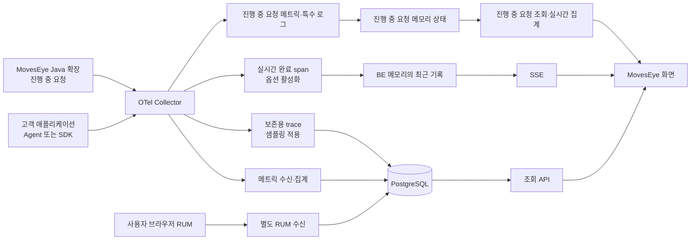

# OpenTelemetry와 MovesEye 수집 흐름

[읽기 안내](solutions--start-here.md) · 다음: [설계·구현 지도](solutions--design-implementation-map.md)

**OpenTelemetry는 관측 데이터를 만들고 전달하기 위한 표준과 도구입니다.** MovesEye는 그 데이터를 받아 저장·집계·검색하고 운영 화면과 알람으로 연결합니다. OpenTelemetry 자체가 완성된 저장·분석 화면을 제공하는 APM 제품은 아닙니다. [공식 개요](https://opentelemetry.io/docs/what-is-opentelemetry/).

## 1. 구성 요소를 배송 과정으로 이해하기

| 구성 요소 | 하는 일 | 우리 시스템에서의 위치 |
|---|---|---|
| Instrumentation, 계측 | 요청 시작·종료, SQL 호출 같은 사건을 관측 | 고객 애플리케이션 |
| API·SDK | 계측 정보를 표준 데이터로 만들고 내보냄 | 언어별 라이브러리·Agent 내부 |
| Java agent | 지원 라이브러리에 자동계측을 연결 | 고객 JVM 시작 옵션 |
| OTLP | 데이터를 주고받는 전송 규약 | Agent→Collector, Collector→BE |
| Collector | 수신·가공·필터·전송을 맡는 중계 프로세스 | 고객 환경의 수집기 |
| MovesEye BE | 인증, 정규화, 집계·저장·조회·알람 | 우리 Spring 애플리케이션 |
| MovesEye FE | 분석과 운영을 위한 화면 | 사용자 브라우저 |

배송에 비유하면 계측은 기록 작성, OTLP는 송장 형식, Collector는 분류·중계 시설입니다. MovesEye는 도착한 기록을 보관하고 활용하는 시스템입니다. 비유와 달리 Collector가 모든 데이터를 영구 보관하는 것은 아닙니다.

Collector는 receiver → processor → exporter로 파이프라인을 구성합니다. processor 순서와 파이프라인 연결이 실제 수집 범위를 결정합니다. [공식 Collector 설명](https://opentelemetry.io/docs/collector/).

## 2. 세 가지 주요 데이터

**Metrics:** 요청 수·지연 분포·메모리처럼 시간에 따라 집계하는 숫자입니다.

**Traces:** 요청 하나가 거친 작업 구간의 연결입니다. trace ID로 전체 요청을, span ID로 구간을 구분합니다.

**Logs:** 특정 시각의 사건 기록입니다. trace ID가 함께 있으면 요청과 연결할 수 있습니다. 그러나 로그를 전송할 수 있다는 사실과 MovesEye가 범용 로그 검색·보존을 제공한다는 것은 별개입니다.

우리 수신기는 수집기 자체 상태 로그와 진행 중 요청 로그 등 특정 목적을 처리합니다. 일반 애플리케이션 로그를 모두 적재·검색하는 경로로 해석하면 안 됩니다. [수신 코드](file:///C:/solutions/moveseye-be-spring/src/main/java/com/dmove/moveseye/premium/apm/collector/ingest/ApmOtlpController.java).

## 3. 우리 데이터가 실제로 지나가는 길

이는 개념도입니다. Java 확장의 메트릭·특수 로그는 각각 해당 수신·메모리 경로로 분기됩니다. RUM은 일반적인 서버 Agent 수집과 별도 경로입니다.

현재 Collector→BE의 OTLP 수신은 JSON 경로를 중심으로 구현되어 있습니다. 표준에서 지원하는 모든 전송 방식이 우리 수신기에 그대로 지원되는 것은 아닙니다. 생성 설정과 수신 Controller를 함께 확인해야 합니다.

근거: [Collector 템플릿](file:///C:/solutions/moveseye-be-spring/src/main/resources/apm/collector-template.yaml), [라이브 템플릿](file:///C:/solutions/moveseye-be-spring/src/main/resources/apm/collector-live-template.yaml), [APM 계약](../../_workspace/features/apm/core/solutions--contract_apm.md).

## 4. 이름과 단위가 맞아야 같은 데이터가 된다

`service.name`은 어떤 서비스인지, `service.instance.id`는 어떤 실행체인지 구분하는 속성입니다. Semantic Conventions는 이런 이름과 의미를 맞추기 위한 규칙입니다.

같은 “응답 시간”이라도 초와 밀리초를 섞으면 1,000배 차이가 납니다. 같은 숫자 배열의 히스토그램도 무엇을 측정한 것인지가 다를 수 있습니다. 우리 구현에서 히스토그램 경계와 `family`를 함께 구분하는 이유입니다.

Metrics는 단일 값만 있는 것이 아닙니다. Histogram은 구간별 건수를 저장해 분포를 표현합니다. 여러 인스턴스의 p95를 평균 내면 전체 p95가 되지 않습니다. 분포를 합칠 수 있는 조건을 확인한 뒤 전체 백분위를 계산해야 합니다.

## 5. Trace가 여러 서비스에서 이어지는 원리

서비스 A가 B를 호출할 때 trace 컨텍스트를 전달하고, B가 이를 읽어 자신의 span과 연결합니다. 전파가 끊기면 같은 사용자 요청이 별개의 trace로 보일 수 있습니다.

자동계측은 지원되는 프레임워크 경계를 연결하는 데 도움을 줍니다. 자체 비동기 큐나 지원되지 않는 라이브러리까지 언제나 자동으로 연결해 주는 것은 아닙니다. 필요하면 수동 계측과 컨텍스트 전달이 필요합니다. [공식 컨텍스트 전파](https://opentelemetry.io/docs/concepts/context-propagation/).

## 6. 샘플링은 왜 하는가

**Head sampling**은 요청 초기에 선택합니다. 비용을 일찍 줄일 수 있지만 이후 느려질지 알기 어렵습니다.

**Tail sampling**은 모인 trace의 결과를 보고 선택합니다. 오류·지연 요청을 우선 보존할 수 있지만 기다리는 메모리와 시간, 관련 span이 같은 판정 경로에 모이는 조건이 필요합니다. 앞단에서 이미 버린 데이터는 뒤에서 복원할 수 없습니다. [공식 Sampling 설명](https://opentelemetry.io/docs/concepts/sampling/).

MovesEye Collector의 보존용 trace 파이프라인에는 tail sampling이 있습니다. 실시간 완료 span은 별도 분기로 다룹니다. 따라서 보존용 trace의 상세가 실시간 화면의 모든 점에 대해 남는다고 약속할 수 없습니다.

## 7. 재시도와 중복 방지는 별개다

Collector가 전송 중 실패하면 큐에서 다시 보낼 수 있습니다. 저장형 큐는 재시작 시 복구 가능성을 높이지만, 디스크 부족·큐 상한·재시도 시간 초과까지 무손실을 보장하지는 않습니다. [공식 Resiliency 설명](https://opentelemetry.io/docs/collector/resiliency/).

MovesEye 생성 템플릿에는 `file_storage`와 `sending_queue`, 재시도 시간 설정이 있습니다. **BE가 받은 뒤 정확히 한 번만 더하는지는 별도의 저장 설계 문제**입니다. 현재 영수증 기록과 메트릭 저장의 분리가 남아 있어, 재시도 기능만으로 중복 집계가 해결됐다고 말할 수 없습니다.

수신 API의 상태 코드도 중요합니다. 실제 재시도 여부는 OTLP 규약과 해당 exporter 구현을 따라 확인해야 하며, “모든 5xx는 같은 방식으로 재시도한다”는 안내는 피해야 합니다. [OTLP 전송 규약](https://opentelemetry.io/docs/specs/otlp/).

## 8. 마스킹과 필터는 수집 품질의 일부다

SQL, URL, 예외 메시지에는 민감한 내용이 포함될 수 있습니다. 수집 전에 제거·마스킹하고, 서버에서 다시 허용 범위를 확인하는 이유입니다.

다만 규칙을 너무 넓게 만들면 정상 데이터도 손상됩니다. 이 프로젝트에서는 로그 JSON 안의 긴 숫자가 마스킹되어 진행 중 요청 데이터가 깨졌던 경험이 있습니다. 마스킹은 “규칙이 존재한다”뿐 아니라 정상 데이터 구조와 민감값 제거를 함께 시험해야 합니다.

관련 근거: [Java 확장 README](../../moveseye-otel-extension/solutions--README.md), [Collector 설정 해설](../../_workspace/guides/solutions--apm-collector-config-explained.md).

## 9. 설치 완료를 판단하는 순서

1. Agent·SDK가 지원 버전에서 기동하고 서비스 이름·환경이 올바른가.
2. Collector가 설정을 읽었고 수신 데이터가 실제로 들어오는가.
3. 토큰·권한·전송 형식이 맞아 BE가 수용하는가.
4. 수용한 데이터가 허용목록·서비스 등록 정책을 통과하는가.
5. 저장된 데이터의 단위·시간·서비스가 예상과 같은가.
6. 화면에서 정상·오류·빈 데이터가 올바르게 구분되는가.
7. 재시작·일시 DB 장애·큐 포화 후 결과가 누락되거나 중복되지 않는가.

실제 설치 명령은 [수집기 설치 가이드](../guides/pages/%EB%AA%A8%EB%8B%88%ED%84%B0%EB%A7%81/solutions--%EC%88%98%EC%A7%91%EA%B8%B0-%EC%84%A4%EC%B9%98.md)와 현재 화면이 생성한 설정을 사용합니다. 이 문서는 설치 명령의 새 정본을 만들지 않습니다.
