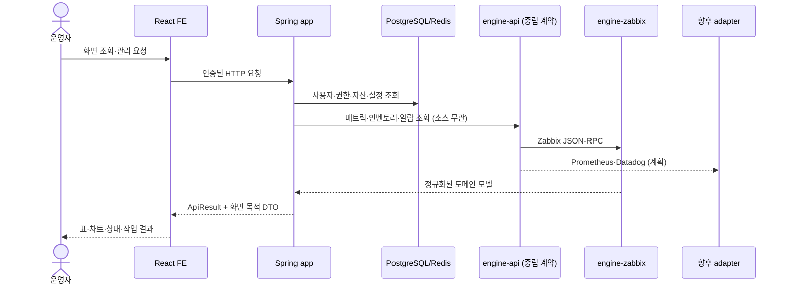

# MovesEye 제품 개요

## 1. 한 줄 정의

**MovesEye(DMOVE)는 여러 모니터링 데이터소스(Zabbix·Prometheus·Datadog·Elasticsearch)의 수집·감지 능력을 소스 중립 계약으로 정규화해, 하나의 운영 화면·자산 맥락·권한 체계로 연결하는 종합 모니터링 제품이다.**

2026-08-11 현재 **동작하는 어댑터는 Zabbix 하나**다. 나머지 소스는 계약과 레지스트리가 준비된 상태이며 어댑터 구현이 남았다. 문서에서 "다중 데이터소스"는 **완료된 구조**를 뜻하고, 개별 소스 지원 여부는 §3의 상태 표기를 따른다.

## 2. 누구의 어떤 문제를 푸는가

| 독자 | 기존 문제 | MovesEye가 제공하는 것 |
|---|---|---|
| 인프라 운영자 | 메트릭·장애·장비 정보가 여러 도구와 화면에 흩어진다 | 소스와 무관한 단일 운영 화면. 홈 요약, 호스트 그룹·서버 상세, 문제 중심 탐색 |
| 멀티툴 운영 조직 | 도구마다 콘솔·권한·용어가 달라 통합 운영이 안 된다 | capability 단위로 정규화한 공통 도메인과 통합 권한 |
| 데이터소스 관리자 | 원천 관리 화면과 운영 대시보드의 맥락이 끊긴다 | 소스별 관리 워크스페이스(Zabbix: 호스트·템플릿·아이템·트리거) |
| 자산 관리자 | 모니터링 대상과 자산·위치·비용 정보가 분리된다 | 자산 목록, 비용, 네트워크 맵, 지리 맵 |
| 조직 관리자 | 사용자별로 보여 줄 호스트 범위를 통제하기 어렵다 | Role과 User Group–Host Group 관계 기반 접근 제어 |

## 2.1 설계 철학 — 정규화이지 패스스루가 아니다

Grafana는 소스를 통합하지 않는다. 패널마다 소스별 쿼리를 쓰고 공통은 데이터 프레임 수준에 그친다. MovesEye는 **화면이 고정된 오피니언 대시보드**이므로 다른 선택을 했다.

범용 쿼리 패스스루 대신 **화면이 요구하는 능력(capability) 단위의 정규화 포트**를 세운다. 그 결과 소스가 바뀌어도 서비스 레이어와 화면은 바뀌지 않는다. 대신 소스 고유 개념(Zabbix trigger expression DSL, template link 등)은 공통화하지 않고 **전용 계약으로 분리**한다.

## 3. 기능 지도

| 영역 | 핵심 기능 | 현재 상태 |
|---|---|---|
| 홈 | 전체 상태·주요 요약 | 소스 구현·배포 미확인 |
| 모니터링 | 호스트 그룹, 서버, 네트워크, CPU·메모리·디스크·트래픽 차트 | 소스 구현·배포 미확인 |
| 이벤트·알림 | Problem 목록·상세, 호스트 그룹 기준 탐색, acknowledge/read 상태 | 소스 구현·배포 미확인 |
| 소스 전용 관리(Zabbix) | 연결 정보, 호스트·템플릿·아이템·트리거·사용자 관리. `ZABBIX_ADMIN` capability 보유 소스에서만 노출 | 소스 구현·배포 미확인 |
| 자산 | 소스 연동 자산+custom 자산, 활동 이력, 복원·동기화 | 소스 구현·배포 미확인 |
| 비용 | HW 비용, 감가상각, CSV 일괄 업로드, 대시보드 | 소스 구현·배포 미확인 |
| 맵 | 네트워크 구성도, 지리 cluster와 호스트 좌표 | 소스 구현·배포 미확인 |
| 클라우드 | AWS region·VPC·EC2 정보 | 소스 구현·배포 미확인 |
| 데이터소스 관리 | 소스 등록·연결 상태·소스별 관리 워크스페이스 | FE 카탈로그·화면 골격 존재(4종 정의), BE 다중 소스 등록은 Phase 2 |
| Application·Database·GPU | route 골격 또는 edition 후보 | 계획/부분 — 런타임 검증 전 제공 기능으로 약속하지 않음 |
| 로그 도메인 | Elasticsearch 기반 로그 화면 | 계획 — 메트릭 소스가 아닌 신규 도메인. 별도 설계 예정 |
| 다중 데이터소스 | 중립 port + Zabbix adapter | **Phase 1 완료**(포트 3종·의존 차단), Prometheus adapter 보류 |

### 3.1 데이터소스별 상태

| 소스 | 어댑터 | 비고 |
|---|---|---|
| **Zabbix** | ✅ 구현 | 메트릭·인벤토리·알람 + 전용 관리(ZABBIX_ADMIN) |
| **Prometheus** | ⬜ 계획 | 스텝 6. 추상화 실검증 대상이자 Phase 2 진입점 |
| **Datadog** | ⬜ 계획 | Phase 3 |
| **Elasticsearch** | ⬜ 계획 | 메트릭이 아니라 로그 도메인으로 편입 |

FE `constants/dataSources.ts`에는 4종 카탈로그와 소스별 워크스페이스 모듈이 이미 정의돼 있다. **카탈로그 존재는 어댑터 구현을 뜻하지 않는다** — 문서에서 이 둘을 섞지 않는다.

`소스 구현·배포 미확인`은 **2026-08-05 code 기준선에 구현 경로가 존재한다는 뜻**이다. 특정 고객 운영 환경의 배포·권한·데이터 검증을 대신하지 않는다. 실제 제공 상태는 해당 환경의 릴리스 기준선과 QA evidence로 다시 확인한다. 기능별 상세 문서가 아직 없는 영역은 [문서 인벤토리](../reference/solutions--%EB%AC%B8%EC%84%9C-%EC%9D%B8%EB%B2%A4%ED%86%A0%EB%A6%AC.md)의 승격 대기 항목이다.

## 4. 제품 경계

MovesEye는 **수집기를 대체하지 않는다.** 각 데이터소스(Zabbix Server/Agent, Prometheus, Datadog, Elasticsearch)가 메트릭 수집과 이상 판정의 원천이고, MovesEye는 다음을 담당한다.

- 소스의 조회 결과를 중립 계약으로 정규화해 화면 목적에 맞게 가공한다.
- 사용자·Role·Host Group 권한과 제품 설정을 관리한다.
- 자산·비용·맵처럼 어떤 수집기도 담당하지 않는 업무 맥락을 저장한다.
- 소스가 여럿이어도 같은 상태를 일관된 UX와 용어로 제공한다.
- 소스가 선언한 capability에 따라 기능 노출을 조정한다.

**공통화하지 않는 것도 경계다.** 소스 고유 개념(Zabbix의 trigger expression DSL·template link 등)은 중립 포트로 끌어올리지 않는다. 억지로 공통화하면 어느 소스에서도 정확하지 않은 계약이 된다. 이런 기능은 해당 소스가 연결됐을 때만 켜지는 전용 기능으로 둔다.

## 5. 데이터 흐름

서비스 레이어는 어느 소스가 응답했는지 알지 못한다. 소스 선택과 토큰 관리는 어댑터 내부 책임이다.

## 6. 기술 기준선

- FE: React 19, Vite, TypeScript, Ant Design 5, TanStack Query, Redux Toolkit, ECharts, MapLibre/Mapbox.
- BE: Spring Boot 3.3.5, Java 17, Gradle Kotlin DSL, Spring MVC/Security/Data JPA, Flyway, Redis.
- 수집 엔진: `engine-api` 계약 모듈(Spring-free) + 소스별 어댑터 모듈. 현재 `engine-zabbix` 1종. `app`의 어댑터 직접 compile 의존은 차단된다.
- 중립 포트: `MetricPort`·`InventoryPort`·`AlertPort` 3종. capability는 `METRICS`·`INVENTORY`·`ALERTS`·`ALERT_ACK`·`LOGS`·`ZABBIX_ADMIN` 6종.
- 계약은 proto 호환으로 설계돼 있다 — 수집기를 별도 서버(gRPC)로 물리 분리할 때의 비용을 미리 지불한 것이며, 분리 자체는 조건 성립 시로 유예됐다.
- 외부 연동: Zabbix JSON-RPC, AWS API, SMTP 등. Prometheus·Datadog·Elasticsearch는 계획.
- API 문서: 운영 기본 비노출. dev profile에서 Springdoc을 활성화해 `/api`로 확인한다.

## 7. 핵심 운영 원칙

1. 모니터링 원천 값의 정본은 해당 데이터소스다(현재 Zabbix). AWS Cloud 영역은 AWS API/CloudWatch를 원천으로 한다. MovesEye는 원천 값을 재해석하거나 임의로 보정하지 않는다.
2. 자산의 편집 가능한 보강 정보와 Zabbix 원천 필드는 소유권을 구분한다.
3. 지도 좌표는 Zabbix inventory를 원천으로 사용한다.
4. DB schema는 Flyway migration만으로 변경한다. JPA `ddl-auto`는 `none`이다.
5. 새 모니터링 읽기는 `engine-api` port를 거치고 Zabbix adapter를 직접 참조하지 않는다. **빌드가 이를 강제한다** — `app`은 `engine-zabbix`에 컴파일 의존할 수 없다.
6. 소스 공통화가 불가능한 개념은 중립 포트로 올리지 않고 전용 계약으로 둔다. 판단 기준은 "그 값이 답하는 질문이 소스 중립적인가"다.
7. 현재 기능과 edition·roadmap 후보를 문서에서 분리한다. 카탈로그·route 존재를 구현 완료로 표기하지 않는다.

## 8. 다음 문서

- 처음 써 보기: [빠른 시작](../guides/solutions--%EB%B9%A0%EB%A5%B8-%EC%8B%9C%EC%9E%91.md)
- 메뉴와 작업: [사용자 가이드](../guides/solutions--%EC%82%AC%EC%9A%A9%EC%9E%90-%EA%B0%80%EC%9D%B4%EB%93%9C.md)
- 시스템 경계: [아키텍처](../technical/solutions--%EC%95%84%ED%82%A4%ED%85%8D%EC%B2%98.md)
- 정확한 용어: [용어집](../reference/solutions--%EC%9A%A9%EC%96%B4%EC%A7%91.md)

## 변경 이력

| 날짜 | 변경 |
|---|---|
| 2026-08-05 | 코드·route·수집 엔진 Phase 1 기준으로 최초 작성 |
| 2026-08-11 | 다중 데이터소스 제품으로 포지셔닝 갱신 — 한 줄 정의, 설계 철학(정규화 vs 패스스루), 소스별 상태표, 제품 경계의 "공통화하지 않는 것", 원칙 6·7 추가 |
