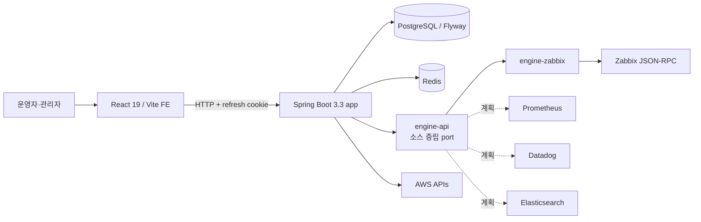

# MovesEye 문서 허브

> **최근 작업과 APM을 처음 이해하려면 [여기서 시작하세요](overview/solutions--start-here.md).** 최근 작업 설명 → APM → OpenTelemetry → 설계·구현 지도 → 부족점 분석 순서로 읽을 수 있습니다. **2026-10-05 소스 대조 기준**이며, 아래 기존 허브의 8월 기준선·구조도와 구분합니다. 현재 APM 상태와 미완료 과제는 새 안내 묶음을 먼저 확인하세요.

> **기능이 내부에서 어떻게 동작하는지, 무엇이 문제인지 알려면 [기능별 상세 가이드](guides/features/solutions--README.md)를 보세요.** 제품 전체를 13개 영역으로 나눠 사용법·동작 원리·문제점과 보완점을 정리했고, 전 영역 요약은 [전 제품 문제점·보완점 종합 리포트](overview/solutions--product-gap-report.md)에 있습니다. **2026-10-06 소스 정적 대조 기준**이며 런타임 검증은 포함하지 않습니다.

MovesEye(DMOVE)는 여러 모니터링 데이터소스(Zabbix·Prometheus·Datadog·Elasticsearch)를 소스 중립 계약으로 정규화해, 서버·네트워크·클라우드 자원의 상태·장애·자산·비용을 하나의 운영 화면에서 관리하는 **종합 모니터링 제품**이다. 2026-08-11 현재 동작하는 어댑터는 **Zabbix 하나**이며, 나머지는 계약이 준비된 계획 상태다.

이 디렉터리는 제품 설명부터 운영·개발 기준까지 연결하는 **서술 문서 정본(SSOT)** 이다. REST·schema·route 같은 기계적 사실은 코드와 생성 계약이 더 높은 우선순위를 가진다.

## 처음 보는 사람의 읽기 순서

| 독자 | 먼저 읽기 | 다음 문서 |
|---|---|---|
| 고객·도입 검토자 | [제품 소개서](product/solutions--%EC%A0%9C%ED%92%88-%EC%86%8C%EA%B0%9C%EC%84%9C.md) | [자주 묻는 질문](guides/solutions--%EC%9E%90%EC%A3%BC-%EB%AC%BB%EB%8A%94-%EC%A7%88%EB%AC%B8.md), [제품 개요](product/solutions--%EC%A0%9C%ED%92%88-%EA%B0%9C%EC%9A%94.md), [용어집](reference/solutions--%EC%9A%A9%EC%96%B4%EC%A7%91.md) |
| 반복 문의에 답해야 하는 지원 담당자 | [자주 묻는 질문](guides/solutions--%EC%9E%90%EC%A3%BC-%EB%AC%BB%EB%8A%94-%EC%A7%88%EB%AC%B8.md) | [문제 해결](guides/solutions--%EB%AC%B8%EC%A0%9C-%ED%95%B4%EA%B2%B0.md) |
| 신규 입사자 | [제품 개요](product/solutions--%EC%A0%9C%ED%92%88-%EA%B0%9C%EC%9A%94.md) | [용어집](reference/solutions--%EC%9A%A9%EC%96%B4%EC%A7%91.md) |
| 일반 사용자 | [빠른 시작](guides/solutions--%EB%B9%A0%EB%A5%B8-%EC%8B%9C%EC%9E%91.md) | [사용자 가이드](guides/solutions--%EC%82%AC%EC%9A%A9%EC%9E%90-%EA%B0%80%EC%9D%B4%EB%93%9C.md), [화면별 가이드](guides/pages/solutions--README.md), [문제 해결](guides/solutions--%EB%AC%B8%EC%A0%9C-%ED%95%B4%EA%B2%B0.md) |
| 특정 화면 사용법을 찾는 사람 | [화면별 가이드 색인](guides/pages/solutions--README.md) | 사이드바 메뉴 그대로 찾는다 |
| 시스템 관리자 | [관리자 가이드](guides/solutions--%EA%B4%80%EB%A6%AC%EC%9E%90-%EA%B0%80%EC%9D%B4%EB%93%9C.md) | [설치·배포 가이드](operations/solutions--%EC%84%A4%EC%B9%98-%EB%B0%B0%ED%8F%AC-%EA%B0%80%EC%9D%B4%EB%93%9C.md), [문제 해결](guides/solutions--%EB%AC%B8%EC%A0%9C-%ED%95%B4%EA%B2%B0.md) |
| 설치 담당자 | [설치·배포 가이드](operations/solutions--%EC%84%A4%EC%B9%98-%EB%B0%B0%ED%8F%AC-%EA%B0%80%EC%9D%B4%EB%93%9C.md) | [관리자 가이드](guides/solutions--%EA%B4%80%EB%A6%AC%EC%9E%90-%EA%B0%80%EC%9D%B4%EB%93%9C.md) |
| 개발 운영자·검증 담당자 | [로컬·검증 Runbook](operations/solutions--%EC%9A%B4%EC%98%81%EC%9E%90-%EB%9F%B0%EB%B6%81.md) | [아키텍처](technical/solutions--%EC%95%84%ED%82%A4%ED%85%8D%EC%B2%98.md), [데이터 모델](technical/solutions--%EB%8D%B0%EC%9D%B4%ED%84%B0-%EB%AA%A8%EB%8D%B8.md) |
| Production 운영 책임자 | [Production Runbook draft](operations/solutions--%ED%94%84%EB%A1%9C%EB%8D%95%EC%85%98-%EB%9F%B0%EB%B6%81.md) | [Credential 정책 draft](operations/solutions--%EC%8B%9C%ED%81%AC%EB%A6%BF-%EB%B3%B4%ED%98%B8-%EC%A0%95%EC%B1%85.md) — 둘 다 current 승격 전 실행 금지 |
| 개발자 | `C:\solutions\moveseye_개발자_온보딩.md` | [API 카탈로그](technical/solutions--API-%EC%B9%B4%ED%83%88%EB%A1%9C%EA%B7%B8.md), [아키텍처](technical/solutions--%EC%95%84%ED%82%A4%ED%85%8D%EC%B2%98.md), [문서 운영 규칙](solutions--%EB%AC%B8%EC%84%9C-%EC%9A%B4%EC%98%81%EA%B7%9C%EC%B9%99.md) |
| 연동 개발자 | [API 카탈로그](technical/solutions--API-%EC%B9%B4%ED%83%88%EB%A1%9C%EA%B7%B8.md) | [아키텍처](technical/solutions--%EC%95%84%ED%82%A4%ED%85%8D%EC%B2%98.md) |
| 기능 담당자 | [기능 문서 목록](features/solutions--README.md) | [기능 문서 템플릿](templates/solutions--%EA%B8%B0%EB%8A%A5-%EB%AC%B8%EC%84%9C-%ED%85%9C%ED%94%8C%EB%A6%BF.md) |
| 기능의 동작 원리·한계를 알아야 하는 기획·개발·QA·지원 | [기능별 상세 가이드](guides/features/solutions--README.md) | [전 제품 문제점·보완점 종합 리포트](overview/solutions--product-gap-report.md) |

## 문서 지도

```text
moveseye-docs/
├── product/       제품 정의·도입 설명
├── guides/        사용자가 목표를 달성하는 절차 (pages/ 화면별, features/ 기능 영역별 상세)
├── overview/      최근 작업·APM 읽기 안내, 부족점·문제점 종합 리포트
├── technical/     아키텍처·데이터·계약의 현재 기준선
├── operations/    기동·점검·장애 대응 Runbook
├── features/      기능별 설계→계약→운영 연결 문서
├── decisions/     채택된 ADR(Architecture Decision Record)
├── reference/     용어집·문서 인벤토리처럼 반복 참조하는 정보
├── releases/      배포 기준 변경 이력
└── templates/     새 문서를 만들 때 복사하는 표준 형식
```

전체 상태와 다음 작성 순서는 [문서 인벤토리](reference/solutions--%EB%AC%B8%EC%84%9C-%EC%9D%B8%EB%B2%A4%ED%86%A0%EB%A6%AC.md)에서 관리한다.

> 기준선 주의: 위 commit은 문서 작성 시 확인한 HEAD다. BE에는 사용자 소유의 미커밋 변경이 있었고, 이 문서 세트는 실제 배포 환경을 검증하지 않았다. 따라서 capability 표의 “소스 구현”은 “배포됨”을 뜻하지 않는다.

## 시스템 한눈에 보기



백엔드 `app`은 `engine-api`만 compile 의존하고 어댑터는 runtimeOnly로 연결한다 — **빌드가 이 경계를 강제한다.** 새 모니터링 읽기 기능은 특정 소스 구현을 직접 호출하지 않고 capability port를 거치므로, 소스를 추가해도 서비스 레이어와 화면은 바뀌지 않는다.

## 무엇이 정본인가

| 정보 | 정본 | 이 문서 세트의 역할 |
|---|---|---|
| REST 경로·요청·응답 | Spring Controller/DTO + dev OpenAPI | 사람이 이해할 수 있게 흐름과 예외를 설명 |
| FE route·navigation | `moveseyee_fe/src/routes/routes.tsx`, `SideNav.tsx` | 사용자 목표 기준으로 묶어 설명 |
| FE 화면의 실제 내용 | `moveseyee_fe/src/pages/`, `src/components/` | 안정된 사용자 동작을 설명 |
| DB schema | `moveseye-be-spring/src/main/resources/db/migration/` | 테이블의 책임·관계를 설명 |
| 수집 엔진 경계 | `engine-api` public type + module build dependency | 중립 계약과 Zabbix 전용 계약의 경계를 설명 |
| 진행 중 기능 계약 | `C:\solutions\_workspace\contract_*.md` | 완료 후 stable 문서로 승격 |
| 결정·교훈·타임라인 | Obsidian `claude-experiences/projects/moveseye/` | 최종 문서의 배경과 변경 이유를 보존 |
| 에이전트·협업 규칙 | `C:\solutions\AGENTS.md`, `COLLAB.md` | 문서와 코드를 수정하는 절차를 통제 |

코드와 문서가 충돌하면 코드를 확인하되, 충돌을 그대로 방치하지 말고 같은 변경에서 문서를 동기화한다.

## 기존 문서와의 관계

- `C:\solutions\제품소개_신규입사자.md`: 기존 상세 제품 온보딩. 제품 개요의 보조 자료로 유지한다.
- `C:\solutions\moveseye_개발자_온보딩.md`: 개발자 입문 정본. 이 허브의 기술 문서와 함께 읽는다.
- 각 코드 저장소의 `README.md`, `AGENTS.md`, `CLAUDE.md`: 해당 저장소의 빌드·코딩 규칙 정본이다.
- `C:\solutions\_workspace\`: 설계·계약·QA 증거를 기능별로 누적하는 작업 공간이며, 완성 문서의 영구 위치가 아니다.

## 문서를 바꾸는 최소 절차

1. [문서 운영 규칙](solutions--%EB%AC%B8%EC%84%9C-%EC%9A%B4%EC%98%81%EA%B7%9C%EC%B9%99.md)에서 문서 유형과 정본을 확인한다.
2. 코드·OpenAPI·migration·route 중 관련 사실 원천을 교차 확인한다.
3. 문서의 `baseline`, `reviewed_at`, 변경 이력을 갱신한다.
4. 상대 문서 링크와 [문서 인벤토리](reference/solutions--%EB%AC%B8%EC%84%9C-%EC%9D%B8%EB%B2%A4%ED%86%A0%EB%A6%AC.md)를 확인한다.
5. 결정이나 재사용할 교훈이 생겼으면 Obsidian MOC에 연결한다.
