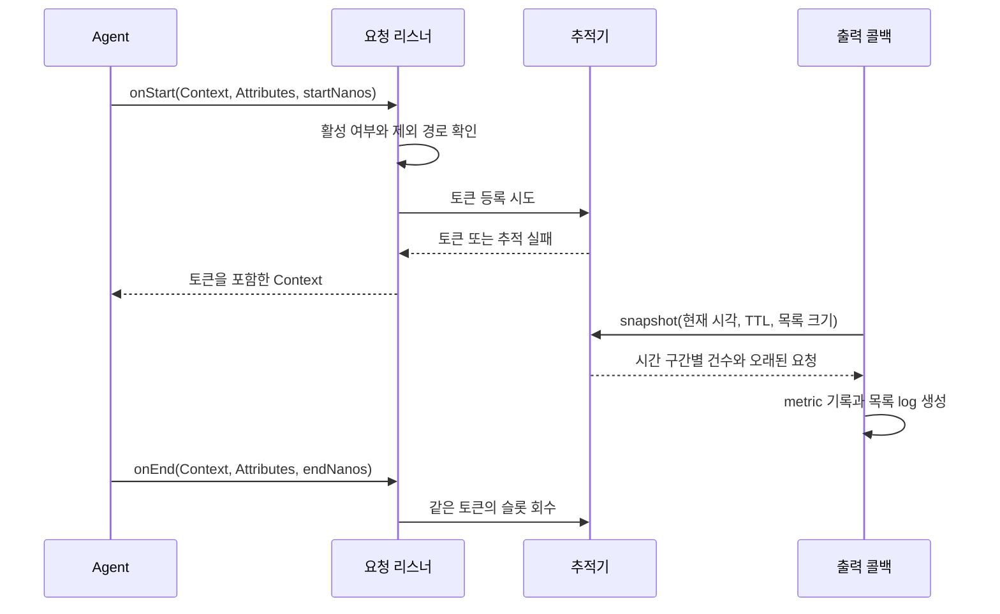

# 설계 문서

[프로젝트 소개](../worktrees--README.md) · [개발 가이드](worktrees--development.md)

이 문서는 확장 버전 `0.3.0`에서도 유지되는 ActiveRequest 구조를 설명합니다. 대상은 확장을 유지보수하거나 수신 시스템을 연동하는 개발자입니다.

`0.3.0`의 선택형 Hikari 획득 진단은 ActiveRequest와 별도의 HTTP_SERVER Context token을 사용합니다.
`diagnostics` 패키지가 요청별 최대 16개 구간과 summary를 기존 trace exporter로 보내며, `moveseye.process.run_id` resource는 모든 신호에 공통으로 적용합니다.
Agent 2.31.1의 모듈별 `ISOLATED` helper SPI와 상위 ExtensionClassLoader 연결을 실제 JVM에서 검증했습니다.
설정·설치·해제·지원 범위는 [README](../worktrees--README.md)의 APM 심층 진단 항목을 참조하십시오. 장시간 안정성 및 성능 게이트는 아직 수행하지 않았습니다.

## 1. 목적과 범위

일반적인 완료 스팬 전송만으로는 아직 끝나지 않은 HTTP 요청을 즉시 확인하기 어렵습니다.
이 확장은 HTTP 서버 계측의 시작·종료 콜백을 이용하여 진행 중 요청을 별도로 관리합니다.

제공하는 정보는 경과 시간별 요청 수, 가장 오래된 요청 목록, 요청 유입·완료 건수와 현재 하위 작업입니다.
확장은 고객 애플리케이션과 같은 JVM에서 실행되며, 별도 수신 포트나 HTTP API를 열지 않습니다.
Collector, 저장소, 대시보드 및 경보 정책은 이 프로젝트의 구현 범위 밖입니다.

## 2. 구성 요소

코드 의존성은 `instrumentation → tracking ← export`입니다. 그림의 화살표는 데이터 흐름입니다.

| 패키지 | 책임 | 주요 타입 |
|---|---|---|
| `instrumentation` | OTel 계측에 리스너를 연결하고 시작·종료를 처리 | `MovesEyeInstrumenterCustomizerProvider`, `ActiveRequestOperationMetrics`, `ActiveRequestChildOperationMetrics` |
| `tracking` | 설정, 추적 토큰, 용량 제한, 만료 및 스냅샷 | `ActiveRequestState`, `ActiveRequestTracker`, `ActiveRequestSnapshot`, `ExtensionDiagnostics` |
| `export` | 지표 등록, 출력 주기, 목록 JSON과 마스킹 | `ActiveRequestMetricsAgentListener`, `DedicatedActiveRequestMeter`, `ActiveRequestListBody`, `ChildOperationDescription`, `PathMasker` |

`tracking`은 OTel 타입을 직접 참조하지 않습니다. 하위 작업 속성은 불투명한 `Object` 참조로 보관하고,
`export`에서 OTel `Attributes`로 해석합니다. 패키지 간 공개 메서드는 확장 내부 연동용입니다.

## 3. Agent 연결과 초기화

`src/main/resources/META-INF/services/`에 두 진입점을 등록합니다.

| SPI | 구현 클래스 |
|---|---|
| `InstrumenterCustomizerProvider` | `com.dmove.moveseye.otel.active.instrumentation.MovesEyeInstrumenterCustomizerProvider` |
| `AgentListener` | `com.dmove.moveseye.otel.active.export.ActiveRequestMetricsAgentListener` |

Customizer는 계측 이름을 추측하지 않고 `InstrumentationType`으로 유형을 판단합니다.
`HTTP_SERVER`에는 요청 추적 리스너를 등록합니다. 상세 목록이 활성화되어 있을 때만
`DB_CLIENT`, `HTTP_CLIENT`, `RPC_CLIENT`에 하위 작업 리스너를 등록합니다.

Agent 초기화 후 `afterAgent`가 전달받은 SDK를 이용해 metric과 목록 출력을 등록합니다.
등록이 끝나면 `metricsReady`를 설정하고 요청 추적을 활성화합니다.
진단용 `output`이 있으면 출력 등록 전이나 지표 비활성 상태에서도 건수 추적을 수행할 수 있습니다.

목록 크기는 `ActiveRequestState` 생성 시 확정하며 요청 수집과 출력에서 같은 값을 사용합니다.
클라이언트 계측이 먼저 생성되면 공유 상태와 추적 배열도 그 시점에 초기화될 수 있습니다.
설정 변경에는 JVM 재시작이 필요합니다.

## 4. 요청 수명주기

### 시작

1. 추적이 비활성이면 입력 `Context`를 그대로 반환합니다.
2. `url.path`, 없으면 `http.target`으로 제외 경로를 판정합니다. 제외 요청에는 전용 표시 토큰을 달고 유입·완료 집계에서 뺍니다.
3. 유입 건수를 늘리고 고정 배열의 빈 슬롯을 찾습니다.
4. 상세 목록이 켜져 있으면 메서드·경로·trace/span ID를 토큰 생성 전에 채웁니다. 꺼져 있으면 시작 `nanoTime`만으로 추적합니다.
5. 슬롯 확보에 실패하면 `droppedStarts`를 늘립니다. 애플리케이션의 요청 처리는 계속됩니다.
6. 슬롯 확보 후 `Context` 연결이 실패하면 슬롯을 회수합니다.

요청·응답 객체와 스레드는 보관하지 않습니다. 토큰은 OTel `Context`를 따라 전달되므로 비동기 처리에서
스레드가 바뀌어도 해당 Context가 전파되면 종료 요청을 찾을 수 있습니다.

### 종료

응답 상태 코드가 없거나 500 이상이면 `error`, 그 외에는 경과 시간이 느림 기준 이상이면 `slow`, 나머지는 `ok`입니다.
오류 분류가 느림보다 우선합니다. 기본 느림 기준은 2초입니다.

추적하지 못한 요청도 종료 건수에 포함합니다. 다만 시작 시각이 없으므로 그 요청의 느림 여부는 판정할 수 없습니다.
이미 TTL로 회수된 토큰의 늦은 종료도 새 요청의 슬롯을 지우지 않으며, 완료 흐름 집계는 수행합니다.

### TTL

집계 과정에서 기본 10분을 초과한 토큰을 회수합니다. TTL은 실제 요청 취소나 완료를 의미하지 않습니다.
주기 집계가 중지되거나 지연되면 TTL 회수도 다음 집계까지 늦어질 수 있습니다.

## 5. 자료구조와 동시성

`ActiveRequestTracker`는 고정 크기 `AtomicReferenceArray<Token>`을 사용합니다.
기본 용량은 10,000, 설정 최대치는 200,000입니다.

- 시작 위치를 무작위로 분산하고 가까운 64칸을 먼저 탐색합니다.
- 빈칸이 없으면 필요할 때 나머지 배열도 탐색합니다.
- 전체 탐색 실패 후 1ms 동안은 가까운 칸만 살펴 포화 시 비용을 제한합니다.
- 토큰을 완성한 뒤 CAS로 공개하고, 종료·만료도 같은 토큰 객체일 때만 CAS로 슬롯을 비웁니다.
- 토큰은 재사용하지 않습니다. 객체 동일성을 보장해야 늦은 종료가 새 요청을 제거하는 문제를 막을 수 있습니다.

배열 크기가 추적 상한이므로 별도의 점유 카운터와 실제 데이터가 어긋나는 문제를 피합니다.
스냅샷은 배열을 한 번 순회하여 분포와 가장 오래된 요청을 함께 계산합니다. 상위 N건은 작은 우선순위 큐로 선별합니다.
전체 집계 비용은 배열 용량에 비례하며, 목록 선별에는 활성 요청 수와 N에 따른 추가 비용이 듭니다.

순회 중에도 요청이 시작·종료되므로 스냅샷은 단일 시점의 원자적 상태가 아닙니다.
진행 중 총수는 같은 순회에서 계산한 다섯 구간의 합입니다.

## 6. 지표와 목록 전송

정확한 metric 이름, 속성값, 본문 필드는 [README의 출력 데이터](../worktrees--README.md#출력-데이터)를 참조합니다.

### 지표

하나의 batch callback에서 스냅샷을 만들고 다음 정보를 기록합니다.

- 100ms 미만 / 100~500ms / 500ms~1초 / 1~5초 / 5초 이상 요청 수
- 가장 오래된 요청의 경과 시간과 추적 상한
- 직전 집계 이후 유입·종료·추적 실패·TTL 만료 건수

`*_recent`는 누계의 차분을 gauge로 기록합니다. 차분 기준은 수집 콜백에서 갱신되며 전송 성공 확인과 연결되어 있지 않습니다.
최종적으로 유실된 전송 구간의 건수는 확장이 다음 구간에 복원하지 않습니다.

### 전송 경로

실시간 지표용 `SdkMeterProvider`를 별도로 만들어 기본 1초 주기로 전송합니다.
Agent의 Resource와 exporter 설정을 읽고 같은 공급자로 새 exporter를 생성합니다.
기존 Agent exporter 인스턴스를 공유하지 않아 종료 처리의 간섭을 피합니다.

구성 정보는 SDK 내부 메서드에 reflection으로 접근하여 읽습니다. 전용 경로를 만들 수 없으면 Agent 기본 meter로 돌아갑니다.
현재 전용 경로는 설정 목록의 첫 metric exporter만 사용합니다. 여러 exporter에 동일하게 전송해야 하는 환경은 별도 검증이 필요합니다.

### 상세 목록

오래된 요청을 기본 30건, 최대 100건 선별하고 `moveseye.kind=active_requests` 로그 한 건에 담습니다.
로그 타임스탬프와 경과 시간을 전달하며 요청별 시작 epoch 시각은 보관하거나 출력하지 않습니다.
목록은 metric 집계 시 생성하지만 실제 전송은 Agent 로그 파이프라인을 따르므로 도착 시각이 같다고 보장하지 않습니다.

`moveseye.total`과 실제 본문 항목 수는 다를 수 있습니다. 목록 수 제한과 본문 길이 제한을 고려해야 합니다.
본문 길이는 문자 수로 제한하며, 구현은 마지막 닫는 대괄호를 덧붙이기 전에 약 64K자 예산을 검사합니다. 바이트 제한이 아닙니다.

## 7. 상세 정보 수집과 마스킹

| 설정 | 건수·경과 시간 | 상세 정보·하위 작업 |
|---|---|---|
| 기본 설정 | 출력 등록 후 추적 | 수집 |
| `list.size=0` | 추적 | 수집 생략 |
| `metrics.enabled=false`, `output` 지정 | 진단용 추적 | 수집 생략 |
| `metrics.enabled=false`, `output` 미지정 | 비활성 | 비활성 |

경로는 숫자로만 된 구간, 긴 hex 및 UUID 모양 구간을 `{id}`로 바꾸고 쿼리스트링을 제거합니다.
입력은 512자까지 처리하며 출력 경로는 약 120자로 제한합니다. 모든 개인정보를 탐지하는 마스킹은 아닙니다.

하위 작업 속성은 요청당 하나의 불변 `Op` 객체로 보관합니다. SQL은 Agent가 리터럴을 가렸다는 전제 아래
출력 길이와 줄바꿈을 정리합니다. 외부 HTTP는 호스트와 가린 경로를 표시합니다.
문자열 가공은 요청 경로가 아닌 목록 출력 단계에서 상위 N건에만 수행합니다.

## 8. 설계 결정

| 결정 | 이유 | 비용 또는 제약 |
|---|---|---|
| 고정 배열 | 용량을 명확히 제한하고 요청 간 공유 카운터 경합 감소 | 사용량이 적어도 전체 용량 순회 |
| Context 토큰 | 비동기 요청의 스레드 변경에 대응 | Context 전파가 필요 |
| 목록은 로그로 전송 | 요청 ID별 metric 시계열 증가 방지 | logs 수신 경로도 필요 |
| 전용 metric 주기 | 다른 JVM 지표의 전송 빈도 유지 | 별도 reader/exporter와 내부 SDK 접근 필요 |
| 상세 수집 선택 | 목록을 쓰지 않는 환경에서 조회·객체 생성 생략 | 목록을 다시 켜려면 재시작 |
| 실패 격리 | 관측 코드의 실패가 업무 요청으로 전파되는 것을 줄임 | 일부 관측 데이터는 누락될 수 있음 |

## 9. 알려진 제한과 후속 검증

- 포화 시 탐색 제한으로 멀리 빈칸이 있어도 추적을 포기할 수 있습니다. 여러 스레드가 백오프 종료 시 동시에 전체 탐색을 수행할 수도 있습니다.
- 하위 작업은 하나만 표시합니다. 중첩 작업 종료 후 바깥 작업을 복원하지 않으며, `clearOperation`의 비교·대입은 원자적이지 않아 병렬 작업 표시가 누락될 수 있습니다.
- 추적 누락과 TTL, 집계 시점 차이 때문에 유입에서 완료를 뺀 값이 진행 중 요청 수와 항상 일치하지는 않습니다.
- `metricsReady`는 출력 등록 여부입니다. 실제 수신 성공이나 Collector 상태를 보장하지 않습니다.
- 정적 Java Agent와 같은 JVM 수명을 전제합니다. 실행 중 확장 클래스 로더의 교체·언로드는 지원하지 않습니다.
- Agent 버전 변경 시 SPI, reflection, Resource 일치, metrics/logs 전송을 함께 검증해야 합니다.

실제 서비스 부하에서의 CPU·p99 영향과 수신 시스템까지의 데이터 도착 여부는 단위 테스트와 구분하여 확인합니다.
