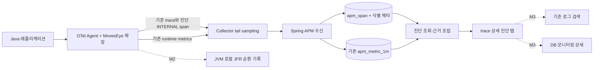

# APM 심층 진단 설계

- 작성: 2026-10-28 · Codex
- 상태: **설계 v0.2 / 2026-10-28 격리 worktree 구현·검증 완료 / master 미병합·미배포**
- 요청: APM 심층 진단 개선 방향을 설계한다. 이후 사용자의 별도 구현 지시에 따라 R0~M1b를 격리 worktree에서 구현했다. M2~M4 재개나 master 병합·배포를 뜻하지 않는다.
- 독자: 제품 담당자, Java 확장·BE·FE 구현자, 검수자
- 기준 소스: BE `df1b39f`, FE `edf667c`, Java 확장 `5c87950`(0.2.0). 읽기 시작 이후 BE의 행위자 이름 보완 커밋이 추가되어 이 기준으로 기록했다.
- 선행 평가: [2026-10-28 기능 평가](../full-review-20261028/review_apm-functional-assessment-20261028.md)
- 구현 계약·검증: [API 계약](contract_apm-deep-diagnostics.md), [BE 보고](report_be-apm-deep-diagnostics.md), [Java 확장 보고](report_otel-apm-deep-diagnostics.md), [정적 QA](qa_apm-deep-diagnostics-contract.md), [E2E](e2e_apm-deep-diagnostics.md)
- 관련 정본: [Java 확장 설계](../../../../moveseye-otel-extension/docs/design.md), [DBM 설계](../../premium/db-monitoring/devdesign_db-monitoring.md), [DBM 진행 기록](../../premium/db-monitoring/report_zm172-progress_2026-10-26.md)

## 1. 목표와 사용 결과

느린 요청에서 **어느 작업에 시간을 썼는지, 그때 실행 환경이 어땠는지, 다음에 어떤 증거를 확인할지**를 한 화면에서 조사한다. 직접 측정한 사실과 시간상 함께 나타난 현상을 구분한다.

첫 제품 결과는 trace 상세의 **진단 탭**이다. 예를 들어 다음처럼 표시한다.

> 이 요청에서 커넥션 획득에 1.8초가 관측됐습니다. 같은 인스턴스의 주변 1분 구간에서 풀 대기 요청이 증가했습니다. 풀 고갈 가능성을 확인하세요. SQL 실행 시간과 커넥션 획득 시간은 별도입니다.

직접 측정하지 않은 CPU 시간, 락 소유자, 정확한 DB 세션을 추론으로 채우지 않는다. 자료가 없으면 이유와 다음 확인 경로를 제공한다. 성공 기준은 그래프 수가 아니라 **풀 획득 지연·SQL 실행 지연·외부 호출 지연을 서로 다른 증거로 구별하는 것**이다.

## 2. 현재 구현에서 확인한 사실

| 사실 | 설계에 주는 제약 | 코드 근거 |
|---|---|---|
| JVM CPU·GC·스레드 수·풀 used/idle/pending/max/획득 시간 p95 슬롯이 있다 | 주변 환경 지표를 처음부터 모두 새로 수집할 필요는 없다 | `RuntimeSlotMap.java:290` 이후, `ApmMetricAllowlist.java:272` 이후 |
| 런타임 API는 service 범위이며 인스턴스를 합친다 | 기존 응답을 trace의 특정 JVM 상태로 표시하면 안 된다 | `ApmSeriesQueryService.runtime`, `ApmMetricStore.dimensionSeries` |
| `apm_metric_1m`만 `instance_id`를 가진다. 5m·1h에는 없다 | 진단용 인스턴스 문맥은 1m 원본이 있는 기간만 제공한다 | `V38__apm_p1.sql`, `ApmMetricStore.SeriesFilter` |
| 현재 metric 원본에도 프로세스 시작별 run 키가 없다 | 같은 인스턴스 이름의 재시작을 확실히 분리하지 못한다 | `apm_metric_1m` PK |
| trace 수신 resolver는 `instanceId`를 반환하지만 `apm_span`에는 정형 instance/run 열이 없다 | 수신 시 resource의 동일 식별을 보존하는 변경이 필요하다 | `ApmServiceResolver.ServiceRef`, `TraceIngestPipeline`, `V44__apm_trace.sql` |
| Java 확장은 OTel Context 토큰을 사용하며 Thread 객체를 보관하지 않는다 | 시작 thread 하나로 async 요청 전체를 귀속하지 않는다 | `ActiveRequestOperationMetrics`, `ActiveRequestTracker` |
| Hikari 집계 지표와 요청별 획득 구간은 다른 데이터다 | 집계 p95를 개별 요청의 대기 시간으로 치환하지 않는다 | `RuntimeSlotMap.SLOT_POOL_WAIT_P95` |
| Collector는 trace tail sampling, BE는 JSON OTLP를 쓴다 | 진단 span도 같은 trace 경로를 따라가며 유실·늦은 도착을 다룬다 | `collector-template.yaml` |
| 일반 애플리케이션 로그는 현재 저장하지 않는다 | ‘관련 로그’는 후속 연결 기능이다 | `ApmOtlpLogSignalHandler` |
| DBM은 별도 워크트리에서 개발 중이다 | 향후 세션·락 조사는 DBM 계약으로 연결하며 현재 사용 가능하다고 안내하지 않는다 | DBM 진행 기록의 10-27 WS-3 갱신 |

DBM 문서 머리의 ‘어댑터 없음’은 뒤쪽 PG 어댑터·typed 저장소 완료 기록과 일치하지 않는다. 이 설계는 뒤쪽 진척 기록을 참고했으며 DBM 워크트리 코드·실행을 새로 검증하지 않았다. DBM 화면·APM 상관이 완료됐다는 가정도 하지 않는다.

## 3. 범위와 단계

| 단계 | 제공할 것 | 완료 이후 사용 가치 |
|---|---|---|
| **R0 기술 실증** | Hikari hook, Context 귀속, resource run 키, Collector 왕복, 비용 측정 | 위험한 가정과 지원 조합 확정 |
| **M1a 문맥 연결** | span instance/run 보존, 인스턴스 1m 런타임 조회, 진단 탭·자료 상태 | 느린 요청과 주변 상황을 함께 조사 |
| **M1b 직접 증거 — 첫 MVP 완성** | Java/Hikari 커넥션 획득 구간·요청별 계측 요약, 직접/정황 구분 | 획득 지연·SQL·외부 호출 지연 구분 |
| **M2 사건 기록** | JVM별 JFR 순환 기록과 장애 전후 로컬 보존, 안전한 요약 표시 경로 실증 | CPU·GC·monitor/park 등 추가 근거 |
| **M3 관련 자료 연결** | 기존 로그 검색 연결, DBM의 대상·시간 상관 | 로그·DB 내부 상태로 조사 이어가기 |
| **M4 정밀 프로파일링** | 필요한 OS/JDK에서 CPU·wall-clock·allocation 분석 및 비교 | 코드 수준 병목 조사 |

이번에 상세 API·저장·UX를 고정하는 범위는 **R0~M1b**다. M2~M4는 경계·운영 원칙·진입 조건을 설계하며 수집/업로드 계약을 완료된 것으로 취급하지 않는다.

첫 지원 후보는 **JDK 17 + OTel Java Agent 2.31.1 + Spring MVC/embedded Tomcat + HikariCP**다. HikariCP 정확한 버전, OS·컨테이너 조합은 R0에서 실물 의존성을 확인하고 고정한다. WebFlux·가상 스레드·다른 풀·비-Java에 동일한 정확도를 약속하지 않는다. 일반 OTel trace 자체는 기존 범위를 유지한다.

첫 MVP에 넣지 않는 것: 앱 로그 전체 저장소, 원격 JVM 명령 실행·heap dump, 자동 SQL 재실행·튜닝, AI 원인 확정, HA 상태 공유 재설계, 기존 `currentOp` 재가림 보류 작업의 일괄 재개.

## 4. 설계 결정

| ID | 선택 | 이유 |
|---|---|---|
| D1 | trace 상세에 진단 탭 추가. 새 최상위 메뉴는 만들지 않음 | 조사 중인 요청·선택 span·시간을 유지 |
| D2 | 근거의 연결 범위와 자료 완전성을 독립 필드로 표현 | 직접 증거도 일부만 저장될 수 있음 |
| D3 | M1 런타임 문맥은 기존 1m 데이터의 instance 범위 | 기존 집계 의미·PK를 바꾸지 않고 활용 |
| D4 | M1에서 runtime 문맥의 processRun 귀속을 보장하지 않음 | 기존 메트릭에 run 키가 없어 사실상 복원이 불가능 |
| D5 | 요청별 Hikari 획득 구간은 **정형 INTERNAL span**으로 기존 OTLP trace 경로 전송 | 새 수신 포트·임의 로그 본문 프로토콜 없이 시간 구간과 trace 관계 활용 |
| D6 | `getConnection` 전체 시간은 **POOL_ACQUIRE**로 명명 | 순수 큐 대기·연결 생성·검증 시간의 분리가 아직 없음 |
| D7 | 확장 계측·BE 진단 조회를 각각 기본 OFF·지원된 조합만 opt-in | M1a 문맥 조회와 M1b 직접 계측을 독립 도입 |
| D8 | JFR는 M2에서 JVM 로컬 순환 기록부터 | 원격 제어·원본 중앙 저장을 첫 MVP에 끌어오지 않음 |
| D9 | DB 내부 수집은 DBM 책임. APM은 연결 계약 소비 | 서로 다른 수집·권한·라이선스 경계 유지 |
| D10 | 모든 원인 후보는 규칙 버전과 evidence 참조를 가짐 | 재현 가능한 설명, 근거 없는 확신 방지 |

## 5. 구조와 데이터 흐름



- 새 BE 코드는 `moveseye-be-spring/premium/apm`에만 작성한다. `moveseye-be`는 참조만 한다.
- 조립 책임은 `premium.apm.diagnostics`에 둔다. 같은 기능 안의 `query`·`evidence`·`dto` 정도로 나누고 전역 controller/service 레이어를 추가하지 않는다.
- 기존 수신/trace/metric 소유 코드에는 필요한 identity 보존과 범위 조회만 더한다. `diagnostics`가 수신을 다시 파싱하거나 CUMULATIVE를 두 번 차분하지 않는다.
- 확장에는 `diagnostics` 토큰·계측 모듈을 분리한다. 기존 active-list 활성 여부와 별도로 진단 기능을 켤 수 있어야 한다.
- 데이터·읽기 API에 쓰는 `schemaVersion=1`, 설명 규칙의 `ruleVersion=1`, 확장 버전은 서로 다른 값이다.

## 6. 동일 요청·인스턴스·프로세스 식별

### 6.1 식별 키

| 키 | 출처·의미 | 사용 규칙 |
|---|---|---|
| `traceId` + `spanId` | OTel 실제 요청/작업 | 형식·존재·선택 서비스 관계를 BE가 검증 |
| `serviceId` | 기존 승인 서비스 resolver | FE 입력으로 저장 대상 결정 금지 |
| `instanceId` | metric과 동일한 resolver의 `ServiceRef.instanceId` | 정규화와 길이 정책을 새로 복제하지 않음 |
| `processRunUid` | 확장이 JVM 시작마다 생성하는 UUID | 새 resource `moveseye.process.run_id`; host/PID/시각만으로 추정하지 않음 |
| `identitySource` | `RESOURCE_EXPLICIT / RESOLVER_DERIVED / UNKNOWN` | 유도된 instance 식별은 정확성 한계를 함께 반환 |

run UUID는 **SDK resource 생성 전에 한 번** 생성하고 자동 계측 trace·metric·확장 SDK 공급자가 같은 값을 쓰도록 연결한다. 현 확장의 전용 MeterProvider가 Resource를 복사하는 경로도 확인한다. 적용 가능 SPI와 classloader별 singleton 일치는 R0 실증 대상이다. 원문 resource 키가 유효하지 않으면 `null`+사유이며 임의 UUID를 BE에서 생성하지 않는다.

M1 metric 저장에는 run 컬럼을 추가하지 않는다. trace에 run이 있어도 runtime 문맥은 `INSTANCE_TIME_WINDOW`이고 `processScope=UNVERIFIED`다. trace의 run UUID가 재시작마다 달라져도 과거 metric 버킷을 그 UUID로 소급 분리하지 않는다. run별 runtime 시계열이 필요해지면 별도 저장 계약·용량 검증을 거친다.

### 6.2 비동기·시간·재시작

- 확장 요청 토큰은 Context로 전달한다. Thread 객체·요청 객체·Connection 객체를 요청 수명 이후 보관하지 않는다.
- 진단 구간에는 **hook 진입 시점의 Context**와 HTTP request token을 함께 묶는다. Context가 없거나 지원되지 않으면 해당 요청 증거를 만들지 않고 미귀속 카운터를 올린다.
- elapsed는 단조 시계로 측정한다. OTLP 시각은 동일 시계 기준점에서 변환한다. 시스템 시각이 움직여도 elapsed가 음수가 되지 않아야 한다.
- 요청 종료 이후 도착한 callback은 닫힌 token에 쓰지 않는다. 해당 요청 요약의 미종료 수가 남으면 `PARTIAL`이다.
- M1은 span·metric의 같은 instance 시간 상관까지만 제공한다. 다중 JVM이 instance ID를 공유하면 분리 불가 안내를 한다. 모든 충돌을 자동 발견할 수 있다고 약속하지 않는다.
- clock offset을 입증하지 못한 다른 호스트의 자료는 `CLOCK_UNCERTAIN`을 표시하고 정밀 ms 정렬이나 인과 판정에 사용하지 않는다.

## 7. M1b: 커넥션 획득의 직접 측정

### 7.1 측정점과 어휘

Hikari의 지원 버전에서 커넥션을 얻는 public 경로 한 곳을 계측한다. 과도한 중복 계측을 막기 위해 외부 DataSource wrapper·위임 overload·Hikari 내부 호출 중 **한 획득 시도당 한 번**만 기록한다. 기존 OTel Hikari 계측은 집계 지표를 계속 담당한다.

`POOL_ACQUIRE`는 성공 또는 예외 반환까지의 전체 경과다. 순수 큐 대기와 연결 생성/검증이 섞일 수 있다. ‘커넥션 획득 1.8초’는 직접 관측이고 ‘풀 고갈 때문에 1.8초 대기’는 추가 근거가 필요한 해석이다. `POOL_QUEUE_WAIT`는 내부 hook의 의미를 따로 검증한 이후에만 도입한다.

Agent `InstrumentationModule` 기반 hook을 우선 검토한다. 현재 `InstrumenterCustomizerProvider`의 DB_CLIENT 콜백이 커넥션 획득까지 감싼다고 가정하지 않는다. 정확한 메서드·예외 경로·기존 계측과의 충돌은 R0에서 고정한다. OTel의 확장 API는 계측 추가·resource 확장을 제공하지만 **프로젝트가 쓰는 2.31.1 조합의 동작은 별도 검증**한다. [공식 확장 문서](https://opentelemetry.io/docs/zero-code/java/agent/extensions/)

### 7.2 요청 토큰과 전송

1. HTTP_SERVER 시작 시 독립 진단 token을 생성한다. 원래 trace와 서버 span의 Context를 보관한다.
2. 획득 hook은 진입 시 token·시각을 읽고, exit에서 성공/timeout/other-error와 elapsed를 기록한다. 고객 예외는 그대로 전파하고 진단 실패는 앱 결과를 바꾸지 않는다.
3. token은 건수·누적 획득 시간·최댓값·미종료 건수를 고정 크기로 관리한다. 상세 구간은 임계 이상인 **앞의 16건**만 보존한다. 뒤 구간의 생략 건수도 센다. 가장 느린 16건으로 표현하지 않는다.
4. HTTP_SERVER 종료 시 snapshot을 한 번 가져오고 token을 닫는다. retained 구간들을 실제 시작·종료 시각의 INTERNAL span으로 내보낸다. 실제 요청 SERVER span에 대한 부모 관계를 사용한다.
5. 같은 trace에 0-duration `moveseye.diagnostics.summary` INTERNAL span 하나를 요청 종료 시각으로 보낸다. 이 summary는 설정·관측 범위·생략·미종료 수를 나타내며 HTTP 요청 건수로 집계하지 않는다. 구간과 summary 묶음은 §12의 JVM 전송 예산을 확보한 경우에만 전송을 시도한다.
6. 강제 종료·head sampling·SDK 큐 드롭·tail sampling·늦은 span 폐기 시 summary까지 보장하지 못한다. **summary 없음은 0회 획득이나 정상으로 해석하지 않는다.**

해당 Context의 trace가 유효하고 sampled일 때만 내보낸다. head sampler가 이미 버린 trace를 진단 확장이 되살리지 않는다. 현재 tail sampling을 통과한 trace에만 진단이 함께 남는 구조다. 종료 시점 전송이 Collector의 결정 시각보다 늦어 일부만 남을 수 있으므로 R0에 장시간·지연 도착 시험을 포함한다. 첫 MVP에서 기존 tail 보관 정책을 몰래 확대하지 않는다.

### 7.3 정형 span 계약 초안

모든 값은 허용된 키·유형·길이로 검증한다. 풀 이름은 단순 마스킹 문자열 대신 JVM 안에서 발급한 불투명 `poolUid`를 사용한다. JDBC URL·사용자명·비밀번호·SQL·예외 메시지를 넣지 않는다.

| 종류 | 필드 | 의미 |
|---|---|---|
| 공통 resource | `moveseye.process.run_id` | JVM run UUID |
| 공통 attrs | `moveseye.diag.version=1`, `moveseye.diag.request_span_id` | 구간·summary 모두 필수. 실제 부모 SERVER와 일치해야 함 |
| 구간 span | `name=moveseye.pool.acquire`, `kind=INTERNAL`, `status=UNSET` | 고객 오류 집계를 바꾸지 않는 진단 구간 |
| 구간 attrs | `moveseye.diag.kind=POOL_ACQUIRE`, `moveseye.diag.pool_uid`, `moveseye.diag.outcome=SUCCESS/TIMEOUT/ERROR`, 선택 `moveseye.diag.related_span_id` | outcome은 직접 관측. 고객 예외 원문 없음 |
| summary attrs | `moveseye.diag.kind=REQUEST_SUMMARY`, `attempts`, `acquire_total_ns`, `acquire_max_ns`, `retained`, `below_threshold`, `detail_dropped`, `unfinished`, `threshold_ns` | kind 외 나열된 숫자 키도 모두 `moveseye.diag.` 접두사를 붙임. 비음수 정수·오버플로 검증 |
| summary attrs | `moveseye.diag.coverage=SUPPORTED_HOOKS_ONLY`, `moveseye.diag.extension_version` | 전 애플리케이션의 모든 DB 경로를 계측했다는 뜻이 아님 |

구간 parent는 원래 HTTP request SERVER span이다. getConnection 시점의 중간 span ID는 선택 `related_span_id`로 보존하며 구조를 혼용하지 않는다. summary의 이름은 `moveseye.diagnostics.summary`, kind/status는 `INTERNAL/UNSET`이다. summary는 중복 생성하지 않으며 Collector 재전송에는 기존 span 멱등 처리를 사용한다.

숫자 계약은 `attempts = retained + below_threshold + detail_dropped + unfinished`다. 완료 시도만 total/max에 포함한다. `retained`는 producer가 전송하려던 구간 수이며 실제 DB 수신 수와 구분한다. `below_threshold`는 임계 미만 완료 건수, `detail_dropped`는 16건 상한 때문에 보존하지 않은 완료 건수다. 수신 유효 구간 수가 retained보다 적으면 `TRANSPORT_GAP`, unfinished>0이면 `UNFINISHED_OPERATION`으로 PARTIAL 처리한다. summary가 없으면 유효 구간만 표시하며 전체 횟수·누적 시간은 알 수 없다. target과 진단 span의 service/instance/run 식별이 충돌하면 조인하지 않고 `IDENTITY_MISMATCH`로 처리한다.

누적 획득 시간은 병렬 시 요청 시간보다 클 수 있다. 화면의 ‘관측된 획득 구간’은 요청 시간으로 clip한 구간들의 **합집합 길이**다. ‘관측된 구간’과 ‘모든 획득 시도의 누적 시간’을 분리하며 상세 잘림 시 합집합은 하한이다. 중첩 SQL·HTTP·획득 시간을 단순 합산해 100% 원인 파이를 만들지 않는다.

이 진단 span은 **진단 탭의 자체 타임라인에만 표시**한다. 기존 waterfall·flame·critical path의 입력에서는 제외한다. SQL·외부 호출은 기존 waterfall로 이동하고, 획득 구간은 자체 타임라인에서 선택한다. DB 호출 수·DB query group·메시징·오류 그룹·서비스 맵·RED·실시간 완료 요청 건수를 바꾸지 않는지 회귀로 증명한다. 저장 요약의 `spanCount`는 진단 span도 포함하는 기존 ‘저장 span 수’ 의미를 유지하며 화면에 이를 알린다. 이 값을 HTTP 요청 건수로 쓰지 않는다.

현재 trace 상세의 5,000 span 상한을 지키기 위해 **일반 span 조회 SQL에서 diagnostic_kind를 먼저 제외하고 LIMIT을 적용**한다. 가져온 5,000건에서 뒤늦게 진단 span을 제거하면 일반 span을 잃으므로 허용하지 않는다. 진단 API는 선택 SERVER의 진단 span만 별도 조회하고 17+1건으로 초과를 탐지한다. 여분·중복 summary는 `PARTIAL/INVALID_DIAGNOSTIC_SET`이며 임의 한 summary를 확정하지 않는다. 기존 요약의 시작/지속시간·오류·서비스 집계에도 진단 span을 제외한다. T16은 같은 일반 span 집합에 대한 계산 불변을 시험하고, 수집 경로의 유실 증가는 R0-4에서 별도로 시험한다.

## 8. BE 저장과 조회

### 8.1 M1 저장 변경 후보

`apm_span`에 다음 nullable 열만 추가한다. 기존 PK·파티션 기간은 유지한다.

| 열 | 형식 | 의미 |
|---|---|---|
| `instance_id` | varchar(255), nullable | 기존 metric resolver와 동일한 정규 instance 식별 |
| `process_run_uid` | uuid, nullable | source resource에서 검증된 값 |
| `identity_source` | varchar(24), nullable | §6.1 출처 |
| `diagnostic_kind` | varchar(32), nullable | 검증된 `POOL_ACQUIRE / REQUEST_SUMMARY`; 일반 span은 null |

- 신규 Flyway 번호는 실제 착수 때 master·DBM 병합 순서에 맞춰 할당한다. V38/V44 또는 적용된 마이그레이션을 수정하지 않는다.
- resource identity는 span attrs의 동일 이름 값보다 우선한다. token·승인 서비스 resolver 결과로 service 범위를 정한다. 클라이언트가 보낸 service UID로 건너뛰지 않는다.
- 버전·kind·numeric field가 잘못된 진단 span은 거부 사유를 계수한다. 배치의 정상 span은 기존 정책대로 처리한다. 일반 span이 diagnostic 이름만 갖는다고 진단으로 채택하지 않는다.
- 악성 producer가 진단 속성을 꾸밀 수 있으므로 `basis=MEASURED`는 ‘수신한 계측의 직접 관측’이다. 암호학적으로 검증된 사실·절대 진실이라는 의미가 아니다. producer provenance를 남긴다.
- 중복 적재에서 이미 저장한 행의 identity를 다른 값으로 덮지 않는다. 기존 dedupe에 따른 첫 저장값 유지와 충돌 계수 정책을 구현 시험에 고정한다.
- 과거 span은 백필하지 않는다. 모르는 identity는 null로 남긴다. 현재 실행 중인 인스턴스로 과거 요청을 연결하지 않는다.
- 기존 trace 상세 DTO는 유지한다. identity와 진단 정보는 별도 조회 API에서 제공한다.

진단 payload를 위한 별도 영구 테이블이나 JFR binary를 M1에 만들지 않는다. 기존 `apm_span` 보존·아카이브와 같은 수명을 따른다. 아카이브 생성·스키마 manifest·복원 읽기의 신규 열 수용과 구 ZIP 호환을 확인한다. **M1 진단 조회는 hot DB만** 지원하고, archive-only 자료는 해당 사유를 안내한다.

### 8.2 runtime 문맥 조회

- `service_id + instance_id + 좁은 시간 창 + 허용 metric 집합`으로 `apm_metric_1m`을 조회하는 전용 함수를 추가한다. 기존 service 전체 runtime API 의미는 바꾸지 않는다.
- 동일 인스턴스의 CPU·GC·heap·스레드·pool 시리즈를 한 질의 묶음으로 읽는다. 임의 metric 이름·JSONPath·전체 태그 탐색은 받지 않는다.
- 기간 기본은 선택 SERVER span 시작 2분 전부터 종료 2분 후. 최대 15분이다. 긴 요청은 **종료+2분을 오른쪽 끝으로 최근 15분**을 사용하고 앞부분 잘림을 안내한다.
- 반환 `contextWindow`는 실제 조회 구간, `resolutionMs=60000`은 지표 해상도다. 1분 값을 1초 간격으로 보간해 정밀하게 측정한 것처럼 그리지 않는다.
- 1m 보존 밖이면 `EXPIRED`다. 5m/1h 서비스 집계를 instance 그래프로 대체하지 않는다. instance 불명은 `IDENTITY_UNAVAILABLE`이며 서비스 그래프를 무음 대입하지 않는다.
- poolUid와 기존 메트릭 pool name의 안전한 매핑은 M1에 없다. 풀별 집계는 인스턴스의 주변 정황으로만 보여주며 특정 획득 구간과 같은 풀이라는 자동 조인은 하지 않는다. 후속 매핑은 run-scoped registry 계약을 별도 설계한다.
- 모든 runtime 문맥에 `scope=INSTANCE_TIME_WINDOW`, `processScope=UNVERIFIED`를 표시한다. identity가 명확해도 지표 자체는 요청별 CPU·GC 시간이 아니다.

## 9. 근거·상태 모델과 판정 규칙

### 9.1 서로 독립인 세 축

| 축 | 값 | 뜻 |
|---|---|---|
| 연결 범위 `scope` | `REQUEST_SPAN / INSTANCE_TIME_WINDOW / PROCESS_TIME_WINDOW / SERVICE_TIME_WINDOW` | 무엇에 귀속된 자료인가 |
| 근거 유형 `basis` | `MEASURED / CORRELATED` | 작업 직접 측정인가, 시간상 정황인가 |
| 자료 상태 `availability` | `AVAILABLE / PARTIAL / NOT_RECEIVED / UNSUPPORTED / EXPIRED / NOT_AUTHORIZED / UNAVAILABLE` | 쓸 수 있는 정도와 부재 |

`reasonCodes[]`는 `IDENTITY_UNAVAILABLE`, `IDENTITY_MISMATCH`, `LEGACY_DATA`, `PROCESS_SCOPE_UNVERIFIED`, `BELOW_THRESHOLD`, `DETAIL_LIMIT`, `SUMMARY_MISSING`, `TRANSPORT_GAP`, `UNFINISHED_OPERATION`, `TRACE_INCOMPLETE`, `CLOCK_UNCERTAIN`, `QUERY_LIMIT`, `SOURCE_TIMEOUT`, `SOURCE_FAILURE`, `FEATURE_DISABLED`, `ARCHIVE_ONLY` 등 정형 사유다. 코드와 사용자 문구는 분리한다. FE는 코드를 번역하고 증거에서 받은 임의 문자열을 HTML로 렌더하지 않는다.

획득 자료의 판정은 다음 표로 고정한다. `AVAILABLE`도 ‘지원 hook에 대한 관측 자료가 완전하다’는 뜻이며 앱의 모든 DB 작업을 보장하지 않는다.

| 저장된 자료 | acquisition 상태 | 횟수·구간 합집합 |
|---|---|---|
| 유효 summary, attempts=0 | AVAILABLE | 지원 hook에서 0회. union=0, 하한 아님 |
| 유효 summary, retained 전부 수신, 아래 누락 요인 없음 | AVAILABLE | summary 횟수·누적값과 수신 union 사용 |
| below_threshold>0 | PARTIAL / BELOW_THRESHOLD | 임계 미만 횟수·누적값은 유지. union은 하한 |
| detail_dropped>0 또는 unfinished>0 | PARTIAL / DETAIL_LIMIT 또는 UNFINISHED_OPERATION | 횟수는 summary 기준, 완료 시도 누적값과 union의 한계 표시 |
| 수신 구간 수 < retained | PARTIAL / TRANSPORT_GAP | summary와 수신 수를 병기. union은 하한 |
| summary 없음, 유효 구간 있음 | PARTIAL / SUMMARY_MISSING | 총횟수·누적값 null, 수신 union은 하한 |
| summary·구간 모두 없음 | NOT_RECEIVED / SUMMARY_MISSING | 총횟수·누적값·union null. 확장 설치 여부 추정 금지 |
| 식별 충돌·모순된 summary만 존재 | UNAVAILABLE / IDENTITY_MISMATCH 또는 INVALID_DIAGNOSTIC_SET | 충돌 자료를 계산에서 제외. 유효 구간이 따로 있으면 그것만 PARTIAL로 제공 |

여러 사유가 있으면 모두 반환한다. `observedUnionIsLowerBound`는 interval 생략·유실·미종료·불완전 요청 범위가 하나라도 있으면 true다. union=null이면 이 필드도 null이다. runtime은 창 전체가 1m 보존 밖이면 EXPIRED, 일부만 보존 밖이면 PARTIAL/WINDOW_PARTIALLY_EXPIRED, 아직 끝나지 않은 창이면 PARTIAL/WINDOW_IN_PROGRESS다. 범위 안에 값이 없을 뿐이면 NOT_RECEIVED이며 EXPIRED로 추정하지 않는다.

### 9.2 M1 규칙 초안

| 규칙 | 조건·근거 | 표시 | 금지하는 결론 |
|---|---|---|---|
| 획득 구간 관측 | 유효 POOL_ACQUIRE span이 선택 request 안에 있음 | ‘커넥션 획득 Xms 관측’ + 구간·outcome | 모든 시간이 풀 큐 대기였다는 단정 |
| 획득 지연 후보 | 관측 구간 ≥100ms 또는 request 대비 union ≥20%(초안값) | ‘획득 지연 조사’ + 계산식·ruleVersion | 사용자 응답 지연의 단독 원인 확정 |
| 풀 압박 정황 | 같은 instance·pool dimension·1m 버킷의 pending 평균>0 **AND** used 평균/max 평균≥0.9, max 평균>0 | ‘주변 구간에 풀 압박’ + 평균값·풀별 수치 | 평균 비율을 순간 최대 점유율로 설명, 특정 poolUid 자동 연결 |
| CPU/GC 정황 | 수집된 주변 CPU·GC 버킷 | 수치와 시간, ‘주변 상황’ | 요청별 CPU/GC ms로 치환 |
| SQL·외부 호출 | 기존 CLIENT span의 실제 구간 | 호출 구간·서비스·duration | DB 서버 내부 실행 시간과 네트워크 대기 완전 분리 |
| 자료 없음 | summary/identity/metric 없음 | 사유·설치/보존 안내 | 정상 판정, 0으로 채움 |

rule threshold는 코드 상수로 흩뿌리지 않고 진단 설정과 응답에 버전으로 남긴다. M1에서 알람 자동 발화에 사용하지 않는다. 여러 후보가 동시에 가능하며 과도한 확률 점수는 붙이지 않는다. 요청 트리가 잘렸거나 부모가 없으면 `PARTIAL`; 불완전한 요청 지속시간을 분모로 사용한 비율 판정은 생략한다.

pool 값 중 하나라도 null·차원 불일치·max≤0이면 합성 압박 규칙을 계산하지 않고 관측된 개별 값만 표시한다. 평균은 현재 `RuntimeSlotMap`의 `GAUGE_AVG` 의미를 사용한다. 서로 다른 풀이나 다른 버킷의 수치를 나누지 않는다.

SQL/외부 호출 후보는 **선택 SERVER를 가장 가까운 SERVER 조상으로 갖는 같은 서비스의 CLIENT span**으로 제한한다. 부모 경로가 다른 SERVER를 만나면 그 아래는 별도 대상이며, 서비스가 같아도 중첩 SERVER 경계를 넘지 않는다. 부모 경로가 끊기면 귀속을 추정하지 않고 PARTIAL/TRACE_INCOMPLETE를 표시한다. DB·HTTP 분류는 기존 정규 분류기를 재사용하고 이름 문자열로 추측하지 않는다. BE가 해당 span ID·유형·시간·자료 상태와 판정을 `operations`로 조립한다. FE는 기존 trace 상세 DTO를 waterfall 이동에 재사용하며 자체 하위 트리 판정기를 만들지 않는다.

## 10. 읽기 API 초안

> **미구현 계약 제안**이다. 실제 구현 때 `contract_apm-deep-diagnostics.md`로 승격하고 FE 픽스처·OpenAPI와 동기화한다. 아래 JSON은 기존 envelope를 두 번 언랩한 payload다.

`GET /apm/traces/{traceId}/diagnostics?spanId={serverSpanId}`

- `@RequiresFeature(APM)` + `ApmAccessChecker.requireRead` + 기존 로그인/visitor 규칙.
- `spanId`는 기본적으로 UI가 선택한 SERVER span. 생략하면 실제 root SERVER가 유일할 때만 자동 선택한다. 다중 루트·루트 누락은 후보 목록과 `selectionRequired=true`를 반환하며 다른 서비스를 임의로 고르지 않는다.
- query에 instance/run/service를 받지 않는다. 선택 span의 저장값에서 결정한다. 선택 span이 trace 밖이면 입력 오류다.
- 성공·부분 자료는 HTTP 200/code 200. 미인증은 HTTP 401. 권한·라이선스·잘못된 입력은 기존 body code/errorCode 규약을 따른다. 저장 trace가 없으면 기존 `APM_TRACE_NOT_FOUND`. 새 오류명은 구현 계약에서 enum 등록한다.
- trace 자체를 읽을 수 없으면 전체 실패. runtime 하위 질의만 실패하면 해당 자료를 `UNAVAILABLE/SOURCE_FAILURE`로 반환하고 trace 직접 증거는 유지한다.
- M1에서 `spanId`가 INTERNAL 또는 CLIENT면 `SERVER_SPAN_REQUIRED` 입력 오류. FE의 다른 span 선택과 진단 대상 SERVER 선택은 별도 상태다.

성공 payload의 `target`, `request`, `contextWindow`, `runtime`, `acquisition`, `operations` 키는 항상 존재하되 대상 선택 전에는 null이다. `candidates`, `findings`는 항상 배열이다. 상태 객체의 `reasonCodes`는 항상 배열이며 없는 값은 null로 반환한다. `next`는 capability 정보만 제공한다.

| 조건 | HTTP / body code | payload·처리 |
|---|---|---|
| 대상 선택 필요 | 200 / 200 | target 및 자료 객체 null, candidates 최대32, selectionRequired=true |
| 일반 성공·자료 일부 없음 | 200 / 200 | 대상 보존, 자료별 availability/reasonCodes |
| 사용자 동시 조회 초과 | 200 / 429 | errorCode=APM_DIAG_BUSY, payload 없음. 자동 무한 재시도 금지 |
| BE 진단 조회 OFF | 200 / 403 | errorCode=APM_DIAGNOSTICS_DISABLED, payload 없음 |
| 인증/권한/라이선스/잘못된 ID | 기존 공통 오류 규약 | 새 데이터로 권한 우회 없음. 신규 enum은 contract 승격 시 등록 |
| hot trace 없음 | 기존 APM_TRACE_NOT_FOUND | archive를 자동 탐색·다운로드하지 않음 |

archive-only 안내는 사용자가 **기존 archive 화면에서 자료 출처를 이미 확인한 경우**에 FE가 표시한다. hot DB에 없다는 이유만으로 보관 ZIP이 있다고 단정하지 않는다. 위 API에서 archive 존재를 판정하는 새 조회는 M1 범위에 없다.

```json
{
  "schemaVersion": 1,
  "ruleVersion": 1,
  "traceId": "0123456789abcdef0123456789abcdef",
  "selectionRequired": false,
  "candidates": [],
  "target": {
    "spanId": "0123456789abcdef",
    "serviceUid": "00000000-0000-4000-8000-000000000001",
    "instanceId": "orders-01",
    "processRunUid": "00000000-0000-4000-8000-000000000002",
    "identitySource": "RESOURCE_EXPLICIT"
  },
  "request": { "startMs": 1793100000000, "durationMs": 3000, "availability": "AVAILABLE", "reasonCodes": [] },
  "contextWindow": { "fromMs": 1793099880000, "toMs": 1793100123000, "clipped": false },
  "runtime": {
    "scope": "INSTANCE_TIME_WINDOW",
    "basis": "CORRELATED",
    "processScope": "UNVERIFIED",
    "availability": "AVAILABLE",
    "reasonCodes": ["PROCESS_SCOPE_UNVERIFIED"],
    "resolutionMs": 60000,
    "series": []
  },
  "acquisition": {
    "scope": "REQUEST_SPAN",
    "basis": "MEASURED",
    "availability": "PARTIAL",
    "reasonCodes": ["DETAIL_LIMIT"],
    "coverage": "SUPPORTED_HOOKS_ONLY",
    "thresholdMs": 10,
    "observedUnionMs": 1800,
    "observedUnionIsLowerBound": true,
    "attempts": 24,
    "expectedIntervals": 16,
    "receivedIntervals": 16,
    "belowThreshold": 0,
    "detailDropped": 8,
    "unfinished": 0,
    "totalAcquireMs": 2200,
    "maxAcquireMs": 1800,
    "intervals": []
  },
  "operations": {
    "scope": "REQUEST_SPAN",
    "basis": "MEASURED",
    "availability": "AVAILABLE",
    "reasonCodes": [],
    "items": []
  },
  "findings": [
    { "code": "POOL_ACQUIRE_DELAY_OBSERVED", "evidenceIds": ["acquisition"], "valueMs": 1800 }
  ],
  "sources": { "traceTruncated": false, "summaryPresent": true, "runtimeQueryLimited": false },
  "next": { "logs": { "availability": "UNSUPPORTED" }, "dbm": { "availability": "UNSUPPORTED" }, "jfr": { "availability": "UNSUPPORTED" } }
}
```

- `target=null`일 때 `candidates[]`(SERVER 후보 id·service 표시명, 최대 32)를 제공하고 `selectionRequired=true`. 후보가 잘리면 이유를 알린다. 나머지 자료는 아직 조회하지 않는다.
- `runtime.series[]`: `{metric, unit, dimension, points:[{bucketStartMs,value}]}`. metric·unit·dimension은 허용목록 값이며 단위 변환은 BE 한 곳에서 한다. null 점은 미관측이다. 위 예시의 빈 배열은 shape 축약용이며 실제 AVAILABLE이면 최소 1개 점이 존재한다.
- `acquisition.intervals[]`: `{spanId,offsetMs,durationMs,poolUid,outcome}`. **유효 summary의 attempts=0일 때만** ‘관측된 지원 hook에서 0회’라고 설명한다. 수신 구간이 0건이어도 attempts>0이면 시도 횟수와 상세 생략/미수신 사유를 표시한다. summary 유래 attempts/expectedIntervals/belowThreshold/detailDropped/unfinished/totalAcquireMs/maxAcquireMs/coverage/thresholdMs는 summary가 없으면 null이며 0으로 기본화하지 않는다. receivedIntervals는 실제 검증된 구간 수다. 위 예시 intervals도 shape 축약용이다.
- `operations.items[]`: `{spanId,type:SQL|HTTP,offsetMs,durationMs}`. 최대256건을 duration 내림차순·spanId 순으로 고르고 QUERY_LIMIT이면 PARTIAL이다. 완료된 정상 트리에서 해당 작업이 0건이면 AVAILABLE+빈 배열이다. 분류·판정은 BE가 담당한다. 기존 trace 상세의 5,000 일반 span 범위가 불완전하면 이 자료에도 한계를 전파한다.
- UI 임계·선택 가능 여부를 FE에서 다시 판정하지 않는다. 원문 SQL·스택은 기존 열람 정책을 지키며 이 신규 응답에는 원문 문자열을 새로 넣지 않는다.

## 11. 화면 흐름

trace 상세에 `?tab=diagnostics&diagnosticSpan={SERVER_ID}`를 추가한다. 기존 `?span=`의 waterfall 선택은 보존한다. 뒤로가기·공유 URL·비동기 trace 복귀 경로에서도 두 상태를 유지한다.

1. 상단: 대상 서비스·인스턴스·요청 시간, 변경 가능한 SERVER 대상, 자료 상태.
2. 요청별 관측: SQL·외부 호출·커넥션 획득 구간. SQL/외부 호출은 기존 waterfall로 이동하고 획득 구간은 진단 타임라인에서 선택.
3. 주변 상황: 동일 instance의 1m CPU·GC·pool 등. 모든 차트에 해상도와 ‘프로세스 재시작 분리 안 됨’을 표시.
4. 조사 후보: 규칙 문구·수치·근거 링크. 정황만 있으면 확정 표현을 쓰지 않음.
5. 자료가 없을 때: ‘확장 미설치/과거 데이터/보존 만료/요청 일부 누락’에 맞는 설명. 설치 상태를 실제 확인하지 못하면 단정하지 않고 ‘진단 summary 미수신’으로 표시.

M1에서 M2~M4의 사용할 수 없는 기능 버튼을 노출하지 않는다. 도움말에는 지원 범위를 설명한다. 실시간 요청 걸림에서 완료 trace가 저장되지 않은 경우에는 기존 미저장 안내를 유지한다. ‘진단 탭이 있으니 모든 걸린 요청의 stack이 남는다’고 해석되지 않도록 한다.

## 12. 비용·보존·실패 정책

다음 수치는 **설계 초안의 보호 한도/시험 목표**이며 측정된 지원 사양이 아니다. R0 결과로 변경하면 버전을 올린다.

| 위치 | 초안 한도 | 초과·실패 시 |
|---|---|---|
| 진단 token | 동시 10,000, 상세 구간 16/요청, 임계 10ms | 새 상세 생략·건수 계수. 앱은 계속 처리 |
| token 수명 | 최대 10분, 요청 종료 시 회수 | 만료 후 callback은 새 token을 건드리지 않음. summary 없음/부분 상태 |
| 전송 | 진단 span 요청당 ≤17. JVM별 초당 200개, 순간 400개·추정 encoded payload 초당 256KiB 후보 | 구간+summary 묶음 전체 예산을 못 얻으면 전송 시도 생략·로컬 계수. 유실을 정상/0으로 해석하지 않음 |
| 진단 조회 | runtime 최대 15분, metric ≤12, dimension ≤32, 점 최대 8,192 | 잘림 flag·자료 상태. 넓은 자동 폴백 금지 |
| 질의 비용 | runtime statement timeout 2초 후보, 사용자당 진단 조회 동시 2 | 입장 제한은 HTTP 200/body code 429·`APM_DIAG_BUSY`. 입장 후 runtime timeout은 성공 응답 내 `UNAVAILABLE/SOURCE_TIMEOUT` |
| 응답 | 직렬화 1MiB 상한 후보 | 덜 중요한 runtime 시리즈부터 생략, 사유 포함 |
| 저장 | 기존 span·1m 보존 정책 | 기간 확대·영구 보관은 별도 결정 |

전송 한도는 JVM 공통 token bucket으로 적용하며 요청 thread에서 대기하지 않는다. 예산 확보는 원자적이지만 SDK/Collector 전송 자체는 원자적이지 않으므로 부분 도착은 여전히 가능하다. 제한 때문에 summary가 빠져도 조회 서버는 로컬 사유를 추측하지 않고 `SUMMARY_MISSING`으로 표시한다. 로컬 suppression 계수는 수집 상태 진단에만 사용한다. 지원 hook 관측 상태를 알기 위해 sampled 요청당 summary 1개를 **시도**하되 이 제한을 함께 적용한다.

요청당 17개는 token 상한과 별개로 쓰기량을 키울 수 있다. 기존 SDK queue를 공유하므로 진단 ON에서 일반 span 수신이 동일하다고 사전 보장할 수 없다. R0에서 정상/느림/풀 미사용 비율, 추가 bytes, 일반 span 유실률을 비교한다. 정상 운전 부하에서 일반 span 유실이 늘면 한도·전송 설계를 조정하기 전까지 M1b를 통과시키지 않는다. queue 크기·tail 정책을 자동 확대하지 않는다. summary를 느린/오류 요청만 보내도록 바꾸는 것은 관측 범위가 달라지는 후속 계약 변경이다.

진단 전용 샘플링을 하게 되면 항상 sample rate·정책을 남기고 ‘일부 요청’임을 표시해야 한다. token/SDK/Collector/drop 계수, summary 수신 비율, 쿼리 지연을 수집기 진단에 추가한다. 새 구조적 데이터는 기본 마스킹보다 앞에서 입력 허용목록·정형 검증을 적용하고 민감 문자열은 애초에 만들지 않는다. Collector의 기존 redaction이 run UUID·숫자·정형 key를 변형하는지도 왕복 시험한다.

설정은 두 개로 나눈다. **확장 collectionEnabled(기본 false)**는 hook·token·진단 전송만 제어한다. OFF여도 이미 저장된 진단과 M1a runtime 조회는 가능하다. **BE queryEnabled(기본 false)**는 신규 조회 API와 그 capability에 따른 FE 탭 노출을 제어한다. FE는 별도 독립 flag를 갖지 않는다. M1a 파일럿은 queryEnabled만 켜고, 검증된 M1b 대상 JVM에 collectionEnabled를 추가한다. 설정명은 구현 계약에서 정식 key로 고정한다.

어느 설정을 꺼도 이미 저장된 증거를 삭제하지 않는다. 구버전 확장/Collector의 자료는 기존 APM 관측을 유지하고 진단만 ‘자료 없음’이 된다. 라이선스 만료의 기존 수신/읽기 정책을 그대로 적용한다. 기능 실패로 앱 요청 결과나 기존 정상 metric 적재를 변경하지 않는 것을 회귀로 확인한다.

## 13. M2~M4 후속 설계 경계

### 13.1 JFR 사건 기록(M2)

JFR의 `Recording`은 기간·용량 제한과 dump를 제공한다. API 자체의 파일 생성과 프로젝트의 중앙 수집 기능은 별개다. [JDK 17 Recording](https://docs.oracle.com/en/java/javase/17/docs/api/jdk.jfr/jdk/jfr/Recording.html)

- **첫 실증은 JVM 로컬만**: 명시 opt-in, 순환 기록 5분/64MiB 후보, 사건 snapshot 1개 64MiB·프로세스 총 256MiB 후보. 오래된 chunk로 인해 요청 앞부분이 없으면 실제 범위를 메타에 기록한다.
- 이벤트: JDK17 실물 `jfr metadata`로 가능한 CPU sample·GC pause·monitor enter·thread park 등을 확인하고 허용목록 설정을 만든다. `GC duration`을 모두 Stop-The-World 시간으로 취급하지 않는다. 할당 상세·socket/file payload는 기본 제외 후 필요별 실증.
- 요청 종료·걸림 감지로 로컬 snapshot 예약. 캡처와 dump는 요청 thread에서 실행하지 않는다. JVM당 동시 1, 5분 cooldown, 근접 사건은 같은 snapshot 참조로 합친다.
- state: `DISABLED → BUFFERING → SNAPSHOT_PENDING → WRITING → LOCAL_READY`; `FAILED/EXPIRED/SUPPRESSED`는 별도 종료 사유. JVM 재시작은 새 run이고 이전 snapshot 상태를 새 요청에 붙이지 않는다.
- 기본 귀속은 `PROCESS_TIME_WINDOW`. 특정 요청·thread 구간으로 격상하려면 Context 실행 구간을 JFR marker로 연결하는 별도 시험이 필요하다. `RUNNABLE`만으로 CPU 사용, `WAITING`만으로 락 병목을 확정하지 않는다.
- 원격 명령·UI 원본 업로드/다운로드는 M2 첫 실증에서 제공하지 않는다. 중앙 제품화 전에는 인증된 artifact 전송·checksum·중복·크기/파싱 예산·악성 JFR 격리·관리자/조회자 권한·보존·감사·라이선스 실패를 별도 계약으로 닫는다. 로컬 경로를 일반 사용자 응답에 내보내지 않는다.
- JFR에는 환경·경로·프로세스 정보가 들어갈 수 있다. 기본 프로필의 민감 이벤트를 확인하고, 화면에는 허용된 요약만 노출하는 정책을 설계한다. 기존 `keepRawSql` 옵션이 JFR 원문 접근을 자동 허용하지 않는다.

### 13.2 로그 연결(M3)

기존 로그 시스템이 있으면 관리자가 허용한 HTTPS 검색 URL template에 URL-encoded traceId·서비스·시간을 채워 이동한다. 임의 URL을 사용자가 넣거나 BE가 대신 fetch하지 않는다. 외부 시스템의 인증은 그 시스템이 수행한다. 로그 시스템 미설정 시 기능 없음 안내만 한다. OTel 로그 모델의 TraceId·SpanId를 우선 사용한다. [OTel 로그 모델](https://opentelemetry.io/docs/specs/otel/logs/data-model/)

자체 저장 요구가 확인되면 별도 과제로 제한된 진단 로그 수신·마스킹·검색·보존·백프레셔 계약을 작성한다. ‘오류 로그만 받기’도 일반 로그 저장 기능의 구현이며 기존 OTLP 로그 handler가 이미 지원한다고 가정하지 않는다.

### 13.3 DBM 연결(M3)

- 기존 DBM의 대상 식별·endpoint 매핑·권한을 소비한다. 첫 화면은 서비스/요청 구간과 **해당 DB의 같은 시간대 부하·대기**를 함께 보여주는 상관이다.
- 주소/포트/namespace 후보가 여러 개거나 VIP/proxy 뒤 실노드가 불명확하면 선택을 요구하거나 연결 불가로 둔다. 이름 부분일치로 자동 확정하지 않는다.
- APM SQL fingerprint와 DB native queryid는 같은 키가 아니다. 한 SQL처럼 보여도 사용자/DB/search_path 문맥이 다를 수 있다. 정확한 SQL·세션 조인은 별도 매핑 계약이 증명된 뒤 추가한다.
- `APM ∧ DB_MONITORING` 권한·라이선스는 연결 화면에서 모두 검사한다. 둘 중 하나가 없으면 그쪽의 대상 존재·상태를 누설하지 않는다.
- DBM 정본대로 고객 SQL 재실행·자동 EXPLAIN은 GA에 넣지 않고 `EXPLAIN ANALYZE` 금지를 유지한다. SQL 주석에 trace ID를 삽입하는 방안도 기존 DBM 결정과 충돌하므로 채택하지 않는다.

### 13.4 정밀 프로파일링(M4)

JFR 실증 후 필요 환경에서 async-profiler 등으로 CPU·wall-clock·allocation·lock 분석을 추가 검토한다. 각 모드는 측정 대상이 다르므로 그래프의 단위·범위를 분리한다. 지원 모드·OS·컨테이너 권한·JDK별 비용을 측정하고 특정 요청 전체의 정확한 CPU 시간처럼 표시하지 않는다. [async-profiler 모드](https://github.com/async-profiler/async-profiler/blob/master/docs/ProfilingModes.md)

## 14. 구현 작업과 검증 게이트

| 작업 | 소유 영역 | 산출물·완료 기준 |
|---|---|---|
| R0-1 | Java 확장 | 실제 Hikari/Agent 버전 확정, 중복 hook 0, 성공·timeout·예외·async Context의 원래 앱 결과 보존 |
| R0-2 | 확장+Collector | run Resource 공통성, 16구간+summary의 tail 왕복·late/drop·redaction·head sampling 검증 |
| R0-3 | BE 조회·성능 | 1m 인스턴스 질의 EXPLAIN, 1/10/100 instance 데이터의 잘못된 합산 0 |
| R0-4 | 성능 | 기준 동일 입력에서 OFF/ON 비교, 비용·추가 span·큐 유실·DB 증가량 측정 |
| M1a-1 | Spring | nullable migration, resource identity 저장, 구버전 insert·신버전 read 혼용 검증 |
| M1a-2 | Spring | bounded runtime 조회·상태 모델·읽기 API, 권한/envelope/미관측 사유 |
| M1a-3 | FE | 진단 탭·SERVER 선택·URL 복원·부분 데이터·문맥 라벨 |
| M1b-1 | Java 확장 | token·Hikari interval·summary·예외 격리·전송 예산 |
| M1b-2 | Spring | 진단 attrs 검증·분석 입력 분리·근거 규칙·생략/부분 처리 |
| M1b-3 | QA | 아래 행위 시나리오 전부, 기존 APM 수치 불변 |
| 문서 승격 | 설계/계약 | 실측 지원표·contract/OpenAPI/FE fixture·설치/해제 안내 |

R0 비용 목표 후보: 동일 처리량에서 앱 p95 지연 증가 ≤3%, CPU 추가 사용 ≤3 percentage points, 진단 전용 live heap ≤32MiB, shutdown·큐 포화·Collector 단절에도 앱 기능 실패 0. 이는 합격을 보장하는 값이 아니며 기준 하드웨어·workload·반복 분산을 함께 기록한다. 기준선·후보를 3회 이상 반복하고 30분 부하+8시간 안정성 후 고객 파일럿 범위를 정한다. **R0 실패 시 M1b 지원 완료 문구를 만들지 않는다.** M1a 문맥 화면만 독립 제공할 수 있다.

### 행위 검증 시나리오

| ID | 입력/장애 | 기대 |
|---|---|---|
| T1 | pool 최대 1, 다른 요청이 연결 점유 | 획득 지연 직접 관측. SQL 실행과 분리. 원인 확정 대신 풀 압박 정황 제시 |
| T2 | 획득 즉시·SQL만 지연 | SQL CLIENT 구간이 길고 획득 지연으로 오진하지 않음 |
| T3 | 외부 HTTP만 지연 | HTTP CLIENT 근거, pool 관련 후보 없음 또는 자료 없음 |
| T4 | CPU 계산 부하 | CPU는 인스턴스 주변 정황으로 표시. 요청별 CPU ms 생성 금지 |
| T5 | 같은 서비스 A/B 중 B만 CPU 상승 | A의 runtime에 B 값이 섞이지 않음 |
| T6 | 같은 instance 이름 재사용·JVM 재시작 | trace run은 다름. M1 runtime은 UNVERIFIED 문구 유지 |
| T7 | async callback 다른 thread·Context 소실 | 올바른 요청 귀속 또는 미귀속/부분. 다른 요청에 붙지 않음 |
| T8 | 병렬·중첩 24회 획득, 16건 상한 | union 하한·누적 시간·생략 수 일치, 요청 시간 초과 파이 없음 |
| T9 | 일부 span/summary만 유실·tail 늦은 도착 | PARTIAL/NOT_RECEIVED, 미수신을 0으로 만들지 않음 |
| T10 | trace만 남고 1m 만료 | 직접 자료만 표시, service 5m로 몰래 대체하지 않음 |
| T11 | root 없음·다중 root·tree truncated | SERVER 선택 요구/부분. 잘못된 기본 인스턴스나 비율 판정 없음 |
| T12 | 토큰 오류·권한 없음·라이선스 만료 | 기존 계약 보존, 진단 추가 데이터로 우회 없음 |
| T13 | 구버전 자료·지원되지 않는 pool | 기존 관측 정상. 수신된 근거 범위만 표시하며 설치/지원 여부를 추정하지 않음 |
| T13a | collectionEnabled=false, queryEnabled=true | 기존 저장 진단·M1a runtime 조회 가능. 새 진단 전송만 중지 |
| T13b | queryEnabled=false | 진단 탭 미노출·API disabled 오류. 저장 자료 삭제 없음 |
| T14 | 진단에 SQL·비밀번호·URL·잘못된 숫자 주입 | 민감 필드 미저장·미반환, 정형 거부 사유만 계수 |
| T15 | Collector 단절·SDK 포화·token TTL·JVM 종료 | 앱 응답/예외 보존, 진단 유실과 생략 관측 |
| T16 | 진단 ON/OFF 같은 요청 데이터 | RED·DB 호출 수·오류·service map·메시징·live 건수·기존 flame/critical path 불변 |
| T17 | 마이그레이션·구 ZIP 읽기·새 archive | 구 자료 null 처리, 신규 열 보존/만료 정책 일치 |
| T18 | FE 탭 이동·SERVER 선택·뒤로가기·공유 | 선택한 요청과 표본 범위 유지, runtime 실패가 trace 화면을 막지 않음 |
| T19 | 5,000 일반 span+진단 span, 중첩 SERVER·다른 서비스 | 진단 span이 일반 조회 한도를 잠식하지 않음. SQL/HTTP 귀속이 SERVER 경계를 넘지 않음 |
| T20 | 모두 임계 미만·summary만 도착·불일치 카운터 | 상태표·null/0·union 하한 규칙을 정확히 적용 |

새 구현이 없는 이번 설계에서는 위 시험을 실행하지 않았다. 선행 평가의 185건 통과를 이 신규 기능의 검증으로 재사용하지 않는다.

## 15. 착수 전 판단 사항

질문 때문에 초안을 비워 두지 않고 추천 기본안을 적었다. 사용자 채택 전까지 제품 결정으로 취급하지 않는다.

| 항목 | 추천 기본안 | 결정 영향 |
|---|---|---|
| 첫 배포 범위 | 검증된 Java/Spring MVC/Hikari 조합의 opt-in 파일럿 | 그 밖 스택의 계측·QA는 별도 |
| MVP 경계 | M1a+M1b까지. JFR 중앙 수집은 후속 | 첫 출시에서 stack/메서드 진단을 약속하지 않음 |
| 요약 span 비용 | sampled HTTP 요청당 summary 1개, 구간 최대16 | R0에서 처리량·저장비용 측정 후 유지/축소 |
| 진단 기간 | 기존 trace·1m 보존과 동일 | 상세 장기 보존·pin 정책과 자동 결합하지 않음 |
| M2 로컬 JFR | 별도 opt-in 실증 | 원본 접근·배포/업로드 계약은 별도 필요 |

## 16. 추적성과 검수

근거 파일은 모두 `C:/solutions` 기준이다. BE 정본은 `moveseye-be-spring/src/main/java/com/dmove/moveseye/premium/apm/`다.

- `service/runtime/RuntimeSlotMap.java`, `service/red/ApmSeriesQueryService.java`, `core/metric/ApmMetricStore.java`: 현재 runtime 축과 해상도.
- `collector/ingest/resolve/ApmServiceResolver.java`, `trace/ingest/TraceIngestPipeline.java`, `trace/ingest/ApmTraceWriter.java`: instance가 수신에서 조회까지 보존되지 않는 경계, 기존 적재 멱등성.
- `trace/query/ApmTraceDetailDto.java`, `trace/query/ApmTraceQueryService.java`: 기존 tree 상태·flame·critical path.
- `core/security/ApmAccessChecker.java`: 읽기/편집/원문 권한과 body code.
- `moveseye-be-spring/src/main/resources/{db/migration/V38__apm_p1.sql,db/migration/V44__apm_trace.sql,apm/collector-template.yaml}`: 저장 축·Collector 계약.
- `moveseye-otel-extension/src/main/java/com/dmove/moveseye/otel/active/instrumentation/`: Context·요청 수명·현재 하위 작업 관측.
- `moveseyee_fe/src/pages/application-monitoring/traces/ApmTraceDetailPage.tsx`, `src/constants/apm.ts`: 기존 상세 탭·선택·복귀 상태.

독자 검증은 별도 [검수 기록](review_apm-deep-diagnostics-design.md)에 남긴다. 이 문서의 초안 상태와 R0 미검증을 독자가 혼동하지 않는지 확인한다.
