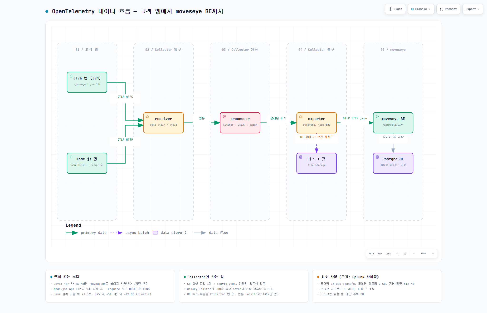

# OpenTelemetry Collector 쉽게 이해하기

> 작성일 2026-10-12 · 읽는 사람: OpenTelemetry를 처음 듣는 운영·개발·영업 담당자
> 숫자는 전부 공식 문서나 벤더가 공개한 자료에서 가져왔다. 각 절 끝에 **근거**를 적었고, 맨 아래 [근거 자료](#근거-자료)에 모아 두었다.
> 도입 배경과 설계 결정은 [apm-opentelemetry-primer.md](apm-opentelemetry-primer.md), moveseye 설정 파일 줄별 설명은 [apm-collector-config-explained.md](apm-collector-config-explained.md)에 있다.

---

## 0. 먼저 알아 둘 용어 다섯 개

| 용어 | 뜻 |
|------|------------|
| **OpenTelemetry (OTel)** | 앱의 상태 데이터를 뽑아내는 **공용 규격**과 그 규격대로 만든 **공식 도구들**. 특정 회사 제품이 아니라 오픈소스 표준이다. |
| **계측 에이전트** | 앱에 붙여서 데이터를 **만들어 내는** 부품. Java는 jar 파일 하나, Node.js는 npm 패키지 하나. |
| **Collector** | 에이전트가 보낸 데이터를 **받아서 정리하고 넘겨주는** 별도 프로그램. 앱 밖에서 따로 돈다. |
| **OTLP** | 에이전트와 Collector, Collector와 서버가 서로 데이터를 주고받을 때 쓰는 **통신 규격**. 포트는 4317(gRPC) 또는 4318(HTTP). |
| **트레이스 · 메트릭 · 로그** | 뽑아내는 데이터 세 종류. 트레이스는 "요청 하나가 어디를 거쳐 얼마나 걸렸나", 메트릭은 "초당 요청 수·응답 시간·메모리 같은 숫자", 로그는 "앱이 남긴 글". |

---

## 1. 한 줄로

**앱에는 작은 부품 하나를 붙이고, 그 부품이 보내는 데이터를 Collector가 받아 정리해서 moveseye 서버로 넘긴다.**

앱을 실행할 때 같이 띄워야 하는 것은 Collector가 아니라 **계측 에이전트**다. Collector는 앱과 상관없이 따로 실행되고, 앱은 Collector의 주소 하나만 알면 된다.

---

## 2. 그림으로 보는 전체 흐름



> 원본 흐름도: [diagram_otel-collector-basics.html](diagram_otel-collector-basics.html) (확대·축소, 다크 모드, PNG/SVG 내보내기 가능) · 다크 버전 `diagram_otel-collector-basics.dark.png`

데이터는 세 단계를 거친다.

1. **에이전트가 만든다.** 앱 안에서 요청이 처리될 때마다 "어느 구간을 거쳐 몇 ms 걸렸는지", "초당 요청 수와 메모리 사용량이 얼마인지"를 기록한다.
2. **Collector가 모아서 정리한다.** 여러 앱에서 온 데이터를 한곳에서 받아, 메모리가 넘치지 않게 조절하고, 개인정보를 가리고, 여러 건을 한 묶음으로 만들어 BE로 보낸다. BE가 응답하지 않으면 디스크에 보관했다가 다시 보낸다.
3. **moveseye BE가 저장한다.** 받은 데이터를 PostgreSQL에 넣고 화면에 보여 준다.

Collector를 따로 두면 앱은 데이터를 만들어 가까운 Collector로 넘기는 일만 한다. 재시도, 묶음 전송, 개인정보 처리, BE 주소와 인증 토큰 관리는 전부 Collector 한 곳에서 맡는다.

| 비교 | 계측 에이전트 | Collector |
|------|--------------|-----------|
| 어디서 도나 | 앱 프로세스 **안** | 앱과 **별개의** 프로세스 |
| 설치물 | Java: jar 1개 / Node.js: npm 패키지 1개 | 실행 파일 1개 + 설정 파일(YAML) 1장 |
| 미리 깔려 있어야 하는 것 | Java 8 이상 또는 Node.js 18 이상 | **없음** (Go로 만든 단일 실행 파일) |
| 하는 일 | 데이터 **만들기** | 데이터 **받기 → 정리 → 보내기** |

> **근거**: OpenTelemetry 공식 문서는 Collector를 "벤더에 묶이지 않고 데이터를 받고, 처리하고, 내보내는 구현체"로 정의한다. 앱 옆에 두면 "앱이 데이터를 빨리 털어낼 수 있고, 재시도·묶음 전송·암호화·민감정보 필터링을 Collector가 대신한다"고 설명한다. ([Collector 소개](https://opentelemetry.io/docs/collector/))

---

## 3. 앱에는 무엇을 하나

### 3.1 Java 앱: jar 파일 하나를 붙인다

앱 소스는 건드리지 않는다. 서버에 jar 파일을 내려받아 두고, 앱을 띄우는 명령에 옵션 하나를 추가한다.

```bash
# 방법 A. 실행 명령에 직접 추가
java -javaagent:/opt/otel/opentelemetry-javaagent.jar \
     -Dotel.service.name=order-api \
     -jar app.jar

# 방법 B. 실행 명령을 못 고칠 때(Tomcat, 서비스 등록 등)
#        → 환경변수로 넣어 두면 Java가 알아서 읽는다
export JAVA_TOOL_OPTIONS="-javaagent:/opt/otel/opentelemetry-javaagent.jar"
export OTEL_SERVICE_NAME="order-api"                            # 화면에 표시될 서비스 이름
export OTEL_EXPORTER_OTLP_ENDPOINT="http://<collector-host>:4317"  # Collector 주소
java -jar app.jar
```

**앱 안에서 벌어지는 일**은 세 단계다.

1. 앱이 시작될 때 jar가 먼저 로딩되고, 앱 클래스가 메모리에 올라오는 순간 **감시 코드를 자동으로 끼워 넣는다.** 공식 문서의 표현은 "바이트코드를 동적으로 주입한다"이다.
2. 요청이 들어오면 끼워 넣은 코드가 **HTTP 요청, DB 쿼리, 외부 API 호출, Redis, Kafka** 같은 지점을 지날 때마다 기록을 남긴다. 앱의 비즈니스 로직 안쪽은 건드리지 않고, 라이브러리를 드나드는 "문턱"에서만 기록한다.
3. 기록은 잠시 모였다가 **몇 초마다 Collector로 전송**된다.

빌드 도구(Maven, Gradle)에 추가할 의존성은 없다. jar 안에 필요한 것이 다 들어 있다.

**앱이 지는 부담**은 이 정도다.

| 항목 | 값 |
|------|----|
| jar 파일 크기 | 약 26 MB |
| 지원 Java | 8 이상 |
| 앱 시작 시간 | 약 1.3초 늘어남 (5.55초 → 6.82초) |
| 응답 지연 (p95) | 약 5% 늘어남 (1.96 ms → 2.06 ms) |
| CPU | 거의 변화 없음 (53.8% → 54.3%) |
| 메모리(최대 힙) | 약 42 MB 늘어남 (437 MB → 478 MB) |

부담은 **수집하는 데이터 양에 비례**한다. DB 쿼리가 많은 앱은 기록도 많아진다. 줄이려면 안 쓰는 계측을 끄거나(`OTEL_INSTRUMENTATION_<이름>_ENABLED=false`), 트레이스를 일부만 보내도록 샘플링 비율을 낮춘다.

> **근거**: 설치 방법 두 가지는 [Java agent Getting started](https://opentelemetry.io/docs/zero-code/java/agent/getting-started/), 동작 원리와 Java 8+는 [Java agent 개요](https://opentelemetry.io/docs/zero-code/java/agent/), 부담 수치는 [Elastic의 벤치마크](https://www.elastic.co/docs/reference/opentelemetry/edot-sdks/java/overhead)(에이전트 없음 vs 있음, 샘플 앱 기준이라 절대값보다 비율로 볼 것), jar 크기는 2026-10-12 GitHub 최신 릴리스 실측. OpenTelemetry 공식 [성능 문서](https://opentelemetry.io/docs/zero-code/java/agent/performance/)는 "환경이 제각각이라 단일 오버헤드 수치를 낼 수 없다"고 밝히고, 가장 큰 변수가 수집량이라고 적고 있다.

### 3.2 Node.js 앱: npm 패키지 하나를 설치한다

원리는 Java와 같다. 앱이 시작될 때 계측 모듈을 먼저 불러와 `http`, `express`, `pg`, `mysql`, `redis` 같은 모듈의 함수를 가로챈다. 다른 점은 jar 대신 npm 패키지를 쓴다는 것이다.

```bash
# 1. 패키지 설치 (앱의 package.json에 추가됨)
npm install --save @opentelemetry/api @opentelemetry/auto-instrumentations-node

# 2-A. 실행 명령에 직접 추가
node --require @opentelemetry/auto-instrumentations-node/register app.js

# 2-B. 실행 명령을 못 고칠 때(pm2 등) → 환경변수로
export NODE_OPTIONS="--require @opentelemetry/auto-instrumentations-node/register"
export OTEL_SERVICE_NAME="order-api"
export OTEL_EXPORTER_OTLP_ENDPOINT="http://<collector-host>:4318"
export OTEL_TRACES_EXPORTER="otlp"
node app.js
```

| 항목 | 값 |
|------|----|
| 지원 Node.js | 18.19 이상 또는 20.6 이상 |
| 패키지 크기 | 패키지 자체는 약 77 KB. 단, 계측용 패키지 수십 개를 함께 끌어온다 |
| 전송 기본값 | OTLP HTTP (포트 4318) |
| 계측 끄기 | `OTEL_NODE_DISABLED_INSTRUMENTATIONS="fs,grpc"` 처럼 쉼표로 나열 |

Java와 다른 점 두 가지는 미리 알려 줘야 한다.

- **빌드 결과물에 포함된다.** jar처럼 서버에 파일만 놓는 방식이 아니라 `package.json` 의존성이 된다. 컨테이너 이미지라면 이미지를 다시 빌드해야 한다.
- **파일 시스템(`fs`) 계측이 기본으로 켜져 있어 기록이 많이 생긴다.** 처음부터 `OTEL_NODE_DISABLED_INSTRUMENTATIONS="fs"`로 끄기를 권한다.

Node.js는 공식 벤치마크 수치가 없다. "수집량에 비례한다"는 원칙만 같고, 실제 부담은 고객 환경에서 재야 한다.

> **근거**: 설치·실행 방법은 [Node.js zero-code 문서](https://opentelemetry.io/docs/zero-code/js/), 계측 켜고 끄는 환경변수는 [Node.js 설정 문서](https://opentelemetry.io/docs/zero-code/js/configuration/), 지원 버전과 크기는 npm registry의 `@opentelemetry/auto-instrumentations-node` v0.81.0 메타데이터(2026-10-12 조회).

---

## 4. Collector는 무엇을 하나

### 4.1 입구 → 가공 → 출구

Collector는 설정 파일 한 장으로 움직인다. 설정 파일에는 세 종류의 부품을 적고, 마지막에 그 부품들을 한 줄로 엮는다.

| 부품 | 역할 | 하는 일 |
|------|------|---------|
| **receiver** | 데이터를 받는 입구 | OTLP 4317(gRPC)/4318(HTTP) 포트를 열고 에이전트의 전송을 받는다 |
| **processor** | 받은 데이터를 가공 | 메모리 보호, 개인정보 마스킹, 샘플링, 여러 건을 한 묶음으로 만들기 |
| **exporter** | 바깥으로 내보내는 출구 | moveseye BE로 전송하고, 실패하면 큐에 넣고 재시도한다 |

가장 단순한 설정은 이렇게 생겼다.

```yaml
receivers:
  otlp:                                    # 입구: 에이전트가 보내는 OTLP를 받는다
    protocols:
      grpc: { endpoint: 0.0.0.0:4317 }
      http: { endpoint: 0.0.0.0:4318 }

processors:
  memory_limiter:                          # 가공 1: 메모리가 넘치지 않게 지킨다 (반드시 맨 앞)
    check_interval: 1s
    limit_mib: 512
    spike_limit_mib: 128
  batch: {}                                # 가공 2: 여러 건을 한 묶음으로

exporters:
  otlphttp:                                # 출구: moveseye BE로 json 전송
    endpoint: https://<moveseye-be>/apm/otlp
    encoding: json

service:
  pipelines:                               # 입구 → 가공 → 출구 순서로 엮기
    traces:  { receivers: [otlp], processors: [memory_limiter, batch], exporters: [otlphttp] }
    metrics: { receivers: [otlp], processors: [memory_limiter, batch], exporters: [otlphttp] }
    logs:    { receivers: [otlp], processors: [memory_limiter, batch], exporters: [otlphttp] }
```

> **근거**: 부품 구조와 "설정에 적어도 `service`에서 엮지 않으면 켜지지 않는다"는 규칙은 [Collector Configuration](https://opentelemetry.io/docs/collector/configuration/).

### 4.2 moveseye가 Collector를 꼭 두는 이유

앱에서 BE로 바로 보낼 수도 있다. 그래도 Collector를 사이에 두는 이유는 네 가지다.

1. **BE가 단순해진다.** Java 에이전트는 protobuf라는 바이너리 형식으로만 보낸다. Collector가 이를 json으로 바꿔 주니 BE는 평소 쓰던 파서를 그대로 쓴다.
2. **오류를 놓치지 않는다.** 에이전트 혼자서는 요청이 시작될 때 "이건 보낼까 말까"를 정해야 해서 나중에 오류가 날 요청을 미리 버릴 수 있다. Collector는 요청이 끝난 뒤 결과를 보고 고르므로, 오류·느린 요청은 100% 남기고 정상 요청만 일부 샘플링한다.
3. **앱 설정이 단순해진다.** 앱은 `localhost:4317`만 알면 된다. BE 주소와 인증 토큰은 Collector 한 곳에만 있어서, BE 주소가 바뀌어도 앱을 재시작하지 않는다.
4. **BE가 잠시 죽어도 데이터가 안 사라진다.** Collector가 디스크 큐에 보관했다가 BE가 살아나면 다시 보낸다.

> **근거**: 1~4는 설계서 `_workspace/features/apm/core/devdesign_apm.md` §1 "왜 Collector를 사이에 두나" 표. 일반론은 [Collector 소개](https://opentelemetry.io/docs/collector/)의 "재시도·배치·암호화·민감정보 필터링을 Collector가 맡는다".

### 4.3 메모리 보호가 왜 중요한가

Collector가 죽는 가장 흔한 원인은 **BE가 느려져서 보낼 데이터가 쌓이다가 메모리가 터지는 것**이다. 그래서 `memory_limiter`라는 가공 부품을 반드시 넣고, 다음 규칙을 지킨다.

- **가공 순서에서 맨 앞**에 둔다. 메모리가 차면 입구에서부터 "지금은 못 받는다"고 거절해서 앱 쪽 버퍼로 밀어낸다.
- 검사 주기는 **1초**, 여유분(`spike_limit_mib`)은 **상한의 20%**가 출발점이다.
- 컨테이너라면 MB 대신 **퍼센트**(`limit_percentage`)로 적는다.
- 환경변수 `GOMEMLIMIT`를 상한의 **80%**로 같이 걸어 준다.

> **근거**: [memory_limiter 공식 README](https://github.com/open-telemetry/opentelemetry-collector/blob/main/processor/memorylimiterprocessor/README.md). "OOM을 막기 위해 쓴다", "파이프라인의 첫 번째 프로세서로 두는 것이 최선", "`check_interval` 권장 1초", "`spike_limit_mib`는 하드 리밋의 20%", "`GOMEMLIMIT`는 80%"가 원문이다.

---

## 5. 서버 사양은 얼마나 필요한가

### 5.1 결론부터

**대부분의 고객 사이트는 1~2 vCPU, 1~2 GB 메모리짜리 작은 VM 한 대면 충분하다.**

| 규모 | 기준 | CPU | 메모리 | 디스크 |
|------|------|-----|--------|--------|
| 소규모 | 앱 1~5개, 초당 트레이스 수백 건 | 1 vCPU | 1 GB | 설치 파일 + 디스크 큐 수백 MB |
| 중규모 | 앱 수십 개, 초당 수천 건 | 2 vCPU | 2~4 GB | 디스크 큐 수백 MB ~ 수 GB |
| 대규모 | 초당 수만 건 이상 | 초당 건수 ÷ 15,000 + 여유 | 코어당 2 GB | 큐 상한에 맞춰 |

설치 파일 크기는 다음과 같다. moveseye는 마스킹·tail 샘플링·디스크 큐가 들어 있는 `otelcol-contrib`를 쓴다.

| 배포판 | 압축 파일 크기 |
|--------|----------------|
| `otelcol` (기본판) | 약 37 MB |
| `otelcol-contrib` (확장판, moveseye 사용) | 약 112 MB |

### 5.2 이 숫자는 어디서 왔나

**OpenTelemetry 공식 문서에는 "최소 사양" 숫자가 없다.** 대신 "언제 늘려야 하는가"의 신호만 준다. 메모리 보호가 자주 거절하거나, 전송 큐가 용량의 60~70%에 닿으면 늘리라는 식이다. 그리고 "BE가 느린 게 원인이면 Collector를 늘려도 소용없다"고 못 박는다.

그래서 위 표는 **Splunk가 공개한 사이징 자료**를 썼다. Splunk 배포판은 업스트림 Collector를 그대로 패키징한 것이라 수치가 그대로 적용된다.

| Splunk 사이징 기준 | 값 |
|---------------------|----|
| CPU 1코어가 처리하는 트레이스 | 초당 15,000 건 |
| CPU 1코어가 처리하는 메트릭 | 초당 20,000 포인트 |
| CPU 1코어가 처리하는 로그 | 초당 10,000 건 |
| 메모리 | 코어당 2 GB |
| 기본 메모리 상한 | 512 MB |
| 중앙(게이트웨이) 모드 최소 | Collector 1대당 1코어 |
| 디스크 | 기본은 불필요 (디스크 큐를 켤 때만 필요) |

소규모 사이트의 초당 수백 건은 1코어 처리량의 5%도 안 된다. 그래서 1 vCPU면 넉넉하다. moveseye 설정 템플릿의 메모리 상한도 Splunk 기본값과 같은 512 MB다.

### 5.3 moveseye에서 하나 더 알아 둘 것

**고객 사이트당 Collector는 1대**가 기본이다. 오류·느린 요청을 골라내는 tail 샘플링은 한 요청의 모든 기록이 같은 Collector에 와야 동작한다. 두 대 이상 두려면 요청 ID로 나눠 보내는 추가 계층이 필요하므로, 그 전까지는 1대를 유지한다.

> **근거**: 스케일링 신호는 [Collector Scaling](https://opentelemetry.io/docs/collector/scaling/). 코어당 처리량·메모리 비율·기본 상한은 [Splunk Collector Sizing and scaling](https://help.splunk.com/en/splunk-observability-cloud/manage-data/splunk-distribution-of-the-opentelemetry-collector/get-started-with-the-splunk-distribution-of-the-opentelemetry-collector/collector-requirements/sizing-and-scaling). 설치 파일 크기는 2026-10-12 GitHub 릴리스 v0.162.0 linux_amd64 실측. Collector 1대 원칙과 템플릿 값은 설계서 `devdesign_apm.md` §3.1·§3.2.

---

## 6. 자주 묻는 질문

**Q. Collector 없이 앱이 바로 BE로 보내면 안 되나?**
되긴 한다. 하지만 재시도·묶음 전송·개인정보 가리기를 앱이 다 떠안고, BE 주소나 토큰이 바뀔 때마다 모든 앱을 재시작해야 한다. moveseye는 Java 에이전트가 protobuf로만 보내는 문제도 있어서 Collector를 필수로 둔다.

**Q. 앱 빌드를 다시 해야 하나?**
Java는 아니다. jar 파일을 서버에 놓고 실행 옵션만 추가한다. Node.js는 npm 패키지가 `package.json`에 들어가므로 컨테이너라면 이미지를 다시 빌드해야 한다.

**Q. 설정은 어디서 하나?**
앱 쪽은 환경변수 두 개(`OTEL_SERVICE_NAME`, `OTEL_EXPORTER_OTLP_ENDPOINT`). Collector 쪽은 설정 파일 한 장. moveseye 관리 콘솔이 토큰이 들어간 설정 파일을 만들어 준다.

**Q. 끄려면?**
앱은 `-javaagent` 옵션(또는 `--require`)을 빼고 재시작한다. Collector는 프로세스를 멈추면 된다.

**Q. Collector가 죽으면 앱도 멈추나?**
아니다. 에이전트는 보낼 곳이 없으면 버퍼가 찬 뒤 데이터를 버릴 뿐, 앱의 요청 처리는 그대로 계속된다.

**Q. 라이선스가 만료되면?**
BE가 403으로 거절하고, Collector는 403을 "다시 보내도 소용없는 실패"로 보고 즉시 버린다. 그 시점부터 데이터가 쌓이지 않으므로 만료 전에 안내가 필요하다. (설계서 §4.1)

---

## 근거 자료

| 자료 | 이 문서에서 가져온 내용 |
|------|------------------------|
| [OpenTelemetry Collector 소개](https://opentelemetry.io/docs/collector/) | Collector 정의, 앱 옆에 두는 이유 |
| [Collector Configuration](https://opentelemetry.io/docs/collector/configuration/) | receiver/processor/exporter 구조, 포트 4317/4318 |
| [Collector Scaling](https://opentelemetry.io/docs/collector/scaling/) | 늘려야 하는 신호(큐 60~70%), BE 병목이면 무용 |
| [memory_limiter README](https://github.com/open-telemetry/opentelemetry-collector/blob/main/processor/memorylimiterprocessor/README.md) | OOM 방지, 맨 앞 배치, 1초, 20%, GOMEMLIMIT 80% |
| [Java agent 개요](https://opentelemetry.io/docs/zero-code/java/agent/) | 바이트코드 주입 원리, Java 8+ |
| [Java agent Getting started](https://opentelemetry.io/docs/zero-code/java/agent/getting-started/) | `-javaagent` 실행법, `JAVA_TOOL_OPTIONS` |
| [Java agent Performance](https://opentelemetry.io/docs/zero-code/java/agent/performance/) | 단일 수치 불가, 수집량이 최대 변수, 줄이는 방법 |
| [Elastic EDOT Java 오버헤드](https://www.elastic.co/docs/reference/opentelemetry/edot-sdks/java/overhead) | 에이전트 유무 벤치마크(시작 시간·CPU·힙·p95) |
| [Node.js zero-code](https://opentelemetry.io/docs/zero-code/js/) | npm 설치, `--require`, `NODE_OPTIONS`, 환경변수 |
| [Node.js 설정 문서](https://opentelemetry.io/docs/zero-code/js/configuration/) | 계측 켜고 끄는 환경변수 |
| npm registry `@opentelemetry/auto-instrumentations-node` v0.81.0 | 지원 Node 18.19+/20.6+, 크기 77 KB (2026-10-12 조회) |
| [Splunk Collector Sizing and scaling](https://help.splunk.com/en/splunk-observability-cloud/manage-data/splunk-distribution-of-the-opentelemetry-collector/get-started-with-the-splunk-distribution-of-the-opentelemetry-collector/collector-requirements/sizing-and-scaling) | 코어당 15k/20k/10k, 코어당 2 GB, 기본 512 MB, 1대당 1코어 |
| GitHub 릴리스 실측 (2026-10-12) | Java agent jar 26 MB, otelcol 37 MB, otelcol-contrib 112 MB (v0.162.0) |
| `_workspace/features/apm/core/devdesign_apm.md` §1·§3·§4 | Collector를 두는 이유, 1대 원칙, 템플릿 값, 403 즉시 폐기 |
